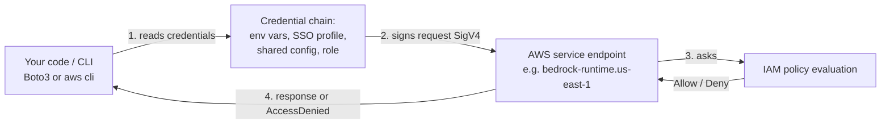
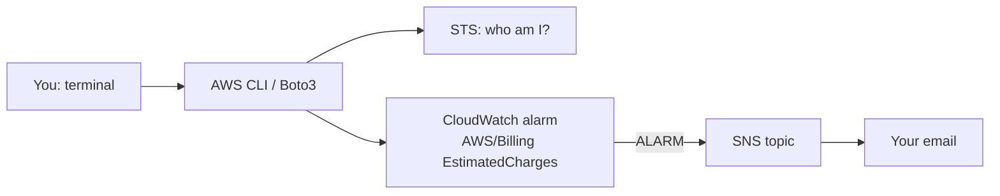

---

## 0. Before you start
- **Essential:** none. This is the first file.
- **Helpful:** know what a command line is (PowerShell on Windows).
- **Later:** [08-security IAM deep dive] (planned).

## 1. Simple explanation
An AWS account is like a company bank account for cloud services: everything you create and every dollar you spend is attached to it. The first login you get, the **root user**, can do anything, including closing the account, so you should lock it away and use a weaker **identity** for daily work. Before building anything you also set a **billing alarm**, which emails you when charges pass a number you choose. Then you install the **AWS CLI** and **Boto3** so your own code can talk to AWS, and you check with one command that AWS recognizes you.


```figure
flow cli-auth
```

## 2. Structured explanation
1. **Create the account** and pick a plan (Free or Paid).
2. **Secure the root user** with multi-factor authentication (MFA). Do not create root access keys.
3. **Create a daily-use identity**: IAM Identity Center user (preferred) or IAM user.
4. **Enable billing alerts** and create a **billing alarm**.
5. **Install the AWS CLI v2**, configure a profile, test with `aws sts get-caller-identity`.
6. **Install Boto3** and run `labs-code/00_setup/verify_identity.py`.
7. **Choose a Region** and stay in it, because Bedrock models and quotas are per Region.

## 3. Analogy
| AWS thing | Analogy | Where it breaks |
|---|---|---|
| Account | A company with one bank account | Real accounts can be grouped into AWS Organizations, which has no simple bank equivalent. |
| Root user | The owner's master key to the whole building | Unlike a physical key, you can (and should) never use it daily. |
| IAM role | A visitor badge that expires | A role is also used *by services* (Lambda wears a badge too), not only by people. |
| Billing alarm | A smoke detector | It fires only *after* charges exceed the threshold; it does not stop spending. |

## 4. The seven questions

**WHAT?** An AWS **account** is the container for resources and billing. **IAM** (Identity and Access Management) decides who can do what. The **CLI** is a terminal tool, and **Boto3** is the Python library, that call AWS **APIs** (web requests signed with your credentials).

**WHY?** Cloud services are pay-as-you-go. A mistake (a forgotten cluster, a leaked key) can cost real money. Safe setup reduces both financial and security risk.

**WHEN?** Do all of this once, before any lab.

**WHERE?** Account/billing sits above every service. IAM is global; most other services are per-Region. Billing metrics are stored in **us-east-1** regardless of where you work.

**HOW?** See the lab below. Under the hood, each CLI/Boto3 call is an HTTPS request signed with temporary or long-term credentials (Signature Version 4). IAM evaluates the signed request against policies and answers *Allow* or *Deny*.

**WHAT IF?**
- *You choose the Free plan and it ends?* Per AWS, the free plan ends after **six months or when credits are fully used, whichever comes first**; the account **then closes automatically** and AWS keeps content for 90 days before deletion unless you upgrade to the Paid plan (✅ official page, below). Plan your study period accordingly.
- *You get `AccessDeniedException` on a service?* Free-plan accounts don't include some services and features "that could possibly deplete credits". Whether Bedrock features are restricted on your plan is **not verified here**; if blocked, upgrade to Paid after setting the billing alarm.
- *You committed access keys to GitHub?* Deactivate and delete them immediately (see "What can go wrong").

**WHY NOT use the root user for everything?** It cannot be restricted by IAM policies the normal way, so a leaked root credential is catastrophic. The only valid reasons to log in as root are rare account-level tasks (for example, enabling billing alert preferences if no billing-enabled admin exists).

## 5. Technical depth

```figure
iam-eval
```




**Reading the diagram.**
1. Boto3 looks for credentials in a fixed order (environment variables → shared credentials/config → SSO → container/instance role). That order is the **credential provider chain**.
2. The request is cryptographically signed. The secret key never travels over the network.
3. The service asks IAM: *does this identity have a policy that allows this action on this resource, and does no policy deny it?* An explicit **Deny always wins**; otherwise the default is deny.
4. You get a result or an error such as `AccessDeniedException`.

**Billing alarm mechanics (✅ verified).** The metric `EstimatedCharges` (namespace `AWS/Billing`, dimension `Currency=USD`) is stored in **US East (N. Virginia)** and covers worldwide charges. You must first enable **Receive CloudWatch Billing Alerts** in Billing preferences; data appears after about 15 minutes. The alarm uses the current total, **not a projection**, and values are in USD.

**Choosing the plan (✅ verified).**

| | Free plan | Paid plan |
|---|---|---|
| New-customer credit | USD $100, plus up to $100 more for activities | same |
| Charges | None; stops instead | Pay beyond credits |
| Service access | "Select services and features" | All services |
| Ends | After 6 months **or** credits used | Never auto-closes |
| Other promo credits | Not eligible | Eligible |

Free plans **auto-upgrade to Paid** if you join AWS Organizations, set up Control Tower, etc.

## 6. Worked example
*Problem:* Maya is new to AWS and wants to run Bedrock labs without a surprise bill.

1. She signs up, chooses the **Paid plan** (so Bedrock and other lab services aren't blocked), and notes her $100 credit.
2. She enables root MFA with an authenticator app.
3. She creates an Identity Center user `maya-dev` with a permission set limited to what labs need.
4. She enables billing alerts and waits 15 minutes.
5. She runs `python create_billing_alarm.py maya@example.com 20`, then confirms the SNS email.
6. She runs `aws sts get-caller-identity` and sees an `assumed-role/...` ARN, not `:root`.

Expected result: one account, one non-root identity, one alarm at $20, a verified call to AWS.

## 7. Knowledge checkpoints
1. Why is the billing alarm created in us-east-1 even if your labs run elsewhere?
2. Which wins when one policy allows and another denies the same action?
3. Name two reasons a Free-plan account may suddenly lose access to resources.
4. What does `aws sts get-caller-identity` prove?

(Practice questions Q1–Q8 are in §7b; answers are in §14.)

(Answers at the end of the file.)

## 7b. Practice questions (exam-style, original) — answers below

**Q1.** A developer needs to run AWS CLI commands from a laptop for daily GenAI work. Which credential approach is MOST secure?
A. Create access keys for the root user and store them in `~/.aws/credentials`
B. Use IAM Identity Center (SSO) with short-lived credentials and MFA
C. Create one shared IAM user with `AdministratorAccess` for the whole team
D. Hard-code an IAM user's keys in the application code

**Q2.** (Select TWO) An engineer created a billing alarm in `eu-west-1` but never sees the `EstimatedCharges` metric. Which TWO things should be checked?
A. The Region: billing metric data is stored in US East (N. Virginia)
B. That "Receive CloudWatch Billing Alerts" is enabled in Billing preferences (data appears after about 15 minutes)
C. That Bedrock model access is enabled
D. That the VPC has an internet gateway
E. That the account uses Amazon Aurora

**Q3.** A billing alarm is configured at $50. Charges reach $80 in one afternoon. What does the alarm do?
A. Automatically stops all running resources
B. Sends a notification through its SNS action; it does not stop spending
C. Deletes the most expensive resource
D. Nothing, because alarms use forecasts only

**Q4.** One IAM policy allows `bedrock:InvokeModel` on a model, and another attached policy explicitly denies it. What is the result?
A. Allowed, because Allow is evaluated first
B. Denied, because an explicit Deny overrides any Allow
C. Allowed if MFA is on
D. Depends on alphabetical policy order

**Q5.** A student on the AWS Free plan plans to study for seven months. Which statement is accurate?
A. The free plan lasts forever
B. The free plan ends after six months or when credits are used, whichever comes first, and the account then closes unless upgraded to the Paid plan
C. The free plan automatically converts to Paid with no action
D. The free plan only ends after twelve months

**Q6.** What does `aws sts get-caller-identity` tell you?
A. Which Bedrock models you may use
B. Which account and identity (ARN) your current credentials map to
C. Your current monthly cost
D. Which Region has the lowest latency

**Q7.** An access key was accidentally committed to a public repository. What should happen FIRST?
A. Make the repository private and continue using the key
B. Deactivate/delete the key, then review CloudTrail and resources for misuse and rotate credentials
C. Wait to see whether the bill increases
D. Rename the IAM user

**Q8.** (Select TWO) Which are good account-setup practices before starting GenAI labs?
A. Enable MFA on the root user and avoid using root for daily work
B. Create a billing alarm
C. Attach `AdministratorAccess` to your application's role
D. Share one login among classmates
E. Disable CloudTrail to save money

## 8. Hands-on lab: "Safe start"

### 8.1 Objective
Create a safe account setup, an alarm, and a working local CLI/Boto3 connection.

### 8.2 Prerequisites
Python 3.10+, internet access, an AWS account (or follow step A to create one).

### 8.3 AWS services
IAM / IAM Identity Center, AWS Billing, Amazon CloudWatch, Amazon SNS, AWS STS.

### 8.4 IAM permissions
For the *daily-use* identity, start with a managed policy such as **PowerUserAccess** for early labs, **plus** IAM permissions only when a lab says so. **Never** attach `AdministratorAccess` to application code. Later labs give precise policies. Minimal permissions for this lab's scripts:

```json
{
  "Version": "2012-10-17",
  "Statement": [
    { "Effect": "Allow", "Action": ["sts:GetCallerIdentity"], "Resource": "*" },
    { "Effect": "Allow",
      "Action": ["cloudwatch:PutMetricAlarm", "cloudwatch:DescribeAlarms",
                 "sns:CreateTopic", "sns:Subscribe"],
      "Resource": "*" }
  ]
}
```
(`sts:GetCallerIdentity` needs no permission in practice; it is shown for completeness.)

### 8.5 Region notes
Use **us-east-1** for the billing alarm. For labs, pick a Region where your chosen Bedrock model is available (verified per lab).

### 8.6 Architecture

*Reading:* the script creates an alarm on the billing metric; when it breaches, CloudWatch publishes to an SNS topic, which emails you once you confirm the subscription.

### 8.7 Cost
Alarm and SNS email notifications are tiny; check current pricing on the CloudWatch and SNS pricing pages. This lab should cost cents or nothing. **Not verified here:** exact per-alarm price.

### 8.8 Environment setup

**A. Account and security (console, manual)**
1. Sign up at aws.amazon.com and choose your plan using the table above.
2. Sign in as root → **Security credentials** → add an **MFA device**.
3. Create an **IAM Identity Center** user (or an IAM user with MFA) and log in with it from now on.
4. Billing and Cost Management → **Billing preferences** → *Alert preferences* → **Receive CloudWatch Billing Alerts** → Save.

**B. Install the CLI (PowerShell on Windows)**
```powershell
msiexec.exe /i https://awscli.amazonaws.com/AWSCLIV2.msi
aws --version
```
macOS/Linux: follow the official page (links in References).

**C. Sign in from the terminal (SSO)**
```powershell
aws configure sso
aws sso login --profile <YOUR_PROFILE>
$env:AWS_PROFILE = "<YOUR_PROFILE>"
```

### 8.9 Dependencies
```powershell
python -m venv .venv
.\.venv\Scripts\Activate.ps1
pip install boto3
```

### 8.10 Complete code
- [labs-code/00_setup/verify_identity.py](aip-code:labs-code/00_setup/verify_identity.py)
- [labs-code/00_setup/create_billing_alarm.py](aip-code:labs-code/00_setup/create_billing_alarm.py)

### 8.11 Key code explained
- `boto3.Session()` builds the credential chain for you; you never type keys.
- `sts.get_caller_identity()` is the "hello world" of AWS: it works for any valid identity and tells you which one is active.
- `put_metric_alarm(... Period=21600 ...)` mirrors the console walkthrough (Maximum statistic, 6-hour period). It is idempotent: re-running updates the same alarm name.
- `TreatMissingData="missing"` matches the documented console choice.

### 8.12 Run
```powershell
python labs-code/00_setup/verify_identity.py
python labs-code/00_setup/create_billing_alarm.py you@example.com 20
```

### 8.13 Expected output
```
Account : 123456789012
ARN     : arn:aws:sts::123456789012:assumed-role/AWSReservedSSO_.../maya-dev
Region  : us-east-1
```
and then `Subscription requested. CHECK YOUR INBOX…`

### 8.14 Testing and validation
- Inbox: confirm the SNS subscription email.
- `aws cloudwatch describe-alarms --region us-east-1 --query "MetricAlarms[].AlarmName"` lists your alarm.
- Optional test: temporarily create an alarm with threshold `0.01`. If you already have any charges, it should go to `ALARM` immediately (documented behavior). Delete it afterward.

### 8.15 Common errors and fixes
| Error | Likely cause | Fix |
|---|---|---|
| `NoCredentialsError` | No profile active | `aws sso login`, set `AWS_PROFILE` |
| `ExpiredToken` | SSO session expired | `aws sso login` again |
| Billing metric missing in console | Alerts not enabled, or wrong Region | Enable preference; switch to us-east-1; wait ~15 min |
| `AccessDenied` on `PutMetricAlarm` | Missing IAM permission | Add the actions in 8.4 |
| Alarm never emails | Subscription not confirmed | Click the link in the SNS email |
| No billing data at all | Account is in AWS Partner Network | Documented limitation: billing metrics aren't published for APN accounts |

### 8.16 Security recommendations
- MFA on root and on your daily identity.
- No access keys for root. Prefer SSO/temporary credentials over long-term IAM user keys.
- Never commit `.aws/credentials`, `.env` or keys. Add them to `.gitignore`.
- Least privilege: widen permissions only when a specific lab needs it, and remove them afterward.

**Cleanup:** delete the test alarm if you made one. Keep the real alarm.

## 9. What can go wrong?

| Failure | Why | Symptoms | Investigate | Fix | Prevent |
|---|---|---|---|---|---|
| **Leaked access key** | Key pasted into code/Git | Unknown resources (often large GPU/EC2), unusual bills, AWS notice email | CloudTrail event history; IAM → Access Advisor; `last used` on the key | Deactivate/delete key, rotate, review & delete rogue resources, contact AWS Support | SSO/temporary credentials; secret scanning; `.gitignore` |
| **Free plan expires** | 6 months or credits used | Account closes; resources vanish | Billing console free-plan banner | Upgrade within the 90-day window | Track credit balance; upgrade deliberately |
| **Billing alarm never fires** | Alerts off, wrong Region, unconfirmed SNS, APN account | No emails despite charges | Alarm state in us-east-1; SNS subscription status | Fix the cause; also check Billing console manually | Test with a tiny threshold once |
| **Using root daily** | Convenience | Everything works, so nothing warns you | `get-caller-identity` shows `:root` | Create a non-root identity | Habit + SCP/IAM guardrails |
| **Wrong Region** | Console/CLI default differs | "Resource not found", missing models | `aws configure get region`, console Region selector | Set Region explicitly in code (`region_name=`) | Always pass Region explicitly in labs |
| **Orphaned expensive resources** | Forgot cleanup | Rising daily charges (OpenSearch Serverless, NAT, endpoints) | Cost Explorer by service | Delete resources | Cleanup step in every lab; billing alarm |

## 10. Common misconceptions
1. **"The billing alarm stops spending."** It only notifies. Nothing is shut off automatically.
2. **"Free tier means everything is free."** Free plans exclude some services and end after six months or when credits are consumed; Paid plans charge beyond credits.
3. **"Admin access is fine for learning."** It trains bad habits and makes leaked credentials far more damaging.
4. **"IAM is regional."** IAM is a global service; most others are Regional.
5. **"Bedrock model access is a console switch."** That changed; see [verification-log §4](aip:meta/verification-log).

## 11. Exam notes
- Heavily tested: *least privilege*, *roles over long-term keys*, *explicit deny wins*, *MFA*. See `08-security`.
- AWS **Budgets** and **Cost and Usage Report** are **out of scope** for AIP-C01; **Cost Explorer** and **Cost Anomaly Detection** are in scope. A CloudWatch billing alarm is a legitimate, simple answer for "alert at a spend threshold".
- Keywords: "temporary credentials" → STS/roles/Identity Center. "Federate" → Identity Center / Cognito (depending on user type: workforce vs app customers).

## 12. Summary and revision cards
- Root = master key. Lock it with MFA. Don't use it.
- Daily work = Identity Center (or IAM user with MFA) + least privilege.
- Billing alarm lives in us-east-1; enable "Receive CloudWatch Billing Alerts" first; ~15 min delay.
- Free plan: 6 months or credits used → account closes (90-day recovery by upgrading).
- `aws sts get-caller-identity` = "who am I?".

**Cards:** Q: Where is the EstimatedCharges metric stored? A: us-east-1. · Q: Credential chain? A: env → config/SSO → role. · Q: Deny vs Allow? A: Deny wins.

## 13. References
| Source | URL | Verified |
|---|---|---|
| Choosing a plan (Free vs Paid) | https://docs.aws.amazon.com/awsaccountbilling/latest/aboutv2/free-tier-plans.html | 2026-10-23 |
| Create a billing alarm (CloudWatch) | https://docs.aws.amazon.com/AmazonCloudWatch/latest/monitoring/monitor_estimated_charges_with_cloudwatch.html | 2026-10-23 |
| Install the AWS CLI v2 | https://docs.aws.amazon.com/cli/latest/userguide/getting-started-install.html | 2026-10-23 (page fetched; the Windows `msiexec` command is the standard documented method, but I did not read that exact line in the saved output) |
| IAM best practices | https://docs.aws.amazon.com/IAM/latest/UserGuide/best-practices.html | not fetched, listed for follow-up |

## 14. Answers to checkpoints
1. Billing metric data is stored in us-east-1 and represents worldwide charges.
2. The explicit **Deny**.
3. Six months elapsed, or credits fully used; also joining certain programs causes an automatic upgrade (which changes billing behavior).
4. That your credentials are valid and which account/identity (ARN) they map to.

**Practice questions.**
- **Q1 → B.** SSO gives short-lived credentials with MFA. A, C, D create long-lived, over-privileged or exposed credentials.
- **Q2 → A, B.** Billing metrics live only in us-east-1 and need the billing-alerts preference enabled (about 15 minutes to appear). C, D, E are unrelated.
- **Q3 → B.** Alarms notify; they never stop or delete resources. D is wrong because the alarm uses current charges, not a projection.
- **Q4 → B.** An explicit Deny always wins.
- **Q5 → B.** Per the official plan page, the free plan ends after six months or when credits run out, then the account closes (90 days to upgrade).
- **Q6 → B.** It returns the account ID, user/role ID and ARN of the caller.
- **Q7 → B.** Revoke first (making the repo private doesn't undo exposure), then investigate and rotate. A and C leave the key live.
- **Q8 → A, B.** C is a bad practice (over-privileged), D breaks accountability, E removes audit logging.
