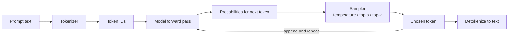
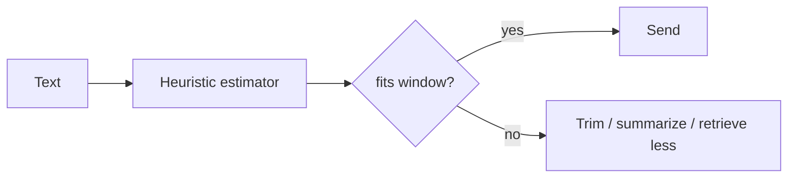

## 0. Before you start
- **Essential:** basic Python.
- **Helpful:** none.
- **Optional advanced:** transformer architecture, attention. Not needed for this exam.

## 1. Simple explanation
A large language model (LLM) is a program trained on huge amounts of text to predict the next small piece of text, over and over, until it has written an answer. It does not "look up" facts like a search engine; it produces what is *likely* to come next based on patterns it learned. That is why it can write fluent, useful answers, and also why it sometimes states false things with confidence (a **hallucination**). The text it reads and writes is counted in **tokens**, and every model can only handle a limited number of tokens at once (its **context window**). Settings such as **temperature** control how adventurous the choice of the next token is.


```figure
flow llm-generation
```

## 2. Structured explanation
1. **Foundation model (FM):** a big pre-trained model reusable for many tasks. An LLM is an FM for text. Others handle images, audio, embeddings.
2. **Tokenization:** your text is split into tokens (pieces of words). The model sees only token IDs.
3. **Inference loop:** the model computes probabilities for the next token, picks one (see sampling), appends it, repeats until it hits a stop condition or the output limit.
4. **Context window:** `input tokens + output tokens` must fit. Overflow means an error or silent truncation depending on the API.
5. **Sampling controls:** temperature, top-p, top-k, max tokens, stop sequences.
6. **Statelessness:** the model remembers nothing between calls. A "conversation" is you resending the history.
7. **Ways to adapt a model:** prompting → RAG → fine-tuning → (training from scratch). Cheapest and most reversible first.

## 3. Analogy
**An LLM is a very well-read intern who has never seen your company's files and has no memory between meetings.** Ask a general question and they answer from what they read. Ask about your private policy and they may confidently guess. Give them the policy page in the meeting (RAG/prompt) and they answer from it.

*Where it breaks:* an intern knows when they are guessing; an LLM often cannot tell. And the "meeting" has a hard size limit (context window).

## 4. The seven questions

**WHAT?** An LLM generates text one token at a time from learned probabilities. **Tokens** ≈ word pieces. As a rough *English-only* rule of thumb, a token is a few characters. AWS's Titan embeddings page states an average of **4.7 characters per token for English** (✅), but treat any ratio as an estimate; other languages and code tokenize differently.

**WHY do we need to understand this?** Cost (billed per token), speed (more output tokens = more time), correctness (context overflow, truncation), and safety (hallucinations) are all driven by these mechanics.

**WHEN does each customization fit?**

| Need | Best first choice | Why |
|---|---|---|
| Different tone/format | Prompt engineering | Free, instant, reversible |
| Answers from *your* changing documents | RAG | Updates by changing documents, not the model; supports citations |
| Consistent style/skill on a narrow task, lots of examples | Fine-tuning | Changes model behavior; costs more; slower to update |
| New capability no model has | Train from scratch | Rare; out of scope for this exam |

**WHERE?** In AWS, LLMs are called through Amazon Bedrock (managed) or SageMaker AI endpoints (you host). See [01/01](aip:01-bedrock-genai-fundamentals/01-bedrock-overview-and-converse-api).

**HOW?** Input text → tokenizer → token IDs → model → probability for every possible next token → sampler picks one → detokenized text. Repeats. Output ends on a stop sequence, end-of-turn token, or `maxTokens`.

**WHAT IF?**
- *Input + max output exceeds the window?* The request is rejected (validation error) or the answer is cut short. Always leave room for output.
- *The prompt contains the answer but the model ignores it?* Common when the relevant text is buried in a very long context or conflicts with the model's prior knowledge. Put key instructions clearly, and keep context focused.
- *You set temperature 0 and still get different answers?* Lower randomness is not a guarantee of identical output across calls or model versions.

**WHY NOT always use the largest model?** Higher cost and latency; many tasks (classification, extraction, routing) work well on smaller models. See `04-operational-efficiency` (model cascading, tiered selection).

**WHY NOT fine-tune instead of RAG?** Fine-tuning does not reliably teach facts, can't show sources, and must be repeated when documents change. It *is* appropriate for style, format, and domain behavior.

## 5. Technical depth

```figure
token-sampler
```



*Reading:* the tokenizer turns text into numbers; the model scores every possible next token; the sampler picks one using your settings; the loop repeats, feeding its own output back in, until a stop condition.

### Sampling settings
| Setting | What it does | Lower value | Higher value | Typical use |
|---|---|---|---|---|
| **temperature** | Reshapes the probability distribution | More deterministic, safe | More varied, creative, riskier | Low for extraction/Q&A; higher for brainstorming |
| **top-p** (nucleus) | Only consider the smallest set of tokens whose probabilities add to p | Narrower choice | Wider choice | Often adjust *either* temperature *or* top-p, not both |
| **top-k** | Only consider the k most likely tokens | Narrower | Wider | Provider-specific; not on every model |
| **maxTokens** | Hard cap on output length | Cheaper/faster, risk of truncation | Allows long answers | Always set it |
| **stop sequences** | Strings that end generation | – | – | Enforce formats |

Exam link: skill 4.2.4 names "appropriate temperature and top-k/top-p selection based on requirements".

### Context window budgeting
```
available_for_prompt = context_window − reserved_for_output
prompt = system + history + retrieved_documents + user_question
```
If `prompt` is too big you must **trim history, summarize, retrieve less, or chunk**. This is the root of many "troubleshooting" exam scenarios (skill 5.2.1: context window overflow diagnostics, truncation analysis).

### Why hallucinations happen
The model optimizes for *plausible* text, not *verified* text. Triggers: missing knowledge, ambiguous prompts, outdated training data, pressure to answer ("always answer"), and noisy retrieved context. Mitigations stack: ground with RAG + citations, instruct "say you don't know", lower temperature, verify with Guardrails contextual grounding checks, validate structured output.

## 6. Worked example

```figure
context-budget
```


*Problem:* A support bot must answer "What is our refund window?" using policy text.

| Step | Action | Why |
|---|---|---|
| 1 | Question alone → model answers "30 days" (a guess from typical policies) | No grounding: plausible but unverified |
| 2 | Put the policy paragraph in the prompt: "Answer only from the text. If missing, say 'not in policy'." | Grounds the answer and gives an exit |
| 3 | Set `temperature=0.2`, `maxTokens=150` | Predictable, cheap, bounded |
| 4 | Count tokens: policy 400 + question 20 + reserve 150 = 570, far below any modern window | Budget check |
| 5 | Result: "Refunds are allowed within 14 days with receipt." | Correct because it came from the source |

*Takeaway:* nothing about the model changed; **the context did**. That is the core idea behind RAG.

## 7. Knowledge checkpoints
1. Why does a chat application have to resend earlier messages on every call?
2. A request has a 6,000-token prompt and `maxTokens=4,000` for a model with an 8,000-token window. What happens and what do you change?
3. Which customization would you choose for "answer from this week's updated HR PDFs"? Why not fine-tuning?
4. Name three levers that reduce hallucinations.

## 7b. Practice questions (exam-style, original) — answers below

**Q1.** A chatbot built on a foundation model "forgets" the user's name after every request. What is the correct fix?
A. Raise the temperature
B. Store the conversation and resend the relevant history with each request
C. Switch to a larger model
D. Lower `maxTokens`

**Q2.** A request has a 7,000-token prompt and `maxTokens` of 3,000 on a model with an 8,000-token context window. What is the BEST action?
A. Send it unchanged
B. Reduce the prompt or lower `maxTokens` so input plus output fits within 8,000 tokens
C. Increase temperature
D. Add more examples to the prompt

**Q3.** Which approach BEST fits "answers must reflect HR documents that change weekly, with citations"?
A. Fine-tune the model weekly
B. RAG over the HR documents
C. Train a new model from scratch
D. Increase top-p

**Q4.** (Select TWO) Which changes make a classification prompt's output more predictable?
A. Lower the temperature
B. Specify an exact output format and use a stop sequence or schema validation
C. Raise top-k to the maximum
D. Remove the system prompt
E. Increase `maxTokens` to the model limit

**Q5.** A response ends in the middle of a sentence and `stopReason` is `max_tokens`. What happened and what should you do?
A. The model refused; rewrite the prompt politely
B. The output hit your `maxTokens` limit; raise it or request a shorter answer
C. The context window was increased
D. The API key expired

**Q6.** Which statement about hallucinations is correct?
A. They only happen with high temperature
B. They are plausible-sounding but unsupported outputs; grounding, instructions to say "unknown" and verification reduce them
C. They are impossible when using a larger model
D. They are caused by tokenization only

**Q7.** Why can "just use the biggest model" be a poor answer on an exam about cost or latency?
A. Bigger models are always less accurate
B. Larger models generally cost more and respond more slowly; many tasks work well on smaller models, with larger ones reserved for hard cases
C. Bigger models cannot be used with APIs
D. Bigger models ignore prompts

**Q8.** (Select TWO) Which are true about tokens?
A. Models and billing are measured in tokens
B. A token is always exactly one word
C. Token counts depend on the tokenizer and language, so character-based estimates are only approximations
D. Tokens apply only to output, never input
E. Token limits do not matter if temperature is zero

## 8. Hands-on lab: "Count before you send"

### 8.1 Objective
Build intuition for tokens and budgets without spending money.

### 8.2 Prerequisites
Python 3.10+.

### 8.3 Services
None (local). Optional: Bedrock `Converse` to read real `usage` numbers (see [01/01](aip:01-bedrock-genai-fundamentals/01-bedrock-overview-and-converse-api)).

### 8.4 IAM
None for the local part.

### 8.5 Region
n/a.

### 8.6 Architecture

*Reading:* check the budget *before* calling the model; trim if needed.

### 8.7 Cost
Zero.

### 8.8–8.9 Setup and dependencies
No packages needed.

### 8.10 Code
File: [labs-code/00_foundations/token_budget.py](aip-code:labs-code/00_foundations/token_budget.py) (same code shown below):

```python
"""Rough token budgeting. The ratio is a HEURISTIC for English; real counts come from the
service response (usage.inputTokens) or the model provider's tokenizer."""

CHARS_PER_TOKEN = 4.0  # conservative guess; AWS cites ~4.7 for Titan embeddings on English text


def estimate_tokens(text: str) -> int:
    return max(1, round(len(text) / CHARS_PER_TOKEN))


def fits(prompt: str, context_window: int, reserved_output: int, safety: float = 0.9) -> bool:
    """Leave a safety margin because estimates are imperfect."""
    return estimate_tokens(prompt) <= (context_window - reserved_output) * safety


def trim_history(messages: list[str], budget_tokens: int) -> list[str]:
    """Keep the most recent messages that fit the budget."""
    kept, total = [], 0
    for msg in reversed(messages):
        cost = estimate_tokens(msg)
        if total + cost > budget_tokens:
            break
        kept.append(msg)
        total += cost
    return list(reversed(kept))


if __name__ == "__main__":
    policy = "Refunds are allowed within 14 days of purchase with a receipt. " * 20
    print("estimated tokens:", estimate_tokens(policy))
    print("fits in 8k window with 1k output reserved:", fits(policy, 8000, 1000))
    history = [f"message {i}: " + "x" * 400 for i in range(30)]
    print("messages kept under 1000 tokens:", len(trim_history(history, 1000)))
```

### 8.11 Key code explained
- `estimate_tokens` is deliberately crude; the point is the *habit* of budgeting.
- `fits` leaves a safety margin (10%) because the heuristic can undercount.
- `trim_history` walks newest → oldest so recent context survives.

### 8.12 Run
```powershell
python labs-code/00_foundations/token_budget.py
```

### 8.13 Expected output (captured from a real run on 2026-10-23)
```
estimated tokens: 315
fits in 8k window with 1k output reserved: True
messages kept under 1000 tokens: 9
```

### 8.14 Validation
Change `CHARS_PER_TOKEN` to 3 and see how the budget tightens. Later, compare your estimate against `usage.inputTokens` returned by a real Bedrock call.

### 8.15 Common errors
| Problem | Cause | Fix |
|---|---|---|
| Real count differs a lot | Non-English text or code tokenizes differently | Use service-reported usage; apply bigger margin |
| First message is an assistant message after trimming | Trimming cut mid-pair | Re-align so history starts with a user turn |

### 8.16 Security
Never paste secrets or personal data into prompts you log. Token estimation scripts should not write prompts to disk.

## 9. What can go wrong?

| Failure | Why | Symptoms | Investigate | Fix | Prevent |
|---|---|---|---|---|---|
| **Context overflow** | History/documents grow unchecked | ValidationException, or answers ignore early messages | Log `inputTokens`; compare with window | Trim/summarize history; retrieve fewer chunks | Token budget guard before every call |
| **Truncated answer** | `maxTokens` too low | Sentence stops mid-way; `stopReason=max_tokens` | Check `stopReason` | Raise `maxTokens` or request brevity | Alert on `max_tokens` rate |
| **Hallucinated fact** | No grounding | Confident wrong detail, no source | Compare to source docs; golden set | Add RAG + "say unknown" rule + verification | Grounding checks, evaluation set |
| **Inconsistent output** | High temperature | Same prompt, different format | Run N repeats and diff | Lower temperature; enforce schema | Output validation + retries |
| **Cost spike** | Verbose prompts/outputs, long history | Token usage up with no traffic change | CloudWatch token metrics | Compress prompts, cap output, cache | Token dashboards + anomaly alerts |

## 10. Common misconceptions
1. **"The model remembers our earlier chat."** The API is stateless; you resend history (and pay for it each time).
2. **"Temperature 0 means always identical."** It reduces randomness; it is not a guarantee.
3. **"Bigger context window means I can paste everything."** More context raises cost and latency and can dilute focus.
4. **"Fine-tuning teaches it our documents."** It mainly shapes behavior and style; use RAG for facts.
5. **"LLMs search the internet."** Unless you give them a tool, they only use training data and your prompt.

## 11. Exam notes
- Scenario signals: *"answers must reflect documents updated daily"* → RAG. *"must match brand voice consistently"* → prompt templates and/or fine-tuning. *"reduce cost"* → smaller model, fewer tokens, caching. *"hallucination"* → grounding + guardrails + evaluation.
- Skills linked: 1.3.3 (format input per model), 4.1.1 (token efficiency), 4.2.4 (parameters), 5.2.1 (context overflow).
- Elimination trick: an option that says "increase the model size" is rarely the best answer to a *cost* or *latency* problem.

## 12. Summary and cards
- LLM = next-token predictor. Tokens are billed and limited.
- Context window = input + output. Budget it.
- Stateless: resend history.
- Prompt → RAG → fine-tune, in that order of effort.
- Hallucination mitigation = ground, constrain, verify.

## 13. References
| Source | URL | Verified |
|---|---|---|
| Titan Text Embeddings (chars-per-token note) | https://docs.aws.amazon.com/bedrock/latest/userguide/titan-embedding-models.html | 2026-10-23 |
| Bedrock inference concepts / Converse | https://docs.aws.amazon.com/bedrock/latest/userguide/conversation-inference.html | 2026-10-23 |

Concept-level statements (sampling, hallucination, statelessness) are general knowledge, not tied to one AWS page.

## 14. Answers to checkpoints
1. The model is stateless; context only exists in what you send.
2. 6,000 + 4,000 = 10,000 > 8,000, so it fails validation or is constrained. Lower `maxTokens` (≤ 2,000) or shorten the prompt.
3. RAG; documents change weekly and RAG updates by refreshing the index; fine-tuning would need retraining and can't cite sources.
4. Any three of: grounding with RAG, "say you don't know" instruction, lower temperature, contextual grounding check, structured-output validation, human review, evaluation against a golden set.

**Practice questions (§7b).**
- **Q1 → B.** The model is stateless; the app must store and resend history. A, C, D don't create memory.
- **Q2 → B.** 7,000 + 3,000 = 10,000 > 8,000. Shrink the prompt or `maxTokens`. A fails or truncates; C, D don't help the budget.
- **Q3 → B.** RAG updates by refreshing documents and supports citations. A is slow and can't cite; C is absurd; D only changes sampling.
- **Q4 → A, B.** Lower temperature and a constrained format/validation reduce variability. C widens choice, D removes guidance, E doesn't improve predictability.
- **Q5 → B.** `max_tokens` means your output cap was reached.
- **Q6 → B.** Hallucinations occur at any temperature and with any model size; they are reduced by grounding, "unknown" instructions and verification.
- **Q7 → B.** Larger models usually cost more and are slower; tiering/cascading reserves them for hard queries.
- **Q8 → A, C.** B is false (tokens are word pieces); D is false (input tokens count and are billed); E is false (limits always apply).
