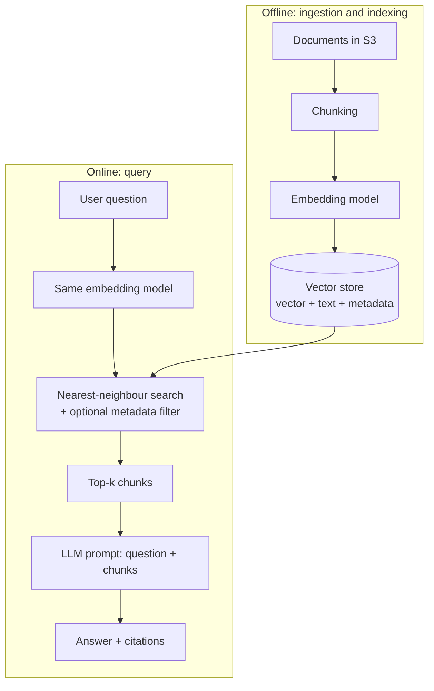
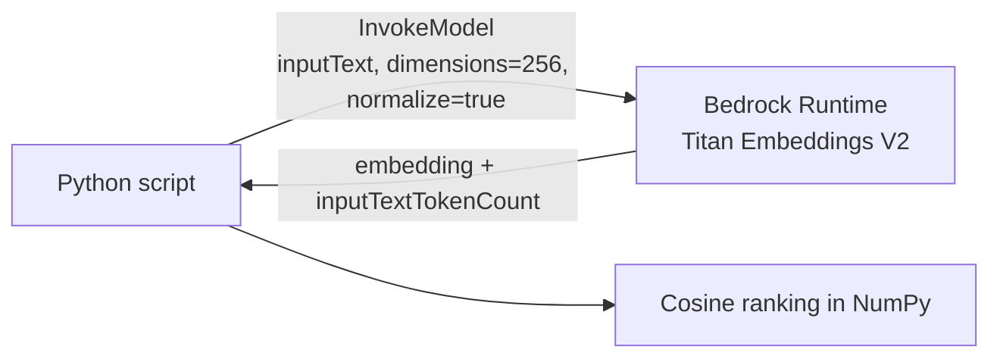

## 0. Before you start
- **Essential:** what a token is ([02](aip:00-foundations/02-llm-and-genai-basics)); what a list of numbers is.
- **Helpful:** high-school idea of "angle between two arrows".
- **Optional advanced:** HNSW graph theory, product quantization.

## 1. Simple explanation
Computers compare exact letters well but compare *meaning* badly: "reset my password" and "I can't get into my account" share almost no words. An **embedding model** turns a piece of text into a long list of numbers (a **vector**) so that texts with similar meaning get similar numbers. Then "find similar meaning" becomes simple maths: find the vectors closest together. A **vector store** is a database built to do that search quickly over millions of vectors. This is the engine behind RAG: you embed your documents once, embed each question when it arrives, and fetch the closest documents.


```figure
flow semantic-search
```

## 2. Structured explanation
1. **Embed** text with an embedding model → a vector of fixed length (e.g. 1,024 numbers).
2. **Store** the vector with the original text and **metadata** (source, date, author) in a vector store.
3. **At question time:** embed the question with the **same model**.
4. **Search:** find the stored vectors nearest to the question vector (top-k).
5. **Return** the matching text chunks (optionally filtered by metadata, re-ranked, or blended with keyword search).
6. **Pass** those chunks to an LLM as context (that is RAG; see `01/03`).

## 3. Analogy
**A library shelved by *meaning* instead of by title.** Books about dogs sit near books about puppies and pet care, far from books about taxes. To find something, you describe what you want, walk to the right area, and pick the nearest books.

*Where it breaks:* a real library has 3 dimensions of space; embeddings have hundreds or thousands. And the "shelf positions" are produced by a model, so a different model gives a completely different arrangement: **you cannot mix vectors from two different embedding models**.

## 4. The seven questions

**WHAT?** An **embedding** is a numeric representation of data (text, image, audio) that preserves meaning. **Semantic search** finds items by closeness of meaning. A **vector database** stores embeddings and does approximate nearest-neighbour (ANN) search. Important accuracy note from AWS: *"the actual similarity computation and retrieval are performed by your vector database, not by the embedding model"* (✅ Titan docs).

**WHY?**
| Before | Problem | Embeddings fix |
|---|---|---|
| Keyword search (SQL `LIKE`, BM25) | Misses synonyms and paraphrases ("car" vs "automobile") | Matches by meaning |
| Giving the LLM everything | Context window limits and cost | Retrieve only the few relevant chunks |
| Fine-tuning for facts | Slow, costly, no citations | Update by re-embedding changed documents |

**WHEN?** Semantic search shines for natural-language questions, support/FAQ, document Q&A, recommendations, deduplication. Prefer **keyword or hybrid** when exact tokens matter: part numbers, error codes, names, legal clause IDs. Pure semantic search can miss exact identifiers.

**WHERE?** Two pipelines meet at the vector store:
- **Ingestion (offline):** documents → chunk → embed → store.
- **Query (online):** question → embed → search → context.
In AWS: Bedrock embedding models (Titan, Cohere, Nova), vector stores such as Amazon OpenSearch Service/Serverless, Aurora PostgreSQL with pgvector, Amazon S3 Vectors, Neptune Analytics, or the managed store inside a Bedrock Managed Knowledge Base. (Choosing between them is covered in `02-data-management` and `10-architecture-capstone`.)

**HOW?** Details in §5.

**WHAT IF?**
- *You change the embedding model later?* All stored vectors must be re-generated; old and new vectors are not comparable.
- *The question is in another language?* AWS notes cross-language queries on Titan V2 return **sub-optimal** results (✅); use a multilingual model and test.
- *The text is longer than the model's input limit?* Titan V2 accepts up to **8,192 tokens or 50,000 characters** (✅). Even below that, AWS recommends splitting into logical segments (paragraphs/sections) for retrieval.
- *No result is truly relevant?* Nearest-neighbour search **always returns the k nearest**, even if all are poor. Use a **similarity threshold** and an "I don't know" path.

**WHY NOT store embeddings in DynamoDB / a normal SQL column?** You can *store* them, but you'd have to compare against every row (brute force), which slows down as data grows. DynamoDB has no native vector search; it is often used for **metadata/conversation state** next to a vector store. (Exam skill 1.4.1 mentions "DynamoDB with vector databases for metadata and embeddings" as a combined pattern.) Brute force is fine for small sets (see the lab).

**WHY NOT just use a bigger LLM context?** Cost and latency grow with tokens, and models can lose focus in very long contexts. Retrieval keeps the prompt small and relevant.

## 5. Technical depth

```figure
vector-space
```


### 5.1 Vectors and similarity
Each text → vector `v ∈ ℝⁿ`. Common similarity/distance measures:

| Measure | Idea | Notes |
|---|---|---|
| **Cosine similarity** `cos θ = a·b / (‖a‖‖b‖)` | Angle between vectors (direction) | Range −1…1; ignores length. Most common for text. |
| **Dot product** `a·b` | Direction × length | Equals cosine if vectors are normalized. Fast. |
| **Euclidean (L2) distance** | Straight-line distance | Sensitive to vector length. |

Titan V2's `normalize` option **defaults to true** (✅): vectors have length 1, so dot product and cosine give the same ranking.

### 5.2 Dimensions: size vs quality
Titan Text Embeddings V2 outputs **1,024 (default), 512 or 256** dimensions (✅). Fewer dimensions = less storage, faster search, usually slightly lower accuracy. The vector store index **must be created with the same dimension** as the vectors you insert, or inserts fail.

### 5.3 Approximate nearest neighbour (ANN)
Comparing a query against every vector (exact/brute-force "k-NN") is accurate but slow at scale. Vector stores build an **index** (commonly **HNSW**, a layered graph, or **IVF**, clustered lists) that finds *very likely* nearest neighbours much faster, trading a little recall for speed. Index settings trade **recall vs latency vs memory**; tuning is covered in `02-data-management` (OpenSearch tuning, lessons 59) and `04-operational-efficiency`.

### 5.4 Ingestion and query pipelines


*Reading the arrows:*
- **Documents → Chunking:** long files are split into pieces that each carry one idea.
- **Chunking → Embedding model:** each chunk's text becomes a vector (the model never sees your whole corpus at once).
- **Embedding → Vector store:** the vector is saved with the chunk text and metadata (source URL, date) so you can cite and filter later.
- **Question → Same embedding model:** *same* model is mandatory so the question lands in the same "meaning space".
- **Store → Search → Top-k chunks:** the engine returns the closest chunks; metadata filters can narrow candidates first.
- **Chunks → LLM:** the retrieved text is pasted into the prompt as evidence.

### 5.5 Beyond pure vector search (preview)
- **Hybrid search:** combine keyword (BM25) and vector scores. Helps exact terms. (Managed Bedrock KBs always run hybrid per the Kendra migration page ✅.)
- **Re-ranking:** a second model re-orders the top candidates for relevance.
- **Metadata filtering:** restrict by department, date, tenant.

## 6. Worked example

*Problem:* A bank's help centre has 5 articles. A customer asks: "I can't remember how to get back into my account."

| Step | What happens |
|---|---|
| 1. Ingest | Each article is embedded (256-dim) and stored with its title. |
| 2. Query | The question is embedded with the **same** model. |
| 3. Compare | Cosine against all 5: "How do I reset my password…" ≈ high; "You can change your account login credentials…" ≈ high; "Shipping takes 3–5 days" ≈ low. |
| 4. Keyword baseline | Shared words with the question: almost none ("my", "I"), so keyword search ranks nearly randomly. |
| 5. Result | The semantic search returns the two login/password articles first. |

*Why it works:* the vectors for the question and the password articles point in similar directions even though the words differ. (Exact scores vary by model; run Lab B to see yours.)

## 7. Knowledge checkpoints
1. Why must the question and documents use the same embedding model?
2. Cosine similarity of 0.0 between two vectors means what?
3. You created a vector index with dimension 1,024 but insert 256-dim Titan vectors. What happens and how do you fix it?
4. When would pure semantic search be a poor choice?
5. Why does semantic search always return results, even for nonsense questions?

## 7b. Practice questions (exam-style, original) — answers below

**Q1.** A company embeds 2 million documents with Embedding Model A. Later a developer starts embedding user queries with Embedding Model B but searches the same index. What is the likely outcome?
A. Better accuracy because two models are combined
B. Poor or meaningless similarity results because the vector spaces are incompatible
C. The vector database converts the vectors automatically
D. Only the dimension must match; results are unaffected

**Q2.** A vector index was created with 1,024 dimensions. A job writes 256-dimension Titan vectors into it. What happens, and what is the fix?
A. They are padded automatically; no action needed
B. The writes fail due to dimension mismatch; recreate the index with 256 dimensions (or generate 1,024-dimension vectors) and re-ingest
C. Search quality improves
D. The embedding model is retrained

**Q3.** (Select TWO) Which are valid reasons to prefer hybrid (keyword + vector) search over pure semantic search?
A. Queries often include exact identifiers such as "ERR-4021" or product codes
B. Users search by paraphrased natural language only
C. Exact terms matter and rare tokens are poorly represented by embeddings
D. You want to avoid indexing entirely
E. You need to reduce embedding dimensions

**Q4.** According to the Titan Text Embeddings V2 documentation, which is correct?
A. It accepts unlimited text and returns a fixed 4,096-dimension vector
B. It accepts up to 8,192 tokens or 50,000 characters and can output 1,024, 512 or 256 dimensions
C. It supports `temperature` and `topP`
D. It is throttled by tokens per minute only

**Q5.** A semantic search always returns results, even for a nonsense question. What is the BEST way to avoid presenting irrelevant answers?
A. Increase the number of results returned
B. Apply a minimum similarity threshold (and/or reranker) and provide a fallback "no relevant information" response
C. Reduce the embedding dimension
D. Disable metadata

**Q6.** Which statement about cosine similarity is correct?
A. It measures the straight-line distance between vectors and is sensitive to vector length
B. It measures the angle between vectors; with normalized vectors it ranks the same as the dot product
C. It always returns values between 0 and 100
D. It requires vectors of different lengths

**Q7.** Why is storing embeddings in a table and scanning every row a poor choice at large scale?
A. It is not possible to store numbers in a table
B. Exact brute-force comparison grows linearly with data size; vector stores use approximate nearest-neighbour indexes for speed
C. Embeddings cannot be compared mathematically
D. Tables cannot hold metadata

**Q8.** (Select TWO) Which actions are most likely to improve poor retrieval quality in a RAG system?
A. Tune chunk size and overlap
B. Add a reranking step
C. Increase the LLM's temperature
D. Delete the metadata filters in all cases
E. Shorten the system prompt only

## 8. Hands-on labs

### Lab A (no AWS): vector maths and a tiny vector store

**8A.1 Objective.** Understand cosine similarity, nearest neighbours and metadata filtering.
**8A.2 Prerequisites.** Python 3.10+, `pip install numpy`.
**8A.3 Services.** None. **8A.4 IAM.** None. **8A.5 Region.** n/a.
**8A.6 Architecture.** Python dict of vectors, brute-force search (a toy of the pipeline above).
**8A.7 Cost.** Zero.
**8A.8–9 Setup.** `pip install numpy`.
**8A.10 Code.** [labs-code/00_foundations/vector_math_no_aws.py](aip-code:labs-code/00_foundations/vector_math_no_aws.py)
**8A.11 Key code.**
- `cosine_similarity` guards against a zero vector (avoids divide-by-zero).
- `TinyVectorStore.search` loops over every item: that *is* exact k-NN. Real databases add an index so they don't loop.
- `where={"category": "thing"}` shows metadata filtering: skip non-matching items before scoring.
**8A.12 Run.** `python labs-code/00_foundations/vector_math_no_aws.py`
**8A.13 Expected output (captured from a real run, 2026-10-23).**
```
== Pairwise cosine similarity ==
    cat vs dog    : cosine=0.994  euclid=0.100
    cat vs pizza  : cosine=0.110  euclid=1.204
    car vs truck  : cosine=0.994  euclid=0.100
   king vs queen  : cosine=1.000  euclid=0.050
   king vs pizza  : cosine=0.000  euclid=1.277

== Semantic search over the toy store ==
Query: 'puppy' (never stored in the database)
  dog     score=0.999  meta={'category': 'living'}
  cat     score=0.998  meta={'category': 'living'}
  burger  score=0.225  meta={'category': 'thing'}
...
cosine(a, 10a) = 1.000 (same meaning)
euclid(a, 10a) = 33.675 (looks very different)
```
**8A.14 Validation.** Add a word with vector `[0,0,0,0]` and confirm `cosine_similarity` returns 0.0 without crashing.
**8A.15 Errors.** `ModuleNotFoundError: numpy` → `pip install numpy`.
**8A.16 Security.** No data leaves your machine.

### Lab B (AWS): real semantic search with Titan Text Embeddings V2

**8B.1 Objective.** Compare keyword overlap with real embeddings.
**8B.2 Prerequisites.** [01 setup](aip:00-foundations/01-aws-account-iam-and-cli-setup) complete; Python deps `boto3`, `numpy`.
**8B.3 Services.** Amazon Bedrock Runtime (`InvokeModel`).
**8B.4 IAM.**
```json
{
  "Version": "2012-10-17",
  "Statement": [{
    "Effect": "Allow",
    "Action": "bedrock:InvokeModel",
    "Resource": "arn:aws:bedrock:<REGION>::foundation-model/amazon.titan-embed-text-v2:0"
  }]
}
```
The first use of a third-party model may also require AWS Marketplace permissions (see [verification-log §4](aip:meta/verification-log)). Titan is an Amazon model, and AWS lists Amazon among providers **not** sold through Marketplace, so those permissions should not apply to it (✅ model-access page).
**8B.5 Region.** Any Region where Titan Text Embeddings V2 is available. Verify in the Bedrock console model catalog; availability is **not** asserted here.
**8B.6 Architecture.**

*Reading:* one API call per text; the response carries the vector; ranking happens locally.
**8B.7 Cost.** Embedding calls are billed per input token; this lab sends ~6 short sentences, so cost is expected to be negligible. Check the current Bedrock pricing page for the exact rate (not verified here).
**8B.8–9 Setup.** `pip install boto3 numpy`; `$env:AWS_REGION = "us-east-1"` (or your Region).
**8B.10 Code.** [labs-code/00_foundations/titan_semantic_search.py](aip-code:labs-code/00_foundations/titan_semantic_search.py)
**8B.11 Key code.**
- Request body fields `inputText`, `dimensions`, `normalize` match the documented Titan V2 schema (✅).
- The retry loop only retries *transient* error codes (throttling, timeout, unavailable). `ValidationException` is **not** retried, because retrying a bad request cannot succeed.
- `max_attempts: 1` on the client config is deliberate so the visible loop does the retrying (in production, rely on the SDK's `standard`/`adaptive` retry modes).
**8B.12 Run.** `python labs-code/00_foundations/titan_semantic_search.py`
**8B.13 Expected output.** The password/login sentences should rank above refund/shipping. **I could not run this against a live account, so I give no sample scores**; yours will differ by model version.
**8B.14 Validation.** Change `DIMENSIONS` to 1024 and compare score gaps. Try an empty string to confirm the local `ValueError`.
**8B.15 Common errors.**
| Error | Cause | Fix |
|---|---|---|
| `AccessDeniedException` | IAM missing, wrong Region, or model not enabled | Check policy and the Region's catalog; wait if first-time subscription is pending |
| `ValidationException` | Empty text, too many tokens, invalid `dimensions` | Use 256/512/1024 and non-empty input |
| `ThrottlingException` | Embedding models are limited by **requests per minute** (✅) | Backoff; batch work; request quota increase |
| `ResourceNotFoundException` | Model not available in Region | Switch Region |
**8B.16 Security.** Don't send confidential text unless your data-handling policy allows it. Use least privilege, scoped to the single model ARN.

## 9. What can go wrong?

| Failure | Why | Symptoms | Investigate | Fix | Prevent |
|---|---|---|---|---|---|
| **Dimension mismatch** | Index built for N dims, vectors have M | Insert/query errors from the vector DB | Compare index mapping dimension to model output length | Recreate index with correct dimension (usually requires re-ingest) | Store `model_id` + `dimensions` in config; assert on insert |
| **Mixed embedding models** | Docs embedded with model A, queries with B | Plausible-looking but poor/random results | Check metadata of the ingest job; test a known pair | Re-embed everything with one model | Version the embedding model; one index per model |
| **Irrelevant top-k** | Nearest neighbours are all weak; chunks too big/small | Answers off-topic | Print scores; inspect retrieved chunks by eye | Tune chunking, add threshold, hybrid search, reranker | Retrieval evaluation set (`07-governance-qa`) |
| **Exact terms missed** | Pure semantic search | "ERR-4021" returns generic errors | Compare with keyword search | Hybrid search; metadata filters | Choose hybrid for ID-heavy content |
| **Stale index** | Documents changed, vectors not refreshed | Answers cite old policy | Compare source timestamp vs indexed time | Incremental sync | Scheduled/Event-driven ingestion (Task 1.4.5) |
| **Throttling at ingest** | Embedding model RPM limit | `ThrottlingException` bursts | CloudWatch / error logs | Backoff + batching + quota request | Rate-limited workers |
| **PII leaks into vectors/chunks** | Raw docs embedded unmasked | Sensitive text surfaced in answers | Scan source and chunks | Mask/redact before ingest | Comprehend/Macie scan (Domain 3) |

## 10. Common misconceptions
1. **"A vector database understands language like an LLM."** It stores and compares numbers. Meaning comes from the embedding model; the DB just finds neighbours.
2. **"Higher dimensions are always better."** Gains flatten and cost grows; 256 may be enough for your data. Measure.
3. **"Semantic search replaces keyword search."** Hybrid usually beats either alone, especially for identifiers.
4. **"Embeddings are encrypted/safe, so PII in them is fine."** Vectors can leak information about the text and you also store the original text chunk.
5. **"I can switch embedding models without re-indexing."** You cannot; vectors from different models are incompatible.

## 11. Exam notes
- Keywords: *"semantic"*, *"similar meaning"*, *"paraphrase"* → embeddings + vector search. *"exact match, product codes"* → keyword/hybrid. *"fastest relevance gain"* → reranker or hybrid before re-architecting.
- Skill mapping: 1.5.2 (choose embedding by dimensionality and domain fit; Lambda batch embeddings), 1.5.3 (OpenSearch, pgvector, KB), 1.5.4 (hybrid + reranker).
- A distractor to expect: "fine-tune the LLM so it knows the documents" for fast-changing content. Wrong; RAG.
- Titan V2 facts worth remembering: **8,192 tokens/50,000 chars; 1,024/512/256 dims; normalize default true; RPM-throttled**.

## 12. Summary and revision cards
- Embedding = meaning → numbers. Same model for docs and queries.
- Cosine = angle; normalized vectors make dot product equal cosine.
- ANN indexes trade a little recall for big speed.
- Always handle "nothing relevant" (threshold/fallback).
- Hybrid + metadata filters + rerankers improve quality; chunking matters (next topics).

**Cards.** Q: Titan V2 dimensions? A: 1,024 (default), 512, 256. · Q: What compares vectors, the model or the DB? A: The DB. · Q: Why throttled by RPM? A: Embedding quotas are per request, not per token (✅).

## 13. References
| Source | URL | Verified |
|---|---|---|
| Amazon Titan Text Embeddings models | https://docs.aws.amazon.com/bedrock/latest/userguide/titan-embedding-models.html | 2026-10-23 |
| Titan embeddings request/response format | https://docs.aws.amazon.com/bedrock/latest/userguide/model-parameters-titan-embed-text.html | 2026-10-23 |
| Bedrock model access (Marketplace note) | https://docs.aws.amazon.com/bedrock/latest/userguide/model-access.html | 2026-10-23 |
| Managed KB: always hybrid search; 1,024-dim fixed | https://docs.aws.amazon.com/kendra/latest/dg/kendra-availability-change.html | 2026-10-23 |

## 14. Answers to checkpoints
1. Each model creates its own "meaning space"; vectors from different models aren't comparable.
2. The vectors are orthogonal (unrelated direction); no similarity.
3. The write fails (dimension mismatch). Recreate the index with dimension 256 (or re-embed at 1,024) and re-ingest.
4. Exact identifiers, codes, names, legal clause numbers; use hybrid/keyword.
5. Nearest-neighbour search returns the k closest regardless of how far they are; add a score threshold.

**Practice questions (§7b).**
- **Q1 → B.** Different models create incompatible vector spaces. Re-embed with one model.
- **Q2 → B.** Dimension mismatch makes inserts fail; the index dimension is fixed at creation.
- **Q3 → A, C.** Exact identifiers and rare terms favor keyword matching alongside vectors. B favors pure semantic; D and E are unrelated.
- **Q4 → B.** Per the AWS Titan docs. A, C are false (no inference parameters like `topP`), D is false (embedding models are throttled by requests per minute).
- **Q5 → B.** Search returns the nearest k regardless of relevance; use a threshold or reranker plus a fallback response.
- **Q6 → B.** Cosine is about angle; normalized vectors make dot product equivalent in ranking. A describes Euclidean distance.
- **Q7 → B.** Brute force is O(N) per query; ANN indexes (HNSW/IVF) trade a little recall for much better speed.
- **Q8 → A, B.** Chunking and reranking target retrieval quality. C, D, E do not.
