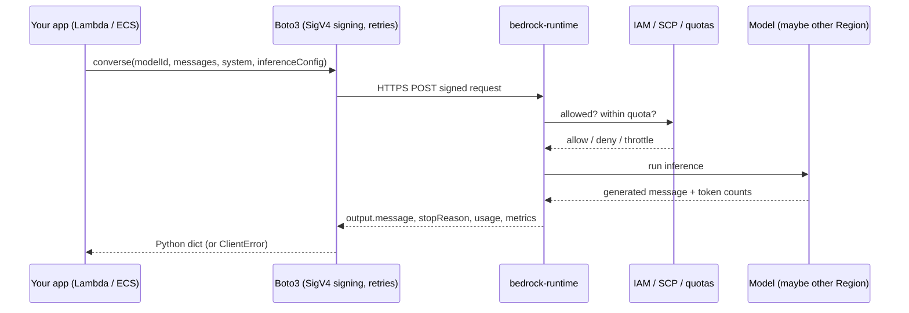
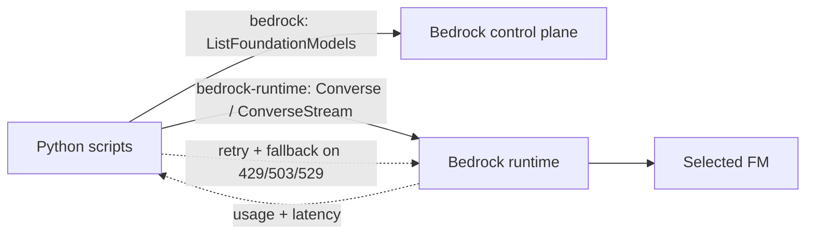

## 0. Before you start
- **Essential:** an AWS identity that works in the CLI; the ideas of token, context window, temperature ([02](aip:00-foundations/02-llm-and-genai-basics)).
- **Helpful:** IAM policies (resource ARNs and actions).
- **Optional advanced:** HTTP streaming, SigV4.

## 1. Simple explanation
Amazon Bedrock is a service that lets you use many different AI models (text, image, embeddings) through one AWS API, without hosting any servers yourself. You send a prompt, Bedrock runs the model on AWS's machines, and you get an answer back, paying for what you use. The **Converse API** is the "universal remote": one request format that works across most chat models, so you can switch models by changing one string instead of rewriting code. Around the models, Bedrock also offers safety filters (Guardrails), document search (Knowledge Bases), prompt storage, agents, and evaluations. This file covers the base layer: calling models safely and correctly.


```figure
flow converse-request
```

## 2. Structured explanation
1. **Bedrock = managed access to foundation models** from several providers (AWS overview lists Amazon, Anthropic, DeepSeek, Moonshot AI, MiniMax, OpenAI and xAI among 100+ models ✅).
2. **Two endpoints, two jobs:**
   - `bedrock` (control plane): list models, create guardrails, manage custom models, inference profiles.
   - `bedrock-runtime` (data plane): actually run inference: `Converse`, `ConverseStream`, `InvokeModel`, `InvokeModelWithResponseStream`. AWS recommends `bedrock-runtime` for new applications ✅.
3. **Model access** is mostly automatic now (first use), with extra steps for Anthropic and IAM Marketplace permissions ✅.
4. **Inference options:** on-demand (pay per token), cross-Region inference profiles (more capacity), Provisioned Throughput / reserved capacity (steady load or custom models), batch (offline bulk). Details in `04-operational-efficiency`.
5. **Converse** gives one message format; `InvokeModel` gives you each model's *own* JSON format.
6. **Stateless:** you send the whole conversation each call.
7. **Operational musts:** timeouts, retries with backoff, token limits, logging, least-privilege IAM.

## 3. Analogy
**A hotel concierge desk with many specialist chefs in the kitchen.** You hand the concierge (Bedrock) a written order. The concierge knows which chef (model) can cook it, forwards it, and brings back the dish. `Converse` is the standard order form every chef accepts. `InvokeModel` is writing each chef's private custom note.

*Where it breaks:* the concierge doesn't remember you between visits (stateless), and busy kitchens can refuse orders (throttling), so the form needs retry logic.

## 4. The seven questions

**WHAT?** A managed, pay-per-use service for foundation models with an API (`bedrock-runtime`) for inference and a control plane (`bedrock`) for management. Key vocabulary: *model ID* (e.g. a string naming a model version), *inference profile* (a routing wrapper, possibly cross-Region), *Converse* (unified chat API), *stop reason*, *usage*.

**WHY?** Before Bedrock you either called each provider's separate API (different SDKs, keys, contracts, security reviews) or hosted open models on GPUs yourself (capacity planning, patching). Bedrock gives one IAM-secured, billed-on-AWS entry point. For the exam, Bedrock is the default answer when the question says *"managed"*, *"minimal operational overhead"* or *"no infrastructure to manage"*.

**WHEN?** Use Bedrock for most GenAI apps. Consider **SageMaker AI** when you need a model Bedrock doesn't offer, full control of the container/GPU, or custom hosting (see `05-sagemaker`). Use **`InvokeModel`** when you need a model-specific feature `Converse` doesn't expose; otherwise prefer **`Converse`**.

**WHERE?** Between your application (Lambda, ECS, API Gateway backend) and the model providers. Data enters as the prompt (and optional documents/images), exits as the generated message. IAM governs who can call; CloudTrail records API calls; CloudWatch has metrics; optional *model invocation logging* captures prompts/responses (configure deliberately, it contains data).

**HOW?** See §5 sequence diagram. In short: Boto3 signs a request → `bedrock-runtime` checks IAM and quotas → routes to the model (maybe in another Region for cross-Region profiles) → returns `output.message`, `stopReason`, `usage`, `metrics.latencyMs`.

**WHAT IF?**
| Situation | What happens | What to do |
|---|---|---|
| Not enough permission | `AccessDeniedException` 403 ✅ | Fix IAM/SCP; check credentials expiry |
| Anthropic model, form not filled | `FTUFormNotFilled` 404 ✅ | Submit use-case form once per account/org |
| First-use subscription still processing | `MPAgreementBeingCreated` 403 ✅ | Wait and retry (docs say try after 15 minutes) |
| Over account quota | `ThrottlingException` 429 ✅ | Backoff + jitter; request quota increase; cross-Region inference; Provisioned/Reserved capacity |
| Service busy (not your quota) | `ServiceUnavailable` 503 ✅ | Backoff; other Region or cross-Region inference |
| Model overloaded | `overloaded_error` 529 ✅ | Retry with backoff; honor `Retry-After`; avoid synchronized retries |
| Malformed request | `ValidationError` 400 ✅ | Fix the request; **do not retry** |
| Wrong model ID/Region | `ResourceNotFound` 404 ✅ | Check ID and Region; use `ListFoundationModels` |

**WHY NOT?**
- *Why not always call `InvokeModel`?* Every model family has its own body schema, so switching models means rewriting code. `Converse` hides that.
- *Why not hard-code a model ID in code?* Models are versioned and retired; hard-coding blocks "dynamic model selection without code changes" (exam skill 1.2.2: Lambda + API Gateway + **AppConfig**). Read it from config.
- *Why not give the app `bedrock:*` on `*`?* Violates least privilege (skill 2.3.3). Scope to the needed actions and model/profile ARNs.
- *When is `InvokeModel` right?* Model-specific parameters outside Converse, embeddings (Titan embeddings use `InvokeModel`, as in [00-foundations/03](aip:00-foundations/03-embeddings-vectors-semantic-search)), image generation.

## 5. Technical depth

```figure
latency-stream
```


### 5.1 One request, end to end

*Reading the arrows:* (1) your code passes a model ID and messages; (2) the SDK signs and sends; (3) Bedrock asks IAM, SCPs and quota whether to proceed (a denial or throttle ends the flow here with an error); (4) the model generates; (5) results flow back with token counts and latency.

### 5.2 Converse request fields (✅ from the Converse docs)
| Field | Purpose |
|---|---|
| `modelId` | Model ID, inference profile ID/ARN, or a Prompt Management prompt ARN |
| `messages` | Conversation: list of `{role: user|assistant, content: [blocks]}` |
| `system` | System prompt blocks |
| `inferenceConfig` | `maxTokens`, `temperature`, `topP`, `stopSequences` |
| `toolConfig` | Tool definitions for tool use (function calling) |
| `guardrailConfig` | Attach a Guardrail |
| `additionalModelRequestFields` | Model-specific parameters (e.g. provider-only options such as top-k on some models) |
| `additionalModelResponseFieldPaths` | Extra response fields returned as JSON pointers |
| `promptVariables` | Fill variables when `modelId` is a managed prompt |
| `requestMetadata` | Key/values you can filter on in invocation logs |
| `serviceTier` | Per-request service tier |
| `cachePoint` (a content block) | Prompt caching checkpoint inside `messages` |

IAM actions: **`Converse` needs `bedrock:InvokeModel`; `ConverseStream` needs `bedrock:InvokeModelWithResponseStream`** ✅.

Response essentials: `output.message.content[]` (a **list** of blocks), `stopReason`, `usage` (input/output/total tokens), `metrics.latencyMs`.
Notes from the docs: with Mistral AI and Meta models, Converse wraps your input in a model-specific prompt template ✅. Some operations have API restrictions (see AWS "API restrictions" page; not detailed here).

### 5.3 `stopReason` meanings you must handle
| Value | Meaning | Your reaction |
|---|---|---|
| `end_turn` | Model finished naturally | Normal |
| `max_tokens` | Hit your `maxTokens` | Answer is cut off; raise limit or shorten ask |
| `stop_sequence` | Hit a stop string you set | Normal if intended |
| `tool_use` | Model wants you to run a tool | Run tool, return `toolResult` (Domain 2) |
| `guardrail_intervened` / `content_filtered` | Safety layer acted | Show safe fallback message |

(Exact value list can vary by API version/model; check the API reference for the full set. I list the common ones from the Converse behavior; not individually re-verified.)

### 5.4 Model IDs, inference profiles and Regions
- A plain *model ID* works only if the model supports on-demand in your Region. Some models are **only** reachable through an **inference profile** ID ✅.
- **Cross-Region inference profiles** carry a geography prefix (`us.`, `eu.`, `apac.`, `global.`). Calls are routed to one of the profile's destination Regions ✅.
- **Data residency warning (✅):** don't rely on the prefix alone; call `GetInferenceProfile` from each source Region and read `models[].modelArn`. If your SCP blocks any destination Region, the request fails even if others are allowed. Opt-in Regions may be destinations even if you did not opt in, and prompts/outputs may be stored there for abuse detection.
- **Why this matters for the exam:** Skill 1.2.3 explicitly names *Cross-Region Inference for models with limited regional availability*.

### 5.5 Access model in one page (✅ verified; replaces course lesson 8)
1. Most models: invoke them; the first call triggers an automatic subscription (up to ~15 min). Needs `aws-marketplace:Subscribe`, `Unsubscribe`, `ViewSubscriptions` the first time.
2. Anthropic: fill the **first-time-use form** (once per account/org; console or `PutUseCaseForModelAccess`). Status check: `GetFoundationModelAvailability` → `agreementAvailability` = `AVAILABLE | PENDING | NOT_AVAILABLE | ERROR`.
3. Amazon, Meta, Mistral, DeepSeek, Google, etc. are **not sold via Marketplace**, so Marketplace permissions don't apply to them.
4. **To block a model, deny `bedrock:InvokeModel` via SCP/IAM.** Deleting the agreement doesn't prevent re-creation on next invoke.
5. **GovCloud** still uses the manual *Model access* page.

## 6. Worked example

*Problem:* A support team wants a prototype that answers "What is a Kubernetes pod?" in plain English and must not crash when Bedrock is busy.

| Step | Detail | Why |
|---|---|---|
| 1 | Run `discover_models.py` and choose a text model/profile available in your Region | Don't guess IDs |
| 2 | `export BEDROCK_MODEL_ID=<id>` | Config, not code |
| 3 | `converse(system=[…concise tutor…], messages=[user question], inferenceConfig={maxTokens:300, temperature:0.2})` | Predictable, bounded output |
| 4 | Read `content` blocks, join the `text` ones | Content is a list |
| 5 | Check `stopReason` and `usage` | Detect truncation; track cost |
| 6 | Wrap the call in the resilient wrapper | Retry transient errors; fallback model |
| 7 | Result: a short answer, e.g. "A pod is the smallest deployable unit in Kubernetes…" | Exact wording varies by model |

## 7. Knowledge checkpoints
1. Which IAM action does `ConverseStream` require?
2. Your call returns `ValidationError` 400. Should your code retry? Why?
3. What is the difference between a 429 `ThrottlingException` and a 503 `ServiceUnavailable`?
4. Why can an inference profile ID with the `us.` prefix still be a data-residency risk?
5. A user says Bedrock "forgot" the previous question. What's wrong?

## 7b. Practice questions (exam-style, original) — answers below

**Q1.** An application using `ConverseStream` fails with `AccessDeniedException`, although the role allows `bedrock:InvokeModel` on the model. What is the MOST likely missing permission?
A. `bedrock:ListFoundationModels`
B. `bedrock:InvokeModelWithResponseStream`
C. `bedrock:CreateGuardrail`
D. `s3:GetObject`

**Q2.** A request returns `ValidationError` (HTTP 400). What should the client do?
A. Retry immediately in a loop
B. Fix the request; retrying the same invalid request will not succeed
C. Retry with exponential backoff up to 10 times
D. Switch Region and retry unchanged

**Q3.** (Select TWO) Which statements correctly distinguish error types?
A. `ThrottlingException` (429) means the account exceeded a Bedrock quota
B. `ServiceUnavailable` (503) means the service is temporarily short of capacity, not that your quota was exceeded
C. 503 and 429 always require the same remedy
D. `AccessDeniedException` should be retried with backoff until it succeeds
E. `overloaded_error` (529) means the IAM policy is missing

**Q4.** A team must be able to change which foundation model an application uses without redeploying code. Which design BEST supports this?
A. Hard-code the model ID in each Lambda function
B. Read the model ID from configuration (for example AWS AppConfig or Parameter Store) and use the Converse API for a consistent request format
C. Create a separate application for each model
D. Use `InvokeModel` with a different JSON body per model in the code

**Q5.** A model is only available in a different Region than the application. Which Bedrock feature can route requests to additional Regions while the app calls from its home Region?
A. Cross-Region inference profiles
B. S3 Replication
C. CloudFront
D. Route 53 latency routing

**Q6.** A compliance officer says data must stay in the EU. The team plans to use a cross-Region inference profile whose ID starts with `eu.`. What should the team still do?
A. Nothing; the prefix guarantees the destination Regions
B. Call `GetInferenceProfile` from each source Region and verify all destination Regions, and align SCPs
C. Remove IAM policies
D. Use a `global.` profile instead because it is always EU-only

**Q7.** Which scenario is the BEST use of `InvokeModel` rather than `Converse`?
A. A simple multi-turn chat across several chat models
B. Generating a Titan text embedding for a sentence
C. A single question with a system prompt on a chat model
D. Streaming chat output

**Q8.** (Select TWO) A Lambda function calling Bedrock from a private subnet through a NAT Gateway intermittently fails with connection resets on requests that follow idle periods. Which actions address this?
A. Enable TCP keep-alive in the SDK client configuration
B. Set the OS keep-alive interval below the NAT Gateway's 350-second idle timeout
C. Increase `maxTokens`
D. Disable retries
E. Change the model temperature

## 8. Hands-on labs

### Lab 8.0: Bedrock Playground (course lesson 9)
Console → Amazon Bedrock → **Playgrounds** (chat/text). Pick a model, set temperature 0 then 1, run the same prompt 3 times each, and note the variation. Change `max tokens` to 20 to see truncation. This costs tokens, so keep prompts short. UI labels change often: **verify** the exact menu names in your console.

### Lab 8.1–8.4: Converse in code

**Objective.** Call Bedrock from Python with Converse, stream tokens, handle errors, and observe usage.

**Prerequisites.** [00-foundations/01](aip:00-foundations/01-aws-account-iam-and-cli-setup) done; Python deps: `pip install boto3`.

**AWS services.** Amazon Bedrock (control plane for discovery, runtime for inference).

**IAM permissions** (replace `<REGION>`, `<MODEL_OR_PROFILE_ARN>`):
```json
{
  "Version": "2012-10-17",
  "Statement": [
    { "Sid": "Discover",
      "Effect": "Allow",
      "Action": ["bedrock:ListFoundationModels", "bedrock:ListInferenceProfiles", "bedrock:GetInferenceProfile"],
      "Resource": "*" },
    { "Sid": "Invoke",
      "Effect": "Allow",
      "Action": ["bedrock:InvokeModel", "bedrock:InvokeModelWithResponseStream"],
      "Resource": ["<MODEL_OR_PROFILE_ARN>"] }
  ]
}
```
*Note on resources:* when you call an **inference profile**, IAM generally needs permission on the **profile ARN and the underlying foundation-model ARNs in the destination Regions**. I did not verify the exact resource list in this session, so if you get `AccessDeniedException` with a profile, read the model's page in the Bedrock docs ("Regional availability / inference profile IDs") and AWS's cross-Region IAM guidance, then widen `Resource` accordingly. First-time third-party model use additionally needs the Marketplace actions in §5.5.

**Region notes.** Use a Region where your chosen model or profile is listed by `discover_models.py`. Set `AWS_REGION`.

**Architecture.**

*Reading:* discovery uses the control plane; every inference call uses the runtime endpoint; transient failures loop back through the retry wrapper.

**Estimated cost.** You pay per input/output token for the model you pick. A handful of short prompts is typically cents or less, but prices vary widely by model: **open the Bedrock pricing page for your model before running**, and keep `maxTokens` small. Not verified here.

**Environment setup (PowerShell).**
```powershell
cd AIP-C01-Study-Guide\labs-code\01_bedrock
python -m venv .venv ; .\.venv\Scripts\Activate.ps1
pip install boto3
$env:AWS_REGION = "us-east-1"        # use your Region
python discover_models.py claude     # or any filter text; copy a model/profile ID
$env:BEDROCK_MODEL_ID = "<paste id>"
```

**Complete code** (all in `labs-code/01_bedrock/`):
| File | Purpose |
|---|---|
| [_common.py](aip-code:labs-code/01_bedrock/_common.py) | Region/model from env; client with `adaptive` retries, 120 s read timeout |
| [discover_models.py](aip-code:labs-code/01_bedrock/discover_models.py) | List models and inference profiles |
| [converse_basic.py](aip-code:labs-code/01_bedrock/converse_basic.py) | One call; print text, `stopReason`, `usage`, latency |
| [converse_chat_stream.py](aip-code:labs-code/01_bedrock/converse_chat_stream.py) | Multi-turn chat with streaming and a history cap |
| [converse_resilient.py](aip-code:labs-code/01_bedrock/converse_resilient.py) | Backoff with full jitter, no-retry rules, fallback model |
| [test_converse_resilient_offline.py](aip-code:labs-code/01_bedrock/test_converse_resilient_offline.py) | 7 offline tests (no AWS) |

**Key code explained.**
- `read_timeout=120`: boto3's default read timeout is 60 seconds, which long generations can exceed; raise it deliberately.
- `retries mode "adaptive"` in `_common.py` adds client-side rate limiting on top of backoff. The resilient wrapper sets SDK retries to 1 so **one layer** owns retries, avoiding retry multiplication (3 SDK × 5 app = 15 calls).
- `RETRYABLE` vs `NOT_RETRYABLE`: transient (429/503/529/500) vs caller mistakes (400/403/404). Unknown codes are *not* retried blindly.
- `backoff_delay` = **full jitter**: random(0, min(cap, base·2^attempt)). Jitter stops many clients retrying in lockstep (the docs call out avoiding synchronized retries ✅).
- `content` is a list; `"".join(b["text"] ...)` handles multi-block replies (and skips tool/reasoning blocks).
- `converse_chat_stream.py` trims history and makes sure the first message is from the user; many models reject histories that start with an assistant turn.
- Streaming events: `contentBlockDelta` (text pieces), `messageStop` (stop reason), `metadata` (usage).

**How to run.**
```powershell
python converse_basic.py "Explain what a vector store is in two sentences."
python converse_chat_stream.py
python converse_resilient.py "Summarise RAG in one paragraph."
python test_converse_resilient_offline.py
```

**Expected output.**
- `converse_basic.py` prints a short answer, then lines like `stopReason : end_turn`, `usage : {'inputTokens': …, 'outputTokens': …, 'totalTokens': …}`, `latencyMs : …`. Numbers vary by model, so I give none here (**not run against live AWS in this session**).
- `test_converse_resilient_offline.py` (captured from a real run, 2026-10-23):
```
Ran 7 tests in 3.268s
OK
```
(plus a `[fallback] primary failed (ThrottlingException); trying fallback model` line from the fallback test).

**Testing and validation.**
1. Set `maxTokens` to 10 → expect `stopReason: max_tokens` and the warning.
2. Set `BEDROCK_MODEL_ID` to nonsense → expect `ValidationException`/`ResourceNotFound`, **no retries**.
3. Run the offline tests to see retry rules proven without spending tokens.
4. In CloudTrail Event history, find your `InvokeModel`/`Converse` events (management/data-event coverage varies; **check** your trail settings, as the course has a dedicated lesson on CloudTrail + Bedrock, lesson 204).

**Common errors and troubleshooting.**
| Error | Cause | Fix |
|---|---|---|
| `AccessDeniedException` | IAM, SCP, expired creds, Anthropic form, pending subscription | Walk the checklist in §4 WHAT IF; check `GetFoundationModelAvailability` |
| `ValidationException` "on-demand throughput isn't supported" (or similar) | Model needs an inference profile | Use a profile ID from `discover_models.py` |
| `ResourceNotFoundException` | Wrong Region/model ID | List models in the same Region you call |
| `ThrottlingException` | Account quota exceeded | Backoff; lower concurrency; quota increase; cross-Region profile |
| `ReadTimeoutError` | Long generation, small timeout | Raise `read_timeout`; stream; reduce `maxTokens` |
| Intermittent connection reset or 60–70 s cold calls behind NAT/VPC endpoint | NAT/interface endpoint/NLB drop idle connections after **350 s** ✅ | `Config(tcp_keepalive=True)` **and** OS keep-alive time < 350 s (e.g. `net.ipv4.tcp_keepalive_time=45`); both are required ✅ |
| Roles must alternate error | History starts with assistant, or two user turns in a row | Rebuild history; the chat script does this |

**Security recommendations.**
- Scope IAM to specific actions and model/profile ARNs; avoid `bedrock:*` on `*`.
- Use roles/SSO, never embedded keys.
- Treat prompts and outputs as sensitive; enable **model invocation logging** only with a retention policy, encryption (KMS) and restricted access. Check its default state in your account; do not assume.
- Guardrails (lesson 23+) before exposing the app to users.
- Use VPC interface endpoints (**PrivateLink**) if the workload must not traverse the public internet (`08-security`).

**Cleanup.** Nothing persistent was created. Unset env vars if desired.

## 9. What can go wrong?

| Failure | Why | Symptoms | Investigate | Fix | Prevent |
|---|---|---|---|---|---|
| **Retry storm** | All clients retry immediately; SDK + app both retry | Throttling gets *worse*; latency spikes | Count calls per request; CloudWatch invocation metrics | Add jitter; cap attempts; one retry layer | Jittered backoff; client-side rate limiting; request quota |
| **Silent truncation** | `maxTokens` too low; ignoring `stopReason` | Answers end mid-sentence | Log `stopReason`; alert on `max_tokens` | Raise limit; shorten ask | Dashboard "max_tokens rate" |
| **Cost surprise** | Long history resent every turn; big outputs | Token usage grows per conversation | `usage` per call; cost anomaly detection | Trim/summarize history; cap output; cache | Token budgets and alarms (`04`) |
| **Wrong model/Region at deploy** | Hard-coded ID; model not in Region | `ResourceNotFound`/`AccessDenied` only in prod | Compare dev/prod Regions | Config-driven model ID; cross-Region profile | IaC + startup health check (`ListFoundationModels`) |
| **Data residency violation** | Cross-Region profile routes elsewhere | Compliance finding | `GetInferenceProfile` from every source Region | Use in-Region or geography-restricted profile; SCP | Review destination Regions before approving |
| **Access flaps for new accounts** | Marketplace subscription pending/failed (payment, geography) | `MPAgreementBeingCreated`; 403 for ~15 min; persistent 403 | Error name; `GetFoundationModelAvailability` | Fix payment/permissions; retry later | Pre-warm models in a deploy step by an authorized principal |
| **Prompt/PII in logs** | Invocation logging on without controls | Sensitive text in S3/CloudWatch | Review logging config | Mask, shorten retention, restrict access | Policy and review before enabling |
| **Idle connection drops** | NAT/endpoint 350 s idle timeout | Sporadic resets, 70 s first call | Pattern after idle periods | TCP keep-alive (SDK + OS) ✅ | Standard client config |

## 10. Common misconceptions
1. **"I must request access to every model in the console."** Not anymore in commercial Regions: most are enabled on first use; Anthropic needs the one-time form; IAM needs Marketplace permissions ✅.
2. **"Bedrock remembers conversations."** It's stateless. Store history (e.g. DynamoDB) and resend it.
3. **"429 and 503 are the same."** 429 = *your* quota; 503/529 = *service capacity*. Different fixes (quota increase vs. capacity options/backoff) ✅.
4. **"Retry everything."** Never retry 400/403/404; fix the request instead.
5. **"`us.` prefix guarantees US-only processing."** AWS says check the destination Regions yourself ✅.
6. **"Deleting model access blocks usage."** Invoking recreates it; use deny policies ✅.
7. **"The course said Bedrock Agents is deprecated, so Bedrock is going away."** Only *Agents Classic* is in maintenance mode; Bedrock inference, Knowledge Bases and Guardrails are unaffected ✅ ([verification-log §1](aip:meta/verification-log)).

## 11. Exam notes
- **Pattern: "minimal operational overhead GenAI"** → Bedrock (not self-hosted SageMaker) unless a custom/unsupported model is required.
- **Pattern: "switch models without redeploying"** → config in **AppConfig/Parameter Store**, abstraction layer (API Gateway + Lambda), `Converse` for a uniform request format.
- **Pattern: "intermittent 429s"** → exponential backoff with jitter; quota increase; **cross-Region inference**; **Provisioned Throughput/reserved capacity** for predictable load. Not "retry in a tight loop".
- **Pattern: "Region lacks the model"** → cross-Region inference profile (mind residency).
- **Pattern: "stream the answer to the UI"** → `ConverseStream`/`InvokeModelWithResponseStream`, WebSockets/SSE (skill 2.4.2).
- **IAM trap:** `ConverseStream` needs `InvokeModelWithResponseStream`, not just `InvokeModel` ✅.
- **Similar-service comparison:** *Bedrock vs SageMaker AI*, managed serverless FMs vs hosted endpoints you control (cost model, control, ops). *Bedrock vs Amazon Q*: platform for building vs. packaged assistants.
- Do not memorize model IDs; know *how to choose and configure* them.

## 12. Summary and revision cards
- Bedrock = managed multi-model API. `bedrock-runtime` for inference, `bedrock` for management.
- Converse = uniform chat format; InvokeModel = model-specific body (and embeddings).
- Model access: automatic on first use; Anthropic needs a form; Marketplace permissions needed once.
- Handle `stopReason`, `usage`; stateless; content is a list.
- Retry transient (429/503/529/500) with jittered backoff; never retry 400/403/404.
- Cross-Region profiles help capacity, check residency; keep-alive for NAT/VPC endpoints.

**Cards.** Q: IAM action for ConverseStream? A: `bedrock:InvokeModelWithResponseStream`. · Q: 429 vs 503? A: Your quota vs service capacity. · Q: Anthropic first-use blocker? A: `FTUFormNotFilled`. · Q: Why jitter? A: Avoid synchronized retries.

## 13. References
| Source | URL | Verified |
|---|---|---|
| Bedrock overview (APIs, providers, `bedrock-runtime` recommendation) | https://docs.aws.amazon.com/bedrock/latest/userguide/what-is-bedrock.html | 2026-10-23 |
| Inference using the Converse API (fields, IAM, cachePoint, promptVariables) | https://docs.aws.amazon.com/bedrock/latest/userguide/conversation-inference.html | 2026-10-23 |
| Request access to models | https://docs.aws.amazon.com/bedrock/latest/userguide/model-access.html | 2026-10-23 |
| Troubleshooting API error codes (+ 350 s idle-timeout fix) | https://docs.aws.amazon.com/bedrock/latest/userguide/troubleshooting-api-error-codes.html | 2026-10-23 |
| Inference profiles: supported Regions/models, residency warning | https://docs.aws.amazon.com/bedrock/latest/userguide/inference-profiles-support.html | 2026-10-23 |
| Bedrock Agents Classic maintenance mode | https://docs.aws.amazon.com/bedrock/latest/userguide/agents-classic-maintenance-mode.html | 2026-10-23 |
| AWS retry with backoff pattern | https://docs.aws.amazon.com/prescriptive-guidance/latest/cloud-design-patterns/retry-backoff.html | linked from AWS error page; not opened separately |

**Unverified in this file:** exact `stopReason` value list; IAM resource list for inference profiles; live behavior of the lab scripts against AWS; invocation-logging defaults; current prices and quotas.

## 14. Answers to checkpoints
1. `bedrock:InvokeModelWithResponseStream`.
2. No. A 400 means the request itself is invalid; retrying can't fix it. Correct the request.
3. 429: you exceeded *your* account quota (backoff, quota increase, reserved capacity). 503: service temporarily lacks capacity regardless of your quota (backoff, other Region/cross-Region inference).
4. The profile may route to several destination Regions that differ by source Region; you must inspect them with `GetInferenceProfile`, and SCPs blocking any destination can fail requests.
5. Bedrock is stateless; the app must resend the conversation history on every call.

**Practice questions (§7b).**
- **Q1 → B.** `ConverseStream` needs `bedrock:InvokeModelWithResponseStream`.
- **Q2 → B.** 400-class validation errors are caller mistakes; retries cannot fix them.
- **Q3 → A, B.** 429 = your quota; 503 = service capacity. C is false (different remedies), D is false (403s need permission fixes), E is false (529 is a capacity signal).
- **Q4 → B.** Config-driven model ID plus Converse's uniform format enables switching without redeploys. A and C require code changes; D forces per-model bodies.
- **Q5 → A.** Cross-Region inference profiles route to other Regions. B, C, D don't route model inference.
- **Q6 → B.** AWS says not to rely on the prefix alone; verify destinations from every source Region and check SCPs. D is wrong: `global.` profiles can route to all commercial Regions.
- **Q7 → B.** Titan embeddings use `InvokeModel`. A, C, D are Converse/ConverseStream use cases.
- **Q8 → A, B.** AWS documents NAT/interface-endpoint/NLB idle timeouts of 350 s; fix with SDK `tcp_keepalive` and an OS keep-alive interval below 350 s (both needed).
