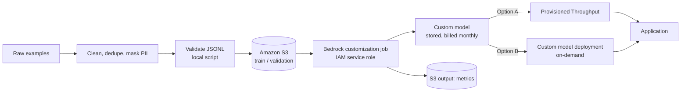

## 0. Before you start
- **Essential:** tokens, prompts, the idea of "training data" ([02](aip:00-foundations/02-llm-and-genai-basics)).
- **Helpful:** what a matrix is (a table of numbers). The LoRA demo uses NumPy.
- **Optional advanced:** gradient descent, overfitting, catastrophic forgetting.

## 1. Simple explanation
A foundation model is already smart, but it is generic. **Customizing** it means showing it many examples of exactly how *you* want it to behave, so that its behavior shifts permanently, like training a new employee with hundreds of worked examples instead of re-explaining the job every morning. It is the right tool for **style, format and narrow-task skill**, and the wrong tool for **facts that change** (that is RAG). **LoRA** is a trick that makes this cheaper: instead of changing every number inside the model, you freeze the model and train a tiny add-on that nudges its behavior.


```figure
flow customization-job
```

## 2. Structured explanation
1. **Pick the cheapest tool that works:** prompt engineering → RAG → customization.
2. **Bedrock offers three customization methods** (✅ official overview):
   - **Supervised fine-tuning:** labeled input→output examples; parameters are adjusted.
   - **Reinforcement fine-tuning:** you provide *reward functions* (AWS Lambda) that score responses; the model learns from the scores. You can start from prompts or from existing invocation logs.
   - **Distillation:** a large **teacher** model generates answers for your prompts; a smaller, cheaper **student** is fine-tuned on them.
3. **Data:** `.jsonl` files in S3 (one JSON object per line); formats differ per model.
4. **Job:** a managed customization job reads S3, trains, writes a **custom model**, and you pay for training tokens × epochs plus monthly model storage.
5. **Deployment:** use **Provisioned Throughput** (dedicated capacity) *or* a **custom model deployment for on-demand inference** (pay per use) (✅).
6. **Lifecycle:** evaluate, version, roll out gradually, roll back, retire. On SageMaker AI the exam guide names Model Registry, deployment pipelines and rollback strategies (skill 1.2.4).

## 3. Analogy
**Teaching a talented new hire.**
- *Prompting* = giving them instructions on a sticky note each time.
- *RAG* = handing them the right binder to read before answering.
- *Fine-tuning* = months of on-the-job coaching until the habits are second nature.
- *Distillation* = the senior expert's answers are used to train a junior who is faster and cheaper.

*Where it breaks:* a coached employee can still look things up; a fine-tuned model **cannot cite sources** and can't learn tomorrow's new policy without being trained again. Also, unlike a person, a model can get *worse* at other things after intense narrow training (catastrophic forgetting).

## 4. The seven questions

**WHAT?** Model customization = adjusting a foundation model's parameters (or a small add-on) using your data so its default behavior fits your task. **LoRA** (Low-Rank Adaptation) is a *parameter-efficient* fine-tuning technique: freeze the original weights `W` and train two small matrices `A` and `B` whose product is a low-rank update, `W' = W + (α/r)·B·A`.

**WHY?** Prompting alone can be long, expensive (every request resends the instructions and examples) and inconsistent. Customization bakes behavior into the model so prompts get **shorter** and outputs **more consistent**; distillation also moves work to a **smaller, faster, cheaper** model.

**WHEN?**
| Situation | Choose | Reason |
|---|---|---|
| Needs current/private facts, citations, frequent updates | **RAG** (not fine-tuning) | Update documents, not the model |
| Consistent tone/format/classification schema across thousands of calls | **Fine-tuning** | Behavior baked in; shorter prompts |
| You can measure "good" with code (valid JSON, correct SQL, rubric score) but have few labeled pairs | **Reinforcement fine-tuning** | Reward function replaces labels |
| A big model gives great answers but is too slow/costly | **Distillation** | Student imitates teacher at lower cost |
| Need a skill the base model lacks entirely | Different/larger model, or heavy custom training | Fine-tuning shifts, rarely creates skills |

**WHERE?** Between your data in S3 and a deployed model endpoint: S3 (data) → Bedrock customization job (IAM service role) → custom model → deployment (Provisioned Throughput or on-demand custom deployment) → your app via the usual runtime APIs. Region matters: fine-tunable models in the official table were mostly single-Region (us-east-1 or us-west-2) ✅.

**HOW?** See §5.

**WHAT IF?**
- *The training data is too small or inconsistent?* The model overfits or learns noise. Quality beats quantity.
- *The base model is retired?* Your custom model depends on it; plan a re-fine-tune on the successor (lifecycle management).
- *Your data contains PII or secrets?* They can be memorized and later reproduced. Clean and mask first (Domain 3).
- *You keep the model idle?* Storage is billed monthly per custom model ✅. Delete unused models; a Provisioned Throughput commitment bills even when idle.
- *The job fails validation?* Usually format, record count, or token limits. Validate locally first (lab).

**WHY NOT?**
- *Why not fine-tune instead of RAG?* No citations, stale after training, and risk of confident wrong "facts". Use RAG for knowledge, fine-tuning for behavior. Many systems use **both**.
- *Why not always distill?* You need good teacher outputs and an evaluation set to prove the student is close enough; on easy tasks a small base model + good prompt may already suffice.
- *When is the "wrong" choice right?* Fine-tuning *can* inject domain vocabulary and jargon handling; RAG alone struggles when the model needs a very specific output style with thousands of examples.

## 5. Technical depth

```figure
lora-rank
```


### 5.1 Customization pipeline

*Reading the arrows:* examples are cleaned and validated, uploaded to S3, and read by the job through a service role you create. The result is a custom model you deploy in one of two ways. Training metrics land in the S3 output location so you can judge whether training helped before paying for deployment.

### 5.2 Data formats (✅ official)
```json
{"prompt": "What is the capital of France?", "completion": "The capital of France is Paris."}
```
Non-conversational tasks (summarize, classify, extract). For conversational models using the Converse format:
```json
{"schemaVersion": "bedrock-conversation-2024",
 "system": [{"text": "You are a ticket classifier."}],
 "messages": [{"role": "user", "content": [{"text": "Refund has not arrived."}]},
              {"role": "assistant", "content": [{"text": "billing"}]}]}
```
Claude 3 Haiku uses its own `system` + `messages` (plain strings) shape. **Use ~6 characters per token** when planning dataset size (AWS's ratio for this page). Documented limits include, for example: Claude 3 Haiku min 32 / max 10,000 records, 32,000 tokens; Llama 3.x min 100 records, 16,000 tokens. These are page snapshots; check yours.

### 5.3 How LoRA works
Full fine-tuning updates every weight in a layer's matrix `W` (size `d×d`). LoRA:
1. **Freezes `W`.**
2. Adds `A` (`r×d`) and `B` (`d×r`), with **rank `r` ≪ `d`** (for example 8 or 16).
3. **Initializes `B` to zero**, so the model starts exactly as the base model.
4. Trains only `A` and `B`. Output = `W·x + (α/r)·B·A·x`.
5. Optionally **merges** (`W' = W + (α/r)BA`) for serving, or keeps adapters separate so **many adapters can share one base model**.

Result: far fewer trainable numbers (see the lab: about **0.39%** at `d=4096, r=8`), less memory, faster training, and tiny adapter files that are easy to version and swap. The trade-off: very low rank can limit how much behavior you can change.

> **What AWS does *not* say (✅ checked):** the Bedrock customization pages I read do not say which technique Bedrock uses internally per model. Treat LoRA as the concept the course and the exam guide use (skill 1.2.4: "parameter-efficient adaptation techniques such as LoRA and adapters for model deployment" on **SageMaker AI**), not as a guaranteed implementation detail of every Bedrock job.

### 5.4 Reinforcement fine-tuning and distillation in one table
| | Supervised FT | Reinforcement FT | Distillation |
|---|---|---|---|
| You provide | Labeled input→output pairs | Prompts + **reward function** (Lambda) | Prompts (optionally labeled pairs) + choose **teacher** and **student** |
| Learns from | Examples | Scores | Teacher's generated answers |
| Good for | Format/style/classification | Verifiable quality (valid JSON, correct math, rubric) | Cheaper/faster model with near-teacher quality |
| Key risk | Bad or biased labels | Reward hacking (model games the score) | Student inherits teacher mistakes |

### 5.5 Deployment options for a custom model (✅)
| Option | Billing | Use when |
|---|---|---|
| **Provisioned Throughput** | Dedicated capacity, billed for the commitment | Steady high traffic, guaranteed throughput, lower latency |
| **Custom model deployment (on-demand)** | Pay per use, no provisioned capacity | Spiky or low traffic, experimentation |

Invoke an on-demand custom model through the **deployment ARN**.

### 5.6 Lifecycle thinking (exam skill 1.2.4)
Version every custom model and its training data → evaluate against a **golden set** before promotion → deploy gradually (canary) → **roll back** on regression → retire and replace when the base model is retired. On SageMaker AI the guide names **Model Registry** for versioning and automated pipelines for updates (covered in `05-sagemaker`).

## 6. Worked example
*Problem:* A telecom wants tickets classified into `billing | bug | account | other`. A strong model with a 500-token prompt (instructions + 10 examples) works but costs more per call and sometimes answers in sentences instead of one word.

| Step | Action | Why |
|---|---|---|
| 1 | Try prompt + few-shot first; measure accuracy and format errors on 200 labeled tickets | Baseline; maybe no customization is needed |
| 2 | Collect 2,000 reviewed ticket→label pairs; remove duplicates and PII | Quality data |
| 3 | Run `validate_training_data.py`; fix issues | Don't pay for a failing job |
| 4 | Fine-tune a *small* supported model on the pairs; keep 10% as validation | Small model + examples ≈ good classifier |
| 5 | Compare against baseline on a held-out set: accuracy, format compliance, cost per 1,000 calls | Prove it helped |
| 6 | Deploy on-demand; later move to Provisioned Throughput if traffic becomes steady | Match capacity to traffic |
| 7 | Prompt shrinks to ~30 tokens ("Classify: …") | Lower per-call cost and latency |

*Takeaway:* customization paid off because the task is narrow, stable, and has many examples. For "answer from our policy PDFs" the same effort would be better spent on RAG.

## 7. Knowledge checkpoints
1. Name the three Bedrock customization methods.
2. Why does LoRA initialize `B` with zeros?
3. A policy document changes weekly. Fine-tune or RAG? Why?
4. What two deployment options exist for a Bedrock custom model?
5. What recurring cost exists even if nobody calls the custom model?

## 7b. Practice questions (exam-style, original) — answers below

**Q1.** A company wants its support assistant to always reply in a fixed JSON schema and a specific brand tone. It has 8,000 reviewed examples. Policy facts live in a wiki that rarely changes in structure but is edited daily. Which approach is MOST appropriate?
A. Fine-tune the model on the wiki pages so it memorizes policies.
B. Fine-tune for schema and tone; use RAG over the wiki for facts.
C. Use only a longer system prompt with the wiki pasted in.
D. Train a new foundation model from scratch.

**Q2.** (Select TWO) Which statements about Bedrock custom models are correct?
A. You can deploy them with Provisioned Throughput.
B. You can deploy them for on-demand, pay-per-use inference using a custom model deployment.
C. Provisioned Throughput is the only possible way to run a custom model.
D. Custom models have no storage cost.
E. A custom model keeps working unchanged even if you change nothing, so no lifecycle planning is needed.

**Q3.** A team wants a much cheaper model that approximates the answers of a very large model on their specific prompts. They have prompts but few labeled answers. Which method fits?
A. Reinforcement fine-tuning
B. Distillation
C. RAG with a reranker
D. Continued prompt caching

**Q4.** Your output must be valid, schema-conforming JSON, and you can write a Lambda function that checks validity and scores quality, but you have almost no labeled pairs. Which approach is the BEST fit?
A. Supervised fine-tuning
B. Reinforcement fine-tuning with a reward function
C. Increase temperature
D. Switch to a smaller embedding model

**Q5.** A fine-tuning job is rejected during validation. Which TWO checks should you perform first?
A. Each line is valid JSON in the format required for that specific model
B. The number of records meets the model's documented minimum and token limits
C. The S3 bucket uses the Standard storage class
D. The IAM user has MFA enabled
E. The training file has fewer than 10 lines

**Q6.** After fine-tuning on a narrow task, the model gives worse general answers on unrelated questions. What is this called, and what is a sensible mitigation?
A. Throttling; request a quota increase
B. Catastrophic forgetting; mix in diverse data, use a parameter-efficient method (like LoRA), lower learning rate/epochs, evaluate broadly
C. Hallucination; raise temperature
D. Drift; delete the vector index

**Q7.** Why can LoRA make serving many customer-specific variants cheaper?
A. It removes the need for a base model.
B. Adapters are small and can share one frozen base model.
C. It always lowers the context window requirement to zero.
D. It converts the model to a rule-based system.

**Q8.** Which scenario should NOT be solved by fine-tuning?
A. Normalizing outputs to a company-specific label set
B. Answering questions about this week's updated HR policy with citations
C. Teaching a small model to mimic a larger model's style
D. Enforcing a consistent response format

## 8. Hands-on lab: validate data, understand LoRA, (optionally) dry-run a job

### 8.1 Objective
Prepare and validate training data locally, see LoRA's parameter savings with real numbers, and inspect the exact job request before spending money.

### 8.2 Prerequisites
Python 3.10+; `pip install numpy boto3`.

### 8.3 AWS services
Local parts: none. Optional real job: Amazon Bedrock (customization), Amazon S3, IAM.

### 8.4 IAM permissions (only for the optional real job)
- **Your identity:** `bedrock:CreateModelCustomizationJob`, `bedrock:GetModelCustomizationJob`, `bedrock:StopModelCustomizationJob`, `bedrock:ListCustomModels`, `iam:PassRole` on the service role (condition `iam:PassedToService: bedrock.amazonaws.com`).
- **Service role** (trust `bedrock.amazonaws.com`): `s3:GetObject`, `s3:ListBucket` on the training bucket; `s3:PutObject` on the output prefix. The official page for exact policy text is "Permissions to access training and validation files and to write output files in S3" (I did not fetch it in this session; take the policy from there).

### 8.5 Region notes
Fine-tuning support is Region- and model-specific. Pick the base model and Region from the *current* "Supported models and Regions for fine-tuning" table.

### 8.6 Architecture
Same as §5.1. Local scripts replace the "validate" and "dry-run" steps.

### 8.7 Cost
- Local scripts: free.
- A real job: billed on training tokens × epochs plus monthly storage (✅). **Estimate before you run:** `estimated_tokens × epochs`, then price it on the Bedrock pricing page for your model (not verified here). Then add deployment cost (Provisioned Throughput commitment or on-demand usage).

### 8.8–8.9 Setup and dependencies
```powershell
cd AIP-C01-Study-Guide\labs-code\01_bedrock\customization
pip install numpy boto3
```

### 8.10 Complete code
| File | Purpose |
|---|---|
| [validate_training_data.py](aip-code:labs-code/01_bedrock/customization/validate_training_data.py) | Validates `.jsonl` formats, empties, duplicates, estimated tokens |
| [sample_train.jsonl](aip-code:labs-code/01_bedrock/customization/sample_train.jsonl) | Deliberately flawed sample (so you can see problems caught) |
| [lora_math_demo.py](aip-code:labs-code/01_bedrock/customization/lora_math_demo.py) | Parameter counts and a real low-rank update (NumPy) |
| [create_customization_job.py](aip-code:labs-code/01_bedrock/customization/create_customization_job.py) | **Dry-run by default**; `--execute` starts a billable job |
| [hyper_example.json](aip-code:labs-code/01_bedrock/customization/hyper_example.json) | Placeholder hyperparameters (model-specific names must come from AWS docs) |

### 8.11 Key code explained
- `check_record` branches on the format and checks **role alternation** (`user`, `assistant`, …) and that the last message is the assistant's target.
- Duplicate detection skips empty prompts so the same problem isn't reported twice (a bug I fixed while testing).
- `lora_math_demo.py` initializes `B` to zeros to prove the model starts unchanged, and uses `np.linalg.matrix_rank` to show the update's rank ≤ `r`.
- `create_customization_job.py` converts hyperparameters to **strings** (the API expects strings), drops keys starting with `_` (my comments), and **refuses to call AWS unless `--execute` is present**.

### 8.12 Run
```powershell
python validate_training_data.py sample_train.jsonl --min-records 100
python lora_math_demo.py
python create_customization_job.py --job-name j1 --model-name m1 --base-model <ID> `
   --role-arn arn:aws:iam::<ACCOUNT>:role/<ROLE> --train-s3 s3://<BUCKET>/train.jsonl `
   --output-s3 s3://<BUCKET>/out/ --hyper hyper_example.json
```

### 8.13 Expected output (captured from real runs, 2026-10-23)
Validator:
```
line 7: empty or missing 'completion'
line 8: empty or missing 'prompt'
line 9: invalid JSON (Expecting value)
line 11: 'messages' needs at least a user and an assistant turn

--- summary ---
records            : 11
records with issues: 4
duplicate prompts  : 1
est. tokens/record : avg 7, max 10
est. training tokens (1 epoch): 76  (billing = tokens x epochs)
WARNING: only 11 records; this model family may need at least 100.
```
LoRA demo (excerpt):
```
d= 4096 r= 8: full=  16,777,216  lora=   65,536  ->  0.39% of the parameters are trained
update is zero at start: True
rank of the learned update = 4 (<= r=4) although the matrix is 512x512
```
Job script (dry run): prints the JSON request, then `DRY RUN: nothing was sent.`

### 8.14 Testing and validation
- Fix the five flawed lines in a copy of `sample_train.jsonl` and rerun until exit code 0.
- Change `r` in the LoRA demo and confirm the printed rank follows `r`.
- Dry-run with a wrong S3 URI to see that **local checks cannot catch AWS-side problems** (permissions, region); those only appear when the real job runs.

### 8.15 Common errors and troubleshooting
| Error | Cause | Fix |
|---|---|---|
| Job fails in validation | Format/limits wrong for that model | Re-read the model's row in the data-prep page; run the validator |
| `AccessDeniedException` on S3 | Service role lacks `s3:GetObject`/`ListBucket`, or bucket in another Region/account | Fix role policy; keep bucket and job in the same Region |
| `ValidationException` on hyperparameters | Wrong names/ranges | Copy from the model's hyperparameter page |
| Can't find the base model | Not fine-tunable or not in this Region | Check the supported table for your Region |
| Model works but costs keep growing | Custom model storage or Provisioned Throughput left on | Delete unused models/commitments |

### 8.16 Security recommendations
- Encrypt training data in S3 (SSE-KMS); restrict the bucket policy to the service role.
- Remove PII and secrets before training (Comprehend/Macie, `08-security`).
- Scope the service role to the specific bucket/prefixes only.
- Log who started jobs (CloudTrail) and tag models with an owner and data-classification.

**Cleanup:** delete the custom model, any Provisioned Throughput, S3 test data, and the service role when finished.

## 9. What can go wrong?

| Failure | Why | Symptoms | Investigate | Fix | Prevent |
|---|---|---|---|---|---|
| **Overfitting** | Too many epochs or too few/narrow examples | Perfect on training set, poor on new inputs | Compare training vs validation loss/metrics | Fewer epochs, more diverse data, use validation set | Always hold out validation + test data |
| **Catastrophic forgetting** | Narrow training shifts general behavior | Worse on unrelated tasks | Run a broad regression set | Mix general data; parameter-efficient method; lower rate | Evaluate on general and task suites |
| **Wrong tool chosen** | Fine-tuned to inject changing facts | Stale/confident wrong answers; no citations | Compare to RAG baseline | Move facts to RAG; keep FT for behavior | Decision table in §4 |
| **Poisoned/biased labels** | Unreviewed labels | Systematic bias in outputs | Slice errors by group; audit labels | Fix data, retrain | Label review + bias evaluation |
| **PII memorized** | Raw data used | Model reveals names/IDs | Red-team extraction tests | Retrain on masked data | Mask before training |
| **Surprise bill** | Idle Provisioned Throughput / stored models; repeated experiments | Cost anomaly | Cost Explorer by usage type | Delete or switch to on-demand | Tag, alarm, cleanup checklist |
| **Base-model retirement** | Provider retires the base | Deployment warnings, forced migration | Model lifecycle notices | Re-fine-tune on successor | Track lifecycle; keep data + pipeline reproducible |
| **Validation job failures** | Format/limits | Fails fast with a message | Read failure reason | Fix data | Local validator in CI |

## 10. Common misconceptions
1. **"Fine-tuning teaches the model our documents."** It mostly shapes behavior; use RAG for facts and citations.
2. **"More data is always better."** Clean, consistent, diverse data beats a large noisy set.
3. **"Provisioned Throughput is required for custom models."** Not anymore: on-demand custom deployment exists ✅.
4. **"LoRA means a different model."** It's the same base model plus a small trained add-on.
5. **"Distillation is just fine-tuning on random data."** It is fine-tuning on a *teacher's generated outputs* for your prompts.
6. **"Once trained, I'm done."** Models need evaluation, versioning, rollback and retirement planning.

## 11. Exam notes
- **Pattern:** "knowledge changes frequently / needs citations" → **RAG**. "consistent style/format with many labeled examples" → **fine-tuning**. "lower cost approximating a bigger model" → **distillation / smaller model / model cascading**.
- **Pattern:** "deploy customized models with versioning, rollback and automation" → **SageMaker Model Registry + pipelines** (skill 1.2.4); LoRA/adapters named explicitly.
- **Distractors:** "train a new FM from scratch" (out of scope), "increase temperature", "bigger embedding model".
- **Cost keywords:** custom models cost **training tokens × epochs + monthly storage + deployment** ✅.
- **Compare:** *Fine-tuning vs RAG vs prompt engineering*; *Provisioned Throughput vs on-demand custom deployment*; *distillation vs fine-tuning*.
- Remember the course says "Fine-Tuning Foundation Models in Bedrock" only; reinforcement fine-tuning and distillation are on the **current** overview page ✅.

## 12. Summary and revision cards
- Order of effort: prompt → RAG → customize.
- Three methods: supervised FT, reinforcement FT (reward Lambda), distillation (teacher→student).
- LoRA: freeze `W`, train low-rank `A`,`B`; `B` starts at 0; tiny adapters.
- Billing: tokens × epochs + monthly storage + deployment.
- Deploy: Provisioned Throughput **or** on-demand custom deployment.
- Validate data locally; hold out evaluation data; plan lifecycle.

**Cards.** Q: What does LoRA freeze? A: The original weights. · Q: RAG or FT for changing facts? A: RAG. · Q: ~chars per token for dataset sizing? A: ~6 (AWS planning ratio).

## 13. References
| Source | URL | Verified |
|---|---|---|
| Customize your model (methods, billing) | https://docs.aws.amazon.com/bedrock/latest/userguide/custom-models.html | 2026-10-23 |
| Fine-tuning: supported models/Regions | https://docs.aws.amazon.com/bedrock/latest/userguide/custom-model-fine-tuning.html | 2026-10-23 |
| Prepare data for fine-tuning (formats, limits) | https://docs.aws.amazon.com/bedrock/latest/userguide/model-customization-prepare.html | 2026-10-23 |
| Set up inference for a custom model | https://docs.aws.amazon.com/bedrock/latest/userguide/model-customization-use.html | 2026-10-23 |
| Exam guide Task 1.2 (skill 1.2.4) | https://docs.aws.amazon.com/aws-certification/latest/ai-professional-01/ai-professional-01-domain1.html | 2026-10-23 |
| LoRA paper (Hu et al., 2021) | https://arxiv.org/abs/2106.09685 | not fetched; cited from general knowledge |

**Unverified here:** per-model hyperparameter names; exact service-role policy text; whether continued pre-training still exists; live behavior of `create_customization_job.py`.

## 14. Answers to checkpoints and practice questions

**Checkpoints.** 1) Supervised fine-tuning, reinforcement fine-tuning, distillation. 2) So `B·A = 0` initially and the model starts identical to the base model; training moves it gradually. 3) RAG; update the documents without retraining, supports citations. 4) Provisioned Throughput; custom model deployment for on-demand inference. 5) Monthly storage per custom model (and a Provisioned Throughput commitment if you bought one).

**Practice questions.**
- **Q1 → B.** Fine-tuning gives consistent schema/tone; RAG supplies edited-daily facts. A is wrong (fine-tuning is poor at keeping facts current). C bloats every request and can't scale to a wiki. D is out of scope and absurd for this need.
- **Q2 → A, B.** C is outdated (on-demand deployment exists). D is wrong (monthly storage per model). E is wrong (base model retirement and drift require lifecycle management).
- **Q3 → B.** Distillation generates teacher answers for your prompts, then fine-tunes a smaller student, so you don't need labels. A needs a reward function. C and D don't create a cheaper approximation model.
- **Q4 → B.** Reward functions (Lambda) score validity/quality without labeled pairs. A needs labeled pairs. C increases randomness (worse). D is unrelated.
- **Q5 → A, B.** Format and record/token limits are the usual validation failures. C and D are irrelevant (storage class and MFA don't affect dataset validation). E is backwards: models have *minimum* record counts (for example 32 or 100), so a tiny file is more likely to be the problem, not a requirement.
- **Q6 → B.** Catastrophic forgetting; mitigate with diverse data, parameter-efficient tuning, gentler training, broad evaluation. A, C, D name unrelated issues.
- **Q7 → B.** Small adapters share one frozen base model. A is false (a base model is required). C and D are nonsense.
- **Q8 → B.** Current, cited policy answers are a RAG use case. A, C, D are classic fine-tuning strengths.
