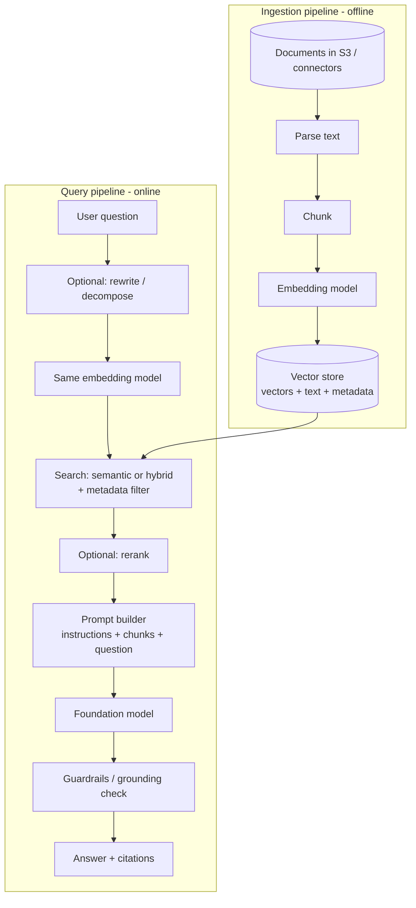

## 0. Before you start
- **Essential:** tokens and context windows; embeddings and cosine similarity (links above).
- **Helpful:** the idea of a "golden set" of test questions.
- **Optional advanced:** BM25, HNSW, cross-encoder rerankers.

## 1. Simple explanation
A language model only knows what it learned during training and what you put in the prompt. **RAG** (Retrieval-Augmented Generation) fixes the "what you put in the prompt" part automatically: when a user asks a question, the system first *searches your documents* for the most relevant passages, then pastes those passages into the prompt and tells the model, "answer using only these." The model writes the answer in fluent language, and you can show which documents it came from. To update the system's knowledge, you update the documents. You never retrain the model.


```figure
flow rag-pipeline
```

## 2. Structured explanation
**Two pipelines meet at the vector store:**
1. **Ingestion (offline, repeated on change):** load documents → parse text → **chunk** → **embed** each chunk → **store** vectors with text + metadata.
2. **Query (online, every request):**
   1. (Optional) **rewrite/expand/decompose** the question.
   2. **Embed** the question with the *same* model.
   3. **Search** the vector store (semantic, or hybrid with keywords), optionally **filter by metadata**.
   4. (Optional) **rerank** the candidates.
   5. **Build the prompt:** instructions + retrieved chunks + question (+ chat history).
   6. **Generate** with the LLM; return the answer **with citations**.
   7. (Optional) **verify/guard** the answer (grounding checks, Guardrails).

## 3. Analogy
**An employee who consults the company binders before answering a customer.** The binders are your documents, the index tabs are the embeddings, and the "how to answer" instruction is the prompt.

*Where it breaks:* a human knows when the binder doesn't contain the answer. A model will happily answer anyway unless you build the "I don't know" path. And if the employee grabs the wrong binder (bad retrieval), a perfectly fluent answer will still be wrong.

## 4. The seven questions

**WHAT?** A pattern, not a single product: *retrieve relevant external data, then generate a response grounded in it*. In AWS, the managed implementation is **Amazon Bedrock Knowledge Bases**; you can also assemble it yourself from an embedding model, a vector store (OpenSearch, Aurora pgvector, S3 Vectors…), and a model via Converse. AWS describes it as "a technique that uses information from data sources to improve the relevancy and accuracy of generated responses" ✅.

**WHY?** LLMs have (1) a training cutoff, (2) no access to your private data, (3) a tendency to hallucinate, (4) no source attribution. RAG addresses all four without retraining, and AWS notes it "removes the need to continually train your model to be able to use your private data" ✅.

**WHEN?** Use RAG when answers must reflect **private, large, or frequently changing** content, or must be **cited and auditable**: help desks, policy Q&A, internal wikis, contract review, product manuals.

| Need | RAG? | Better alternative |
|---|---|---|
| Fresh/private facts with citations | Yes | – |
| Tone/format consistency | No | Prompting / fine-tuning |
| Answer from a single short document | Maybe not | Put the text in the prompt (long context); simpler |
| Exact structured lookup ("order #123 status") | No | Tool/function call to a database/API |
| Aggregations ("total sales last month") | No | Text-to-SQL / structured data store (Bedrock KB can connect to structured stores ✅) |

**WHERE?** Between your data and the model. Data enters via ingestion; the user's question enters at query time; the answer exits with citations. It sits behind an API (API Gateway/Lambda) and often beside Guardrails, caching and logging.

**HOW?** §5.

**WHAT IF?**
| Situation | What happens | Remedy |
|---|---|---|
| Nothing relevant exists | Nearest-neighbour search still returns *something* | Score threshold + "I don't know" path |
| Retrieved text is irrelevant | Model may answer from noise or its own memory | Better chunking, hybrid search, reranker, filters, evaluation |
| Retrieved chunks are too long | Prompt exceeds limit; Bedrock returns a prompt-length error ✅ | Fewer results, smaller chunks, shorter template/query (the doc lists exactly these four fixes) |
| Docs contain conflicting versions | Model blends them | Metadata (date/version) filter; remove stale docs |
| User lacks permission to a document | Leakage risk | Metadata/ACL filtering per user; managed KBs offer document-level ACL filtering on supported connectors ✅ |
| Prompt injection inside a document | Hidden instructions hijack the model | Treat retrieved text as untrusted; guardrails; instruction hierarchy |

**WHY NOT?**
- *Why not fine-tune instead?* No citations, stale after training, can't enforce per-user access.
- *Why not stuff everything into a huge context window?* Cost and latency scale with tokens; relevance gets diluted; some corpora are simply too big.
- *Why not skip chunking and embed whole files?* One vector for a 50-page file blurs meaning; the right passage can't be isolated (see chunking, next topic).
- *When is "naive RAG" enough?* Small, clean corpora with straightforward questions. Add rerankers, hybrid search and query rewriting only when evaluation shows retrieval problems.

## 5. Technical depth

```figure
rerank-fusion
```


### 5.1 End-to-end architecture

*Reading the arrows:* (1) Documents are parsed and split into chunks, each becoming a vector in the store. (2) At question time, the optional rewrite step can turn a vague or multi-part question into better search queries. (3) The question vector searches the store (the filter narrows candidates, for example by department or date). (4) A reranker can reorder the candidates by true relevance. (5) The prompt builder places the best chunks in the prompt with strict instructions. (6) The model generates; a guard layer can check the output; the user gets the answer plus the source list.

### 5.2 Where Amazon Bedrock Knowledge Bases fits
AWS describes Knowledge Bases as automating this pipeline: it converts data to text, splits it, creates embeddings, writes them to a vector index "while maintaining a mapping to the original document"; at runtime it embeds the query, finds similar chunks, augments the prompt and calls the model ✅ (`kb-how-it-works`). Details and the managed vs. customer-managed choice are in the next topic ([04 Knowledge Bases](aip:01-bedrock-genai-fundamentals/04-bedrock-knowledge-bases)).

### 5.3 Query-side techniques (exam skills 1.5.4–1.5.5)
| Technique | What it does | When it helps | AWS building blocks |
|---|---|---|---|
| **Query rewriting/expansion** | Rewrites vague questions, adds synonyms | Short/ambiguous queries | A small LLM call (Bedrock), Lambda |
| **Query decomposition** | Splits a multi-part question into sub-queries and merges results | "Compare A and B" questions | KB `QUERY_DECOMPOSITION` ✅; Step Functions orchestration |
| **Hybrid search** | Combines keyword and vector scores | IDs, names, rare terms | KB `overrideSearchType: HYBRID` (only on stores with a filterable text field) ✅ |
| **Metadata filtering** | Restricts candidates by attributes | Tenancy, dates, document type | KB `filter` operators ✅ |
| **Reranking** | A second model reorders the top results | Good recall but poor ordering | KB `rerankingConfiguration` / Bedrock reranker ✅ |
| **Parent-child (hierarchical) chunks** | Match on small chunks, return larger parent | Precise match + enough context | KB hierarchical chunking ✅ |

### 5.4 Prompt construction rules that matter
1. Say "**use only the sources**" and give an **exact refusal sentence** when the answer is absent.
2. **Number the sources** so the model can cite `[1]`.
3. Put sources in a clearly delimited block; treat them as **data, not instructions**.
4. Keep temperature low for factual Q&A.
5. In Bedrock KB custom templates, `$search_results$` is **required** and `$output_format_instructions$` is needed for **citations to appear** ✅.

### 5.5 Guardrails and RAG: an exam trap (✅)
Per the AWS page: **Guardrails are applied to the input and the generated response only. They are not applied to the references retrieved from Knowledge Bases at runtime.** So a malicious or sensitive passage inside a retrieved chunk is *not* filtered by the guardrail before it reaches the model. Defend the corpus at ingestion (PII scan, access control), not only at the output.

### 5.6 Evaluating RAG: two separate questions
| Layer | Question | Simple metrics |
|---|---|---|
| **Retrieval** | Did we fetch the right chunks? | hit@k, recall@k, MRR, context relevance, retrieval latency |
| **Generation** | Is the answer faithful to the chunks and does it answer the question? | groundedness/faithfulness, answer relevance, completeness, citation accuracy |

Diagnose in this order: **retrieval first.** If the right chunk was never retrieved, no prompt can save you. (Skill 5.1.6 covers retrieval quality testing; 5.1.5 covers RAG evaluation and LLM-as-a-judge; Bedrock Evaluations details come in `07-governance-qa`.)

## 6. Worked example
*Problem:* An HR bot must answer "How many vacation days do new hires get?" The policy was updated yesterday (20 → 25 days).

| Step | What happens | Why |
|---|---|---|
| 1 | HR uploads `vacation-policy-v3.pdf`; ingestion re-embeds it and updates metadata `{"version": 3, "effective": 20261022}` | Knowledge updated without retraining |
| 2 | Question → embedding → top-5 chunks. Chunks from v2 and v3 are both returned | Old document still indexed |
| 3 | Filter `version >= 3` (or delete v2 from the source and re-sync) | Prevent conflicting evidence |
| 4 | Prompt: "Use only these sources… cite [n]… else say you don't know." | Grounding |
| 5 | Answer: "New hires receive 25 vacation days [1]." with a link to the v3 document | Correct, current, auditable |
| 6 | Log question, chunk IDs, scores, answer | Debugging and compliance |

*Lesson:* the quality problem here was **stale data**, not the model.

## 7. Knowledge checkpoints
1. Name the two pipelines in a RAG system.
2. Why must the same embedding model embed documents and questions?
3. A user asks something not covered by any document. Which two mechanisms prevent a made-up answer?
4. Does a Bedrock Guardrail filter the chunks returned by a knowledge base before the model sees them?
5. Which should you debug first when answers are wrong: the prompt or retrieval? Why?

## 7b. Practice questions (exam-style, original) — answers below

**Q1.** An insurance company's claims manual is updated weekly. Adjusters need accurate answers with links to the source paragraph. Which solution BEST meets the requirements with the least operational effort?
A. Fine-tune a foundation model every week on the manual.
B. Use a Bedrock knowledge base over the manual and return citations from `RetrieveAndGenerate`.
C. Paste the full manual into every prompt.
D. Train a custom model from scratch on the manual.

**Q2.** (Select TWO) Users complain that questions containing exact policy codes such as "POL-2291-B" return unrelated results from a vector-only search. Which changes are MOST likely to help?
A. Use hybrid search that combines keyword and vector search.
B. Add the policy code as filterable metadata and filter on it when the code is present.
C. Increase the model's temperature.
D. Reduce the embedding dimensions from 1,024 to 256.
E. Disable chunking.

**Q3.** A RAG application sometimes answers confidently even when no document contains the answer. Which TWO actions reduce this? 
A. Add a minimum similarity score and return a fixed "I don't know" response when no chunk passes.
B. Instruct the model to answer only from sources and use an exact refusal sentence when information is missing.
C. Increase `numberOfResults` to 100 so something is always relevant.
D. Raise the temperature to encourage varied answers.
E. Remove the system prompt.

**Q4.** A team enabled a Bedrock Guardrail on their knowledge-base `RetrieveAndGenerate` calls but found a prompt-injection sentence in a retrieved document still influenced the model. Why?
A. Guardrails only work with Anthropic models.
B. Guardrails are applied to the user input and the generated response, not to the references retrieved from the knowledge base.
C. Guardrails must be attached to the vector store.
D. Guardrails are disabled for `Retrieve` and `RetrieveAndGenerate` calls entirely.

**Q5.** Evaluation shows correct passages are in the top-20 retrieved results but rarely in the top-3 passed to the model. What is the MOST targeted improvement?
A. Fine-tune the generation model
B. Add a reranking model to reorder the candidates
C. Reduce the maximum output tokens
D. Switch the LLM to a larger size

**Q6.** A knowledge-base query fails with an error that the prompt exceeds the character limit. Which TWO changes can resolve it?
A. Reduce the number of retrieved results
B. Use smaller chunks in the data source
C. Increase the temperature
D. Disable citations
E. Add more documents to the knowledge base

**Q7.** Which question is LEAST suitable for a document-RAG pipeline?
A. "Summarize our remote-work policy."
B. "What is the current status of order 88123?"
C. "Which clause covers early termination fees?"
D. "How do I reset the VPN token?"

**Q8.** After a policy change, answers still quote the old policy. Retrieval logs show both old and new documents retrieved. What is the BEST fix?
A. Lower the temperature to 0
B. Remove or expire the stale document in the source and re-sync, or filter on version/effective-date metadata
C. Increase the number of chunks returned
D. Change the embedding dimension

## 8. Hands-on lab: build and evaluate a mini RAG pipeline

### 8.1 Objective
Run a full RAG pipeline end to end (chunk, embed, retrieve, threshold, prompt, answer), measure retrieval with a golden set, and see why a lexical embedder fails on paraphrases.

### 8.2 Prerequisites
Python 3.10+; `pip install numpy`. For the optional semantic run: `pip install boto3` and [Bedrock setup](aip:01-bedrock-genai-fundamentals/01-bedrock-overview-and-converse-api).

### 8.3 AWS services
Offline run: none. Optional: Bedrock Runtime (Titan Text Embeddings V2; Converse for generation).

### 8.4 IAM (optional AWS run)
`bedrock:InvokeModel` on `amazon.titan-embed-text-v2:0` (and your generation model/profile ARN for `GENERATOR=bedrock`). See [03 embeddings lab](aip:00-foundations/03-embeddings-vectors-semantic-search) for the policy.

### 8.5 Region notes
Use a Region where Titan Text Embeddings V2 and your chosen generation model are available.

### 8.6 Architecture
Same as §5.1 with a Python process playing every role in-memory.

### 8.7 Cost
Offline: free. Titan run: a few short embedding calls (tiny; check pricing). Bedrock generation: a few short calls (pick a low-cost model; keep `maxTokens` small).

### 8.8–8.9 Setup and dependencies
```powershell
cd AIP-C01-Study-Guide\labs-code\01_bedrock\rag
pip install numpy
```

### 8.10 Complete code
[labs-code/01_bedrock/rag/mini_rag.py](aip-code:labs-code/01_bedrock/rag/mini_rag.py): `chunk_text`, `HashingEmbedder` (offline), `TitanEmbedder` (Bedrock), `MiniVectorStore`, `build_prompt`, `answer`, `evaluate_retrieval`.

### 8.11 Key code explained
- **`chunk_text`** slides a window of `max_words` and steps by `max_words − overlap_words`. It raises an error if overlap ≥ size, because the window would never advance (an infinite loop).
- **`HashingEmbedder`** hashes each word into one of 512 slots and L2-normalizes. It uses `md5` rather than Python's `hash()` because `hash()` changes between runs (randomized per process). It is **lexical only**: it cannot know that "sign in" ≈ "login".
- **`search`** uses a dot product, which equals cosine similarity because vectors are normalized.
- **`answer`** returns "I don't know" *without calling the model* when no chunk beats `min_score`, saving cost and preventing a made-up answer.
- **`build_prompt`** numbers the sources and includes the exact refusal sentence.
- **`evaluate_retrieval`** computes hit@1 against `GOLDEN`. With six chunks, hit@3 would be nearly always high, so the lab reports hit@1.

### 8.12 Run
```powershell
python mini_rag.py                              # offline
$env:EMBEDDER = "titan"; python mini_rag.py     # semantic embeddings (AWS)
$env:GENERATOR = "bedrock"; $env:BEDROCK_MODEL_ID = "<id>"; python mini_rag.py
```

### 8.13 Expected output (offline, captured from a real run on 2026-10-23)
```
Embedder: hashing | chunks stored: 6

Q: How long do refunds take to arrive?
A: I don't know based on the provided documents.  (best score 0.13 < threshold 0.25)

Q: How do I reset a forgotten password?
A: Account security. To reset a forgotten password, choose Forgot password ...  [1: account-security.md, score=0.49]

Q: What is the airspeed velocity of an unladen swallow?
A: I don't know based on the provided documents.  (best score 0.21 < threshold 0.25)

== Retrieval evaluation (hit@1 on the golden set) ==
  HIT  score=0.38  'How many days do I have to ask for a refund?'     -> refund-policy.md
  HIT  score=0.35  'How long does express shipping take?'             -> shipping.md
  HIT  score=0.45  'I forgot my password, what do I do?'              -> account-security.md
  HIT  score=0.25  'Why was my account locked after failed logins?'   -> account-security.md
  MISS score=0.00  "I can't recall how to sign in"                    -> refund-policy.md

hit@1 = 80%
```
**What this output teaches (read it carefully):**
1. *"How long do refunds take to arrive?"* is answerable (the refund policy says 5 to 7 business days) but was **refused** with best score 0.13. The words "take", "refunds" (plural), "arrive" don't match the document's "refund", "returned". A **false refusal**.
2. The truly unanswerable *swallow* question scored **0.21**, *higher* than the answerable refund question (0.13). **No single threshold separates them** with this embedder. Real semantic embeddings, reranking, and per-corpus tuning exist to fix exactly this.
3. The paraphrase *"I can't recall how to sign in"* **missed with score 0.00**: zero shared words. This is the case semantic embeddings solve. Run with `EMBEDDER=titan` to compare. **I could not run the Titan variant here**, so I don't state its numbers.

### 8.14 Testing and validation
1. Lower `min_score` to 0.1 and rerun: the refund question now answers, but check what the swallow question does. Record the trade-off.
2. Add three of your own golden questions, including one paraphrase and one unanswerable one.
3. Change chunk size (`max_words` 12 vs 40) and compare hit@1.
4. With `EMBEDDER=titan`, compare the paraphrase score and the threshold behavior.

### 8.15 Common errors and troubleshooting
| Problem | Cause | Fix |
|---|---|---|
| `ValueError: overlap must be smaller…` | `overlap_words ≥ max_words` | Use overlap < size |
| Titan run `AccessDeniedException` | IAM/Region/model | See the embeddings lab |
| Different results each run (if you replace md5 with `hash()`) | Python randomizes string hashing per process | Use a stable hash |
| Generator ignores sources | Weak prompt | Strengthen instructions; lower temperature |

### 8.16 Security recommendations
- Treat retrieved text as untrusted input (prompt-injection risk).
- Don't embed or log PII without a policy.
- Apply per-user access filters at retrieval time if documents have different audiences.
- Don't print entire prompts to shared logs.

**Cleanup:** none (in-memory only).

## 9. What can go wrong?

| Failure | Why | Symptoms | Investigate | Fix | Prevent |
|---|---|---|---|---|---|
| **Retrieval miss** | Poor chunking, vocabulary mismatch, wrong embedding model | Right doc exists but isn't returned; plausible but wrong answers | Log top-k with scores; test golden set | Re-chunk, hybrid search, query rewrite, reranker, better embeddings | Retrieval evaluation in CI |
| **False refusals / false answers (threshold)** | A single score cutoff can't separate hits from misses | "I don't know" on answerable questions or confident answers on unanswerable ones (see lab) | Plot scores for known-answerable vs unanswerable questions | Tune per corpus; rerank; use a grounding check | Maintain a labelled set with both types |
| **Context overload** | Too many/large chunks | Prompt-length errors; ignored middle content | Token counts per request | Fewer/smaller chunks; summarise; rerank | Token budget guard |
| **Stale or conflicting data** | Old docs still indexed | Answers cite old policy | Compare source timestamps with index sync time | Re-sync, delete old versions, version filters | Scheduled/event-driven sync (Task 1.4.5) |
| **Hallucination despite RAG** | Weak prompt; irrelevant chunks; high temperature | Claims not present in sources | Groundedness check against cited chunks | Stronger prompt, lower temperature, grounding check | Faithfulness metric + guardrails |
| **Unauthorized data exposure** | No access filtering | User sees another team's content | Test with low-privilege users | Metadata/ACL filters at query time | Per-tenant indexes or enforced filters |
| **Prompt injection via documents** | Retrieved text contains instructions; guardrails don't scan retrieved references ✅ | Model follows instructions found in a document | Red-team documents | Sanitize at ingestion, delimit sources, limit tool powers | Ingestion scanning |
| **Cost/latency spikes** | Query decomposition, big contexts, reranking everything | Slow responses; rising token spend | Trace stage timings | Cache; limit candidates; cheaper model for rewriting | Latency budget per stage |

## 10. Common misconceptions
1. **"RAG eliminates hallucinations."** It reduces them. Bad retrieval or weak prompts still yield wrong answers.
2. **"RAG needs fine-tuning to work well."** Usually not; retrieval quality matters more.
3. **"Vector search always finds the answer if it exists."** It finds the *nearest* vectors, which can be wrong; chunking and embeddings matter.
4. **"A guardrail protects the retrieved documents."** Not for retrieved references ✅. Protect them upstream.
5. **"Bigger context windows make RAG obsolete."** Cost, latency, focus and corpus size keep RAG relevant.
6. **"One similarity threshold works for every query."** The lab shows it doesn't.

## 11. Exam notes
- **Pattern:** "private data, frequently updated, needs citations, minimal ops" → **Bedrock Knowledge Bases** (managed RAG).
- **Pattern:** "exact identifiers missed" → **hybrid search**, metadata filters. "Right chunk found but ranked low" → **reranker**. "Complex multi-part question" → **query decomposition**. "Answer needs both precision and context" → **hierarchical chunking**.
- **Pattern:** "reduce hallucinations" → grounding (RAG), instruction to say unknown, contextual grounding check (Guardrails), structured output validation (skill 3.1.3).
- **Trap:** guardrails don't filter retrieved references ✅.
- **Troubleshooting order:** retrieval → context assembly → prompt → generation.
- **Compare:** *RAG vs fine-tuning vs long context*; *Retrieve vs RetrieveAndGenerate* (next topic).
- Skills: 1.5.1 chunking, 1.5.4 hybrid + reranker, 1.5.5 query handling, 5.1.5 / 5.1.6 RAG and retrieval evaluation.

## 12. Summary and revision cards
- RAG = retrieve → augment prompt → generate (+ cite).
- Two pipelines: ingestion (chunk, embed, store) and query (embed, search, [rerank], prompt, generate).
- Always provide an "I don't know" path; thresholds need tuning per corpus.
- Fix retrieval before prompts; measure with a golden set (hit@k, groundedness).
- Hybrid + metadata + rerank + decomposition are targeted fixes.
- Guardrails ≠ retrieved-reference protection.

**Cards.** Q: What updates RAG knowledge? A: The documents/index, not the model. · Q: hit@k? A: Fraction of questions whose right doc is in the top-k. · Q: Fix for exact-ID misses? A: Hybrid search / metadata.

## 13. References
| Source | URL | Verified |
|---|---|---|
| Retrieve data and generate AI responses with Knowledge Bases | https://docs.aws.amazon.com/bedrock/latest/userguide/knowledge-base.html | 2026-10-23 |
| How Knowledge Bases work (pre-processing, runtime) | https://docs.aws.amazon.com/bedrock/latest/userguide/kb-how-it-works.html | 2026-10-23 |
| Query configuration (search type, filters, decomposition, templates, guardrails) | https://docs.aws.amazon.com/bedrock/latest/userguide/kb-test-config.html | 2026-10-23 |
| RetrieveAndGenerate (guardrail scope, prompt-length note) | https://docs.aws.amazon.com/bedrock/latest/userguide/kb-test-retrieve-generate.html | 2026-10-23 |
| Exam guide Tasks 1.4/1.5/5.1 | https://docs.aws.amazon.com/aws-certification/latest/ai-professional-01/ai-professional-01-domain1.html | 2026-10-23 |

**Unverified here:** Titan-embedder results for the mini lab (not run against AWS); exact reranker model names and prices.

## 14. Answers to checkpoints and practice questions

**Checkpoints.** 1) Ingestion (offline) and query (online). 2) Different models create incompatible vector spaces. 3) A minimum-score threshold with a fixed refusal, and a prompt that restricts answers to sources with an exact refusal sentence. 4) No; guardrails apply to input and generated response, not to retrieved references. 5) Retrieval; if the right chunk isn't retrieved, prompt changes can't fix it.

**Practice questions.**
- **Q1 → B.** Managed RAG with citations and no retraining. A is slow, costly and can't cite. C blows past limits and cost. D is out of scope.
- **Q2 → A, B.** Hybrid search matches exact tokens; metadata filtering narrows to the code. C worsens consistency. D reduces precision. E removes the ability to isolate passages.
- **Q3 → A, B.** Threshold plus strict grounding instruction. C feeds more noise. D increases fabrication. E removes guardrails for the model's behavior.
- **Q4 → B.** AWS states guardrails apply to input and generated output, not retrieved references. A, C, D are false.
- **Q5 → B.** The right passages are retrieved but poorly ordered; reranking addresses ordering. A, C, D don't fix ranking.
- **Q6 → A, B.** AWS lists reducing retrieved results and using smaller chunks (plus shortening template/query). C, D don't shorten the prompt meaningfully; E makes it worse.
- **Q7 → B.** Live operational status is a database/API tool call, not document retrieval. A, C, D are document questions.
- **Q8 → B.** Remove/expire stale content and re-sync, or filter by version/effective date. A, C, D don't resolve conflicting evidence (C may worsen it).
