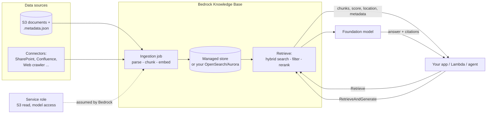

## 0. Before you start
- **Essential:** RAG pipeline vocabulary; what an IAM *service role* is (a role an AWS service assumes on your behalf).
- **Helpful:** S3 prefixes; JSON.
- **Optional advanced:** OpenSearch indexes, pgvector.

## 1. Simple explanation
Building RAG by hand means writing code to read files, split them, call an embedding model, run a vector database, search it, and assemble prompts. **Amazon Bedrock Knowledge Bases** does this plumbing for you. You point it at your documents (for example an S3 folder), it processes them into searchable chunks, and your app then calls one API to either **get the best passages** (`Retrieve`) or **get a finished answer with citations** (`RetrieveAndGenerate`). There are now **two flavors**: a **Managed** knowledge base where AWS also runs the search storage and AWS recommends it, and a **Customer-managed** one where you choose and run the vector database yourself.


```figure
flow kb-retrieve-generate
```

## 2. Structured explanation
1. **Create a knowledge base** (type `MANAGED` or customer-managed with your vector store).
2. **Connect a data source** (S3 and others). Optionally add **metadata** files.
3. **Ingest (sync):** parse → chunk → embed → store. Re-sync later to pick up adds, edits and deletes (incremental ✅).
4. **Query** with `Retrieve` (chunks + scores + locations + metadata) or `RetrieveAndGenerate` (answer + citations).
5. **Tune retrieval:** metadata filters, hybrid vs semantic search, reranking, query decomposition, prompt template, number of results.
6. **Secure and operate:** IAM least privilege, encryption, logging, cost control, data deletion policy.

## 3. Analogy
**A managed research library with a librarian.** You hand over your documents; the librarian catalogs them (chunks + embeddings), keeps the catalog current when you add or change books (sync), and answers "find me the pages about X" (Retrieve) or "answer this from the pages" (RetrieveAndGenerate).
- *Managed KB* = the library also owns the shelving system.
- *Customer-managed KB* = you rent your own shelving system (OpenSearch/Aurora) and maintain it.

*Where it breaks:* a librarian doesn't check who may read what unless you set that up. In Bedrock, **everything you sync is retrievable by anyone with `bedrock:Retrieve`** (✅ AWS warning), so permissions must be designed deliberately.

## 4. The seven questions

**WHAT?** A managed AWS capability that implements the RAG ingestion and retrieval pipeline. AWS lists the KB types on the main page ✅: **Managed**, **Customer-managed** (vector store such as OpenSearch Serverless, Aurora, Neptune Analytics), plus options to connect **structured data stores** (natural language → SQL), an **Amazon Kendra GenAI index**, and **Neptune Analytics graphs**.

**WHY?** Faster time to market and less undifferentiated work: AWS says it abstracts "the heavy lifting of building pipelines" and removes "the need to continually train your model to be able to use your private data" ✅.

**WHEN?** | Choose | When |
|---|---|
| **Managed KB** (AWS recommends ✅) | You want end-to-end managed RAG, many connectors, agentic retrieval, document-level ACL filtering, AgentCore Gateway integration, no vector DB to run |
| **Customer-managed KB** | You need a specific vector store configuration, direct access to the vector DB, a custom parsing choice (Foundation Model or Bedrock Data Automation parser), or the store already exists |
| **Hand-built RAG** (own code) | You need pipeline logic Bedrock KB can't express, or must run outside Bedrock |
| **Structured data store KB** | Questions are about tables ("sales by region"), not documents |

**WHERE?** Between your data sources and your application/agent. Data enters from connectors; queries enter via `bedrock-agent-runtime`; results exit as chunks or generated answers. It feeds agents (Agents Classic, AgentCore via Gateway), Amazon Quick, and your own Lambda/API Gateway apps.

**HOW?** §5.

**WHAT IF?**
| Situation | What happens | What to do |
|---|---|---|
| Documents change | Index is stale until re-sync | Schedule or event-trigger `StartIngestionJob`; incremental sync handles add/update/delete ✅ |
| You delete the data source | Behavior depends on `dataDeletionPolicy` | `DELETE` removes vectors; `RETAIN` keeps them (and they keep costing) ✅ |
| Query returns too few results | Hierarchical chunking replaces children with parents; table/figure context merges results | Expected; raise `numberOfResults` or accept |
| Using a custom embedding model on a managed KB | **Managed reranker unavailable**; can't switch embedding type later ✅ | Decide up front; recreate the KB to change |
| Someone without a need-to-know calls `Retrieve` | They see any synced content ✅ | Least-privilege IAM, per-KB separation, ACL filtering on supported connectors |
| Filter returns nothing | Metadata missing/wrong type, or unsupported operator for your store | Check `.metadata.json`, operator support (e.g. no `startsWith` on managed) ✅ |
| Prompt too long in `RetrieveAndGenerate` | Error | Fewer results, smaller chunks, shorter template/query ✅ |

**WHY NOT?**
- *Why not always Managed?* Less control over the store and chunking choices (managed: built-in/default or fixed-size, no semantic chunking ✅), and the feature may not be in your Region.
- *Why not always Customer-managed?* You operate and pay for the vector database (idle costs!), and several features (third-party connectors, document-level permissions, AgentCore Gateway integration) are **managed-only** ✅.
- *Why not skip KB and call the embedding model + OpenSearch directly?* You can, and the exam names that pattern (Lambda batch embeddings, OpenSearch Neural plugin). KB trades flexibility for speed and less code.

## 5. Technical depth

```figure
vector-space {"filter": true}
```


### 5.1 Managed vs customer-managed (✅ official comparison)
| Feature | Managed | Customer-managed |
|---|---|---|
| Data store | Auto-scaling store of embeddings, text, metadata, raw files, all managed by Bedrock | You choose, provision, scale, update |
| Search | Agentic and semantic **hybrid** retrieval (always hybrid for `Retrieve`) | You choose (hybrid only on stores with a filterable text field: RDS, OpenSearch Serverless, MongoDB) |
| Embeddings | Built-in managed model (no extra cost) *or* any listed Bedrock embedding model at **float32, 1024 dims** | Any supported Bedrock embedding model |
| Reranking | Built-in managed reranker by default; custom or none optional | Choose a Bedrock reranker |
| Connectors | 7 listed on the comparison table (S3, SharePoint, Confluence, Web Crawler, Google Drive, OneDrive, Custom); the create page lists more (see log) | S3 and Custom |
| Parsing | Built-in multimodal parser | Default (text), Foundation Model, or Bedrock Data Automation |
| Chunking | Default or fixed-size per the comparison table (other AWS pages also list none/hierarchical; semantic is **not** supported on managed) | Default, fixed-size, hierarchical, semantic, none (per the chunking page) |
| Agentic retrieval | Yes | No |
| AgentCore Gateway | Yes | No |
| Infra management | None | Yours |
| Query API config | `managedSearchConfiguration` | `vectorSearchConfiguration` |

*Note on a doc inconsistency:* the managed comparison table lists chunking as built-in or fixed-size only, while the Kendra migration page lists default, fixed-size, hierarchical and no chunking for managed. The create-page console steps show default / fixed-size / no chunking. Trust the KB build pages; verify in your console.

### 5.2 Architecture

*Reading:* data sources feed an **ingestion job** that runs under a **service role** you grant (least privilege). The job writes to the store. At query time, your app calls Retrieve (just chunks) or RetrieveAndGenerate (chunks go to a model, and the answer comes back with citations).

### 5.3 The two query APIs
| API | Returns | Use when |
|---|---|---|
| **`Retrieve`** | `retrievalResults[]` with `content.text`, `score`, `location`, `metadata` | You build your own prompt, pipeline, agent tool, or UI; you want to inspect/evaluate retrieval |
| **`RetrieveAndGenerate`** (and `...Stream`) | Generated `output.text` + `citations` (`generatedResponsePart`, `retrievedReferences`), `sessionId` for multi-turn | Quick end-to-end Q&A with citations |
| **Agentic retrieval** (managed only) | Iterative multi-hop retrieval, decomposes queries, may span multiple KBs (`AgenticRetrieveStream`, quota 300 RPM/account ✅) | Complex questions needing several lookups |

Key request fields (✅): `knowledgeBaseId`, `retrievalQuery.text`, `retrievalConfiguration`; for generation: `modelArn` (model or inference profile), `generationConfiguration.promptTemplate.textPromptTemplate`, `guardrailConfiguration`, `sessionId`. Defaults: **5 results** if unspecified; `numberOfResults` is a maximum.

**Managed `Retrieve` specifics (✅):** always hybrid; reranking on by default via `rerankingModelType` = `MANAGED` | `CUSTOM` | `NONE`; no `startsWith`/`stringContains` filters.

### 5.4 Metadata: the cheap precision tool
A sidecar file named `<document>.<ext>.metadata.json` next to the source (≤ 10 KB) ✅:
```json
{"metadataAttributes": {
   "department": {"value": {"type": "STRING", "stringValue": "support"}, "includeForEmbedding": false},
   "version":    {"value": {"type": "NUMBER", "numberValue": 3}, "includeForEmbedding": false}}}
```
Simplified form `{"metadataAttributes": {"tag": "value"}}` stores metadata for filtering only. `includeForEmbedding: true` prepends `key: value` to the chunk text *before embedding* (so it influences similarity) but is not returned in the chunk text. Filter operators and one-level `andAll`/`orAll` nesting are listed in the log. Use metadata for **tenant/department**, **document type**, **version/effective date**, **language**, **classification**.

### 5.5 Chunking choices (preview; the next topic goes deeper) ✅
Default ≈ 300 tokens, sentence-aware · Fixed-size (`maxTokens`, `overlapPercentage`) · Hierarchical (parent/child, child retrieved then replaced by parent) · Semantic (extra FM cost; not available on managed) · None (document = one chunk; no page numbers in citations). **You can't change the chunking strategy after connecting the data source** (customer-managed S3 flow ✅), so decide early.

### 5.6 Security model: read this twice
1. **Service role** (assumed by Bedrock): trust `bedrock.amazonaws.com` **with** `aws:SourceAccount` and `aws:SourceArn` conditions (confused-deputy protection); permissions only to the specific bucket (+ KMS decrypt if the bucket is encrypted) ✅.
2. **Caller permissions:** `iam:PassRole` for the service role (with `iam:PassedToService = bedrock.amazonaws.com`), `bedrock:Retrieve` / `RetrieveAndGenerate` for querying.
3. **Data exposure:** "All data that you sync … becomes available to anyone with `bedrock:Retrieve` permissions" ✅. One KB per sensitivity level or per tenant is a safe default; use ACL filtering where a connector supports it.
4. **Encryption:** optional customer KMS key for the managed store (`ServerSideEncryptionConfiguration.KmsKeyArn`) ✅.
5. **Guardrails** protect the user input and generated answer, **not retrieved references** ✅ (see RAG topic).

### 5.7 Keeping the store current (exam skill 1.4.5; lesson 80)
Incremental sync handles add/update/delete since the last sync ✅. Trigger options: manual/console sync, **EventBridge schedule → Lambda → `StartIngestionJob`**, or **S3 event → Lambda** for near-real-time. For connectors beyond S3, a custom pipeline that exports to S3 then ingests is AWS's own recommended pattern in the Kendra migration guidance ✅.

### 5.8 Cost and "don't leave OpenSearch running" (lesson 17)
- *Customer-managed with OpenSearch Serverless:* capacity is billed in **OCUs**, provisioned separately for indexing and search; vector-search collections can't change type after creation ✅. **I did not verify minimum OCU counts or the idle price**, so check the OpenSearch pricing page before any lab. The takeaway stands: serverless ≠ free when idle.
- *Managed KB:* the managed embedding and reranking models come "at no extra cost" ✅; storage, ingestion and queries are still billed per the pricing page (not verified here).
- *Always:* delete the KB, data source, vector collection/index, role and test data after a lab. Use the cleanup script.

## 6. Worked example
*Problem:* Support wants answers from refund and security policies. A refund policy changed (14 → 25 days) and the old version file is still in the bucket.

| Step | Action | Why |
|---|---|---|
| 1 | Upload `refund-policy.md` (v3), `refund-policy-v2.md` (v2), `account-security.md` + sidecars with `version`, `department` | Metadata lets us separate versions |
| 2 | Create managed KB + S3 data source (`inclusionPrefixes: ["documents/"]`) + ingestion | Managed pipeline |
| 3 | `Retrieve("refund window")` with no filter returns v3 **and** v2 chunks | Conflicting evidence |
| 4 | Add filter `version >= 3` (or delete v2 and re-sync) | Correct, current source only |
| 5 | `RetrieveAndGenerate` → "25 days" with a citation to the v3 object | Auditable answer |
| 6 | Later, a nightly EventBridge → Lambda calls `StartIngestionJob` | Index stays fresh |

## 7. Knowledge checkpoints
1. Name the two knowledge-base types and one feature available only on managed KBs.
2. Which query API fits "I'm building my own agent tool and want to inspect scores"?
3. What does `includeForEmbedding: true` do?
4. Who can read your synced documents, and what does that imply for design?
5. Why is hybrid-only behavior a consideration for the `Retrieve` call on a managed KB?

## 7b. Practice questions (exam-style, original) — answers below

**Q1.** A startup wants a RAG solution over documents in S3 with the least infrastructure to manage. It does not need to control the vector database. Which option does AWS currently recommend?
A. Customer-managed knowledge base with OpenSearch Serverless
B. Amazon Bedrock Managed Knowledge Base
C. Self-hosted OpenSearch on EC2 with custom ingestion code
D. DynamoDB with embeddings stored as attributes

**Q2.** (Select TWO) Which features are available **only** with managed knowledge bases (not customer-managed)?
A. Third-party data source connectors such as SharePoint and Confluence
B. S3 as a data source
C. Native integration with AgentCore Gateway
D. Choosing OpenSearch Serverless as the vector store
E. Using a Bedrock embedding model such as Titan Text Embeddings V2

**Q3.** A team created a managed KB with a custom embedding model. They now cannot use the built-in managed reranker. Which statement explains this?
A. Reranking requires a customer-managed KB.
B. Managed reranking is available only when the KB uses the managed embedding model.
C. Reranking was deprecated.
D. Custom embedding models cannot be queried.

**Q4.** An intern with only `bedrock:Retrieve` permission on a knowledge base can read HR salary documents that were synced into it by another team. What is the root cause and best remedy?
A. A bug; open an AWS support case
B. All synced data is retrievable by anyone with `bedrock:Retrieve`; separate sensitive content into its own KB and restrict `Retrieve` by resource, and use ACL filtering where supported
C. Guardrails automatically hide salary data
D. Enable hybrid search

**Q5.** After a policy update, a knowledge base answers with outdated text. The S3 object has been replaced. What should the team do?
A. Delete the KB and recreate it
B. Run an ingestion (sync) job; schedule it or trigger it from S3/EventBridge events
C. Increase `numberOfResults`
D. Switch to semantic-only search

**Q6.** A query with metadata filter `{"startsWith": {"key": "doc_id", "value": "POL-"}}` fails or is unsupported on a managed KB. What should the team do?
A. Use `equals`, `in`, `greaterThan`/`lessThan` style filters and restructure metadata (for example a separate `doc_prefix` attribute)
B. Switch to a smaller embedding model
C. Convert the filter to `stringContains`
D. Turn off hybrid search

**Q7.** A developer wants to build their own prompt and apply custom post-processing after retrieving passages. Which API should they call?
A. `RetrieveAndGenerate`
B. `Retrieve`
C. `Converse` only
D. `CreateKnowledgeBase`

**Q8.** (Select TWO) A lab used a customer-managed KB with OpenSearch Serverless. A week later the bill is higher than expected. Which actions should have been taken?
A. Delete the knowledge base, data source and the OpenSearch collection after the lab
B. Assume serverless services cost nothing when idle
C. Set a billing alarm and review Cost Explorer by service
D. Increase the number of OCUs to speed up cleanup
E. Disable CloudTrail

## 8. Hands-on lab: managed knowledge base end to end

### 8.1 Objective
Create a **managed** knowledge base over S3 documents with metadata, ingest it, query it with and without filters, then **clean up**.

### 8.2 Prerequisites
[Setup](aip:00-foundations/01-aws-account-iam-and-cli-setup) done; billing alarm set; Python 3.10+, `pip install boto3`; Bedrock **managed** KB available in your Region (**check**: AWS lists supported Regions on a dedicated page I did not open).

### 8.3 AWS services
Amazon Bedrock (Knowledge Bases, agent runtime), Amazon S3, IAM, STS.

### 8.4 IAM permissions
Your identity (lab only; tighten afterwards): `iam:CreateRole`, `iam:GetRole`, `iam:PutRolePolicy`, `iam:DeleteRolePolicy`, `iam:ListRolePolicies`, `iam:DeleteRole`, `iam:PassRole` (condition `iam:PassedToService = bedrock.amazonaws.com`), `s3:CreateBucket`, `s3:PutObject`, `s3:PutBucketPublicAccessBlock`, `s3:DeleteObject`, `s3:DeleteBucket`, `s3:ListBucket`, `bedrock:CreateKnowledgeBase`, `bedrock:GetKnowledgeBase`, `bedrock:DeleteKnowledgeBase`, `bedrock:CreateDataSource`, `bedrock:GetDataSource`, `bedrock:DeleteDataSource`, `bedrock:StartIngestionJob`, `bedrock:GetIngestionJob`, `bedrock:Retrieve`, `bedrock:RetrieveAndGenerate`, `sts:GetCallerIdentity`. (Exact resource-level scoping is left for you to tighten; I did not verify every action name against the IAM reference.)
Service role (created by the script): trust `bedrock.amazonaws.com` with `aws:SourceAccount` and `AWS:SourceArn` conditions, plus `s3:ListBucket`/`s3:GetObject` on the one bucket ✅ (copied from AWS's managed-KB role page).

### 8.5 Region notes
Bucket and KB must be in the **same Region** ✅. Set `AWS_REGION`.

### 8.6 Architecture
Same as §5.2 with a single S3 data source.

### 8.7 Cost
Managed embedding/reranking: no extra model cost per AWS ✅. Storage, ingestion and queries and any generation model tokens are billed per the Bedrock pricing page (not verified here). Expect small cost for 3 tiny documents, but **clean up the same day**.

### 8.8 Environment setup
```powershell
cd AIP-C01-Study-Guide\labs-code\01_bedrock\kb
pip install boto3
$env:AWS_REGION = "us-east-1"          # your Region
```

### 8.9 Dependencies
`boto3` only.

### 8.10 Complete code
| File | Purpose |
|---|---|
| [kb_common.py](aip-code:labs-code/01_bedrock/kb/kb_common.py) | Clients; `kb_state.json` remembers what was created |
| [kb_upload_docs.py](aip-code:labs-code/01_bedrock/kb/kb_upload_docs.py) | Create private bucket (optional) and upload docs + metadata sidecars |
| [kb_setup_managed.py](aip-code:labs-code/01_bedrock/kb/kb_setup_managed.py) | Role → managed KB → S3 data source → ingestion (`--dry-run` available) |
| [kb_query.py](aip-code:labs-code/01_bedrock/kb/kb_query.py) | `Retrieve` with filters; optional `RetrieveAndGenerate` |
| [kb_cleanup.py](aip-code:labs-code/01_bedrock/kb/kb_cleanup.py) | Delete only what the lab created |
| sample_docs/ | v3 and v2 refund policy, account security, with sidecars |

### 8.11 Key code explained
- **Trust policy conditions** (`aws:SourceAccount`, `AWS:SourceArn`) stop another account's Bedrock resource from tricking your role (confused deputy).
- **Retry on role creation:** IAM is eventually consistent; a brand-new role can be rejected for seconds, so the script retries `CreateKnowledgeBase`.
- **`embeddingModelType: MANAGED`** means no embedding model ARN or access request is needed ✅.
- **`dataDeletionPolicy="DELETE"`**: deleting the data source also deletes its vectors (so cleanup actually frees storage).
- **`wait()`** polls status values: KB `ACTIVE`/`FAILED`; data source `AVAILABLE`; ingestion `COMPLETE`/`FAILED`/`STOPPED`.
- **`kb_query.py`** builds `managedSearchConfiguration` (managed KB), composes filters with `andAll`, and prints score/location/metadata so you can *see* retrieval quality.
- **`kb_cleanup.py`** deletes only resources recorded in the state file and waits for the data source to disappear (a KB with a data source cannot be deleted).

### 8.12 Run
```powershell
python kb_upload_docs.py --bucket <UNIQUE-BUCKET-NAME> --create-bucket
python kb_setup_managed.py --dry-run
python kb_setup_managed.py
python kb_query.py "How many days do I have to ask for a refund?"
python kb_query.py "refund window" --min-version 3
python kb_query.py "refund window" --department support --generate-model-arn <MODEL-OR-PROFILE-ARN>
python kb_cleanup.py            # preview
python kb_cleanup.py --yes --delete-bucket
```

### 8.13 Expected output
- **Verified by running here (2026-10-23):** the `--dry-run` request printouts, the `kb_query.py --dry-run` request JSON (a `managedSearchConfiguration` with `andAll` of `greaterThanOrEquals(version, 3)` and `equals(department, support)`), and `kb_cleanup.py` stating `kb_state.json not found` when nothing is recorded.
- **Not run against live AWS:** ingestion and retrieval. Expected *behavior*: ingestion statistics show 3 documents; unfiltered `Retrieve` for "refund window" returns chunks from both the v3 and v2 files; with `--min-version 3` only v3 chunks appear; each result prints a `score`, S3 `location` and metadata.

### 8.14 Testing and validation
1. Run the unfiltered query and confirm **both** v2 and v3 appear; then filter and confirm only v3 appears.
2. Edit `refund-policy.md` in S3, re-run ingestion, and confirm the new text is retrievable (incremental sync).
3. Remove the `.metadata.json` sidecar of one file, re-sync, and see that the version filter excludes that file (no metadata → no match).
4. Call `Retrieve` with a role that lacks `bedrock:Retrieve` to see `AccessDeniedException`.

### 8.15 Common errors and troubleshooting
| Error | Cause | Fix |
|---|---|---|
| `ValidationException` creating KB right after role creation | IAM eventual consistency | Wait/retry (script does) |
| `AccessDeniedException` on `CreateKnowledgeBase` | Missing `iam:PassRole` or Bedrock permission | Add `iam:PassRole` with the `PassedToService` condition |
| Feature/Region not available | Managed KB not offered in the Region | Choose a supported Region |
| Ingestion `FAILED` | Role can't read bucket, wrong prefix, unsupported file | Check role policy, `inclusionPrefixes`, file types, failure reasons |
| `retrieve` returns zero results | Ingestion not complete, filter too strict, wrong KB/Region | Check ingestion status; remove the filter; verify IDs |
| Filter error | Unsupported operator on managed KB | Use supported operators ✅ |
| `ResourceNotFoundException` on cleanup | Already deleted | Safe to ignore |

### 8.16 Security recommendations
- Keep the bucket private (the script enables Block Public Access).
- Scope the service role to the one bucket; encrypt with KMS if required.
- **Treat `bedrock:Retrieve` as read access to all synced content**; separate sensitive data into separate KBs.
- Don't put real customer data in lab KBs.
- Log API activity with CloudTrail; review who can `PassRole`.

**Cleanup (do it now):** `python kb_cleanup.py --yes --delete-bucket`, then confirm in the console that the KB, role and bucket are gone.

## 9. What can go wrong?

| Failure | Why | Symptoms | Investigate | Fix | Prevent |
|---|---|---|---|---|---|
| **Stale answers** | No re-sync after document change | Old facts quoted | Compare S3 `LastModified` with last ingestion job time | Run ingestion; fix schedule | EventBridge/S3-triggered sync; monitor ingestion failures |
| **Failed ingestion** | Role/bucket/prefix/file-type problems | Job `FAILED`; some documents not indexed | `get_ingestion_job` failure reasons and statistics (scanned vs indexed vs failed) | Fix permission/format; re-run | Alarm on failed jobs; test with a sample |
| **Data over-exposure** | Broad `bedrock:Retrieve` | Unauthorized staff see HR/finance text | IAM Access Analyzer / policy review; test as low-privilege user | Split KBs; resource-scope IAM; ACL filtering | One KB per sensitivity level; reviews |
| **Wrong chunking, can't change** | Strategy fixed at connection time | Poor retrieval; no fix without rebuild | Retrieval evaluation | Recreate data source/KB with new strategy | Pilot chunking on a sample before full ingest |
| **Idle vector store cost** | OpenSearch Serverless/other store left running | Daily charges after lab | Cost Explorer by service | Delete collection/KB | Cleanup scripts; billing alarm |
| **Filter silently excludes everything** | Metadata absent or wrong type; unsupported operator/engine (`nmslib` vs `faiss` on OpenSearch Serverless ✅) | Empty results with filter, results without | Query without filter; inspect returned metadata | Fix sidecars; use `faiss`; use supported operators | Metadata schema + test queries |
| **Throttling** | Managed KB `Retrieve` 600 RPM/KB default (burst 25 RPS) ✅ | `ThrottlingException` under load | CloudWatch/error logs | Backoff; cache results; request increase | Capacity planning, caching |
| **Low-quality answers despite good retrieval** | Weak prompt template; guardrail scope misunderstood | Hallucinated claims | Inspect retrieved chunks vs answer | Custom `textPromptTemplate`; keep `$output_format_instructions$` for citations ✅ | Evaluation set |
| **Cross-Region data movement** | Using a cross-Region inference profile for generation | Compliance review flags it ✅ | `GetInferenceProfile` | Use an in-Region model/profile | Data-residency review |

## 10. Common misconceptions
1. **"A knowledge base is a vector database."** It is a managed *pipeline and retrieval service*; the vector store is part of it (managed) or yours (customer-managed).
2. **"Knowledge Bases only work with OpenSearch Serverless."** Other stores exist for customer-managed KBs, and managed KBs need no store at all ✅.
3. **"Guardrails protect everything in RAG."** Not retrieved references ✅.
4. **"IAM on the KB means per-document permissions."** Not by default; synced data is retrievable by anyone with `Retrieve`. ACL filtering exists for supported managed connectors ✅.
5. **"I can change chunking later."** Not on an existing data source (customer-managed S3 flow) ✅; plan ahead.
6. **"Kendra is the Bedrock KB."** Kendra is a separate service in maintenance mode; AWS recommends migrating to the Managed KB ✅ ([log §2](aip:meta/verification-log)).
7. **"Serverless means no idle cost."** Not for OpenSearch Serverless capacity ✅ (check pricing).

## 11. Exam notes
- **Pattern:** "managed RAG, least ops, citations" → Bedrock Knowledge Bases (Managed when features like agentic retrieval/connectors/ACLs are needed).
- **Pattern:** "improve precision by department/date/tenant" → **metadata filtering** (skill 1.4.2).
- **Pattern:** "keep the index current" → incremental sync + EventBridge/Lambda (skill 1.4.5).
- **Pattern:** "use an existing vector DB / full control" → **customer-managed** KB (OpenSearch Serverless, Aurora pgvector, Neptune Analytics) or hand-built RAG.
- **Pattern:** "exact IDs missed" → hybrid search; "right result ranked low" → reranker; "multi-part question" → query decomposition or agentic retrieval.
- **Pattern:** "migrate off Kendra" → Bedrock Managed Knowledge Base ✅.
- **Traps:** guardrails don't cover retrieved references; managed KBs can't use `startsWith`/`stringContains`; custom embedding on managed = no managed reranker; embedding type can't be changed later.
- **Compare:** Retrieve vs RetrieveAndGenerate; managed vs customer-managed; KB vs Kendra vs hand-built OpenSearch.
- **Skills:** 1.4.1 (KB hierarchical organization, OpenSearch + neural plugin, RDS+S3, DynamoDB metadata), 1.4.2 (metadata), 1.4.4 (integration components), 1.4.5 (maintenance), 1.5.3 (vector search deployment), 1.5.4 (hybrid, reranker), 1.5.6 (function calling/MCP access to retrieval).

## 12. Summary and revision cards
- Two KB types: Managed (recommended; AWS runs store, always hybrid, managed embed/rerank by default) vs Customer-managed (you run the store).
- Pipeline: connect → ingest (parse, chunk, embed, store) → query (Retrieve / RetrieveAndGenerate).
- Metadata sidecars enable filtering and precision; chunking can't be changed later.
- Everything synced is retrievable by anyone with `bedrock:Retrieve`.
- Guardrails don't scan retrieved references.
- Keep fresh with scheduled/event-driven ingestion; clean up vector stores.

**Cards.** Q: Managed-only features? A: Third-party connectors, document ACL filtering, AgentCore Gateway integration, agentic retrieval. · Q: Managed `Retrieve` config field? A: `managedSearchConfiguration`. · Q: Default results returned? A: 5. · Q: Metadata file name? A: `<file>.<ext>.metadata.json` (≤ 10 KB).

## 13. References
| Source | URL | Verified |
|---|---|---|
| Bedrock Knowledge Bases overview (types) | https://docs.aws.amazon.com/bedrock/latest/userguide/knowledge-base.html | 2026-10-23 |
| How knowledge bases work | https://docs.aws.amazon.com/bedrock/latest/userguide/kb-how-it-works.html | 2026-10-23 |
| Build a managed knowledge base (comparison table) | https://docs.aws.amazon.com/bedrock/latest/userguide/kb-build-managed.html | 2026-10-23 |
| Create a managed knowledge base (API, embedding options) | https://docs.aws.amazon.com/bedrock/latest/userguide/kb-managed-create.html | 2026-10-23 |
| Managed KB prerequisites (PassRole, KMS) | https://docs.aws.amazon.com/bedrock/latest/userguide/kb-managed-prereqs.html | 2026-10-23 |
| Managed KB service role (trust and S3 policies) | https://docs.aws.amazon.com/bedrock/latest/userguide/kb-managed-permissions.html | 2026-10-23 |
| Managed KB quotas | https://docs.aws.amazon.com/bedrock/latest/userguide/kb-managed-quotas.html | 2026-10-23 |
| Query and retrieve (managed `Retrieve`) | https://docs.aws.amazon.com/bedrock/latest/userguide/kb-test-retrieve.html | 2026-10-23 |
| RetrieveAndGenerate | https://docs.aws.amazon.com/bedrock/latest/userguide/kb-test-retrieve-generate.html | 2026-10-23 |
| Configure queries (filters, search type, templates) | https://docs.aws.amazon.com/bedrock/latest/userguide/kb-test-config.html | 2026-10-23 |
| S3 data source connector (metadata format, incremental sync) | https://docs.aws.amazon.com/bedrock/latest/userguide/s3-data-source-connector.html | 2026-10-23 |
| Chunking | https://docs.aws.amazon.com/bedrock/latest/userguide/kb-chunking.html | 2026-10-23 |
| Supported embedding models | https://docs.aws.amazon.com/bedrock/latest/userguide/knowledge-base-supported.html | 2026-10-23 |
| OpenSearch Serverless overview | https://docs.aws.amazon.com/opensearch-service/latest/developerguide/serverless-overview.html | 2026-10-23 |
| Kendra availability change (migration to Managed KB) | https://docs.aws.amazon.com/kendra/latest/dg/kendra-availability-change.html | 2026-10-23 |

**Unverified here:** live behavior of the lab scripts; Region availability of managed KBs; exact IAM action list; OpenSearch Serverless minimum OCUs/idle price; managed KB pricing.

## 14. Answers to checkpoints and practice questions

**Checkpoints.** 1) Managed and Customer-managed; managed-only examples: agentic retrieval, third-party connectors, document ACL filtering, AgentCore Gateway integration. 2) `Retrieve`. 3) Prepends the metadata key/value to the chunk text before embedding so it influences similarity (not returned in the chunk text). 4) Anyone with `bedrock:Retrieve`; separate sensitive content into separate KBs and restrict access. 5) Managed `Retrieve` always uses hybrid search; semantic-only isn't available, which affects tuning expectations for exact terms vs meaning.

**Practice questions.**
- **Q1 → B.** AWS recommends Managed KB for optimized accuracy and a managed experience. A requires you to manage the store; C is custom ops; D lacks native vector search.
- **Q2 → A, C.** Third-party connectors and AgentCore Gateway integration are managed-only. B (S3) is supported by both. D is customer-managed only (managed KBs need no store you choose). E is supported by both (managed KBs accept a custom Bedrock embedding model at 1024 dims, float32).
- **Q3 → B.** Managed reranking is available only with managed embedding; with a custom model you can use custom reranking or none.
- **Q4 → B.** Synced data is retrievable by anyone with `Retrieve`. Split KBs, scope IAM, and use ACL filtering. A is wrong (by design), C false, D irrelevant.
- **Q5 → B.** Re-sync (ingestion) picks up changes incrementally. A is unnecessary, C and D don't refresh data.
- **Q6 → A.** `startsWith`/`stringContains` aren't supported on managed KBs; restructure metadata and use `equals`/`in`/range filters. C is also unsupported on managed.
- **Q7 → B.** `Retrieve` returns chunks for your own prompt. A generates for you; C isn't retrieval; D creates a KB.
- **Q8 → A, C.** Delete everything after labs; use billing alarms and Cost Explorer. B is false for OpenSearch Serverless capacity; D adds cost; E is unrelated.
