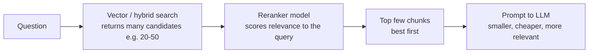

## 0. Before you start
- **Essential:** the RAG pipeline; what an embedding is; what a Knowledge Base ingestion job does.
- **Helpful:** basic JSON; what a Lambda function is (a small piece of code AWS runs on demand).
- **Optional advanced:** HNSW tuning (covered in `02-data-management`), cross-encoder rerankers.

## 1. Simple explanation
Most "bad RAG answers" are caused *before* the model ever writes a word: the documents were read badly, cut in the wrong places, or embedded in a way that makes the right passage hard to find. **Chunking** is how you cut documents into pieces: too small and a piece has no context; too big and one piece mixes many topics so it matches nothing well. **Parsing** is how text is pulled out of PDFs, tables and images. **Embedding choices** decide how precise and how expensive search is. A **reranker** then re-orders the top results so the best passage lands first. And since you can't improve what you can't measure, you **evaluate** retrieval and answers separately with a test set.


```figure
flow rerank-pipeline
```

## 2. Structured explanation
1. **Parse:** extract clean text (and optionally tables/figures) from source files.
2. **Chunk:** split into pieces sized for one idea each; keep structure (headings, tables).
3. **Enrich:** attach metadata (source, date, version, department) for filtering.
4. **Embed:** choose model, dimensions and vector type.
5. **Index:** store in the vector store with settings that balance recall, latency and memory.
6. **Retrieve:** hybrid search, metadata filter, optional query rewriting.
7. **Rerank:** reorder candidates with a reranker model; pass fewer, better chunks.
8. **Evaluate:** measure retrieval (did we fetch the right chunks?) and generation (is the answer faithful and complete?).

## 3. Analogy
**Preparing a textbook for a student who will only ever see a few index cards at a time.**
- *Chunking* = deciding what goes on each card. One idea per card works; half a sentence or a whole chapter doesn't.
- *Parsing* = copying the text correctly, including tables and diagrams.
- *Reranking* = a tutor quickly sorting the pulled cards so the most useful one is on top.
- *Evaluation* = a quiz to see whether the student finds the right card, and then whether they answer correctly from it.

*Where it breaks:* a student can flip to the next card; a RAG system sees only the chunks you hand it, so a sentence cut in half is gone for good.

## 4. The seven questions

**WHAT?** *Chunking* = splitting content before embedding. *Hierarchical chunking* = small child chunks for matching, larger parents returned for context. *Parsing* = text/table/figure extraction. *Reranking* = a model that scores each retrieved chunk's relevance to the query and reorders them (✅ AWS definition). *RAG evaluation* = metrics for retrieval and generation quality.

**WHY?** Retrieval quality caps answer quality. AWS notes rerankers let you "retrieve fewer, but more relevant, results", which can also "decrease cost and latency" by shrinking the prompt ✅.

**WHEN?** Revisit chunking, parsing and reranking when evaluation shows *right document, wrong chunk*, *right chunk, low rank*, or *tables/figures ignored*.

| Symptom | Likely cause | Targeted fix |
|---|---|---|
| Answer needs a fact that was split across two chunks | Chunks too small / boundary cuts a sentence | Sentence-aware or larger chunks; hierarchical (parent context) |
| Retrieved chunk is on-topic but too vague to answer | Chunks too large, mixed topics | Smaller chunks / hierarchical |
| Tables and charts "invisible" | Default text parser | BDA or foundation-model parser |
| Right chunk retrieved but ranked 8th | Ranking quality | Reranker |
| Exact codes missed | Pure semantic | Hybrid search + metadata |
| Cross-language misses | Embedding model language fit | Multilingual embedding model; test |
| Costly/slow ingestion | Semantic chunking or FM parsing on everything | Use only where needed |

**WHERE?** Chunking/parsing/enrichment sit in the **ingestion** pipeline; embeddings span ingestion and query; reranking sits in the **query** pipeline between search and the prompt; evaluation sits around both, usually as a CI/CD step or scheduled job.

**HOW?** §5.

**WHAT IF?**
| Situation | What happens | Remedy |
|---|---|---|
| You pick the wrong chunking strategy | Can't change it on an existing data source (customer-managed S3 flow ✅) | Pilot on a sample; recreate the data source if needed |
| You choose BDA/FM parser | It is used for **all PDFs**, even text-only ones, and you are charged ✅ | Separate image-heavy PDFs into their own data source |
| Hierarchical chunking returns fewer results than requested | Children replaced by shared parents ✅ | Expected; request more or accept |
| You use semantic chunking on a managed KB | Not supported ✅ | Use default/fixed-size, or custom Lambda chunking |
| `numberOfRerankedResults` > `numberOfResults` | Capped at `numberOfResults` (up to 5× only with query decomposition) ✅ | Set sensible values |
| Ground truth missing | **Context coverage** can't be computed ✅ | Supply ground-truth answers in the dataset |

**WHY NOT?**
- *Why not use the biggest chunks possible?* Mixed topics blur the embedding and waste prompt tokens.
- *Why not always rerank?* It adds cost and latency and works on text only ✅; use it when evaluation shows ranking is the weak point.
- *Why not always semantic chunking?* It uses a foundation model, adding cost ✅, and isn't available on managed KBs; fixed-size with sensible overlap is often good enough.
- *Why not always the highest-dimension embedding?* More storage and slower search for small gains; measure.
- *When are the "wrong" choices right?* Tiny chunks can be ideal for FAQ-style Q&A pairs; no chunking is right when you pre-split documents yourself.

## 5. Technical depth

```figure
chunker
```


### 5.1 Chunking strategies in Amazon Bedrock Knowledge Bases (✅)
| Strategy | How it works | Good for | Watch out |
|---|---|---|---|
| **Default** | ≈300 tokens, honors sentence boundaries | Most text; a sane start | Not tunable |
| **Fixed-size** | You set `maxTokens` and `overlapPercentage` | Predictable, uniform docs | Can cut mid-idea if too small |
| **Hierarchical** | Parent and child sizes plus overlap *tokens*; search children, return parents | Needs precise match **and** broad context | Fewer results than requested; metadata size limits (S3 vector buckets: not recommended; >8,000 tokens combined may hit limits) |
| **Semantic** | Splits where sentence meaning changes: `maxTokens`, `bufferSize`, `breakpointPercentileThreshold` | Documents with shifting topics, no clear structure | **Extra FM cost**; not on managed KBs |
| **None** | Each document = one chunk | Already pre-split files | No page numbers in citations; can't filter by page-number metadata |

Semantic parameter intuition: a **buffer size of 1** embeds each sentence together with its previous and next sentence (3 sentences) when judging boundaries; a **higher percentile threshold** requires bigger dissimilarity to split, producing fewer, larger chunks ✅.

**Tables and figures (✅):** for markdown-style parsed content, a matching chunk may be replaced by the **full page or table** (only if ≤ 10,000 characters), and chunks sharing that context are returned once, so you may get fewer results than `numberOfResults`.

### 5.2 Custom chunking and enrichment with Lambda (skill 1.5.1: "Lambda functions to implement fixed-size chunking, custom processing for hierarchical chunking")
Two patterns (✅):
1. **Own chunking logic:** set chunking to **none**, give an S3 bucket (`intermediateStorage`) and a Lambda; your function writes chunked files back and returns references.
2. **Chunk-level metadata:** keep a built-in strategy, add a Lambda (`stepToApply: POST_CHUNKING`) that adds metadata per chunk. **Chunk-level metadata wins over file-level metadata on collisions.**

```json
"vectorIngestionConfiguration": {
  "customTransformationConfiguration": {
    "intermediateStorage": { "s3Location": { "uri": "s3://<BUCKET>/kb-intermediate/" } },
    "transformations": [{
      "transformationFunction": { "transformationLambdaConfiguration": { "lambdaArn": "<LAMBDA_ARN>" } },
      "stepToApply": "POST_CHUNKING" }]
  },
  "chunkingConfiguration": { "chunkingStrategy": "FIXED_SIZE",
    "fixedSizeChunkingConfiguration": { "maxTokens": 300, "overlapPercentage": 20 } }
}
```
The Lambda receives `inputFiles[].contentBatches[]` (S3 keys of JSON files containing `fileContents[]` with `contentBody`, `contentType`, `contentMetadata`) and must return `outputFiles[]` in the same shape. For web connectors the Lambda receives **markdown, not HTML** ✅.

### 5.3 Parsing options (✅)
| Parser | Handles | Cost basis | Notes |
|---|---|---|---|
| **Default** | Text from .txt, .md, .html, .doc/.docx, .xls/.xlsx, .pdf | No usage charge | Text only: no figures/charts/tables as images |
| **Bedrock Data Automation (BDA)** | Multimodal: figures, charts, tables in PDFs; images | **Per page / per image** | No prompt needed; applied to **all** PDFs once chosen |
| **Foundation model** | Multimodal; **customizable parsing prompt** | **Input + output tokens** | Total file size across files ≤ 100 GB; applied to **all** PDFs |

### 5.4 Embeddings and vector choices (✅ from the supported-models page and KB docs)
| Choice | Facts | Guidance |
|---|---|---|
| **Model** | KB-supported: Titan Embeddings G1 (1,536 dims), **Titan Text Embeddings V2 (256/512/1024; float or binary)**, Cohere Embed English / Multilingual (1,024; float or binary), Titan Multimodal G1 (1,024), Cohere Embed v3 Multimodal, Nova Multimodal Embeddings (1,024) | Match language and modality; test on *your* questions |
| **Dimensions** | Titan V2: 256 / 512 / 1,024 | Fewer = cheaper/faster; verify recall on your golden set |
| **Vector type** | float32 or **binary** (1 bit/dim; cheaper but less precise); binary needs a model **and** a vector store that support it | Binary for very large corpora when recall holds |
| **Managed KB constraint** | Custom embedding: **1,024 dims, float32** only | Plan before creating the KB |
| **Metadata in embeddings** | `includeForEmbedding: true` adds key/value into the embedding | Use for terms users actually mention (department, product) |
| **Throughput** | Embedding models are throttled per **requests/minute** ✅ | Batch with backoff in custom pipelines (Lambda batch embedding, skill 1.5.2) |

Index-level tuning (HNSW parameters, shards, OpenSearch engines) is covered in `02-data-management`. One filtering fact to keep: on **OpenSearch Serverless**, metadata filtering needs the **`faiss`** engine, not `nmslib` ✅.

### 5.5 Reranking (✅)

*Reading:* search is cheap and wide; the reranker is more accurate and narrow. It reorders candidates and you keep only the best few, shrinking the prompt (lower cost and latency).

Two ways to use it: call **`Rerank`** directly (query + your documents → reordered list), or add **`rerankingConfiguration`** to `Retrieve`/`RetrieveAndGenerate` (overrides the default ranking) ✅. Supported reranker models (page snapshot): **Amazon Rerank 1.0** (`amazon.rerank-v1:0`, *not* in us-east-1) and **Cohere Rerank 3.5** (`cohere.rerank-v3-5:0`; us-east-1, us-west-2, ap-northeast-1, ca-central-1, eu-central-1). **Text only.** On **managed** KBs rerank is on by default (`rerankingModelType: MANAGED | CUSTOM | NONE`) but the managed reranker needs managed embeddings ✅.

### 5.6 Evaluating RAG (✅ Bedrock Evaluations)
Two job types: **retrieve only** (evaluates retrieved chunks; can evaluate a Bedrock KB *or* your own external RAG's responses) and **retrieve and generate** (evaluates retrieval plus the generator model's answers). Judging is done by an **evaluator LLM** (LLM-as-a-judge) you choose from a supported list, plus optional custom metrics.

| Job type | Built-in metric | Meaning |
|---|---|---|
| Retrieve-only | **Context relevance** (`Builtin.ContextRelevance`) | Are retrieved texts relevant to the question? |
| Retrieve-only | **Context coverage** (`Builtin.ContextCoverage`) | Do retrieved texts cover the ground-truth information? **Needs ground truth** |
| Retrieve-and-generate | **Correctness** | Is the answer accurate? |
| | **Completeness** | Does it resolve all aspects of the question? |
| | **Helpfulness** | Holistic usefulness |
| | **Logical coherence** | Free of gaps/contradictions |
| | **Faithfulness** | Avoids hallucination relative to the retrieved texts |
| | **Citation precision** | How many cited passages were correctly cited |
| | **Citation coverage** | How well the answer is supported by citations; any missing citations |
| | **Harmfulness / Stereotyping / Refusal** | Responsible-AI checks |

Notes: citation metrics apply to Bedrock KB evaluations (for bring-your-own-responses without citations, don't select them 🟡 from AWS blog/search summary).

**Classic IR metrics you can compute yourself** (no service needed): **hit@k / recall@k** (right document in top-k), **MRR** (mean reciprocal rank = average of 1/rank of the first correct result), **precision@k**. Use a **golden set** of 30–200 real questions with the document(s) that answer each. Evaluate *retrieval first*, then generation.

## 6. Worked example
*Problem:* A bank's KB answers "What is the refund window?" wrongly about a third of the time. Documents are PDFs with tables.

| Step | Finding | Action |
|---|---|---|
| 1 | Golden set of 60 questions: hit@5 = 55% | Retrieval is the problem |
| 2 | Inspect misses: 20 involve table content; the default parser flattened tables | Switch only the table-heavy data source to the **BDA parser** (cost per page) |
| 3 | hit@5 → 72%. Remaining misses: right doc in top-20 but not top-5 | Add a **reranker**, retrieve 20, keep 5 |
| 4 | hit@5 → 88%; prompt tokens fall (5 chunks instead of 10) | Lower cost and latency |
| 5 | Run a Bedrock **retrieve-and-generate** evaluation (faithfulness, correctness, citation precision) | Check generation quality too |
| 6 | Put the golden set in CI; re-run on every ingestion or chunking change | Prevent regressions |

*(Numbers are illustrative of the method, not measured results.)*

## 7. Knowledge checkpoints
1. Why can 20% overlap still fail to preserve a sentence?
2. In hierarchical chunking, which chunk is searched and which is returned to the model?
3. Why might choosing the BDA parser raise your bill unexpectedly?
4. Which evaluation metric needs ground truth, and for which job type?
5. When should you add a reranker before changing the embedding model?

## 7b. Practice questions (exam-style, original) — answers below

**Q1.** Users ask questions whose answers require a full paragraph, but the knowledge base returns tiny fragments that lack context. The team wants precise matching and enough context for the model. Which chunking strategy fits BEST?
A. Fixed-size chunks of 20 tokens
B. Hierarchical chunking (match small child chunks, return larger parent chunks)
C. No chunking for very large PDFs
D. Increase the model's temperature

**Q2.** (Select TWO) A knowledge base on documents full of charts and tables returns poor answers. Which TWO statements are accurate?
A. The default parser extracts text only and does not extract figures, charts or tables as images
B. Choosing a Bedrock Data Automation or foundation-model parser applies it to all PDFs in the data source and incurs charges
C. The default parser is the best option for multimodal documents
D. Parser choice has no cost impact
E. Parsing only affects images, never tables

**Q3.** A team wants custom chunking logic not offered by Bedrock. Which approach is supported?
A. Choose "no chunking", provide an intermediate S3 bucket and a transformation Lambda that writes chunked files back
B. Edit the vector index directly in the managed KB store
C. Increase `numberOfResults`
D. Use semantic chunking on a managed knowledge base

**Q4.** A retrieval evaluation shows the correct passage is within the top 20 results but rarely within the top 3 that are sent to the model. What is the MOST effective next step?
A. Switch to a larger generation model
B. Add a reranker model to reorder candidates and keep the top few
C. Remove all metadata
D. Lower `maxTokens`

**Q5.** (Select TWO) Which are correct about Bedrock reranking?
A. Rerankers reorder retrieved chunks by relevance to the query
B. Reranking works for text data only
C. Rerankers work on images and audio
D. A reranker always increases prompt size
E. You cannot call reranking directly outside a knowledge base

**Q6.** Which Bedrock RAG-evaluation metric requires you to supply ground-truth text in the dataset?
A. Context relevance
B. Context coverage
C. Harmfulness
D. Refusal

**Q7.** A RAG answer cites passages that do not actually support the claim. Which metric BEST detects this?
A. Citation precision
B. Context coverage
C. Latency
D. Refusal

**Q8.** (Select TWO) A team plans to switch embedding models on an existing managed KB created with the default managed embedding. Which statements are correct?
A. The embedding model type cannot be changed after creation; create a new knowledge base
B. With a custom embedding model on a managed KB, the managed reranker is not available
C. They can switch freely with no re-ingestion
D. A custom embedding on managed KBs can use any dimension size
E. Managed KBs do not support embeddings

## 8. Hands-on lab (no Python files): measure chunking, then tune a KB

### 8.1 Objective
See, with real numbers, how chunk size and overlap affect whether a key fact survives; then repeat the idea on a Bedrock Knowledge Base with the console and the AWS CLI.

### 8.2 Prerequisites
Python 3.10+ only for Part A. Parts B–C need the [managed KB lab](aip:01-bedrock-genai-fundamentals/04-bedrock-knowledge-bases) resources (or any KB) and the AWS CLI v2.

### 8.3 AWS services
Part A: none. Parts B–C: Bedrock Knowledge Bases, Bedrock runtime, (optional) Bedrock Evaluations, S3.

### 8.4 IAM permissions
Part A: none. Part B: `bedrock:Retrieve` and ingestion permissions from the KB lab. Part C (console evaluation): permissions to create evaluation jobs and pass a service role, plus access to an evaluator model. I did not fetch the evaluation IAM page; follow the role instructions the console shows.

### 8.5 Region notes
Reranker availability differs by Region (see §5.5). Evaluator and generator models must be available in your Region.

### 8.6 Architecture
```mermaid
flowchart LR
    G[Golden set<br/>question + expected doc] --> E[Run each question]
    KB1[KB variant A<br/>default chunking] --> E
    KB2[KB variant B<br/>fixed-size 300 / 20%] --> E
    KB3[KB variant C<br/>hierarchical] --> E
    E --> M[hit@k / MRR / evaluation job]
    M --> D[Pick the best variant]
```
*Reading:* the same questions run against several chunking variants; the metric decides, not intuition.

### 8.7 Cost
Part A: free. Part B: small (queries; extra ingestion for each variant, and parser/semantic-chunking costs if you enable them). Part C: evaluation jobs invoke an evaluator model per record, so cost scales with dataset size; check the pricing page and start with ~10 questions. Not verified here.

### 8.8 Part A: chunk-size experiment (paste into a terminal; no file is created)
```powershell
@'
text = ('Refund policy. Customers may request a refund within 25 days of purchase with a valid receipt. '
        'Digital downloads are refundable only if they have not been accessed. '
        'Approved refunds are returned to the original payment method within 5 to 7 business days. '
        'Shipping policy. Standard shipping takes 3 to 5 business days within the country. '
        'Express shipping takes 1 to 2 business days and costs extra.')
FACT = 'refund within 25 days of purchase with a valid receipt'
words = text.split()
def chunks(n, pct):
    step = max(1, n - int(n * pct / 100)); out, i = [], 0
    while i < len(words):
        out.append(' '.join(words[i:i+n]))
        if i + n >= len(words): break
        i += step
    return out
print('size overlap chunks fact_intact')
for n in (8, 12, 20, 40):
    for pct in (0, 20):
        cs = chunks(n, pct); print(n, pct, len(cs), any(FACT in c.lower() for c in cs))
# Hierarchical idea: small CHILD chunks are searched, the larger PARENT is returned to the model
parent_size, child_size = 40, 10
parents = [' '.join(words[i:i+parent_size]) for i in range(0, len(words), parent_size)]
child_to_parent = {}
for pi, p in enumerate(parents):
    pw = p.split()
    for j in range(0, len(pw), child_size):
        child_to_parent[' '.join(pw[j:j+child_size])] = pi
hit = next(c for c in child_to_parent if 'within 25 days' in c.lower())
print('matched CHILD  :', repr(hit))
print('returned PARENT:', repr(parents[child_to_parent[hit]][:110] + '...'))
'@ | python -
```
*(The closing `'@` must start at the very beginning of its line. In bash/macOS use `python - <<'EOF'` … `EOF`. Tested in Windows PowerShell 5.1; the program is piped to Python's standard input, so no file is created.)*

**Captured output (real run on 2026-10-23 of exactly the program above):**
```
size overlap chunks fact_intact
8 0 9 False
8 20 10 False
12 0 6 False
12 20 7 False
20 0 4 True
20 20 4 True
40 0 2 True
40 20 2 True
matched CHILD  : 'Refund policy. Customers may request a refund within 25 days'
returned PARENT: 'Refund policy. Customers may request a refund within 25 days of purchase with a valid receipt. Digital downloa...'
```
**Read it:** the key sentence is 11 words. At size 12, "20% overlap" is only 2 words, which is far too little to rescue a split sentence. Only chunks large enough to contain the whole sentence keep it intact. Bedrock's **default chunking is sentence-aware** for exactly this reason ✅. Overlap is a safety margin, not a fix for chunks smaller than the unit of meaning.

The last two lines show the hierarchical idea: the matching **child** is a fragment, while the **parent** returned for context contains the whole sentence including `of purchase with a valid receipt`.

### 8.9 Part B: compare chunking variants on a KB (console + CLI)
1. In the console, create **two or three data sources or KBs** over the same documents, each with a different chunking choice (default, fixed-size 300 tokens / 20% overlap, hierarchical with parent ≈ 1,500 and child ≈ 300 tokens). Hierarchical and semantic are customer-managed options in the chunking page; managed KBs offer a narrower set (see [04 §5.1](aip:01-bedrock-genai-fundamentals/04-bedrock-knowledge-bases)). **Labels in the console change; verify the exact field names.**
2. Write 10–20 golden questions and the document each should hit (a simple table in a notes file is enough).
3. For each variant run `Retrieve` and record whether the expected document appears in the top 3 and its rank:
Save this as `request.json` (a notes file, not code to maintain):
```json
{
  "knowledgeBaseId": "<KB_ID>",
  "retrievalQuery": { "text": "How many days do I have to ask for a refund?" },
  "retrievalConfiguration": { "vectorSearchConfiguration": { "numberOfResults": 5 } }
}
```
```powershell
aws bedrock-agent-runtime retrieve --cli-input-json file://request.json --region <REGION>
```
Using a JSON file avoids the shell-quoting problems that inline JSON causes in PowerShell. For a **managed** KB, replace `vectorSearchConfiguration` with `managedSearchConfiguration` ✅. Edit only the question text between runs.
4. Compute hit@3 and MRR by hand. Prefer the variant with the best numbers *and* acceptable cost.

### 8.10 Part C: add a reranker, then run a Bedrock RAG evaluation
- **Reranker:** add this to the retrieval configuration of a customer-managed KB query (model ARN from §5.5, in a Region where it exists):
```json
"vectorSearchConfiguration": {
  "numberOfResults": 20,
  "rerankingConfiguration": {
    "type": "BEDROCK_RERANKING_MODEL",
    "bedrockRerankingConfiguration": {
      "numberOfRerankedResults": 5,
      "modelConfiguration": { "modelArn": "arn:aws:bedrock:<REGION>::foundation-model/cohere.rerank-v3-5:0" } } } }
```
(The managed-KB variant with `rerankingModelType: CUSTOM` is shown in the official `Retrieve` page ✅.) Re-measure hit@3 and compare.
- **Evaluation job (console):** Bedrock console → **Evaluations** → create a **RAG** evaluation → choose *retrieve only* or *retrieve and generate*, pick your KB, an evaluator model, built-in metrics (start with Context relevance and, if you add ground truth, Context coverage; for generation add Faithfulness, Correctness and Citation precision), upload a small prompt dataset to S3. **Exact dataset schema and button labels were not verified here; follow the console's dataset instructions.**

### 8.11 Key ideas in the lab (instead of code walkthrough)
- The experiment isolates **one variable** (chunk size/overlap) and checks one **testable property** (is the fact intact?). Do the same on real documents with your own facts.
- Part B treats chunking as a **measurable choice**, not a guess; the golden set is the judge.
- Part C changes **ranking** (reranker) separately from **chunking**, so you know which change helped.

### 8.12 Expected results
Part A: exactly the table above (deterministic). Parts B–C: *I did not run these against live AWS*, so I give no numbers. Expect hierarchical/larger sentence-aware chunks to keep multi-sentence facts together, and a reranker to improve rank (not recall) when the right chunk is already in the candidate list.

### 8.13 Testing and validation
- Add a sentence of your own to `FACT` and find the smallest chunk size that keeps it intact.
- Change the golden questions to paraphrases and see which variant degrades.
- After any chunking, parser or embedding change, **re-run the same golden set**.

### 8.14 Common errors and troubleshooting
| Problem | Cause | Fix |
|---|---|---|
| CLI JSON parse errors | Shell quoting | Use `file://` JSON files |
| Reranker `ValidationException`/not found | Model not in Region (Amazon Rerank 1.0 not in us-east-1 ✅) | Use Cohere Rerank 3.5 or another Region |
| Fewer results than `numberOfResults` | Parent replacement / shared table context ✅ | Expected |
| Evaluation can't compute Context coverage | No ground truth in dataset ✅ | Add ground-truth text |
| Metadata filter fails on OpenSearch Serverless | Index uses `nmslib` ✅ | Recreate with `faiss` |

### 8.15 Security recommendations
- Parsing and evaluation send document text to models: apply the same data-handling rules as production.
- Evaluation datasets and intermediate S3 buckets (custom transformation) may contain sensitive text: encrypt (KMS) and restrict access.
- Treat Lambda transformation functions as part of your ingestion trust boundary: least-privilege role, no external calls without review.

**Cleanup:** delete the extra data sources/KBs created for comparison; remove intermediate S3 data; delete evaluation outputs you don't need.

## 9. What can go wrong?

| Failure | Why | Symptoms | Investigate | Fix | Prevent |
|---|---|---|---|---|---|
| **Facts split across chunks** | Chunks smaller than the unit of meaning; low overlap | Right document retrieved, answer incomplete | Print retrieved chunks next to the expected passage | Sentence-aware/larger chunks, hierarchical, custom Lambda chunking | Golden set with multi-sentence facts |
| **Chunks too big** | Many topics per chunk | Low similarity scores, vague retrieved text | Inspect chunk contents; check score distribution | Smaller chunks / hierarchical | Test several sizes before full ingest |
| **Tables/figures lost** | Default text-only parser | Questions about charts/tables fail | Look at parsed output | BDA or FM parser (watch cost) | Classify documents; parse by type |
| **Parser cost surprise** | BDA/FM parser applied to every PDF | Bill jump after ingest | Cost Explorer by usage type | Separate data sources by document type | Pilot on a sample; estimate pages × price |
| **Wrong ranking** | Good recall, weak ordering | Right chunk at rank 6–20 | Compare hit@20 to hit@3 | Reranker; hybrid search | Track both recall@k and precision@k |
| **Embedding/index mismatch** | Dimension/type mismatch; binary vectors with unsupported store | Ingest errors | Compare index mapping to model output | Align dimension and vector type | Infrastructure-as-code with asserted settings |
| **Can't change strategy** | Chunking fixed per data source | Stuck with poor retrieval | – | Create a new data source/KB and re-ingest | Pilot first |
| **Evaluation that misleads** | Tiny or unrepresentative golden set; judge model bias | Metrics up, users unhappy | Compare metrics with user feedback | Larger, real-question set; human review of samples | Combine LLM-as-judge with human checks |
| **Metadata size limits** | Hierarchical chunking with big tokens, or table context, on S3 vector buckets ✅ | Ingest failures | Check failure reasons | Smaller chunks; non-filterable metadata keys (`AMAZON_BEDROCK_TEXT`, `AMAZON_BEDROCK_METADATA`) | Read store-specific limits |

## 10. Common misconceptions
1. **"More overlap always fixes split sentences."** Overlap smaller than the sentence doesn't (see Part A).
2. **"Semantic chunking is strictly better."** It costs more (FM calls) and isn't on managed KBs ✅.
3. **"A reranker replaces good retrieval."** It reorders what you retrieved; if the right chunk isn't in the candidates, it can't help.
4. **"Choosing a better parser only affects tricky documents."** Once chosen, BDA/FM parsers process *all* PDFs and bill for them ✅.
5. **"RAG evaluation = checking answers."** Evaluate retrieval separately from generation.
6. **"I can retune chunking later without rebuilding."** Not on an existing data source ✅.
7. **"Higher embedding dimensions always mean better answers."** Often marginal; measure.

## 11. Exam notes
- **Pattern:** "precise match but needs broader context" → **hierarchical chunking**. "Unstructured text with shifting topics, accept extra cost" → **semantic chunking** (customer-managed). "Pre-split files / custom boundaries" → **no chunking + Lambda**.
- **Pattern:** "charts, tables, scanned images" → **BDA or FM parser**; "chunk-level metadata" → **Lambda POST_CHUNKING**.
- **Pattern:** "right chunk exists but low rank" → **reranker**; "reduce prompt size/cost while improving relevance" → **reranker + fewer results**.
- **Pattern:** "evaluate KB quality" → **Bedrock RAG evaluation** (retrieve-only vs retrieve-and-generate; context relevance/coverage; faithfulness, citation precision/coverage); "need ground truth" → context coverage.
- **Pattern:** "batch embedding generation with throttling" → **Lambda + backoff** (skill 1.5.2).
- **Traps:** semantic chunking not on managed KBs; chunking can't change after connect; reranker text-only; managed reranker needs managed embedding; context coverage needs ground truth.
- **Compare:** fixed-size vs hierarchical vs semantic; default parser vs BDA vs FM parser; Rerank API vs `rerankingConfiguration`.
- **Skills:** 1.5.1, 1.5.2, 1.5.4, 4.2.2, 5.1.5, 5.1.6, 5.2.4.

## 12. Summary and revision cards
- Retrieval quality caps answer quality; fix retrieval before prompts.
- Chunk to the size of one idea; sentence-aware or hierarchical; overlap is a margin, not a cure.
- Parser: default (text, free) vs BDA (per page) vs FM (tokens, custom prompt); chosen parser covers all PDFs.
- Embeddings: Titan V2 256/512/1024; binary needs support; managed custom = 1024 float32.
- Reranker: reorders candidates (text only); retrieve more, keep few.
- Evaluate retrieval (hit@k, MRR, context relevance/coverage) and generation (faithfulness, correctness, citations) separately.

**Cards.** Q: Hierarchical retrieval returns? A: Parent chunks (children are matched). · Q: Which metric needs ground truth? A: Context coverage. · Q: Where is semantic chunking unavailable? A: Managed KBs. · Q: Reranker models? A: Amazon Rerank 1.0, Cohere Rerank 3.5.

## 13. References
| Source | URL | Verified |
|---|---|---|
| How content chunking works | https://docs.aws.amazon.com/bedrock/latest/userguide/kb-chunking.html | 2026-10-23 |
| Parsing options | https://docs.aws.amazon.com/bedrock/latest/userguide/kb-advanced-parsing.html | 2026-10-23 |
| Custom transformation Lambda | https://docs.aws.amazon.com/bedrock/latest/userguide/kb-custom-transformation.html | 2026-10-23 |
| Reranker models | https://docs.aws.amazon.com/bedrock/latest/userguide/rerank.html | 2026-10-23 |
| Reranker supported models/Regions | https://docs.aws.amazon.com/bedrock/latest/userguide/rerank-supported.html | 2026-10-23 |
| Supported embedding models for KBs | https://docs.aws.amazon.com/bedrock/latest/userguide/knowledge-base-supported.html | 2026-10-23 |
| Evaluate RAG sources with Bedrock evaluations | https://docs.aws.amazon.com/bedrock/latest/userguide/evaluation-kb.html | 2026-10-23 |
| RAG evaluation metrics | https://docs.aws.amazon.com/bedrock/latest/userguide/knowledge-base-evaluation-metrics.html | 2026-10-23 |
| Query configuration (reranking, decomposition) | https://docs.aws.amazon.com/bedrock/latest/userguide/kb-test-config.html | 2026-10-23 |
| Exam guide Task 1.5, 5.1, 5.2 | https://docs.aws.amazon.com/aws-certification/latest/ai-professional-01/ai-professional-01-domain1.html | 2026-10-23 |

**Unverified here:** evaluation dataset schema and IAM role details; console labels; live behavior of Parts B–C; reranker pricing; the illustrative numbers in §6.

## 14. Answers to checkpoints and practice questions

**Checkpoints.** 1) Overlap is a percentage of chunk size; if that is smaller than the sentence, the sentence still splits (2 words of overlap for a 12-word chunk can't save an 11-word sentence). 2) Child chunks are searched; parent chunks are returned. 3) Once chosen, the BDA/FM parser handles all PDFs (even text-only ones) and is billed per page or per token. 4) Context coverage (retrieve-only jobs). 5) When evaluation shows the right chunk is in the candidates but ranked low (a ranking problem, not an embedding problem).

**Practice questions.**
- **Q1 → B.** Hierarchical: precise child match, broader parent context. A makes fragments worse. C hurts matching on large PDFs. D is irrelevant.
- **Q2 → A, B.** The default parser is text-only; BDA/FM parsers apply to all PDFs and incur charges. C, D, E are false.
- **Q3 → A.** "No chunking" + intermediate S3 bucket + Lambda is the documented custom-chunking path. B isn't supported, C doesn't change chunking, D is unsupported on managed KBs.
- **Q4 → B.** The right passage is retrieved but poorly ordered; a reranker fixes ordering. A, C, D don't address ranking.
- **Q5 → A, B.** Rerankers reorder by relevance and are text-only. C is false, D is false (they let you pass fewer chunks), E is false (the `Rerank` API can be called directly).
- **Q6 → B.** Context coverage compares retrieved text with ground truth. A needs only the question; C and D are generation-side responsible-AI metrics.
- **Q7 → A.** Citation precision measures how many cited passages were correctly cited. B measures retrieval coverage; C and D don't test citation support.
- **Q8 → A, B.** Embedding type can't change after creation, and a custom embedding disables the managed reranker. C is false; D is false (1,024 dims, float32); E is false.
