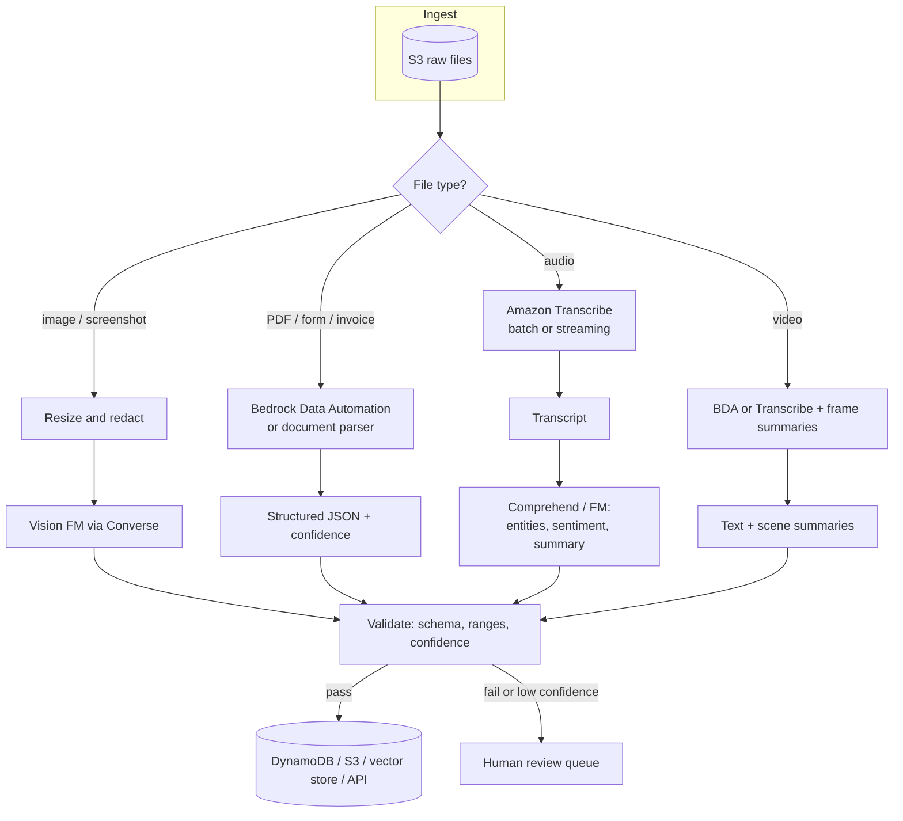
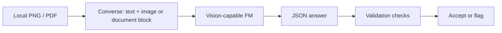

## 0. Before you start
- **Essential:** the Converse `messages` / `content` block format.
- **Helpful:** what OCR (reading text from images) and speech-to-text mean.
- **Optional advanced:** video frame sampling, audio diarization (who spoke when).

## 1. Simple explanation
A **multimodal** model understands more than text: it can look at an image, read a PDF, or watch a video along with your question ("What is the total on this invoice?"). For data a model can't read directly, such as audio, you first convert it to something it can: **Amazon Transcribe** turns speech into text. A **multimodal pipeline** is the chain of steps that turns messy real-world files (scans, recordings, slides) into clean inputs for a model, and then into clean outputs your systems can use. Most production work is in this chain, not in the model call itself.


```figure
flow multimodal-pipeline
```

## 2. Structured explanation
1. **Identify the modality:** text, image, document (PDF/Word/Excel), audio, video, tabular.
2. **Choose how the model will "see" it:**
   - Directly: pass an `image`, `document` or `video` block to a model that supports it.
   - Indirectly: convert first (Transcribe for speech; BDA or a parser for documents; OCR for scans).
3. **Pre-process:** resize/compress, split long files, remove PII, normalize formats.
4. **Prompt with a clear task and an output format** (usually JSON).
5. **Validate the output:** schema, ranges, confidence, human review for risky cases.
6. **Store/route** results (S3, DynamoDB, downstream APIs, vector store for retrieval).

## 3. Analogy
**A mailroom that sorts mixed mail before it reaches the analyst.** Letters (text) go straight in. Photos (images) are clipped to the case file. Voicemails (audio) are typed up by a transcriber. Scanned forms go through a clerk who extracts the fields. The analyst (the model) only works well if every item arrives in a form they can read.

*Where it breaks:* a clerk's typing mistakes silently reach the analyst. Each conversion step (OCR, transcription) can introduce errors that the model then treats as fact, so keep confidence scores and spot-checks.

## 4. The seven questions

**WHAT?** *Multimodal* = more than one input/output type. In Bedrock's Converse API a message's `content` is a list of blocks: `text`, `image`, `document`, `video` (plus `toolUse`, `toolResult`, `guardContent`, `cachePoint`) ✅. *Multimodal embeddings* map images/video/audio/text into one vector space for cross-modal search (for example Titan Multimodal Embeddings G1 at 1,024 dimensions; Nova Multimodal Embeddings) ✅.

**WHY?** Business data is mostly not plain text: invoices, scans, screenshots, call recordings, product photos. Without multimodal handling you either lose information or build many separate services.

**WHEN?**
| Task | Approach |
|---|---|
| Ask questions about one image/screenshot/chart | `image` block to a vision-capable model |
| Q&A over a short PDF | `document` block (+ required text prompt) |
| Extract structured fields from many invoices/forms | Bedrock Data Automation (BDA) or FM extraction with JSON schema; validate |
| Search a library of images/videos by text or similar image | Multimodal embeddings + vector store |
| Understand a call recording | Transcribe (speech→text) → Comprehend/FM for sentiment, summary, entities |
| Video with important speech | Transcribe/BDA for transcript + scene summaries; embeddings alone ignore speech ✅ |
| Table/CSV analysis | Usually not a vision task: parse to structured data, then text-to-SQL/aggregation |

**WHERE?** At the *front* of the GenAI pipeline (ingestion and pre-processing) and inside the model call. Services: Bedrock (multimodal FMs, BDA), Transcribe, Textract/Rekognition (classic AI services), S3 (storage), Lambda/Step Functions (orchestration), SageMaker Processing (heavy custom processing; named in the exam guide).

**HOW?** §5.

**WHAT IF?**
| Situation | What happens | Remedy |
|---|---|---|
| You pass an S3 URI image to a non-Nova model | Rejected with a validation error ✅ | Read the object and pass `bytes` |
| You omit `format` on a document | `ValidationException: Document format is required.` ✅ | Always set `format` (it is never inferred) |
| You send a document without any `text` block | Invalid; a text prompt is required ✅ | Add an instruction block |
| Enable `citations` with a `docx` or an S3 source | Fails: citations allow only `txt`/`pdf` and no `s3Location` ✅ | Convert, or send bytes |
| Document `name` contains instructions | Prompt-injection risk ✅ | Use a neutral name such as `Document 1` |
| Video's key info is spoken | Visual embeddings miss it ✅ | Transcribe first or use BDA |
| OCR misreads a digit | Wrong total flows downstream | Confidence thresholds, cross-field checks, human review |
| Model doesn't support a modality | Error | Check the model's page in "models at a glance" |

**WHY NOT?**
- *Why not send everything as raw images to a vision model?* Cost (image tokens), accuracy on dense forms, and no structured provenance. Specialized extraction (BDA, Textract) is often cheaper and more reliable for forms.
- *Why not always use classic Textract/Rekognition?* They don't reason or follow free-form instructions; an FM can answer questions about the content.
- *Why not skip pre-processing?* Large, noisy or sensitive files inflate cost and risk. Resize, split and redact first.
- *When is the "wrong" way right?* For a one-off screenshot, sending the image directly is the simplest and perfectly fine.

## 5. Technical depth

### 5.1 Converse content blocks (✅ official)
```json
{ "role": "user",
  "content": [
    { "text": "Extract vendor, date and total as JSON. Reply with JSON only." },
    { "image": { "format": "png", "source": { "bytes": "<raw bytes; the SDK base64-encodes for you>" } } }
  ] }
```
| Block | Source options | Key rules |
|---|---|---|
| `image` | `bytes`; `s3Location` **only for Amazon Nova** | If you omit `text`, the model describes the image |
| `document` | `bytes` (or `content` for inline text); `s3Location` in general | `format` required; accompanying `text` required; neutral `name`; with `citations`: `txt`/`pdf` only, no `s3Location` |
| `video` | `bytes` or `s3Location` | Role needs `s3:GetObject` on the S3 object; `bucketOwner` if the bucket isn't yours; if you omit `text` the model describes the video |
| `cachePoint` | – | Prompt caching checkpoint (cost/latency) |

Which models accept which blocks is listed per model in "models at a glance" (not reproduced here).

### 5.2 Pipeline patterns

*Reading the arrows:* a router (Lambda or Step Functions) inspects each file and sends it down the right branch. Each branch ends as text or structured JSON, which then passes a **validation gate**. Only validated results are stored or acted on; the rest go to a human review queue. This gate is what keeps conversion errors from becoming business errors.

### 5.3 Services in the chain
| Service | Role | Notes (✅ where verified) |
|---|---|---|
| **Amazon Bedrock multimodal FMs** | Reason over images/documents/video | Block support is model-specific |
| **Bedrock Data Automation (BDA)** | Turn documents, images, audio, video into structured output; built-in visual grounding and confidence scores | API/blueprint details in `02-data-management` |
| **Amazon Transcribe** | Speech→text; batch (S3) or streaming; per-second billing; PII redaction and custom language models cost extra ✅ | Region support differs for batch vs streaming |
| **Amazon Comprehend** | Entities, sentiment, PII on text | Used after transcription (`02`) |
| **Amazon Textract / Rekognition** | Classic OCR/forms and image analysis | Listed in the exam service scope |
| **SageMaker Processing** | Large or custom batch processing | Named in skill 1.3.2 |
| **Embedding models** | Multimodal vectors for retrieval | Titan Multimodal G1 (1,024), Nova Multimodal Embeddings (1,024); Nova embeddings can't process speech ✅ |

### 5.4 Cost and size thinking
Images and video consume many input tokens; long PDFs can exceed context. Strategy: downscale images to the needed resolution, send only relevant pages, cache repeated documents with `cachePoint`, and use cheaper specialized extraction when the task is "read fields from a form". I don't state per-image token counts because they vary by model; check each model's page.

## 6. Worked example
*Problem:* A bank receives 5,000 scanned expense receipts a day plus recorded support calls. It wants (a) total, merchant and date per receipt, and (b) a one-paragraph summary and sentiment per call.

| Step | Receipts | Calls |
|---|---|---|
| 1 | Upload to S3; S3 event → Step Functions | Upload to S3 |
| 2 | Redact faces/IDs if present; downscale | Transcribe **batch** job with speaker labels |
| 3 | BDA (or FM + JSON schema) extracts fields with confidence | Comprehend: entities, sentiment; FM: summary |
| 4 | Validate: date parses, total ≥ 0, merchant non-empty, confidence ≥ threshold | Validate: summary length; PII check |
| 5 | Pass → DynamoDB; fail → human review queue | Store summary and metadata; link to transcript in S3 |
| 6 | Dashboard: failure rate, review rate, cost per receipt | Dashboard: sentiment trend |

*Lesson:* the model call is one step in six; reliability comes from routing, validation and review.

## 7. Knowledge checkpoints
1. Which Converse block carries a PDF, and what two things must accompany it?
2. Which models accept an S3 URI for an `image` block?
3. Why does video with important speech need a transcript step even if you use multimodal embeddings?
4. Name two risks introduced by conversion steps like OCR or transcription.

## 7b. Practice questions (exam-style, original) — answers below

**Q1.** A developer passes a PDF to `Converse` as a `document` block and gets `ValidationException: Document format is required.` What is the fix?
A. Rename the file to `.pdf`
B. Set the `format` field explicitly (for example `pdf`) and include an accompanying text prompt
C. Switch to `ConverseStream`
D. Increase `maxTokens`

**Q2.** A team tries to pass an image to a non-Nova model using an `s3Location` source and the request is rejected. What should they do?
A. Convert the image to PDF
B. Read the image from S3 in their code and pass the raw `bytes`
C. Remove the `format` field
D. Add a system prompt

**Q3.** (Select TWO) A company wants to analyze recorded customer calls for sentiment and summaries. Which services fit?
A. Amazon Transcribe to convert speech to text
B. Amazon Comprehend and/or a foundation model on the transcript for sentiment and summarization
C. Amazon Rekognition to read the speech
D. AWS DataSync to analyze sentiment
E. Amazon Macie to transcribe audio

**Q4.** A pipeline extracts invoice totals with a foundation model. Occasionally a digit is misread, causing wrong payments. Which control BEST reduces the impact?
A. Increase temperature
B. Add a validation gate (schema, ranges, cross-field checks, confidence threshold) and a human-review queue for failures
C. Use a smaller image
D. Remove the output schema

**Q5.** A team wants users to search a library of product photos with a text query or by uploading a similar photo. Which approach fits BEST?
A. Keyword search on file names only
B. Multimodal embeddings stored in a vector store, with the query embedded the same way
C. Fine-tune a text-only model
D. Use Amazon Transcribe

**Q6.** A video library contains training videos where the key content is spoken. A team embeds only the visual frames with a multimodal embedding model and finds that questions about the spoken content fail. What is the BEST fix?
A. Increase the number of frames
B. Add a transcript step (Transcribe or Bedrock Data Automation) so spoken content is searchable as text
C. Lower the similarity threshold
D. Remove metadata

**Q7.** A developer enables `citations` on a document block and uses `.docx` from an S3 location. The request fails. Which statement explains why?
A. Citations support only `txt` or `pdf` and do not allow `s3Location` as the source
B. Citations require a Nova model
C. Documents cannot be used with Converse
D. Citations require streaming

**Q8.** (Select TWO) Which are reasonable ways to reduce cost and risk when sending many images or PDFs to a foundation model?
A. Downscale images to the resolution the task needs and send only relevant pages
B. Redact sensitive data (faces, IDs, PII) before sending
C. Always send the highest-resolution original
D. Put instructions inside the document `name`
E. Skip validation of outputs to save time

## 8. Hands-on lab (no Python files): image and document questions with Converse

### 8.1 Objective
Ask a vision-capable model about an image and a PDF using the Converse API, then add a validation step to catch bad extraction.

### 8.2 Prerequisites
[Setup](aip:00-foundations/01-aws-account-iam-and-cli-setup); a vision-capable model or inference profile available in your Region (check "models at a glance"; I don't hard-code IDs); one small PNG (e.g., a receipt photo or screenshot you own) and one short PDF.

### 8.3 AWS services
Amazon Bedrock Runtime. Optional: S3, Transcribe.

### 8.4 IAM permissions
`bedrock:InvokeModel` on the model/profile ARN (see [01/01 §8](aip:01-bedrock-genai-fundamentals/01-bedrock-overview-and-converse-api)). For an S3-based Nova image or video: `s3:GetObject` on the object ✅.

### 8.5 Region notes
Vision support and Region vary by model; confirm in the model card.

### 8.6 Architecture

*Reading:* one request carries both the instruction and the file; the answer is checked before use.

### 8.7 Cost
You pay input tokens (images and PDFs count) plus output tokens. Use one small image and a 1–2 page PDF; set `maxTokens` ≤ 400. Check your model's price.

### 8.8 Code (paste into a terminal; nothing is saved)
**Image question (PowerShell piping the program to Python):**
```powershell
@'
import boto3, json
client = boto3.client("bedrock-runtime", region_name="<REGION>")
with open("receipt.png", "rb") as f:
    img = f.read()
resp = client.converse(
    modelId="<VISION_MODEL_OR_PROFILE_ID>",
    messages=[{"role": "user", "content": [
        {"text": "Extract merchant, date (YYYY-MM-DD) and total as JSON with keys merchant,date,total. Reply with JSON only."},
        {"image": {"format": "png", "source": {"bytes": img}}}]}],
    inferenceConfig={"maxTokens": 300, "temperature": 0})
text = "".join(b["text"] for b in resp["output"]["message"]["content"] if "text" in b)
print(text)
try:
    data = json.loads(text)
    assert isinstance(data["total"], (int, float)) and data["total"] >= 0, "total must be a non-negative number"
    assert len(data["date"]) == 10, "date must look like YYYY-MM-DD"
    print("VALID:", data)
except Exception as exc:
    print("NEEDS HUMAN REVIEW:", exc)
'@ | python -
```
**Document question:** replace the content list with:
```python
[{"text": "Summarise this document in three bullet points."},
 {"document": {"format": "pdf", "name": "Document 1", "source": {"bytes": open("sample.pdf", "rb").read()}}}]
```
(`format` is mandatory; `name` is deliberately neutral ✅.)

### 8.9 Syntax check I ran
I compiled both snippets with Python's `compile()` to confirm they parse (see output below). I could **not** call a live model, so no model output is shown. I also ran the validation logic offline against three fake model replies (captured 2026-10-23):
```
'{"merchant":"Cafe","date":"2026-10-22","' -> VALID
'```json\n{"total":1}\n```'                 -> NEEDS HUMAN REVIEW (JSONDecodeError)
'{"merchant":"x","date":"22 Oct","total":'  -> NEEDS HUMAN REVIEW (AssertionError)
```
The second line is a very common real-world failure: models often wrap JSON in a code fence, so strip fences before parsing or enforce structured output.

### 8.10 Expected behavior
- Image: a JSON string; then `VALID: {...}` or `NEEDS HUMAN REVIEW: ...` if the model returns non-JSON or a bad value. Models sometimes wrap JSON in a code fence; if so your validator should strip it or you should ask for JSON-only more firmly (a real-world failure mode).
- Document: three bullets.

### 8.11 Testing and validation
1. Send a blurry or irrelevant image; confirm validation flags the result.
2. Remove `format` from the document block; confirm the documented `ValidationException`.
3. Pass an S3 URI to a non-Nova model; confirm it is rejected ✅.
4. Try a prompt that asks for the same fields in a different language; check consistency.

### 8.12 Common errors and troubleshooting
| Error | Cause | Fix |
|---|---|---|
| `Document format is required.` | `format` omitted | Set it explicitly |
| Validation error on S3 image | Model isn't a Nova model | Use `bytes` |
| `AccessDeniedException` | IAM/model not enabled/Region | See 01/01 checklist |
| Output isn't valid JSON | Model added prose/code fences | Stricter instruction, parse defensively, retry once |
| Timeout on big files | Large payload | Downscale, split pages, raise client read timeout |

### 8.13 Security recommendations
- Don't send documents containing real PII or confidential data to a lab model.
- Redact before sending; remember invocation logs capture inputs (see Guardrails topic).
- Treat text extracted from images as untrusted (prompt-injection text can be hidden in images or document names).

**Cleanup:** none (no resources created).

## 9. What can go wrong?

| Failure | Why | Symptoms | Investigate | Fix | Prevent |
|---|---|---|---|---|---|
| **Extraction errors** | Blurry scans, handwriting, dense tables | Wrong numbers, missing fields | Compare with ground truth sample | Better pre-processing, BDA/Textract for forms, confidence thresholds | Validation gate + human review |
| **Spoken content missing** | Visual-only embeddings ✅ | Questions about narration fail | Check what was embedded | Add transcript | Always transcribe videos with speech |
| **Cost blow-up** | High-res images, whole PDFs | Token spend spikes | Usage metrics per request | Downscale, page selection, caching | Pre-processing standards |
| **Prompt injection via file** | Hidden text in image/PDF/document name ✅ | Model follows instructions found in the file | Red-team files | Neutral names, treat extracted text as data, guardrails | Input scanning |
| **PII exposure** | Faces/IDs/numbers in files | Sensitive data in logs/outputs | Scan inputs and logs | Redact before sending; log protection | Privacy review of pipeline |
| **Wrong tool for the job** | Vision FM used for large-scale form extraction | Slow, costly, inconsistent | Compare with BDA/Textract on a sample | Switch to specialized extraction | Decision table in §4 |
| **Modality mismatch** | Block not supported by the model | Validation error | Model card | Choose a supporting model | Capability check in CI |
| **Unsupported source** | S3 URI to non-Nova model ✅ | Request rejected | Error message | Pass `bytes` | Helper that picks the right source |

## 10. Common misconceptions
1. **"Any Bedrock model accepts images."** Support is per model.
2. **"S3 URIs work for any image."** Only Nova models ✅.
3. **"Multimodal embeddings understand speech in a video."** Not for Nova multimodal embeddings; transcribe first ✅.
4. **"The model's answer is reliable because it saw the original file."** Conversions and reading errors still happen; validate.
5. **"File names are harmless."** The document `name` is a prompt-injection vector ✅.
6. **"Vision FMs replace OCR/BDA."** Often you combine them: specialized extraction for structure, FM for reasoning.

## 11. Exam notes
- **Pattern:** "extract structured data from documents/images/audio/video with minimal code" → **Bedrock Data Automation**.
- **Pattern:** "convert call recordings to insights" → **Transcribe → Comprehend/FM**.
- **Pattern:** "search images by text or image" → **multimodal embeddings + vector store**.
- **Pattern:** "complex custom batch processing of media" → **SageMaker Processing** (skill 1.3.2).
- **Pattern:** "format input per model requirements" → JSON request body for Bedrock APIs; conversation formatting (skill 1.3.3).
- **Traps:** S3 URI image only for Nova; document `format` required; citations limits; speech not captured by visual embeddings.
- **Compare:** Textract vs BDA vs FM extraction; Transcribe batch vs streaming (live captions → streaming; files in S3 → batch).

## 12. Summary and revision cards
- Converse blocks: text, image, document, video; `format` rules; Nova-only S3 images.
- Convert non-readable modalities first (Transcribe, BDA, OCR).
- Pipeline = route → convert → prompt → validate → store/review.
- Control cost: downscale, select pages, cache.
- Treat file content and names as untrusted.

**Cards.** Q: Who accepts S3 URI images? A: Amazon Nova models. · Q: Transcribe modes? A: Batch (S3) and streaming. · Q: Why add a validation gate? A: Conversion/extraction errors would otherwise become business errors.

## 13. References
| Source | URL | Verified |
|---|---|---|
| Converse API (content blocks, image/document/video rules) | https://docs.aws.amazon.com/bedrock/latest/userguide/conversation-inference.html | 2026-10-23 |
| Bedrock Data Automation overview | https://docs.aws.amazon.com/bedrock/latest/userguide/bda.html | 2026-10-23 |
| What is Amazon Transcribe | https://docs.aws.amazon.com/transcribe/latest/dg/what-is.html | 2026-10-23 |
| KB retrieve (Nova embeddings and speech note) | https://docs.aws.amazon.com/bedrock/latest/userguide/kb-test-retrieve.html | 2026-10-23 |
| KB supported embedding models | https://docs.aws.amazon.com/bedrock/latest/userguide/knowledge-base-supported.html | 2026-10-23 |
| Exam guide Task 1.3 | https://docs.aws.amazon.com/aws-certification/latest/ai-professional-01/ai-professional-01-domain1.html | 2026-10-23 |

**Unverified here:** per-model modality support, image size limits, token cost of images, live behavior of the lab snippets.

## 14. Answers to checkpoints and practice questions

**Checkpoints.** 1) `document`; it needs an explicit `format` and an accompanying `text` block. 2) Amazon Nova models. 3) Nova multimodal embeddings can't process speech, so spoken information isn't captured. 4) Examples: misread characters/numbers, wrong speaker or words, lost layout, hidden instructions in extracted text.

**Practice questions.**
- **Q1 → B.** `format` is required and never inferred; a text prompt must accompany the document. A doesn't help (extension isn't used). C, D are unrelated.
- **Q2 → B.** Only Nova models accept S3 URIs for images; others need `bytes`.
- **Q3 → A, B.** Transcribe for speech-to-text, then Comprehend/FM for sentiment and summary. C can't read speech; D transfers data; E finds sensitive data, not audio transcription.
- **Q4 → B.** Validation gate plus human review catches conversion errors. A worsens variability, C may reduce accuracy, D removes safeguards.
- **Q5 → B.** Multimodal embeddings enable text-to-image and image-to-image search. A can't match content; C is text-only; D is for speech.
- **Q6 → B.** Visual-only embeddings miss speech; add a transcript. A, C, D don't add the missing content.
- **Q7 → A.** Citations allow only `txt` or `pdf` and no `s3Location`.
- **Q8 → A, B.** Downscaling/page selection cut cost; redaction reduces risk. C raises cost, D is an injection risk, E invites errors.
