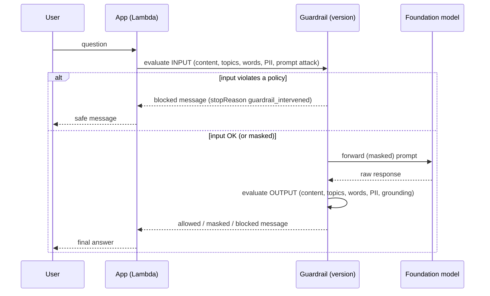
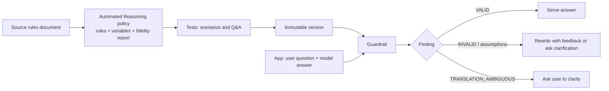
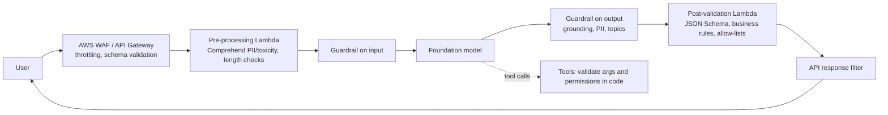
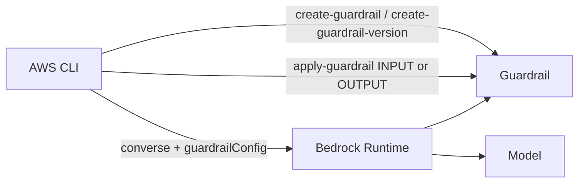

## 0. Before you start
- **Essential:** the Converse request/response shape (`messages`, `stopReason`); what PII is (personally identifiable information, e.g. names, emails, ID numbers).
- **Helpful:** what a regular expression is; what "trace" or "debug output" means.
- **Optional advanced:** formal logic / SAT solvers (only for the Automated Reasoning section).

## 1. Simple explanation
A foundation model will try to answer almost anything, including things your business must never say or do. **Guardrails** is a configurable safety layer placed around the model: it checks what the user sends in, and what the model sends back, against rules you set (block hate speech, refuse investment advice, hide email addresses, flag answers that aren't supported by your documents). If a rule is broken, the guardrail replaces the content with a safe message or masks the sensitive part. It works with any Bedrock model, and can even check text from models you host yourself. Guardrails reduce risk; they are one layer of defense, not a guarantee.


```figure
flow guardrail-sequence
```

## 2. Structured explanation
1. **Create a guardrail** (a working **DRAFT** exists automatically) and configure **policies**:
   - **Content filters:** Hate, Insults, Sexual, Violence, Misconduct, and **Prompt Attack**.
   - **Denied topics:** subjects the app must refuse.
   - **Word filters:** exact words/phrases (including a profanity list).
   - **Sensitive information filters:** PII types and custom regex; **block** or **mask**.
   - **Contextual grounding checks:** grounding and relevance scores vs thresholds.
   - **Automated Reasoning checks:** logical validation against a policy.
2. **Test** in the console test window; **create a version** (immutable); use the version in production.
3. **Attach at runtime:** pass `guardrailConfig` to Converse/ConverseStream (or the equivalent for InvokeModel), attach to Knowledge Bases or agents, or call **ApplyGuardrail** standalone.
4. **Handle the result:** `stopReason = guardrail_intervened`, blocked message, optional **trace**.
5. **Monitor and tune:** review interventions, false positives/negatives, cost and latency.

## 3. Analogy
**Airport security around a flight.** Passengers' bags are screened on the way in (input checks) and again before arrivals leave the terminal (output checks). Different scanners look for different things (weapons = content filters, restricted items = denied topics, labeled luggage = PII). Security reduces risk but isn't a guarantee, and a bag that skips the scanner lane gets through.

*Where it breaks:* airport scanners check every bag; Guardrails checks only the parts you send through it. Content wrapped in `guardContent`, tool-call fields, and retrieved knowledge-base references are handled differently (see below), and that is where real gaps appear.

## 4. The seven questions

**WHAT?** A managed policy layer: "configurable safeguards ... across foundation models" for input prompts and model responses ✅. It evaluates text (and image content for content filters) against the policies in your guardrail version.

**WHY?** Model-native safety training isn't enough for business rules (no legal advice, no competitor names, no PII leakage, no hallucinated policy claims). Guardrails gives consistent, centrally managed, auditable controls independent of which model you choose, so changing models doesn't change your safety rules.

**WHEN?** Any user-facing or compliance-sensitive GenAI app: chatbots, RAG assistants, summarization of calls, agents. Use **ApplyGuardrail** when you need checks without calling a Bedrock model (third-party models, pre-retrieval input checks, post-processing).

**WHERE?** Around the model call. Typical placement: API Gateway/Lambda → (optional Comprehend pre-filter) → Bedrock call with `guardrailConfig` → (optional Lambda post-validation) → response. Also attachable to Knowledge Bases (`RetrieveAndGenerate`) and agents.

**HOW?** §5.

**WHAT IF?**
| Situation | What happens | Remedy |
|---|---|---|
| Input violates a policy | Model is not called (blocked message returned); `stopReason = guardrail_intervened` ✅ | Show your configured message; log trace |
| Model output violates a policy | Output replaced by blocked-output message ✅ | Same |
| PII is *masked*, not blocked | Response still has `stopReason = guardrail_intervened` and placeholders like `{NAME}` ✅ | Read trace `action: ANONYMIZED` to tell masking from blocking |
| App uses tool calling | `toolResult`, `toolSpec`, and `toolUse.input` are **not evaluated** by content/topic/word/PII filters ✅ | Validate tool arguments/results in your own code (Lambda) |
| You add any `guardContent` block | **Only** `guardContent` is evaluated; everything else is skipped (for those policies) ✅ | Wrap everything that must be checked, or use none |
| Streaming | **Sync** (default): chunks held until scanned, more latency; **async**: chunks flow immediately and may be unsafe until detection; **masking unsupported in async** ✅ | Use sync when masking or strictness matters |
| Retrieved KB chunks contain bad content | Guardrails don't scan retrieved references ✅ | Clean data at ingestion; validate answers |
| Threshold too strict/loose | False blocks or missed hallucinations | Tune thresholds on your own labelled data |
| Cross-Region inference (Standard tier) | Guardrail checks may be processed in other Regions ✅ | Review data-residency requirements |

**WHY NOT?**
- *Why not rely only on the system prompt ("never discuss X")?* Prompts can be overridden by prompt injection; guardrails enforce independently.
- *Why not guardrails alone?* They're probabilistic (the PII filter is ML-based ✅) and have scope limits. Combine with IAM, data minimization, output validation, human review.
- *Why not use denied topics to block a word or a person's name?* AWS says topics capture themes, not entities or words; use word filters or sensitive-info/regex ✅.
- *When is "no guardrail" acceptable?* Internal prototypes with synthetic data; never for public-facing or regulated use.

## 5. Technical depth

```figure
guardrail-lab
```


### 5.1 How a guarded request flows

*Reading the arrows:* the guardrail sits in front of and behind the model. A blocked input never reaches the model (so you aren't charged for generation); outputs are checked again because the model can generate harmful or sensitive content even from a clean prompt.

### 5.2 The policies in detail (✅ unless noted)
| Policy | What it does | Key facts |
|---|---|---|
| **Content filters** | Detect Hate, Insults, Sexual, Violence, Misconduct (text and image) | Strength **NONE / LOW / MEDIUM / HIGH**, **separately for input and output**; action `BLOCK` or detect-only (`NONE`) |
| **Prompt attack** (a content-filter type) | Detect **jailbreaks**, **prompt injection**, and (Standard tier) **prompt leakage** | **Input only**; with `InvokeModel` you **must tag user input** (`amazon-bedrock-guardrails-guardContent_<suffix>`) or prompt attacks are **not filtered** |
| **Denied topics** | Block themes (e.g. "Investment Advice") | Up to **30** topics; definition ≤ **200** chars (Classic) / 1,000 (Standard); ≤ 5 sample phrases (≤ 100 chars each); don't write instructions or negatives; **evaluation order can change outcomes** |
| **Word filters** | Block exact words/phrases | **Case-insensitive whole-word/phrase** matching; managed profanity list |
| **Sensitive information** | Detect PII types (name, email, phone, address, SSN, card numbers, AWS keys, IP, etc.) and custom **regex** | Actions `BLOCK`, `ANONYMIZE` (mask), `NONE`; **separate input/output actions**; probabilistic, context-dependent (give it context, not single words); **regex lookaround not supported** |
| **Contextual grounding** | Check **grounding** (supported by source) and **relevance** (answers the query) | Thresholds **0–0.99**; limits **100,000** chars source / **1,000** query / **5,000** response; outputs only |
| **Automated Reasoning** | Logical validation vs. a policy | Detect-mode only; English only; no streaming (§5.7) |

### 5.3 Safeguard tiers
**Classic** (English, French, Spanish) vs **Standard** (more languages, code-aware, prompt-leakage detection, more robust; **requires cross-Region inference**). If you don't specify, you get **Classic**. `UpdateGuardrail` **replaces** the entire policy config: omit `tierConfig` and the tier resets to Classic ✅. Standard contextual grounding is available only in a subset of Regions; elsewhere the request fails with `ValidationException` ✅.

### 5.4 Choosing what the guardrail sees: `guardContent`, tags and qualifiers
- **Converse:** wrap content in `guardContent`. Once any `guardContent` exists, **only** those blocks are checked; the **system prompt** is checked **only** if wrapped in `guardContent` ✅.
- **InvokeModel:** use input tags (`amazon-bedrock-guardrails-guardContent_xyz`), enabled via `amazon-bedrock-guardrailConfig.tagSuffix`.
- **Contextual grounding** needs three roles; in Converse use `qualifiers`:
```json
[{ "role": "user", "content": [
  { "guardContent": { "text": { "text": "<retrieved passages>", "qualifiers": ["grounding_source"] } } },
  { "guardContent": { "text": { "text": "<user question>",       "qualifiers": ["query"] } } } ] }]
```
`grounding_source` and `query` blocks are **not** evaluated by other policies unless you add `guard_content` to their qualifiers ✅.

### 5.5 Calling patterns
| Pattern | How | Use when |
|---|---|---|
| **Inline with Converse** | `guardrailConfig: {guardrailIdentifier, guardrailVersion, trace: "enabled"}` | Normal Bedrock chat apps |
| **Streaming** | `ConverseStream` + `streamProcessingMode` `sync`/`async` | Token streaming UIs (sync if masking needed) |
| **Standalone `ApplyGuardrail`** | `POST /guardrail/{id}/version/{v}/apply` with `source: INPUT|OUTPUT` and `content` blocks; permission **only** `bedrock:ApplyGuardrail` on the guardrail ARN | Third-party models, check **before retrieval**, post-processing, batch moderation |
| **Knowledge Bases** | `guardrailConfiguration` inside `generationConfiguration` of `RetrieveAndGenerate` | RAG with managed KB (input + generated answer only) |

`ApplyGuardrail` returns `action: GUARDRAIL_INTERVENED | NONE`; blocked → one canned message; masked → your content with masks; no action → empty `outputs`. `outputScope: FULL` also returns *undetected* entries for debugging.

### 5.6 Masking, traces, logs: where PII still leaks (important)
| Place | Is PII masked there? |
|---|---|
| Prompt sent to the model; response returned to the user | **Yes** (when action is `ANONYMIZE`) |
| **Guardrail trace** (`match`, `modelOutput`) | **No**, contains the **original** values by design ✅ |
| **Model invocation logs** (CloudWatch/S3) | **No**, `input` always holds the original request ✅ |
| Tool-call arguments and tool results | **Not evaluated at all** ✅ |
| Async streaming | **Masking not supported** ✅ |

Controls: treat traces as sensitive, don't log them with ordinary responses ✅; protect invocation logs with **Amazon CloudWatch Logs data protection policies** ✅ and KMS; restrict `logs:Unmask`-style access to a small audit role (🟡 from AWS security blog).

### 5.7 Automated Reasoning checks (lesson 24)
**What:** instead of pattern matching, it uses **formal logic** to check whether a model's answer is *consistent with rules you define* and can explain *why*. Workflow ✅: **create a policy** from a source document (≤ 5 MB / 50,000 chars; extracted rules + variables + a **fidelity report**) → **test** (generated scenarios and Q&A tests) → **deploy** an immutable version in a guardrail → **integrate** (findings returned by Converse/InvokeModel/`ApplyGuardrail`).
**Findings you will see** include `VALID`, `TRANSLATION_AMBIGUOUS`, `TOO_COMPLEX` (full list: see the AWS concepts page; not reproduced here).
**Limits ✅:** **detect mode only** (it returns findings, doesn't block); **English (US) only**; **no streaming**; **no prompt-injection protection**; plaintext only (Base64/hex/percent-encoding can cause the whole submission to be skipped); **no off-topic detection** (use topic policies); a `VALID` result covers **only variables captured in the policy**; non-linear arithmetic can time out; extra latency grows with the number of variables; billed per validation request; processed with cross-Region inference **within the same geography** (US, EU, or Australia).
**Best for:** regulated, rule-heavy domains (HR benefits, insurance eligibility, mortgage rules, compliance).


*Reading:* findings are inputs to *your* application logic (serve, rewrite, ask), because this policy only reports and does not block.

### 5.8 "Token-level redaction" (lesson 26; exam skill 3.3.4)
The exam guide lists "token-level redaction, response logging, AI output policy filters" among continuous-monitoring controls. **I found no single built-in Bedrock feature called "token-level redaction"** (✅ docs checked; see log). Practical meaning and the AWS building blocks:
| Goal | Mechanism |
|---|---|
| Remove sensitive values from what the model sees/returns | Guardrails **sensitive information filter** with `ANONYMIZE` (placeholders such as `{NAME}`) |
| Keep sensitive values out of logs | **CloudWatch Logs data protection** on invocation-log groups; KMS; short retention |
| Keep data *usable* downstream (e.g. map `{NAME}` back later) | Custom **tokenization**: replace PII with reversible, format-preserving tokens held in a separate vault (🟡 AWS ML blog pattern; custom code, not a Bedrock feature) |
| Record every decision for audit | Response logging, guardrail trace (secured), CloudTrail |
Do not assume masking is reversible; Guardrails masking is one-way placeholder substitution.

### 5.9 Defense in depth (skill 3.1.4)

*Reading:* every layer catches what the previous one can miss: WAF/API layer stops abuse and malformed requests; Comprehend gives a cheap first screen; the guardrail applies policy; post-validation enforces deterministic rules (JSON Schema, allowed values); tool calls are validated in code because guardrails don't evaluate tool fields.

### 5.10 Permissions
- **Manage guardrails:** `bedrock:CreateGuardrail`, `CreateGuardrailVersion`, `UpdateGuardrail`, `GetGuardrail`, `ListGuardrails`, `DeleteGuardrail` (+ `bedrock:TagResource` if you pass tags) ✅.
- **Use with a model:** `bedrock:InvokeModel` / `InvokeModelWithResponseStream` on the model, plus `bedrock:ApplyGuardrail` on `arn:aws:bedrock:<REGION>:<ACCOUNT>:guardrail/<ID>` ✅. For standalone `ApplyGuardrail`, only `bedrock:ApplyGuardrail` is needed ✅.
- **Customer-managed KMS key** for the guardrail: add the key permissions the console shows.
- **Enforcing that callers always use a guardrail via IAM condition keys:** AWS documents this, but I did **not** verify the exact key name here (❌); look it up in the Bedrock IAM condition-keys reference before relying on it.

### 5.11 Cost and latency
Guardrails bill by **text units processed per policy** (the response `usage` shows units per policy ✅). Automated Reasoning bills per validation request ✅. I do not state prices (not verified). Latency rises with more policies, Standard tier, and sync streaming; `invocationMetrics.guardrailProcessingLatency` reports it ✅. Cache repeated validations where appropriate.

## 6. Worked example
*Problem:* A bank's RAG assistant must (1) refuse investment advice, (2) never echo customer emails or SSNs, (3) block jailbreaks, (4) avoid inventing fees.

| Step | Configuration |
|---|---|
| 1 | **Denied topic** "Investment Advice" with a crisp definition and 2–3 sample phrases |
| 2 | **Sensitive info:** `EMAIL`, `NAME` → `ANONYMIZE`; `US_SOCIAL_SECURITY_NUMBER` → `BLOCK`; regex for internal account IDs → `ANONYMIZE` |
| 3 | **Content filters:** HIGH for Hate/Violence; **Prompt Attack = HIGH** on input; user text wrapped in `guardContent` |
| 4 | **Contextual grounding:** grounding and relevance thresholds 0.75 with the retrieved fee table as `grounding_source` and the question as `query` |
| 5 | Version the guardrail; reference the **version** (not DRAFT) in production |
| 6 | Logs: CloudWatch data protection on invocation logs; trace stored encrypted with restricted access |
| 7 | Test with: an investment question, a prompt that says "ignore previous instructions", a message with an email, a question whose answer isn't in the fee table |

*Expected behaviors (by design, not observed here):* (1) refused with your message; (3) blocked; (2) email appears as `{EMAIL}`; (4) a made-up fee is flagged by low grounding score and replaced by the blocked-output message.

## 7. Knowledge checkpoints
1. What does `stopReason = guardrail_intervened` mean, and how do you tell masking from blocking?
2. Which request fields are *not* evaluated when you use tool calling?
3. What happens to non-`guardContent` text once you add one `guardContent` block?
4. Why can't Automated Reasoning replace content filters?
5. Where does PII still appear in plain text even when masking is on?

## 7b. Practice questions (exam-style, original) — answers below

**Q1.** A guardrail masks emails in model responses, but the compliance team finds the original emails in CloudWatch. What is the BEST explanation and fix?
A. Masking failed; switch to a bigger model
B. Model invocation logs capture the original request; protect logs with CloudWatch Logs data protection and restrict access
C. Masking only works with Claude models
D. Enable asynchronous streaming

**Q2.** (Select TWO) Which statements about guardrails with tool calling (function calling) are correct?
A. Content, topic, word and PII filters do not evaluate `toolUse.input`
B. Content, topic, word and PII filters do not evaluate `toolResult` or `toolSpec`
C. Tool arguments are always masked automatically
D. Tool results are always scanned for prompt attacks
E. Guardrails block all tool calls by default

**Q3.** A team uses `InvokeModel` with a guardrail that has a prompt-attack filter but never tags user input. What is the result?
A. Prompt attacks are detected normally
B. Prompt attacks are not filtered for those requests because input tags are required with InvokeModel
C. The guardrail blocks every request
D. The guardrail masks the system prompt

**Q4.** An assistant must answer only from retrieved policy text and must be blocked when it adds facts not in the text. Which guardrail policy fits?
A. Word filter
B. Contextual grounding check (grounding and relevance)
C. Denied topic with a definition "don't hallucinate"
D. Sensitive information filter

**Q5.** (Select TWO) Which are true of Automated Reasoning checks?
A. They operate in detect mode and return findings rather than blocking
B. They support English (US) only
C. They support streaming responses
D. They protect against prompt injection
E. They detect off-topic responses

**Q6.** A developer wants to check user input for harmful content before running vector retrieval, without invoking any model. Which API is BEST?
A. `InvokeModel`
B. `ApplyGuardrail` with `source: INPUT`
C. `CreateGuardrail`
D. `RetrieveAndGenerate`

**Q7.** A guardrail uses the Standard tier for contextual grounding and the team calls `UpdateGuardrail` to change a threshold, omitting `tierConfig`. What happens?
A. Nothing changes
B. The tier resets to Classic because update replaces the whole policy configuration
C. The guardrail is deleted
D. The tier becomes "Premium"

**Q8.** A denied topic is defined as "All content except medical information." Detection is unreliable. What is the problem?
A. Denied topics don't support text
B. The definition is negative/exception-based and an instruction; definitions should describe the topic crisply and positively
C. Denied topics require image input
D. The topic list is too short

**Q9.** A streaming chat app needs PII masking. Which streaming mode should it use?
A. Asynchronous, because it is faster and supports masking
B. Synchronous, because masking is not supported in asynchronous mode
C. Either; the mode doesn't affect masking
D. Streaming cannot be used with guardrails

**Q10.** A RAG application attaches a guardrail to `RetrieveAndGenerate`. A document in the knowledge base contains a hidden instruction that influences the answer. Why wasn't it filtered, and what is the right defense?
A. Guardrails don't scan retrieved references; sanitize/scan content at ingestion and validate outputs
B. Guardrails scan only images
C. Guardrails work only with Agents
D. Hybrid search disables guardrails

## 8. Hands-on lab (console + AWS CLI, no Python files)

### 8.1 Objective
Create a guardrail (denied topic, PII masking, prompt-attack filter, grounding check), version it, test it with `ApplyGuardrail`, and attach it to a Converse call.

### 8.2 Prerequisites
[Setup](aip:00-foundations/01-aws-account-iam-and-cli-setup); AWS CLI v2; a Bedrock model or inference profile that works in your Region ([01/01](aip:01-bedrock-genai-fundamentals/01-bedrock-overview-and-converse-api)).

### 8.3 AWS services
Amazon Bedrock (Guardrails, Runtime).

### 8.4 IAM permissions
Manage: the Create/Update/Get/List/Delete/CreateGuardrailVersion actions in §5.10. Use: `bedrock:ApplyGuardrail` on the guardrail ARN, plus `bedrock:InvokeModel` on your model for the Converse test.

### 8.5 Region notes
Guardrails availability, safeguard tiers and cross-Region profiles vary by Region. This lab uses the default **Classic** tier so no cross-Region profile is needed.

### 8.6 Architecture

*Reading:* you create and version the guardrail once, then test it directly (no model) and through a model call.

### 8.7 Cost
Guardrails bill per text unit per policy; a handful of short test strings should be negligible, but check the pricing page (not verified here). Converse tokens apply. Delete the guardrail afterwards.

### 8.8 Step 1: save `guardrail.json` (data file, not code)
```json
{
  "name": "aip-c01-lab-guardrail",
  "description": "Study lab guardrail",
  "blockedInputMessaging": "Sorry, I can't help with that request.",
  "blockedOutputsMessaging": "Sorry, I can't provide that response.",
  "contentPolicyConfig": {
    "filtersConfig": [
      { "type": "HATE",    "inputStrength": "HIGH", "outputStrength": "HIGH" },
      { "type": "INSULTS", "inputStrength": "MEDIUM", "outputStrength": "MEDIUM" },
      { "type": "PROMPT_ATTACK", "inputStrength": "HIGH" }
    ]
  },
  "topicPolicyConfig": {
    "topicsConfig": [
      {
        "name": "Investment Advice",
        "definition": "Inquiries, guidance, or recommendations about managing or allocating funds or assets to generate returns or reach financial goals.",
        "examples": ["Should I invest in gold?", "Is it better to buy stocks or bonds?"],
        "type": "DENY"
      }
    ]
  },
  "sensitiveInformationPolicyConfig": {
    "piiEntitiesConfig": [
      { "type": "EMAIL", "action": "ANONYMIZE" },
      { "type": "NAME",  "action": "ANONYMIZE" },
      { "type": "US_SOCIAL_SECURITY_NUMBER", "action": "BLOCK" }
    ],
    "regexesConfig": [
      { "name": "OrderId", "description": "Internal order id", "pattern": "ORD-\\d{6}", "action": "ANONYMIZE" }
    ]
  },
  "contextualGroundingPolicyConfig": {
    "filtersConfig": [
      { "type": "GROUNDING",  "threshold": 0.75 },
      { "type": "RELEVANCE", "threshold": 0.75 }
    ]
  }
}
```
Field names follow the official `CreateGuardrail` request shapes ✅ (`filtersConfig`, `topicsConfig`, `piiEntitiesConfig`, `regexesConfig`, `contextualGroundingPolicyConfig`). `PROMPT_ATTACK` uses only `inputStrength` ✅.

### 8.9 Step 2: create, version, and test
```powershell
aws bedrock create-guardrail --cli-input-json file://guardrail.json --region <REGION>
# note guardrailId from the output
aws bedrock create-guardrail-version --guardrail-identifier <GUARDRAIL_ID> --description "v1" --region <REGION>
```
Save `apply-input.json`:
```json
{
  "guardrailIdentifier": "<GUARDRAIL_ID>",
  "guardrailVersion": "1",
  "source": "INPUT",
  "content": [ { "text": { "text": "Hi, my name is Alice and my email is alice@example.com. Should I invest in gold?" } } ]
}
```
```powershell
aws bedrock-runtime apply-guardrail --cli-input-json file://apply-input.json --region <REGION> --output json
```
**Expected (by design; I did not run this against AWS):** `action: GUARDRAIL_INTERVENED` with the **Investment Advice** topic assessed as `BLOCKED` and `outputs[0].text` equal to your blocked-input message. Then test masking by changing the text to `Hi, my name is Alice and my email is alice@example.com. Please confirm my order.`: expect `GUARDRAIL_INTERVENED` with masked output (`{NAME}`, `{EMAIL}`) and an assessment with `action: ANONYMIZED` ✅ shape.

Grounding test (`source: OUTPUT`), save `apply-grounding.json`:
```json
{
  "guardrailIdentifier": "<GUARDRAIL_ID>",
  "guardrailVersion": "1",
  "source": "OUTPUT",
  "content": [
    { "text": { "text": "The monthly fee for a checking account is $10. There is a 1% charge on international transfers.", "qualifiers": ["grounding_source"] } },
    { "text": { "text": "What is the monthly fee for a checking account?", "qualifiers": ["query"] } },
    { "text": { "text": "The monthly fee is $25 and there is a $5 charge for domestic transfers." } }
  ]
}
```
Expect a low grounding score and an `contextualGroundingPolicy` assessment with `action: BLOCKED` ✅ shape.

### 8.10 Step 3: attach to Converse
Save `converse.json`:
```json
{
  "modelId": "<MODEL_OR_PROFILE_ID>",
  "messages": [ { "role": "user", "content": [
      { "text": "Answer briefly." },
      { "guardContent": { "text": { "text": "Should I invest in gold?" } } } ] } ],
  "guardrailConfig": { "guardrailIdentifier": "<GUARDRAIL_ID>", "guardrailVersion": "1", "trace": "enabled" }
}
```
```powershell
aws bedrock-runtime converse --cli-input-json file://converse.json --region <REGION>
```
Expect `stopReason: guardrail_intervened`, your blocked message in `output`, and a `trace.guardrail.inputAssessment` ✅ shape. Note the instruction text "Answer briefly." is **outside** `guardContent` and therefore not evaluated ✅.

### 8.11 Validation I performed
I loaded the `guardrail.json` above with a JSON parser and checked the documented limits: topic definition ≤ 200 characters (Classic), examples ≤ 5 and ≤ 100 characters each, thresholds within 0–0.99. Captured output (2026-10-23):
```
json blocks found: 5      valid: 5 of 5
definition chars: 130 (Classic limit 200) | examples: 2 max len 36 (limits 5 / 100)
grounding thresholds OK (0-0.99)
regex: ORD-\d{6} | compiles: True
```
This proves the JSON is well-formed and within the documented limits; it does **not** prove AWS will accept every field (that needs a live `create-guardrail` call).

### 8.12 Testing and validation
1. Add `"source": "OUTPUT"` tests with an email and confirm masking.
2. Change the denied-topic definition to "All content except medical information" and observe worse behavior (documented anti-pattern).
3. Remove `guardContent` from the Converse test and note that the whole message is evaluated.
4. Turn `trace` on and find the unmasked `match` values in a masked response; consider where such a trace must **not** be logged.
5. Compare `streamProcessingMode` `sync` vs `async` with `converse-stream` if you have a client; verify masking isn't applied in async.

### 8.13 Common errors and troubleshooting
| Error | Cause | Fix |
|---|---|---|
| `ValidationException` on create | Field shape or limits wrong (definition too long, bad threshold) | Check limits in §5.2 |
| `ValidationException` for Standard grounding | Region not supported or no cross-Region profile | Use Classic or a supported Region |
| `AccessDeniedException` on apply | Missing `bedrock:ApplyGuardrail` on that guardrail ARN | Add permission |
| Guardrail seems ignored | Used DRAFT vs version mismatch, or content wasn't in `guardContent`, or no input tags with InvokeModel | Reference the version; check `guardContent`/tags |
| Masked reply but you expected a block message | Masking returns the same `stopReason` | Inspect trace `action` |
| Grounding never triggers | Missing `grounding_source`/`query` roles, or threshold too low | Provide all three roles; tune threshold |

### 8.14 Security recommendations
- Use a **version** in production; keep DRAFT for experiments.
- Encrypt the guardrail with a customer-managed KMS key if policy requires.
- Treat traces and invocation logs as sensitive; use CloudWatch data protection.
- Version-control guardrail JSON and deploy with CloudFormation/CDK/CI.
- Add independent validation for tool arguments, since guardrails skip them.

**Cleanup:**
```powershell
aws bedrock delete-guardrail --guardrail-identifier <GUARDRAIL_ID> --region <REGION>
```

## 9. What can go wrong?

| Failure | Why | Symptoms | Investigate | Fix | Prevent |
|---|---|---|---|---|---|
| **Guardrail silently not checking text** | `guardContent` used partially; or no input tags with InvokeModel ✅ | Harmful input passes | Inspect `guardrailCoverage` (guarded vs total characters) ✅ | Wrap all required text, or use none; tag inputs | Check coverage metric in tests |
| **PII still in logs/traces** | Masking doesn't cover logs/traces ✅ | Sensitive data in CloudWatch | Search logs | Log data protection, KMS, restricted trace storage | Logging design review |
| **PII in tool calls** | Tool fields not evaluated ✅ | Email written to a file/API | Review tool schemas | Validate/redact in tool code | Allow-lists, schema validation |
| **Over-blocking** | Strengths/thresholds too high | Legit users blocked | Review traces for false positives | Lower strength, refine topics/samples | Evaluate on real traffic samples |
| **Under-blocking** | Thresholds too low; narrow topic definitions | Hallucinations/harm get through | Red-team set | Raise thresholds; add policies; defense in depth | Adversarial test suite |
| **Streaming exposure** | Async mode shows chunks before detection ✅ | Unsafe chunk briefly displayed; masking absent | Review mode setting | Use `sync` for sensitive apps | Default to sync |
| **Tier regression** | `UpdateGuardrail` without `tierConfig` ✅ | Accuracy drops after an unrelated change | Compare tier before/after | Always include `tierConfig` in updates | IaC with full config |
| **Wrong version in prod** | App references DRAFT or an old version | Behavior differs from tests | Check `guardrailVersion` in code/config | Pin and promote versions | Config-driven version + CI |
| **Automated Reasoning misuse** | Expecting it to block, stream, or catch injection ✅ | Unsafe responses served | Review findings handling | Use with content filters; act on findings in code | Document scope; tests |
| **Cost/latency creep** | Many policies, Standard tier, sync streaming | Slower responses, higher bills | Check `usage` and processing latency | Remove unused policies; cache validations | Budgets and dashboards |
| **Retrieved-content attacks** | Guardrails don't scan KB references ✅ | Injected instructions affect answers | Red-team documents | Ingestion scanning, access control | Source vetting |

## 10. Common misconceptions
1. **"Guardrails make my app safe."** They are one layer; probabilistic and scope-limited.
2. **"Masking removes PII everywhere."** Not from traces or invocation logs ✅.
3. **"`guardrail_intervened` always means blocked."** It also appears for masking ✅.
4. **"Guardrails cover tool calls."** Tool fields aren't evaluated ✅.
5. **"Prompt-attack filtering works automatically with InvokeModel."** It needs input tags ✅.
6. **"Automated Reasoning checks stop hallucinations in real time."** Detect-mode, English-only, no streaming, policy-scoped ✅.
7. **"Denied topics can block a person's name or a competitor."** Use word filters or PII/regex ✅.
8. **"Token-level redaction is a Bedrock switch."** No such named feature found; assemble it from masking, log protection, and optional tokenization ✅.

## 11. Exam notes
- **Pattern:** "block harmful/off-topic input and output centrally, any model" → **Bedrock Guardrails**.
- **Pattern:** "hide PII in responses/summaries" → **sensitive information filter (ANONYMIZE)**; "PII in logs" → **CloudWatch Logs data protection** + KMS.
- **Pattern:** "reduce hallucination in RAG" → **contextual grounding check** (+ KB grounding, JSON Schema validation) (skill 3.1.3).
- **Pattern:** "validate answers against business rules with provable logic" → **Automated Reasoning checks**.
- **Pattern:** "check text from a non-Bedrock model / check before retrieval" → **`ApplyGuardrail`**.
- **Pattern:** "defense in depth" → WAF/API Gateway + Comprehend pre-filter + guardrail + Lambda post-validation + response filtering (skill 3.1.4).
- **Pattern:** "jailbreak/prompt injection" → **prompt attack filter** + input tagging (skill 3.1.5).
- **Traps:** retrieved KB references not scanned; tool fields not scanned; masking absent in async streaming and in logs/traces; `guardContent` narrows evaluation; `UpdateGuardrail` resets tier if `tierConfig` omitted; Automated Reasoning = English only/no streaming/detect-only.
- **Compare:** content filter vs denied topic vs word filter vs sensitive info; Classic vs Standard tier; Guardrails vs Comprehend (Comprehend detects PII/toxicity in text but doesn't wrap a model call).
- **Skills:** 3.1.1–3.1.5, 3.2.2–3.2.3, 3.3.4, 3.4.3, 1.6.1.

## 12. Summary and revision cards
- Guardrails = managed policy layer for inputs and outputs; works with any model and standalone via `ApplyGuardrail`.
- Policies: content (incl. prompt attack), denied topics, words, PII/regex, grounding/relevance, Automated Reasoning.
- `guardContent` narrows what is checked; tool-call fields are not checked; KB references are not checked.
- Masking leaves traces and logs unmasked; async streaming can't mask.
- Pin versions; `UpdateGuardrail` replaces the whole config.
- Automated Reasoning: logic-based, detect-only, English, no streaming.

**Cards.** Q: Contextual grounding threshold range? A: 0–0.99. · Q: Denied topics max? A: 30. · Q: IAM for standalone checks? A: `bedrock:ApplyGuardrail`. · Q: Default tier? A: Classic.

## 13. References
| Source | URL | Verified |
|---|---|---|
| Guardrails overview | https://docs.aws.amazon.com/bedrock/latest/userguide/guardrails.html | 2026-10-23 |
| Guardrails with Converse | https://docs.aws.amazon.com/bedrock/latest/userguide/guardrails-use-converse-api.html | 2026-10-23 |
| Content filters | https://docs.aws.amazon.com/bedrock/latest/userguide/guardrails-content-filters.html | 2026-10-23 |
| Prompt attacks | https://docs.aws.amazon.com/bedrock/latest/userguide/guardrails-prompt-attack.html | 2026-10-23 |
| Denied topics | https://docs.aws.amazon.com/bedrock/latest/userguide/guardrails-denied-topics.html | 2026-10-23 |
| Sensitive information filters | https://docs.aws.amazon.com/bedrock/latest/userguide/guardrails-sensitive-filters.html | 2026-10-23 |
| Contextual grounding | https://docs.aws.amazon.com/bedrock/latest/userguide/guardrails-contextual-grounding-check.html | 2026-10-23 |
| Safeguard tiers | https://docs.aws.amazon.com/bedrock/latest/userguide/guardrails-tiers.html | 2026-10-23 |
| Streaming behavior | https://docs.aws.amazon.com/bedrock/latest/userguide/guardrails-streaming.html | 2026-10-23 |
| ApplyGuardrail | https://docs.aws.amazon.com/bedrock/latest/userguide/guardrails-use-independent-api.html | 2026-10-23 |
| Guardrails permissions | https://docs.aws.amazon.com/bedrock/latest/userguide/guardrails-permissions.html | 2026-10-23 |
| Automated Reasoning checks | https://docs.aws.amazon.com/bedrock/latest/userguide/guardrails-automated-reasoning-checks.html | 2026-10-23 |
| Tokenization with Guardrails (🟡 AWS ML blog) | https://aws.amazon.com/blogs/machine-learning/integrate-tokenization-with-amazon-bedrock-guardrails-for-secure-data-handling/ | surfaced by search; not opened |
| Exam guide Domain 3 | https://docs.aws.amazon.com/aws-certification/latest/ai-professional-01/ai-professional-01-domain3.html | 2026-10-23 |

**Unverified here:** IAM condition key to enforce guardrail use; pricing; live behavior of the CLI steps; the complete Automated Reasoning result list; image-filter and word-filter limits.

## 14. Answers to checkpoints and practice questions

**Checkpoints.** 1) A guardrail blocked or masked content; check trace `action` (`BLOCKED` vs `ANONYMIZED`). 2) `toolResult`, `toolSpec` (description/schema) and `toolUse.input`. 3) They're skipped by the evaluated policies (only `guardContent` is evaluated). 4) It only validates against your policy variables, is detect-only, English-only and has no streaming or injection protection. 5) The guardrail trace (`match`, `modelOutput`) and model invocation logs; also tool arguments, which aren't evaluated.

**Practice questions.**
- **Q1 → B.** Invocation logs hold the original request; protect with CloudWatch Logs data protection and tight access. A, C, D are wrong or unrelated (async mode can't mask).
- **Q2 → A, B.** Those fields are not evaluated. C, D, E are false.
- **Q3 → B.** With InvokeModel, untagged input isn't checked for prompt attacks.
- **Q4 → B.** Contextual grounding (with relevance) checks that responses are supported by the source and answer the query. A, C, D don't test grounding.
- **Q5 → A, B.** Detect-mode, English (US) only. C, D, E are false.
- **Q6 → B.** `ApplyGuardrail` with `source: INPUT` checks text without invoking a model.
- **Q7 → B.** `UpdateGuardrail` replaces the whole policy config; omitting `tierConfig` resets to Classic.
- **Q8 → B.** Negative/exception phrasing and instructions are documented anti-patterns; define the topic positively and precisely.
- **Q9 → B.** Masking isn't supported in asynchronous mode; use synchronous.
- **Q10 → A.** Guardrails apply to input and generated output, not retrieved references; scan and control content at ingestion and validate outputs.
