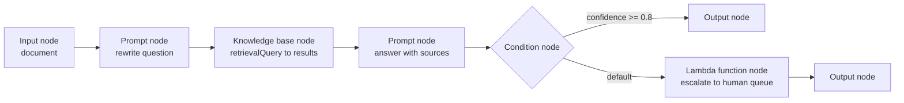
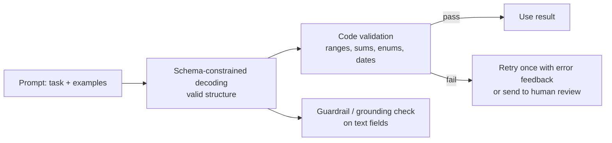
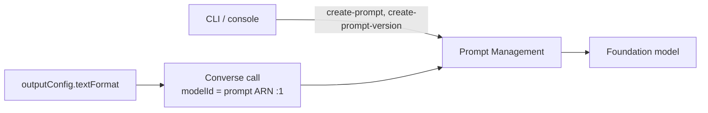

## 0. Before you start
- **Essential:** a prompt is just text plus settings; Converse request format.
- **Helpful:** JSON and JSON Schema basics (types, `required`, `enum`).
- **Optional advanced:** constrained decoding (how a model is forced to follow a grammar).

## 1. Simple explanation
Real applications don't hard-code prompts inside code. **Prompt Management** is a library where you write a prompt once with blank spaces (`{{customer_name}}`), test variations, freeze a good one as a numbered **version**, and then call it by name from any app. **Flows** let you connect prompts, knowledge bases, Lambda functions and conditions on a canvas, like a flowchart that actually runs. **Structured output** solves a different pain: when your code needs JSON, you give Bedrock a **JSON Schema** and it forces the model's reply to match, so you stop writing fragile "please reply with JSON" prompts and retry loops.


```figure
flow prompt-flow
```

## 2. Structured explanation
1. **Prompt Management:** create prompt → add variables → choose model and inference settings → create variants → compare → save draft → **create version** → call the version.
2. **Flows:** create flow → place nodes → connect outputs to inputs → prepare/test the draft → **version** → **alias** → app calls `InvokeFlow` on the alias.
3. **Structured output:** write a schema → pass it in the request (`outputConfig.textFormat` for Converse) → Bedrock constrains generation → still validate business rules in code.
4. **Governance:** versions are immutable, IAM controls who can edit/deploy, CloudTrail records changes, and S3/Git hold template history.

## 3. Analogy
- **Prompt Management** = a recipe card library: each card has blanks for ingredients, numbered editions, and a cook can't alter an edition once printed.
- **Flows** = an assembly line: station 1 rewrites the question, station 2 searches, station 3 drafts, a gate rejects unsafe items, and the result rolls off the end.
- **Structured output** = a form with fixed fields instead of a blank page. The writer can't leave a box off or invent a new one.

*Where it breaks:* a form guarantees the *shape*, not the *truth*. A model can fill every field perfectly with wrong values, and a schema can't say "total must equal the sum of the items".

## 4. The seven questions

**WHAT?**
- **Prompt Management:** create, edit, save and reuse prompts, with variables, **variants** and **versions** ✅. Key terms: *prompt*, *variable* (`{{variable}}`), *prompt variant* (alternative message/model/config), *prompt builder* (console tool) ✅.
- **Amazon Bedrock Flows (Prompt Flows):** workflows linking prompts, FMs, knowledge bases, Lambda and other AWS services, built visually or by API, deployed as immutable versions ✅.
- **Structured outputs:** a Bedrock capability that ensures responses conform to a JSON schema and tool definitions ✅.

**WHY?**
| Problem | Without these | With these |
|---|---|---|
| Prompts scattered across code | Redeploy to change wording; no history | Central versions, rollback by pointing at an older version |
| Multi-step GenAI logic in glue code | Hard to see, test, reuse | Visual, versioned, aliased workflow |
| "Reply in JSON" prompts | Occasional invalid JSON; retries; custom parsers | Schema-conformant output; fewer retries ✅ |
| Prompt changes break prod | No audit trail | Immutable versions + CloudTrail |

**WHEN?**
| Use | When |
|---|---|
| Prompt Management | Several apps/teams share prompts; you need versions, A/B variants, governance |
| Flows | Linear or branching GenAI pipelines without writing orchestration code; prototypes and moderate production flows |
| Step Functions instead | Long-running, heavy error handling, many AWS integrations, human approval, retries and circuit breakers (`06`) |
| Agents/AgentCore instead | The model must *decide* the steps dynamically |
| Structured output | Any time code consumes the model's answer (extraction, classification, routing, tool inputs) |

**WHERE?** Prompt Management and Flows sit in the **build-time** (control-plane) layer (`bedrock-agent` APIs) and are *used* at runtime: `Converse` with a prompt ARN, `InvokeFlow` with an alias. Structured output sits inside the **inference request**.

**HOW?** §5.

**WHAT IF?**
| Situation | What happens | Remedy |
|---|---|---|
| You call a prompt by its DRAFT | Behavior changes when someone edits the draft | Always deploy **versions** ✅ |
| Schema uses unsupported features (e.g. `minimum`, recursion) | Bedrock returns **HTTP 400** immediately ✅ | Simplify schema; enforce ranges in code |
| First request with a new schema | Grammar compilation can take **up to a few minutes** ✅ | Warm up in deploy step; reuse identical schemas (cached **24 h**) ✅ |
| Structured output with Anthropic **citations** | 400 error ✅ | Don't combine |
| Output truncated by `maxTokens` | JSON may be cut off | Check `stopReason` before parsing (🟡 AWS blog guidance) |
| A flow's condition matches several branches | The **earlier** condition wins ✅ | Order conditions deliberately; add a `default` |
| DoWhile loop never ends | Stops at `maxIterations` (default **10**) ✅ | Set a sensible max |
| Guardrail on a KB node | Works only with `RetrieveAndGenerate` mode ✅ | Use generation mode or guard downstream |

**WHY NOT?**
- *Why not keep prompts in S3/Git only?* Perfectly valid (the exam names S3 template repositories). Prompt Management adds variants, console testing and native Converse/Flows integration; Git adds code-review workflow. Many teams use both.
- *Why not Flows for everything?* No arbitrary long-running orchestration, limited custom error handling; some nodes are preview/limited ✅.
- *Why not rely on the prompt for JSON?* Probabilistic; schema-constrained decoding is deterministic about structure ✅.
- *Why not put every rule in the schema?* Numeric ranges, lengths and cross-field rules are **unsupported** ✅; validate in code.

## 5. Technical depth

### 5.1 Prompt Management in detail (✅)
| Concept | Facts |
|---|---|
| **Variables** | `{{variable}}` placeholders; values supplied at test time or runtime |
| **Template types** | `TEXT` or `CHAT`. `CHAT` needs a Converse-capable model; **prompt caching requires `CHAT`** |
| **Chat content** | System prompt, prior user/assistant turns, tools (if the model supports them) |
| **Inference config** | `maxTokens`, `stopSequences`, `temperature`, `topP` (base set), plus `additionalModelRequestFields` for model-specific settings (e.g. `top_k`) |
| **Variants** | Alternative configurations of the same prompt (different wording, model, settings); the console compares **up to three** side by side; `defaultVariant` names the default |
| **Draft vs version** | Saving creates/updates the **draft**; **versions are snapshots** you deploy |
| **Targets** | A model, an inference profile, or an **agent** (`genAiResource`; agent-targeted prompts can only be tested in the console) |
| **Encryption** | AWS managed key by default; optional customer-managed KMS key |
| **Use at runtime** | Put the **prompt ARN with version** in `modelId` of `Converse`, and fill `promptVariables` |

```text
modelId: arn:aws:bedrock:<REGION>:<ACCOUNT>:prompt/<PROMPT_ID>:1       <- the ":1" is the version
```
```json
{ "promptVariables": { "genre": { "text": "pop" }, "number": { "text": "3" } } }
```
Variable values are objects with a `text` field ✅. APIs: `CreatePrompt` (required: `name`, `variants`, `defaultVariant`), `CreatePromptVersion`, `GetPrompt` (build-time endpoint) ✅.

**Governance (exam skill 1.6.3).** The exam guide describes "Prompt Management to create parameterized templates **and approval workflows**, S3 to store template repositories, CloudTrail to track usage, CloudWatch Logs to log access". I could verify versions, variants and variables, but **not a built-in approval feature**. Treat "approval workflow" as a *process you build*: authors can edit drafts but only a release role can `CreatePromptVersion` / update aliases (IAM), changes go through review (CodePipeline/Step Functions manual approval), template sources live in S3/Git, and CloudTrail/CloudWatch Logs record who did what.

### 5.2 Flows in detail (✅)

*Reading the arrows:* data connections carry values between nodes (an *expression* such as `$.data` picks the relevant part); conditional connections choose a branch. A flow starts with exactly one **Input** node and can end in several **Output** nodes (one per branch).

| Node | Purpose | Notes |
|---|---|---|
| **Input** / **Output** | Entry (the `content` of `InvokeFlow`) and exits (`flowOutputEvent`) | One input node; multiple outputs allowed |
| **Prompt** | Run a Prompt-Management prompt (`promptArn`) or an **inline** prompt | Output `modelCompletion` (String); optional `guardrailConfiguration` |
| **Knowledge base** | Query a KB; with `modelId` generates, without returns results array | Guardrails only in generation mode |
| **Agent** | Send input to an agent alias | Supports multi-turn pauses |
| **Lambda function** | Run your code; receives an event with each input's resolved `value` | Output `functionResponse` |
| **Inline code** | Python 3 snippets without a separate Lambda | **Preview**; max 5 per flow; not in async execution; no `print` capture |
| **Condition** | Branch using `==, !=, >, >=, <, <=` and `and/or/not` | Evaluated in order; use `default` |
| **Iterator / Collector** | Loop over an array **one by one (not parallel)** and gather results | Collector returns `collectedArray` |
| **DoWhile** | Repeat while condition true; runs at least once | `maxIterations` default 10 |
| **S3 storage / retrieval** | Write/read objects (retrieval needs UTF-8 text) | |
| **Lex** | Identify an intent from an utterance | **No multi-turn**; one utterance per node |

**Lifecycle (✅):** a new flow has a working **DRAFT** and a test alias **`TSTALIASID`** pointing to it. Publish immutable **versions** (1, 2, …) and create **aliases** that point to them; apps call `InvokeFlow` with the alias. **Rollback = repoint the alias** to an older version. Flows can also run **asynchronously** ("flow executions") ✅, and you can "converse with a flow" for multi-turn use.

Pricing is the sum of the resources used (e.g. model tokens in prompt nodes) ✅.

### 5.3 Structured output (✅)
**Two complementary mechanisms:**
1. **JSON Schema output format:** Converse → `outputConfig.textFormat`; InvokeModel with Anthropic Claude → `output_config.format`; InvokeModel with open-weight models → `response_format`.
2. **Strict tool use:** add `"strict": true` to a tool definition so tool names and inputs follow the schema.

**Converse request shape (note the schema is a *string*):**
```json
"outputConfig": { "textFormat": { "type": "json_schema",
  "structure": { "jsonSchema": {
     "name": "data_extraction",
     "description": "Extract structured data from unstructured text",
     "schema": "{\"type\":\"object\",\"properties\":{\"title\":{\"type\":\"string\"}},\"required\":[\"title\"],\"additionalProperties\":false}" } } } }
```
**How it works:** Bedrock validates your schema against a **supported subset of JSON Schema Draft 2020-12** (unsupported → immediate 400), **compiles a grammar** (first time can take up to a few minutes), **caches it for 24 hours** (identical schema, same account; cached grammars encrypted with AWS-managed keys), and constrains generation to it. Works with Converse/ConverseStream, InvokeModel (+stream), cross-Region inference and batch inference ✅. Some geographic inference profiles don't support it for every model; check the model card ✅.

| Supported | Not supported |
|---|---|
| `object, array, string, integer, number, boolean, null`; `enum`; `const`; `anyOf`/`allOf` (limited); internal `$ref`/`$defs`; formats `date-time, time, date, duration, email, hostname, uri, ipv4, ipv6, uuid`; `minItems` of **0 or 1** | **Recursive** schemas; **external** `$ref`; `minimum/maximum/multipleOf`; `minLength/maxLength`; `additionalProperties` other than **false** |

**Therefore:** schema guarantees *structure* (fields, types, enums), and your code must still check *semantics* (ranges, totals, dates in the past, cross-field consistency).

### 5.4 Layering the guarantees

*Reading:* each layer removes a different failure type: the prompt guides content, the schema fixes structure, code enforces business rules, and the guardrail screens text content. Don't expect one layer to do all four jobs.

## 6. Worked example
*Problem:* A support team triages emails: it needs `{category, priority, summary, customer_email}` for each email, with the refund policy wording managed centrally and a human queue for high-priority cases.

| Step | Action | Why |
|---|---|---|
| 1 | Prompt Management: prompt `triage` with variables `{{email_body}}` and `{{policy}}`; 2 variants (short vs detailed instructions) | Compare wording without code changes |
| 2 | Pick the better variant on 30 labelled emails; `Create version` → v3 | Immutable release |
| 3 | Define the schema: `category` enum (`billing|bug|account|other`), `priority` enum (`low|normal|high`), `summary` string, `customer_email` string with `format: email`; all `required`; `additionalProperties:false` | Structure enforced; no ranges needed |
| 4 | Flow: Input → Prompt node (`triage:3`) → Condition (`priority == "high"`) → Lambda (create ticket + notify) / default → S3 storage node | Visual, versioned routing |
| 5 | Publish flow v1; alias `prod` → v1; app calls `InvokeFlow` on `prod` | Stable deploy |
| 6 | Wording improves → prompt v4 → flow v2 → move alias `prod` to v2; rollback is one alias change | Safe release |
| 7 | CloudTrail records version/alias changes; invocation logs and guardrail on the prompt node | Governance |

## 7. Knowledge checkpoints
1. What goes in `modelId` and `promptVariables` to call a managed prompt via Converse?
2. Which Flows resource do applications call, and how do you roll back?
3. Name three schema features structured outputs does **not** support.
4. Why still validate output in code after structured output?
5. In a Condition node with two true conditions, which branch runs?

## 7b. Practice questions (exam-style, original) — answers below

**Q1.** A team wants to change a production chatbot's wording without redeploying code, keep history, and roll back quickly. Which approach BEST fits?
A. Edit the prompt in the Lambda source and redeploy
B. Store the prompt in Prompt Management, deploy a numbered **version**, and reference that version from the application
C. Reference the DRAFT so edits apply instantly
D. Put the prompt in an environment variable with no history

**Q2.** (Select THREE) Which statements about Prompt Management are correct?
A. Variables are written with double curly braces, such as `{{customer}}`
B. A prompt version is an immutable snapshot you can deploy
C. Variants can only be created through the API, never the console
D. A managed prompt can be invoked through Converse by putting the prompt ARN (with version) in `modelId` and supplying `promptVariables`
E. Prompt caching works with the `TEXT` template type only

**Q3.** An application invokes a flow and must be able to switch between flow releases instantly and revert on error. What should it call?
A. `InvokeFlow` on the flow's **alias**, repointing the alias between versions as needed
B. `InvokeFlow` on DRAFT
C. A new flow for each release
D. `Converse` with the flow name

**Q4.** In a Condition node, two conditions evaluate to true for the same input. What happens?
A. The flow fails
B. Both branches run in parallel
C. The condition listed first takes precedence
D. The model chooses

**Q5.** A developer must process a list of 20 documents with the same prompt inside a flow and then combine the results. Which nodes fit?
A. Iterator followed by a Collector
B. Condition followed by Output
C. Lex followed by S3 storage
D. Input followed by DoWhile with no limit

**Q6.** A schema contains `"minimum": 0` on a number and `"maxLength": 50` on a string, and the request returns a 400 error. What is the BEST fix?
A. Retry the request
B. Remove the unsupported constraints from the schema and enforce them in application code after the response
C. Switch to a bigger model
D. Increase temperature

**Q7.** (Select TWO) Which are true of Bedrock structured outputs?
A. Grammars compiled for a new schema are cached for 24 hours for the same account
B. The first request with a new schema can be slower
C. Recursive schemas are supported
D. Structured outputs can be combined with Anthropic citations
E. `additionalProperties` may be set to any value

**Q8.** A model returns schema-valid JSON, but `total` is negative and the items don't add up to it. What does this show?
A. Structured output is broken
B. A schema guarantees structure, not semantic correctness, so business rules must be validated in code
C. The temperature was too low
D. The guardrail failed

**Q9.** Which statement about the exam guide's "approval workflows for prompts" is MOST accurate?
A. Bedrock Prompt Management has a built-in approval button that blocks deployment
B. Approval is typically implemented around versioning with IAM separation of duties, review pipelines (such as CodePipeline or Step Functions approvals) and audit via CloudTrail
C. Approval workflows require Amazon Macie
D. Approval workflows are only possible in Flows

**Q10.** A flow needs complex retries, long-running waits, and human approval with callbacks. Which is the better fit?
A. Bedrock Flows only
B. AWS Step Functions (possibly calling Bedrock from states)
C. Prompt Management
D. A Lex node

## 8. Hands-on lab (console + CLI JSON, no Python files)

### 8.1 Objective
Create a parameterized prompt with two variants, version it, call it through Converse, and test a structured-output schema. (Optional: assemble a 3-node flow and rollback via alias.)

### 8.2 Prerequisites
[Setup](aip:00-foundations/01-aws-account-iam-and-cli-setup); a model or inference profile ID that works in your Region ([01/01](aip:01-bedrock-genai-fundamentals/01-bedrock-overview-and-converse-api)); AWS CLI v2.

### 8.3 AWS services
Amazon Bedrock (Prompt Management via `bedrock-agent`, Runtime, Flows).

### 8.4 IAM permissions
Author: `bedrock:CreatePrompt`, `GetPrompt`, `UpdatePrompt`, `CreatePromptVersion`, `ListPrompts`, `DeletePrompt`. Use: `bedrock:InvokeModel` on the model **and** permission to use the prompt resource (the exact action/resource for prompts wasn't verified here; if `AccessDenied` mentions the prompt ARN, grant what the error names). Flows: `bedrock:CreateFlow`, `CreateFlowVersion`, `CreateFlowAlias`, `InvokeFlow`, plus an **execution role** for the flow (the console can create it). Exact action names for flows are from the API names and should be confirmed in the IAM reference.

### 8.5 Region notes
Prompt Management, Flows and structured outputs support specific Regions and models; check "Supported Regions and models" pages. Structured outputs also vary per model/profile ✅.

### 8.6 Architecture

*Reading:* the application only knows the prompt's ARN and version; the wording, model and settings live in Prompt Management. The schema rides along in the request.

### 8.7 Cost
Prompt creation is control-plane work (no model tokens); testing and Converse calls bill model tokens. Flows bill only for resources used ✅. Use a small, low-cost model and short inputs.

### 8.8 Step 1: `prompt.json` (create-prompt request body)
```json
{
  "name": "aip-c01-triage",
  "description": "Study lab: ticket triage",
  "defaultVariant": "concise",
  "variants": [
    {
      "name": "concise",
      "modelId": "<MODEL_OR_PROFILE_ID>",
      "templateType": "TEXT",
      "templateConfiguration": { "text": {
        "text": "Classify this support email into billing, bug, account or other and give a one-sentence summary.\nPolicy notes: {{policy}}\nEmail: {{email_body}}",
        "inputVariables": [ { "name": "policy" }, { "name": "email_body" } ] } },
      "inferenceConfiguration": { "text": { "maxTokens": 200, "temperature": 0 } }
    },
    {
      "name": "detailed",
      "modelId": "<MODEL_OR_PROFILE_ID>",
      "templateType": "TEXT",
      "templateConfiguration": { "text": {
        "text": "You are a careful support triage assistant. Read the policy notes, then classify the email as billing, bug, account or other. Explain your choice briefly.\nPolicy notes: {{policy}}\nEmail: {{email_body}}",
        "inputVariables": [ { "name": "policy" }, { "name": "email_body" } ] } },
      "inferenceConfiguration": { "text": { "maxTokens": 300, "temperature": 0 } }
    }
  ]
}
```
Field names follow the documented `CreatePrompt` / `PromptVariant` shape ✅ (`name`, `variants`, `defaultVariant`, `templateType`, `templateConfiguration.text.text/inputVariables`, `inferenceConfiguration.text`).
```powershell
aws bedrock-agent create-prompt --cli-input-json file://prompt.json --region <REGION>
aws bedrock-agent create-prompt-version --prompt-identifier <PROMPT_ID> --region <REGION>
```
(The CLI parameter name for the identifier is from the API name `CreatePromptVersion`; confirm with `aws bedrock-agent create-prompt-version help`.)

### 8.9 Step 2: call the version through Converse (`converse-prompt.json`)
```json
{
  "modelId": "arn:aws:bedrock:<REGION>:<ACCOUNT_ID>:prompt/<PROMPT_ID>:1",
  "promptVariables": {
    "policy":     { "text": "Refunds within 25 days with receipt." },
    "email_body": { "text": "Hi, I was charged twice for order 8812 and want one charge refunded." }
  }
}
```
```powershell
aws bedrock-runtime converse --cli-input-json file://converse-prompt.json --region <REGION>
```
Expected (by design; not run here): a short classification such as "billing" plus a summary, produced by the **version-1** wording even if someone later edits the draft.

### 8.10 Step 3: structured output request (`converse-structured.json`)
```json
{
  "modelId": "<MODEL_OR_PROFILE_ID>",
  "messages": [ { "role": "user", "content": [
    { "text": "Extract the ticket fields from this email." },
    { "text": "From: sam@example.com. Hi, I was charged twice for order 8812. This is urgent, please fix today." } ] } ],
  "inferenceConfig": { "maxTokens": 400, "temperature": 0 },
  "outputConfig": { "textFormat": { "type": "json_schema", "structure": { "jsonSchema": {
    "name": "ticket",
    "description": "Support ticket fields",
    "schema": "{\"type\":\"object\",\"properties\":{\"category\":{\"type\":\"string\",\"enum\":[\"billing\",\"bug\",\"account\",\"other\"]},\"priority\":{\"type\":\"string\",\"enum\":[\"low\",\"normal\",\"high\"]},\"summary\":{\"type\":\"string\"},\"customer_email\":{\"type\":\"string\",\"format\":\"email\"}},\"required\":[\"category\",\"priority\",\"summary\",\"customer_email\"],\"additionalProperties\":false}"
  } } } }
}
```
```powershell
aws bedrock-runtime converse --cli-input-json file://converse-structured.json --region <REGION>
```
Expect the first content block's `text` to be a JSON string that parses and matches the schema. The first call with a new schema may be slow (grammar compilation) ✅. If the model/profile doesn't support structured outputs you will get an error; check the model card.

### 8.11 Step 4: check your schema locally *before* calling AWS (inline, no files)
Paste this program into a terminal (PowerShell: between `@'` and `'@ | python -`; bash: `python - <<'EOF'` … `EOF`). It flags the documented unsupported features in a good and a deliberately bad schema, then shows business-rule checks that the schema cannot express:
```python
import json

UNSUPPORTED_KEYS = {"minimum","maximum","exclusiveMinimum","exclusiveMaximum","multipleOf","minLength","maxLength"}
SUPPORTED_FORMATS = {"date-time","time","date","duration","email","hostname","uri","ipv4","ipv6","uuid"}

def check(schema, path="$"):
    """Flag features the Bedrock structured-output docs say are NOT supported (Draft 2020-12 subset)."""
    problems = []
    if isinstance(schema, dict):
        for k in UNSUPPORTED_KEYS & schema.keys():
            problems.append(f"{path}.{k}: numeric/string constraints are not supported")
        if schema.get("type") == "object":
            if schema.get("additionalProperties", None) is not False:
                problems.append(f"{path}: object should set additionalProperties:false (only false is supported)")
        if "additionalProperties" in schema and schema["additionalProperties"] not in (False,):
            problems.append(f"{path}.additionalProperties: only false is supported")
        if "format" in schema and schema["format"] not in SUPPORTED_FORMATS:
            problems.append(f"{path}.format={schema['format']!r}: unsupported string format")
        if "minItems" in schema and schema["minItems"] not in (0, 1):
            problems.append(f"{path}.minItems={schema['minItems']}: only 0 or 1 supported")
        if "$ref" in schema and not schema["$ref"].startswith("#"):
            problems.append(f"{path}.$ref={schema['$ref']!r}: external references are not supported")
        for k, v in schema.items():
            problems += check(v, f"{path}.{k}")
    elif isinstance(schema, list):
        for i, v in enumerate(schema):
            problems += check(v, f"{path}[{i}]")
    return problems

def has_recursion(schema):
    defs = schema.get("$defs", {}) or schema.get("definitions", {})
    def refs(node):
        out = set()
        if isinstance(node, dict):
            if "$ref" in node and node["$ref"].startswith("#/"):
                out.add(node["$ref"].split("/")[-1])
            for v in node.values(): out |= refs(v)
        elif isinstance(node, list):
            for v in node: out |= refs(v)
        return out
    graph = {name: refs(body) for name, body in defs.items()}
    def reaches(a, target, seen=()):
        for n in graph.get(a, ()):
            if n == target or (n not in seen and reaches(n, target, seen + (n,))): return True
        return False
    return [n for n in graph if reaches(n, n)]

good = {"type":"object","properties":{
  "merchant":{"type":"string"},
  "date":{"type":"string","format":"date"},
  "total":{"type":"number"},
  "category":{"type":"string","enum":["food","travel","office","other"]},
  "items":{"type":"array","minItems":1,"items":{"type":"object","properties":{"name":{"type":"string"},"price":{"type":"number"}},"required":["name","price"],"additionalProperties":False}}},
  "required":["merchant","date","total","category","items"],"additionalProperties":False}

bad = {"type":"object","properties":{
  "total":{"type":"number","minimum":0,"maximum":100000},
  "merchant":{"type":"string","maxLength":50},
  "when":{"type":"string","format":"iso-week"},
  "tags":{"type":"array","minItems":3,"items":{"type":"string"}},
  "child":{"$ref":"#/$defs/Node"},
  "other":{"$ref":"https://example.com/schema.json"}},
  "$defs":{"Node":{"type":"object","properties":{"next":{"$ref":"#/$defs/Node"}},"additionalProperties":False}},
  "additionalProperties":True}

for name, s in (("GOOD", good), ("BAD", bad)):
    probs = check(s)
    rec = has_recursion(s)
    if rec: probs.append(f"recursive definition(s): {rec} (recursive schemas are not supported)")
    print(f"== {name} schema: {len(probs)} problem(s)")
    for p in probs: print("  -", p)
print("\nSchema as the JSON STRING that Converse's outputConfig.textFormat expects (first 90 chars):")
print(json.dumps(good)[:90] + "...")

def business_checks(obj):
    errs = []
    if obj["total"] < 0: errs.append("total must be >= 0")
    if abs(sum(i["price"] for i in obj["items"]) - obj["total"]) > 0.01: errs.append("items must add up to total")
    return errs
print("\nBusiness-rule validation after the model returns valid JSON:")
print(" ok sample :", business_checks({"total": 12.5, "items":[{"name":"a","price":5},{"name":"b","price":7.5}]}))
print(" bad sample:", business_checks({"total": -3, "items":[{"name":"a","price":5}]}))
```
Captured output (run 2026-10-23):
```
== GOOD schema: 0 problem(s)
== BAD schema: 9 problem(s)
  - $: object should set additionalProperties:false (only false is supported)
  - $.additionalProperties: only false is supported
  - $.properties.total.minimum: numeric/string constraints are not supported
  - $.properties.total.maximum: numeric/string constraints are not supported
  - $.properties.merchant.maxLength: numeric/string constraints are not supported
  - $.properties.when.format='iso-week': unsupported string format
  - $.properties.tags.minItems=3: only 0 or 1 supported
  - $.properties.other.$ref='https://example.com/schema.json': external references are not supported
  - recursive definition(s): ['Node'] (recursive schemas are not supported)

Schema as the JSON STRING that Converse's outputConfig.textFormat expects (first 90 chars):
{"type": "object", "properties": {"merchant": {"type": "string"}, "date": {"type": "string...

Business-rule validation after the model returns valid JSON:
 ok sample : []
 bad sample: ['total must be >= 0', 'items must add up to total']
```
This is my own helper based on the documented limits; it is **not** AWS's validator, so AWS can still reject a schema this checker accepts. The last block shows why code-level checks remain necessary: schema-valid JSON can still violate business rules.

### 8.12 Optional Step 5: build and roll back a flow (console)
1. Bedrock console → **Flows** → create flow (let the console create the execution role).
2. Add **Input → Prompt node (choose `aip-c01-triage`, version 1) → Output**; map inputs `policy` and `email_body` using expressions (e.g. `$.data.policy`).
3. **Prepare**, then test in the test window.
4. **Create version** → **Create alias** `prod` → call `InvokeFlow` with the alias (CLI: `aws bedrock-agent-runtime invoke-flow`; shape: `flowIdentifier`, `flowAliasIdentifier`, `inputs`).
5. Edit the prompt, make prompt v2, make flow v2, then **repoint `prod` to flow v2**. Roll back by repointing to v1.
Console labels change; verify names as you go. Not executed here.

### 8.13 Testing and validation
1. Edit the DRAFT after creating v1; confirm v1 outputs don't change.
2. Run the same email through both variants in the console compare view; record which classifies better on 10 emails.
3. Break the structured schema on purpose (add `"minimum": 0`) and confirm a 400.
4. Set `maxTokens` to a tiny number with structured output and see what a truncated response looks like; confirm you must check `stopReason` before parsing.

### 8.14 Common errors and troubleshooting
| Error | Cause | Fix |
|---|---|---|
| `ValidationException` on schema | Unsupported feature | Simplify (see §5.3); enforce in code |
| Slow first structured call | Grammar compile | Warm up; reuse the schema |
| `AccessDenied` calling a prompt ARN | IAM lacks permission on the prompt resource | Grant what the error names |
| Variables not replaced | Name mismatch or missing `inputVariables` | Match `{{name}}` exactly in `promptVariables` |
| Flow node type errors | Wrong data type/expression | Check input types and `$.data` expressions |
| Alias not updated | Calling a version/DRAFT directly | Call the alias; update its routing |

### 8.15 Security recommendations
- Separate roles: authors (edit drafts) vs release managers (create versions, move aliases).
- Encrypt prompts with a customer-managed KMS key when required; tag prompts/flows by owner and data class.
- Treat prompt variables as untrusted input (prompt injection); wrap user text in `guardContent` when using Guardrails.
- Keep secrets out of prompt text and Lambda event payloads; the flow execution role should be least-privilege.
- Log changes with CloudTrail; keep prompt source in Git/S3 for review.

**Cleanup:** delete the flow alias/versions/flow, the prompt (`aws bedrock-agent delete-prompt`), and any test roles.

## 9. What can go wrong?

| Failure | Why | Symptoms | Investigate | Fix | Prevent |
|---|---|---|---|---|---|
| **App uses DRAFT** | Convenience | Behavior changes unexpectedly | Check the identifier in config | Use numbered versions/aliases | Lint configs; IAM prevents prod use of drafts |
| **Variable mismatch** | Name typo; missing input | Literal `{{x}}` in output or errors | Compare `inputVariables` with `promptVariables` | Fix names | Unit test prompt calls |
| **Schema rejected (400)** | Unsupported features ✅ | Immediate error | Run local checker; read message | Simplify schema | Schema linting in CI |
| **Cold-start schema latency** | Grammar compile ✅ | First request slow | Compare first vs later | Warm-up request; stable schema | Deploy hook |
| **Valid JSON, wrong values** | Schema can't express rules ✅ | Negative totals, mismatched sums | Code validation logs | Add validators; retry with feedback | Business-rule tests |
| **Truncated JSON** | `maxTokens` too low | Parse errors | `stopReason` | Raise limit; check before parsing | Alert on `max_tokens` |
| **Flow branch surprises** | Overlapping conditions ✅ | Wrong branch | Review condition order | Order + `default` | Test each branch |
| **Infinite/large loops** | DoWhile without limits ✅ | Cost/time blow-up | Iteration count | Set `maxIterations` | Limits and alarms |
| **Too much logic in Flows** | Wrong tool | Hard retries/waits | Compare with Step Functions | Move orchestration to Step Functions | Decision table in §4 |
| **No audit trail** | Console edits by many users | Unknown who changed prompt | CloudTrail | Restrict edit roles; process | Governance process |
| **Inline code node limits** | Preview; limits ✅ | Not usable in async, 5-node cap | Flow validation errors | Use Lambda node | Read limits first |

## 10. Common misconceptions
1. **"Saving a prompt deploys it."** Saving updates the draft; deployments should use versions ✅.
2. **"Structured output guarantees correct data."** It guarantees structure only.
3. **"Any JSON Schema works."** Only a Draft 2020-12 subset ✅.
4. **"Flows replace Step Functions."** They overlap but serve different needs (`06`).
5. **"Prompt Management has built-in approvals."** I could not verify that; approvals are a process around versions and IAM.
6. **"Iterator runs items in parallel."** It processes them one by one ✅.
7. **"Guardrails apply to every flow node."** Prompt nodes and KB generation mode only, as configured ✅.
8. **"Prompt caching works with any template."** It requires `CHAT` ✅.

## 11. Exam notes
- **Pattern:** "central, reusable, parameterized prompts with versions" → **Bedrock Prompt Management** (skills 1.6.1, 1.6.3).
- **Pattern:** "sequential prompt chains, conditional branching, reusable prompt components, pre/post-processing, no-code" → **Bedrock Prompt Flows** (skill 1.6.6, 2.5.2).
- **Pattern:** "governance/audit of prompt usage" → **CloudTrail**, **CloudWatch Logs**, **S3 template repository**, versioning and IAM (skill 1.6.3).
- **Pattern:** "prompt regression testing" → Lambda/Step Functions/CloudWatch tests against a golden set (skill 1.6.4).
- **Pattern:** "guarantee JSON structure / reduce parsing errors" → **structured outputs (JSON Schema)** or strict tool use; "reduce hallucination via structure" is partial: add grounding (skill 3.1.3).
- **Pattern:** "long-running, retries, human approval" → **Step Functions**, not Flows.
- **Traps:** DRAFT vs version; schema subset limits; first-call latency; conditions evaluated in order; iterator not parallel; guardrails only in KB generation mode; approval workflows are not a verified built-in.
- **Compare:** Prompt Management vs S3/Git templates; Flows vs Step Functions vs Agents; schema output vs JSON-in-prompt vs tool use.

## 12. Summary and revision cards
- Prompt Management: variables `{{x}}`, variants (compare up to 3), draft vs immutable versions, call via prompt ARN + `promptVariables`.
- Flows: nodes + data/conditional connections, versions + aliases (`TSTALIASID` for the draft), `InvokeFlow` on alias, rollback = repoint alias.
- Structured output: Converse `outputConfig.textFormat`; schema subset; 24 h grammar cache; validate business rules in code.
- Governance = IAM + versions + CloudTrail + Git/S3; approvals are a process.

**Cards.** Q: Which template type enables prompt caching? A: `CHAT`. · Q: Iterator parallel? A: No, sequential. · Q: DoWhile default max? A: 10. · Q: Unsupported schema features? A: recursion, external `$ref`, min/max, minLength/maxLength, `additionalProperties` ≠ false.

## 13. References
| Source | URL | Verified |
|---|---|---|
| Prompt management overview | https://docs.aws.amazon.com/bedrock/latest/userguide/prompt-management.html | 2026-10-23 |
| Create a prompt (variables, variants, API fields) | https://docs.aws.amazon.com/bedrock/latest/userguide/prompt-management-create.html | 2026-10-23 |
| Deploy a prompt with versions | https://docs.aws.amazon.com/bedrock/latest/userguide/prompt-management-deploy.html | 2026-10-23 |
| Converse API (`promptVariables`, prompt ARN as `modelId`) | https://docs.aws.amazon.com/bedrock/latest/userguide/conversation-inference.html | 2026-10-23 |
| Bedrock Flows overview | https://docs.aws.amazon.com/bedrock/latest/userguide/flows.html | 2026-10-23 |
| Flow node types | https://docs.aws.amazon.com/bedrock/latest/userguide/flows-nodes.html | 2026-10-23 |
| Deploy a flow (versions, aliases) | https://docs.aws.amazon.com/bedrock/latest/userguide/flows-deploy.html | 2026-10-23 |
| Structured outputs | https://docs.aws.amazon.com/bedrock/latest/userguide/structured-output.html | 2026-10-23 |
| AWS ML blog: structured outputs (🟡 stop-reason and GPT flag notes from a search summary) | https://aws.amazon.com/blogs/machine-learning/structured-outputs-on-amazon-bedrock-schema-compliant-ai-responses/ | surfaced by search; not opened |
| Exam guide Task 1.6 | https://docs.aws.amazon.com/aws-certification/latest/ai-professional-01/ai-professional-01-domain1.html | 2026-10-23 |

**Unverified here:** IAM actions/resources for invoking prompts and flows; CLI parameter names for prompt versions; built-in approval features; model-by-model structured-output support; live behavior of all CLI steps.

## 14. Answers to checkpoints and practice questions

**Checkpoints.** 1) `modelId` = the prompt ARN with version (`…:prompt/<ID>:<VERSION>`); `promptVariables` = map of variable name → `{ "text": "value" }`. 2) The flow **alias** via `InvokeFlow`; roll back by repointing the alias to an older version. 3) Any three: recursive schemas, external `$ref`, `minimum/maximum/multipleOf`, `minLength/maxLength`, `additionalProperties` other than false. 4) The schema can't express ranges or cross-field rules, and semantic correctness isn't guaranteed. 5) The earlier condition.

**Practice questions.**
- **Q1 → B.** Versions give history and rollback without redeploying code. A needs redeploys, C makes behavior unstable, D lacks history.
- **Q2 → A, B, D.** Variables use `{{name}}`; versions are immutable snapshots; a managed prompt is called through Converse with the prompt ARN (and version) as `modelId` plus `promptVariables`. C is false (variants exist in the console, and up to three can be compared side by side). E is false (prompt caching requires the `CHAT` template type).
- **Q3 → A.** Alias-based invocation with repointing. B uses the mutable draft, C and D don't fit.
- **Q4 → C.** Conditions are evaluated in order; the earlier wins.
- **Q5 → A.** Iterator processes items one at a time; Collector gathers results into an array. D lacks a bounded loop.
- **Q6 → B.** Those constraints are unsupported (400). Simplify the schema and validate in code. A, C, D don't fix it.
- **Q7 → A, B.** Grammar is cached 24 h and the first request can be slower. C, D, E are false (recursion unsupported; citations conflict for Anthropic; `additionalProperties` only false).
- **Q8 → B.** Structure ≠ semantics; add business-rule validation.
- **Q9 → B.** I couldn't verify a built-in approval feature; implement approvals with versioning, IAM separation, pipelines and CloudTrail.
- **Q10 → B.** Step Functions handles long waits, retries and human callbacks; Flows is lighter-weight.
