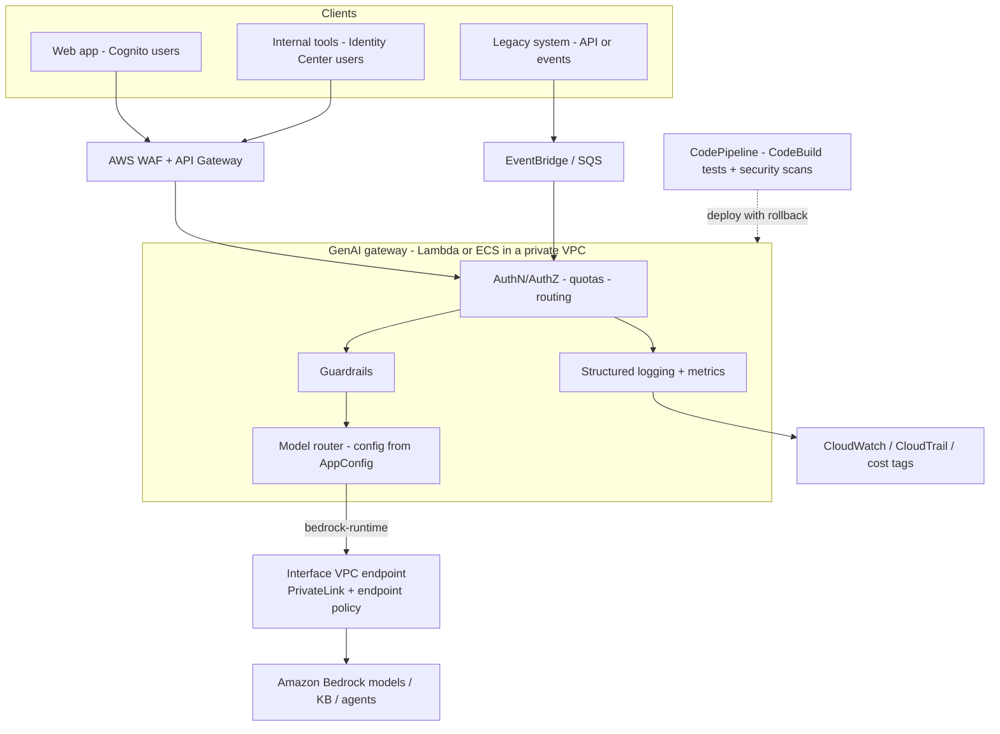
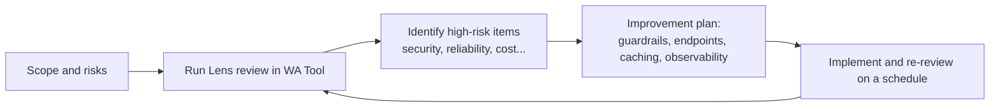
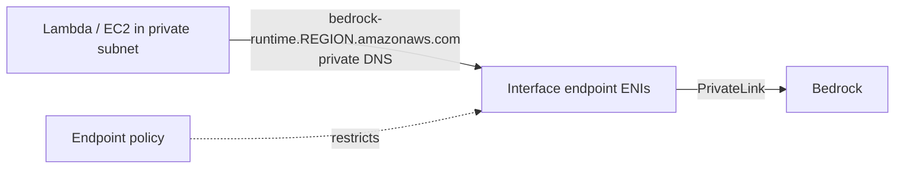

> **Source note.** The syllabus gives only the title "Enterprise Integration" (3 min) for lesson 35; I did not have the lesson content. This file therefore builds the topic from the **official exam skills for Task 2.3** plus verified AWS documentation, and does not claim to mirror the lesson.

## 0. Before you start
- **Essential:** IAM roles and policies, the Bedrock runtime/control-plane split ([01/01](aip:01-bedrock-genai-fundamentals/01-bedrock-overview-and-converse-api)).
- **Helpful:** VPC, subnets, endpoints (deepened in `08-security`); API Gateway, Lambda, EventBridge, SQS (deepened in `06`).
- **Optional advanced:** SAML/OIDC federation, AWS Organizations SCPs.

## 1. Simple explanation
A demo calls a model from a laptop. An enterprise needs that same capability to work *inside* its existing world: connect to old systems, respect who may see what, stay on private networks, pass audits, be deployed by pipelines, and be charged back to the right team. **Enterprise integration** is the set of patterns that do this: APIs and events to connect systems, identity federation and least privilege for access, private endpoints for network safety, a central **GenAI gateway** so every team uses models the same governed way, and CI/CD to ship changes safely. The **Well-Architected Generative AI Lens** is AWS's checklist of good practices for exactly these workloads, organized by the familiar Well-Architected pillars.


```figure
flow genai-gateway
```

## 2. Structured explanation
1. **Connect:** wrap Bedrock behind **API Gateway + Lambda** (or ECS); use **EventBridge/SQS/SNS** for loose coupling; sync data with scheduled or event-driven jobs.
2. **Identify:** workforce → **IAM Identity Center** (federation with the corporate IdP); customers → **Amazon Cognito**; map identities to **roles**; apply **RBAC** to models, prompts and data.
3. **Restrict:** least-privilege IAM on specific model/profile/guardrail ARNs; **SCPs** to approve models and Regions.
4. **Isolate network:** **interface VPC endpoints (PrivateLink)** for Bedrock APIs; endpoint policies.
5. **Centralize:** a **GenAI gateway** layer for auth, quotas, routing, guardrails, logging and cost attribution.
6. **Deliver:** CI/CD (CodePipeline/CodeBuild/CodeDeploy) with automated tests, security scans and rollback.
7. **Span environments:** on-premises and edge via **Outposts/Wavelength** and secure routing when data can't leave a site.
8. **Review:** assess the workload against the **Generative AI Lens** in the **Well-Architected Tool**.

## 3. Analogy
**A hospital adding a new specialist.** The specialist (the model) is excellent, but the hospital still needs: a reception desk that checks identity and routes patients (API gateway / GenAI gateway), badge rules for which wards each person may enter (IAM/RBAC), private corridors instead of public streets (PrivateLink), a record of every consultation (logging), a billing code per department (cost allocation), and an inspection checklist before opening a new wing (Well-Architected review).

*Where it breaks:* a hospital's reception can't be bypassed by walking around it, but a developer with direct IAM access to Bedrock can bypass your gateway unless you **remove** that access. A gateway only governs what must pass through it.

## 4. The seven questions

**WHAT?** *Enterprise integration architecture* = connecting GenAI capabilities into enterprise systems securely and consistently (exam Task 2.3). A *GenAI gateway* is a centralized abstraction layer providing "observability and control mechanisms" for model access (skill 2.3.5). The *Generative AI Lens* "extends the Well-Architected Framework to address the unique considerations" of foundation-model workloads and covers Amazon Bedrock and customer-managed models on SageMaker AI ✅.

**WHY?** Without it: every team builds its own integration, secrets and keys sprawl, there's no spend visibility, compliance can't prove who called what, model changes break apps, and shadow usage of unapproved models grows.

**WHEN?** As soon as more than one application, team or sensitive dataset is involved. For a single prototype, direct IAM-authenticated calls from one Lambda are fine.

**WHERE?** Around and in front of Bedrock: edge (WAF, CloudFront), API layer (API Gateway/ALB), compute (Lambda/ECS), identity (Identity Center/Cognito), network (VPC endpoints), governance (Organizations/SCPs, CloudTrail, CloudWatch), delivery (CodePipeline).

**HOW?** §5.

**WHAT IF?**
| Situation | What happens | Remedy |
|---|---|---|
| A team calls Bedrock directly, bypassing the gateway | No central logging/quotas/guardrails for that traffic | Remove broad `bedrock:Invoke*` from team roles; allow only the gateway role (or an SCP) |
| A model is approved in one Region but a cross-Region profile routes elsewhere | SCP on a destination Region makes the call fail ✅ | Allow all destination Regions in the profile, or choose in-Region |
| Traffic must not touch the internet | NAT/IGW path exists | Use **interface endpoints**; with private DNS no code change ✅ |
| Private DNS isn't enabled on the endpoint | SDK still resolves public name | Pass `endpoint_url` of the VPCE ✅ |
| An endpoint policy is default | Full Bedrock access through it ✅ | Attach a restrictive endpoint policy |
| On-prem data can't leave the site | Cloud-only design fails residency | Outposts for local processing; secure routing (skill 2.3.4) |
| A legacy system has no REST API | Can't call it synchronously | Event/queue adapter, batch file drops, or API wrapper |
| Model provider access to your data | None: model providers have no access to the AWS-operated deployment accounts, logs, prompts or completions ✅ | Still apply least privilege and logging yourself |

**WHY NOT?**
- *Why not give every team `bedrock:*`?* No governance, cost attribution or audit; violates least privilege.
- *Why not one gateway for everything always?* It adds latency and a single point of failure; keep it highly available and thin, and skip it for isolated prototypes.
- *Why not rely on the Lens alone?* It is guidance, not enforcement. Pair it with IAM, SCPs, Config-style checks and testing.
- *When is a direct call right?* Internal batch jobs with a dedicated, scoped role and their own logging.

## 5. Technical depth

### 5.1 Reference architecture (GenAI gateway)

*Reading the arrows:* all callers hit one governed entry point. Web users come through WAF/API Gateway; legacy systems drop events onto a queue. The gateway authenticates, enforces per-team quotas, applies guardrails, picks the model (the model ID comes from configuration so it can change without code changes), and calls Bedrock **through a private endpoint**. Logs and metrics go to CloudWatch/CloudTrail with tags for cost allocation. A pipeline deploys the gateway with tests and rollback. Team roles have **no direct Bedrock access** so the gateway cannot be bypassed.

### 5.2 Integration patterns (exam skills 2.3.1–2.3.2)
| Need | Pattern | AWS services |
|---|---|---|
| Add GenAI to an existing app | Microservice facade | API Gateway + Lambda/ECS |
| Loose coupling with legacy | Event-driven | EventBridge, SQS, SNS |
| Slow or bulk jobs | Async queue + worker | SQS + Lambda/ECS, Step Functions |
| Third-party webhooks | Lambda webhook handler | API Gateway/Function URL + Lambda |
| Keep data in sync | Scheduled/event-driven sync | EventBridge Scheduler, S3 events, DataSync, AppFlow |
| Dynamic model choice | Config-driven routing | AppConfig, Parameter Store |
| Cross-system workflows | Orchestration | Step Functions |

### 5.3 Secure access (skill 2.3.3)
- **Identity federation:** workforce via IAM Identity Center; app customers via Cognito; both end as temporary credentials/roles. AWS Security guidance: map identity-provider claims to IAM roles so "the damage is still constrained by the IAM role that was assigned" ✅.
- **RBAC:** roles per function (`genai-invoker`, `prompt-author`, `kb-reader`, `release-manager`).
- **Least-privilege Bedrock access:** scope `bedrock:InvokeModel*` to specific model/profile ARNs, `bedrock:ApplyGuardrail` to a specific guardrail ARN ✅, `bedrock:Retrieve` to specific knowledge bases (everything synced is retrievable by anyone with it ✅).
- **Organization controls (SCPs):** AWS shows denying `bedrock:*` on a model ARN to block a model even after access was granted ✅ and warns that denying only `aws-marketplace:Subscribe` doesn't stop first invocation; use deny on `InvokeModel` at SCP/IAM level ✅. For cross-Region inference, an SCP that blocks **any** destination Region fails the request ✅.
- **Cost attribution:** inference profiles let you "track costs and metrics" ✅ (application inference profiles per team/app).

### 5.4 Private connectivity (✅)
Interface endpoints (AWS PrivateLink) let you reach Bedrock "without the use of an internet gateway, NAT device, VPN connection, or Direct Connect connection" ✅. Endpoint service names:
`com.amazonaws.<region>.bedrock` · `…bedrock-runtime` · `…bedrock-agent` · `…bedrock-agent-runtime` · `…bedrock-mantle` · FIPS: `…bedrock-fips`, `…bedrock-runtime-fips` (limited Regions).
- **Private DNS enabled:** no code change; default names like `bedrock-runtime.<region>.amazonaws.com` resolve privately.
- **Not enabled:** pass `endpoint_url=https://<vpce-id>.bedrock-runtime.<region>.vpce.amazonaws.com` to the SDK/CLI.
- **Endpoint policy:** default allows full Bedrock access through the endpoint; attach a custom policy to restrict principals, actions and resources ✅.
- Tip: long-idle connections through NAT/endpoints drop after 350 s; enable TCP keep-alive (see [01/01](aip:01-bedrock-genai-fundamentals/01-bedrock-overview-and-converse-api)).

### 5.5 Data protection facts to cite (✅)
Shared responsibility applies. **TLS 1.2 is required (1.3 recommended).** Model providers **have no access** to the Bedrock-operated model deployment accounts, so they do not see Bedrock logs, prompts or completions. Don't put confidential data in tags or free-form name fields (they may reach billing/diagnostic logs). Use CloudTrail for API activity; Macie to find sensitive data in S3.

### 5.6 Cross-environment (skill 2.3.4, awareness level)
**AWS Outposts** brings AWS infrastructure on premises (local processing/data residency); **AWS Wavelength** puts compute at telecom edge for low latency. Design principle: keep sensitive data where required, send only what's allowed to Bedrock, and use secure routing between environments. Detailed mechanics are covered in `06-app-building-tools` (lessons 176–179). Direct Connect/VPN are **out of scope** for the exam but may appear as distractors.

### 5.7 CI/CD for GenAI components (skill 2.3.5)
Pipeline stages: source → build (CodeBuild) → **automated tests** (prompt regression golden sets, guardrail tests, schema checks) → **security scans** (dependency, IaC, secrets) → deploy (CodeDeploy/CloudFormation) with **rollback**; promote prompt versions and flow aliases the same way (`08`). Deep dive in `06`.

### 5.8 The Well-Architected Generative AI Lens (lesson 36) ✅
- **Published** November 19, 2025; scope: generative AI on **Amazon Bedrock** or customer-managed models on **SageMaker AI**, and business applications with Amazon Q. For traditional ML on SageMaker AI use the **Machine Learning Lens**.
- **Lifecycle stages:** scoping, model selection, customization, development, deployment, continuous improvement.
- **Responsible AI** with shared responsibility between model producers, providers and consumers.
- **Pillars and focus areas (as listed by AWS):**
| Pillar | Focus (paraphrased from AWS) |
|---|---|
| **Operational excellence** | Consistent output quality, operational health, traceability, lifecycle automation, deciding when to customize |
| **Security** | Protect endpoints, mitigate harmful outputs and **excessive agency**, monitor/audit, secure prompts, remediate **model poisoning** |
| **Reliability** | Throughput, reliable component communication, observability, graceful failure, versioned artifacts, distributed inference |
| **Performance efficiency** | Capture/improve model performance, optimize compute, improve retrieval performance |
| **Cost optimization** | Cost-optimized models, balance inference cost/performance, prompt engineering for cost, optimize vector stores and agent workflows |
| **Sustainability** | Minimize compute for training/customization/hosting/data/storage; efficiency techniques; serverless |
- **Six design principles:** *Design for controlled autonomy*, *Implement comprehensive observability*, *Optimize resource efficiency*, *Establish distributed resilience*, *Standardize resource management* (central catalogs of prompts, models, permissions), *Secure interaction boundaries* ✅.
- **Scenarios in the Lens:** multi-tenant GenAI platform, autonomous call center, generative business intelligence, code transformation, SMB/DB knowledge-worker co-pilot, incident-response system, automated code review, automated Kanban workflow ✅.
- **How to use it:** import the Lens JSON (AWS sample custom-lens repository on GitHub) into the **AWS Well-Architected Tool**, then answer its questions for your workload, record risks, and track improvements ✅ (import mechanics: console custom-lens import; exact CLI wording not verified).


*Reading:* the Lens is a loop, not a one-off audit: review, fix the riskiest items, re-review as the workload changes.

## 6. Worked example
*Problem:* An insurer has 6 teams building GenAI features. Security demands: no public-internet traffic to models, only approved models, per-team cost reports, central guardrails, audit logs, and the ability to switch models without redeploying apps.

| Step | Design choice | Maps to |
|---|---|---|
| 1 | Shared **GenAI gateway** (API Gateway + Lambda in a private VPC) | Skill 2.3.5 |
| 2 | **Interface endpoints** for `bedrock-runtime`, `bedrock-agent-runtime` with a restrictive endpoint policy | Private connectivity ✅ |
| 3 | SCP denies `bedrock:InvokeModel*` on non-approved model ARNs; team roles lose direct Bedrock access | RBAC + SCP |
| 4 | Gateway applies a **versioned guardrail** and logs structured records (team, app, model, tokens) | Guardrails, observability |
| 5 | **Application inference profiles** per team for cost/metrics; cost tags | Cost attribution ✅ |
| 6 | Model ID per route stored in **AppConfig**; change without code redeploy | Skill 1.2.2 |
| 7 | CodePipeline runs prompt regression + guardrail tests, deploys with rollback | Skill 2.3.5 |
| 8 | Quarterly **Generative AI Lens** review in the WA Tool | Skill 1.1.3 |

## 7. Knowledge checkpoints
1. Why can a gateway be bypassed, and how do you prevent that?
2. What do you do if private DNS is not enabled on the Bedrock interface endpoint?
3. Do Bedrock model providers see your prompts?
4. Name three pillars of the Generative AI Lens and one focus area for each.
5. Which pattern lets a legacy system call GenAI without a synchronous API?

## 7b. Practice questions (exam-style, original) — answers below

**Q1.** A company requires that Bedrock traffic from its VPC never traverses the public internet. Which solution BEST meets this?
A. A NAT gateway with a restrictive security group
B. Interface VPC endpoints (AWS PrivateLink) for `bedrock-runtime` (and other Bedrock APIs used)
C. A public Application Load Balancer
D. AWS WAF on the Lambda function

**Q2.** (Select TWO) A VPC interface endpoint for Bedrock was created without private DNS. What can the team do to use it?
A. Enable the private DNS name on the endpoint so default Regional names resolve privately
B. Pass the VPC endpoint URL as `endpoint_url` in the SDK client or `--endpoint-url` in the CLI
C. Nothing; traffic automatically uses the endpoint
D. Replace IAM roles with access keys
E. Disable TLS

**Q3.** An architect wants to ensure no team can use unapproved foundation models, even if someone grants broader IAM permissions locally. What is the BEST control?
A. Rely on developer training
B. An AWS Organizations SCP denying `bedrock:InvokeModel*` on non-approved model ARNs (and a gateway allow-list)
C. A CloudWatch dashboard
D. Denying only `aws-marketplace:Subscribe`

**Q4.** A central GenAI gateway exists, but some teams still call Bedrock directly and bypass its logging. What is the MOST effective fix?
A. Ask teams to use the gateway
B. Remove direct `bedrock:Invoke*` permissions from team roles so only the gateway role can call Bedrock
C. Increase gateway timeouts
D. Add more CloudWatch alarms

**Q5.** A request through a cross-Region inference profile fails although the home Region is allowed. What should the architect check?
A. Whether an SCP blocks any of the profile's destination Regions
B. Whether CloudFront is enabled
C. The DynamoDB capacity mode
D. The Lambda memory size

**Q6.** Which statement about data privacy in Amazon Bedrock is supported by AWS documentation?
A. Model providers can read customers' prompts in the Bedrock logs
B. Model providers don't have access to the Bedrock model deployment accounts, and therefore not to Bedrock logs or customer prompts and completions
C. Prompts are posted publicly for abuse detection
D. TLS is optional

**Q7.** (Select TWO) Which are design principles or focus areas of the AWS Well-Architected Generative AI Lens?
A. Design for controlled autonomy
B. Secure interaction boundaries
C. Maximize public exposure of endpoints
D. Disable observability to save cost
E. Replace human governance with automation entirely

**Q8.** A team must review its GenAI workload against AWS guidance and track risks over time. Which tool and artifact fit BEST?
A. AWS Budgets
B. AWS Well-Architected Tool with the Generative AI Lens imported as a custom lens
C. AWS Cost and Usage Report
D. AWS Trusted Advisor only

**Q9.** A legacy mainframe application cannot make synchronous HTTPS calls but can drop files and send messages. How should GenAI summarization be integrated?
A. Rewrite the mainframe
B. Use an event/queue-based integration (for example messages or file drops triggering SQS/EventBridge and a worker that calls Bedrock, writing results back)
C. Use Wavelength
D. Expose the Bedrock control plane publicly

**Q10.** A VPC endpoint to Bedrock has the default endpoint policy. What does that mean?
A. No access is allowed through the endpoint
B. Full access to Bedrock is allowed through the endpoint, so a custom policy should be attached to restrict principals, actions and resources
C. Only read access is allowed
D. Access is limited to one model

## 8. Hands-on lab (CLI + console, no Python files)

### 8.1 Objective
Create a private path to Bedrock with an interface endpoint and a restrictive endpoint policy, write an SCP-style deny for unapproved models, and run a Generative AI Lens review.

### 8.2 Prerequisites
A VPC with private subnets (use the default VPC for a lab if allowed); AWS CLI v2; permissions to create VPC endpoints. SCPs require AWS Organizations and management-account access; **skip step 2 in a standalone account**, or test the same JSON as an IAM policy on a lab role instead.

### 8.3 AWS services
Amazon VPC (PrivateLink), Amazon Bedrock, AWS Organizations (optional), AWS Well-Architected Tool.

### 8.4 IAM permissions
`ec2:CreateVpcEndpoint`, `ec2:DescribeVpcEndpoints`, `ec2:DeleteVpcEndpoints`, `ec2:ModifyVpcEndpoint`, plus Well-Architected Tool permissions for the review. Exact action lists should be confirmed in the IAM reference.

### 8.5 Region notes
Interface endpoints are Regional; FIPS variants only in a few Regions ✅. Use the Region where your model lives.

### 8.6 Architecture

*Reading:* the workload reaches Bedrock through network interfaces inside your VPC; no internet gateway or NAT is needed for this traffic; the endpoint policy controls what may pass.

### 8.7 Cost
Interface endpoints bill hourly per Availability Zone plus data processed (check the VPC/PrivateLink pricing page; not verified here). Delete the endpoint after the lab.

### 8.8 Step 1: endpoint policy (`endpoint-policy.json`)
```json
{
  "Version": "2012-10-17",
  "Statement": [
    {
      "Sid": "AllowInvokeOnApprovedModelsOnly",
      "Effect": "Allow",
      "Principal": "*",
      "Action": ["bedrock:InvokeModel", "bedrock:InvokeModelWithResponseStream"],
      "Resource": "arn:aws:bedrock:<REGION>::foundation-model/<APPROVED_MODEL_ID>"
    }
  ]
}
```
(Structure follows AWS's example endpoint policy ✅. If you use an **inference profile**, its ARN and the underlying model ARNs must also be allowed; I did not verify the exact resource list, so test it.)
```powershell
aws ec2 create-vpc-endpoint `
  --vpc-id <VPC_ID> --vpc-endpoint-type Interface `
  --service-name com.amazonaws.<REGION>.bedrock-runtime `
  --subnet-ids <SUBNET_ID_1> <SUBNET_ID_2> --security-group-ids <SG_ID> `
  --private-dns-enabled --policy-document file://endpoint-policy.json
```
The security group must allow inbound HTTPS (443) from your workload ✅ (standard for interface endpoints).

### 8.9 Step 2: deny unapproved models (`scp-deny-unapproved-models.json`)
```json
{
  "Version": "2012-10-17",
  "Statement": [
    {
      "Sid": "DenyBedrockInvokeExceptApprovedModels",
      "Effect": "Deny",
      "Action": ["bedrock:InvokeModel", "bedrock:InvokeModelWithResponseStream"],
      "NotResource": [
        "arn:aws:bedrock:*::foundation-model/<APPROVED_MODEL_ID_1>",
        "arn:aws:bedrock:*::foundation-model/<APPROVED_MODEL_ID_2>"
      ]
    }
  ]
}
```
This adapts AWS's documented deny-by-resource approach ✅ (deny `InvokeModel` actions at SCP/IAM level to block models). **Caution:** if you call through inference profiles, the profile ARN is also a resource in these calls; add those ARNs to `NotResource` or the policy will block valid calls. Test on a sandbox OU before real use.

### 8.10 Step 3: verify
1. From a host in the subnet, resolve the Bedrock runtime hostname and confirm it returns **private IPs** inside your VPC range (private DNS working).
2. Call `converse` for the approved model: expect success. Call an unapproved model ID: expect `AccessDeniedException` (policy-dependent).
3. Check CloudTrail event history for the Bedrock calls and note the source.
Expected outcomes are by design; not executed in this session.

### 8.11 Step 4: Generative AI Lens review (console)
1. Open **AWS Well-Architected Tool** → define a workload.
2. Import the Generative AI Lens (download its JSON from the AWS sample custom-lens repository; console **Custom lenses → Import**).
3. Apply the lens to the workload and answer the questions; record high-risk items.
4. Create milestones; schedule a re-review after improvements.
(Console labels may change; verify as you go.)

### 8.12 Common errors and troubleshooting
| Error | Cause | Fix |
|---|---|---|
| Timeout calling Bedrock from the VPC | Endpoint SG blocks 443; private DNS off | Fix SG; enable private DNS or pass `endpoint_url` ✅ |
| `AccessDeniedException` via endpoint | Endpoint policy too narrow (e.g., missing profile ARN) | Add resources; check both endpoint and IAM policies |
| Works from laptop, fails in VPC | Different network path/policies | Compare policies on both paths |
| Intermittent resets after idle | 350 s idle timeout ✅ | TCP keep-alive |
| SCP blocks valid calls | Missing profile ARNs in `NotResource` | Add; test in sandbox |
| Cross-Region profile fails | SCP blocks a destination Region ✅ | Allow all destination Regions |

### 8.13 Security recommendations
- Endpoint policy + IAM + SCP all apply; the **effective** permission is the intersection; test all three.
- No direct Bedrock permissions for application roles that should go through the gateway.
- Keep the gateway's logs free of raw sensitive prompts or protect them (see Guardrails topic).
- Tag gateway resources and profiles for cost and ownership.

**Cleanup:** `aws ec2 delete-vpc-endpoints --vpc-endpoint-ids <VPCE_ID>`; remove the test SCP/policy; delete the WA Tool workload if not needed.

## 9. What can go wrong?

| Failure | Why | Symptoms | Investigate | Fix | Prevent |
|---|---|---|---|---|---|
| **Gateway bypass** | Teams retain direct Bedrock IAM | Missing logs, unmanaged spend | CloudTrail by principal | Remove direct permissions; SCP | Permission boundaries |
| **Over-permissive endpoint** | Default endpoint policy ✅ | Any principal in VPC can call anything | Review endpoint policy | Restrictive policy | IaC baseline |
| **Residency surprise** | Cross-Region profile routes elsewhere ✅ | Compliance finding | `GetInferenceProfile` | In-Region/geography profile; SCP alignment | Pre-approval review |
| **SCP breaks profiles** | Missing ARNs/Regions ✅ | `AccessDenied` on valid use | Policy simulator, error text | Add resources/Regions | Sandbox testing |
| **Gateway as bottleneck** | Under-provisioned, synchronous | Latency/throttling | Gateway metrics | Scale, async paths, caching | Load tests |
| **Federation misconfig** | Claim→role mapping too broad | Users get excess privilege | Review role trust/mapping | Narrow mapping, MFA | Access reviews |
| **Idle-connection resets** | NAT/endpoint 350 s timeout ✅ | Sporadic failures | Pattern after idle | Keep-alive | Client baseline |
| **Lens treated as a one-time audit** | No follow-through | Risks never closed | Milestones in WA Tool | Scheduled re-reviews | Governance cadence |
| **Sensitive data in names/tags** ✅ | Free-text fields reach billing/diagnostics | Data in logs | Review tags | Remove | Tagging standard |

## 10. Common misconceptions
1. **"PrivateLink means no IAM needed."** IAM still authorizes; the endpoint adds network isolation.
2. **"A gateway automatically stops direct calls."** Only removing direct permissions does.
3. **"The default endpoint policy is safe."** It allows full access ✅.
4. **"Model providers can see my prompts."** Not in Bedrock's deployment accounts ✅.
5. **"The Lens is only for SageMaker."** It covers Bedrock too ✅.
6. **"A Well-Architected review enforces rules."** It guides and records risk; enforcement is yours.
7. **"Direct Connect/VPN are required for private Bedrock access."** PrivateLink gives private access without them ✅ (and they're out of exam scope).

## 11. Exam notes
- **Pattern:** "no internet traversal to Bedrock" → **interface VPC endpoint (PrivateLink)**.
- **Pattern:** "central control, quotas, observability, consistent policy across teams" → **GenAI gateway** (API Gateway/Lambda/ECS) + guardrails + logging (skill 2.3.5).
- **Pattern:** "workforce vs customer identities" → **IAM Identity Center** vs **Amazon Cognito**; least-privilege roles (skill 2.3.3).
- **Pattern:** "restrict which models/Regions" → **SCPs / IAM deny**; cross-Region profiles need all destination Regions allowed ✅.
- **Pattern:** "legacy integration, loose coupling" → **EventBridge/SQS/SNS**, API Gateway microservices (skills 2.3.1–2.3.2).
- **Pattern:** "on-prem/data residency" → **Outposts**; "low-latency edge" → **Wavelength** (skill 2.3.4).
- **Pattern:** "review against AWS best practices for GenAI" → **Well-Architected Tool + Generative AI Lens** (skill 1.1.3).
- **Traps:** default endpoint policy; bypass of gateway; SCP vs profile ARNs; Direct Connect/VPN are out of scope distractors.
- **Compare:** gateway vs direct SDK; Identity Center vs Cognito; PrivateLink vs NAT; Lens vs ML Lens.

## 12. Summary and revision cards
- Enterprise integration = connect (API/events), identify (federation/RBAC), restrict (IAM/SCP), isolate (PrivateLink), centralize (gateway), deliver (CI/CD).
- Bedrock endpoints: bedrock, bedrock-runtime, bedrock-agent, bedrock-agent-runtime (+mantle, FIPS).
- Default endpoint policy = full access; restrict it. Private DNS on = no code change.
- Providers can't access Bedrock logs/prompts/completions ✅; TLS 1.2 required.
- Generative AI Lens: 6 pillars, 6 design principles, lifecycle stages, 8 scenarios; use via WA Tool custom lens.

**Cards.** Q: How to reach Bedrock privately? A: Interface VPC endpoint. · Q: Block a model org-wide? A: Deny `InvokeModel*` on its ARN in an SCP/IAM. · Q: Lens publication date? A: November 19, 2025.

## 13. References
| Source | URL | Verified |
|---|---|---|
| Generative AI Lens (overview, pillars, scope, lens JSON) | https://docs.aws.amazon.com/wellarchitected/latest/generative-ai-lens/generative-ai-lens.html | 2026-10-23 |
| Lens design principles | https://docs.aws.amazon.com/wellarchitected/latest/generative-ai-lens/design-principles.html | 2026-10-23 |
| Lens scenarios | https://docs.aws.amazon.com/wellarchitected/latest/generative-ai-lens/scenarios.html | 2026-10-23 |
| Bedrock data protection | https://docs.aws.amazon.com/bedrock/latest/userguide/data-protection.html | 2026-10-23 |
| Bedrock interface VPC endpoints (PrivateLink) | https://docs.aws.amazon.com/bedrock/latest/userguide/vpc-interface-endpoints.html | 2026-10-23 |
| Bedrock model access (deny policies, SCPs) | https://docs.aws.amazon.com/bedrock/latest/userguide/model-access.html | 2026-10-23 |
| Inference profiles (SCP and cross-Region behavior) | https://docs.aws.amazon.com/bedrock/latest/userguide/inference-profiles-support.html | 2026-10-23 |
| AWS Security Blog: prompt-injection mitigations (role mapping, monitoring) | https://aws.amazon.com/blogs/security/safeguard-your-generative-ai-workloads-from-prompt-injections/ | 2026-10-23 |
| Exam guide Tasks 1.1, 2.3 | https://docs.aws.amazon.com/aws-certification/latest/ai-professional-01/ai-professional-01-domain2.html | 2026-10-23 |

**Unverified here:** lesson 35's actual content; exact IAM action lists for endpoint creation; Well-Architected Tool CLI import syntax; pricing; behavior of the lab steps in a live account.

## 14. Answers to checkpoints and practice questions

**Checkpoints.** 1) Callers can still use Bedrock directly if their IAM allows it; remove direct invoke permissions (and use SCPs) so only the gateway can call. 2) Pass the VPC endpoint URL as `endpoint_url`/`--endpoint-url`, or enable the private DNS name. 3) No: providers don't have access to the Bedrock model deployment accounts, logs, prompts or completions. 4) E.g., Security: protect endpoints/mitigate excessive agency; Reliability: graceful failure handling/versioning; Cost optimization: right-sized models and prompt engineering for cost (others in §5.8). 5) Event-driven/queue-based integration (EventBridge/SQS/SNS) or file drops with a worker.

**Practice questions.**
- **Q1 → B.** Interface endpoints give private connectivity. A/C/D don't remove internet paths or add private access.
- **Q2 → A, B.** Enable private DNS or specify the endpoint URL. C is false without DNS/URL; D and E are wrong.
- **Q3 → B.** An SCP deny on non-approved model ARNs is enforced regardless of local IAM grants. D alone doesn't block first invocation ✅.
- **Q4 → B.** Remove the bypass path. A is a request, not control; C, D don't prevent bypass.
- **Q5 → A.** An SCP blocking any destination Region fails the request ✅.
- **Q6 → B.** Per AWS data-protection documentation.
- **Q7 → A, B.** Both are Lens design principles ✅. C, D, E contradict them.
- **Q8 → B.** Import the Lens into the WA Tool and track risks. Budgets, CUR and Trusted Advisor are cost/advisory tools (and out of exam scope).
- **Q9 → B.** Event/queue-based integration decouples the legacy system.
- **Q10 → B.** The default policy allows full access through the endpoint ✅.
