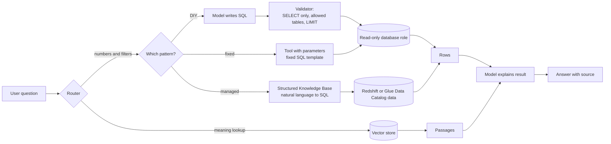
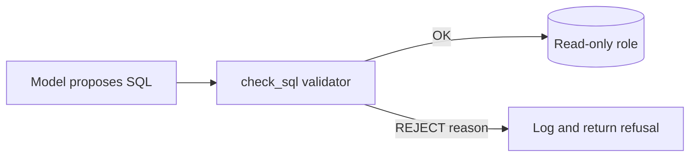

> **Note on lesson 38.** The syllabus gives only the title "Dealing with Structured Data". I built this part from exam skills 1.3.2/1.5 and the AWS pages listed in §13, not from the lesson itself.

## 0. Before you start
- **Essential:** the difference between structured data (rows and columns, such as a SQL table or CSV) and unstructured data (PDFs, audio, images, video).
- **Helpful:** what a vector store does ([RAG](aip:01-bedrock-genai-fundamentals/03-retrieval-augmented-generation-rag)); what a JSON schema is.
- **Optional advanced:** Lake Formation permissions (covered later in 07-governance-qa).

## 1. Simple explanation
A language model is good with words but bad with big tables: if you paste a million sales rows into a prompt it will run out of room and guess. So with **structured data** you let a database do the counting, and you let the model do two small jobs: (1) turn the user's question into a safe query, and (2) explain the result in plain words. With **unstructured files** (scans, call recordings, videos) the opposite problem exists: they are not rows yet. **Amazon Bedrock Data Automation (BDA)** is a managed service that turns such files into structured, machine-readable output (text, fields, summaries) with confidence scores, so the rest of your pipeline can treat them like data.


```figure
flow text-to-sql
```

## 2. Structured explanation
1. **Decide what the question needs.** Exact numbers or filters ("total refunds in March by region") → query the structured store. Meaning-based lookup ("what is our refund policy?") → vector search ([RAG](aip:01-bedrock-genai-fundamentals/03-retrieval-augmented-generation-rag)). Often you need both.
2. **For structured stores, use one of three patterns:**
   - *Managed:* Bedrock Knowledge Bases with a **structured data store** (Amazon Redshift as the query engine, data from Redshift or the AWS Glue Data Catalog through Lake Formation 🟡).
   - *Do-it-yourself text-to-SQL:* the model writes SQL, your code validates it, a **read-only** database role runs it.
   - *Tool use:* expose fixed, parameterised queries as tools (Converse tool use or an agent action group) so the model only chooses parameters.
3. **For unstructured files, use BDA** (or a classic service such as Textract/Transcribe) to produce structured output first.
4. **Validate** every converted value (types, ranges, confidence) before it enters a database, a prompt or a vector store.
5. **Store** the structured output (S3, DynamoDB, a relational table) and, for search, also embed the text parts.

## 3. Analogy
**A librarian and a calculator.** The librarian (the model) understands your question and finds the right book, but you would never ask them to add up 10,000 receipts in their head; you hand that to the calculator (the database). BDA is the mailroom clerk who opens every envelope, photocopies the key fields on to a form and stamps each field "I'm 95% sure".

*Where it breaks:* a calculator never misreads your question, but a model can write the *wrong* query that runs perfectly and returns a confident, wrong number. Correct execution is not correct meaning.

## 4. The seven questions

**WHAT?**
- *Structured data retrieval* = answering questions from tables via generated or fixed SQL.
- *BDA* = a managed API that extracts insights from documents, images, audio and video into structured formats; it states that it has built-in safeguards "such as visual grounding and confidence scores" ✅.
- *Standard output* = what you get by sending a file with no extra configuration (for example audio transcriptions, scene summaries for video, document summaries) ✅.
- *Custom output* = fields you define with a **blueprint**, for documents, audio and images only ✅.
- *Project* = a BDA resource that organises standard-output settings and blueprints; referenced in `InvokeDataAutomationAsync` ✅.

**WHY?** Prompting over raw tables is expensive and wrong; hand-building OCR + parsing + normalisation per document type is slow. A managed extraction API replaces many models and glue scripts with one interface, and per-field confidence lets you route doubtful values to humans.

**WHEN?**
| Need | Choose |
|---|---|
| Exact aggregates, joins, filters on business tables | SQL (managed structured KB, text-to-SQL with guards, or fixed tool queries) |
| Meaning-based lookup over text | Vector store / Knowledge Base |
| Mixed: "why did refunds spike?" | Agent that calls a SQL tool and a retrieval tool |
| Extract fields from invoices, IDs, forms at scale | BDA custom output (blueprints) |
| Summaries, transcripts or scene descriptions of media | BDA standard output |
| One-off screenshot question | Send the image to a vision model directly |
| Strict legal/finance extraction | BDA or Textract + validation gate + human review |

**WHERE?** Between your data sources (S3, Redshift, RDS, Glue Data Catalog) and the model call. BDA sits at ingestion; a SQL step sits at retrieval.

**HOW?** §5.

**WHAT IF?**
| Situation | What happens | Remedy |
|---|---|---|
| The model-written SQL drops or updates data | Only possible if its credentials allow it | Read-only DB role, allow-list of tables, statement validator |
| Wrong joins or wrong column meaning | Valid SQL, wrong answer | Table/column descriptions, curated example queries, human spot checks 🟡 |
| A document exceeds the BDA size/page limit | Request is rejected | Split the file or use async limits (§5.4) |
| BDA returns low confidence on a field | Field may be wrong | Threshold + human review queue |
| You send DOCX to BDA and rely on page numbers | Page mapping does not work, because DOCX is converted to PDF first ✅ | Send PDF if page references matter |
| Blueprint prompt comes from untrusted users | Prompt-injection risk; AWS says only trusted sources should control blueprint prompts ✅ | Keep blueprints in version control, restrict `CreateBlueprint` |

**WHY NOT?**
- *Why not put the table in the prompt?* Context limit, cost, and the model can mis-add.
- *Why not let the model run any SQL?* Data loss, data leaks across tenants, runaway queries.
- *Why not always BDA?* For a plain-text file or a table already in a database it adds nothing; and for a single screenshot a direct image call is simpler.
- *When is the "wrong" way right?* For a tiny table (a dozen rows) pasting it into the prompt is fine and avoids infrastructure.

## 5. Technical depth

### 5.1 Three patterns for structured data

*Reading the arrows:* a router decides whether the question needs meaning or numbers. For numbers there are three paths with decreasing flexibility and increasing safety: managed (the service generates SQL), DIY (you generate and validate SQL), fixed tools (the model only fills in parameters). All paths end with rows that the model *explains*; the model does not compute the aggregates itself.

**What AWS documents for the managed path 🟡:** Knowledge Bases connect to structured stores through the Amazon Redshift query engine and accept Redshift or the AWS Glue Data Catalog (via Lake Formation) as data sources; a managed mechanism uses query patterns, query history and schema metadata to turn natural language into SQL. Operation names `Retrieve`, `RetrieveAndGenerate` and `GenerateQuery` come from a third-party summary, so confirm them on the AWS page before relying on them. I could not load the AWS structured-data page itself in this session ❌.

### 5.2 Safe text-to-SQL checklist
1. **Least privilege first:** the database user can only `SELECT`, only on allowed schemas. A validator is a second line of defence, never the only one.
2. **Allow-list** tables and columns; add business descriptions so the model picks the right column.
3. **Reject** multiple statements, non-SELECT, missing `LIMIT`, and `SELECT *` on sensitive tables.
4. **Timeouts and row caps** on the database.
5. **Show the SQL** to the user or log it (audit); log with the user ID.
6. **Test with a question set** that has known answers; track accuracy.

### 5.3 BDA concepts (✅ unless marked)
| Concept | Meaning |
|---|---|
| Standard output | Default output by data type: audio transcripts, video scene summaries, document summaries; tunable through projects |
| Custom output | You define fields in a **blueprint**; the "How BDA works" page says documents, audio and images only, while the custom-output and limits pages also allow **one video blueprint** per project (source conflict, see the note below the table) |
| Blueprint | JSON-formatted list of fields with a data type (string, number, boolean, array of string, array of numbers), a natural-language description (≤300 characters in the walkthrough page), and explicit or inferred extraction; each blueprint is an AWS resource with an ID and ARN |
| Catalog blueprint | Premade blueprint for common documents (for example IDs, pay stubs) |
| Project | Groups standard-output settings and blueprints; up to **40 document blueprints**, one image, one audio and one video blueprint per project |
| Explicit vs inferred field | Explicit = visible in the file; inferred = needs transformation, such as stripping dashes from a number |
| Confidence score | Per-field certainty percentage; **audio and image blueprints do not return a confidence score** |
| Visual grounding | Links an extracted value back to where it appears (built-in safeguard) |
| Table field / group / custom type | Table fields up to 15 sub-fields; groups organise results; up to 30 custom-type fields per blueprint |
| `InvokeDataAutomationAsync` | Asynchronous processing (large files, S3 in and out) |
| `InvokeDataAutomation` | Synchronous processing (small files, lower limits) |

*Source conflict:* the "How BDA works" page limits custom output to documents, audio and images, while the custom-output page ("up to 40 document blueprints, one image blueprint, one audio blueprint, and/or one video blueprint") and the limits page ("Maximum Video Blueprints per Project: 1") include video. I follow the two more specific pages and flag it.

The runtime API names are shown on the AWS blueprint page ✅. The calls for creating blueprints and projects, and for polling an async job, use the service's *build-time* and *runtime* API families; I did not re-verify their exact operation names in this session ❌ (look them up in the API reference before scripting).

### 5.4 Limits that exam scenarios like (✅ read 2026-10-26)
| Item | Async | Sync |
|---|---|---|
| Document formats | PDF, TIFF, JPEG, PNG, DOC, DOCX | PDF, TIFF, JPEG, PNG |
| Max document file size | 500 MB (console 200 MB) | 50 MB |
| Max pages per document | 3,000 with splitter enabled (console 20) | 10 |
| Image | – | 5 MB, 8k resolution, JPEG/PNG |
| Video | The page lists one set of limits without an async/sync split: up to 10,240 MB and 240 minutes; MP4, MOV, AVI, MKV or WEBM | (same) |
| Audio | One set of limits: up to 2,048 MB and 240 minutes; AMR, FLAC, M4A, MP3, Ogg, WAV; max 2 channels | (same) |
| Document input languages | English, German, Spanish, French, Italian, Portuguese | same |
| Blueprint fields | 100 leaf fields per blueprint for async; **15 for sync** | |
| Blueprints per project / projects per account | 40 / 100 | |
| Blueprint size | 100,000 characters | |

Why the sync/async split matters: use **sync** for interactive, small documents (and keep blueprints small and generative fields off to be faster); use **async** for large files and batches, with S3 input and output.

### 5.5 Where BDA plugs into RAG
Customer-managed Knowledge Bases can choose **Bedrock Data Automation** as a parser (see [01/04](aip:01-bedrock-genai-fundamentals/04-bedrock-knowledge-bases) and [01/05](aip:01-bedrock-genai-fundamentals/05-chunking-embeddings-reranking-and-rag-evaluation)). You can also run BDA yourself, store its text output in S3 and ingest that.

## 6. Worked example
*Problem:* A retailer wants (a) "how many orders over 100 USD were refunded last month?" answered from a Redshift table, and (b) fields extracted from 2,000 scanned supplier invoices per night.

| Step | (a) Table question | (b) Invoices |
|---|---|---|
| 1 | Route as "numbers" | S3 upload event starts Step Functions |
| 2 | Model proposes SQL | `InvokeDataAutomationAsync` with a project that has an invoice blueprint |
| 3 | Validator: SELECT only, table `sales.orders`, has `LIMIT` or aggregate | Read the JSON from S3 |
| 4 | Read-only role executes; 1 row returned | Gate: date parses, total ≥ 0, confidence ≥ 0.9 (your threshold) |
| 5 | Model answers in one sentence and shows the SQL | Pass → DynamoDB; fail → human review queue |
| 6 | Log question, SQL, row count | Dashboard of review rate and cost per invoice |

*Lesson:* in both halves the model or service proposes, and deterministic code disposes.

## 7. Knowledge checkpoints
1. Why should the model not compute aggregates over a large table itself?
2. Name the three structured-data patterns from least to most flexible.
3. Which BDA output type needs a blueprint, and which data types support it?
4. Which BDA APIs are sync and async, and which has the 15-field blueprint limit?

## 7b. Practice questions (exam-style, original) — answers below

**Q1.** A company wants employees to ask "what was last quarter's revenue per region?" against a data warehouse. The team worries the model might modify data. What is the BEST first control?
A. Ask the model politely not to write UPDATE statements
B. Run generated SQL with a database role that has read-only access to an allow-listed set of tables
C. Increase the model's temperature
D. Paste the full revenue table into every prompt

**Q2.** A developer must process thousands of 400-page PDF contracts overnight with custom field extraction. Which BDA invocation style fits?
A. The synchronous `InvokeDataAutomation` API
B. The asynchronous `InvokeDataAutomationAsync` API with a project that references a blueprint
C. Converse with a `document` block per page
D. Amazon Comprehend `DetectSentiment`

**Q3.** (Select TWO) Which statements about BDA custom output are correct?
A. It is configured with blueprints
B. It supports documents, audio and images
C. It supports video blueprints in a project in unlimited numbers
D. It returns confidence scores for every modality
E. It requires you to train a model first

**Q4.** A team stores a user-editable "extraction prompt" and uses it as a blueprint field description. What risk should they address?
A. Higher storage cost
B. Prompt injection, because AWS advises that only trusted sources control blueprint prompts
C. Reduced Region availability
D. Loss of confidence scores for text

**Q5.** Which question is BEST answered by SQL on a structured store rather than vector search?
A. "Summarise our remote-work policy."
B. "How many support tickets were closed in each week of March?"
C. "Find paragraphs similar to this complaint."
D. "Which product photos look like this sketch?"

**Q6.** A pipeline sends DOCX contracts to BDA and then shows users "page 7" citations. The page numbers are wrong or missing. Why?
A. BDA does not read English
B. DOCX files are converted to PDF first, so page-number mapping does not work for DOCX
C. DOCX files exceed 1 KB
D. Citations require streaming

**Q7.** An interactive app extracts a handful of fields from one-page receipts and needs low latency. Which configuration choices help? (Select TWO)
A. Use the sync API within its limits
B. Keep the blueprint small and turn off generative fields unless required
C. Always request every output granularity
D. Use async with 3,000-page splitting
E. Use a blueprint with 100 fields

**Q8.** An extracted invoice total has 61% confidence. What should the pipeline do?
A. Write it to the ledger because BDA is managed
B. Route it to a human-review queue (or re-extract with a clearer file) because it is below the team's threshold
C. Delete the invoice
D. Increase `maxTokens`

## 8. Hands-on lab (no Python files): a read-only SQL guard you can run offline

### 8.1 Objective
Build and test the validator from §5.2 so you see what it catches and what it cannot.

### 8.2 Prerequisites
Python 3 on your PC. No AWS account is needed for this part.

### 8.3 AWS services
None for the offline part. For the live variant: Amazon Bedrock Runtime plus a database or Redshift workgroup.

### 8.4 IAM permissions
Offline part: none. Live variant: `bedrock:InvokeModel` for the model, plus a database user with `SELECT` only on the allow-listed schema; never give the model's SQL a writer role.

### 8.5 Region notes
BDA and structured-data Knowledge Bases are Region-limited; check the BDA and KB pages for your Region. I do not list Regions here.

### 8.6 Architecture

*Reading:* nothing reaches the database unless the validator passes it; rejects are logged with the reason.

### 8.7 Cost
Offline: none. Live: model tokens plus database time. Keep a `LIMIT` on every query.

### 8.8 Code (paste into a terminal with `python -`, or into any REPL)
```python lab-run
import re

FORBIDDEN = {"insert", "update", "delete", "drop", "alter", "create",
             "truncate", "grant", "revoke", "merge", "call"}

def check_sql(sql, allowed_tables):
    s = sql.strip().rstrip(";")
    if ";" in s:
        return "REJECT: multiple statements"
    low = re.sub(r"--.*", "", s.lower())
    if not low.lstrip().startswith(("select", "with")):
        return "REJECT: not a SELECT"
    bad = set(re.findall(r"[a-z_]+", low)) & FORBIDDEN
    if bad:
        return "REJECT: forbidden keyword " + sorted(bad)[0]
    tables = set(re.findall(r"(?:from|join)\s+([a-z_.]+)", low))
    extra = tables - allowed_tables
    if extra:
        return "REJECT: table not allowed " + sorted(extra)[0]
    if " limit " not in low and "count(" not in low:
        return "REJECT: add LIMIT"
    return "OK"

ALLOWED = {"sales.orders"}
tests = [
    "SELECT order_id, total FROM sales.orders WHERE total > 100 LIMIT 20",
    "DROP TABLE sales.orders",
    "SELECT * FROM sales.orders; DELETE FROM sales.orders",
    "SELECT * FROM hr.salaries LIMIT 5",
    "SELECT COUNT(*) FROM sales.orders",
    "SELECT * FROM sales.orders",
    "SELECT created_at FROM sales.orders LIMIT 3",
    "SELECT * FROM sales.orders WHERE note = 'x' OR 1=1 LIMIT 5",
]
for t in tests:
    print(f"{check_sql(t, ALLOWED):<38} <- {t}")
```

### 8.9 Captured output
Generated on 2026-10-26 by extracting the block above from this file and running it (Python 3.13). It is **not** AWS output; this lab makes no AWS call.
```text lab-out
OK                                     <- SELECT order_id, total FROM sales.orders WHERE total > 100 LIMIT 20
REJECT: not a SELECT                   <- DROP TABLE sales.orders
REJECT: multiple statements            <- SELECT * FROM sales.orders; DELETE FROM sales.orders
REJECT: table not allowed hr.salaries  <- SELECT * FROM hr.salaries LIMIT 5
OK                                     <- SELECT COUNT(*) FROM sales.orders
REJECT: add LIMIT                      <- SELECT * FROM sales.orders
OK                                     <- SELECT created_at FROM sales.orders LIMIT 3
OK                                     <- SELECT * FROM sales.orders WHERE note = 'x' OR 1=1 LIMIT 5
```

### 8.10 Explanation of key points
- `created_at` passes because the keyword check compares whole words (`created_at` is not `create`).
- The last line **passes** even though `OR 1=1` returns every row. A regex validator cannot judge meaning. This is why the database role must be read-only, tenant filters must be added by your code (not by the model), and `LIMIT` caps the damage.
- A production guard should use a real SQL parser; this is a teaching sketch.

### 8.11 Testing and validation
1. Add a query using a subquery on `hr.salaries` and see whether the table check catches it (it should, because the regex finds each `from`).
2. Add `select pg_sleep(100) limit 1` and notice it is allowed; add function allow-lists or timeouts.
3. Try a comment trick such as `SELECT 1 -- ; DROP TABLE x` and explain the result.

### 8.12 Common errors and fixes
| Error | Cause | Fix |
|---|---|---|
| Valid queries rejected | Table names with quotes or aliases | Normalise identifiers, or parse with a SQL parser |
| Validator passes a harmful query | Regex limits | Rely on database permissions first |
| Model keeps writing `SELECT *` | No schema guidance | Provide column descriptions and examples |

### 8.13 Security recommendations
Use a read-only role; add the tenant filter in code; log every generated query with the user ID; time-limit queries; never place secrets in the schema description sent to the model.

**Live BDA variant (not run in this session):** create a project in the console, upload a one-page PDF to S3, call the async API with the project and your S3 locations, then read the JSON output from the output prefix. I did not run it against AWS.

## 9. What can go wrong?

| Failure | Why | Symptoms | Investigate | Fix | Prevent |
|---|---|---|---|---|---|
| **Confidently wrong SQL** | Ambiguous column names, wrong join | Plausible but incorrect numbers | Compare to a known-answer test set | Descriptions, curated example queries, human review for key reports | Accuracy tracking in CI |
| **Data exfiltration through SQL** | Model can query tables the user must not see | Rows from other tenants | Query logs | Row-level security, tenant filter in code | Per-user database roles |
| **Runaway query** | Missing limits | Long waits, cost | DB monitor | Timeouts, row caps | Validator + workload management |
| **Low-confidence values stored** | No gate | Bad data in ledger | Confidence distribution | Threshold + review queue | Gate in the pipeline |
| **File over limit** | Large or too many pages | Request rejected | Compare to §5.4 | Split files, use async | Pre-check size/pages in the router |
| **Wrong page references** | DOCX converted to PDF | Mismatched citations | Test with PDF | Send PDF | Standardise on PDF for citations |
| **Blueprint tampering** | Untrusted prompt text | Odd or leaked output | Blueprint change history | Lock `CreateBlueprint`/`UpdateBlueprint` permissions | IaC + review for blueprints |
| **Sync call too slow** | Large blueprint, generative fields | Timeouts | Latency per field | Slim the blueprint, use async | Choose sync only for small files |

## 10. Common misconceptions
1. **"The model can query a database by itself."** It only writes text; your code runs it.
2. **"A valid query is a correct query."** It can be valid and answer the wrong question.
3. **"BDA replaces all other extraction tools."** It is one option; Textract, Transcribe and plain parsers are still used, and the exam guide names them.
4. **"Every BDA output has a confidence score."** Audio and image blueprints do not return one ✅.
5. **"Video support for custom output is settled."** AWS's own pages disagree: one says custom output is for documents, audio and images, others allow one video blueprint per project. Video *standard* output (scene summaries, transcripts) is certain ✅; check the current console before depending on video blueprints.

## 11. Exam notes
- **Pattern:** "extract structured data from documents/images/audio/video with minimal custom code" → **Bedrock Data Automation**.
- **Pattern:** "questions about numbers in tables" → SQL path (structured KB or guarded text-to-SQL), not embeddings.
- **Pattern:** "prevent the model from changing data" → **read-only role + least privilege**; prompts are not security.
- **Traps:** DOCX page mapping; sync vs async limits; confidence not returned for audio/image blueprints; blueprint prompts as an injection vector.
- **Compare:** BDA vs Textract (classic OCR/forms, no generative reasoning) vs Converse `document` block (ad hoc, you build the validation).

## 12. Summary and revision cards
- Let databases compute and models translate or explain.
- Three SQL patterns: managed, DIY with validator, fixed tools.
- BDA: standard output, custom output via blueprints, projects, async vs sync.
- Always add a validation gate and a human-review path.

**Cards.** Q: Where do blueprint prompts come from? A: Only trusted sources. · Q: Sync PDF page limit? A: 10 pages. · Q: Max document blueprints per project? A: 40.

## 13. References
| Source | URL | Verified |
|---|---|---|
| What is Bedrock Data Automation | https://docs.aws.amazon.com/bedrock/latest/userguide/bda.html | 2026-10-26 |
| How BDA works (standard/custom output, projects) | https://docs.aws.amazon.com/bedrock/latest/userguide/bda-how-it-works.html | 2026-10-26 |
| Custom output and blueprints | https://docs.aws.amazon.com/bedrock/latest/userguide/bda-custom-output-idp.html | 2026-10-26 |
| Blueprints (fields, limits, trust note) | https://docs.aws.amazon.com/bedrock/latest/userguide/bda-blueprint-info.html | 2026-10-26 |
| BDA prerequisites and limits | https://docs.aws.amazon.com/bedrock/latest/userguide/bda-limits.html | 2026-10-26 |
| Knowledge Bases for structured data (AWS ML blog, via search) | https://aws.amazon.com/blogs/machine-learning/build-conversational-interfaces-for-structured-data-using-amazon-bedrock-knowledge-bases/ | 🟡 2026-10-26, not opened |
| Exam guide Task 1.3 | https://docs.aws.amazon.com/aws-certification/latest/ai-professional-01/ai-professional-01-domain1.html | 2026-10-23 |

**Unverified here:** AWS structured-data KB page, exact BDA create/poll operation names, BDA pricing and Regions, Redshift/Glue version requirements.

## 14. Answers to checkpoints and practice questions

**Checkpoints.** 1) Context limits, cost, and models mis-add; databases are exact. 2) Fixed tool queries (least flexible, safest) → DIY text-to-SQL with validator → managed structured KB (most automatic). 3) Custom output; string, number, boolean, array of string, array of numbers. 4) Sync = `InvokeDataAutomation` (15 fields per blueprint); async = `InvokeDataAutomationAsync` (100).

**Practice questions.**
- **Q1 → B.** Permissions are enforceable; A is a request, C increases randomness, D is infeasible and leaks data.
- **Q2 → B.** Large, batch work uses async; sync is limited to 10 pages. C is page-by-page glue with no blueprint; D is sentiment.
- **Q3 → A, B.** Custom output uses blueprints for documents, audio, images. C is wrong (one video blueprint per project); D wrong (audio and image blueprints do not return confidence); E wrong (no training).
- **Q4 → B.** AWS says to let only trusted sources control prompts used in blueprints.
- **Q5 → B.** Counting by week is a structured aggregate. A, C, D are meaning/similarity problems.
- **Q6 → B.** DOCX is converted to PDF, so page numbers do not map.
- **Q7 → A, B.** The sync path with a small blueprint and no unneeded generative fields is faster. C adds work; D and E are for large async jobs.
- **Q8 → B.** Low confidence needs review or re-extraction; A skips the safeguard, C and D are unrelated.
