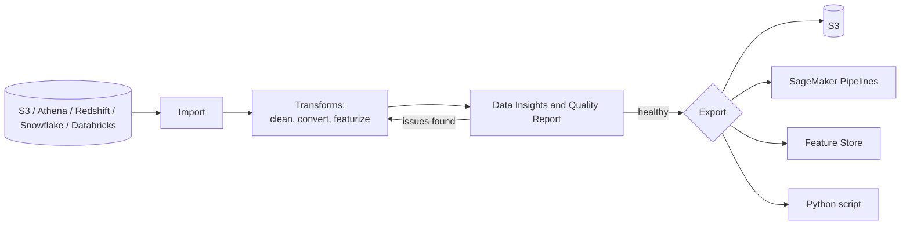
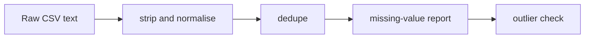

## 0. Before you start
- **Essential:** what "cleaning" a dataset means (missing values, duplicates, wrong types, outliers).
- **Helpful:** what an Amazon SageMaker AI *domain* is (the shared workspace that holds users, apps and storage).
- **Optional advanced:** SageMaker Pipelines, Feature Store (see 05-sagemaker later).

## 1. Simple explanation
Before data reaches a model, an embedding job or a training run, somebody has to tidy it: fix dates, remove duplicates, fill or drop blanks, spot weird numbers. **Amazon SageMaker Data Wrangler** is a point-and-click (and now also chat-style) tool for doing exactly that, with a built-in report that tells you how healthy the data is. Think of it as a "spreadsheet cleaner" that remembers every step as a repeatable **flow** and can export that flow to run on much bigger data.


```figure
flow data-wrangler
```

## 2. Structured explanation
1. **Import** from S3, Athena, Redshift, Snowflake or Databricks ✅.
2. **Build a data flow**: a sequence of steps (join, transform, analyse) ✅.
3. **Transform**: standard string, numeric and vector tools; featurise with text and date/time embedding and categorical encoding ✅.
4. **Generate Data Insights and Quality Report**: automatic checks that flag problems ✅.
5. **Analyse** with built-in charts, target-leakage analysis and quick modelling ✅.
6. **Export** to S3, SageMaker Pipelines, SageMaker Feature Store or a Python script ✅.

## 3. Analogy
**A kitchen prep station.** Raw vegetables (raw rows) come in, you wash, chop and sort them (transforms), a checklist on the wall shows what is bruised (quality report), and the same recipe card (flow) can be given to a catering kitchen (a bigger processing job) when volume grows.

*Where it breaks:* a recipe card replays your steps but does not know *why* you chose them. A silent assumption (for example "03/04/2026 means 4 March") stays in the flow and can be wrong for other data.

## 4. The seven questions

**WHAT?** A SageMaker AI data-preparation tool. The official page says Data Wrangler "has been integrated into Amazon SageMaker Canvas" and that the new experience adds "a natural language interface to explore and transform your data in addition to the visual interface" ✅. The older page still describes it as a feature of **SageMaker Studio Classic** ✅.

**WHY?** Bad inputs make bad outputs: duplicates skew retrieval, a stray 9,999 skews statistics, mixed date formats break filters. A visual tool lowers the entry barrier and the quality report makes problems visible before they reach a vector store or a training job. The exam guide lists Data Wrangler under skill 1.3.1 "data validation workflows".

**WHEN?**
| Situation | Choose |
|---|---|
| One analyst explores and cleans a dataset interactively | Data Wrangler (in Canvas) |
| Scheduled, large, repeatable ETL over a data lake | AWS Glue (next file) |
| Row-level checks that must run in a pipeline | Glue Data Quality, or Lambda checks |
| Heavy custom processing code on big batches | SageMaker Processing (named in skill 1.3.2) |
| Real-time input validation on one request | Lambda / API Gateway, not Data Wrangler |

**WHERE?** In the SageMaker AI console area (Canvas, Studio). It needs a SageMaker AI domain and an IAM execution role with access to your data.

**HOW?** §5.

**WHAT IF?**
| Situation | What happens | Remedy |
|---|---|---|
| You cannot find Data Wrangler (lesson 41) | It moved into Canvas; older Studio Classic paths differ | Open SageMaker Canvas → data preparation; check the "Data preparation" page |
| Source is not in the supported list | You cannot import directly | Land it in S3 first |
| The flow works on a sample, fails at scale | Interactive sessions are sized for sampling | Export to a processing job / pipeline |
| A flow hides a risky assumption | Wrong values pass silently | Review steps, add explicit checks |
| You leave the Canvas/Studio app running | You keep paying for compute while it runs ❌ (not verified on a pricing page) | Log out / shut down apps; check pricing |

**WHY NOT?**
- *Why not just use Python?* You can; Data Wrangler trades flexibility for speed and visibility. You can still add your own Python transforms ✅.
- *Why not Data Wrangler for production ETL?* Production pipelines want versioned, scheduled, tested jobs (Glue/Processing/Pipelines).
- *When is the "wrong" way right?* For a one-off clean of a small CSV, a spreadsheet or the script in §8 is faster than any service.

## 5. Technical depth

### 5.1 Data flow

*Reading the arrows:* import feeds a chain of transforms; the quality report loops you back to fix problems; once healthy, the flow is exported to a destination. The loop is the point: cleaning is iterative, not one pass.

### 5.2 What to clean for GenAI specifically
| Problem | Why it matters for GenAI |
|---|---|
| Duplicate documents or rows | Duplicate chunks fill the top-k results and waste tokens |
| Mixed encodings or broken text | Embeddings of garbage match garbage |
| Missing metadata (owner, date, product) | Metadata filters in retrieval cannot work |
| Unredacted PII | Leaks into prompts, logs and vector stores |
| Inconsistent labels (training data) | Fine-tuning learns the noise |
| Outliers | Skew statistics, thresholds and evaluation |

### 5.3 Data Wrangler vs neighbours
| Tool | Style | Best for |
|---|---|---|
| Data Wrangler (Canvas) | Visual + natural language, interactive | Exploration and prep, then export |
| AWS Glue / Glue Studio | Serverless ETL jobs | Scheduled, large-scale pipelines |
| Glue Data Quality | Rules (DQDL) | Measuring and enforcing quality |
| SageMaker Processing | Containerised batch code | Custom heavy processing |
| Lambda | Small event-driven code | Per-file or per-request checks |

## 6. Worked example
*Problem:* A support team wants to embed 40,000 ticket descriptions. The CSV has duplicate tickets, three date formats and a few absurd amounts used later in analytics.

| Step | Action |
|---|---|
| 1 | Import the CSV from S3 into a Data Wrangler flow |
| 2 | Strip whitespace, title-case customer names, convert all dates to `YYYY-MM-DD` |
| 3 | Drop exact duplicates |
| 4 | Run the quality report; investigate columns with many blanks and outliers |
| 5 | Export the flow to S3 (or a pipeline) for the embedding job |
| 6 | Keep the flow with the pipeline code so the same cleaning runs on tomorrow's file |

## 7. Knowledge checkpoints
1. Where did Data Wrangler move to, and why might it be "hard to find"?
2. Name three export destinations.
3. Why are duplicates especially harmful for RAG?
4. When would you prefer Glue over Data Wrangler?

## 7b. Practice questions (exam-style, original) — answers below

**Q1.** A data scientist wants a visual way to clean a CSV, see a data-quality report and export the steps for reuse in a pipeline. Which service FITS BEST?
A. Amazon Rekognition
B. SageMaker Data Wrangler (in SageMaker Canvas)
C. AWS WAF
D. Amazon Transcribe

**Q2.** (Select TWO) Which are Data Wrangler import sources named in the AWS documentation?
A. Amazon S3
B. Amazon Athena
C. Amazon Rekognition
D. AWS Shield
E. Amazon Cognito

**Q3.** A team needs a nightly, scheduled, large-scale ETL job with data-quality rules. Which is the BEST fit?
A. Data Wrangler interactive session run by an analyst
B. AWS Glue ETL job with Glue Data Quality
C. A Bedrock Playground session
D. An S3 lifecycle rule

**Q4.** A developer follows an older tutorial and cannot find Data Wrangler in the menu. What is the most likely explanation?
A. The service was retired and has no replacement
B. Data Wrangler is now integrated into SageMaker Canvas, so the entry point differs from older Studio Classic paths
C. It only works in one AWS partition
D. It requires Bedrock model access

**Q5.** Which cleaning step most directly reduces wasted tokens in a RAG pipeline?
A. Adding more columns
B. Removing duplicate documents or chunks before embedding
C. Raising temperature
D. Converting text to uppercase

**Q6.** A flow cleaned a 5,000-row sample perfectly, but the 800 GB production dataset needs the same logic nightly. What should the team do?
A. Re-run the interactive session each night
B. Export the flow to a repeatable job (for example a processing job or SageMaker Pipelines step) and schedule it
C. Email the sample to the model
D. Disable the quality report

**Q7.** (Select TWO) Which of these are good checks before embedding enterprise documents?
A. Detect and redact PII
B. Verify required metadata fields are present
C. Replace all numbers with zero
D. Remove the document titles
E. Randomly shuffle the characters

**Q8.** A date column contains `03/04/2026`. What is the safest practice?
A. Assume month/day and move on
B. Confirm the source's date convention, convert to an unambiguous ISO format, and add a check
C. Delete the column
D. Convert it to a string of digits

## 8. Hands-on lab (no Python files)

### 8.1 Objective
See the cleaning ideas of Data Wrangler (strip, normalise, dedupe, missing-value report, outlier flag) in a tiny offline script, then optionally repeat them in the visual tool.

### 8.2 Prerequisites
Python 3. For the optional visual part: an AWS account with a SageMaker AI domain and access to SageMaker Canvas (see §8.13 on cost).

### 8.3 AWS services
Offline part: none. Optional: SageMaker Canvas (Data Wrangler), S3.

### 8.4 IAM permissions
Optional part: the domain's execution role needs `s3:GetObject`/`s3:PutObject` on your bucket. I did not verify a minimal Canvas policy ❌; use the SageMaker Canvas setup page.

### 8.5 Region notes
SageMaker features vary by Region; check Canvas availability for your Region.

### 8.6 Architecture

*Reading:* the same stages as a Data Wrangler flow, in code.

### 8.7 Cost
Offline: none. Canvas: billed while the workspace runs ❌ (check the SageMaker pricing page). Shut it down when finished.

### 8.8 Code
```python lab-run
import csv, io, statistics

RAW = """ticket_id,customer,created,amount,notes
101, Alice ,2026-03-01,25.50,refund requested
102,BOB,2026-03-02,,late delivery
102,BOB,2026-03-02,,late delivery
103,carol,03/04/2026,40.00,
104,Dave,2026-03-05,9999.00,chargeback
105,Eve,2026-03-06,31.25,wrong size
"""

rows = list(csv.DictReader(io.StringIO(RAW)))
print("rows in:", len(rows))

def clean_date(s):
    if "/" in s:                       # ASSUMPTION: month/day/year
        m, d, y = s.split("/")
        return f"{y}-{m}-{d}"
    return s

seen, cleaned = set(), []
for r in rows:
    r = {k: v.strip() for k, v in r.items()}
    r["customer"] = r["customer"].title()
    r["created"] = clean_date(r["created"])
    key = tuple(r.values())
    if key in seen:
        continue
    seen.add(key)
    cleaned.append(r)

print("after dedupe:", len(cleaned))
for col in ["amount", "notes"]:
    missing = sum(1 for r in cleaned if r[col] == "")
    print(f"missing {col}: {missing}/{len(cleaned)}")

amounts = [float(r["amount"]) for r in cleaned if r["amount"]]
med = statistics.median(amounts)
mad = statistics.median([abs(a - med) for a in amounts])
print("median amount:", med, " MAD:", mad)
for r in cleaned:
    if r["amount"] and abs(float(r["amount"]) - med) > 10 * mad:
        print("outlier:", r["ticket_id"], r["amount"])
print("dates:", [r["created"] for r in cleaned])
```

### 8.9 Captured output
Generated on 2026-10-26 by extracting the block above from this file and running it (Python 3.13). Not AWS output.
```text lab-out
rows in: 6
after dedupe: 5
missing amount: 1/5
missing notes: 1/5
median amount: 35.625  MAD: 7.25
outlier: 104 9999.00
dates: ['2026-03-01', '2026-03-02', '2026-03-04', '2026-03-05', '2026-03-06']
```

### 8.10 Explanation
- The robust outlier test uses the **median** and **median absolute deviation (MAD)**; a mean-based test would be dragged up by the 9,999 itself.
- The `clean_date` function silently assumes month/day/year. If the source is day/month/year, `03/04/2026` becomes 4 March instead of 3 April. This is the kind of hidden assumption a replayed flow can hide.

### 8.11 Optional visual lab (not run in this session ❌)
1. Save `RAW` as `tickets.csv` and upload it to an S3 bucket you own.
2. Open SageMaker Canvas → data preparation → import from S3.
3. Add transforms: strip, change case, parse date, drop duplicates.
4. Generate the Data Insights and Quality Report and compare with the script's numbers.
5. Export to S3. Delete the output and shut down the Canvas app.

### 8.12 Common errors
| Error | Cause | Fix |
|---|---|---|
| Cannot find Data Wrangler | UI moved into Canvas | Use Canvas data preparation |
| Access denied on import | Execution role lacks S3 rights | Grant `s3:GetObject` on that prefix |
| Script crashes on a date | Unexpected format | Validate formats before splitting |

### 8.13 Security recommendations
Do not use real customer data in a trial; restrict the bucket; delete exported files; stop Canvas/Studio apps; keep PII out of sample files.

## 9. What can go wrong?

| Failure | Why | Symptoms | Investigate | Fix | Prevent |
|---|---|---|---|---|---|
| **Hidden assumption in a flow** | Date or locale guess | Wrong months, wrong filters | Spot-check sample rows | Make conversions explicit, add checks | Review flows like code |
| **Sample not representative** | Random 5,000 rows miss rare cases | Production job fails | Compare distributions | Stratified sampling | Test on real edge cases |
| **Duplicate chunks in retrieval** | No dedupe before embedding | Repeated passages in answers | Count unique hashes | Dedupe by content hash | Dedupe step in pipeline |
| **PII goes to the vector store** | No redaction step | Sensitive text in answers | Scan with Comprehend/Macie | Redact before embedding | Mandatory redaction stage |
| **Interactive tool in production** | Analyst-run flow | Missed nightly runs | Run history | Export to pipeline | Treat flows as code |
| **Cost leak** | Workspace left running | Unexpected bill ❌ | Billing console | Shut down apps | Billing alarm ([setup](aip:00-foundations/01-aws-account-iam-and-cli-setup)) |

## 10. Common misconceptions
1. **"Data Wrangler is a Glue feature."** It is a SageMaker AI feature.
2. **"It only works in Studio Classic."** The current docs say it is integrated into SageMaker Canvas ✅.
3. **"A clean sample means a clean dataset."** Rare values hide in the tail.
4. **"The quality report fixes data."** It finds problems; you fix them.

## 11. Exam notes
- **Pattern:** "visual, low-code data preparation and a data-quality report for ML/GenAI inputs" → **SageMaker Data Wrangler**.
- **Pattern:** "serverless scheduled ETL" → **Glue**; "rule-based quality scoring" → **Glue Data Quality**.
- **Pattern:** "custom large batch processing" → **SageMaker Processing**.
- **Traps:** treating Data Wrangler as a real-time validator; forgetting PII redaction before embedding.
- **Compare:** Data Wrangler (interactive prep) vs Glue (pipeline ETL) vs Lambda (event-driven small checks).

## 12. Summary and revision cards
- Data Wrangler = import, transform, insight report, export; now inside SageMaker Canvas.
- Clean for GenAI: dedupe, normalise, keep metadata, redact PII.
- Move from interactive to automated by exporting flows.

**Cards.** Q: Four export destinations? A: S3, Pipelines, Feature Store, Python script. · Q: Why MAD over mean? A: Outliers distort the mean.

## 13. References
| Source | URL | Verified |
|---|---|---|
| Prepare ML data with Amazon SageMaker Data Wrangler | https://docs.aws.amazon.com/sagemaker/latest/dg/data-wrangler.html | 2026-10-26 |
| Data preparation in SageMaker Canvas | https://docs.aws.amazon.com/sagemaker/latest/dg/canvas-data-prep.html | ❌ linked from the page above, not opened |
| Exam guide Task 1.3 | https://docs.aws.amazon.com/aws-certification/latest/ai-professional-01/ai-professional-01-domain1.html | 2026-10-23 |

**Unverified here:** Canvas pricing and permissions, number of built-in transforms, whether Studio Classic Data Wrangler has an end date.

## 14. Answers to checkpoints and practice questions

**Checkpoints.** 1) Into SageMaker Canvas; old Studio Classic guides point to a different place. 2) S3, Pipelines, Feature Store, Python script. 3) Duplicates fill top-k slots and waste tokens. 4) Scheduled, large, serverless ETL.

**Practice questions.**
- **Q1 → B.** Visual prep + quality report + export. A, C, D are unrelated.
- **Q2 → A, B.** S3 and Athena are listed (also Redshift, Snowflake, Databricks).
- **Q3 → B.** Scheduled ETL with rules fits Glue + Glue Data Quality; A is manual, C and D unrelated.
- **Q4 → B.** The page says Data Wrangler was integrated into Canvas.
- **Q5 → B.** Dedupe cuts repeated chunks.
- **Q6 → B.** Export the flow to a repeatable job.
- **Q7 → A, B.** PII redaction and required metadata. C, D, E destroy information.
- **Q8 → B.** Ambiguous dates need confirmation and ISO conversion.
