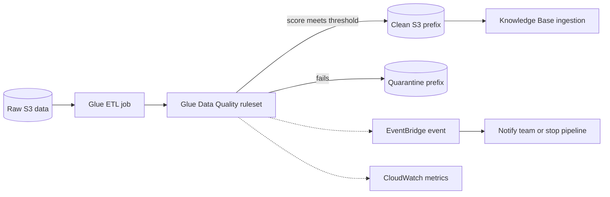

## 0. Before you start
- **Essential:** what ETL (extract, transform, load) means; what a table schema is.
- **Helpful:** Amazon S3 as a data lake; Apache Spark as a distributed data engine (only the idea).
- **Optional advanced:** Lake Formation permissions (07-governance-qa), CloudWatch alarms and logs (07).

## 1. Simple explanation
**AWS Glue** is a serverless data-plumbing service: it finds your data and writes down what it looks like (the **Data Catalog**), then runs jobs that move and reshape that data (**ETL**), without servers for you to manage. **Glue Studio** is the drag-and-drop screen for building those jobs. **Glue Data Quality** adds a checklist of rules ("this column is never empty", "ids are unique", "row count is above 1,000") and gives the dataset a **score**: the percentage of rules that passed. **CloudWatch metrics** are the numbers (counts, latencies, errors) that AWS services publish so you can graph them and raise alarms. Together they answer: "Is the data fed to my GenAI app healthy, and is the app itself healthy?"


```figure
flow glue-dq-gate
```

## 2. Structured explanation
1. **Discover:** a crawler (or you) registers tables in the Glue Data Catalog ✅.
2. **Transform:** build an ETL job visually in Glue Studio or in code; it runs on a serverless Apache Spark engine ✅ and scales workers on demand ✅.
3. **Check quality:** attach a ruleset written in DQDL (Data Quality Definition Language). Rules return pass/fail; the **data quality score** = percentage of rules that pass ✅.
4. **Act:** stop the job, quarantine bad rows, or notify through EventBridge and CloudWatch ✅.
5. **Observe:** CloudWatch metrics and alarms watch both the pipeline and the GenAI runtime (for Bedrock: namespace `AWS/Bedrock`) ✅.

## 3. Analogy
**A factory conveyor with an inspector.** The Data Catalog is the parts list. The ETL job is the conveyor that cuts and assembles. The quality ruleset is the inspector with a clipboard, and the score is "18 of 20 checks passed". CloudWatch is the control-room wall of gauges.

*Where it breaks:* the score counts **rules**, not rows. One failed rule that covers a critical column and one failed rule that covers a trivial column both reduce the score by the same amount, so a "90% score" can still hide a fatal problem. Label and prioritise rules.

## 4. The seven questions

**WHAT?**
- *AWS Glue:* "a serverless data integration service" to discover, prepare, move and integrate data, with a centralised Data Catalog ✅.
- *Glue Studio:* graphical interface to create, run and monitor jobs on the Spark-based serverless ETL engine ✅.
- *Glue Data Quality:* serverless, built on the open-source DeeQu framework, rules in DQDL, 25+ out-of-the-box rule types, ML-based anomaly detection, and a score ✅.
- *CloudWatch metrics:* time-series numbers published by services into **namespaces**, optionally split by **dimensions** (for Bedrock, `ModelId`) ✅.

**WHY?** Retrieval and training both inherit the quality of their data. Bad rows in a knowledge-base source produce bad answers that look confident. A rule-based gate stops them before indexing, and metrics tell you when quality or availability degrades.

**WHEN?**
| Need | Choose |
|---|---|
| Scheduled, large transformation of S3 / database data | Glue ETL job |
| Visual job building | Glue Studio |
| Measure and enforce data rules with a score | Glue Data Quality |
| Know which individual rows failed | Data Quality **inside ETL jobs** (row-level results not supported in Data Catalog mode ✅) |
| Rule recommendations from a profile | Data Quality on the **Data Catalog** (recommendations supported there, not in ETL jobs ✅) |
| Detect abnormal drift automatically | ML anomaly detection with analyzers ✅ |
| Alarm on Bedrock errors or throttling | CloudWatch metrics + alarms |

**WHERE?** Between raw storage (S3, databases) and consumers (Knowledge Base ingestion, embedding jobs, analytics). For observability, alongside the GenAI application.

**HOW?** §5.

**WHAT IF?**
| Situation | What happens | Remedy |
|---|---|---|
| Source has nested or list-type columns | Data quality rules cannot evaluate nested/list-type sources ✅ | Flatten structs first |
| Ruleset grows beyond limits | Limits are 2,000 rules and 65 KB per ruleset ✅ | Split into several rulesets |
| You use `OR` between rules and expect row-by-row logic | By default composite rules evaluate each column across the whole dataset, then combine; row logic needs `compositeRuleEvaluation.method = ROW` ✅ | Set the option explicitly |
| Dynamic rule has no history | `last(k)` returns 0.0 when there are no data points ✅ | Seed with a few runs; exclude one-off loads |
| You filter Bedrock metrics by `ModelId` | Requests that failed before the model was known are published without `ModelId`, so you can undercount errors ✅ | Query without a dimension to see everything |

**WHY NOT?**
- *Why not Lambda checks only?* Fine for small per-file checks; at table scale you want a rules engine and scores.
- *Why not Glue for one-off cleaning?* Spinning up a job is heavier than a script or Data Wrangler.
- *Why not trust the score alone?* It is rule-count based (see the analogy's limit).
- *When is the "wrong" way right?* A 20-line Lambda that rejects a malformed PDF at upload is better than any Spark job.

## 5. Technical depth

```figure
data-quality
```


### 5.1 Two entry points for Glue Data Quality (✅ official comparison)
| Feature | Data Catalog | ETL jobs |
|---|---|---|
| Typical user | Data stewards, analysts (no code) | Engineers (proactive checks before loading) |
| Rule recommendations | Supported | Not supported |
| Author and run DQDL | Yes | Yes |
| Identify which rows failed | Not supported | Supported |
| Auto scaling / Flex | Not supported | Supported |
| EventBridge and CloudWatch integration | Yes | Yes |
| Write results to S3 | Yes | Yes |
| Incremental checks | Pushdown predicates | Job bookmarks |
| ML anomaly detection, dynamic rules | Anomaly detection supported; **dynamic rules are only supported in Glue ETL** per the DQDL page ✅ (the comparison table marks both as supported, so check the current DQDL page) | Yes |

*Source conflict recorded:* the comparison table on the Glue Data Quality page says dynamic rules are supported for both entry points, while the DQDL reference says "Dynamic Rules are only supported in AWS Glue ETL". I follow the more specific DQDL page and flag it.

### 5.2 DQDL in practice (✅ syntax from the reference)
```text
Rules = [
    IsComplete "order_id",
    IsUnique "order_id",
    RowCount > 1000,
    ColumnValues "status" in ["OPEN", "CLOSED", "REFUNDED"],
    ColumnValues "amount" between 0 and 100000,
    Completeness "email" > 0.95 where "country = 'US'",
    (IsComplete "id") and (IsUnique "id")
]
```
- A ruleset is a list named `Rules` (capitalised, case sensitive) in square brackets ✅.
- `between x and y` is **exclusive** on the DQDL expression table ✅.
- The `where` clause filters rows with a SparkSQL expression before applying the rule (Glue 4.0) ✅.
- Dynamic rule: `RowCount > avg(last(3))` compares today's count with the last three runs ✅.
- **Analyzers** collect statistics without asserting a condition and feed anomaly detection ✅. Newer features: labels for reporting (Nov 2025), constants, a `Distribution` analyzer and advanced Bedrock-powered rule recommendations (Sept 2026) ✅ (all from the release notes).

### 5.3 Limits and facts worth memorising
| Item | Value ✅ |
|---|---|
| Rules per ruleset | 2,000 |
| Ruleset size | 65 KB |
| Statistics kept | 100,000 per account, retained up to two years |
| Data quality score | percentage of rules that pass |
| Labels | up to 10 per rule; ETL only |

### 5.4 CloudWatch metrics for a GenAI application (✅ Bedrock page)
Namespace `AWS/Bedrock`:
| Metric | Meaning | Important detail |
|---|---|---|
| `Invocations` | Requests Bedrock accepted | Includes later client/server errors; **excludes throttled requests and input-validation rejects** |
| `InvocationLatency` | Request sent → last token received | Use OTPS page to tell throughput vs longer outputs |
| `InvocationClientErrors` | 4xx-type failures | Quota rejections counted here, **not** as throttles |
| `InvocationServerErrors` | AWS-side failures | Also counted in `Invocations` |
| `InvocationThrottles` | Throttled requests | **Not** counted in the three metrics above |
| `InputTokenCount`, `OutputTokenCount` | Tokens | Basis of cost and quota |
| `TimeToFirstToken` | Streaming only | For chat responsiveness |
| `EstimatedTPMQuotaUsage` | Estimated tokens-per-minute use | Approximation; throttling uses a reservation of input tokens + `max_tokens` |
| `CacheReadInputTokenCount` / `CacheWriteInputTokenCount` | Prompt-cache reads/writes | Reads don't count towards TPM quota; writes do |
| `OutputImageCount` | Images generated | Image models only |
| `ModelInvocationLogs...DeliverySuccess/Failure` | Whether invocation logs reached CloudWatch/S3 | Alarm on `Failure` |

CloudWatch vocabulary: **namespace** (the family), **metric**, **dimension** (name/value filter such as `ModelId`), **period** (aggregation window), **statistic** (Sum, Average, p99…), **alarm** (threshold on a metric; see 07-governance-qa).

### 5.5 Architecture: a quality gate before indexing

*Reading the arrows:* the ETL job evaluates the ruleset on the way through. Passing data flows to the clean prefix that the Knowledge Base ingests; failing data goes to quarantine. Dotted arrows are side effects: an EventBridge event and CloudWatch metrics, which are the hooks for alerts and dashboards.

## 6. Worked example
*Problem:* A nightly job converts support tickets into JSON for a Knowledge Base. Last month 3% of tickets arrived with empty `body` fields and duplicate ids, so answers cited empty documents.

| Step | Action |
|---|---|
| 1 | Crawl the raw tickets into the Data Catalog |
| 2 | Glue Studio job: flatten structs, trim text, write Parquet/JSON |
| 3 | Add rules: `IsComplete "body"`, `IsUnique "ticket_id"`, `RowCount > avg(last(3))` |
| 4 | Route failing rows to quarantine using row-level results (ETL mode) |
| 5 | EventBridge rule notifies on a low score; ingestion runs only on success |
| 6 | CloudWatch dashboard: score trend and Bedrock error/throttle metrics |

## 7. Knowledge checkpoints
1. What is the Glue Data Quality score?
2. Which entry point can tell you the exact failing rows, and which gives rule recommendations?
3. Which Bedrock metric would you alarm on for rate limiting, and what does it exclude from `Invocations`?
4. Why can a Bedrock error count look too low when filtered by `ModelId`?

## 7b. Practice questions (exam-style, original) — answers below

**Q1.** A team wants to ensure documents with empty bodies never reach a Knowledge Base. They already run Glue ETL. Which addition fits BEST?
A. A CloudFront distribution
B. A Glue Data Quality ruleset with `IsComplete "body"` in the ETL job, quarantining failures
C. An S3 lifecycle rule
D. Amazon Rekognition

**Q2.** What does a Glue Data Quality score of 0.8 mean?
A. 80% of rows are valid
B. 80% of the evaluated rules passed
C. The job used 80% of its workers
D. 80% of columns are numeric

**Q3.** (Select TWO) Which are true about Glue Data Quality?
A. Rules are written in DQDL
B. It is built on the open-source DeeQu framework
C. It requires you to provision EC2 servers
D. Rulesets have no size limits
E. It can only run on Amazon RDS tables

**Q4.** An analyst needs rule recommendations generated from a profile of a cataloged table, with no coding. Which entry point supports recommendations?
A. Data Quality for the AWS Glue Data Catalog
B. Data Quality for ETL jobs
C. CloudWatch Logs Insights
D. Amazon Macie

**Q5.** A dataset has nested struct columns and rules fail to evaluate. What is the documented guidance?
A. Rules cannot evaluate nested or list-type data sources; flatten the structs first
B. Convert to CSV and ignore the error
C. Use a bigger instance
D. Disable DQDL

**Q6.** A rule `(ColumnValues "age" >= 26) OR (ColumnLength "name" >= 4)` fails although every row satisfies at least one side. Why?
A. Composite rules evaluate each side across the whole dataset by default, then combine; row-wise evaluation needs `compositeRuleEvaluation.method` set to `ROW`
B. DQDL does not support OR
C. The rule is case-insensitive
D. The score is rounded

**Q7.** An alarm built on `InvocationThrottles` shows spikes, but `Invocations` does not include those requests. Which statement is correct?
A. Throttled requests are not counted in `Invocations`, `InvocationClientErrors` or `InvocationServerErrors`
B. Throttled requests are counted twice in `Invocations`
C. Throttles only appear in CloudTrail
D. `InvocationThrottles` counts tokens

**Q8.** (Select TWO) What are good ways to reduce the risk of misleading data-quality scores?
A. Label rules by criticality and report critical failures separately
B. Treat any score above 50% as safe
C. Split large rulesets into several smaller ones
D. Remove all failing rules
E. Hide the score from engineers

## 8. Hands-on lab (no Python files): a toy rule evaluator + score

### 8.1 Objective
Understand what a ruleset, a pass/fail result, a score and a dynamic rule are, by implementing a **teaching imitation** of a DQDL subset. This is not Glue and does not parse DQDL; it mirrors the documented meanings.

### 8.2 Prerequisites
Python 3. Optional AWS part: a Glue-capable account and an S3 bucket.

### 8.3 AWS services
Offline: none. Optional: AWS Glue (Data Catalog, ETL), S3, CloudWatch.

### 8.4 IAM permissions
Optional: a Glue service role with S3 read/write on your prefix, `glue:*` for the job you create, and permission to publish CloudWatch metrics. I did not verify a minimal policy ❌.

### 8.5 Region notes
Glue and CloudWatch are regional; use one Region for the whole lab.

### 8.6 Architecture
See §5.5. The offline lab implements only the "DQ ruleset" box.

### 8.7 Cost
Offline: none. Glue jobs and Data Quality evaluations are billed ❌ (see Glue pricing); use tiny data and delete the job.

### 8.8 Code
```python lab-run
ROWS = [
    {"id": 1, "age": 34,  "email": "a@x.com"},
    {"id": 2, "age": 29,  "email": None},
    {"id": 3, "age": 212, "email": "c@x.com"},
    {"id": 3, "age": 41,  "email": "d@x.com"},
]

def col(name):
    return [r[name] for r in ROWS]

RULES = [
    ('IsComplete "id"',                      lambda: all(v is not None for v in col("id"))),
    ('IsComplete "email"',                   lambda: all(v is not None for v in col("email"))),
    ('IsUnique "id"',                        lambda: len(col("id")) == len(set(col("id")))),
    ('RowCount > 3',                         lambda: len(ROWS) > 3),
    ('ColumnValues "age" between 0 and 120', lambda: all(0 < v < 120 for v in col("age"))),
]

passed = 0
for text, check in RULES:
    ok = check()
    passed += ok
    print("PASS" if ok else "FAIL", text)
print(f"data quality score: {passed / len(RULES):.2f} ({passed} of {len(RULES)} rules passed)")

# Dynamic rule: RowCount > avg(last(3)), with the documented default of 0.0 when no history
def last(history, k):
    return history[-k:] if history else [0.0]

for history in ([3, 3, 4], []):
    window = last(history, 3)
    avg = sum(window) / len(window)
    print(f"history={history} avg(last(3))={avg:.4f} RowCount(4) > avg: {4 > avg}")
```

### 8.9 Captured output
Generated on 2026-10-26 by extracting the block above from this file and running it (Python 3.13). Not AWS output.
```text lab-out
PASS IsComplete "id"
FAIL IsComplete "email"
FAIL IsUnique "id"
PASS RowCount > 3
FAIL ColumnValues "age" between 0 and 120
data quality score: 0.40 (2 of 5 rules passed)
history=[3, 3, 4] avg(last(3))=3.3333 RowCount(4) > avg: True
history=[] avg(last(3))=0.0000 RowCount(4) > avg: True
```

### 8.10 Explanation
- Two of five rules pass, so the score is 0.40 (percentage of rules passed ✅).
- The age rule fails because 212 is outside the exclusive range 0–120; the duplicate id fails `IsUnique`.
- With no history the dynamic rule's baseline is 0.0, so almost any non-empty dataset passes the first time ✅. That is why a brand-new dynamic rule is weak until it has history.

### 8.11 Optional AWS steps (not run in this session ❌)
1. In the Glue console, create a database and table over a small CSV in S3 (crawler or manual).
2. Open the table → Data quality → create rules (try "Recommend rules") → run an evaluation.
3. In Glue Studio, add a **Data Quality** transform to a visual job and choose to publish metrics to CloudWatch.
4. Create a CloudWatch alarm on Bedrock throttling (shown, not run):
```bash
aws cloudwatch put-metric-alarm --alarm-name bedrock-throttles \
  --namespace AWS/Bedrock --metric-name InvocationThrottles \
  --statistic Sum --period 300 --evaluation-periods 1 --threshold 5 \
  --comparison-operator GreaterThanOrEqualToThreshold --treat-missing-data notBreaching
```
(Without a `--dimensions` option this alarm covers all models.)

### 8.12 Common errors
| Error | Cause | Fix |
|---|---|---|
| Rule fails on nested column | Nested or list type | Flatten first |
| Dynamic rule always passes | No history | Seed runs, then tighten |
| Alarm never fires | Metric published under another dimension | Create the alarm on the dimensionless metric or on both |

### 8.13 Security recommendations
Least-privilege Glue role; encrypt S3 data and job bookmarks; no real PII in test data; delete test jobs; do not put secrets in connection strings (use Secrets Manager).

## 9. What can go wrong?

| Failure | Why | Symptoms | Investigate | Fix | Prevent |
|---|---|---|---|---|---|
| **High score, bad data** | Few weak rules | Passing runs with bad rows | Review rule coverage | Add critical-column rules, labels | Rule review per dataset |
| **Dynamic rule drift** | Historical bulk load skews average | False alerts | Statistics trend | Exclude statistics from calculation ✅ | Exclude one-off loads |
| **Row logic mismatch** | Composite rules evaluated by column | Unexpected FAIL | Rule evaluation setting | `ROW` evaluation | Document rule semantics |
| **Ruleset too big** | >2,000 rules or 65 KB | Save/run errors | Size check | Split | Modular rulesets |
| **Undercounted errors** | `ModelId` filter | Dashboard lower than reality | Compare dimensionless metric | Query without dimension | Dashboard on both |
| **Missing alarms on throttling** | Throttles not in `Invocations` | No alert during rate limiting | Check `InvocationThrottles` | Alarm on throttles | Standard alarm set |
| **Log delivery silently failing** | Permissions or destination issue | Missing invocation logs | `ModelInvocationLogs...Failure` metrics | Fix role/bucket | Alarm on failure metrics |

## 10. Common misconceptions
1. **"Glue is only for analytics."** The exam positions it as part of GenAI data validation (skill 1.3.1).
2. **"The score measures rows."** It is the percentage of **rules** passed ✅.
3. **"Glue Data Quality needs servers."** It is serverless ✅.
4. **"Throttles are client errors."** Quota rejections are client errors; throttles are separate and excluded from the error metrics ✅.
5. **"`Invocations` counts everything I send."** It excludes throttled and validation-rejected requests ✅.

## 11. Exam notes
- **Pattern:** "validate data before it feeds a GenAI/FM pipeline, with rules and scores, serverless" → **Glue Data Quality**.
- **Pattern:** "visual ETL" → **Glue Studio**; "which rows failed?" → **ETL job mode**.
- **Pattern:** "monitor token usage, latency, errors of Bedrock" → **CloudWatch `AWS/Bedrock` metrics**; "invocation content" → invocation logging (not metrics, and not CloudTrail).
- **Traps:** score ≠ row percentage; dynamic rules in ETL; throttles vs client errors; `ModelId` undercount.
- **Compare:** Glue DQ (rules at scale) vs Data Wrangler (interactive report) vs Lambda (small checks) vs DataBrew (visual prep tool listed under Glue's related services ✅).

## 12. Summary and revision cards
- Glue = serverless discover + ETL; Studio = visual; Data Quality = DQDL rules + score.
- Row-level failures and dynamic rules → ETL; recommendations → Catalog.
- CloudWatch `AWS/Bedrock`: Invocations, latency, errors, throttles, tokens, cache, TTFT.

**Cards.** Q: Max rules per ruleset? A: 2,000. · Q: Dynamic rule syntax? A: `RowCount > avg(last(3))`. · Q: Which metric excludes throttles? A: `Invocations`.

## 13. References
| Source | URL | Verified |
|---|---|---|
| What is AWS Glue | https://docs.aws.amazon.com/glue/latest/dg/what-is-glue.html | 2026-10-26 |
| AWS Glue Data Quality | https://docs.aws.amazon.com/glue/latest/dg/glue-data-quality.html | 2026-10-26 |
| DQDL reference | https://docs.aws.amazon.com/glue/latest/dg/dqdl.html | 2026-10-26 |
| Monitor bedrock-runtime inference using CloudWatch metrics | https://docs.aws.amazon.com/bedrock/latest/userguide/monitoring-runtime-metrics.html | 2026-10-26 |
| Monitor the bedrock-runtime endpoint | https://docs.aws.amazon.com/bedrock/latest/userguide/monitoring.html | 2026-10-26 |
| Exam guide Task 1.3 | https://docs.aws.amazon.com/aws-certification/latest/ai-professional-01/ai-professional-01-domain1.html | 2026-10-23 |

**Unverified here:** Glue and Data Quality pricing, Glue Studio click paths, the dynamic-rules support conflict on the Catalog side, minimal IAM policy.

## 14. Answers to checkpoints and practice questions

**Checkpoints.** 1) Percentage of rules that pass. 2) Row-level failures: ETL jobs; recommendations: Data Catalog. 3) `InvocationThrottles`; throttled requests are not in `Invocations` (or the two error metrics). 4) Failures before the model is known are published without `ModelId`.

**Practice questions.**
- **Q1 → B.** A rules gate in ETL stops bad rows. Others don't validate content.
- **Q2 → B.** Score = percentage of rules passed.
- **Q3 → A, B.** DQDL and DeeQu are documented. C is wrong (serverless), D wrong (limits exist), E wrong (many sources).
- **Q4 → A.** Recommendations are supported for the Catalog entry point, not for ETL jobs.
- **Q5 → A.** Flatten nested structs first.
- **Q6 → A.** Default composite evaluation is per column over the dataset; `ROW` gives row logic.
- **Q7 → A.** Throttles are excluded from those three metrics.
- **Q8 → A, C.** Prioritising rules and splitting rulesets help; B, D, E are unsafe.
