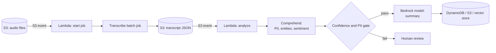

## 0. Before you start
- **Essential:** what speech-to-text, NER (named-entity recognition) and sentiment mean.
- **Helpful:** Lambda triggered by an S3 event (Lambda module comes later).
- **Optional advanced:** HIPAA basics, ICD-10 / RxNorm / SNOMED CT as medical code systems.

## 1. Simple explanation
GenAI apps often start with data a model cannot read directly. **Amazon Transcribe** turns audio (calls, meetings, videos) into text with timestamps and, optionally, speaker labels. **Amazon Comprehend** reads text and returns structured facts: who and where is mentioned (entities), how people feel (sentiment), what language it is, and which pieces are personal data (PII). **Comprehend Medical** does the same for clinical notes and links findings to medical code systems. A typical chain: audio → Transcribe → Comprehend (find PII, sentiment, entities) → foundation model (summary) → store.


```figure
flow audio-insights
```

## 2. Structured explanation
1. **Transcribe** supports **batch** (files in S3) and **streaming** (live audio) ✅. Billing is per second of audio, 1-second increments, with extra charges for features such as PII redaction and custom language models ✅.
2. **Transcribe features** (intro page): language customization, content filtering for privacy or audience-appropriate language, multi-channel audio analysis, partitioning the speech of individual speakers ✅.
3. **Comprehend insights:** entities, key phrases, PII, dominant language, sentiment (positive, neutral, negative, mixed), targeted sentiment per entity, syntax ✅.
4. **Comprehend Custom:** AutoML-built custom classification and custom entity recognition ✅; **flywheels** manage retraining over time ✅.
5. **Topic modelling** clusters a corpus by word frequency ✅.
6. **Modes:** real-time for small workloads, asynchronous jobs for large document sets ✅.
7. **Comprehend Medical:** medical entities, PHI, and ontology linking (**InferICD10CM**, **InferRxNorm**, **InferSNOMEDCT**) ✅; English (US) only ✅.
8. **Post-process** results with confidence thresholds and send only trusted facts onward.

## 3. Analogy
**A transcription typist, a highlighter and a medical coder.** The typist (Transcribe) writes down a phone call. The highlighter (Comprehend) marks names, places, feelings and private numbers. The medical coder (Comprehend Medical) turns "chest pain, aspirin 81 mg" into official codes.

*Where it breaks:* the typist can mishear and the highlighter can mark the wrong word. Both attach confidence scores; ignoring them turns small errors into "facts". Also Comprehend is a trained classifier, not a reasoning model; it does not understand context the way a foundation model does.

## 4. The seven questions

**WHAT?** Three managed AI services: speech-to-text (Transcribe), text analytics (Comprehend), clinical text analytics (Comprehend Medical). Comprehend "may store your content to continuously improve the quality of its pre-trained models" per its overview ✅, so read the data-use controls before sending sensitive text. Comprehend Medical "does not persistently store customer content" ✅ and is HIPAA eligible ✅.

**WHY?** Classic NLP services are cheap, fast, deterministic and good at *extraction*. A foundation model is better at *reasoning and writing*. Using Comprehend first gives the model clean, labelled inputs (and removes PII) and keeps token cost down.

**WHEN?**
| Need | Choose |
|---|---|
| Convert call recordings to text | Transcribe batch |
| Live captions or live agent assist | Transcribe streaming |
| Detect/redact PII before prompts or indexing | Comprehend PII (or Transcribe PII redaction for audio) |
| Sentiment at scale on reviews/transcripts | Comprehend sentiment (cheap) |
| Custom categories from labelled examples | Comprehend Custom classification |
| Summaries, answers, rewriting | Foundation model |
| Clinical notes → conditions, medications, codes | Comprehend Medical |
| Extract fields from forms/PDFs | BDA / Textract, not Comprehend |

**WHERE?** Right after ingestion (S3 event → Lambda/Step Functions). Output goes to S3, DynamoDB, a vector store or a prompt.

**HOW?** §5.

**WHAT IF?**
| Situation | What happens | Remedy |
|---|---|---|
| Region lacks the Transcribe mode you need | Region support differs for batch vs streaming (and for Medical, Call Analytics) ✅ | Check the Region table; for example some Regions list batch only |
| Non-English clinical text | Comprehend Medical detects medical entities in English (US-EN) only ✅ | Translate first or use another approach |
| Low-confidence entity | Wrong mask or missed PII | Threshold plus review; mask conservatively |
| Redacting by offsets in forward order | Offsets shift after the first replacement | Redact from the end of the text backwards (§8) |
| Sensitive data sent to Comprehend | Content may be stored for model improvement ✅ | Check the opt-out/data-use settings before sending |
| Transcript has no speaker labels | Summaries mix speakers | Enable speaker partitioning |

**WHY NOT?**
- *Why not just ask a foundation model to find PII?* It can, but costs tokens, is non-deterministic, and your PII leaves for a model call first. A purpose-built detector or a Guardrails sensitive-information filter is cheaper and auditable.
- *Why not Comprehend for summaries?* It extracts; it does not write.
- *Why not Comprehend Medical for general text?* It is tuned for English clinical text.
- *When is the "wrong" way right?* For a one-off small text, a foundation model doing sentiment plus summary in one call is simplest.

## 5. Technical depth

```figure
pii-redact
```


### 5.1 Pipeline: calls to insights

*Reading the arrows:* uploading audio triggers a Lambda that starts a Transcribe job; the finished transcript triggers a second Lambda that calls Comprehend. A gate masks PII and drops low-confidence facts; only then does the foundation model summarise. Splitting into two Lambdas keeps each short and lets Transcribe run asynchronously.

### 5.2 Comprehend feature map
| Feature | Output | Typical GenAI use |
|---|---|---|
| Entities | people, places, organisations… | Metadata for filtering in retrieval |
| Key phrases | important phrases | Tags, query expansion |
| PII detection | PII types with locations | Redaction before indexing/prompting |
| Language | dominant language | Route to the right model/translation |
| Sentiment / targeted sentiment | label (+ per entity) | Triage, dashboards |
| Syntax | parts of speech | Rare in GenAI |
| Custom classification / entities | your labels | Routing tickets, domain terms |
| Topic modelling | clusters | Corpus exploration |
All features accept UTF-8 text; custom classification and custom entity recognition also accept images, PDFs and Word files ✅.

### 5.3 Comprehend Medical operations ✅
| Operation | Does |
|---|---|
| Detect entities (Version 2) | Medical conditions, medications, PHI as entities |
| InferICD10CM | Conditions → ICD-10-CM codes (page cites the 2021 version) |
| InferRxNorm | Medications → RxNorm concept ids |
| InferSNOMEDCT | Conditions, anatomy, tests, procedures → SNOMED CT codes |
The AWS notice: it is not a substitute for professional medical advice; choose a confidence threshold for the use case and have trained humans review in patient-care scenarios ✅.

### 5.4 Choosing PII protection layers
| Layer | Where | Notes |
|---|---|---|
| Transcribe PII redaction | At transcription time | Extra charge ✅ |
| Comprehend PII | On text before indexing or prompting | Entities with locations (character offsets) ❌ field names not re-verified |
| Bedrock Guardrails sensitive-info filter | On model input/output | See [01/07](aip:01-bedrock-genai-fundamentals/07-bedrock-guardrails) |
| Macie | Finds PII in S3 at rest | Later security module |
| Log protection | CloudWatch log data protection | Invocation logs hold originals |

## 6. Worked example
*Problem:* A telecom wants a one-paragraph summary and sentiment for every support call, without storing customers' phone numbers or names in the knowledge store.

| Step | Action |
|---|---|
| 1 | Call recordings land in S3; Lambda starts Transcribe batch with speaker partitioning |
| 2 | Transcript lands in S3; second Lambda sends text to Comprehend (PII + sentiment) |
| 3 | Mask PII by offsets (backwards) → redacted transcript |
| 4 | Bedrock model summarises the redacted text |
| 5 | Store summary, sentiment, call id; keep the original audio under a stricter bucket policy |
| 6 | Low-confidence turns go to a review queue |

## 7. Knowledge checkpoints
1. Name Transcribe's two modes and when each fits.
2. Which Comprehend feature returns the sentiment of a specific entity?
3. Which three code systems does Comprehend Medical link to?
4. Why redact PII from the end of the text towards the start?

## 7b. Practice questions (exam-style, original) — answers below

**Q1.** A company wants captions during a live webinar. Which Transcribe mode fits?
A. Batch from S3 only
B. Streaming transcription
C. Comprehend Medical
D. Textract

**Q2.** (Select TWO) Which are Comprehend capabilities?
A. Detect personally identifiable information
B. Determine dominant language
C. Convert speech to text
D. Draw bounding boxes around faces
E. Provision GPU endpoints automatically for any model

**Q3.** A developer needs to mark PII in support tickets before embedding them. Which service is the most direct fit, without calling a foundation model?
A. Amazon Comprehend PII detection
B. Amazon Polly
C. AWS DataSync
D. Amazon Transfer Family

**Q4.** A hospital wants to extract medications and link them to normalized identifiers. Which operation fits?
A. Comprehend `DetectSentiment`
B. Comprehend Medical `InferRxNorm`
C. Transcribe streaming
D. Comprehend topic modelling

**Q5.** A team's non-English clinical notes return poor results from Comprehend Medical. What is the documented limitation?
A. It stores no data
B. It detects medical entities in English (US) text only
C. It needs Provisioned Throughput
D. It cannot run in a VPC

**Q6.** A pipeline masks entities by replacing text in the order returned (start to end) using character offsets. The second mask lands in the wrong place. What is the fix?
A. Apply replacements from the last offset to the first
B. Lowercase the text first
C. Use sentiment instead
D. Increase the Lambda timeout

**Q7.** (Select TWO) Which are sensible controls when feeding call transcripts into a RAG knowledge base?
A. Redact PII before indexing
B. Keep confidence scores and route low-confidence turns for review
C. Index raw transcripts including phone numbers to maximise recall
D. Delete speaker labels so summaries are ambiguous
E. Disable encryption for speed

**Q8.** A team wants cheap, deterministic sentiment scoring over 5 million reviews per day. Which is the BEST fit?
A. Foundation model per review
B. Comprehend asynchronous sentiment job
C. Manual review
D. Transcribe

## 8. Hands-on lab (no Python files): turn-merging, review flags and PII masking by offsets

### 8.1 Objective
Practise three post-processing skills that matter in real pipelines: merge segments into speaker turns, flag low-confidence turns, and mask PII by character offsets without shifting positions.

### 8.2 Prerequisites
Python 3. The data below is **made-up and simplified**; it is *not* the real Transcribe or Comprehend output format.

### 8.3 AWS services
Offline: none. Optional live variant: S3, Transcribe, Comprehend, Lambda.

### 8.4 IAM permissions
Live variant: Transcribe `StartTranscriptionJob`/`GetTranscriptionJob` and S3 read/write on your prefixes for the Lambda role; Comprehend detect permissions. I did not verify exact action lists for this session ❌; use each service's IAM page.

### 8.5 Region notes
Check batch/streaming support per Region (✅ table in the Transcribe overview).

### 8.6 Architecture
See §5.1.

### 8.7 Cost
Offline: none. Live: Transcribe per second of audio (+ add-ons), Comprehend per unit of text. Use a 30-second clip.

### 8.8 Code
```python lab-run
SEGMENTS = [
    ("spk_0", 0.0, "Hi, I want to cancel my plan.", 0.97),
    ("spk_0", 3.1, "My number is 555-0100.", 0.91),
    ("spk_1", 6.0, "Sure, can you confirm your name?", 0.95),
    ("spk_0", 9.2, "It is Jon Doe.", 0.62),
    ("spk_1", 11.0, "Thanks Jon. I can help.", 0.96),
]

turns = []
for spk, start, text, conf in SEGMENTS:
    if turns and turns[-1]["spk"] == spk:
        turns[-1]["text"] += " " + text
        turns[-1]["conf"] = min(turns[-1]["conf"], conf)
    else:
        turns.append({"spk": spk, "start": start, "text": text, "conf": conf})

for t in turns:
    flag = "REVIEW" if t["conf"] < 0.80 else "ok"
    mm, ss = int(t["start"] // 60), int(t["start"] % 60)
    print(f"[{t['spk']} {mm:02d}:{ss:02d}] {t['text']} ({flag}, min confidence {t['conf']})")

text = "My number is 555-0100 and I am Jon Doe."
spans = [(text.index("555-0100"), text.index("555-0100") + 8, "PHONE"),
         (text.index("Jon Doe"), text.index("Jon Doe") + 7, "NAME")]
print("offsets:", spans)

wrong = text
for b, e, label in spans:
    wrong = wrong[:b] + f"[{label}]" + wrong[e:]
print("forward :", wrong)

right = text
for b, e, label in sorted(spans, reverse=True):
    right = right[:b] + f"[{label}]" + right[e:]
print("reverse :", right)
```

### 8.9 Captured output
Generated on 2026-10-26 by extracting the block above from this file and running it (Python 3.13). Not AWS output.
```text lab-out
[spk_0 00:00] Hi, I want to cancel my plan. My number is 555-0100. (ok, min confidence 0.91)
[spk_1 00:06] Sure, can you confirm your name? (ok, min confidence 0.95)
[spk_0 00:09] It is Jon Doe. (REVIEW, min confidence 0.62)
[spk_1 00:11] Thanks Jon. I can help. (ok, min confidence 0.96)
offsets: [(13, 21, 'PHONE'), (31, 38, 'NAME')]
forward : My number is [PHONE] and I am J[NAME]
reverse : My number is [PHONE] and I am [NAME].
```

### 8.10 Explanation
- A turn takes the **minimum** confidence of its segments: one shaky word makes the whole turn suspect.
- `forward` shows the bug: `[PHONE]` is one character shorter than the number, so every later offset is off by one and the second mask eats the wrong characters (the stray `J` and the missing final `.`).
- `reverse` replaces the last span first; earlier offsets stay valid.

### 8.11 Optional live steps (not run in this session ❌)
1. Upload a short MP3/WAV you own to S3. In the Transcribe console create a batch job with speaker partitioning and the output bucket.
2. Open the output JSON and compare its real structure with the simplified list above.
3. Paste the transcript text into the Comprehend console "real-time analysis" and inspect entities, PII and sentiment.
4. Delete the jobs, transcripts and audio.

### 8.12 Common errors
| Error | Cause | Fix |
|---|---|---|
| Job fails to read audio | Bad format or S3 permission | Check supported formats and role |
| Region has no streaming | Batch-only Region | Choose a streaming-capable Region ✅ |
| Wrong text masked | Forward offset replacement | Reverse order |
| Empty entity list | Wrong language | Detect language first |

### 8.13 Security recommendations
Encrypt buckets (SSE-KMS where policy requires), restrict who can read raw audio, redact before logging or indexing, set retention (S3 lifecycle) on recordings, and never test with real customer calls.

## 9. What can go wrong?

| Failure | Why | Symptoms | Investigate | Fix | Prevent |
|---|---|---|---|---|---|
| **Misheard words** | Noisy audio, accents | Wrong names/terms in summaries | Confidence by segment | Custom vocabulary/language customization ✅, better audio | Confidence gating |
| **PII leaks to index** | No redaction | Phone numbers retrievable | Search the index | Re-index after redaction | Mandatory redaction step |
| **Offset mask corruption** | Forward replacement | Garbled text | Unit test with two entities | Reverse order | Test case from §8 |
| **Sensitive text stored by service** | Default data-use for Comprehend ✅ | Compliance finding | Read service data-use/opt-out docs | Opt out or use another control | Review before sending PHI |
| **Wrong mode/Region** | Batch/streaming differ ✅ | Job cannot start | Region table | Move Region | Template per Region |
| **Language mismatch** | Medical service is English (US) only ✅ | Poor extraction | Language check | Translate | Route by language |
| **Cost spike** | Add-ons, long audio | Bill higher than forecast | Cost Explorer | Trim audio, batch | Budgets and alarms |

## 10. Common misconceptions
1. **"Comprehend summarises text."** It extracts insights; use a foundation model to write summaries.
2. **"Transcribe is only for files."** It also does streaming ✅.
3. **"Comprehend Medical works on any language."** English (US) only ✅.
4. **"Comprehend stores nothing."** Comprehend may store content for model improvement ✅; Comprehend Medical does not persistently store content ✅.
5. **"Redaction by offsets is trivial."** Order matters.

## 11. Exam notes
- **Pattern:** "audio to insights" → **Transcribe → Comprehend → foundation model**.
- **Pattern:** "clinical text, codes" → **Comprehend Medical** (ICD-10-CM, RxNorm, SNOMED CT).
- **Pattern:** "improve input quality: PII removal, entities as metadata" → **Comprehend**.
- **Traps:** Medical = English only; streaming vs batch Region support; Comprehend extracts, does not generate.
- **Compare:** Comprehend (extract) vs Bedrock model (reason) vs Guardrails sensitive-info filter (inference-time) vs Macie (S3 at rest).

## 12. Summary and revision cards
- Transcribe: batch + streaming, per-second billing, add-ons cost extra.
- Comprehend: entities, key phrases, PII, language, sentiment, syntax, custom models, flywheels, topic modelling.
- Comprehend Medical: medical entities and ontology linking; English (US).
- Gate on confidence; redact backwards by offsets.

**Cards.** Q: Medical code systems? A: ICD-10-CM, RxNorm, SNOMED CT. · Q: Comprehend sentiment values? A: positive, neutral, negative, mixed.

## 13. References
| Source | URL | Verified |
|---|---|---|
| What is Amazon Transcribe | https://docs.aws.amazon.com/transcribe/latest/dg/what-is.html | 2026-10-26 |
| What is Amazon Comprehend | https://docs.aws.amazon.com/comprehend/latest/dg/what-is.html | 2026-10-26 |
| What is Amazon Comprehend Medical | https://docs.aws.amazon.com/comprehend-medical/latest/dev/comprehendmedical-welcome.html | 2026-10-26 |
| Exam guide Task 1.3 | https://docs.aws.amazon.com/aws-certification/latest/ai-professional-01/ai-professional-01-domain1.html | 2026-10-23 |

**Unverified here:** real Transcribe/Comprehend JSON field names, any "not open to new customers"/maintenance notice for Comprehend features (none appeared on the pages I read; check the service availability page), pricing numbers, exact IAM actions.

## 14. Answers to checkpoints and practice questions

**Checkpoints.** 1) Batch for files in S3; streaming for live audio. 2) Targeted sentiment. 3) ICD-10-CM, RxNorm, SNOMED CT. 4) Replacements change text length, shifting later offsets; going last-to-first keeps earlier offsets valid.

**Practice questions.**
- **Q1 → B.** Live audio needs streaming.
- **Q2 → A, B.** C is Transcribe, D Rekognition, E is not Comprehend.
- **Q3 → A.** Comprehend PII detection. B, C, D are unrelated.
- **Q4 → B.** `InferRxNorm` links medications to RxNorm.
- **Q5 → B.** English (US) only.
- **Q6 → A.** Reverse order.
- **Q7 → A, B.** Redaction and confidence handling. C, D, E are poor practice.
- **Q8 → B.** Cheap, deterministic, async at scale.
