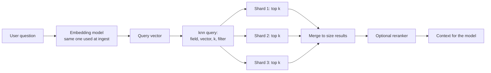
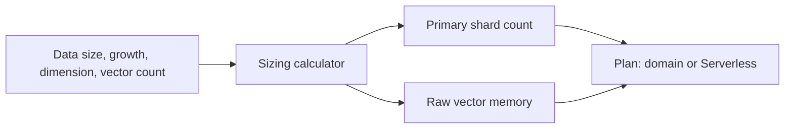

> **Cost warning (lesson 17 reminder).** Provisioned domains bill every hour they exist, and Serverless bills OCUs. Delete labs when done. The old claim that Serverless always has a non-zero minimum is **out of date for NextGen collection groups**; see §5.5.

## 0. Before you start
- **Essential:** what a vector, k-NN and cosine similarity are ([00/03](aip:00-foundations/03-embeddings-vectors-semantic-search)).
- **Helpful:** what a shard and a replica are (a slice of an index and a copy of it).
- **Optional advanced:** HNSW graph search, quantization, search pipelines.

## 1. Simple explanation
**Amazon OpenSearch** is a search engine that can do two kinds of search at once: classic keyword search (find the word "refund") and vector search (find text that *means* refund). That mix makes it the most flexible vector store for RAG. You can run it two ways: **OpenSearch Service domains** (a cluster you size and tune: nodes, shards, storage) or **OpenSearch Serverless** (collections that scale by themselves and are billed in compute units). The exam asks you to choose between them, to size and protect a domain, and to know the knobs that trade speed, memory and accuracy.


```figure
flow opensearch-knn
```

## 2. Structured explanation
1. **Choose the deployment:** managed *domain* (full control, many features) vs *serverless collection* (little operations, auto scaling).
2. **Design indexes:** a `knn_vector` field with a fixed `dimension`, a distance metric, an ANN method (HNSW), plus text and metadata fields for filters and hybrid search.
3. **Size shards** so that they are neither huge nor tiny (§5.2).
4. **Ingest** embeddings (from a Knowledge Base, an ingestion pipeline, or your code) and metadata.
5. **Query** with k-NN, optionally combined with filters and keyword search (hybrid), then optionally rerank.
6. **Operate:** watch memory (graphs live in RAM), JVM pressure, storage, shard counts; manage index lifecycle with ISM.
7. **Tune:** recall vs latency vs memory (§5.6).

## 3. Analogy
**A library with two catalogues.** The card catalogue (keywords) finds books containing exact words; the "similar books" shelf (vectors) groups books by theme. A domain is a library you staff and rearrange; Serverless is a library that adds and removes reading rooms (compute units) automatically as visitors come.

*Where it breaks:* a real library does not have to keep the whole "similar books" map in fast memory; k-NN graph indexes do, which is why vector workloads are memory-bound and why memory sizing drives cost.

## 4. The seven questions

**WHAT?**
- *Domain* = an OpenSearch cluster with the instance types, counts and storage you specify; nodes are EC2 instances ✅.
- *Collection* (Serverless) = a group of indexes for one workload; types **search**, **vector search**, **time series** (time series only in Classic) ✅. The type **cannot be changed** after creation ✅.
- *OCU* = OpenSearch Compute Unit: 6 GiB memory plus vCPU and data transfer to S3 ✅.
- *k-NN plugin* = adds the `knn_vector` type and `knn` query; Euclidean distance or cosine similarity on managed OpenSearch Service ✅; Serverless also lists dot product ✅.

**WHY?** A vector store is the memory of a RAG app. OpenSearch gives you vectors **and** full-text, filters, aggregations and geo queries in one system ✅, which avoids syncing a separate search engine. It is one of the stores a Bedrock Knowledge Base can use.

**WHEN?**
| Situation | Choose |
|---|---|
| Quick start, spiky or unknown traffic, minimal ops | OpenSearch Serverless vector collection |
| Need plugins/features Serverless lacks, fine control of nodes, UltraWarm/cold tiers | Managed domain |
| Cheapest storage for huge, rarely queried vectors | S3 Vectors ([next file](aip:02-data-management/06-s3-vectors-and-keeping-vector-stores-current)) |
| Vectors next to relational business data | Aurora/RDS pgvector ([02/07](aip:02-data-management/07-rds-aurora-and-pgvector)) |
| Hybrid keyword + semantic search, rich filters | OpenSearch (domain or Serverless) |
| Existing OpenSearch estate | Domain, with neural/vector features |

**WHERE?** Behind a Knowledge Base, an ingestion pipeline (Lambda/Glue), or called directly by your retrieval code. Clients sign requests with SigV4 for IAM.

**HOW?** §5.

**WHAT IF?**
| Situation | What happens | Remedy |
|---|---|---|
| `knn` query asks for `k` but you omit `size` | You get `k` results **per shard**, not for the whole query ✅ | Always set `size` and `k` |
| `k` above 10,000 | Max `k` is 10,000 ✅ | Keep k small; page results |
| Mixing `knn` with a `post_filter` | Fewer than `k` results can return ✅ | Use filtering inside the k-NN query (`filter`) |
| Graph memory exceeds the circuit-breaker budget | Performance suffers ✅ | Bigger/more nodes, quantization, fewer dimensions |
| Too many tiny shards | CPU/memory overhead, out-of-memory errors ✅ | Resize shards; reindex |
| Vector field wider than 10,000 floats | Not allowed on managed service (`knn_vector` max 10,000 floats) ✅ | Reduce dimension |
| Serverless collection type is wrong | Type cannot be changed ✅ | Create a new collection and reindex |
| Migrating domain → Serverless | No automatic migration; reindex ✅ | Plan a reindex job |

**WHY NOT?**
- *Why not always Serverless?* Some APIs and plugins are unsupported, cross-account access to collections is not supported, manual snapshots are not supported, no cross-Region search/replication ✅.
- *Why not always a domain?* You pay for provisioned capacity and must size, patch decisions, shards and alarms.
- *Why not OpenSearch for everything?* If you only need cheap similarity search at low QPS, S3 Vectors is cheaper; if your data is relational, pgvector avoids a second system.

## 5. Technical depth

```figure
shard-sizing
```


### 5.1 Anatomy of a vector search request

*Reading the arrows:* the query is embedded with the **same model and dimension** as the stored vectors. The k-NN query fans out to every shard; each returns its own top `k`; the coordinator merges them and returns `size` results. This is why leaving out `size` yields `k` per shard ✅ and why too many shards add merge overhead.

### 5.2 Sizing shards (✅ AWS guidance)
- Default for an OpenSearch Service index: **5 primary shards and 1 replica per primary** (differs from open source: 1+1) ✅. You cannot easily change primary count later, so decide before indexing.
- Target shard size: **10–30 GiB** when search latency matters; **30–50 GiB** for write-heavy logs ✅.
- Formula: `(source data + room to grow) × (1 + indexing overhead) / desired shard size = primary shards` ✅.
- Keep **at most 25 shards per GiB of Java heap** per node ✅. Heap is half of instance RAM up to 32 GiB ✅.
- For OpenSearch 2.17+: 1,000 shards per 16 GB heap, up to a maximum of 4,000 per node; earlier: 1,000 per node ✅.

### 5.3 Memory: why vector search is RAM-hungry (✅)
- k-NN uses up to **50% of the remaining RAM** (after the heap half) for graphs by default; a 32 GiB RAM node fits about 8 GiB of graphs ✅. Watch `KNNGraphMemoryUsage` on each data node against `knn.memory.circuit_breaker.limit` ✅.
- Raw vector size = vectors × dimensions × bytes per number (float32 = 4). The graph and metadata add more on top; §8 computes the raw part.
- You can move k-NN indexes made on 2.x to UltraWarm or cold storage on 2.17+ domains; the first query loads graph files from S3 into memory ✅.

### 5.4 Index lifecycle: Index State Management (ISM) ✅
- A policy = a default state + states (actions, transitions). Example from the docs: move to `read_only` after 30 days, delete after 90 ✅.
- After you attach a policy, ISM runs a job every ~5–8 minutes (30–48 min on pre-1.3 clusters) with jitter, and **does not run when the cluster state is red** ✅.
- OpenSearch Service adds `warm_migration`, `cold_migration` and `cold_delete` actions ✅. You can no longer attach policies through index templates; use the policy's `ism_template` field ✅.
- GenAI uses: roll old per-day/per-tenant vector indexes to cheaper tiers, reduce replicas on cold indexes, delete expired embeddings, snapshot before re-embedding.

### 5.5 OpenSearch Serverless specifics
| Fact ✅ | Detail |
|---|---|
| Architecture | Indexing and search compute are separate; **S3 is primary storage** for indexes |
| Scaling | OCUs scale up with load and back down; indexing and search scale independently |
| Capacity controls | **Collection groups** set min and max OCUs, separately for indexing and search; min can be **0** (no OCUs when idle); max up to **1,700** each; values of 2, 4, 8, 16 or multiples of 16 |
| High availability | Built in "without requiring standby nodes or redundancy configuration" |
| One collection type per group | Search, time series or vector search, not mixed |
| Vector engine | Euclidean, cosine, dot product; up to **16,000** dimensions; metadata types: numbers, booleans, dates, keywords, geopoints |
| **NextGen** vector collections | Scale on demand, **scale to zero when idle**; default **32x compression** (also 1x, 2x, 8x, 16x); GPU-accelerated index builds; custom document IDs; `engine` and `mode` not needed; search responses **exclude the vector** by default; refresh interval **5 s** |
| **Classic** vector collections | `nmslib` engine by default (HNSW with **Faiss** needed for filters); only HNSW with Faiss (no IVF, no Lucene engine); refresh interval **60 s** |
| Limits | 1,000 indexes per collection; shards, refresh interval not modifiable; no cross-account access; no custom plugins; no manual snapshots |
| Monitoring | Account-level CloudWatch metrics `SearchOCU` and `IndexingOCU` |

*Why this matters:* the old rule of thumb "Serverless always costs at least a few OCUs" no longer holds when a NextGen collection group's minimum is 0. A minimum above 0 buys predictable latency (no cold start) at the price of paying while idle. Exact prices are on the pricing page ❌ (not quoted here).

### 5.6 Tuning the vector index (the "knobs")
| Knob | Raises | Costs |
|---|---|---|
| HNSW `m` (links per node) | Recall | Memory, build time |
| `ef_construction` | Graph quality | Build time |
| `ef_search` | Recall per query | Latency |
| Larger `k` | More candidates for reranking | Latency, payload |
| Lower dimension / quantization / compression | Memory and cost savings | Some recall |
| More replicas | Query throughput, availability | Storage, cost |
| Fewer, larger shards (within guidance) | Less merge overhead | Slower recovery |
| Filters with the Faiss engine | Precise metadata filtering | Pre/post-filter semantics matter |

The names `m`, `ef_construction` and `ef_search` are standard HNSW parameters in the OpenSearch k-NN docs; this session's AWS pages did not show their defaults ❌, so check the OpenSearch reference before relying on numbers. Defaults for pgvector's equivalents are in [02/07](aip:02-data-management/07-rds-aurora-and-pgvector).

### 5.7 Hybrid search and reranking
- *Hybrid* = run keyword (BM25) and vector retrieval and fuse the scores. Bedrock Knowledge Bases expose this as `overrideSearchType` = `HYBRID` where the store supports it ([01/04](aip:01-bedrock-genai-fundamentals/04-bedrock-knowledge-bases)).
- In OpenSearch itself, hybrid search uses a `hybrid` query and a search pipeline that normalizes and combines scores 🟡 — I could not load the AWS neural-search page, so the processor names and minimum versions are ❌ unverified; read the OpenSearch neural-search docs before the exam if you want the syntax.
- *Reranker* = a second-stage model that reorders the top candidates ([01/05 §5.5](aip:01-bedrock-genai-fundamentals/05-chunking-embeddings-reranking-and-rag-evaluation)).

### 5.8 Multi-index and hierarchical patterns (exam skill 1.4.3)
| Pattern | Idea | Use when |
|---|---|---|
| Index per tenant | Isolation and easy deletion | Few large tenants |
| Shared index + tenant filter | Fewer shards | Many small tenants (watch filter correctness!) |
| Index per time window | ISM can age out | Time-bound data |
| Parent/child chunks | Search small chunks, return the larger parent | Needs context ([hierarchical chunking](aip:01-bedrock-genai-fundamentals/05-chunking-embeddings-reranking-and-rag-evaluation)) |
| Separate "summary" and "detail" indexes | Coarse search first, fine search second | Very large corpora |
These are design patterns; the AWS pages I read describe sharding and ISM but do not name these patterns, so treat the labels as general practice.

### 5.9 Security and operations
- Managed domains: IAM access control, VPC and security groups, encryption at rest and node-to-node, fine-grained (index/document/field-level) security, audit logs ✅.
- Serverless: encryption, network and data-access **policies** govern collections; all endpoint traffic uses TLS 1.2 ✅ (the permissions tutorial lists `aoss:CreateCollection`, `aoss:CreateAccessPolicy`, `aoss:CreateSecurityPolicy` ✅).
- **Recommended alarms** ✅: `ClusterStatus.red` max ≥ 1 for 1 min; `ClusterStatus.yellow` ≥ 1 for 1 min five times; `FreeStorageSpace` low (the docs suggest 25% of node storage); `ClusterIndexWritesBlocked` ≥ 1 for 5 min; `CPUUtilization` ≥ 80% for 15 min ×3; `JVMMemoryPressure` ≥ 95% for 1 min ×3; `OldGenJVMMemoryPressure` ≥ 80%; `MasterCPUUtilization` ≥ 50%; `shards.active` ≥ 25 × heap GiB × data nodes; 5xx ≥ 10% of requests; `ThreadpoolSearchQueue`/`ThreadpoolWriteQueue`; `KMSKeyError`/`KMSKeyInaccessible`.
- Version support: OpenSearch 3.x and 2.x are current; versions past standard support incur **extended support** charges ✅ (check the table before building on old versions).

## 6. Worked example

```figure
rerank-fusion
```

*Problem:* A bank has 12 million passage embeddings (1,024 dimensions) for a policy-search assistant, steady daytime traffic, a strict need for tenant isolation by business unit, and a small ops team.

| Step | Decision |
|---|---|
| 1 | Hybrid search is needed (policy codes are exact tokens) → OpenSearch rather than S3 Vectors |
| 2 | Small ops team, uneven traffic → Serverless vector collection in a collection group with a small non-zero min OCU for predictable latency |
| 3 | Isolation → index per business unit (few units) with data-access policies per index prefix |
| 4 | Raw vector footprint ≈ 12M × 1,024 × 4 bytes ≈ 45.8 GiB before graph/compression (§8) |
| 5 | Ingest via Bedrock Knowledge Base or a Lambda pipeline; metadata for filters |
| 6 | Alarms on `SearchOCU`/`IndexingOCU` approaching the group max; budget alarm |
| 7 | If requirements later include a plugin Serverless lacks → reindex to a domain |

## 7. Knowledge checkpoints
1. Why must you pass `size` as well as `k` in a k-NN query?
2. What is an OCU, and what does a collection group let you set?
3. Give two ways memory pressure from graphs can be reduced.
4. Which collection-type facts cannot change after creation?

## 7b. Practice questions (exam-style, original) — answers below

**Q1.** A team needs a vector store with hybrid keyword + semantic search, minimal operations and unpredictable traffic. Which is the BEST fit?
A. OpenSearch Serverless vector search collection
B. Amazon RDS for MySQL
C. DynamoDB with TTL
D. Amazon Neptune

**Q2.** A k-NN query specifies `k: 5` but no `size`, on an index with 4 primary shards. How many hits can the query return?
A. 5 total
B. Up to 5 per shard (about 20 before merging)
C. 1
D. Exactly 4

**Q3.** (Select TWO) Which are true of OpenSearch Serverless?
A. Indexing and search compute are separate and scale independently
B. Capacity is measured in OCUs (6 GiB memory plus vCPU)
C. You can change a collection's type after creation
D. Cross-account access to collections is supported
E. You must manage shard counts

**Q4.** A domain has `m5.large.search` nodes with a 4 GiB heap. What is the recommended maximum number of shards per node?
A. 25
B. 100
C. 1,000
D. 4,000

**Q5.** A 66 GiB index is not expected to grow; the team wants roughly 30 GiB shards and about 10% indexing overhead. Approximately how many primary shards?
A. 1
B. 3
C. 10
D. 30

**Q6.** A vector index memory alarm fires. `KNNGraphMemoryUsage` exceeds the budget. Which actions help? (Select TWO)
A. Use nodes with more RAM or add nodes
B. Reduce vector dimensions or use quantization/compression where recall allows
C. Add more `post_filter` clauses
D. Increase `k` to 10,000
E. Disable replicas to speed GPU builds

**Q7.** An index policy must move indexes to UltraWarm after 10 days and delete after a year, automatically. Which feature fits?
A. Index State Management (ISM) with `warm_migration`
B. An S3 lifecycle rule on the domain's disks
C. CloudTrail data events
D. AWS Config

**Q8.** A team's Serverless collection was created as "search" but now needs k-NN indexes. What is true?
A. Search collections can host k-NN indexes after enabling a flag
B. The collection type cannot be changed; create a vector search collection and reindex
C. Time series collections support k-NN
D. Use `UpdateCollection` to change the type

## 8. Hands-on lab (no Python files): size shards and memory before you create anything

### 8.1 Objective
Reproduce AWS's sizing arithmetic and estimate raw vector memory, so you can sanity-check a design on paper before paying for a cluster.

### 8.2 Prerequisites
Python 3 only for the offline part. Optional live part: AWS account with OpenSearch Service permissions.

### 8.3 AWS services
Offline: none. Optional: OpenSearch Serverless (vector search collection).

### 8.4 IAM permissions
For the optional live part the docs list, at minimum, `aoss:CreateCollection`, `aoss:ListCollections`, `aoss:BatchGetCollection`, `aoss:DeleteCollection`, `aoss:CreateAccessPolicy`, `aoss:ListAccessPolicies`, `aoss:UpdateAccessPolicy`, `aoss:CreateSecurityPolicy`, `iam:ListUsers`, `iam:ListRoles` ✅.

### 8.5 Region notes
OpenSearch Serverless is available in a subset of the Regions where OpenSearch Service exists ✅; check the endpoints and quotas page.

### 8.6 Architecture

*Reading:* inputs about your data feed two calculations that decide between a domain and Serverless and how big to make it.

### 8.7 Cost
Offline: none. Live: OCU or instance hours until you delete the resource ❌ (prices not quoted).

### 8.8 Code
```python lab-run
import math

def primary_shards(source_gib, growth_gib, overhead, shard_gib):
    return (source_gib + growth_gib) * (1 + overhead) / shard_gib

a = primary_shards(66, 0, 0.10, 30)
b = primary_shards(66, 198, 0.10, 30)
print(f"66 GiB, no growth, 30 GiB shards: {a:.2f} -> {math.ceil(a)} primary shards")
print(f"66 GiB + 198 GiB growth, 30 GiB shards: {b:.2f} -> {math.ceil(b)} primary shards")
print(f"66 GiB spread over 10 shards: {66 * 1.1 / 10:.2f} GiB per shard")
print(f"66 GiB spread over 6 shards: {66 * 1.1 / 6:.1f} GiB now, {(66 + 198) * 1.1 / 6:.1f} GiB after growth")

def max_shards_by_heap(heap_gib):
    return 25 * heap_gib

print("m5.large.search (4 GiB heap): at most", max_shards_by_heap(4), "shards")

def knn_graph_budget_gib(ram_gib):
    heap = min(ram_gib / 2, 32)
    return (ram_gib - heap) * 0.5

print("k-NN graph memory on a 32 GiB RAM node:", knn_graph_budget_gib(32), "GiB")

def raw_vector_gib(n, dim, bytes_per=4):
    return n * dim * bytes_per / 2**30

print(f"10M x 1024-dim float32 vectors, raw only: {raw_vector_gib(10_000_000, 1024):.1f} GiB")
print(f"same with 8-bit values: {raw_vector_gib(10_000_000, 1024, 1):.1f} GiB")
```

### 8.9 Captured output
Generated on 2026-10-26 by extracting the block above from this file and running it (Python 3.13). The first five lines reproduce numbers stated on AWS's shard-sizing and k-NN pages; the vector sizes are plain arithmetic. Not AWS output.
```text lab-out
66 GiB, no growth, 30 GiB shards: 2.42 -> 3 primary shards
66 GiB + 198 GiB growth, 30 GiB shards: 9.68 -> 10 primary shards
66 GiB spread over 10 shards: 7.26 GiB per shard
66 GiB spread over 6 shards: 12.1 GiB now, 48.4 GiB after growth
m5.large.search (4 GiB heap): at most 100 shards
k-NN graph memory on a 32 GiB RAM node: 8.0 GiB
10M x 1024-dim float32 vectors, raw only: 38.1 GiB
same with 8-bit values: 9.5 GiB
```

### 8.10 Explanation
- 66 × 1.1 / 30 = 2.42, rounded **up** to 3; the quadrupled-growth case gives 10 but would make 7.26 GiB shards today, below the 10–30 GiB guidance, so AWS suggests a middle path such as 6 shards (12.1 GiB now, 48.4 GiB later) ✅.
- The graph budget is 50% of the half of RAM that is not heap.
- "8-bit values" is only the raw-size effect; real quantization changes recall and other overheads.

### 8.11 Optional live steps (not run in this session ❌)
1. Console → Amazon OpenSearch Service → Serverless → create a **vector search** collection (NextGen express create configures encryption, network and data-access policies automatically ✅).
2. In Dev Tools create an index with `index.knn: true` and a `knn_vector` of `dimension: 3`, index two documents, run a `knn` query with `size` and `k` set ✅ (the AWS tutorial uses a `housing-index` example).
3. Delete the collection.

### 8.12 Common errors
| Error | Cause | Fix |
|---|---|---|
| 403 on index/search | Data-access policy missing your principal | Add principal and permissions to the data-access policy |
| Dimension mismatch on ingest | Embedding model changed | Reindex with matching dimension |
| Filter returns few/no hits | Wrong engine/filter semantics | Use Faiss + filter inside k-NN |
| Slow first query | Cold graphs or scale from zero | Warm up; set a minimum capacity |

### 8.13 Security recommendations
Least-privilege data-access policies (per collection/index), network policy limited to your VPC endpoint where possible, KMS customer-managed key if required, no public access, delete labs, never index real PII without a plan for deletion requests.

## 9. What can go wrong?

| Failure | Why | Symptoms | Investigate | Fix | Prevent |
|---|---|---|---|---|---|
| **Too many shards** | Rotating indexes too often, tiny shards | High JVM pressure, slow cluster | `shards.active` vs 25×heap | Merge/reindex; ISM delete | Sizing formula |
| **Graph memory overrun** | Dimension × count too large for RAM | Latency spikes, circuit breaker | `KNNGraphMemoryUsage` | More RAM, quantization | Capacity test before launch |
| **Red cluster** | Unallocated primary shards | Writes/searches fail; ISM stops | `ClusterStatus.red` | Free disk, fix nodes | Alarm on red/yellow |
| **Write block** | Low disk | `ClusterIndexWritesBlocked` | Storage metrics | Add storage, delete old indexes | Alarm on free space |
| **Fewer than `k` results** | `post_filter` after k-NN | Empty or short lists | Query shape | Filter inside k-NN | Query templates |
| **Wrong results after model change** | Mixed embedding models in one index | Poor relevance | Check model per field | Re-embed everything | Version embeddings by field |
| **Surprise bill** | Left Serverless/domain running; non-zero minimum OCUs | Idle spend | Cost Explorer, `SearchOCU` | Delete; lower min | Budget alarms |
| **Wrong collection type** | Type is immutable | Cannot create k-NN index | Collection details | Recreate + reindex | Decide type at design time |

## 10. Common misconceptions
1. **"Serverless means free when idle."** Only if the capacity minimum is 0 (NextGen groups); otherwise you pay for min OCUs.
2. **"I can switch a search collection to vector search later."** The type is fixed ✅.
3. **"More shards = faster."** Too many small shards hurt.
4. **"The vector index lives on disk only."** Graphs are memory-resident for speed; memory is the main limit ✅.
5. **"Hybrid search is a Bedrock-only feature."** It is an OpenSearch capability; Bedrock Knowledge Bases expose it for supported stores.
6. **"Domain and Serverless have identical features."** Several APIs/plugins differ ✅.

## 11. Exam notes
- **Pattern:** "vector + keyword + filters, managed, AWS-native" → **OpenSearch** (Serverless for least ops).
- **Pattern:** "large-scale, sharding strategy, multi-index" → shard sizing (10–30 GiB), index per tenant/time, ISM.
- **Pattern:** "reduce vector cost" → quantization/compression, lower dimensions, or S3 Vectors for cold data.
- **Traps:** missing `size`; `post_filter` shrinking results; collection type immutable; Serverless limits (no cross-account, no manual snapshots); stale "Serverless has a high fixed minimum" claims.
- **Compare:** OpenSearch (hybrid, rich query) vs S3 Vectors (cheap, simple) vs pgvector (relational + vectors) vs DynamoDB (key-value, not a vector engine) vs Kendra (maintenance mode, see [verification log](aip:meta/verification-log)).

## 12. Summary and revision cards
- Domain = control; Serverless = auto scaling in OCUs, S3-backed, collection groups with min/max.
- Shard sizing 10–30 GiB; ≤25 shards per GiB heap; default 5+1 on OpenSearch Service.
- Graphs live in RAM: 50% of remaining RAM by default.
- ISM automates tiering and deletion; alarm on red/yellow, storage, JVM, KNN memory.

**Cards.** Q: Max `k`? A: 10,000. · Q: OCU memory? A: 6 GiB. · Q: NextGen default compression? A: 32x. · Q: Collection type changeable? A: No.

## 13. References
| Source | URL | Verified |
|---|---|---|
| k-NN search in Amazon OpenSearch Service | https://docs.aws.amazon.com/opensearch-service/latest/developerguide/knn.html | 2026-10-26 |
| Working with vector search collections (Serverless) | https://docs.aws.amazon.com/opensearch-service/latest/developerguide/serverless-vector-search.html | 2026-10-26 |
| What is OpenSearch Serverless | https://docs.aws.amazon.com/opensearch-service/latest/developerguide/serverless-overview.html | 2026-10-26 |
| Managing capacity limits for Serverless | https://docs.aws.amazon.com/opensearch-service/latest/developerguide/serverless-scaling.html | 2026-10-26 |
| What is Amazon OpenSearch Service | https://docs.aws.amazon.com/opensearch-service/latest/developerguide/what-is.html | 2026-10-26 |
| Choosing the number of shards | https://docs.aws.amazon.com/opensearch-service/latest/developerguide/bp-sharding.html | 2026-10-26 |
| Index State Management | https://docs.aws.amazon.com/opensearch-service/latest/developerguide/ism.html | 2026-10-26 |
| Recommended CloudWatch alarms | https://docs.aws.amazon.com/opensearch-service/latest/developerguide/cloudwatch-alarms.html | 2026-10-26 |
| Exam guide Task 1.4 and 1.5 | https://docs.aws.amazon.com/aws-certification/latest/ai-professional-01/ai-professional-01-domain1.html | 2026-10-23 |

**Unverified here:** neural-search/hybrid query syntax and minimum versions, HNSW default parameters for OpenSearch, pricing, UltraWarm sizing, Serverless Region list.

## 14. Answers to checkpoints and practice questions

**Checkpoints.** 1) Without `size`, you get `k` results per shard and segment instead of `k` overall. 2) An OCU is 6 GiB memory plus vCPU and transfer; a collection group sets min and max OCUs separately for indexing and search. 3) More RAM or nodes; lower dimension, quantization or compression. 4) The collection type (and, for Serverless, shards/refresh interval are service-managed).

**Practice questions.**
- **Q1 → A.** Vector + keyword capable and serverless. B, C, D are not vector search engines for this need.
- **Q2 → B.** Without `size` you receive `k` per shard.
- **Q3 → A, B.** C is false (type immutable); D false (no cross-account); E false (shards managed).
- **Q4 → B.** 25 shards × 4 GiB heap = 100.
- **Q5 → B.** 66 × 1.1 / 30 ≈ 2.4, rounded up to 3.
- **Q6 → A, B.** More memory or smaller vectors. C hurts recall; D increases work; E is unrelated.
- **Q7 → A.** ISM with `warm_migration` and a delete state.
- **Q8 → B.** The type cannot be changed; reindex into a new vector collection.
