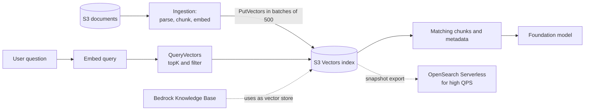

## 0. Before you start
- **Essential:** what a vector index does and why every vector must have the same number of dimensions.
- **Helpful:** Amazon S3 buckets, IAM policies.
- **Optional advanced:** HNSW/ANN theory (not needed here: S3 Vectors manages the index for you).

## 1. Simple explanation
**Amazon S3 Vectors** is storage built for embeddings. Instead of renting a search cluster that runs all day, you put vectors into a new kind of S3 bucket (a *vector bucket*), group them in *vector indexes*, and ask "which stored vectors are closest to this one?" through a dedicated API. You pay for what you store and query, so it is attractive for large collections that are searched only now and then. The second half of this file answers a different, equally important question: **how do you keep any vector store fresh** when your documents change, are deleted, or when you switch to a better embedding model?


```figure
flow s3-vectors
```

## 2. Structured explanation
1. **Create a vector bucket**, then **a vector index** with a fixed dimension and a distance metric (`Cosine` or `Euclidean`) ✅.
2. **Write vectors** with `PutVectors` (up to 500 per call) plus metadata ✅.
3. **Query** with `QueryVectors` (top-K up to 10,000, optional metadata filter, optional distance in the result) ✅.
4. **Keep it current:** detect changed documents, re-embed only those, upsert new vectors, delete vectors of removed documents ✅ pattern.
5. **Integrate:** use the index as a Bedrock Knowledge Base vector store, or pair it with OpenSearch ✅.

## 3. Analogy
**A self-storage unit vs a staffed warehouse.** The OpenSearch cluster is a staffed warehouse: fast, always staffed, always billed. S3 Vectors is a self-storage unit: cheap to keep things there, and you walk in when you need them (sub-second, sometimes ~100 ms), but it is not built for a stampede of customers.

*Where it breaks:* if you do have steady heavy traffic, the cheap unit becomes the bottleneck; AWS itself says S3 Vectors is "ideal for workloads where queries are less frequent" ✅, and points to OpenSearch for high QPS.

## 4. The seven questions

**WHAT?**
- *Vector bucket:* a new bucket type purpose-built to store and query vectors ✅.
- *Vector index:* lives inside a vector bucket; you run similarity queries on it ✅.
- *Vector:* an embedding plus an optional key-value *metadata* set ✅.
- Properties ✅: writes are **strongly consistent** (you can read what you just wrote); same IAM and bucket-policy style controls as S3 but a **different service namespace, `s3vectors`**; **S3 Block Public Access is always on** and cannot be disabled; query latency "subsecond for infrequent queries and as low as 100 milliseconds for more frequent queries".

**WHY?** For RAG and semantic search over large, mostly idle corpora (archives, enterprise documents, media libraries) the always-on cost of a vector cluster dominates. S3 Vectors removes provisioning and uses S3-style elasticity and durability.

**WHEN?**
| Situation | Choose |
|---|---|
| Huge corpus, infrequent queries, cost matters | S3 Vectors |
| Hybrid keyword + vector, aggregations, faceting, high QPS | OpenSearch (can use S3 Vectors as a cost-saving backend or export a snapshot of an index to Serverless for "high QPS and low latency") ✅ |
| Vectors beside relational data and transactions | pgvector ([02/07](aip:02-data-management/07-rds-aurora-and-pgvector)) |
| Simplest managed RAG | Bedrock Knowledge Base (S3 Vectors is selectable as the store ✅) |
| Per-tenant isolation with minimal overhead | One vector **index** per tenant with IAM/bucket policies ✅ |

**WHERE?** Next to your S3 data lake; accessed by Bedrock Knowledge Bases, Lambda, or any app using the S3 Vectors API; also reachable from Amazon Bedrock in SageMaker Unified Studio ✅.

**HOW?** §5.

**WHAT IF?**
| Situation | What happens | Remedy |
|---|---|---|
| You need to change dimension, distance metric, index name or non-filterable keys | **Not updatable** after creation ✅ | Create a new index and migrate |
| Embedding model changes | Dimensions/space differ | New index, re-embed everything, switch over |
| You exceed write rates | `429 TooManyRequestsException` ✅ | Batch to 500 per call and retry with backoff |
| Metadata too large | `400 Bad Request` on `PutVectors` ✅ | Store text as **non-filterable** metadata (larger budget) |
| Filtered query on a `CLASSIC` index | May return **fewer than top-K** results when few vectors match ✅ | Use `ENHANCED` mode (pre-filtering) |
| You need `$startsWith` | Requires `ENHANCED` behaviour ✅ | Index mode `ENHANCED` or set `queryMode` to `ENHANCED` per request |
| You want to filter on a field you marked non-filterable | Impossible; cannot be flipped later ✅ | Recreate the index |

**WHY NOT?**
- *Why not for chatty, latency-critical apps?* Designed for infrequent queries; pick OpenSearch for high QPS.
- *Why not for keyword+vector hybrid?* S3 Vectors is vector search with metadata filters; full-text relevance and aggregations come from OpenSearch ✅.
- *When is the "wrong" way right?* A small hobby corpus is cheaper in a local FAISS file than in any service.

## 5. Technical depth

```figure
vector-space {"filter": true}
```


### 5.1 Limits and facts (✅ official limits page, read 2026-10-26)
| Item | Value |
|---|---|
| Vector buckets per Region per account | 10,000 |
| Indexes per vector bucket | 10,000 |
| Vectors per index | up to 2 billion |
| Dimensions per vector | 1 to 4,096 |
| Total metadata per vector | up to 40 KB (filterable + non-filterable), up to 50 keys |
| Filterable metadata per vector | up to 2 KB |
| Non-filterable metadata keys per index | up to 10 |
| PutVectors / DeleteVectors requests per second per index | up to 1,000 combined |
| Vectors inserted + deleted per second per index | up to 2,500 combined |
| Vectors per PutVectors / DeleteVectors call | up to 500 |
| Vectors per GetVectors call | up to 100 |
| Request payload | up to 20 MiB |
| Top-K per QueryVectors | up to 10,000 |
| Results per page of QueryVectors | up to 100 |
| Filter constraints per query (`ENHANCED`) | up to 100 |
| Listing | ListVectors 1,000 per page; ListVectorBuckets and ListIndexes 500 per page |

Index naming: 3–63 characters, lowercase letters, digits, hyphens and dots, begin and end with a letter or number ✅. Index ARN: `arn:aws:s3vectors:REGION:ACCOUNT:bucket/BUCKET/index/INDEX` ✅.

### 5.2 Index modes and filtering (✅)
- **`ENHANCED`** applies your filter **before** vector search (pre-filtering), so recall stays high even if the filter matches few vectors; supports `$startsWith`; up to 100 filter constraints. AWS recommends it for almost all workloads.
- **`CLASSIC`** searches and filters in tandem and may return fewer than top-K results for selective filters.
- Buckets created **on or after 2026-09-30** default to `ENHANCED` and cannot use `CLASSIC`; older buckets default to `CLASSIC`. Read the mode with `GetIndex`, change it with `UpdateIndexMode`; set a bucket default with `PutVectorBucketDefaultIndexMode` ✅.
- Operators: `$eq`, `$ne`, `$gt`, `$gte`, `$lt`, `$lte`, `$startsWith`, `$in`, `$nin`, `$exists`, `$and`, `$or` ✅.

```json
{"$and": [{"genre": {"$eq": "drama"}}, {"year": {"$gte": 2020}}]}
```
*Reading:* an AWS example filter: "drama" movies from 2020 onwards; both conditions must hold.

- **Filter cost tip (AWS):** a filter on a list of 300 ids uses 300 constraints and is slow; add one grouping key such as `caseId` when you write the vectors and filter on that single key instead ✅.
- **Store the source text as non-filterable metadata** so results can show it without raising the 2 KB filterable budget ✅.

### 5.3 Where S3 Vectors sits

*Reading the arrows:* ingestion writes embeddings in batches; at question time the query is embedded and sent to `QueryVectors`; the returned chunks go to the model. Dotted arrows are alternative integrations: a Knowledge Base can use the index as its store, and a snapshot can be exported to OpenSearch Serverless when you need higher QPS ✅.

### 5.4 Keeping a vector store current (lesson 80, exam skill 1.4.5)
Typical failure: the source changed, the vectors did not, and the model answers from yesterday's policy. Four jobs, in order of importance:

| Job | How | AWS building blocks |
|---|---|---|
| **Detect change** | Keep a manifest of `path → content hash` or use S3 event notifications / `LastModified` | S3 events, EventBridge, Lambda |
| **Upsert changed chunks** | Re-parse, re-chunk, re-embed *only* changed documents; write with stable chunk IDs (for example `docId#chunkNo`) | Lambda/Step Functions, Bedrock embeddings, vector store API |
| **Delete removed content** | Delete vectors for deleted or shortened documents (chunk count can shrink!) | `DeleteVectors` (≤500 per call), `DELETE` in other stores |
| **Re-embed on model change** | Build a **new** index/collection, backfill, validate, then switch the application pointer; keep the old one for rollback | Blue/green index, alias or config in AppConfig/Parameter Store |

- **Bedrock Knowledge Bases:** incremental sync handles adds, updates, deletes since the last sync; start it with `StartIngestionJob` on a schedule or from events ([01/04 §5.7](aip:01-bedrock-genai-fundamentals/04-bedrock-knowledge-bases)).
- **Metadata to store with every vector:** `source_uri`, `doc_version`, `content_hash`, `embedding_model`, `ingested_at`, `tenant_id`. These enable audits, deletions by source, and detecting stale vectors.
- **Expiry:** if content has a lifetime, store an expiry timestamp as metadata and run a periodic delete (S3 Vectors has no per-vector TTL on the pages I read ❌).
- **Idempotency:** design writes so retries are harmless; whether `PutVectors` overwrites an existing key is documented on the API page ❌ not re-verified here—test it.
- **Consistency note:** S3 Vectors writes are strongly consistent ✅; OpenSearch Serverless NextGen has a ~5 s refresh interval and Classic ~60 s ([02/05 §5.5](aip:02-data-management/05-amazon-opensearch-for-genai)), so freshly written vectors there are not instantly searchable.

### 5.5 Security
IAM policies and SCPs control access to `s3vectors:*` actions per bucket or index ✅; Block Public Access is permanently on ✅; use per-tenant indexes plus bucket/IAM policies for isolation ✅. **Encryption** (from the Knowledge Base setup page ✅): vector buckets are encrypted with SSE-S3 by default or you can choose SSE-KMS; **the bucket's encryption type cannot be changed after creation**; a vector index can override the bucket setting.

**When a Bedrock Knowledge Base uses S3 Vectors ✅:** only float32 embeddings (no binary vectors; only OpenSearch Serverless and OpenSearch managed clusters support binary); you give the KB the vector bucket ARN and the index ARN (or bucket ARN plus index name, never both index ARN and index name); the KB allows **up to 1 KB of custom metadata and 35 metadata keys per vector**, and an ingestion job fails if you exceed that; create the index with `AMAZON_BEDROCK_TEXT` and `AMAZON_BEDROCK_METADATA` as non-filterable keys; very large hierarchical-chunking parent/child context is stored as non-filterable metadata and can hit the metadata size limit.

### 5.6 Lesson 63 (bonus, "not on exam")
The course marks "S3 Vectors with Claude Code and Agent Toolkit for AWS" as a bonus outside the exam. I did not find an official AWS page for a product named "Agent Toolkit for AWS" in this session ❌, so I do not describe it. If you want it, take it from the course video and treat it as optional tooling, not exam content.

## 6. Worked example
*Problem:* A law firm stores 2.3 million chunks from case files (1,024 dimensions). Lawyers search a few hundred times a day. Each case must be isolated, and when a case is closed its vectors must disappear within a day.

| Step | Decision |
|---|---|
| 1 | Infrequent queries + huge corpus → S3 Vectors |
| 2 | One **vector index per case** (isolation, easy deletion), IAM conditions on the index ARN |
| 3 | Metadata: `caseId` (filterable), `docId`, `page`, `text` (**non-filterable**) |
| 4 | Bulk load 2.3M vectors in 4,600 calls (§8) |
| 5 | S3 event → Lambda → content-hash check → upsert changed chunks, delete orphans |
| 6 | Case closed → delete the index (and bucket objects) → vectors gone |
| 7 | Dashboards: `429` count, ingestion lag, stale-vector audit by `content_hash` |

## 7. Knowledge checkpoints
1. Which index properties cannot be changed after creation?
2. Why can a filtered query on a `CLASSIC` index return fewer than K results?
3. What is the maximum vectors per `PutVectors` call, and the combined insert/delete rate per index?
4. Name the four jobs of keeping a vector store current.

## 7b. Practice questions (exam-style, original) — answers below

**Q1.** A company has 800 million embeddings queried a few times per hour and wants the lowest storage cost with no cluster to manage. Which fits BEST?
A. Provisioned OpenSearch domain with many data nodes
B. Amazon S3 Vectors
C. DynamoDB with a GSI
D. Amazon RDS with read replicas

**Q2.** A developer must filter results with `$startsWith` on a path field and keep high recall for selective filters. What should they do?
A. Use an `ENHANCED` index mode (or set `queryMode` to `ENHANCED` on the query)
B. Increase the dimension to 4,096
C. Remove all metadata
D. Use `ListVectors` instead of `QueryVectors`

**Q3.** (Select TWO) Which can NOT be changed on an existing S3 Vectors index?
A. Dimension
B. Distance metric
C. Contents of a vector's metadata (by rewriting the vector)
D. The set of vectors stored
E. Query top-K per request

**Q4.** A bulk loader gets `429 TooManyRequestsException`. What are the right fixes? (Select TWO)
A. Send batches near the 500-vector maximum
B. Retry with exponential backoff and stay within the per-index rate limits
C. Increase the vector dimension
D. Send one vector per request as fast as possible
E. Switch the distance metric

**Q5.** Which statement about S3 Vectors security is correct?
A. S3 Block Public Access can be turned off for vector buckets
B. Vector buckets use the `s3vectors` namespace and S3 Block Public Access is always enabled
C. Vector buckets are controlled only by ACLs
D. IAM is not supported

**Q6.** A team changes embedding models (new dimension). What is the safest approach?
A. Overwrite vectors in place in the existing index
B. Create a new index with the new dimension, re-embed and backfill, validate, then switch the application, keeping the old index for rollback
C. Truncate the new vectors to the old dimension
D. Ignore the change

**Q7.** A RAG assistant keeps quoting a deleted policy. The ingestion job only adds new chunks. What is missing?
A. A larger embedding model
B. Change detection plus deletion of vectors for removed or shortened documents
C. A higher temperature
D. More replicas

**Q8.** (Select TWO) Which metadata practices follow AWS guidance for S3 Vectors?
A. Store large source text as non-filterable metadata
B. Add a single grouping key (for example `caseId`) instead of filtering on hundreds of ids
C. Mark every key filterable so you never need to recreate the index
D. Put 100 KB of text in filterable metadata
E. Use metadata to hold the vector itself

## 8. Hands-on lab (no Python files): plan, filter and sync logic you can run offline

### 8.1 Objective
Practise four calculations that matter in production: bulk-load planning against documented limits, why pre-filtering beats post-filtering, counting filter constraints, and hash-based change detection.

### 8.2 Prerequisites
Python 3. Optional live part needs an AWS account with S3 Vectors permissions; it is not run in this session.

### 8.3 AWS services
Offline: none. Optional: S3 Vectors; Bedrock (embeddings).

### 8.4 IAM permissions
Optional live part: `s3vectors:*` actions on your bucket and index ARNs (`arn:aws:s3vectors:REGION:ACCOUNT:bucket/BUCKET/index/INDEX`) and Bedrock invoke permission for the embedding model. I did not enumerate the exact action list ❌; see the S3 Vectors access-management page.

### 8.5 Region notes
S3 Vectors is Region-based; confirm availability for your Region on the S3 Vectors page ❌ (not listed on the pages I read).

### 8.6 Architecture
See §5.3.

### 8.7 Cost
Offline: none. Live: storage + PUT + query charges per the S3 pricing page ❌ (not quoted).

### 8.8 Code
```python lab-run
import hashlib, math

# 1) Plan a bulk load against the documented S3 Vectors limits
N = 2_300_000
PER_CALL, VEC_PER_SEC = 500, 2500
calls = math.ceil(N / PER_CALL)
minutes = N / VEC_PER_SEC / 60
print(f"{N:,} vectors -> {calls:,} PutVectors calls of <= {PER_CALL}; at {VEC_PER_SEC}/s about {minutes:.1f} minutes")

# 2) Pre-filter vs post-filter on a toy index
def cos(u, v):
    dot = sum(x * y for x, y in zip(u, v))
    return dot / (math.sqrt(sum(x * x for x in u)) * math.sqrt(sum(y * y for y in v)))

VECS = {"a": ((1.0, 0.0), "fr"), "b": ((0.9, 0.1), "fr"), "c": ((0.8, 0.2), "fr"),
        "d": ((0.0, 1.0), "en"), "e": ((0.1, 0.9), "en"), "f": ((0.3, 0.7), "en")}
q, k = (1.0, 0.0), 3
by_sim = lambda items: sorted(items, key=lambda kv: -cos(q, kv[1][0]))
post = [key for key, v in by_sim(VECS.items())[:k] if v[1] == "en"]
pre = [key for key, v in by_sim([i for i in VECS.items() if i[1][1] == "en"])[:k]]
print("post-filter (top 3, then filter):", post)
print("pre-filter  (filter, then top 3):", pre)

# 3) Count filter constraints (my reading: every value the filter evaluates counts as one)
def constraints(f):
    if not isinstance(f, dict):
        return 1
    total = 0
    for key, val in f.items():
        if key in ("$and", "$or"):
            total += sum(constraints(x) for x in val)
        elif key in ("$in", "$nin"):
            total += len(val)
        elif isinstance(val, dict):
            total += constraints(val)
        else:
            total += 1
    return total

print(constraints({"category": "electronics"}),
      constraints({"region": {"$in": ["us-east-1", "us-west-2", "eu-west-1"]}}),
      constraints({"$and": [{"category": "electronics"}, {"price": {"$lte": 500}}]}),
      constraints({"documentId": {"$in": [f"doc-{i}" for i in range(300)]}}),
      constraints({"caseId": "case-4471"}))

# 4) Change detection for incremental updates: compare content hashes
sha = lambda s: hashlib.sha256(s.encode()).hexdigest()
old = {"faq.md": sha("v1 faq"), "policy.md": sha("v1 policy"), "old.md": sha("gone")}
new = {"faq.md": "v1 faq", "policy.md": "v2 policy", "new.md": "hello"}
add = sorted(set(new) - set(old))
delete = sorted(set(old) - set(new))
update = sorted(p for p in set(new) & set(old) if sha(new[p]) != old[p])
print("add:", add, "update:", update, "delete:", delete)
```

### 8.9 Captured output
Generated on 2026-10-26 by extracting the block above from this file and running it (Python 3.13). Not AWS output.
```text lab-out
2,300,000 vectors -> 4,600 PutVectors calls of <= 500; at 2500/s about 15.3 minutes
post-filter (top 3, then filter): []
pre-filter  (filter, then top 3): ['f', 'e', 'd']
1 3 2 300 1
add: ['new.md'] update: ['policy.md'] delete: ['old.md']
```

### 8.10 Explanation
- 4,600 calls and 15.3 minutes assume the documented ceilings (500 vectors per call, 2,500 vectors per second per index); real runs also depend on embedding speed.
- The post-filter returns **nothing**: the three nearest vectors are all French, then the "English only" filter removes them. Pre-filtering searches only English vectors, so you still get three results. This is the `CLASSIC` vs `ENHANCED` difference in miniature ✅.
- The constraint counts reproduce AWS's examples (1, 3, 2) and show why 300 ids cost 300 constraints versus 1 for a grouping key. The counting rule is my reading of the AWS examples, not a quoted formula.
- Change detection yields exactly the three lists an ingestion job needs: embed `new.md`, re-embed `policy.md`, delete the vectors of `old.md`.

### 8.11 Optional live steps (not run in this session ❌)
1. S3 console → vector buckets → create a bucket; create an index (for example dimension 1024, `Cosine`) matching your embedding model.
2. Embed a few sentences (Titan Text Embeddings V2 supports 1,024 dimensions [per the Aurora page's mapping]) and `PutVectors` them with `genre`-style metadata.
3. `QueryVectors` with `topK` and a filter; request distances.
4. Delete the index and bucket.

### 8.12 Common errors
| Error | Cause | Fix |
|---|---|---|
| Dimension mismatch | Index created with the wrong dimension | New index |
| `429 TooManyRequestsException` | Rate exceeded | Batch + backoff |
| `400` on put | Metadata over limits | Move text to non-filterable |
| Fewer than K results | `CLASSIC` filtered query | `ENHANCED` |
| Access denied | Wrong namespace in policy (`s3:` instead of `s3vectors:`) | Fix actions |

### 8.13 Security recommendations
Per-tenant indexes with IAM conditions; never put secrets in metadata; delete labs; choose SSE-KMS at bucket creation if policy requires it (the type cannot be changed later ✅); log administrative calls with CloudTrail (see 07-governance-qa).

## 9. What can go wrong?

| Failure | Why | Symptoms | Investigate | Fix | Prevent |
|---|---|---|---|---|---|
| **Stale answers** | Updates not propagated | Old facts quoted | Compare `content_hash`/version in metadata | Re-sync | Event-driven ingestion + audits |
| **Orphan vectors** | Deletions not handled | Deleted docs still retrieved | List vectors by `source_uri` | Delete by source | Delete step in pipeline |
| **Mixed embedding models** | Partial re-embedding | Poor relevance | `embedding_model` metadata | Rebuild whole index | Blue/green re-embedding |
| **Throttling** | Over rate | `429` | CloudWatch/logs | Batch, backoff | Rate-limit loader |
| **Short filtered results** | `CLASSIC` mode | Fewer than K | `GetIndex` mode | `ENHANCED` | Create buckets with `ENHANCED` default |
| **Slow filtered queries** | Long `$in` lists | Latency up | Count constraints | Grouping key | Metadata design review |
| **Wrong store for the load** | High QPS on S3 Vectors | Latency/throttling | QPS vs guidance | Move hot data to OpenSearch | Capacity planning |
| **Cross-tenant leakage** | Shared index + faulty filter | Wrong docs shown | Test with two tenants | Index per tenant | Isolation tests |

## 10. Common misconceptions
1. **"S3 Vectors is just S3 with embeddings in objects."** It is a separate bucket type with its own API and namespace ✅.
2. **"It replaces OpenSearch."** It complements it; AWS names OpenSearch for hybrid search and high QPS ✅.
3. **"I can edit an index's dimension later."** No ✅.
4. **"Filtered queries always return K results."** Not on `CLASSIC` ✅.
5. **"Syncing a knowledge base handles embedding model changes."** Model changes need a new index.

## 11. Exam notes
- **Pattern:** "lowest-cost vector storage, infrequent queries, serverless" → **S3 Vectors**.
- **Pattern:** "keep the vector store in sync with source documents" → **change detection + incremental ingestion (+ deletion)**, e.g., S3 events/EventBridge → Lambda → `StartIngestionJob`.
- **Pattern:** "multi-tenant isolation" → index per tenant + IAM/bucket policy.
- **Traps:** index parameters are immutable; non-filterable metadata cannot be filtered; `CLASSIC` may under-return; high QPS needs OpenSearch.
- **Compare:** S3 Vectors (cheap, simple) vs OpenSearch (hybrid, high QPS) vs pgvector (relational) vs Kendra (maintenance mode).

## 12. Summary and revision cards
- Vector bucket → vector index (dimension, metric, immutable) → vectors + metadata.
- `PutVectors` ≤500/call; ≤1,000 requests/s and ≤2,500 vectors/s per index; top-K ≤10,000.
- `ENHANCED` = pre-filter, `$startsWith`, ≤100 constraints.
- Freshness = detect, upsert, delete, re-embed (blue/green).

**Cards.** Q: Namespace? A: `s3vectors`. · Q: Dimension range? A: 1–4,096. · Q: Filterable metadata limit? A: 2 KB. · Q: Max vectors per index? A: 2 billion.

## 13. References
| Source | URL | Verified |
|---|---|---|
| Working with S3 Vectors and vector buckets | https://docs.aws.amazon.com/AmazonS3/latest/userguide/s3-vectors.html | 2026-10-26 |
| Limitations and restrictions | https://docs.aws.amazon.com/AmazonS3/latest/userguide/s3-vectors-limitations.html | 2026-10-26 |
| Best practices | https://docs.aws.amazon.com/AmazonS3/latest/userguide/s3-vectors-best-practices.html | 2026-10-26 |
| Vector indexes | https://docs.aws.amazon.com/AmazonS3/latest/userguide/s3-vectors-indexes.html | 2026-10-26 |
| Metadata filtering | https://docs.aws.amazon.com/AmazonS3/latest/userguide/s3-vectors-metadata-filtering.html | 2026-10-26 |
| Exam guide Task 1.4 | https://docs.aws.amazon.com/aws-certification/latest/ai-professional-01/ai-professional-01-domain1.html | 2026-10-23 |
| Create a vector index for a Knowledge Base (prerequisites per vector store) | https://docs.aws.amazon.com/bedrock/latest/userguide/knowledge-base-setup.html | 2026-10-26 |

**Unverified here:** `PutVectors` overwrite semantics, Region list, pricing, the "Agent Toolkit for AWS" bonus content, how KB setup screens look.

## 14. Answers to checkpoints and practice questions

**Checkpoints.** 1) Name, dimension, distance metric and non-filterable metadata keys. 2) `CLASSIC` searches and filters together, so few matching candidates mean fewer than K hits. 3) 500 vectors per call; 2,500 vectors per second (and 1,000 requests per second) per index. 4) Detect change, upsert changed chunks, delete removed content, re-embed on model change.

**Practice questions.**
- **Q1 → B.** Large, infrequently queried, serverless, low cost. A is costly, C and D are not vector engines.
- **Q2 → A.** `ENHANCED` pre-filters and supports `$startsWith`.
- **Q3 → A, B.** Dimension and distance metric are fixed. C and D are normal writes; E is per request.
- **Q4 → A, B.** Batch near 500 and back off. C, D, E don't address rate.
- **Q5 → B.** `s3vectors` namespace; Block Public Access always on.
- **Q6 → B.** New dimension means a new index with backfill and switch-over.
- **Q7 → B.** Deletions and updates must be handled.
- **Q8 → A, B.** Use non-filterable metadata for text and group keys for filters. C wastes the 10-key budget, D exceeds limits, E is nonsense.
