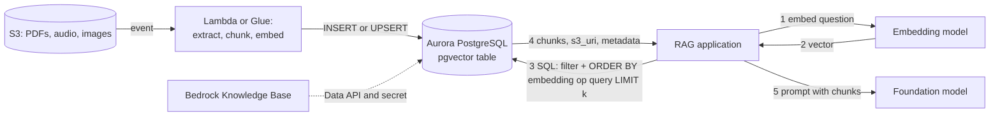

## 0. Before you start
- **Essential:** what a relational table, a primary key and an index are; what a vector is.
- **Helpful:** SQL `SELECT … ORDER BY … LIMIT`.
- **Optional advanced:** PostgreSQL full-text search (`tsvector`), connection pooling.

## 1. Simple explanation
Many companies already keep their business data (customers, products, tickets) in a relational database. **Amazon RDS** runs managed databases such as PostgreSQL; **Amazon Aurora** is AWS's cloud-built, MySQL- and PostgreSQL-compatible engine. A free PostgreSQL extension called **pgvector** adds a `vector` column type and "find the nearest vectors" queries. So you can put embeddings **in the same table as the rest of the row** and ask one SQL question such as "the five most similar tickets *for customer 42 created this year*". That is why pgvector is a popular vector store when your data is already relational: one system, one transaction, one set of permissions.


```figure
flow pgvector-rag
```

## 2. Structured explanation
1. **Pick the engine:** RDS for PostgreSQL or Aurora PostgreSQL (Aurora is the one Bedrock Knowledge Bases supports natively ✅).
2. **Install pgvector:** `CREATE EXTENSION IF NOT EXISTS vector;` ✅.
3. **Model the table:** id, text chunk, `vector(N)` embedding, JSON metadata, plus normal business columns ✅.
4. **Index:** HNSW (or IVFFlat) on the vector column with the matching operator class (`vector_cosine_ops` for cosine) ✅.
5. **Query:** `ORDER BY embedding <=> $query LIMIT k` plus ordinary `WHERE` filters ✅.
6. **Hybrid:** add a GIN index on `to_tsvector(...)` for keyword search ✅.
7. **Secure and scale:** Secrets Manager credentials, Data API for Bedrock, read replicas / larger instances as load grows.

## 3. Analogy
**A filing cabinet with a "looks like this" stamp.** Your normal drawers (columns) are sorted by customer, date and status. pgvector adds one more drawer organised by *similarity*, so you can ask for "files that look like this one, but only in the 2026 drawer".

*Where it breaks:* a big, always-hot similarity index competes with your normal transactions for memory and CPU. Mixing heavy vector search and OLTP in one database can slow both unless you separate them (read replica, separate cluster) or size generously.

## 4. The seven questions

**WHAT?**
- *RDS:* managed relational databases (PostgreSQL among them). *Aurora:* AWS's MySQL/PostgreSQL-compatible engine built for the cloud with a shared cluster storage layer (general knowledge; not re-verified this session ❌).
- *pgvector:* open-source PostgreSQL extension; `vector` type (up to **16,000** dimensions), `halfvec`, `bit`, `sparsevec` 📘.
- Distance operators 📘: `<->` L2, `<#>` **negative** inner product, `<=>` cosine distance, `<+>` L1, `<~>` Hamming, `<%>` Jaccard.
- *Knowledge Base fit:* Aurora PostgreSQL clusters can be a **customer-managed KB** vector store ✅; RDS supports hybrid search (log §12).

**WHY?**
| Benefit | Detail |
|---|---|
| One system | No sync between a vector database and your source of truth |
| Rich filters and joins | Vector similarity plus `WHERE`, `JOIN`, row-level security |
| Transactions | An update to a row and its embedding can be one transaction |
| Familiar ops | Backups, IAM/Secrets Manager, replicas, monitoring |
| Hybrid search | `tsvector` full-text next to vectors in the same engine ✅ |

**WHEN?**
| Situation | Choose |
|---|---|
| Data already in PostgreSQL, moderate vector count (up to millions) | pgvector on RDS/Aurora |
| Need KB integration with SQL-visible chunks | Aurora PostgreSQL + Data API |
| Billions of vectors, minimal cost, infrequent search | S3 Vectors |
| Heavy hybrid relevance tuning, high QPS | OpenSearch |
| Documents are big files (PDF, audio) | Keep files in **S3**; store `s3_uri`, text chunks and embeddings in the DB (the "RDS with S3 document repositories" pattern, lesson 66) |

**WHERE?** Inside your VPC. A Bedrock Knowledge Base reaches Aurora via the **RDS Data API** and a Secrets Manager secret ✅.

**HOW?** §5.

**WHAT IF?**
| Situation | What happens | Remedy |
|---|---|---|
| Index a `vector` column of 3,072 dimensions | HNSW/IVFFlat support **up to 2,000 dimensions** for `vector` 📘 | `halfvec` (index up to 4,000), fewer dimensions (Titan V2 allows 1,024/512/256 ✅), or exact scan |
| pgvector older than 0.5.0 | No HNSW; Aurora KB integration requires **0.5.0 or higher** ✅ | Upgrade the extension |
| Selective `WHERE` filter with an HNSW index | Filter applied **after** the index scan, so fewer rows than `LIMIT` can come back ✅ | Enable iterative scans (pgvector ≥ 0.8.0) ✅ |
| Table or column names differ from the KB mapping | Ingestion fails | Provide the same names in the KB config; they cannot be changed after the KB is created ✅ |
| Aurora cluster in another account | Not allowed: the cluster must be in the same account as the KB ✅ | Same-account cluster or another store |
| Data API not enabled | KB cannot connect ✅ | Enable RDS Data API on the cluster |
| Index build is slow or memory-bound | Tune `maintenance_work_mem`, parallel builds 🟡 | Use `ef_construction=256` guidance for pgvector 0.6.0+ ✅ |

**WHY NOT?**
- *Why not for huge vector counts at high QPS?* A relational engine has to hold HNSW graphs in memory too; OpenSearch or S3 Vectors scale this more cheaply.
- *Why not put big files in the DB?* Store them in S3; keep the row small (URI + chunk text + embedding).
- *Why not use only vectors?* Exact identifiers (error codes, SKUs) need keyword search; keep `tsvector` or hybrid search.
- *When is the "wrong" way right?* For under ~100k vectors a plain exact scan (no index) is simple and perfectly accurate.

## 5. Technical depth

```figure
ann-index
```


### 5.1 The Aurora PostgreSQL knowledge-base table (✅ official, copy-paste)
```sql
CREATE EXTENSION IF NOT EXISTS vector;
SELECT extversion FROM pg_extension WHERE extname='vector';
CREATE SCHEMA bedrock_integration;
CREATE ROLE bedrock_user WITH PASSWORD '<PASSWORD>' LOGIN;
GRANT ALL ON SCHEMA bedrock_integration TO bedrock_user;
-- log in as bedrock_user, then:
CREATE TABLE bedrock_integration.bedrock_kb (
  id uuid PRIMARY KEY,
  embedding vector(1024),
  chunks text,
  metadata json,
  custom_metadata jsonb
);
CREATE INDEX ON bedrock_integration.bedrock_kb USING hnsw (embedding vector_cosine_ops) WITH (ef_construction=256);
CREATE INDEX ON bedrock_integration.bedrock_kb USING gin (to_tsvector('simple', chunks));
CREATE INDEX ON bedrock_integration.bedrock_kb USING gin (custom_metadata);
```
- Replace `1024` with your model's dimension: Titan Text Embeddings V2 → 1,024 / 512 / 256; Titan G1 Text → 1,536; Cohere Embed English / Multilingual → 1,024 ✅.
- The first four columns are mandatory; `custom_metadata` is where Bedrock writes your `.metadata.json` attributes (recommended for filtering) ✅.
- For English content the docs suggest `to_tsvector('english', chunks)` for better hybrid accuracy and latency ✅.
- Range filters on numeric metadata benefit from an expression index on that key, for example on `(custom_metadata->>'year')::double precision` ✅.
- **Iterative scans** (pgvector 0.8.0+) ✅:
```sql
ALTER DATABASE mydb SET hnsw.iterative_scan = 'relaxed_order';
ALTER DATABASE mydb SET hnsw.max_scan_tuples = 20000;
```
These take effect for **new sessions**; with the Data API allow a few minutes for pooled sessions to recycle ✅.

You then give the KB: cluster ARN (`resourceArn`), database name, table name, secret ARN (`credentialsSecretArn`), and the field names `primaryKeyField`, `vectorField`, `textField`, `metadataField`, optional `customMetadataField` ✅.

### 5.2 pgvector indexes and knobs (📘 README)
| Item | Value |
|---|---|
| `vector` max dimensions / indexable dimensions | 16,000 / **2,000** |
| `halfvec` max / indexable | 16,000 / **4,000** |
| `bit` indexable | 64,000 |
| `sparsevec` indexable (HNSW) | 1,000 non-zero elements |
| HNSW build params | `m` default **16**, `ef_construction` default **64** |
| HNSW query param | `hnsw.ef_search` default **40** |
| IVFFlat `lists` | `rows / 1000` up to 1M rows, `sqrt(rows)` above |
| IVFFlat `probes` | default **1**; start near `sqrt(lists)` |
| `hnsw.max_scan_tuples` | default 20,000 |
| `hnsw.iterative_scan` | `strict_order` or `relaxed_order` |

**HNSW vs IVFFlat (concept):** HNSW builds a layered graph—higher recall and speed, more memory and build time; IVFFlat buckets vectors into lists—faster build, smaller, but you must load data before building and tune `probes` for recall. AWS KB docs use HNSW ✅.

### 5.3 Aurora-specific notes (🟡 announcements)
- pgvector **0.8.0** is announced for Aurora PostgreSQL 16.8, 15.12, 14.17 and 13.20 and higher; it brought iterative index scans (`hnsw.max_scan_tuples` default 20,000) 🟡.
- **Aurora Optimized Reads** uses local NVMe on certain instance types to help vector workloads larger than memory; AWS blog benchmarks claim large speedups, but treat them as vendor numbers 🟡.
- Aurora KB prerequisites: PostgreSQL 16.1+, 15.4+, 14.9+, 13.12+ or 12.16+ ✅.

### 5.4 Architecture: RDS/Aurora with S3 documents

*Reading the arrows:* big files stay in S3; a pipeline writes chunk text, embedding and the S3 URI as a row. The app embeds the question, runs one SQL query that combines business filters with vector ordering, and sends the returned chunks to the model. The dotted arrow shows a Knowledge Base managing the same table through the Data API.

### 5.5 Security and operations
- Credentials in **Secrets Manager** ✅; avoid putting passwords in code.
- Use IAM database authentication/roles where supported ❌ (not verified here), VPC security groups, encryption at rest with KMS, TLS.
- A dedicated low-privilege `bedrock_user` for the KB role ✅ pattern.
- Row-level security for tenants: PostgreSQL feature; keep tenant id in a normal column and enforce it in policy (not only in prompts).
- Monitoring: CloudWatch database metrics, Performance Insights ❌ not verified here; watch CPU, memory/IOPS during index builds.

## 6. Worked example
*Problem:* A SaaS company has a `tickets` table in Aurora PostgreSQL and wants "similar past tickets for the same customer", with attached PDFs in S3.

| Step | Action |
|---|---|
| 1 | `CREATE EXTENSION vector;` add `embedding vector(1024)` to a `ticket_chunks` table with `ticket_id`, `customer_id`, `chunk`, `s3_uri` |
| 2 | Lambda on S3 upload: extract text, chunk, embed with Titan V2 (1,024 dims), insert rows |
| 3 | `CREATE INDEX … USING hnsw (embedding vector_cosine_ops) WITH (ef_construction=256)` |
| 4 | Query: `SELECT chunk, s3_uri FROM ticket_chunks WHERE customer_id=$1 ORDER BY embedding <=> $2 LIMIT 5;` |
| 5 | Because `customer_id` filtering can be selective, set `hnsw.iterative_scan='relaxed_order'` |
| 6 | Add `gin (to_tsvector('english', chunk))` for ticket codes (hybrid) |
| 7 | Deleting a ticket deletes its chunk rows in the same transaction |

## 7. Knowledge checkpoints
1. Which pgvector operator gives cosine distance, and which is the *negative* inner product?
2. Why might an HNSW query with a selective `WHERE` return fewer than `LIMIT` rows, and what fixes it?
3. What is the largest `vector` dimension you can index?
4. Name two prerequisites for using Aurora PostgreSQL as a Bedrock KB store.

## 7b. Practice questions (exam-style, original) — answers below

**Q1.** A company stores customer records in Aurora PostgreSQL and wants semantic search combined with `WHERE customer_id = ?` filters in one query. Which approach fits BEST?
A. Export everything to a separate vector database and sync nightly
B. Use pgvector in the same Aurora PostgreSQL database with an HNSW index
C. Store embeddings as comma-separated strings and scan in Lambda
D. Use Amazon Polly

**Q2.** (Select TWO) Which are requirements for using an Aurora PostgreSQL cluster as the vector store of a customer-managed Bedrock Knowledge Base?
A. pgvector 0.5.0 or higher enabled in the database
B. RDS Data API enabled on the cluster
C. The cluster must be in a different AWS account
D. DynamoDB Streams enabled
E. A public S3 bucket

**Q3.** A developer wants an index on a `vector(3072)` column. What should they do?
A. Nothing; HNSW indexes any dimension
B. Use `halfvec`, reduce dimensions, or accept an exact scan, because `vector` indexes are limited to 2,000 dimensions
C. Use `<=>` twice
D. Switch to the `bit` type automatically

**Q4.** After adding a selective metadata filter, a query returns only 3 rows although `LIMIT 10`. What is the BEST fix (pgvector ≥ 0.8.0)?
A. Disable the HNSW index
B. Enable `hnsw.iterative_scan` (for example `relaxed_order`) and set `hnsw.max_scan_tuples`
C. Double the embedding dimension
D. Replace cosine with Hamming

**Q5.** Which operator returns the **cosine distance** in pgvector?
A. `<->`
B. `<#>`
C. `<=>`
D. `<+>`

**Q6.** A team stores 40 GB of PDFs. What is the recommended pattern with a relational vector store?
A. Store the PDF bytes in the same row as the embedding
B. Keep PDFs in S3; store chunk text, embedding, metadata and the S3 URI in the database
C. Delete the PDFs after embedding and keep nothing
D. Email the PDFs

**Q7.** (Select TWO) Which actions improve hybrid (keyword + semantic) retrieval for an English knowledge base on Aurora?
A. Add a GIN index on `to_tsvector('english', chunks)`
B. Keep the vector HNSW index with `vector_cosine_ops`
C. Remove the `chunks` column
D. Store all text in `custom_metadata` only
E. Disable the Data API

**Q8.** When must the KB table column names be decided?
A. After creating the knowledge base, at any time
B. Before creating the knowledge base; the field mappings cannot be updated afterwards
C. Never; they are fixed by AWS
D. Only after the first query

## 8. Hands-on lab (no Python files): operators, indexability and IVFFlat starting points

### 8.1 Objective
Make the pgvector operators concrete, check whether a column can be indexed, and compute starting values for IVFFlat. Then (optionally) run the SQL from §5.1 on a test database.

### 8.2 Prerequisites
Python 3 for the offline part. Optional: an Aurora PostgreSQL cluster or any PostgreSQL 13+ with pgvector.

### 8.3 AWS services
Offline: none. Optional: Aurora PostgreSQL (RDS Data API, Secrets Manager).

### 8.4 IAM permissions
Optional: `rds:CreateDBCluster`/`rds-data:ExecuteStatement` and `secretsmanager:GetSecretValue` for the roles involved. I did not verify the exact minimal policy ❌.

### 8.5 Region notes
Aurora pgvector 0.8.0 is announced for all Regions except China 🟡; confirm your engine version.

### 8.6 Architecture
See §5.4.

### 8.7 Cost
Offline: none. Aurora instances and storage bill continuously until deleted ❌ (not quoted); use the smallest option and delete the cluster.

### 8.8 Code
```python lab-run
import math

A, B = (1.0, 2.0, 3.0), (2.0, 0.0, 1.0)
l2 = math.sqrt(sum((x - y) ** 2 for x, y in zip(A, B)))
ip = sum(x * y for x, y in zip(A, B))
cos_sim = ip / (math.sqrt(sum(x * x for x in A)) * math.sqrt(sum(y * y for y in B)))
l1 = sum(abs(x - y) for x, y in zip(A, B))
print(f"<->  L2 distance        : {l2:.4f}")
print(f"<#>  negative inner prod: {-ip:.4f}")
print(f"<=>  cosine distance    : {1 - cos_sim:.4f}  (= 1 - similarity {cos_sim:.4f})")
print(f"<+>  L1 distance        : {l1:.4f}")

MAX_INDEX_DIMS = {"vector": 2000, "halfvec": 4000}
for t, d in [("vector", 1024), ("vector", 1536), ("vector", 3072), ("halfvec", 3072), ("vector", 4096)]:
    ok = d <= MAX_INDEX_DIMS[t]
    print(f"{t}({d}): " + ("HNSW/IVFFlat index possible" if ok else "too wide to index; use halfvec, fewer dimensions, or exact scan"))

def ivfflat_start(rows):
    lists = rows // 1000 if rows <= 1_000_000 else round(math.sqrt(rows))
    return lists, round(math.sqrt(lists))

for rows in (200_000, 1_000_000, 5_000_000):
    lists, probes = ivfflat_start(rows)
    print(f"{rows:>9,} rows -> lists={lists:,}, start probes={probes}")
```

### 8.9 Captured output
Generated on 2026-10-26 by extracting the block above from this file and running it (Python 3.13). The limits and guidance it encodes come from the pgvector README 📘. Not AWS output.
```text lab-out
<->  L2 distance        : 3.0000
<#>  negative inner prod: -5.0000
<=>  cosine distance    : 0.4024  (= 1 - similarity 0.5976)
<+>  L1 distance        : 5.0000
vector(1024): HNSW/IVFFlat index possible
vector(1536): HNSW/IVFFlat index possible
vector(3072): too wide to index; use halfvec, fewer dimensions, or exact scan
halfvec(3072): HNSW/IVFFlat index possible
vector(4096): too wide to index; use halfvec, fewer dimensions, or exact scan
  200,000 rows -> lists=200, start probes=14
1,000,000 rows -> lists=1,000, start probes=32
5,000,000 rows -> lists=2,236, start probes=47
```

### 8.10 Explanation
- Cosine **distance** is `1 − similarity`, so *smaller is closer*, and `ORDER BY embedding <=> q` returns nearest first. `<#>` is the **negative** inner product so that smaller is still closer.
- The `lists` and `probes` numbers are only starting points from the README's rule of thumb; always measure recall.
- A wider-than-2,000-dimension `vector` column cannot be indexed; `halfvec` (half precision) can go to 4,000.

### 8.11 Optional live steps (not run in this session ❌)
1. Create a small Aurora PostgreSQL cluster (Data API on), or use a local PostgreSQL with pgvector.
2. Run the SQL in §5.1. Insert three rows with 3-dimension vectors for a toy test (change `vector(1024)` to `vector(3)`).
3. `SELECT id, embedding <=> '[1,2,3]' AS dist FROM bedrock_integration.bedrock_kb ORDER BY dist LIMIT 2;`
4. Compare `EXPLAIN` with and without the HNSW index.
5. Delete the cluster.

### 8.12 Common errors
| Error | Cause | Fix |
|---|---|---|
| `extension "vector" is not available` | Engine version too old or extension not installed | Upgrade/enable pgvector |
| `column cannot have more than 2000 dimensions for hnsw index` | Too-wide `vector` 📘 | `halfvec` or fewer dimensions |
| KB ingestion fails | Wrong column names, missing Data API, secret or permissions | Match the mapping; enable the Data API |
| Fewer rows than `LIMIT` | Filter after index scan | Iterative scan |
| Slow build | Low `maintenance_work_mem`, one worker | Increase memory/parallelism 🟡 |

### 8.13 Security recommendations
Use Secrets Manager and rotate; least-privilege roles (`bedrock_user` only on its schema); private subnets; encryption at rest and TLS; no real PII in tests; delete the cluster.

## 9. What can go wrong?

| Failure | Why | Symptoms | Investigate | Fix | Prevent |
|---|---|---|---|---|---|
| **Under-returning filtered queries** | Post-filtering after ANN scan ✅ | Fewer rows than `LIMIT` | `EXPLAIN`, row counts | Iterative scan; add specific indexes | Test selective filters |
| **Index not created / wrong ops class** | Missing `vector_cosine_ops` | Sequential scans, slow | `EXPLAIN` | Create matching index | Migration scripts |
| **Dimension drift** | Embedding model changed | Insert errors or garbage similarity | Column type vs model | New column/table, re-embed | Version embeddings |
| **KB cannot connect** | Data API/secret/permissions | Ingestion errors | KB status | Enable Data API; fix secret | Setup checklist |
| **Mapping mismatch** | Names differ from KB config | Failed sync | Compare names | Recreate KB or table | Fixed naming standard |
| **OLTP slowdown** | Index builds and vector queries share resources | Latency on app queries | Metrics | Read replica / bigger instance / separate cluster | Capacity plan |
| **Recall too low** | Defaults for `ef_search`/`probes` | Missing relevant chunks | Offline recall test | Raise `hnsw.ef_search` / `probes` | Evaluate on a gold set |

## 10. Common misconceptions
1. **"pgvector is an AWS service."** It is an open-source extension available on RDS/Aurora.
2. **"Any RDS engine supports Knowledge Bases."** The AWS KB docs describe Aurora PostgreSQL for this; check the KB page for other engines ✅.
3. **"`<#>` returns the inner product."** It returns the **negative** inner product 📘.
4. **"HNSW can index any vector size."** `vector` indexes stop at 2,000 dimensions 📘.
5. **"Metadata filters are free."** On HNSW they can shrink results unless iterative scans are on ✅.

## 11. Exam notes
- **Pattern:** "vector search with relational filters/transactions, data already in PostgreSQL" → **Aurora/RDS PostgreSQL + pgvector**.
- **Pattern:** "documents in S3, metadata and vectors in a database" → **RDS + S3** (skill 1.4.1).
- **Pattern:** "hybrid search in Aurora" → `tsvector` GIN + vector HNSW.
- **Traps:** Data API + Secrets Manager required for KB; pgvector ≥ 0.5.0; table mapping fixed at KB creation; cluster in the same account; post-filter under-return.
- **Compare:** pgvector (relational + vectors) vs OpenSearch (hybrid search at scale) vs S3 Vectors (cheapest, infrequent) vs DynamoDB (no native vector search; see next file).

## 12. Summary and revision cards
- pgvector = `vector` type, operators `<->`, `<#>`, `<=>`, HNSW/IVFFlat indexes.
- Aurora KB: Data API + secret + `bedrock_integration` schema + 4–5 columns + HNSW cosine + GIN indexes.
- Iterative scans fix selective-filter under-return (0.8.0+).
- Files in S3, searchable rows in the database.

**Cards.** Q: Max indexed `vector` dims? A: 2,000. · Q: Cosine distance operator? A: `<=>`. · Q: Default `hnsw.ef_search`? A: 40. · Q: KB column names changeable after creation? A: No.

## 13. References
| Source | URL | Verified |
|---|---|---|
| Using Aurora PostgreSQL as a Knowledge Base for Amazon Bedrock | https://docs.aws.amazon.com/AmazonRDS/latest/AuroraUserGuide/AuroraPostgreSQL.VectorDB.html | 2026-10-26 |
| Prerequisites for a vector store (Aurora tab) | https://docs.aws.amazon.com/bedrock/latest/userguide/knowledge-base-setup.html | 2026-10-26 |
| pgvector README (limits, operators, defaults) | https://github.com/pgvector/pgvector/blob/master/README.md | 2026-10-26 📘 |
| pgvector 0.8.0 on Aurora PostgreSQL (announcement) | https://aws.amazon.com/about-aws/whats-new/2025/04/pgvector-0-8-0-aurora-postgresql | 🟡 2026-10-26 (search summary) |
| Exam guide Task 1.4 and 1.5 | https://docs.aws.amazon.com/aws-certification/latest/ai-professional-01/ai-professional-01-domain1.html | 2026-10-23 |

**Unverified here:** the AWS RDS-for-PostgreSQL pgvector page (it returned no content), Aurora storage architecture details, Optimized Reads instance list, exact IAM/IAM-auth details, pricing.

## 14. Answers to checkpoints and practice questions

**Checkpoints.** 1) `<=>` cosine distance; `<#>` negative inner product. 2) The filter runs after the HNSW scan so too few candidates survive; iterative scans keep scanning (pgvector 0.8.0+). 3) 2,000 (`halfvec`: 4,000). 4) pgvector ≥ 0.5.0, RDS Data API, a Secrets Manager secret, same-account cluster, supported PostgreSQL version.

**Practice questions.**
- **Q1 → B.** One system with relational filters and vectors. A adds sync risk; C, D unsuitable.
- **Q2 → A, B.** pgvector ≥0.5.0 and Data API. C is false (same account); D, E unrelated.
- **Q3 → B.** `vector` indexes are limited to 2,000 dimensions; use `halfvec`, fewer dimensions or exact scan.
- **Q4 → B.** Iterative scans.
- **Q5 → C.** `<=>` is cosine distance (`<->` L2, `<#>` negative inner product, `<+>` L1).
- **Q6 → B.** Files in S3, vectors and chunk text in the database.
- **Q7 → A, B.** Full-text GIN index plus HNSW. C, D, E break retrieval.
- **Q8 → B.** Mappings cannot be updated after KB creation.
