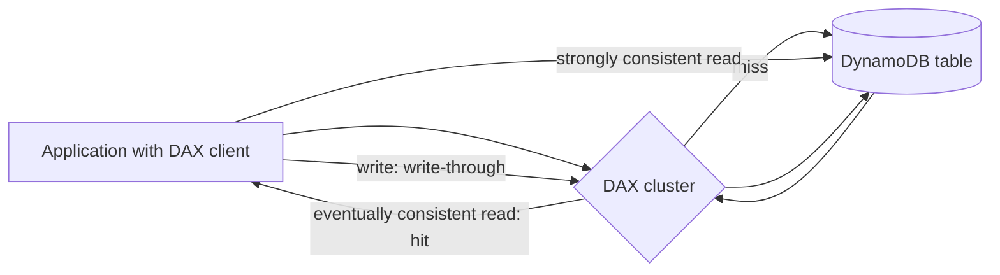
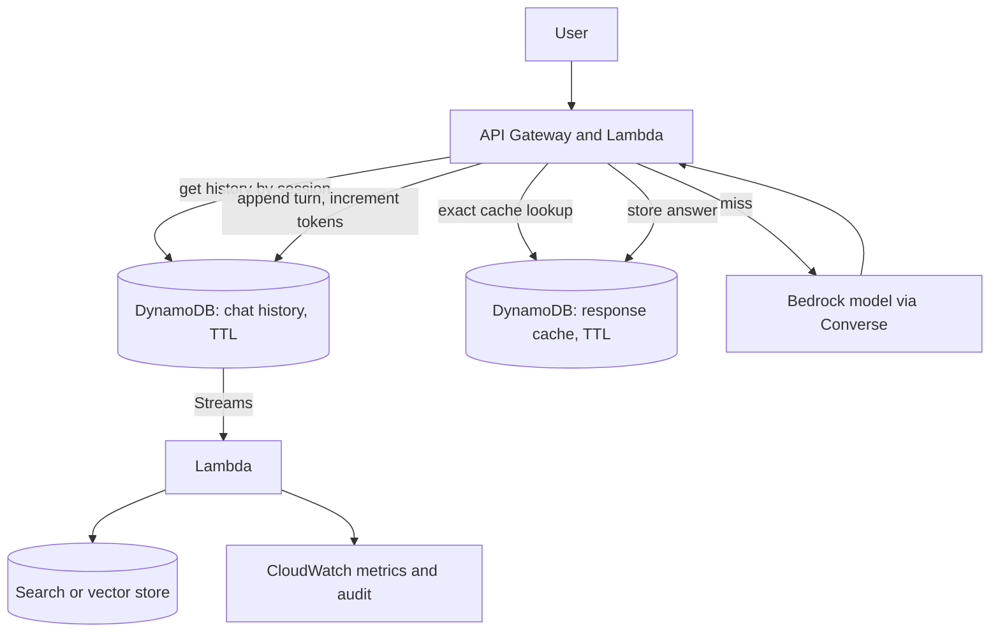

## 0. Before you start
- **Essential:** JSON-like documents, key/value lookup.
- **Helpful:** what a cache is; what epoch time is.
- **Optional advanced:** DynamoDB Streams, global tables.

## 1. Simple explanation
**Amazon DynamoDB** is a serverless NoSQL database that answers "give me the item with this key" in a few milliseconds at almost any scale. You do not manage servers; you pick how throughput is paid for (on-demand, or a number of reads/writes per second you provision). In GenAI apps it is the workhorse for **state**: chat history, user profiles, agent session memory, prompt versions, token-usage counters, and exact-match response caches. It is **not** a similarity-search engine; for "find similar text" you pair it with a vector store.


```figure
flow dynamodb-chat-state
```

## 2. Structured explanation
1. **Model data around access patterns.** A *table* holds *items* (rows) made of *attributes*; every item has a *primary key*: a partition key, or partition key + sort key ✅.
2. **Choose the throughput mode:** on-demand (default and recommended for most workloads) or provisioned for steady, forecastable load ✅.
3. **Understand read/write cost:** read capacity per 4 KB, write capacity per 1 KB, rounded up (§5.1) ✅.
4. **Call the right API:** `GetItem`, `PutItem`, `UpdateItem`, `DeleteItem`, `Query`, `Scan`, `BatchGetItem`, `BatchWriteItem`, transactions ✅.
5. **Speed up hot reads** with DAX (an in-memory cache in front of DynamoDB) ✅.
6. **Expire old data for free** with TTL ✅.
7. **React to changes** with DynamoDB Streams + Lambda ✅.

## 3. Analogy
**A hotel front desk with numbered pigeonholes.** You hand over a room number (the key) and get your mail at once; no one searches through every pigeonhole. DAX is a small tray on the desk with the most requested envelopes, handed over instantly. TTL is housekeeping that empties pigeonholes of guests who checked out, whenever staff get round to it.

*Where it breaks:* if you ask the desk "who has mail containing the word invoice?", the clerk must open every pigeonhole (a `Scan`). DynamoDB is superb at key lookups and poor at ad-hoc search, which is why GenAI "find similar" needs a vector store.

## 4. The seven questions

**WHAT?**
- *Table / item / attribute:* a collection / one record / one field. Beyond the key the table is schemaless, and nested attributes can go 32 levels deep ✅.
- *Primary key:* partition key (hash) alone, or partition key + sort key (range); key attributes are string, number or binary ✅.
- *Secondary indexes:* GSI (different keys; default quota 20 per table) and LSI (same partition key, different sort key; 5 per table) ✅.
- *Streams:* ordered change records kept for 24 hours; can trigger Lambda ✅.
- *Consistency:* tables and LSIs offer eventually consistent (default) and strongly consistent reads; **GSIs and streams are eventually consistent only** ✅; eventually consistent reads cost half ✅.

**WHY?** Predictable low latency at any scale, no servers, pay-per-request option, built-in expiry (TTL), and tight Lambda/Streams integration. That fits the "state around the model" part of GenAI.

**WHEN?**
| GenAI need | DynamoDB pattern |
|---|---|
| Chat history per session | Partition key `session_id`, sort key `timestamp`, TTL for expiry |
| Agent short-term memory/state | Item per agent run with a version/conditional write |
| Prompt template versions and audit trail | Partition key `prompt_id`, sort key `version`; Streams for change capture |
| Exact-match response cache | Key = hash of normalised prompt + model + parameters, value = answer, TTL |
| Token/cost metering per user | Atomic counters via `UpdateItem` |
| Document metadata for a RAG pipeline | Item per document: owner, ACL tags, content hash, version, S3 URI |
| Feature flags / model routing config | Small config items (or AppConfig, later module) |
| "Find similar documents" | **Not DynamoDB**: use OpenSearch, S3 Vectors or pgvector; load data with Streams/Lambda ✅ (OpenSearch Service documents loading from DynamoDB) |

**WHERE?** Regional service, accessed with IAM through endpoints (public or VPC gateway endpoint ❌ not re-verified). DAX runs inside your VPC ✅.

**HOW?** §5.

**WHAT IF?**
| Situation | What happens | Remedy |
|---|---|---|
| Read an item that does not exist | You still consume read capacity ✅ | Cache negative results if frequent |
| Ask for fewer attributes with a projection | Capacity still based on the whole item ✅ | Store large blobs in S3, keep items small |
| `Scan` a big table | Consumes capacity for every item evaluated, not just returned ✅ | Use `Query` with a key, or an index |
| Conditional write fails | Write capacity is still consumed ✅ | Retry logic with backoff |
| Strongly consistent read on a GSI | Not supported ✅ | Read the base table or accept eventual consistency |
| DAX with strongly consistent reads | Passed through to DynamoDB, **not cached** ✅ | Use eventually consistent reads for cache benefit |
| TTL item still returned | Deletion can take "typically within a few days" after expiry ✅ | Filter expired items in reads |
| TTL attribute is not a Number | Ignored by TTL ✅ | Store epoch seconds as a Number |

**WHY NOT?**
- *Why not for vector search?* No similarity search on the pages I read ❌ (absence of evidence, check the DynamoDB docs for new features).
- *Why not a relational database?* For flexible joins and ad-hoc SQL, Aurora/RDS fit better.
- *Why not DAX everywhere?* It adds cost and only helps eventually consistent, repeated reads ✅.
- *When is the "wrong" way right?* Provisioned capacity can be cheaper for flat, predictable traffic; on-demand is simpler everywhere else.

## 5. Technical depth

```figure
dynamo-partitions
```


### 5.1 Capacity arithmetic (✅ official rules, lessons 72–73)
| Operation | Unit size and rounding | Cost |
|---|---|---|
| Strongly consistent read | up to **4 KB**, round up | 1 RCU |
| Eventually consistent read | up to 4 KB | 0.5 RCU |
| Transactional read | up to 4 KB | 2 RCU |
| Standard write | up to **1 KB**, round up | 1 WCU |
| Transactional write | up to 1 KB | 2 WCU (prepare + commit) |
| `BatchGetItem` | up to 100 items; each item rounded to 4 KB **first**, then summed | |
| `BatchWriteItem` | up to 25 `Put`/`Delete` (no updates); each item rounded to 1 KB first | |
| `Query` | all returned items summed, then rounded once to 4 KB | |
| `Scan` | based on items **evaluated**, not returned | |
| `UpdateItem` | larger of the item size before and after | |

Worked checks from the AWS page: a 3.5 KB item reads as 4 KB; 10 KB rounds to 12 KB; BatchGet of 1.5 KB + 6.5 KB = 12 KB (4 + 8), not 8 KB; Query returning 10 items totalling 40.8 KB = 44 KB; BatchWrite of 500 B + 3.5 KB = 5 KB (1 + 4) ✅.

### 5.2 Capacity modes (✅)
- **On-demand:** serverless, pay per request, no capacity planning; "the default and recommended throughput option for most DynamoDB workloads" ✅.
- **Provisioned:** you specify reads/writes per second and are charged for the hourly capacity you provision, whether used or not; good for steady, forecastable workloads ✅.
- Hot-key/partition limits, auto scaling and mode-switch frequency are covered on pages I did not open ❌; check them before sizing.

### 5.3 Basic APIs (lessons 74–75)
| API | Use | Notes |
|---|---|---|
| `PutItem` | Create or replace one item | Capacity from the larger of old/new size ✅ |
| `GetItem` | Read by full primary key | `ConsistentRead=true` for strong ✅ |
| `UpdateItem` | Change attributes, atomic counters | Charged for the whole item size (larger of before/after) ✅ |
| `DeleteItem` | Remove by key | Capacity from the deleted item size ✅ |
| `Query` | All items with one partition key, optional sort-key range | Efficient |
| `Scan` | Whole table | Expensive; avoid in hot paths |
| `BatchGetItem` / `BatchWriteItem` | Many items per call | 100 / 25 items ✅ |
| Transactions | All-or-nothing | 2x capacity ✅ |
| Conditional writes | Only if an expression is true | Failed condition still consumes WCU ✅ |

### 5.4 DAX (✅ lessons 76–77)

*Reading the arrows:* the DAX client sends API calls to the cluster. A cache **hit** returns from memory without touching the table. A **miss** is fetched from DynamoDB, stored, and returned. **Strongly consistent reads bypass the cache** and go to DynamoDB, and are not cached. **Writes are write-through**: written to the table first, then the cache; the operation succeeds only if both succeed.

| Fact ✅ | Detail |
|---|---|
| Latency | Microseconds for eventually consistent reads (vs single-digit ms) |
| Caches | **Item cache** (GetItem/BatchGetItem, by key) and **query cache** (Query/Scan results by parameters) |
| Default item-cache TTL | 5 minutes; TTL 0 on item cache = refresh only on LRU eviction or write-through; query-cache TTL 0 = not cached |
| Eviction | LRU always on |
| Network | Runs inside a VPC; EC2-VPC only |
| Security | Encryption at rest and in transit (TLS) |
| Nodes | One primary + read replicas; throttling returns `ThrottlingException`; watch `ThrottledRequestCount` |
| Good for | Fastest reads, hot keys, read-heavy and cost-sensitive loads, repeated reads of a large set |
| Poor for | Strongly consistent reads, write-heavy, few repeated reads (best above ~90% hit rate), no need for microseconds |
| Trap | Unbounded top-level attribute **names** (timestamps, UUIDs as attribute names) exhaust DAX memory over time |
It does not recognise table-management calls such as `CreateTable`; do those directly against DynamoDB ✅.

### 5.5 TTL (✅ lesson 78)
- Enable TTL on a table and name the attribute; the value must be a **Number in Unix epoch seconds**; non-Number values are ignored ✅.
- Expired items are deleted "typically within a few days" and **without consuming write throughput** ✅; until deletion they can still be read, so **filter** with a filter expression ✅.
- You can still update a pending-deletion item (even to push the TTL into the future) ✅.
- Deletions go to Streams as *service* deletions and are removed from indexes ✅; with global tables v2019.11.21, the TTL delete replicates and **replicas pay replicated write units** ✅.
- GenAI uses: session expiry, short-lived caches, "right to be forgotten" windows. TTL is **not** an instant-delete tool, so do not use it for legal deletion deadlines measured in minutes.

### 5.6 DynamoDB patterns for GenAI (lesson 79)

*Reading the arrows:* the API loads recent history by key, checks an exact-match cache, and only calls the model on a miss. New turns and token counters are written back. A stream from the history table feeds a Lambda that indexes content for search or emits audit metrics. Exact caching only helps when prompts repeat verbatim; a *semantic* cache needs vector similarity and therefore a vector store.

Design notes: keep items small (put long transcripts or files in S3 and store a pointer); use a composite key for time-ordered messages; use conditional writes for optimistic concurrency on agent state; encrypt with KMS and scope IAM to the table with leading-key conditions for multi-tenant isolation ❌ (condition-key names not verified here).

## 6. Worked example
*Problem:* A support chatbot must keep the last 20 turns per session for 24 hours, answer repeated FAQ questions without calling the model, and track tokens per user.

| Step | Design |
|---|---|
| 1 | `ChatHistory` table: PK `session_id`, SK `ts`; attribute `expires_at` (epoch seconds, now + 86,400) with TTL on |
| 2 | Read with `Query`, `ScanIndexForward=false`, `Limit=20` |
| 3 | `FaqCache`: PK `prompt_hash`; value answer; `expires_at` 1 day |
| 4 | `Usage`: PK `user_id#YYYYMM`; `UpdateItem ADD tokens :n` |
| 5 | Add DAX only if the FAQ read rate is high and eventually consistent reads are acceptable |
| 6 | Filter expired items in `Query` because TTL deletion is not instant |
| 7 | Alarm on `ThrottledRequests`-type metrics (names ❌ not verified here) |

## 7. Knowledge checkpoints
1. How many RCU does a strongly consistent read of a 9 KB item cost? An eventually consistent one?
2. Which reads does DAX not cache?
3. What format must a TTL attribute use, and how fast is deletion guaranteed?
4. Why is `Scan` expensive even if it returns few items?

## 7b. Practice questions (exam-style, original) — answers below

**Q1.** An application reads 200 items per second, each 6 KB, using eventually consistent reads. How many read capacity units are needed (provisioned mode)?
A. 100
B. 200
C. 400
D. 800

**Q2.** An item is 2.5 KB. How many WCU does one standard write consume, and one transactional write?
A. 3 and 6
B. 2 and 4
C. 3 and 3
D. 1 and 2

**Q3.** (Select TWO) Which are true of DAX?
A. It serves eventually consistent reads from memory
B. Strongly consistent reads bypass the cache and go to DynamoDB
C. Writes are cache-only and later flushed asynchronously
D. It requires no VPC
E. It improves strongly consistent read latency to microseconds

**Q4.** A chat app stores sessions with `expires_at` as an ISO date string and TTL enabled on `expires_at`. Items never expire. Why?
A. TTL requires a Number attribute with Unix epoch seconds; strings are ignored
B. TTL needs provisioned capacity
C. TTL only works on GSIs
D. TTL deletes only on weekends

**Q5.** Users still occasionally see expired sessions a few hours after expiry. What is the correct design response?
A. Assume TTL is broken and delete it
B. Filter expired items using a filter expression because deletion can lag by days
C. Increase WCU
D. Use `Scan` more often

**Q6.** Which is the BEST use of DynamoDB in a RAG system?
A. Primary store for embeddings with cosine search
B. Storing document metadata, ACL tags, content hashes and ingestion state keyed by document id
C. Running full-text relevance ranking
D. Hosting model weights

**Q7.** (Select TWO) A read-heavy product-catalog lookup has a hot item during a flash sale; stale-by-seconds data is acceptable. Which help?
A. Place DAX in front of the table and use eventually consistent reads
B. Use `Scan` to find the item
C. Reduce overprovisioned read capacity by offloading repeated reads to the cache
D. Switch all reads to strongly consistent reads
E. Put the table in a public subnet

**Q8.** A `BatchGetItem` retrieves two items of 1.5 KB and 6.5 KB. How many KB of read size does DynamoDB compute before applying consistency?
A. 8 KB
B. 12 KB
C. 4 KB
D. 6 KB

## 8. Hands-on lab (no Python files): capacity and TTL calculators + optional CLI

### 8.1 Objective
Reproduce DynamoDB's documented rounding rules, size a table, see what a DAX hit rate does to reads, and compute a TTL timestamp.

### 8.2 Prerequisites
Python 3 for the offline part. Optional: AWS CLI configured ([setup](aip:00-foundations/01-aws-account-iam-and-cli-setup)).

### 8.3 AWS services
Offline: none. Optional: DynamoDB.

### 8.4 IAM permissions
Optional CLI part: `dynamodb:CreateTable`, `PutItem`, `GetItem`, `Query`, `UpdateTimeToLive`, `DescribeTimeToLive`, `DeleteTable` on the lab table ARN.

### 8.5 Region notes
Tables are regional. Use one Region.

### 8.6 Architecture
See §5.6.

### 8.7 Cost
Offline: none. Optional: use **on-demand** mode with a handful of requests; delete the table afterwards. Prices are not quoted ❌.

### 8.8 Code
```python lab-run
import math

def rcu(item_kb, mode="strong"):
    units = math.ceil(item_kb / 4)
    return {"strong": units, "eventual": units / 2, "transactional": units * 2}[mode]

def wcu(item_kb, transactional=False):
    units = math.ceil(item_kb)
    return units * 2 if transactional else units

def batch_get_kb(sizes):     # each item rounded up to 4 KB, then summed
    return sum(math.ceil(s / 4) * 4 for s in sizes)

def batch_write_kb(sizes):   # each item rounded up to 1 KB, then summed
    return sum(math.ceil(s) for s in sizes)

def query_kb(sizes):         # total of all returned items, rounded up to 4 KB once
    return math.ceil(sum(sizes) / 4) * 4

print("GetItem 3.5 KB strong:", rcu(3.5), "RCU")
print("GetItem 10 KB strong :", rcu(10), "RCU (rounded to 12 KB)")
print("GetItem 8 KB strong/eventual/transactional:", rcu(8), rcu(8, "eventual"), rcu(8, "transactional"))
print("BatchGetItem 1.5 KB + 6.5 KB ->", batch_get_kb([1.5, 6.5]), "KB")
print("Query 10 items, 40.8 KB total ->", query_kb([40.8]), "KB")
print("Query 1500 items x 64 bytes ->", query_kb([1500 * 64 / 1024]), "KB")
print("PutItem 1.6 KB:", wcu(1.6), "WCU; 2 KB write:", wcu(2), "WCU; 2 KB transactional:", wcu(2, True), "WCU")
print("BatchWriteItem 0.5 KB + 3.5 KB ->", batch_write_kb([0.5, 3.5]), "KB")

reads_per_s, read_kb, writes_per_s, write_kb = 100, 6, 50, 2.5
print("plan: strong reads", reads_per_s * rcu(read_kb), "RCU | eventual", reads_per_s * rcu(read_kb, "eventual"),
      "RCU | writes", writes_per_s * wcu(write_kb), "WCU")
hit = 0.90
print(f"with a {hit:.0%} DAX hit rate the table sees {reads_per_s * (1 - hit):.0f} reads/s, "
      f"about {reads_per_s * (1 - hit) * rcu(read_kb, 'eventual'):.0f} RCU of eventual reads")

now = 1_800_000_000
ttl = now + 30 * 86400
item = {"session_id": "s1", "expires_at": ttl}
print("TTL epoch seconds for 30 days:", ttl)
print("expired 31 days later?", (now + 31 * 86400) >= item["expires_at"], "| still readable until deleted, so filter on read")
```

### 8.9 Captured output
Generated on 2026-10-26 by extracting the block above from this file and running it (Python 3.13). The first eight lines reproduce numbers stated on AWS's read/write capacity page. Not AWS output.
```text lab-out
GetItem 3.5 KB strong: 1 RCU
GetItem 10 KB strong : 3 RCU (rounded to 12 KB)
GetItem 8 KB strong/eventual/transactional: 2 1.0 4
BatchGetItem 1.5 KB + 6.5 KB -> 12 KB
Query 10 items, 40.8 KB total -> 44 KB
Query 1500 items x 64 bytes -> 96 KB
PutItem 1.6 KB: 2 WCU; 2 KB write: 2 WCU; 2 KB transactional: 4 WCU
BatchWriteItem 0.5 KB + 3.5 KB -> 5 KB
plan: strong reads 200 RCU | eventual 100.0 RCU | writes 150 WCU
with a 90% DAX hit rate the table sees 10 reads/s, about 10 RCU of eventual reads
TTL epoch seconds for 30 days: 1802592000
expired 31 days later? True | still readable until deleted, so filter on read
```

### 8.10 Explanation
- A 6 KB item rounds to 8 KB = 2 units; 100 strongly consistent reads per second = 200 RCU, eventually consistent = 100 RCU.
- A 2.5 KB write rounds to 3 KB = 3 WCU; 50 per second = 150 WCU.
- The cache arithmetic is a simplification: it assumes every hit avoids a table read and ignores misses' extra cost.
- A TTL value is simply `now + seconds`; the lab uses a fixed `now` so the output is reproducible.

### 8.11 Optional CLI lab (shown, not run in this session ❌)
```bash
aws dynamodb create-table --table-name ChatHistory \
  --attribute-definitions AttributeName=session_id,AttributeType=S AttributeName=ts,AttributeType=N \
  --key-schema AttributeName=session_id,KeyType=HASH AttributeName=ts,KeyType=RANGE \
  --billing-mode PAY_PER_REQUEST
aws dynamodb update-time-to-live --table-name ChatHistory \
  --time-to-live-specification Enabled=true,AttributeName=expires_at
aws dynamodb put-item --table-name ChatHistory --item '{"session_id":{"S":"s1"},"ts":{"N":"1"},"expires_at":{"N":"1802592000"},"msg":{"S":"hello"}}'
aws dynamodb query --table-name ChatHistory --key-condition-expression "session_id = :s" \
  --expression-attribute-values '{":s":{"S":"s1"}}' --no-scan-index-forward --limit 20
aws dynamodb delete-table --table-name ChatHistory
```
(`PAY_PER_REQUEST` is the on-demand billing mode in the CLI; confirm the flag names against the CLI reference before running.)

### 8.12 Common errors
| Error | Cause | Fix |
|---|---|---|
| `ProvisionedThroughputExceededException` | Provisioned limits exceeded | On-demand, raise capacity, backoff |
| `ValidationException` on key types | Attribute type mismatch | Match `AttributeType` to values |
| TTL does nothing | Attribute not Number / not enabled | Store epoch seconds as Number |
| Throttling from DAX | Node CPU limit | Scale up/out the cluster ✅ |

### 8.13 Security recommendations
Least-privilege IAM on specific table ARNs; KMS encryption; no PII in key names; put DAX in private subnets with security groups; log table access with CloudTrail; delete lab tables.

## 9. What can go wrong?

| Failure | Why | Symptoms | Investigate | Fix | Prevent |
|---|---|---|---|---|---|
| **Hot partition** | Skewed keys | Throttling despite spare capacity | Per-key access metrics | Better key design, write sharding, DAX for reads | Model access patterns first |
| **Surprise RCU from `Scan`** | Evaluated items billed | Capacity spikes | Request logs | Replace with `Query`/index | Ban `Scan` in hot paths |
| **Stale cache reads** | DAX TTL and eventual consistency | Old values for minutes | Cache TTLs | Lower TTL / bypass for critical reads | Document consistency needs |
| **DAX memory exhaustion** | Unbounded top-level attribute names ✅ | Cluster instability | Attribute names | Use fixed attribute names | Schema review |
| **Expired data still served** | TTL lag ✅ | Old sessions visible | Compare `expires_at` to now | Filter in query | Always filter |
| **Item too big/costly** | Blobs in items | High RCU/WCU | Item sizes | Store payloads in S3 | Size budget |
| **Cache never hits** | Prompt text varies slightly | Zero hit rate | Hash inputs | Normalise prompts or use semantic cache | Cache key design |
| **Global table surprise cost** | Replicated TTL deletes cost replica writes ✅ | Higher bill | Replica write metrics | Account for it | Cost model |

## 10. Common misconceptions
1. **"DynamoDB can search by meaning."** It does key lookups; semantic search needs a vector store.
2. **"Eventually consistent means unreliable."** It is the default and half the price; most reads tolerate it.
3. **"TTL deletes at the exact time."** Typically within a few days ✅.
4. **"DAX speeds up everything."** Only eventually consistent, repeated reads ✅.
5. **"Projecting fewer attributes lowers the read cost."** Cost depends on the whole item ✅.
6. **"UpdateItem costs only what changed."** It costs the larger of before/after item sizes ✅.

## 11. Exam notes
- **Pattern:** "low-latency chat history / session / state with automatic expiry" → **DynamoDB + TTL**.
- **Pattern:** "reduce read latency to microseconds for read-heavy, eventually consistent workload" → **DAX**.
- **Pattern:** "document metadata for RAG ingestion tracking" → DynamoDB items (skill 1.4/1.6).
- **Traps:** DAX + strong consistency; TTL not instant and needs epoch seconds Number; GSIs eventually consistent only; Scan billing.
- **Compare:** DynamoDB (key-value state) vs OpenSearch/S3 Vectors/pgvector (vector search) vs ElastiCache (generic cache, later module) vs S3 (large objects).

## 12. Summary and revision cards
- 4 KB per read unit, 1 KB per write unit; eventual = ½, transactional = 2x.
- On-demand default; provisioned for steady loads.
- DAX: item + query caches, write-through, strong reads bypass, 5-minute default item TTL.
- TTL: Number epoch seconds, deletion typically within days, no WCU.

**Cards.** Q: Streams retention? A: 24 hours. · Q: GSI default quota? A: 20. · Q: BatchGetItem max items? A: 100. · Q: BatchWriteItem max? A: 25.

## 13. References
| Source | URL | Verified |
|---|---|---|
| Read and write operations (capacity units) | https://docs.aws.amazon.com/amazondynamodb/latest/developerguide/read-write-operations.html | 2026-10-26 |
| Throughput capacity modes | https://docs.aws.amazon.com/amazondynamodb/latest/developerguide/HowItWorks.ReadWriteCapacityMode.html | 2026-10-26 |
| Core components | https://docs.aws.amazon.com/amazondynamodb/latest/developerguide/HowItWorks.CoreComponents.html | 2026-10-26 |
| Read consistency | https://docs.aws.amazon.com/amazondynamodb/latest/developerguide/HowItWorks.ReadConsistency.html | 2026-10-26 |
| DAX overview | https://docs.aws.amazon.com/amazondynamodb/latest/developerguide/DAX.html | 2026-10-26 |
| DAX: how it works | https://docs.aws.amazon.com/amazondynamodb/latest/developerguide/DAX.concepts.html | 2026-10-26 |
| Time to live | https://docs.aws.amazon.com/amazondynamodb/latest/developerguide/TTL.html | 2026-10-26 |
| Exam guide Task 1.4 / 1.6 | https://docs.aws.amazon.com/aws-certification/latest/ai-professional-01/ai-professional-01-domain1.html | 2026-10-23 |

**Unverified here:** the 400 KB item-size quota, per-partition throughput limits, auto scaling and mode-switch rules, pricing, IAM condition keys for leading-key access, any native vector search feature.

## 14. Answers to checkpoints and practice questions

**Checkpoints.** 1) 9 KB rounds to 12 KB = 3 RCU strongly consistent; 1.5 RCU eventually consistent. 2) Strongly consistent reads (passed through to DynamoDB, not cached). 3) Number, Unix epoch seconds; typically within a few days after expiry, not guaranteed instant. 4) It is billed on items evaluated, not returned.

**Practice questions.**
- **Q1 → B.** 6 KB rounds to 8 KB = 2 units for a strongly consistent read, 1 RCU for an eventually consistent read; 200 reads/s × 1 = 200 RCU. Forgetting to halve gives 400 (C); A and D ignore the rounding.
- **Q2 → A.** 2.5 KB rounds to 3 KB: 3 WCU, transactional 6.
- **Q3 → A, B.** C false (write-through), D false (VPC), E false (strong reads are not served by DAX).
- **Q4 → A.** TTL needs a Number in epoch seconds.
- **Q5 → B.** Deletion can lag; filter.
- **Q6 → B.** Metadata and state; not vectors, ranking or weights.
- **Q7 → A, C.** Cache with eventual reads cuts repeated reads. B is expensive, D bypasses the cache, E irrelevant.
- **Q8 → B.** Each item is rounded to 4 KB first: 4 + 8 = 12 KB.
