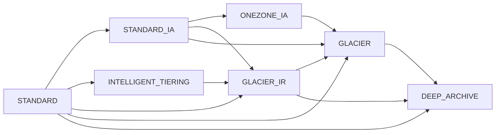
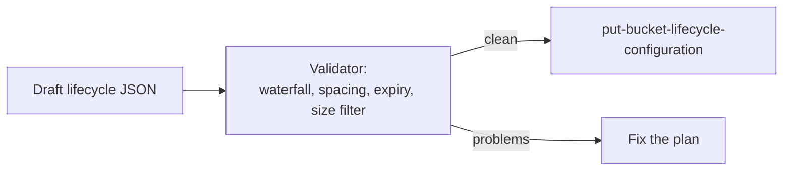

## 0. Before you start
- **Essential:** buckets, objects, keys, IAM policies.
- **Helpful:** versioning, KMS keys (full coverage later in 08-security).
- **Optional advanced:** Object Lock, Multi-Region Access Points.

## 1. Simple explanation
Amazon S3 is where GenAI data lives before and after the model sees it: source documents for a knowledge base, training and evaluation files, call recordings, extracted text, logs, backups. Five practical questions come up again and again. **How much should storage cost?** (pick a *storage class*, and let *lifecycle rules* move objects to cheaper ones). **What if a Region fails?** (*replication* to another bucket). **Is the data protected?** (*encryption*: S3 now encrypts every new object by default, and you choose who holds the key). **Who touched it?** (*server access logs*). **How do many teams share one bucket safely?** (*access points*, each with its own policy).


```figure
flow s3-data-protection
```

## 2. Structured explanation
1. **Classes:** frequent → S3 Standard; unknown pattern → Intelligent-Tiering; rare → Standard-IA / One Zone-IA; archive → Glacier Instant / Flexible / Deep Archive; ultra-low latency single-AZ → Express One Zone ✅.
2. **Lifecycle:** rules that *transition* objects down a waterfall of classes and *expire* them, filtered by prefix, tag or object size ✅.
3. **Replication:** live (CRR to another Region, SRR to the same Region) for new objects; Batch Replication for existing ones ✅.
4. **Encryption:** SSE-S3 (default), SSE-KMS, DSSE-KMS, SSE-C ✅.
5. **Logging:** server access logs to a bucket or CloudWatch Logs ✅.
6. **Access:** bucket policy plus per-application **access points** ✅.

## 3. Analogy
**A warehouse with zones.** Fast-pick shelves at the entrance (Standard), a cheaper back room (Infrequent Access), a deep cold store (Glacier). A foreman (lifecycle) moves boxes back as they age. A sister warehouse in another city (replication) receives a copy of every new box. Every box is already locked (default encryption); you may choose your own lock (KMS). A visitor log (access logs) is filled in by the security desk, but sometimes the clerk forgets an entry. Access points are separate side doors with their own guards.

*Where it breaks:* the sister warehouse copies only *new* boxes and does not copy the foreman's moves; and the visitor log is best-effort, not an audit-grade record.

## 4. The seven questions

**WHAT?** Object storage with classes, lifecycle management, replication, encryption and access features ✅ (details in §5).

**WHY?** GenAI datasets are large and mostly cold. Right-sizing the storage class and expiring staging data is the cheapest optimisation available; encryption and logging are compliance basics; replication supports resilience and data-residency requirements.

**WHEN?**
| Need | Choose |
|---|---|
| Frequently read knowledge-base sources | S3 Standard |
| Access pattern unknown or changing | S3 Intelligent-Tiering (no retrieval fees; small per-object monitoring fee) ✅ |
| Read monthly, need milliseconds | Standard-IA (multi-AZ) or One Zone-IA (single AZ, re-creatable data) ✅ |
| Archive, quarterly access, still milliseconds | Glacier Instant Retrieval ✅ |
| Archive, minutes–hours restore | Glacier Flexible Retrieval ✅ |
| Cold archive, hours restore | Glacier Deep Archive ✅ |
| Single-digit-ms latency in one AZ | Express One Zone ✅ |
| Move data down over time automatically | Lifecycle rules |
| Second copy elsewhere | Replication (CRR/SRR) |
| Customer controls the key, auditable use | SSE-KMS with a customer managed key |
| Regulation demands two encryption layers | DSSE-KMS |
| Many applications, different permissions, one bucket | Access points |

**WHERE?** Everywhere in a GenAI stack: Knowledge Base data sources, Bedrock batch inference input/output, Transcribe/BDA inputs and outputs, Glue lake, model artifacts.

**HOW?** §5.

**WHAT IF?**
| Situation | What happens | Remedy |
|---|---|---|
| Object < 128 KB in Standard-IA/Glacier IR | Billed for 128 KB minimum ✅; also lifecycle skips it by default since Sept 2024 ✅ | Aggregate small files or add an object-size filter |
| Delete/transition before minimum duration | Pro-rated charge for the remainder ✅ | Respect minimums when designing rules |
| Rule moves to Glacier Instant at day 4 then Deep Archive at day 20 | Not allowed in one rule; Deep Archive needs ≥ day 94 ✅ | Space transitions by the earlier class's minimum |
| Reading an archived object | Must be restored first (`RestoreObject`) ✅ | Plan restore time; pick Instant Retrieval if you need ms |
| Replication enabled, bucket already full of objects | Existing objects are not replicated by live replication ✅ | S3 Batch Replication |
| Source object is in Glacier Flexible/Deep Archive | Not replicated until restored and copied ✅ | Restore first or choose other classes |
| Versioning disabled on destination | Replication fails (status `FAILED`) ✅ | Keep versioning on |
| Delete a specific version on the source | The deletion is **not** replicated (protects from malicious deletes) ✅ | By design |
| Lifecycle expiry on the source | Delete markers from lifecycle actions are not replicated ✅ | Configure lifecycle on both buckets |
| SSE-C | New buckets (since April 2026) disable SSE-C writes by default ✅ | Enable it explicitly with `PutBucketEncryption` if truly needed |
| Server access logs delivered to a bucket with SSE-KMS | May be encrypted with a key you cannot access ✅ | Log destination must use SSE-S3 |
| Need exact audit of every request | Server logs are **best effort**, can be late, missing or duplicated ✅ | Use CloudTrail data events for audit-grade records (later module) |

**WHY NOT?**
- *Why not Glacier for everything?* Retrieval fees, restore delays and minimum durations; wrong for data a Knowledge Base re-reads.
- *Why not replicate everything?* Cost (storage twice plus inter-Region transfer for CRR; SRR has no transfer charge ✅) and replicated mistakes.
- *Why not DSSE-KMS by default?* Higher cost and latency; Bucket Keys are not supported with it ✅.
- *When is the "wrong" way right?* One Zone-IA is "wrong" for primary data but fine for a replica or rebuildable derived data ✅.

## 5. Technical depth

```figure
s3-lifecycle
```


### 5.1 Storage classes (✅ official comparison, lessons 82–83)
| Class (API value) | Designed for | Availability | AZs | Min duration | Min billable size | Notes |
|---|---|---|---|---|---|---|
| Standard (`STANDARD`) | Frequent access | 99.99% | ≥3 | none | none | Default |
| Standard-IA (`STANDARD_IA`) | ~monthly, ms | 99.9% | ≥3 | 30 days | 128 KB | Retrieval fee |
| Intelligent-Tiering (`INTELLIGENT_TIERING`) | Unknown/changing | 99.9% | ≥3 | none | none | Monitoring fee; no retrieval fee; < 128 KB stays in Frequent Access |
| One Zone-IA (`ONEZONE_IA`) | Re-creatable, infrequent | 99.5% | 1 | 30 days | 128 KB | Lost if the AZ is lost |
| Express One Zone (`EXPRESS_ONEZONE`) | Single-digit-ms | 99.95% | 1 | none | none | Directory buckets |
| Glacier Instant Retrieval (`GLACIER_IR`) | Quarterly, ms | 99.9% | ≥3 | 90 days | 128 KB | Retrieval fee |
| Glacier Flexible Retrieval (`GLACIER`) | Yearly, minutes–hours | 99.99% after restore | ≥3 | 90 days | n/a (+40 KB metadata) | Restore needed |
| Glacier Deep Archive (`DEEP_ARCHIVE`) | < yearly, hours | 99.99% after restore | ≥3 | 180 days | n/a (+40 KB metadata) | Restore needed |
| Reduced Redundancy | Not recommended | 99.99% | ≥3 | none | none | Durability 99.99%; avoid |
Durability for all current classes is designed for 99.999999999% (eleven 9s). The 40 KB metadata overhead on Glacier Flexible/Deep Archive = 32 KB at the archive rate + 8 KB at Standard ✅.

**Intelligent-Tiering tiers ✅:** Frequent Access; Infrequent Access after 30 days without access; Archive Instant Access after 90 days; optional Archive Access (≥ 90 days) and Deep Archive Access (≥ 180 days) which require a restore; objects < 128 KB are never monitored or moved.

### 5.2 Lifecycle rules (✅ lessons 84–85)

*Reading the arrows (a subset of the full waterfall):* transitions only go **down and to the right**. Glacier Flexible Retrieval can only go on to Deep Archive; Deep Archive is a one-way street via lifecycle; to go back up you must restore a copy and copy it over ✅.

Rules to remember ✅:
- **128 KB default:** since September 2024 the default prevents objects smaller than 128 KB from transitioning to any storage class; use `ObjectSizeGreaterThan` / `ObjectSizeLessThan` filters to override. Configurations created before then keep the old behaviour until you modify them.
- **Minimum-duration spacing:** you cannot transition to a class before the previous class's minimum has passed in a single rule (Glacier IR day 4 → Deep Archive must be at day ≥ 94).
- **Billing starts at the rule date**, even if the physical transition lags (except Intelligent-Tiering, where billing changes after the transition completes) ✅.
- **Versioned buckets:** after enabling versioning add `NonCurrentVersionExpiration` / `NonCurrentVersionTransition` rules to keep prior cost behaviour ✅.
- Add an `AbortIncompleteMultipartUpload` rule to avoid paying for orphaned parts ✅.
- Rule changes can take up to 15 minutes to propagate; tag-based actions are re-evaluated at execution time ✅.

Sample configuration (validated in §8):
```json
{
  "Rules": [
    {
      "ID": "kb-sources-tiering",
      "Status": "Enabled",
      "Filter": {"And": {"Prefix": "documents/", "ObjectSizeGreaterThan": 131072}},
      "Transitions": [
        {"Days": 30, "StorageClass": "STANDARD_IA"},
        {"Days": 120, "StorageClass": "GLACIER_IR"}
      ],
      "Expiration": {"Days": 730}
    },
    {
      "ID": "abort-incomplete-uploads",
      "Status": "Enabled",
      "Filter": {"Prefix": ""},
      "AbortIncompleteMultipartUpload": {"DaysAfterInitiation": 7}
    }
  ]
}
```
*Reading:* documents over 128 KiB (131,072 bytes) under `documents/` go to Standard-IA after 30 days, Glacier Instant Retrieval after 120 days, and expire after two years; failed uploads are cleaned after 7 days. (The `And` filter with `Prefix` and `ObjectSizeGreaterThan` follows the S3 lifecycle API shape; confirm against the API reference before deploying ❌.)

### 5.3 Namespaces (lesson 86 ✅)
- **Global namespace (default):** bucket names must be unique across all accounts in a partition (`aws`, `aws-cn`, `aws-us-gov`, `aws-eusc`); a deleted name can be taken by anyone ⇒ risk of **bucket squatting**/receiving requests meant for you.
- **Account regional namespace:** name = `prefix-<12-digit account>-<region>-an`, created with `--bucket-namespace account-regional` (`x-amz-bucket-namespace` header); only your account can create buckets there; supported in all Regions except Middle East (Bahrain) and (UAE). The suffix counts toward the 63-character limit, so only **37 characters** remain for the prefix with a 12-digit account and `us-east-1` ✅.
- Enforce it with the condition key `s3:x-amz-bucket-namespace` in an IAM policy, SCP or RCP ✅.
- Defence for the global namespace: use **bucket owner condition** (expected bucket owner) on requests ✅.

### 5.4 Replication (✅ lessons 87–89)
| Topic | Facts |
|---|---|
| Types | **Live**: CRR (cross-Region), SRR (same-Region) for new/updated objects; **On-demand**: S3 Batch Replication for existing objects, failed ones, or re-replication |
| Requirements | Versioning on **both** buckets; permissions (IAM role) for S3 to replicate; for cross-account the destination owner grants permission via bucket policy; destination cannot be Requester Pays; Object Lock on the source requires it on the destination |
| Replicated by default | Objects created after the rule, metadata, tags, ACL updates (unless owner override), Object Lock retention, SSE-S3 / SSE-KMS / SSE-C objects (see the encrypted-object page for KMS setup) |
| Not replicated | Existing objects (use Batch), objects already replicated elsewhere, **replicas of replicas** (chain A→B→C), objects in Glacier Flexible/Deep Archive and Intelligent-Tiering archive tiers, bucket-level subresource changes (lifecycle, notifications), lifecycle-generated delete markers, version-ID deletes |
| Delete markers | Not replicated by default with the V2 (`Filter`) rule form; can be enabled for non-tag rules; V1 rules replicate user-created delete markers |
| Tag-based rules | New objects must carry the tag in the `PutObject` call itself; tag later → needs Batch Replication |
| **S3 RTC** | Replication Time Control: replicates 99.99% of new objects within **15 minutes**, SLA-backed; not applicable to Batch Replication |
| Two-way | Replica modification sync plus bidirectional rules for Multi-Region Access Point failover |
| Cost | CRR pays inter-Region transfer; **SRR has no transfer charge** |
| Timing | Large objects can take hours; lifecycle on the destination honours the **original** creation time |

### 5.5 Encryption (✅ lessons 90–93)
| Option | Keys managed by | Notes |
|---|---|---|
| **SSE-S3** | S3 | **Default for every bucket and every new object since 2023-01-05**, at no extra cost; AES-256; unique key per object, wrapped by a regularly rotated root key |
| **SSE-KMS** | You (AWS KMS) | AWS managed key `aws/s3` or customer managed key; same Region; needs `kms:GenerateDataKey` to upload and `kms:Decrypt` to download; multipart needs both; KMS adds charges; auditable in CloudTrail |
| **DSSE-KMS** | You (AWS KMS) | **Two independent AES-256 layers** (KMS data key, then an S3-managed key) for multilayer compliance; header value `aws:kms:dsse`; **Bucket Keys not supported**; higher cost/latency; KMS key must be in the bucket's Region |
| **SSE-C** | You supply the key each request | Disabled by default on new buckets since April 2026 ✅ |
- You cannot apply two SSE types to the same object ✅. Changing the **default** to SSE-KMS does not re-encrypt existing objects; use **S3 Batch Operations (Copy)** with an S3 Inventory list to re-encrypt ✅.
- **S3 Bucket Keys** cut KMS request cost "by up to 99 percent" by using a bucket-level key for a time-limited period; the encryption context becomes the **bucket ARN** instead of the object ARN ✅.
- **Cross-account with SSE-KMS:** objects encrypted with the AWS managed key cannot be shared cross-account; use a customer managed key and give the other account access in the key policy ✅. Use full key ARNs (an alias resolves in the requester's account) ✅.
- **Enforce** with bucket policy: deny `s3:PutObject` unless `s3:x-amz-server-side-encryption` equals `aws:kms:dsse` (DSSE) or the `x-amz-server-side-encryption-aws-kms-key-id` header is present (SSE-KMS) ✅.
- Requests for KMS-encrypted objects must use TLS and SigV4; do not send encryption headers on `GET`/`HEAD` (HTTP 400) ✅.
- Access-log destination must use SSE-S3 ✅.

### 5.6 Server access logging (✅ lessons 94–95)
- Detailed request records for a bucket (operations analysis, security posture, chargeback) ✅.
- Two destinations (one or both): **CloudWatch Logs** (structured JSON; Logs Insights; cross-account/Region aggregation; KMS) or an **S3 general purpose bucket** in the **same Region and account** (space-delimited text; no delivery charge; query with Athena; SSE-S3 only) ✅.
- **Best effort**: most records within a few hours, but completeness and timeliness are not guaranteed; a record might not arrive or may duplicate ✅. Logging status changes take time to take effect ✅.
- Do not confuse with CloudTrail: server logs give a request-level view of bucket traffic; CloudTrail data events are the audit-grade API record (later module ❌).

### 5.7 Access points (✅ lesson 96)
- A named network endpoint attached to a bucket, each with its own **policy** and network controls; if attached to a bucket the access point policy works **together with** the bucket policy ✅.
- Can be restricted to a **VPC** (private network access) ✅; custom Block Public Access settings per access point (cannot be changed after creation, nor the VPC configuration) ✅.
- Limits ✅: exactly one bucket per access point; policy ≤ **20 KB**; **10,000** per account per Region (raise via quota); name 3–50 characters, lowercase letters/digits/hyphens, no periods or underscores, unique per account per Region; HTTPS only; no anonymous access; SigV4 required; **cannot be a replication destination**; object operations only (no bucket deletion/replication configuration through them).
- Cross-account access points do not grant access until the bucket owner updates the bucket policy ✅.
- **Pattern for GenAI:** one bucket of enterprise documents, three access points: `kb-ingest` (read-only for the Bedrock KB role, VPC-restricted), `data-science` (read/write on a prefix), `audit` (read-only logs).

### 5.8 GenAI-specific uses
- Separate buckets/prefixes for **raw**, **clean** and **embedding/derived** data; lifecycle derived data to cheaper classes; keep KB source data in Standard if it is re-read during sync.
- Keep source documents encrypted with a customer managed key if policy demands it; the Knowledge Base or ingestion role then needs the corresponding KMS permissions ❌ (exact grants not verified here).
- Replicate source documents to a second Region for DR, but remember the vector store must be rebuilt or replicated separately.
- Log access to sensitive document buckets; combine with Macie/Lake Formation later.

## 6. Worked example
*Problem:* A legal-tech company stores 40 TB of contracts (PDFs, mostly > 500 KB) for a RAG assistant. Contracts older than 6 months are rarely read; after 7 years they must be deleted; Europe data must be copied to another EU Region; auditors need to know who accessed the bucket; two teams need different access.

| Step | Decision |
|---|---|
| 1 | Create the bucket in the **account regional namespace**; versioning on (needed for replication) |
| 2 | Default encryption **SSE-KMS** with a customer managed key + **Bucket Keys** to cut KMS calls |
| 3 | Lifecycle: Standard → Standard-IA at 30 days → Glacier Instant Retrieval at 180 days (≥ 30 + 30 spacing, and size filter ≥ 128 KB) → expire at 7 years; abort incomplete uploads at 7 days |
| 4 | CRR to a second EU Region; enable **S3 RTC** only if a 15-minute SLA is required; add **Batch Replication** for pre-existing contracts |
| 5 | Server access logs to CloudWatch Logs (cross-Region aggregation) and CloudTrail data events for audit-grade records (later module) |
| 6 | Two **access points**: `kb-ingest` (VPC only, read) and `legal-team` (prefix-scoped read/write); bucket policy delegates to access points |
| 7 | Rebuild or replicate the vector index in the second Region |

## 7. Knowledge checkpoints
1. What is the default encryption of new S3 objects, and since when?
2. Which lifecycle spacing rule makes "GLACIER_IR at day 4, DEEP_ARCHIVE at day 20" invalid?
3. Name three things S3 replication does NOT replicate by default.
4. Why can a bucket keep working with S3 access points while its bucket policy is strict?
5. Which log destination is "best effort", and which key type must it use?

## 7b. Practice questions (exam-style, original) — answers below

**Q1.** A bucket of training datasets has unpredictable access patterns, and the team wants automatic cost savings with no retrieval fees. Which class fits BEST?
A. S3 Glacier Deep Archive
B. S3 Intelligent-Tiering
C. S3 One Zone-IA
D. S3 Standard-IA

**Q2.** (Select TWO) Which are true about S3 Lifecycle transitions?
A. Objects smaller than 128 KB do not transition by default (since September 2024)
B. Glacier Deep Archive can transition back to Standard with a lifecycle rule
C. Lifecycle transitions follow a one-way waterfall toward colder classes
D. Lifecycle can transition Glacier Flexible Retrieval to Standard-IA
E. Transitions have no minimum-duration implications

**Q3.** A team wants to replicate objects already in the bucket before replication was configured. What do they need?
A. Nothing; live replication copies old objects
B. S3 Batch Replication
C. Lifecycle expiration
D. A larger bucket

**Q4.** Replication from bucket A to B and from B to C is configured. New objects uploaded to A appear in B but not in C. Why?
A. Objects that are replicas created by another rule are not replicated again by default
B. Bucket C must be in the same Region as A
C. Versioning is disabled on A
D. Replication only supports two buckets in total

**Q5.** A compliance policy requires two independent layers of encryption with customer-controlled KMS keys. Which option fits?
A. SSE-S3
B. SSE-C
C. DSSE-KMS
D. Client-side Base64 encoding

**Q6.** A team switches a bucket's default encryption to SSE-KMS. What happens to existing objects?
A. All existing objects are re-encrypted automatically
B. Existing objects keep their current encryption; use S3 Batch Operations (Copy) with S3 Inventory to re-encrypt them
C. Existing objects are deleted
D. The bucket becomes read-only

**Q7.** (Select TWO) Which are true of S3 server access logs?
A. Delivery is best effort; records can be late, missing or duplicated
B. They can be sent to CloudWatch Logs or to an S3 bucket in the same Region and account
C. They are an exact, complete audit record of every request
D. A destination bucket with SSE-KMS default encryption is the recommended setup
E. They are enabled by default on every bucket

**Q8.** A security architect wants all new buckets created in the account's reserved namespace to prevent name squatting. What should they do?
A. Name buckets with a random word
B. Create buckets with the account regional namespace and enforce it with the `s3:x-amz-bucket-namespace` condition key
C. Disable versioning
D. Use Reduced Redundancy Storage

## 8. Hands-on lab (no Python files): lifecycle rule validator and early-deletion math

### 8.1 Objective
Encode the documented lifecycle constraints (waterfall order, minimum-duration spacing, early-deletion charge, small-object default) in a checker, and test it with good and bad plans before you ever call the S3 API.

### 8.2 Prerequisites
Python 3. Optional: an S3 bucket you own for the CLI part.

### 8.3 AWS services
Offline: none. Optional: S3.

### 8.4 IAM permissions
Optional CLI: `s3:PutLifecycleConfiguration`, `s3:GetLifecycleConfiguration` on the bucket ARN.

### 8.5 Region notes
Lifecycle is per bucket (per Region). Replication and namespaces are Region-specific.

### 8.6 Architecture

*Reading:* validate first; only a clean plan is applied.

### 8.7 Cost
Offline: none. Optional CLI: lifecycle rules are free to define but transitions have per-request charges; use a test bucket with a few small files ❌ (prices not quoted).

### 8.8 Code
```python lab-run
MIN_DAYS = {"STANDARD_IA": 30, "ONEZONE_IA": 30, "GLACIER_IR": 90, "GLACIER": 90, "DEEP_ARCHIVE": 180}
ALLOWED = {
    "STANDARD": {"STANDARD_IA", "INTELLIGENT_TIERING", "ONEZONE_IA", "GLACIER_IR", "GLACIER", "DEEP_ARCHIVE"},
    "STANDARD_IA": {"INTELLIGENT_TIERING", "ONEZONE_IA", "GLACIER_IR", "GLACIER", "DEEP_ARCHIVE"},
    "INTELLIGENT_TIERING": {"ONEZONE_IA", "GLACIER_IR", "GLACIER", "DEEP_ARCHIVE"},
    "ONEZONE_IA": {"GLACIER", "DEEP_ARCHIVE"},
    "GLACIER_IR": {"GLACIER", "DEEP_ARCHIVE"},
    "GLACIER": {"DEEP_ARCHIVE"},
    "DEEP_ARCHIVE": set(),
}

def check_rule(rule):
    problems, prev, prev_days = [], "STANDARD", 0
    for t in sorted(rule.get("Transitions", []), key=lambda t: t["Days"]):
        cls, days = t["StorageClass"], t["Days"]
        if cls not in ALLOWED[prev]:
            problems.append(f"{prev} -> {cls} is not a supported transition")
        else:
            need = prev_days + MIN_DAYS.get(prev, 0)
            if days < need:
                problems.append(f"{cls} must be at day {need} or later ({prev} has a {MIN_DAYS[prev]}-day minimum)")
        prev, prev_days = cls, days
    exp = rule.get("Expiration", {}).get("Days")
    if exp is not None and prev in MIN_DAYS and exp < prev_days + MIN_DAYS[prev]:
        problems.append(f"expiring on day {exp} is inside the {MIN_DAYS[prev]}-day minimum of {prev}: early-deletion charge")
    if rule.get("Transitions") and "ObjectSizeGreaterThan" not in rule.get("Filter", {}):
        problems.append("note: objects under 128 KB are not transitioned unless a size filter allows it")
    return problems

CASES = {
    "A good plan": {"Transitions": [{"Days": 30, "StorageClass": "STANDARD_IA"}, {"Days": 120, "StorageClass": "GLACIER_IR"}],
                    "Expiration": {"Days": 730}, "Filter": {"ObjectSizeGreaterThan": 131072}},
    "B wrong order": {"Transitions": [{"Days": 30, "StorageClass": "GLACIER"}, {"Days": 60, "StorageClass": "STANDARD_IA"}],
                      "Filter": {"ObjectSizeGreaterThan": 131072}},
    "C too soon": {"Transitions": [{"Days": 4, "StorageClass": "GLACIER_IR"}, {"Days": 20, "StorageClass": "DEEP_ARCHIVE"}],
                   "Filter": {"ObjectSizeGreaterThan": 131072}},
    "D early delete": {"Transitions": [{"Days": 30, "StorageClass": "STANDARD_IA"}], "Expiration": {"Days": 45}},
}
for name, rule in CASES.items():
    result = check_rule(rule)
    print(name + ":" + (" OK" if not result else ""))
    for p in result:
        print("   -", p)

def extra_billable_days(storage_class, age_days):
    return max(0, MIN_DAYS.get(storage_class, 0) - age_days)

for cls, age in (("STANDARD_IA", 10), ("GLACIER", 45), ("DEEP_ARCHIVE", 100), ("STANDARD", 1)):
    print(f"delete a {cls} object at day {age}: billed {extra_billable_days(cls, age)} more day(s)")

def regional_bucket(prefix, account, region):
    name = f"{prefix}-{account}-{region}-an"
    return name, 63 - len(f"-{account}-{region}-an")

print(regional_bucket("amzn-s3-demo-bucket", "012345678910", "us-east-1"))
print("prefix budget:", regional_bucket("x", "012345678910", "us-east-1")[1], "characters")
```

### 8.9 Captured output
Generated on 2026-10-26 by extracting the block above from this file and running it (Python 3.13). The constraints encode AWS's S3 storage-class and lifecycle pages; the checker is a teaching tool, not the S3 service's own validator. Not AWS output.
```text lab-out
A good plan: OK
B wrong order:
   - GLACIER -> STANDARD_IA is not a supported transition
C too soon:
   - DEEP_ARCHIVE must be at day 94 or later (GLACIER_IR has a 90-day minimum)
D early delete:
   - expiring on day 45 is inside the 30-day minimum of STANDARD_IA: early-deletion charge
   - note: objects under 128 KB are not transitioned unless a size filter allows it
delete a STANDARD_IA object at day 10: billed 20 more day(s)
delete a GLACIER object at day 45: billed 45 more day(s)
delete a DEEP_ARCHIVE object at day 100: billed 80 more day(s)
delete a STANDARD object at day 1: billed 0 more day(s)
('amzn-s3-demo-bucket-012345678910-us-east-1-an', 37)
prefix budget: 37 characters
```

### 8.10 Explanation
- Case C reproduces AWS's own example: Glacier IR at day 4 forces Deep Archive to day ≥ 94 (4 + 90).
- Case D shows the early-deletion pitfall: the object enters Standard-IA at day 30 and expires at day 45, so it lives only 15 days in a class with a 30-day minimum (30 + 30 = 60 > 45). You are charged for the remaining 15 days.
- The "billed N more days" lines are the pro-rated remainder of the minimum duration, a simplified model of the charge described on the lifecycle page.
- The bucket-name line proves the 37-character prefix budget stated by AWS.

### 8.11 Optional CLI steps (shown, not run in this session ❌)
```bash
# save the JSON from section 5.2 as lifecycle.json, then:
aws s3api put-bucket-lifecycle-configuration --bucket YOUR_BUCKET --lifecycle-configuration file://lifecycle.json
aws s3api get-bucket-lifecycle-configuration --bucket YOUR_BUCKET
aws s3api create-bucket --bucket amzn-s3-demo-012345678910-us-west-2-an --bucket-namespace account-regional \
  --region us-west-2 --create-bucket-configuration LocationConstraint=us-west-2
aws s3api put-bucket-encryption --bucket YOUR_BUCKET --server-side-encryption-configuration \
  '{"Rules":[{"ApplyServerSideEncryptionByDefault":{"SSEAlgorithm":"aws:kms","KMSMasterKeyID":"YOUR_KEY_ARN"},"BucketKeyEnabled":true}]}'
```
(The bucket-creation command follows the AWS page; the lifecycle and encryption commands follow the standard S3 API shapes—confirm flags in the CLI reference before use ❌.)

### 8.12 Common errors
| Error | Cause | Fix |
|---|---|---|
| `InvalidStorageClass` / invalid transition | Wrong direction or unsupported pair | Follow the waterfall |
| Lifecycle rejected: days too small | Spacing/minimum rule | Increase `Days` |
| Replication `FAILED` | Versioning disabled on destination, or missing KMS permission | Fix both |
| `403` using an access point | Access point policy and bucket policy both must allow | Update both |
| `AccessDenied` with KMS bucket | Caller lacks `kms:GenerateDataKey` / `kms:Decrypt` | Add key permissions |
| Logs missing | Best-effort delivery or wrong destination | Wait; check bucket policy/Region/account |

### 8.13 Security recommendations
Block Public Access on; SSE-KMS with a customer managed key for sensitive data; bucket policy requiring TLS and the expected encryption; least-privilege access points; versioning + MFA delete or Object Lock for critical data; keep logs in a separate bucket with SSE-S3 and restricted write access; delete test resources.

## 9. What can go wrong?

| Failure | Why | Symptoms | Investigate | Fix | Prevent |
|---|---|---|---|---|---|
| **Unexpected storage bill** | Small objects in IA classes (128 KB minimum) ✅ | Cost higher than Standard | Object size histogram (Storage Lens) | Aggregate files; size filter | Size-aware lifecycle |
| **Early-deletion charges** | Expiry/transition before minimum duration ✅ | Extra line items | Rule days vs minimums | Re-space rules | Validate rules |
| **Slow restores block a pipeline** | Archive classes need restore ✅ | Timeouts | Object storage class | Use Instant Retrieval or pre-restore | Keep KB sources in hot classes |
| **Replication gaps** | Existing objects, replicas-of-replicas, archive classes ✅ | Missing objects at destination | Replication status, metrics | Batch Replication; restore | Document what is replicated |
| **Replication lag** | Large objects, no RTC | Stale replica | Replication metrics | Enable RTC if SLA needed | Monitoring on lag |
| **KMS throttling/cost** | Per-object KMS calls | `ThrottlingException`, bills | KMS metrics | Enable Bucket Keys ✅ | Use Bucket Keys by default |
| **Cross-account decrypt fails** | AWS managed key used ✅ | `AccessDenied` for partner | Key type | Customer managed key + key policy | Plan sharing before choosing key |
| **Missing audit trail** | Relying on best-effort logs ✅ | Gaps in investigation | Compare with CloudTrail | Add CloudTrail data events | Audit design |
| **Access point denied** | Only one of bucket/AP policy allows | `403` | Both policies | Align both | Delegate access control via AP |
| **Namespace squatting** | Deleted global name reused ✅ | Requests hit someone else's bucket | Bucket owner | Account regional namespace; expected-owner checks | SCP requiring namespace |

## 10. Common misconceptions
1. **"S3 data is unencrypted unless I enable it."** All new objects are encrypted with SSE-S3 by default since 2023-01-05 ✅.
2. **"Replication copies everything, including old objects and deletions."** No ✅.
3. **"Lifecycle can bring objects back to Standard."** Lifecycle goes colder only ✅.
4. **"Glacier Instant Retrieval needs a restore."** No: it is millisecond access; Flexible and Deep Archive need restores ✅.
5. **"Server access logs are an audit log."** They are best effort ✅.
6. **"Changing default encryption re-encrypts old data."** Existing objects stay as they are ✅.
7. **"Access points replace bucket policies."** They work together; the bucket policy can delegate ✅.
8. **"DSSE-KMS supports Bucket Keys."** It does not ✅.

## 11. Exam notes
- **Pattern:** "unknown access pattern, no retrieval fees" → **Intelligent-Tiering**.
- **Pattern:** "cheapest long-term archive, hours to restore" → **Glacier Deep Archive**; "archive but milliseconds" → **Glacier Instant Retrieval**.
- **Pattern:** "re-creatable data/replica, cheaper than IA" → **One Zone-IA**.
- **Pattern:** "meet compliance requiring dual encryption layers" → **DSSE-KMS**; "reduce KMS request cost" → **S3 Bucket Keys**.
- **Pattern:** "replicate existing objects" → **Batch Replication**; "15-minute SLA" → **S3 RTC**; "same-Region copy for log aggregation or prod/test" → **SRR**.
- **Pattern:** "many apps with different permissions on a shared bucket" → **access points**; "private-network-only access to a dataset" → access point with VPC network origin.
- **Pattern:** "prevent bucket name squatting" → **account regional namespace**.
- **Traps:** replication needs versioning on both; Deep Archive is one-way via lifecycle; 128 KB rules; log delivery is best effort; SSE-KMS key must be same Region; AWS managed key can't be shared cross-account.
- **Compare:** server access logs (request-level, best effort) vs CloudTrail data events (API audit) vs S3 Inventory (object list/metadata).

## 12. Summary and revision cards
- Classes: Standard, IT, Standard-IA, One Zone-IA, Express, Glacier IR/FR/DA; minimums 30/30/90/90/180 days; 128 KB minimum billable for IA/GIR.
- Lifecycle: down-only waterfall; spacing = previous minimum; < 128 KB skipped by default.
- Replication: versioning on both, new objects only (Batch for old), RTC 15 min, SRR no transfer cost.
- Encryption: SSE-S3 default; SSE-KMS (+Bucket Keys); DSSE-KMS (two layers, no Bucket Keys); SSE-C off by default on new buckets.
- Logs: best effort; same Region/account bucket or CloudWatch Logs; SSE-S3 only on bucket destination.
- Access points: own policy, VPC option, ≤10,000/Region, 20 KB policy, not a replication destination.

**Cards.** Q: Glacier Deep Archive minimum? A: 180 days. · Q: Replication prerequisite? A: Versioning on source and destination. · Q: Bucket Keys save? A: Up to 99% of KMS request cost. · Q: Account regional bucket suffix? A: `-<account>-<region>-an`.

## 13. References
| Source | URL | Verified |
|---|---|---|
| Understanding and managing storage classes | https://docs.aws.amazon.com/AmazonS3/latest/userguide/storage-class-intro.html | 2026-10-26 |
| Transitioning objects using S3 Lifecycle | https://docs.aws.amazon.com/AmazonS3/latest/userguide/lifecycle-transition-general-considerations.html | 2026-10-26 |
| Replicating objects within and across Regions | https://docs.aws.amazon.com/AmazonS3/latest/userguide/replication.html | 2026-10-26 |
| What does S3 replicate? | https://docs.aws.amazon.com/AmazonS3/latest/userguide/replication-what-is-isnot-replicated.html | 2026-10-26 |
| Replication requirements and considerations | https://docs.aws.amazon.com/AmazonS3/latest/userguide/replication-requirements.html | 2026-10-26 |
| Protecting data with server-side encryption | https://docs.aws.amazon.com/AmazonS3/latest/userguide/serv-side-encryption.html | 2026-10-26 |
| SSE-KMS | https://docs.aws.amazon.com/AmazonS3/latest/userguide/UsingKMSEncryption.html | 2026-10-26 |
| DSSE-KMS | https://docs.aws.amazon.com/AmazonS3/latest/userguide/UsingDSSEncryption.html | 2026-10-26 |
| Server access logging | https://docs.aws.amazon.com/AmazonS3/latest/userguide/ServerLogs.html | 2026-10-26 |
| Access points | https://docs.aws.amazon.com/AmazonS3/latest/userguide/access-points.html | 2026-10-26 |
| Access point restrictions and naming | https://docs.aws.amazon.com/AmazonS3/latest/userguide/access-points-restrictions-limitations-naming-rules.html | 2026-10-26 |
| Namespaces for general purpose buckets | https://docs.aws.amazon.com/AmazonS3/latest/userguide/gpbucketnamespaces.html | 2026-10-26 |

**Unverified here:** S3 pricing, the exact lifecycle API filter shape for the sample JSON, Batch Operations syntax, KMS grants needed by Bedrock roles, CloudTrail data-event specifics, Multi-Region Access Point details, Storage Lens metrics.

## 14. Answers to checkpoints and practice questions

**Checkpoints.** 1) SSE-S3, applied to all new objects since 2023-01-05. 2) A transition cannot occur before the previous class's minimum duration has passed: Glacier IR has 90 days, so Deep Archive must be at day 94 or later. 3) Existing objects, replicas of replicas, objects in Glacier Flexible/Deep Archive, version-ID deletions, lifecycle-generated delete markers, bucket-level configuration changes. 4) The bucket policy can delegate access control to access points, so each access point policy grants the specific access. 5) Server access logs; an S3 destination bucket must use SSE-S3.

**Practice questions.**
- **Q1 → B.** Intelligent-Tiering moves objects automatically with no retrieval fees. A and D charge retrieval, C is single-AZ and also retrieval-fee based.
- **Q2 → A, C.** B and D are impossible (down-only; Flexible → Deep Archive only). E is false (minimum durations matter).
- **Q3 → B.** Batch Replication for existing objects.
- **Q4 → A.** Replicas created by another rule are not replicated again.
- **Q5 → C.** DSSE-KMS applies two layers with KMS keys.
- **Q6 → B.** Existing objects stay as they are; use Batch Operations Copy with Inventory.
- **Q7 → A, B.** Best effort, two destinations. C is false, D is wrong (SSE-S3 needed), E is false.
- **Q8 → B.** Account regional namespace plus the condition key.
