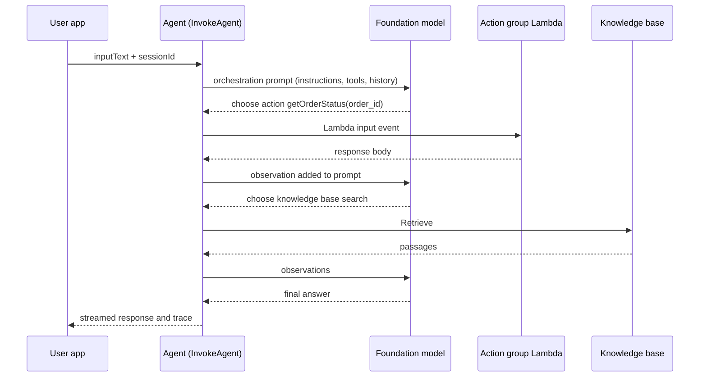

## 0. Before you start
- **Essential:** what a foundation model is and how the Converse API takes messages and tools ([01/01](aip:01-bedrock-genai-fundamentals/01-bedrock-overview-and-converse-api)); what an AWS Lambda function is (a function AWS runs for you when an event arrives).
- **Helpful:** JSON Schema / OpenAPI basics; what a vector store is ([00-foundations/03](aip:00-foundations/03-embeddings-vectors-semantic-search)).
- **Optional advanced:** Cedar-style permissions (used later by AgentCore Policy in [03/04](aip:03-agentic-ai/04-agentcore-runtime-memory-gateway-identity-policy-evaluations)).

## 1. Simple explanation
A plain chatbot answers with words. An **agent** can also *do things*: it reads your request, decides which tool to use (look up an order, search the knowledge base, call an API), uses it, looks at the result, and repeats until it can answer. The "brain" is a foundation model; the "hands" are tools you describe to it. **Amazon Bedrock Agents** (now called **Agents Classic**) was AWS's configuration-driven way to build such agents: you write instructions, attach action groups (Lambda functions or APIs) and knowledge bases, and AWS runs the loop. Since July 30, 2026 it is in maintenance mode and closed to new customers, so you must still understand it for the exam and for existing systems, but new builds go to AgentCore ([03/04](aip:03-agentic-ai/04-agentcore-runtime-memory-gateway-identity-policy-evaluations)).


```figure
flow agent-classic-loop
```

## 2. Structured explanation
1. **The agent loop (ReAct style).** Think → choose a tool → act → observe → think again → answer. "ReAct" means *Reason + Act*.
2. **Agents Classic building blocks** ✅: foundation model, **instructions**, **action groups**, **knowledge bases**, prompt templates (pre-processing, orchestration, KB response generation, post-processing), **traces**, **aliases/versions**, **sessions and memory**, **guardrails**.
3. **Action group** = a set of actions the agent may perform, defined either by *function details* (name + parameters) or by an *OpenAPI schema*, and fulfilled by a **Lambda function** or by **return of control** ✅.
4. **Return of control** hands the call details back to your application instead of calling Lambda, so your code (or a human) can run or approve the action ✅.
5. **Test and deploy:** test against the draft alias `TSTALIASID`; create an alias pointing at a version for production ✅.
6. **Multi-agent** and **memory** are covered in [03/02](aip:03-agentic-ai/02-multi-agent-workflows-and-agent-memory).

## 3. Analogy
**A new employee with a manual, a phone and a filing cabinet.** The instructions are the job description, action groups are the phone numbers they may call (each with a script of what to ask), the knowledge base is the filing cabinet, and the trace is the notebook where they write down why they did each step.

*Where it breaks:* an employee has judgement and accountability; a model can confidently call the wrong tool with plausible-looking arguments. That is why we put hard limits (iteration caps, approvals, IAM) outside the model.

## 4. The seven questions

**WHAT?** An *agent* is a model plus tools plus a control loop. In Agents Classic the service owns the loop, prompt engineering, memory, monitoring, encryption, permissions and API invocation ✅.

**WHY?** Some tasks need several dependent steps and live data (check an order, then check the refund policy, then create a ticket). Hard-coding that flow is brittle; letting the model choose steps is flexible but needs guard rails.

**WHEN?** Use an agent when the *path* is not known in advance. If the path is fixed, a workflow (Step Functions, Bedrock Flows) is cheaper, faster and easier to test ([03/06](aip:03-agentic-ai/06-mcp-openapi-tools-and-human-in-the-loop)).

**WHERE?** Agents Classic runs in Bedrock (runtime API `bedrock-agent-runtime`, build API `bedrock-agent`). Action-group code runs in your Lambda functions. Knowledge bases and guardrails are the same ones from module 01.

**HOW?** See §5.

**WHAT IF?**
| Situation | What happens | Remedy |
|---|---|---|
| New AWS account with no Agents activity in the last 12 months | `CreateAgent` and `InvokeInlineAgent` return `AccessDeniedException` (HTTP 403) ✅ | Use AgentCore |
| Existing agent | Keeps working; management APIs stay; no end-of-life date; no new features ✅ | Plan migration at your pace |
| User omits a required parameter | Agent asks the user for it in natural language ✅ | Mark parameters `required` and describe them well |
| Lambda returns `responseState: REPROMPT` | Response string goes back to the model to retry (invalid input) ✅ | Return a helpful message |
| Lambda returns `responseState: FAILURE` | `DependencyFailedException` for the session ✅ | Use for real dependency failures |
| Several users share one `memoryId` | Their memories mix | One `memoryId` per user |

**WHY NOT?** Not for new builds if your account is closed to Classic. Not when the flow is deterministic. Not for tools that need long-running work beyond Lambda limits without a design for it.

## 5. Technical depth

```figure
react-loop
```


### 5.1 How a request flows

*Reading the arrows:* the app calls the agent with text and a session id. The agent builds an orchestration prompt and asks the model what to do next. When the model picks an action, the agent calls your Lambda with an event, adds the result to the prompt as an *observation*, and asks again. The loop ends when the model produces a final answer. Each hop is recorded in the trace when tracing is on.

### 5.2 Action group Lambda contract (✅ official page)
- One action group may declare **up to 11 API operations but only one Lambda function**, so the function must branch on `apiPath`/`function` ✅.
- Lambda needs a **resource-based policy** that lets Bedrock invoke it ✅.
- Input event (function-details shape): `messageVersion` (only `1.0`), `agent {name, id, alias, version}`, `inputText`, `sessionId`, `actionGroup`, `function`, `parameters [{name,type,value}]`, `sessionAttributes`, `promptSessionAttributes`. OpenAPI shape replaces `function` with `apiPath`, `httpMethod` and adds `requestBody` ✅.
- Response (function-details shape): `messageVersion`, `response {actionGroup, function, functionResponse {responseState?, responseBody {TEXT {body}}}}`, `sessionAttributes`, `promptSessionAttributes`, optional `knowledgeBasesConfiguration` ✅. OpenAPI shape returns `apiPath`, `httpMethod`, `httpStatusCode`, `responseBody {"application/json": {body}}` ✅.
- `sessionAttributes` live for the session; `promptSessionAttributes` live for one turn ✅.

### 5.3 Return of control (✅)
Set `RETURN_CONTROL` as the `customControl` value in `actionGroupExecutor` when creating/updating the action group. `InvokeAgent` then returns `returnControl.invocationInputs` plus an `invocationId`. Your app runs the action and calls `InvokeAgent` again with `sessionState.returnControlInvocationResults`, the **same `invocationId` and `actionGroup`**; if you send those results, `inputText` is ignored. With multi-agent collaboration the payload also carries `agentId` and `collaboratorName`. Use it for **human approval**, calling systems the Lambda cannot reach, or running the tool in your own process.

### 5.4 Memory and sessions (✅)
By default an agent keeps context for one session. With memory enabled, the session joins a memory context when you call with `endSession=true` or when `idleSessionTimeout` elapses; summaries are produced **asynchronously** by the memory-summarization prompt, retained **1 to 365 days (default up to 365)**, loaded for the same `memoryId` next time, and can be deleted. Use one `memoryId` per user. More in [03/02](aip:03-agentic-ai/02-multi-agent-workflows-and-agent-memory).

### 5.5 Guardrails and safety
Agents can use Bedrock Guardrails ([01/07](aip:01-bedrock-genai-fundamentals/07-bedrock-guardrails)) ✅. Exam skill 2.1.3 asks for *stop conditions, timeouts, IAM boundaries and circuit breakers*: the agent's service role gets least privilege, each action Lambda gets only the permissions its action needs, and your code caps iterations and wall-clock time. Classic's own limits on iterations are ❌ not verified here.

## 6. Worked example
*Problem:* "Where is order A-100, and can I cancel it?"

| Step | What happens |
|---|---|
| 1 | Model calls `getOrderStatus(order_id=A-100)` → Lambda returns `shipped` |
| 2 | Model answers status and decides cancelling needs approval |
| 3 | `cancelOrder` is configured for return of control → `InvokeAgent` returns `returnControl` with an `invocationId` |
| 4 | Your app shows the details to a human; on approval it calls the order system |
| 5 | Your app sends `returnControlInvocationResults` with the same `invocationId`; the agent writes the final answer |

The offline lab in §8 reproduces steps 1 to 5 with a scripted stand-in for the model.

## 7. Knowledge checkpoints
1. Why is "Amazon is deprecating Bedrock Agents" an inaccurate summary?
2. How many Lambda functions can one action group have, and how many API operations?
3. What must you send back when resuming after return of control?
4. What is the difference between `sessionAttributes` and `promptSessionAttributes`?

## 7b. Practice questions (exam-style, original) — answers in §14

**Q1.** A company's agent must get human approval before issuing refunds, and the approval UI lives in the company's own web app. Which Agents Classic feature fits best?
A. A second Lambda function that polls a database
B. Return of control on the refund action group
C. A larger context window
D. Memory with a 365-day retention

**Q2.** (Select TWO) Which statements about Agents Classic's status are correct today?
A. It is closed to new customers from July 30, 2026
B. All existing agents stop working on a fixed end-of-life date
C. Existing agents keep working and management APIs remain available
D. Bedrock Knowledge Bases and Guardrails are also closed to new customers
E. Agents Classic requires a migration to AgentCore before July 30, 2026 or agents are deleted

**Q3.** An action group with function details returns `responseState: REPROMPT`. What happens?
A. The session ends with `DependencyFailedException`
B. The response string is passed to the model so it can retry with better input
C. The Lambda function is retried automatically three times
D. Control is returned to the application

**Q4.** A developer defines 14 operations in one OpenAPI-based action group. What is the problem?
A. None, there is no limit
B. An action group supports up to 11 API operations
C. Lambda cannot be used with OpenAPI
D. OpenAPI action groups must use return of control

**Q5.** After a support session ends, the agent should remember the user's preferences next week. Which setting groups sessions per user?
A. A shared `sessionId`
B. The same `memoryId` for the same user
C. A larger `idleSessionTimeout`
D. One alias per user

**Q6.** (Select TWO) Which are sound safeguards for an agent that can call write APIs?
A. Give the action Lambda an IAM role limited to the one table it must update
B. Rely on the system prompt saying "never delete anything"
C. Cap iterations and total runtime in the orchestration code
D. Give the agent service role `AdministratorAccess` so tools never fail
E. Disable traces to reduce risk

**Q7.** Which Lambda event field tells a function-details action group which action to run?
A. `apiPath`
B. `httpMethod`
C. `function`
D. `inputText`

**Q8.** A team wants to follow the agent's reasoning step by step while testing. What should they use?
A. CloudTrail data events only
B. Agent traces via `enableTrace` on `InvokeAgent` and the test alias `TSTALIASID`
C. S3 server access logs
D. Guardrail trace only

## 8. Hands-on lab: an offline agent loop with the real Lambda contract

### 8.1 Objective
Run a tiny agent loop where a *scripted stand-in* plays the foundation model, an action-group handler follows the AWS Lambda event/response shapes, a hard iteration cap stops runaway loops, and return of control pauses a risky action for approval.

### 8.2 Prerequisites
Python 3 only. No AWS account needed.

### 8.3 AWS services
None for the offline part (concepts map to Bedrock Agents Classic, Lambda).

### 8.4 IAM permissions
Offline: none. For the optional console/CLI lab (§8.11): `bedrock:*Agent*` actions on your test agent, `iam:PassRole` for the agent role, `lambda:CreateFunction`/`AddPermission`.

### 8.5 Region notes
Agents Classic availability is limited to existing customers ✅; check the console. Not applicable offline.

### 8.6 Architecture
See §5.1.

### 8.7 Cost
Offline: none. Optional AWS lab: model tokens, Lambda, and any knowledge-base vector store (the expensive part, see §8.11).

### 8.8 Dependencies and code
Standard library only.

```python lab-run
import json, re

ORDERS = {"A-100": {"status": "shipped", "total": 42.5}, "A-200": {"status": "processing", "total": 99.0}}

def lambda_handler(event, context=None):
    """Action-group handler: input and output follow the function-details shapes in the AWS docs."""
    fn = event["function"]
    params = {p["name"]: p["value"] for p in event.get("parameters", [])}
    state = None
    if fn == "getOrderStatus":
        order = ORDERS.get(params.get("order_id"))
        if order is None:
            state, body = "REPROMPT", "No such order id. Ask the user to re-check it."
        else:
            body = json.dumps(order, sort_keys=True)
    else:
        state, body = "FAILURE", "unknown function " + fn
    fr = {"responseBody": {"TEXT": {"body": body}}}
    if state:
        fr["responseState"] = state
    return {"messageVersion": "1.0",
            "response": {"actionGroup": event["actionGroup"], "function": fn, "functionResponse": fr},
            "sessionAttributes": event["sessionAttributes"],
            "promptSessionAttributes": event["promptSessionAttributes"]}

def build_event(fn, args, text):
    return {"messageVersion": "1.0", "agent": {"name": "demo", "id": "AGENT1", "alias": "TSTALIASID", "version": "DRAFT"},
            "inputText": text, "sessionId": "s1", "actionGroup": "Orders", "function": fn,
            "parameters": [{"name": k, "type": "string", "value": v} for k, v in args.items()],
            "sessionAttributes": {}, "promptSessionAttributes": {}}

def scripted_model(question, observations, stuck=False):
    """Stand-in for the foundation model: decides the next step from what it has seen."""
    m = re.search(r"[A-Z]-\d{3}", question)
    if stuck:
        return {"type": "tool", "function": "getOrderStatus", "args": {"order_id": "Z-999"}}
    if not m:
        return {"type": "final", "text": "Which order id do you mean?"}
    if not observations:
        return {"type": "tool", "function": "getOrderStatus", "args": {"order_id": m.group(0)}}
    last = observations[-1]
    if last["state"] == "REPROMPT":
        return {"type": "final", "text": "I could not find that order; please check the id."}
    status = json.loads(last["body"])["status"]
    if "cancel" in question and status == "shipped" and len(observations) == 1:
        return {"type": "tool", "function": "cancelOrder", "args": {"order_id": m.group(0)}}
    return {"type": "final", "text": f"Order {m.group(0)} is {status}."}

RETURN_CONTROL = {"cancelOrder"}

def run_agent(question, max_iterations=4, stuck=False, approve=True):
    trace, obs = [], []
    for step in range(1, max_iterations + 1):
        d = scripted_model(question, obs, stuck)
        if d["type"] == "final":
            trace.append(f"step {step}: final -> {d['text']}")
            return trace
        if d["function"] in RETURN_CONTROL:
            inv = {"returnControl": {"invocationInputs": [{"functionInvocationInput": {
                "actionGroup": "Orders", "function": d["function"],
                "parameters": [{"name": k, "type": "string", "value": v} for k, v in d["args"].items()]}}],
                "invocationId": "inv-1"}}
            trace.append(f"step {step}: RETURN_CONTROL {d['function']} invocationId={inv['returnControl']['invocationId']}")
            result = "cancelled by human" if approve else "denied by human"
            trace.append(f"step {step}: app sends returnControlInvocationResults ({result})")
            return trace + [f"step {step + 1}: final -> Cancel request: {result}."]
        resp = lambda_handler(build_event(d["function"], d["args"], question))
        fr = resp["response"]["functionResponse"]
        o = {"state": fr.get("responseState", "OK"), "body": fr["responseBody"]["TEXT"]["body"]}
        obs.append(o)
        trace.append(f"step {step}: tool {d['function']} -> {o['state']} {o['body']}")
    trace.append(f"STOPPED: max_iterations={max_iterations} reached without a final answer")
    return trace

for q, kw in [("Where is order A-200?", {}),
              ("Where is order A-999?", {}),
              ("Where is my order?", {}),
              ("Where is A-100 and please cancel it", {}),
              ("Where is A-100 and please cancel it", {"approve": False}),
              ("Loop forever on this", {"stuck": True, "max_iterations": 3})]:
    print("Q:", q, kw)
    for line in run_agent(q, **kw):
        print("  ", line)
```

### 8.9 Captured output
Generated on 2026-10-26 by extracting the block above from this file and running it (Python 3). It is **not** Bedrock output: the "model" is a script, so it only demonstrates the loop, the Lambda shapes, the iteration cap and return of control.
```text lab-out
Q: Where is order A-200? {}
   step 1: tool getOrderStatus -> OK {"status": "processing", "total": 99.0}
   step 2: final -> Order A-200 is processing.
Q: Where is order A-999? {}
   step 1: tool getOrderStatus -> REPROMPT No such order id. Ask the user to re-check it.
   step 2: final -> I could not find that order; please check the id.
Q: Where is my order? {}
   step 1: final -> Which order id do you mean?
Q: Where is A-100 and please cancel it {}
   step 1: tool getOrderStatus -> OK {"status": "shipped", "total": 42.5}
   step 2: RETURN_CONTROL cancelOrder invocationId=inv-1
   step 2: app sends returnControlInvocationResults (cancelled by human)
   step 3: final -> Cancel request: cancelled by human.
Q: Where is A-100 and please cancel it {'approve': False}
   step 1: tool getOrderStatus -> OK {"status": "shipped", "total": 42.5}
   step 2: RETURN_CONTROL cancelOrder invocationId=inv-1
   step 2: app sends returnControlInvocationResults (denied by human)
   step 3: final -> Cancel request: denied by human.
Q: Loop forever on this {'stuck': True, 'max_iterations': 3}
   step 1: tool getOrderStatus -> REPROMPT No such order id. Ask the user to re-check it.
   step 2: tool getOrderStatus -> REPROMPT No such order id. Ask the user to re-check it.
   step 3: tool getOrderStatus -> REPROMPT No such order id. Ask the user to re-check it.
   STOPPED: max_iterations=3 reached without a final answer
```

### 8.10 Explanation
- `lambda_handler` mirrors the documented function-details event: it reads `event["function"]` and `event["parameters"]` and returns `functionResponse` with an optional `responseState`.
- `scripted_model` replaces the foundation model; a real model decides from the orchestration prompt, not from `if` statements.
- `run_agent` is the loop; `max_iterations` is the circuit breaker for exam skill 2.1.3.
- For `cancelOrder` the loop returns control instead of calling Lambda, like `RETURN_CONTROL`. Resuming needs the same `invocationId` and `actionGroup` ✅.

### 8.11 Optional console/CLI lab on AWS (not run in this session ❌)
Agents Classic is closed to new accounts ✅, so this works only for accounts with recent Agents activity.
1. Create a Lambda function with the handler above (Python). Add a **resource-based policy** that allows `bedrock.amazonaws.com` to invoke it for your agent ARN.
2. Console → Bedrock → Agents → *Create agent*, pick a model, write instructions ("You help customers check order status. Ask for the order id if missing.").
3. Add an action group *Orders* with function `getOrderStatus` (parameter `order_id`, string, required), executor = your Lambda. Add a second function `cancelOrder` and set it to **return control**.
4. *Prepare*, then test with the draft alias `TSTALIASID` ✅ and turn on **Show trace**.
5. Optional: attach a knowledge base. **Warning (lesson 101):** a quick-created knowledge base may create an **OpenSearch Serverless collection** that keeps billing while it exists (OCU-hours; NextGen collections can scale to zero, Classic ones keep a minimum, see [02/05](aip:02-data-management/05-amazon-opensearch-for-genai) and [verification-log §18](aip:meta/verification-log)). Deleting the agent does not delete it. Delete the knowledge base (with `dataDeletionPolicy` DELETE), then the collection, then confirm in the OpenSearch Serverless console and Cost Explorer.
6. Delete the alias, agent, Lambda, IAM roles and S3 test data.

Console labels can differ from this text ❌ (not re-checked in the console).

### 8.12 Common errors
| Error | Cause | Fix |
|---|---|---|
| `AccessDeniedException` on `CreateAgent` | Account closed to Classic ✅ | Use AgentCore |
| `DependencyFailedException` | Lambda returned `FAILURE`, or timed out | Fix the dependency; use `REPROMPT` for bad input |
| Agent never calls the Lambda | Missing resource-based policy, or vague function description | Add the policy; describe each function and parameter |
| `returnControlInvocationResults` ignored | Wrong `invocationId` or `actionGroup` | Echo the values from the response |
| Same facts "leak" between users | Shared `memoryId` | One id per user |

### 8.13 Security recommendations
Least-privilege role per action Lambda; validate every parameter inside the Lambda (the model's arguments are untrusted input); keep approvals outside the model; encrypt data; do not log secrets in traces; delete lab resources.

## 9. What can go wrong?
| Failure | Why | Symptoms | Investigate | Fix | Prevent |
|---|---|---|---|---|---|
| **Runaway loop** | Model keeps calling tools | High latency and cost | Trace | Iteration/time caps | Limits in code and descriptions |
| **Wrong tool or wrong arguments** | Vague function descriptions | Bad actions | Trace step inputs | Better descriptions, validation | Evaluations ([03/04](aip:03-agentic-ai/04-agentcore-runtime-memory-gateway-identity-policy-evaluations)) |
| **Over-powerful role** | Convenience | Blast radius | IAM Access Analyzer | Scope down | Least privilege |
| **Idle vector store billing** | Forgot OpenSearch Serverless | Daily charge | Cost Explorer | Delete KB and collection | Cleanup checklist |
| **Stale memory** | Summaries not updated | Old preferences | Memory contents | Delete memory | Retention days |
| **Prompt injection through tool output** | Tool returns attacker text | Agent obeys it | Trace | Sanitise, guardrails | Treat tool output as data |

## 10. Common misconceptions
1. **"Bedrock Agents is deprecated and gone."** It is maintenance mode: existing agents work, no end-of-life date ✅.
2. **"The model runs my code."** The model only *chooses* an action; your Lambda or app runs it.
3. **"A longer prompt fixes unreliable tool use."** Clear schemas, validation and evaluations do more.
4. **"Memory = session history."** Session context is per session; memory summarizes across sessions, per `memoryId` ✅.
5. **"Deleting the agent deletes everything."** Vector stores, Lambdas and roles remain.

## 11. Exam notes
- **Pattern:** "approve before executing" → return of control (or Step Functions callback, [03/06](aip:03-agentic-ai/06-mcp-openapi-tools-and-human-in-the-loop)).
- **Pattern:** "remember a user across sessions" → agent memory with `memoryId` (Classic) or AgentCore Memory.
- **Pattern:** "agent takes too long or loops" → iteration/time limits, timeouts, circuit breakers (skill 2.1.3).
- **Trap:** one Lambda per action group; up to 11 operations.
- **Trap:** calling it "deprecated"; the accurate word is maintenance mode.
- **Compare:** Agents Classic (config, closed to new customers) vs AgentCore harness (config, new) vs AgentCore Runtime (your code).

## 12. Summary and revision cards
- Agent = model + tools + loop; Classic = managed loop, action groups, KBs, traces, aliases.
- Return of control = your app runs the action; resume with `invocationId`.
- Memory: `memoryId`, 1 to 365 days, async summaries.
- New builds → AgentCore.

**Cards.** Q: Draft alias id? A: `TSTALIASID`. · Q: Blocked APIs for new accounts? A: `CreateAgent`, `InvokeInlineAgent`. · Q: Operations per action group? A: up to 11, one Lambda.

## 13. References
| Source | URL | Verified |
|---|---|---|
| Agents Classic overview | https://docs.aws.amazon.com/bedrock/latest/userguide/agents.html | 2026-10-26 |
| Agents Classic maintenance mode | https://docs.aws.amazon.com/bedrock/latest/userguide/agents-classic-maintenance-mode.html | 2026-10-23 |
| Action group Lambda event/response | https://docs.aws.amazon.com/bedrock/latest/userguide/agents-lambda.html | 2026-10-26 |
| Return of control | https://docs.aws.amazon.com/bedrock/latest/userguide/agents-returncontrol.html | 2026-10-26 |
| Agent memory | https://docs.aws.amazon.com/bedrock/latest/userguide/agents-memory.html | 2026-10-26 |
| Exam guide Task 2.1 | https://docs.aws.amazon.com/aws-certification/latest/ai-professional-01/ai-professional-01-domain2.html | 2026-10-23 |

**Unverified here:** Classic iteration limits, trace field names, console screen labels, pricing.

## 14. Answers to checkpoints and practice questions
**Checkpoints.** 1) The official term is maintenance mode and closed to new customers; existing agents keep working with no end-of-life date. 2) One Lambda function, up to 11 API operations. 3) The same `invocationId` and `actionGroup` (plus `function`/`apiPath`) in `sessionState.returnControlInvocationResults`. 4) Session attributes last for the session, prompt-session attributes for one turn.

**Practice questions.**
- **Q1 → B.** Return of control hands the details to the app for approval. A is an invented polling design; C and D do not provide approval.
- **Q2 → A, C.** B and E are false: there is no planned end-of-life date or migration deadline ✅. D is false: Knowledge Bases and Guardrails are not affected ✅.
- **Q3 → B.** `FAILURE` causes `DependencyFailedException` (A); C and D do not exist.
- **Q4 → B.** Up to 11 operations per action group.
- **Q5 → B.** Same `memoryId` per user. A merges unrelated sessions; C and D do not scope by user.
- **Q6 → A, C.** B is only a request to the model; D violates least privilege; E removes visibility.
- **Q7 → C.** `apiPath`/`httpMethod` belong to the OpenAPI shape; `inputText` is the raw user text.
- **Q8 → B.** Traces on the test alias show each step. A, C, D are not step-level reasoning views.
