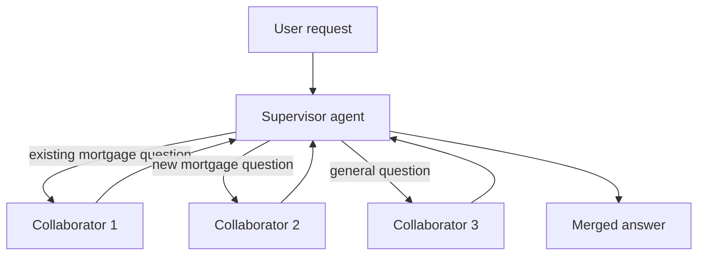
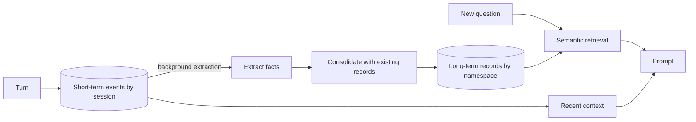

## 0. Before you start
- **Essential:** the agent loop from [03/01](aip:03-agentic-ai/01-llm-agents-and-bedrock-agents-classic); what a context window is ([00-foundations/02](aip:00-foundations/02-llm-and-genai-basics)).
- **Helpful:** embeddings and semantic search ([00-foundations/03](aip:00-foundations/03-embeddings-vectors-semantic-search)).
- **Optional advanced:** Strands multi-agent classes ([03/03](aip:03-agentic-ai/03-strands-agents-and-agent-squad)).

## 1. Simple explanation
One agent with twenty tools gets confused, like one employee doing sales, legal and IT support. A **multi-agent** design gives each agent one job and adds a **supervisor** that splits the request, hands pieces to the right specialist and merges the answers. Separately, a model forgets everything between calls. **Short-term memory** is what the agent keeps inside one conversation. **Long-term memory** is a store of distilled facts (preferences, summaries) that survives across conversations and is looked up when relevant.


```figure
flow supervisor-agents
```

## 2. Structured explanation
1. **Why split agents:** focused instructions and tools, smaller prompts, parallel work, separate permissions per specialist.
2. **Common shapes** ✅ (Strands pages): *agents as tools* (one agent is a callable tool of another), *swarm* (agents hand off to each other at run time), *graph* (developer-defined flowchart with LLM-chosen edges, loops allowed), *workflow* (fixed DAG packaged as one tool, parallel where independent).
3. **Bedrock Agents Classic collaboration** ✅: one agent is the **supervisor**; you associate **collaborator agents**; the supervisor plans, routes and merges; each agent keeps its own tools, action groups, knowledge bases and guardrails.
4. **Short-term memory:** conversation turns, tool results and scratch state for one session.
5. **Long-term memory:** facts extracted from many sessions, consolidated, stored and retrieved by similarity.
6. **Where memory lives:** Classic agent memory ✅, **AgentCore Memory** ✅ ([03/04](aip:03-agentic-ai/04-agentcore-runtime-memory-gateway-identity-policy-evaluations)), or your own DynamoDB/vector store ([02/08](aip:02-data-management/08-amazon-dynamodb-for-genai), [02/05](aip:02-data-management/05-amazon-opensearch-for-genai)).

## 3. Analogy
**A hospital.** The triage nurse (supervisor) does not treat anyone; she sends each patient to cardiology, radiology or pharmacy and gathers the notes. Short-term memory is the clipboard for today's visit. Long-term memory is the patient file in the records room: only the important things are written there, and staff look it up by name.

*Where it breaks:* a nurse knows when she is unsure and asks; a supervisor model may route confidently to the wrong specialist, and a patient file is curated by humans, while an LLM-written memory can record a wrong "fact" and keep it.

## 4. The seven questions

**WHAT?** Multi-agent = several model-driven agents coordinated by routing logic. Memory = state kept outside the model's weights, re-injected into prompts.

**WHY?** Specialisation lowers tool confusion and prompt size; parallel branches cut latency; separate roles give separate IAM and guardrails. Memory makes assistants personal and avoids re-asking.

**WHEN?** Use multi-agent when sub-tasks need different tools, models or permissions. Stay with one agent when tasks are simple: every extra agent adds latency, tokens and failure modes.

**WHERE?** Classic collaboration in Bedrock Agents ✅; Strands patterns and Agent Squad in your code ([03/03](aip:03-agentic-ai/03-strands-agents-and-agent-squad)); AgentCore Runtime hosts multi-agent code and protocols such as A2A ✅ ([03/04](aip:03-agentic-ai/04-agentcore-runtime-memory-gateway-identity-policy-evaluations)).

**HOW?** §5.

**WHAT IF?**
| Situation | Effect | Remedy |
|---|---|---|
| Collaborator roles overlap | Supervisor picks inconsistently ✅ (AWS asks you to minimise overlap) | Write distinct role descriptions |
| Supervisor saved? | You must **save the supervisor first**, then associate collaborators ✅ | Create, save, then update |
| Conversation exceeds the context window | Old turns must be trimmed or summarised | Sliding window + running summary |
| Long-term extraction runs after a session | It is **asynchronous** ✅ (AgentCore: extraction and consolidation in the background) | Do not expect same-turn recall of new facts |
| Memory holds wrong or sensitive facts | They keep being reused | Review/delete memory, avoid storing secrets |
| Event metadata contains secrets | AgentCore says event metadata is **not encrypted with a customer managed key** ✅ | Keep sensitive content out of metadata |

**WHY NOT?** Not when one prompt with a few tools works, or when you need strict determinism: use a workflow ([03/06](aip:03-agentic-ai/06-mcp-openapi-tools-and-human-in-the-loop)). Not for long-term memory of regulated personal data without a retention and deletion plan.

## 5. Technical depth

```figure
memory-window
```


### 5.1 Supervisor and collaborators

*Reading the arrows:* the supervisor receives the request, decides which collaborators apply (possibly several in parallel), receives their results and writes the final answer. This mirrors the AWS mortgage example ✅. Collaborators can use return of control; the response then carries `agentId` and `collaboratorName` so the caller can route the result back ✅ ([03/01 §5.3](aip:03-agentic-ai/01-llm-agents-and-bedrock-agents-classic)). Supervisor "routing" variants and collaborator limits exist in other pages I did not open ❌.

### 5.2 Choosing a pattern (✅ Strands guidance)
| Pattern | Path decided by | Use when |
|---|---|---|
| Agents as tools | Orchestrator LLM reads specialist descriptions | Smallest multi-agent system |
| Swarm | Agents at run time | Exploration, brainstorming, synthesising several sources |
| Graph | Developer-defined nodes, LLM picks edges, loops allowed | Structured process with conditions (support routing, validation with error paths) |
| Workflow | Fixed DAG | Repeatable pipeline you want as one reliable action |

### 5.3 Model coordination and ensembles (skill 2.1.4)
Different roles can use different models (a small fast model to classify, a large one to write). *Ensembles* send one question to several models and combine or vote; a *judge* model can pick the best. Costs multiply with each model call, so use ensembles only where accuracy matters more than price. Cross-links: model selection and cascading in module 04 (not yet written).

### 5.4 Memory layers

*Reading the arrows:* every turn is stored as an event in short-term memory. A background process extracts candidate facts and **consolidates** them with what is already stored (update, merge, avoid duplicates). At answer time the app builds the prompt from recent events plus the long-term records that best match the question.

**AgentCore Memory facts ✅:** events are written with `CreateEvent` and tied to a `sessionId`; `ListSessions`, `ListEvents` (with metadata filters) and `GetEvent` read them; long-term records are read with `GetMemoryRecord`, `ListMemoryRecords` or `RetrieveMemoryRecords` (**semantic search**); data can also be submitted directly with `IngestData`. The harness page names long-term strategies **semantic, summarization, user preference and episodic**, and per-user scoping with an **actor ID** ✅. Retention settings and namespace syntax are ❌ not verified here.

**Classic agent memory ✅:** summaries per `memoryId`, 1 to 365 days, created after `endSession=true` or `idleSessionTimeout`.

**Do-it-yourself:** DynamoDB for short-term turns (partition key `session_id`, sort key time, TTL) and a vector store for long-term facts ([02/08](aip:02-data-management/08-amazon-dynamodb-for-genai)). You write extraction, consolidation and retrieval yourself.

## 6. Worked example
*Problem:* A travel assistant should (a) route "book a flight" and "find hotels" to specialists, and (b) remember "I prefer window seats".

| Step | Design |
|---|---|
| 1 | Supervisor with `FlightAgent` and `HotelAgent` collaborators with non-overlapping instructions |
| 2 | Each turn stored as a short-term event for the session |
| 3 | After the session, extraction records "prefers window seats" under the user's actor/namespace |
| 4 | Next week, retrieval for "book my flight" returns the seat preference, which is added to the prompt |
| 5 | Retention and a delete path exist for privacy requests |

## 7. Knowledge checkpoints
1. Name the four Strands multi-agent patterns and which one has a fixed DAG.
2. What must you do to the supervisor before adding collaborators in Classic?
3. Why is long-term memory not visible in the same turn it was created?
4. Which AgentCore operation does semantic search over memory records?

## 7b. Practice questions (exam-style, original) — answers in §14

**Q1.** A support platform has billing, technical and shipping specialists. Requests often combine two topics. Which design fits best?
A. One agent with all tools and a very long prompt
B. A supervisor that delegates to specialist collaborators and merges results
C. Three unrelated agents behind three URLs
D. A single Lambda with `if` statements

**Q2.** (Select TWO) Which are good reasons to split into several agents?
A. Different tools need different IAM permissions
B. Prompts are getting too long and tool selection is error-prone
C. The task is a single one-step lookup
D. You want to avoid all extra model calls
E. You want one agent to have admin rights for convenience

**Q3.** Which Strands-style pattern is a developer-defined flowchart where an LLM decision picks the next edge and loops are allowed?
A. Workflow
B. Swarm
C. Graph
D. Agents as tools

**Q4.** A user states a preference in a chat and asks about it again in the next message. Which memory handles this?
A. Short-term memory of the current session
B. Long-term memory only after tomorrow's batch
C. Fine-tuning
D. A Guardrail

**Q5.** In AgentCore Memory, which operation performs semantic search for relevant long-term memory records?
A. `CreateEvent`
B. `ListEvents`
C. `RetrieveMemoryRecords`
D. `ListSessions`

**Q6.** (Select TWO) Which statements about Classic agent memory are correct?
A. Memory is keyed per `memoryId`
B. Retention is configurable from 1 to 365 days
C. Summaries are produced synchronously before the user's next word
D. Sessions from all users are merged automatically
E. Memory cannot be deleted

**Q7.** A team stores a customer's account number in AgentCore event metadata to filter events. What is the risk?
A. Event metadata cannot be filtered
B. Event metadata is not encrypted with a customer managed key
C. Metadata is public
D. It will be sent to the model automatically

**Q8.** Two collaborators both claim "handles refunds". What is the likely outcome?
A. The supervisor always picks alphabetically
B. Inconsistent routing, so role descriptions should be made distinct
C. AWS rejects the configuration
D. Both run and the answer is always correct

## 8. Hands-on lab: offline supervisor routing and a two-layer memory

### 8.1 Objective
Simulate a supervisor that routes a request to specialists and a memory with short-term events, background-style extraction, consolidation and similarity retrieval.

### 8.2 Prerequisites
Python 3 only.

### 8.3 AWS services
None offline. Concepts map to Bedrock Agents Classic collaboration and AgentCore Memory.

### 8.4 IAM permissions
Offline: none. For real AgentCore Memory: `bedrock-agentcore:CreateEvent`, `ListEvents`, `RetrieveMemoryRecords` on the memory resource (exact action names ❌ not verified; check the IAM reference).

### 8.5 Region notes
AgentCore Memory is not in every Region ✅ (not in US West N. California, Milan, Spain, Malaysia, Hyderabad, Thailand per the Region table I read). Check the current table.

### 8.6 Architecture
See §5.1 and §5.4.

### 8.7 Cost
Offline: none.

### 8.8 Dependencies and code
Standard library only. The router and the "similarity" are deliberately simple stand-ins for a model and an embedding.

```python lab-run
import math, re
from collections import Counter

SPECIALISTS = {
    "flights": {"flight", "fly", "airline", "seat", "ticket"},
    "hotels": {"hotel", "room", "stay", "night", "booking"},
    "general": set(),
}

def words(text):
    return re.findall(r"[a-z]+", text.lower())

def route(request):
    """Supervisor stand-in: score each specialist by keyword overlap; several can be chosen."""
    w = set(words(request))
    scores = {name: len(w & kws) for name, kws in SPECIALISTS.items() if kws}
    chosen = [n for n, s in sorted(scores.items()) if s > 0]
    return chosen or ["general"]

class Memory:
    def __init__(self):
        self.events = []      # short-term: (session, role, text)
        self.records = []     # long-term: extracted facts

    def create_event(self, session, role, text):
        self.events.append((session, role, text))

    def list_events(self, session, last=None):
        ev = [e for e in self.events if e[0] == session]
        return ev[-last:] if last else ev

    def extract_and_consolidate(self, session):
        """Background step stand-in: pull 'I prefer ...' statements, skip duplicates."""
        for s, role, text in self.events:
            if s == session and role == "user":
                m = re.search(r"i prefer ([a-z ]+)", text.lower())
                if m:
                    fact = "user prefers " + m.group(1).strip()
                    if fact not in self.records:
                        self.records.append(fact)

    def retrieve(self, query, top_k=1):
        q = Counter(words(query))
        def sim(rec):
            r = Counter(words(rec))
            dot = sum(q[k] * r[k] for k in q)
            norm = math.sqrt(sum(v * v for v in q.values())) * math.sqrt(sum(v * v for v in r.values()))
            return dot / norm if norm else 0.0
        ranked = sorted(self.records, key=lambda r: (-sim(r), r))
        return [(r, round(sim(r), 3)) for r in ranked[:top_k] if sim(r) > 0]

for req in ["Book a flight and a hotel room for two nights", "What is your refund policy?"]:
    print("route:", req, "->", route(req))

mem = Memory()
mem.create_event("s1", "user", "I prefer window seats on long flights")
mem.create_event("s1", "assistant", "Noted.")
mem.create_event("s1", "user", "I prefer window seats on long flights")
print("short-term, last 2 events:", mem.list_events("s1", last=2))
print("long-term before extraction:", mem.records)
mem.extract_and_consolidate("s1")
print("long-term after extraction:", mem.records)
print("retrieve for a new session:", mem.retrieve("which seats does the user like on flights"))
print("retrieve unrelated:", mem.retrieve("refund policy"))
```

### 8.9 Captured output
Generated on 2026-10-26 by extracting the block above from this file and running it (Python 3). Not AWS output.
```text lab-out
route: Book a flight and a hotel room for two nights -> ['flights', 'hotels']
route: What is your refund policy? -> ['general']
short-term, last 2 events: [('s1', 'assistant', 'Noted.'), ('s1', 'user', 'I prefer window seats on long flights')]
long-term before extraction: []
long-term after extraction: ['user prefers window seats on long flights']
retrieve for a new session: [('user prefers window seats on long flights', 0.535)]
retrieve unrelated: []
```

### 8.10 Explanation
- `route` shows why overlapping keyword sets (or role descriptions) cause ambiguous routing: a request touching two topics goes to two specialists.
- Short-term events are plain history for a session. Long-term records appear only after `extract_and_consolidate`, and the duplicate statement is stored once (consolidation).
- `retrieve` ranks records by cosine similarity of word counts, a toy for embedding search. A real system embeds text and uses a vector store.

### 8.11 Optional AWS lab (shown, not run in this session ❌)
Use the AgentCore CLI/SDK to create a memory, write events for a session and call `RetrieveMemoryRecords` after extraction has had time to run. Exact CLI sub-commands are ❌ not verified; follow the AgentCore memory "Get started" page. Delete the memory afterwards.

### 8.12 Common errors
| Error | Cause | Fix |
|---|---|---|
| Fact not recalled right after saying it | Long-term extraction is asynchronous | Read recent events too |
| Wrong collaborator chosen | Overlapping roles | Rewrite instructions |
| Memory of other users appears | Shared actor/`memoryId` | Scope per user |
| Memory grows without bound | No retention | Set retention, consolidate |

### 8.13 Security recommendations
Do not store secrets or full card numbers; scope memory per user/actor; set retention; support deletion requests; encrypt with KMS where supported; treat retrieved memory as untrusted prompt input.

## 9. What can go wrong?
| Failure | Why | Symptoms | Investigate | Fix | Prevent |
|---|---|---|---|---|---|
| **Supervisor mis-routes** | Overlapping roles | Wrong specialist answers | Trace routing decisions | Clear role text | Evaluations |
| **Latency explosion** | Serial collaborator calls | Slow answers | Trace timings | Parallelise, cap depth | Budget per request |
| **Cost explosion** | Each agent re-reads big context | High tokens | Token metrics | Trim context, smaller models | Cost alarms |
| **Context overflow** | Whole history sent each turn | Errors/truncation | Token counts | Window + summary | Memory design |
| **Poisoned memory** | Attacker plants "facts" | Persistent bad behaviour | Review records | Delete, validate sources | Write policies |
| **Cross-user leakage** | Wrong namespace | Privacy incident | Retrieval filters | Fix scoping | Tests per user |

## 10. Common misconceptions
1. **"More agents = smarter."** Often just slower and costlier.
2. **"Memory means the model learned."** The model weights do not change; text is re-injected.
3. **"Long-term memory is instant."** Extraction runs in the background ✅.
4. **"Summaries are always accurate."** They are model output and can drop or invent details.
5. **"Memory is automatically private."** Scoping is your design.

## 11. Exam notes
- **Pattern:** "specialised sub-tasks, one coordinator" → supervisor/collaborators or agents-as-tools.
- **Pattern:** "remember preferences across sessions" → long-term memory (AgentCore Memory or Classic `memoryId`).
- **Pattern:** "keep the prompt small in long chats" → sliding window and summarisation.
- **Trap:** confusing session context with persistent memory; assuming instant recall.
- **Compare:** DynamoDB DIY memory (control, effort) vs AgentCore Memory (managed extraction and retrieval) vs Classic memory (summaries per `memoryId`).

## 12. Summary and revision cards
- Split agents for tools, permissions and prompt size; keep roles distinct.
- Strands patterns: agents as tools, swarm, graph, workflow.
- Short-term = events per session; long-term = extracted, consolidated, retrieved records.
- AgentCore: `CreateEvent`, `ListEvents`, `RetrieveMemoryRecords`.

**Cards.** Q: Classic memory retention range? A: 1 to 365 days. · Q: Fixed DAG pattern? A: Workflow. · Q: Is event metadata CMK-encrypted? A: No.

## 13. References
| Source | URL | Verified |
|---|---|---|
| Multi-agent collaboration (Classic) | https://docs.aws.amazon.com/bedrock/latest/userguide/agents-multi-agent-collaboration.html | 2026-10-26 |
| Agent memory (Classic) | https://docs.aws.amazon.com/bedrock/latest/userguide/agents-memory.html | 2026-10-26 |
| AgentCore Memory overview | https://docs.aws.amazon.com/bedrock-agentcore/latest/devguide/memory.html | 2026-10-26 |
| AgentCore memory types | https://docs.aws.amazon.com/bedrock-agentcore/latest/devguide/memory-types.html | 2026-10-26 |
| Strands multi-agent patterns | https://strandsagents.com/latest/documentation/docs/user-guide/concepts/multi-agent/multi-agent-patterns/ | 2026-10-26 |
| AgentCore harness vs Runtime (strategy names) | https://docs.aws.amazon.com/bedrock-agentcore/latest/devguide/harness-vs-runtime.html | 2026-10-26 |

**Unverified here:** Classic collaborator limits and routing modes; AgentCore retention/namespace syntax; IAM action names; pricing.

## 14. Answers to checkpoints and practice questions
**Checkpoints.** 1) Agents as tools, swarm, graph, workflow; workflow is the fixed DAG. 2) Save the supervisor first. 3) Extraction/consolidation is an asynchronous background process. 4) `RetrieveMemoryRecords`.

**Practice questions.**
- **Q1 → B.** Supervisor plus specialists handles combined topics. A overloads one prompt; C has no coordination; D is a fixed flow without model judgement.
- **Q2 → A, B.** C is a single step; D is the opposite of the effect; E is poor security.
- **Q3 → C.** Workflow is a fixed DAG; swarm hands off at run time; agents-as-tools has no flowchart.
- **Q4 → A.** Same-session context is short-term. B is wrong (no daily batch); C and D are unrelated.
- **Q5 → C.** The others write or list raw events/sessions.
- **Q6 → A, B.** C is false (asynchronous); D false (per `memoryId`); E false (can be deleted).
- **Q7 → B.** Metadata is not CMK-encrypted ✅; it is filterable (A false) and not public or auto-injected.
- **Q8 → B.** Overlap hurts routing ✅; AWS does not reject or guarantee correctness.
