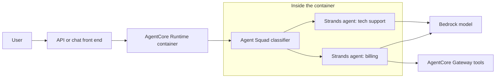

## 0. Before you start
- **Essential:** Python functions and decorators; the agent loop ([03/01](aip:03-agentic-ai/01-llm-agents-and-bedrock-agents-classic)).
- **Helpful:** JSON Schema (how a tool is described to a model).
- **Optional advanced:** async Python, MCP ([03/06](aip:03-agentic-ai/06-mcp-openapi-tools-and-human-in-the-loop)).

## 1. Simple explanation
**Strands Agents** is an open-source library from AWS. You write a few lines of Python, give the agent a model and some functions, and the library runs the think-act-observe loop for you inside your own process. **Agent Squad** is another open-source library that sits *above* agents: it looks at each user message and the conversation so far, picks the best specialist agent, and keeps the conversation context. Think of Strands as "how to build one good agent" and Agent Squad as "how to route among many".


```figure
flow agent-squad-routing
```

## 2. Structured explanation
1. **Strands runs in your process** (laptop, Lambda, container, AgentCore Runtime). There is no hosted control plane to create first ✅.
2. **Languages:** Python and TypeScript ✅.
3. **Default model provider is Amazon Bedrock**; other providers (Anthropic, OpenAI, Google, Ollama in Python) plug in by passing a model object ✅.
4. **Tools:** plain Python functions turned into tools with the `@tool` decorator; type hints and the docstring describe the tool to the model ✅. Many community tools exist (Python: "30+ via community package") ✅.
5. **Multi-agent:** agents as tools, swarm, graph, workflow, and agent-to-agent (A2A) ✅. **MCP** tools are supported ✅ ([03/06](aip:03-agentic-ai/06-mcp-openapi-tools-and-human-in-the-loop)).
6. **Human in the loop:** *interrupts* raised from hooks or tools pause the agent and return pending interrupts; you resume with responses ✅ (first fetch failed, a later retry succeeded; see §5.4).
7. **Agent Squad:** an `AgentSquad` orchestrator, a **classifier** that chooses the agent from each agent's description and the conversation history, prebuilt agents (Bedrock, Anthropic, OpenAI, Lex, Lambda), conversation **storage**, and a **SupervisorAgent** that coordinates a team in parallel using an agent-as-tools design 🟡/✅ (README fetched; project moved, see §5.5).

## 3. Analogy
**Strands is a toolbox you carry; Agent Squad is the reception desk.** With Strands you assemble one capable technician (model + tools). Agent Squad is the receptionist who reads the visitor's request and sends them to the right technician, remembering who they already spoke to.

*Where it breaks:* both are libraries. They do not give you hosting, isolation, identity or monitoring; for that you deploy them on AgentCore Runtime or your own compute ([03/04](aip:03-agentic-ai/04-agentcore-runtime-memory-gateway-identity-policy-evaluations)).

## 4. The seven questions

**WHAT?** Strands = SDK for the agent loop, tools, providers, multi-agent patterns, MCP, interrupts. Agent Squad = routing/orchestration framework with classifier, agents and storage.

**WHY?** Strands keeps agent code short and model-driven; Agent Squad avoids building your own router and context passing. Both are open source and framework-neutral on AgentCore.

**WHEN?** Strands: building agents in code, especially for AgentCore Runtime or Lambda. Agent Squad: many specialised agents behind one chat entry point, where routing by description is enough.

**WHERE?** Anywhere Python or Node runs. On AWS the usual homes are Lambda, ECS/Fargate, and AgentCore Runtime. The managed AgentCore **harness is powered by Strands Agents** ✅ and can be exported to Strands code ✅.

**HOW?** §5.

**WHAT IF?**
| Situation | Effect | Remedy |
|---|---|---|
| No model passed to `Agent()` | Bedrock is the default provider ✅ | Make sure Bedrock access and Region are configured |
| Docstring missing on a tool | The model gets a poor description (inferred behaviour ❌ not verified) | Always write docstrings with an `Args:` section |
| Tool raises an exception | Behaviour depends on the SDK ❌ | Return clear error strings; test failure paths |
| Interrupt used with `agent.tool.my_tool()` direct call | Not allowed ✅ | Use interrupts only inside the agent loop |
| Agent Squad classifier picks the wrong agent | Wrong answer | Improve agent descriptions; add history; test routing |
| Old package name | `multi-agent-orchestrator` on PyPI is marked deprecated; use `agent-squad` 🟡 | Update imports |

**WHY NOT?** Not when you need a fully managed no-code agent (use the AgentCore harness or Quick). Not when a deterministic workflow is enough. Agent Squad's routing is only as good as the descriptions and classifier model.

## 5. Technical depth

### 5.1 Minimal Strands agent (✅ quoted from the Strands pages; shown, not run)
```python
from strands import Agent

agent = Agent()
agent("What can you help me build?")
```
TypeScript: `import { Agent } from '@strands-agents/sdk'`, then `new Agent()` and `await agent.invoke(...)` ✅.

### 5.2 A custom tool (✅ official example; shown, not run)
```python
from strands import Agent, tool

@tool
def weather_forecast(city: str, days: int = 3) -> str:
    """Get weather forecast for a city.

    Args:
        city: The name of the city
        days: Number of days for the forecast
    """
    return f"Weather forecast for {city} for the next {days} days..."

agent = Agent(tools=[weather_forecast])
```
The function name, type hints, defaults and docstring become the tool's name, input schema and description (the lab in §8 shows the idea with a mini re-implementation; Strands' real internals are ❌ not verified).

### 5.3 Where the pieces run

*Reading the arrows:* the front end calls code hosted on AgentCore Runtime. Inside, Agent Squad's classifier picks one Strands agent for the turn. Each Strands agent calls a model (Bedrock by default) and may call tools through a Gateway. This is one common arrangement, not the only one.

### 5.4 Human in the loop with interrupts (✅ page read on the second attempt; code not run)
An interrupt can be raised from a hook (`BeforeToolCallEvent` pauses one tool call, `BeforeToolsEvent` pauses the whole batch) or from a tool via a context object. The agent halts and returns pending interrupts (check `result.stop_reason`); your app answers each by its `id`; a session manager can persist interrupt state so a person can answer later; approvals can be stored in agent state so the same approval is not asked twice. Interrupts also work in swarm and graph systems. Direct tool calls cannot interrupt ✅. Exact method signatures: use the Strands docs ❌.

### 5.5 Agent Squad (🟡/✅ README read from the project's current home)
- Formerly **multi-agent-orchestrator**; repository now at `2fastlabs/agent-squad` (previously `awslabs/agent-squad`); Python 3.11+, TypeScript, and a Swift runtime ✅.
- Install: `pip install "agent-squad[aws]"` (extras `[anthropic]`, `[openai]`, `[all]`) or `npm install agent-squad` ✅.
- Flow: the **orchestrator** receives input → the **classifier** chooses an agent from the descriptions and history → the agent responds → the orchestrator saves the exchange ✅.
- README example (excerpt, shown not run):
```python
from agent_squad.orchestrator import AgentSquad
from agent_squad.agents import BedrockLLMAgent, BedrockLLMAgentOptions

orchestrator = AgentSquad()
orchestrator.add_agent(BedrockLLMAgent(BedrockLLMAgentOptions(
    name="Tech Agent",
    description="Specializes in technology: software, hardware, AI, cybersecurity, cloud.",
    streaming=True,
)))
response = await orchestrator.route_request("What is AWS Lambda?", "user123", "session456", {}, True)
```
`route_request(input, user_id, session_id, additional_params, stream_response)` is the call shape in the README example ✅. Exam relevance: know *what it is* (classifier-based routing + context + SupervisorAgent), not its internals.

## 6. Worked example
*Problem:* A bank chatbot has billing, card-security and general-FAQ specialists.

| Step | Design |
|---|---|
| 1 | Three Strands agents, each with its own tools and system prompt |
| 2 | Agent Squad with three agents and precise `description` text |
| 3 | Conversation storage keyed by user and session so follow-ups ("and last month?") stay with billing |
| 4 | Sensitive actions (block card) raise a Strands interrupt for approval |
| 5 | Deploy the container on AgentCore Runtime with Gateway for tools |
| 6 | Evaluate routing with a test set of questions ([03/04](aip:03-agentic-ai/04-agentcore-runtime-memory-gateway-identity-policy-evaluations)) |

## 7. Knowledge checkpoints
1. What is the default model provider in Strands?
2. How does a Strands tool get its description?
3. What does Agent Squad's classifier look at when choosing an agent?
4. What powers the managed AgentCore harness?

## 7b. Practice questions (exam-style, original) — answers in §14

**Q1.** A developer wants to build a code-defined agent in a few lines of Python with Bedrock as the model and plain functions as tools. Which fits best?
A. Amazon Q Apps
B. Strands Agents
C. AWS Glue
D. Amazon Lex V1 only

**Q2.** (Select TWO) Which are true about Strands Agents?
A. It runs inside your own process
B. Amazon Bedrock is the default model provider
C. It requires a hosted control plane in your account first
D. It only supports Python
E. It cannot use MCP tools

**Q3.** A chat front end has several specialised agents and needs automatic routing using each agent's description and the conversation so far. Which fits?
A. Agent Squad with a classifier
B. Amazon S3 event notifications
C. DynamoDB TTL
D. A VPC peering connection

**Q4.** A Strands agent must pause before running a destructive tool and let a person approve. Which feature applies?
A. Interrupts raised from a hook or tool
B. Larger `max_tokens`
C. Prompt caching
D. Cross-Region inference

**Q5.** Which statement about the AgentCore harness and Strands is correct?
A. The harness is powered by Strands Agents and can be exported to Strands code
B. They are unrelated
C. The harness only supports Strands tools
D. Strands requires the harness

**Q6.** (Select TWO) Your Strands tool is chosen at the wrong times. What should you improve first?
A. The docstring and argument descriptions
B. The function name so it states the action
C. The VPC route table
D. The S3 bucket policy
E. The KMS key rotation

**Q7.** In Strands, which multi-agent pattern packages a fixed DAG with parallel independent tasks as one reusable tool?
A. Swarm
B. Graph
C. Workflow
D. Interrupt

**Q8.** An engineer installs `multi-agent-orchestrator` from PyPI. What should they know?
A. It is the preferred current package
B. It is marked deprecated in favour of `agent-squad`
C. It is a Bedrock Guardrails SDK
D. It only works with Lex

## 8. Hands-on lab: mini tool-schema builder and description-based router

### 8.1 Objective
Understand two ideas without installing either library: (1) turning a typed, documented Python function into a tool schema a model can read; (2) choosing an agent by comparing a request and history with agent descriptions.

### 8.2 Prerequisites
Python 3 only. Nothing is imported from Strands or Agent Squad; these are teaching re-implementations, **not** the libraries' code.

### 8.3 AWS services
None offline.

### 8.4 IAM permissions
Offline: none. Running real Strands with Bedrock needs `bedrock:InvokeModel`/`InvokeModelWithResponseStream` (or Converse equivalents) on the chosen model ❌ exact action list not re-verified.

### 8.5 Region notes
Bedrock model availability differs by Region ([01/01](aip:01-bedrock-genai-fundamentals/01-bedrock-overview-and-converse-api)).

### 8.6 Architecture
See §5.3.

### 8.7 Cost
Offline: none. Real runs: model tokens only (Strands itself is free open source; compute is yours).

### 8.8 Dependencies and code
```python lab-run
import inspect, json, re, math
from collections import Counter

PYTYPES = {str: "string", int: "integer", float: "number", bool: "boolean"}

def tool(fn):
    """Mini @tool: build a JSON-schema-like spec from signature + docstring (teaching sketch, not Strands code)."""
    doc = inspect.getdoc(fn) or ""
    summary = doc.split("\n\n")[0].strip()
    arg_docs = dict(re.findall(r"^\s*(\w+):\s*(.+)$", doc.split("Args:")[-1], re.M)) if "Args:" in doc else {}
    props, required = {}, []
    for name, p in inspect.signature(fn).parameters.items():
        props[name] = {"type": PYTYPES.get(p.annotation, "string"), "description": arg_docs.get(name, "")}
        if p.default is inspect.Parameter.empty:
            required.append(name)
    fn.spec = {"name": fn.__name__, "description": summary,
               "inputSchema": {"type": "object", "properties": props, "required": required}}
    return fn

@tool
def weather_forecast(city: str, days: int = 3) -> str:
    """Get weather forecast for a city.

    Args:
        city: The name of the city
        days: Number of days for the forecast
    """
    return f"Weather forecast for {city} for the next {days} days..."

print(json.dumps(weather_forecast.spec, indent=2, sort_keys=True))
print(weather_forecast("Pune"))

AGENTS = {
    "billing": "invoices payments refund refunds charge charges statement statements balance",
    "tech": "software hardware cloud lambda error bug cybersecurity",
}

def words(t):
    return re.findall(r"[a-z]+", t.lower())

def classify(message, history):
    """Pick the agent whose description best matches the message, with a small bonus for the last agent used."""
    q = Counter(words(message))
    best, best_score = None, -1.0
    for name, desc in AGENTS.items():
        d = Counter(words(desc))
        dot = sum(q[k] * d[k] for k in q)
        score = dot / (math.sqrt(sum(v * v for v in q.values())) * math.sqrt(sum(v * v for v in d.values())) or 1)
        if history and history[-1] == name:
            score += 0.05
        if score > best_score:
            best, best_score = name, score
    return best, round(best_score, 3)

history = []
for msg in ["I see a wrong charge on my statement", "and the refund?", "my lambda throws an error"]:
    agent, score = classify(msg, history)
    history.append(agent)
    print(f"{msg!r} -> {agent} (score {score})")
```

### 8.9 Captured output
Generated on 2026-10-26 by extracting the block above from this file and running it (Python 3). Not Strands or Agent Squad output.
```text lab-out
{
  "description": "Get weather forecast for a city.",
  "inputSchema": {
    "properties": {
      "city": {
        "description": "The name of the city",
        "type": "string"
      },
      "days": {
        "description": "Number of days for the forecast",
        "type": "integer"
      }
    },
    "required": [
      "city"
    ],
    "type": "object"
  },
  "name": "weather_forecast"
}
Weather forecast for Pune for the next 3 days...
'I see a wrong charge on my statement' -> billing (score 0.236)
'and the refund?' -> billing (score 0.242)
'my lambda throws an error' -> tech (score 0.338)
```

### 8.10 Explanation
- The decorator reads the function name, type hints, defaults (no default = required) and the docstring's `Args:` lines. A model needs exactly this: a name, a description and an input schema.
- `classify` shows why descriptions matter: the router can only match words (or, in a real classifier, meaning) that your descriptions contain. Follow-up "and the refund?" stays with billing because of both its words and the history bonus.

### 8.11 Optional real run (shown, not run in this session ❌)
```bash
pip install strands-agents            # package name ❌ not re-verified; check the Strands install page
python agent.py                        # a file you create with the snippet from 5.1 or 5.2
```
Needs AWS credentials, a Region with model access and permission to call the model. Do not paste secrets into prompts.

### 8.12 Common errors
| Error | Cause | Fix |
|---|---|---|
| Access denied calling the model | Missing Bedrock permission or model access | Fix IAM/Region |
| Tool never used | Weak docstring | Rewrite description |
| Wrong agent chosen by router | Overlapping descriptions | Make them distinct, test |
| `ModuleNotFoundError` | Old/new package name | Use `agent-squad`, not the deprecated name 🟡 |

### 8.13 Security recommendations
Validate all tool inputs; least-privilege role for the process; never let a tool run arbitrary shell/SQL from model text without limits; store approvals and session state securely; pin library versions in production.

## 9. What can go wrong?
| Failure | Why | Symptoms | Investigate | Fix | Prevent |
|---|---|---|---|---|---|
| **Wrong tool chosen** | Bad descriptions | Misuse | Trace/logs | Rewrite docs | Tool tests |
| **Router mistakes** | Vague agent descriptions | Wrong specialist | Routing logs | Improve descriptions | Labelled routing tests |
| **Unbounded loop** | No cap | Cost spike | Token metrics | Iteration/time limits | Defaults in code |
| **Library drift** | Fast-moving projects | Breaking changes | Release notes | Pin versions | CI upgrade tests |
| **Missing isolation** | Library only | Cross-user leaks | Architecture review | Host on AgentCore Runtime | Session isolation |

## 10. Common misconceptions
1. **"Strands is an AWS managed service."** It is an open-source library; AgentCore harness/Runtime are the managed parts ✅.
2. **"Strands only works with Bedrock."** Bedrock is the default; other providers plug in ✅.
3. **"Agent Squad replaces a model."** It routes and keeps context; agents still call models.
4. **"The classifier is deterministic."** It uses a model or decision logic and can be wrong.
5. **"Same project, same name."** It was renamed from multi-agent-orchestrator and moved repositories 🟡.

## 11. Exam notes
- **Pattern:** "open-source, code-first agent framework from AWS" → Strands Agents.
- **Pattern:** "route to the right specialist agent and keep context" → Agent Squad.
- **Pattern:** "managed harness without code" → AgentCore harness (built on Strands) ✅.
- **Trap:** thinking libraries provide hosting or isolation.
- **Compare:** Strands (agent loop) vs Agent Squad (router) vs AgentCore Runtime (hosting) vs Bedrock Agents Classic (managed, closed to new customers).

## 12. Summary and revision cards
- Strands: Python/TypeScript, Bedrock default, `@tool`, multi-agent patterns, MCP, interrupts.
- Agent Squad: orchestrator + classifier + agents + storage + SupervisorAgent.
- Both are libraries; deploy on AgentCore Runtime for isolation and scale.

**Cards.** Q: Import for the minimal agent? A: `from strands import Agent`. · Q: Old name of Agent Squad? A: multi-agent-orchestrator. · Q: What powers the harness? A: Strands Agents.

## 13. References
| Source | URL | Verified |
|---|---|---|
| Strands Agents documentation home | https://strandsagents.com/latest/documentation/docs/ | 2026-10-26 |
| Strands custom tools | https://strandsagents.com/latest/documentation/docs/user-guide/concepts/tools/custom-tools/ | 2026-10-26 |
| Strands interrupts | https://strandsagents.com/latest/documentation/docs/user-guide/concepts/interrupts/ | 2026-10-26 (second attempt succeeded) |
| Strands multi-agent patterns | https://strandsagents.com/latest/documentation/docs/user-guide/concepts/multi-agent/multi-agent-patterns/ | 2026-10-26 |
| Agent Squad README | https://github.com/2fastlabs/agent-squad | 2026-10-26 |
| AgentCore harness | https://docs.aws.amazon.com/bedrock-agentcore/latest/devguide/harness.html | 2026-10-26 |
| Exam guide Task 2.1 / 2.5 | https://docs.aws.amazon.com/aws-certification/latest/ai-professional-01/ai-professional-01-domain2.html | 2026-10-23 |

**Unverified here:** current Strands/Agent Squad version numbers, install package name for Strands, exact interrupt method signatures, whether an AWS-owned page for Agent Squad still exists (the old `awslabs.github.io` URL returned 404).

## 14. Answers to checkpoints and practice questions
**Checkpoints.** 1) Amazon Bedrock. 2) From the function name, type hints and docstring (`Args:` section). 3) The agents' descriptions and the conversation history. 4) Strands Agents.

**Practice questions.**
- **Q1 → B.** Q Apps is for no-code business apps; Glue is ETL; Lex V1 is neither.
- **Q2 → A, B.** C and D false (runs in process; Python and TypeScript); E false (MCP supported).
- **Q3 → A.** The others are unrelated services.
- **Q4 → A.** Interrupts pause for approval; the rest do not.
- **Q5 → A.** The harness is powered by Strands and can export to Strands code ✅.
- **Q6 → A, B.** The model sees the name, description and schema; network or encryption settings do not affect selection.
- **Q7 → C.** Workflow is the fixed DAG; swarm and graph differ in how the path is chosen; interrupt is a pause feature.
- **Q8 → B.** The PyPI listing marks it deprecated in favour of `agent-squad` 🟡 (secondary source).
