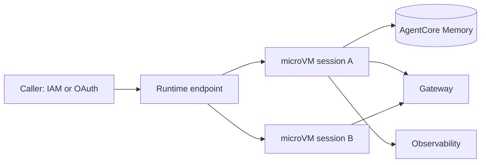
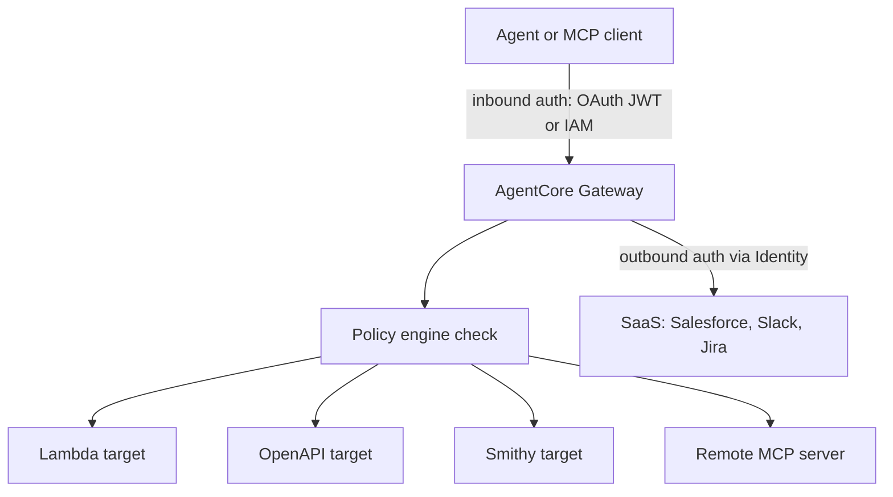

## 0. Before you start
- **Essential:** the agent loop; what OAuth/JWT means (a signed token that says who you are); IAM roles.
- **Helpful:** Cedar-style allow/deny rules; OpenTelemetry (a standard for traces).
- **Optional advanced:** MCP ([03/06](aip:03-agentic-ai/06-mcp-openapi-tools-and-human-in-the-loop)); Guardrails ([01/07](aip:01-bedrock-genai-fundamentals/07-bedrock-guardrails)).

## 1. Simple explanation
Building a demo agent is easy. Running thousands of agents safely is hard: where do they run, how do they remember, how do they reach company tools without holding passwords, who stops them doing something dangerous, and how do you know they are any good? **Amazon Bedrock AgentCore** is a set of separate, mix-and-match services that answer those questions for agents built with *any* framework and *any* model. **Runtime** hosts the agent, **Memory** remembers, **Gateway** turns APIs into tools, **Identity** manages who may do what, **Policy** blocks forbidden tool calls, **Evaluations** scores quality, and **Observability** shows what happened.


```figure
flow agentcore-gateway
```

## 2. Structured explanation (✅ official overview page)
| Service | One-line purpose |
|---|---|
| **Harness** | Managed agent loop from one config; each session in an isolated microVM; powered by Strands |
| **Runtime** | Serverless hosting for agents/tools; per-session microVM isolation; any framework/model; MCP and A2A |
| **Memory** | Short-term (events) and long-term (extracted records) memory |
| **Gateway** | Converts APIs, Lambda and services into MCP tools; ingress and egress auth; semantic tool search |
| **Identity** | Workload identities, inbound JWT auth, outbound credentials (OAuth, API keys), token vault |
| **Code Interpreter** | Sandboxed code execution (Python, JavaScript, TypeScript) |
| **Browser** | Managed cloud browser for agents (Playwright, Nova Act, Strands) |
| **Observability** | Traces/metrics in OpenTelemetry-compatible form, shown through CloudWatch |
| **Policy** | Deterministic allow/deny on tool calls through Gateway (Cedar-compatible) |
| **Evaluations** | LLM-as-judge scoring of sessions, traces and tool calls |
| **Optimization** | Recommendations, configuration bundles and A/B tests built on Evaluations |
| **Registry** | Governed catalog of agents, MCP servers, tools and skills |
| **Payments** | Microtransaction payments for agents (x402 / MPP) |

Services "work together or independently" ✅. Pricing is consumption-based; there is no separate harness charge ✅; AgentCore "may use and store your content to improve your service experience" ✅ (read the data-use terms).

## 3. Analogy
**An airport.** Runtime is the terminal building (each traveller/session gets a private booth). Memory is the lost-and-found plus the frequent-flyer file. Gateway is the single customs gate through which every tool request passes. Identity checks passports and holds visas (credentials) so travellers never carry them. Policy is the rulebook at the gate: some people may never pass, whatever they say. Evaluations is the quality auditor who samples journeys. Observability is the CCTV.

*Where it breaks:* an airport is one building; AgentCore services are separate and optional, and you can use Gateway or Memory with agents hosted elsewhere ✅.

## 4. The seven questions

**WHAT?** A platform of modular agent services (§2).

**WHY?** Move agents from prototype to production without building isolation, state, tool plumbing, authorization and monitoring yourself. Framework-neutral (CrewAI, LangGraph, LlamaIndex, Google ADK, OpenAI Agents SDK, Strands) ✅.

**WHEN?** New agent builds on AWS; migrations from Agents Classic ([03/01](aip:03-agentic-ai/01-llm-agents-and-bedrock-agents-classic)); enterprise governance needs (identity, policy, audit).

**WHERE?** Regional. Per-capability availability differs: for example Runtime microVMs and Gateway/Identity/Policy/Evaluations appear in every Region in the table I read, while Memory and the harness are missing from some (e.g. US West N. California, Milan, Spain, Malaysia, Hyderabad, Thailand) ✅. European Regions with Memory and harness: Frankfurt, Ireland, London, Paris, Stockholm ✅. Re-check the table before you design.

**HOW?** §5.

**WHAT IF?**
| Situation | Effect | Remedy |
|---|---|---|
| Policy has no permit for a tool call | Denied: **default-deny** ✅ | Add a permit |
| A permit and a forbid both match | **Forbid wins** ✅ | Narrow the forbid |
| You want to test a policy first | Gateway association can **log only** instead of enforce ✅ | Switch to enforce after review |
| Agent code is bypassed | Policy still applies because it sits at the Gateway boundary ✅ | Route every tool through Gateway |
| Session ends | Runtime terminates the microVM and sanitises memory ✅ | Persist what matters to Memory |
| Built-in evaluator needs a change | Built-in configurations **cannot be modified** ✅ | Create a custom evaluator |

**WHY NOT?** Not if a simple Lambda-backed Bedrock call is enough; not as a replacement for application-level validation (Policy checks tool calls, not the truth of model output).

## 5. Technical depth

### 5.1 Runtime (lesson 106) ✅

*Reading the arrows:* an authenticated caller invokes a Runtime endpoint. Each session lands in its **own microVM** with isolated CPU, memory and filesystem; when the session finishes the VM is terminated and memory sanitised. The agent code inside may use Memory, Gateway and Observability.

Key facts ✅: you wrap code with the AgentCore SDK entrypoint (`BedrockAgentCoreApp`), package an **ARM64 container**, push to ECR and deploy (Runtime is code you own; the harness is config); sessions up to **8 hours** on microVMs or up to **14 days** on *Instances*; payloads up to **100 MB**; HTTP and WebSocket streaming; protocols **MCP**, **A2A** and AG-UI; built-in inbound auth (IAM SigV4 or OAuth) via AgentCore Identity; versioning and endpoints. A newer platform version V2 starts agents from a snapshot for faster, consistent cold starts ✅.

### 5.2 Harness vs Runtime ✅
Harness = *config, no loop code*: model, prompt, tools, memory, limits (`maxIterations`, `timeoutSeconds`, `maxTokens`), model switch mid-session, skills, session filesystem; it runs inside Runtime. Runtime = *your loop in your container*: any framework, bidirectional streaming, non-agent patterns (graphs/workflows). Pick the harness unless you need to own the loop. The harness is GA across the Regions listed ✅. Harness details and the lab are in [03/05](aip:03-agentic-ai/05-labs-strands-agentcore-agent-squad-and-harness).

### 5.3 Memory and built-in tools (lesson 107)
Memory: see [03/02 §5.4](aip:03-agentic-ai/02-multi-agent-workflows-and-agent-memory) (events, long-term records, `RetrieveMemoryRecords`).
**Code Interpreter** ✅: sandboxed containers; Python/JavaScript/TypeScript; default execution time 15 minutes extendable to 8 hours; inline upload up to 100 MB, up to 5 GB via S3 terminal commands; use `code_session` context manager and close sessions. **Browser** ✅: isolated, ephemeral sessions (default 15 minutes, max 8 hours); AWS-managed `aws.browser.v1` or custom browsers (session recording needs custom); Live View lets a human watch or take over; Playwright/Nova Act/Strands drive it. Security caution: a browser or code tool lets a *model* act, so apply network modes, IAM roles and Policy.

### 5.4 Gateway (lesson 108) ✅

*Reading the arrows:* the agent calls one Gateway endpoint after proving who it is (inbound auth). Before a tool runs, the Policy engine checks the call. Gateway then translates the MCP request into a Lambda invocation or an API call and injects the right credentials (outbound auth) for each target.

Facts ✅: target **categories** are MCP targets (aggregated into one virtual MCP server), HTTP targets (passed through, including A2A), and inference targets (model routing); tool inputs from **OpenAPI, Smithy, Lambda**; 1-click integrations for Salesforce, Slack, Jira, Asana, Zendesk; **semantic tool selection** lets agents search thousands of tools without bloating prompts; credential providers can differ per target. Managed Knowledge Bases have native Gateway integration ([verification-log §5](aip:meta/verification-log)).

### 5.5 Identity (lesson 108) ✅
Agents get **workload identities**. **Inbound**: configure a JWT authorizer so only valid users/agents reach Runtime/Gateway (works with IdPs such as Cognito, Okta, Entra ID, Auth0). **Outbound**: credential providers with a **token vault** handle OAuth flows, token refresh and API keys so the agent code never stores secrets; consent portal for user-delegated (3-legged) flows. Per-page detail (grant type names) ❌ not verified.

### 5.6 Import from Classic (lesson 108 title)
AWS says the AgentCore CLI can **import existing Agents Classic configurations** as a starting point for the harness or code path 🟡 (a search summary of the maintenance-mode page; I did not locate the exact command ❌). A legacy toolkit page maps action groups → Gateway, orchestration → ReAct, knowledge bases → retrieval tools 🟡. Treat the command syntax as unverified.

### 5.7 Policy (lesson 109) ✅
- **GA on March 3, 2026** (preview since Dec 2025) ✅.
- Structure: a **policy engine** stores policies and is **associated with a Gateway**; every tool call through the Gateway is evaluated; **default-deny** and **forbid-wins** ✅.
- Languages: **Cedar** (AWS open source) and **Dogwood** (Cedar-compatible superset adding `when temporal` session-aware rules and `when guardrails` signals) ✅. AWS advises writing Dogwood so rules can grow ✅.
- Principals: `AgentCore::OAuthUser` (from JWT `sub`, with claim tags) and `AgentCore::IamEntity` (IAM ARN) ✅.
- Authoring: natural language → generated Cedar → validated against the schema auto-generated from the Gateway's tools → automated-reasoning check for overly permissive, overly restrictive or unsatisfiable policies ✅.
- Temporal examples ✅: require an approval before a transfer, limit how often an action runs, keep a running total under a budget; session grouped by header `x-amzn-bedrock-agentcore-policy-session-id`.
- Modes: enforce, or log-only to test first ✅ (exact enum labels ❌).
- Illustrative shape of a Cedar rule (entity and action names here are placeholders; use the policy authoring guide for real names):
```text
permit(principal, action, resource)
when { principal.hasTag("role") && principal.getTag("role") == "support" };
```

### 5.8 Evaluations (lesson 110) ✅
- **GA on March 31, 2026** (13 built-in evaluators announced) ✅.
- Scored by **LLM-as-a-judge**; works on sessions, traces and spans from **Strands or LangGraph** agents instrumented with **OpenTelemetry / OpenInference** ✅.
- Built-in IDs look like `Builtin.Helpfulness` (ARN `arn:aws:bedrock-agentcore:::evaluator/Builtin.Helpfulness`); they cannot be modified; custom evaluators are private with ARN `arn:aws:bedrock-agentcore:region:account:evaluator/my-evaluator-id` ✅.
- Modes in the docs: **online** (sample live traffic continuously), **on-demand**, **batch**, **dataset**, and **simulation** ✅.
- Quotas read: up to **1,000 evaluation configurations per Region per account**; about **1 million input+output tokens per minute** per account for large Regions ✅.
- Evaluator names from the launch blog (preview-era; the current list has 13) 🟡: Correctness, Faithfulness, Helpfulness, Harmfulness, Stereotyping, Tool selection accuracy, Tool parameter accuracy, Safety, Goal success rate, Context relevance. Levels (session / trace / tool call) are ❌ not confirmed per evaluator.
- Results flow to Observability (CloudWatch) ✅. **Optimization** builds on Evaluations with config bundles and A/B tests ✅.

### 5.9 Observability and agent tracing
AgentCore Observability emits OpenTelemetry-compatible traces of the reasoning steps, tool calls and model interactions and works with CloudWatch and other stacks ✅. Agent *tracing* is an exam skill: you need it to debug loops, wrong tool choices and latency.

## 6. Worked example
*Problem:* Finance wants an agent that can read balances for all staff but only transfer money for users in the `treasury` role, never above a daily budget, and every decision must be auditable.

| Step | Design |
|---|---|
| 1 | Host the agent on Runtime (or harness) with an inbound JWT authorizer from the corporate IdP |
| 2 | Expose `getBalance` and `transfer` as Lambda targets on a Gateway |
| 3 | Policy: permit `getBalance` for authenticated users; permit `transfer` only if the JWT role is `treasury` and the amount is under a limit; temporal rule: running total per session under the daily budget |
| 4 | Start in log-only mode, review CloudWatch decisions, then enforce |
| 5 | Online evaluation samples live traffic for tool-selection accuracy and harmfulness |
| 6 | Alarms on denied-call counts and evaluator score drops |

## 7. Knowledge checkpoints
1. What two things does a Gateway do to a Lambda function so an agent can use it?
2. If one policy permits and another forbids the same call, what happens?
3. Which framework instrumentation does AgentCore Evaluations support?
4. How long can a Runtime session run on microVMs?

## 7b. Practice questions (exam-style, original) — answers in §14

**Q1.** A company wants every agent tool call checked against central rules *outside* agent code, so a prompt-injected agent cannot bypass them. Which AgentCore capability fits?
A. Memory
B. Policy associated with a Gateway
C. Browser
D. Registry

**Q2.** (Select TWO) Which are true about Policy in AgentCore?
A. Requests without a matching permit are denied
B. A matching forbid overrides a matching permit
C. Policies run inside the agent's prompt
D. Only natural language policies are supported
E. It replaces IAM for all AWS services

**Q3.** A team has REST APIs described by OpenAPI and Lambda functions and wants any MCP-capable agent to call them with minimal code. Which service?
A. AgentCore Gateway
B. AgentCore Evaluations
C. AgentCore Code Interpreter
D. AgentCore Payments

**Q4.** An agent calls Salesforce on behalf of a signed-in user. Where should OAuth tokens be stored and refreshed so agent code never holds secrets?
A. Hard-coded in the prompt
B. AgentCore Identity token vault and credential providers
C. In the model's context window
D. In S3 server access logs

**Q5.** (Select TWO) Which describe AgentCore Runtime?
A. Each session runs in its own isolated microVM
B. It works with any framework and any model
C. It only runs Strands agents
D. Sessions are shared between users to save cost
E. It only supports HTTP, not MCP

**Q6.** A team needs continuous quality scoring of sampled production agent traces for tool selection and harmfulness. Which fits?
A. AgentCore Evaluations online evaluation
B. DynamoDB TTL
C. S3 Lifecycle
D. AWS Config

**Q7.** Which option best distinguishes the AgentCore harness from Runtime?
A. Harness is configuration with a managed loop (Strands-powered); Runtime hosts code you write
B. Harness is only for GPUs; Runtime is only for CPUs
C. They are identical
D. Harness is deprecated; Runtime is new

**Q8.** A new built-in evaluator prompt does not match your rubric. What can you do?
A. Edit the built-in evaluator
B. Create a custom evaluator with your own prompt and model
C. Nothing; evaluators cannot be customised
D. Disable CloudWatch

## 8. Hands-on lab: an offline policy engine and evaluator scorer

### 8.1 Objective
Reproduce, in plain Python, the semantics you must know for the exam: default-deny, forbid-wins, log-only versus enforce, a temporal budget rule, and a simple tool-selection score. These are teaching models, **not** the Cedar engine or the LLM judge.

### 8.2 Prerequisites
Python 3 only.

### 8.3 AWS services
None offline. Concepts map to AgentCore Policy and Evaluations.

### 8.4 IAM permissions
Offline: none.

### 8.5 Region notes
See §4 WHERE.

### 8.6 Architecture
See §5.4.

### 8.7 Cost
Offline: none. Real Evaluations use judge-model tokens (quota 1M tokens/min noted above); pricing ❌ not quoted.

### 8.8 Dependencies and code
```python lab-run
def decide(policies, request):
    """Default-deny; any matching forbid wins over any permit (the documented semantics)."""
    matches = []
    for p in policies:
        applies = p["when"]
        if applies(request):
            matches.append(p)
    if any(p["effect"] == "forbid" for p in matches):
        return "DENY", [p["id"] for p in matches if p["effect"] == "forbid"]
    if any(p["effect"] == "permit" for p in matches):
        return "ALLOW", [p["id"] for p in matches if p["effect"] == "permit"]
    return "DENY", ["default-deny"]

POLICIES = [
    {"id": "read-for-all", "effect": "permit", "when": lambda r: r["tool"] == "getBalance"},
    {"id": "treasury-transfer", "effect": "permit",
     "when": lambda r: r["tool"] == "transfer" and r["role"] == "treasury" and r["amount"] <= 5000},
    {"id": "no-night-transfers", "effect": "forbid", "when": lambda r: r["tool"] == "transfer" and r.get("hour", 12) >= 22},
]

class Gateway:
    def __init__(self, policies, mode="enforce", daily_budget=8000):
        self.policies, self.mode, self.budget, self.spent = policies, mode, daily_budget, 0
        self.log = []

    def call(self, req):
        verdict, why = decide(self.policies, req)
        # temporal rule: running total per session must stay under the budget
        if verdict == "ALLOW" and req["tool"] == "transfer":
            if self.spent + req["amount"] > self.budget:
                verdict, why = "DENY", ["budget-exceeded"]
            else:
                self.spent += req["amount"]
        executed = verdict == "ALLOW" or self.mode == "log-only"
        self.log.append((req["tool"], verdict, why, "executed" if executed else "blocked"))
        return self.log[-1]

reqs = [
    {"tool": "getBalance", "role": "staff", "amount": 0},
    {"tool": "transfer", "role": "staff", "amount": 100},
    {"tool": "transfer", "role": "treasury", "amount": 4000},
    {"tool": "transfer", "role": "treasury", "amount": 4000, "hour": 23},
    {"tool": "transfer", "role": "treasury", "amount": 4000},
    {"tool": "transfer", "role": "treasury", "amount": 4000},
]
for mode in ("enforce", "log-only"):
    gw = Gateway(POLICIES, mode)
    print("mode:", mode)
    for r in reqs:
        print("  ", gw.call(r))

def tool_selection_accuracy(sessions):
    """Share of calls where the agent's tool equals the expected tool (rule-based stand-in for a judge)."""
    total = hit = 0
    for expected, actual in sessions:
        for e, a in zip(expected, actual):
            total += 1
            hit += (e == a)
    return hit / total if total else 0.0

sessions = [
    (["search_kb", "create_ticket"], ["search_kb", "create_ticket"]),
    (["get_order"], ["search_kb"]),
    (["get_order", "refund"], ["get_order", "refund"]),
]
print("tool selection accuracy:", round(tool_selection_accuracy(sessions), 3))
print("flag sessions below 1.0:", [i for i, (e, a) in enumerate(sessions) if e != a])
```

### 8.9 Captured output
Generated on 2026-10-26 by extracting the block above from this file and running it (Python 3). Not AgentCore output.
```text lab-out
mode: enforce
   ('getBalance', 'ALLOW', ['read-for-all'], 'executed')
   ('transfer', 'DENY', ['default-deny'], 'blocked')
   ('transfer', 'ALLOW', ['treasury-transfer'], 'executed')
   ('transfer', 'DENY', ['no-night-transfers'], 'blocked')
   ('transfer', 'ALLOW', ['treasury-transfer'], 'executed')
   ('transfer', 'DENY', ['budget-exceeded'], 'blocked')
mode: log-only
   ('getBalance', 'ALLOW', ['read-for-all'], 'executed')
   ('transfer', 'DENY', ['default-deny'], 'executed')
   ('transfer', 'ALLOW', ['treasury-transfer'], 'executed')
   ('transfer', 'DENY', ['no-night-transfers'], 'executed')
   ('transfer', 'ALLOW', ['treasury-transfer'], 'executed')
   ('transfer', 'DENY', ['budget-exceeded'], 'executed')
tool selection accuracy: 0.8
flag sessions below 1.0: [1]
```

### 8.10 Explanation
- `decide` implements default-deny and forbid-wins. `no-night-transfers` blocks a request that `treasury-transfer` would otherwise permit.
- `Gateway.call` adds a session budget (a temporal rule) after the permit/forbid decision.
- In `log-only` mode the verdict is recorded, but the call still executes: this is why you test in log-only first and then switch to enforce.
- The accuracy score is the idea behind the *Tool selection accuracy* evaluator; the real service uses an LLM judge on traces, not an exact-match rule.

### 8.11 Optional AWS lab (shown, not run in this session ❌)
1. Install and use the AgentCore CLI per the "Get started with the AgentCore CLI" page (`agentcore create/add/deploy/invoke` appear on the Classic maintenance page ✅; confirm syntax in the CLI docs ❌).
2. Create a Gateway with one Lambda target; create a policy engine and associate it in log-only mode; call the tool; read the decisions in CloudWatch.
3. Switch to enforce; verify a forbidden call is denied.
4. Create an online evaluation on a test agent and read scores.
5. **Clean up:** delete evaluation configs, policy engine association, Gateway, targets, Runtime/harness, memory resources, ECR images, CloudWatch log groups, IAM roles.

### 8.12 Common errors
| Error | Cause | Fix |
|---|---|---|
| Every tool call denied | No permit (default-deny) | Add a permit |
| Policy rejected at creation | Fails schema validation ✅ | Fix action/parameter names |
| Agent cannot call SaaS | Outbound credential provider missing | Configure Identity provider |
| Evaluator cannot read traces | Telemetry not set up | Instrument with OTEL/OpenInference ✅ |
| Cross-session budget not enforced | Missing policy-session header | Send `x-amzn-bedrock-agentcore-policy-session-id` ✅ |

### 8.13 Security recommendations
Route all tools through Gateway; least-privilege IAM and Identity scopes; log-only then enforce; never pass secrets in prompts or event metadata; review Policy analysis warnings; restrict Browser/Code Interpreter networking; sample and review evaluator results; delete lab resources.

## 9. What can go wrong?
| Failure | Why | Symptoms | Investigate | Fix | Prevent |
|---|---|---|---|---|---|
| **Policy gaps** | Default-deny without permits | Agent "broken" | Decision logs | Add permits | Log-only first |
| **Over-permissive policy** | Broad permit | Unsafe actions | Cedar analysis warnings ✅ | Tighten | Review before enforce |
| **Tools bypass Gateway** | Direct API calls in code | Unchecked actions | Network/IAM review | Force via Gateway | SCPs, network rules |
| **Token leakage** | Secrets in prompts | Credential exposure | Prompt/log review | Use token vault | Identity for all outbound |
| **Evaluator drift** | Judge model/rubric changes | Scores shift | Compare versions | Pin custom evaluators | Baselines |
| **Cost surprise** | Long sessions, judge tokens | Bill spike | Cost Explorer | Limits, sampling | Budgets |
| **Region gap** | Feature not in Region | Deploy fails | Region table ✅ | Pick another Region | Check table early |

## 10. Common misconceptions
1. **"AgentCore replaces my framework."** It hosts and supports any framework ✅.
2. **"Policy is prompt instructions."** It is deterministic evaluation outside the model ✅.
3. **"Evaluations needs Strands."** Strands or LangGraph with OTEL/OpenInference ✅.
4. **"Harness and Runtime are rivals."** The harness runs inside Runtime ✅.
5. **"Memory is automatic and instant."** Long-term extraction is asynchronous ✅.
6. **"Policy and Evaluations are still preview."** GA in March 2026 ✅.

## 11. Exam notes
- **Pattern:** "central, deterministic control of agent tool calls" → Policy + Gateway.
- **Pattern:** "turn APIs/Lambda into MCP tools" → Gateway.
- **Pattern:** "agent needs user-delegated OAuth to SaaS" → Identity outbound credential provider.
- **Pattern:** "run agents securely at scale with session isolation" → Runtime.
- **Pattern:** "measure agent quality in production" → Evaluations (online) + Observability.
- **Trap:** default-deny; forbid-wins; built-in evaluators are not editable.
- **Compare:** Guardrails (content safety on model I/O) vs Policy (authorization of tool calls) vs IAM (AWS API permissions).

## 12. Summary and revision cards
- AgentCore = Harness, Runtime, Memory, Gateway, Identity, Code Interpreter, Browser, Observability, Policy, Evaluations, Optimization, Registry, Payments.
- Policy: Cedar/Dogwood, engine on Gateway, default-deny, forbid-wins, log-only first.
- Evaluations: LLM-as-judge, `Builtin.*` IDs, online/on-demand/batch/dataset.

**Cards.** Q: Runtime session max (microVM)? A: 8 hours. · Q: Policy GA date? A: 2026-03-03. · Q: Evaluations GA date? A: 2026-03-31. · Q: Eval configs per Region? A: 1,000.

## 13. References
| Source | URL | Verified |
|---|---|---|
| What is AgentCore | https://docs.aws.amazon.com/bedrock-agentcore/latest/devguide/what-is-bedrock-agentcore.html | 2026-10-26 |
| Runtime | https://docs.aws.amazon.com/bedrock-agentcore/latest/devguide/agents-tools-runtime.html | 2026-10-26 |
| Harness and harness vs Runtime | https://docs.aws.amazon.com/bedrock-agentcore/latest/devguide/harness.html | 2026-10-26 |
| Gateway and supported targets | https://docs.aws.amazon.com/bedrock-agentcore/latest/devguide/gateway.html | 2026-10-26 |
| Identity | https://docs.aws.amazon.com/bedrock-agentcore/latest/devguide/identity.html | 2026-10-26 |
| Policy and core concepts | https://docs.aws.amazon.com/bedrock-agentcore/latest/devguide/policy.html | 2026-10-26 |
| Evaluations and built-in evaluators | https://docs.aws.amazon.com/bedrock-agentcore/latest/devguide/evaluations.html | 2026-10-26 |
| Evaluations GA announcement | https://aws.amazon.com/about-aws/whats-new/2026/03/agentcore-evaluations-generally-available | 2026-10-26 |
| AWS News Blog: evaluations and policy | https://aws.amazon.com/blogs/aws/amazon-bedrock-agentcore-adds-quality-evaluations-and-policy-controls-for-deploying-trusted-ai-agents/ | 2026-10-26 |
| Code Interpreter · Browser | https://docs.aws.amazon.com/bedrock-agentcore/latest/devguide/code-interpreter-tool.html · .../browser-tool.html | 2026-10-26 |
| Supported Regions | https://docs.aws.amazon.com/bedrock-agentcore/latest/devguide/agentcore-regions.html | 2026-10-26 |

**Unverified here:** per-evaluator levels and the current list of 13 names; CLI import syntax; Identity grant details; policy mode enum names; pricing; IAM action names. **Source conflict:** the March 2026 announcement said Evaluations was in nine Regions, while the current Region table shows it in every listed Region; use the table (newer).

## 14. Answers to checkpoints and practice questions
**Checkpoints.** 1) Translates MCP requests into the Lambda invocation (translation) and injects credentials/auth (secure credential exchange). 2) The forbid wins. 3) Strands or LangGraph, instrumented with OpenTelemetry or OpenInference. 4) Up to 8 hours (14 days on Instances).

**Practice questions.**
- **Q1 → B.** Policy intercepts Gateway tool calls outside agent code. Memory, Browser and Registry do not authorise calls.
- **Q2 → A, B.** C false (outside the prompt); D false (Cedar/Dogwood also); E false (scope is Gateway tool calls).
- **Q3 → A.** Gateway converts OpenAPI/Lambda to MCP tools.
- **Q4 → B.** Identity's token vault and credential providers; A and C expose secrets; D is nonsense.
- **Q5 → A, B.** C false (any framework); D false (isolated sessions); E false (MCP and A2A).
- **Q6 → A.** Others are unrelated storage/config services.
- **Q7 → A.** The harness runs inside Runtime and is Strands-powered ✅; B and C are false; D is false (harness is GA).
- **Q8 → B.** Built-in evaluators cannot be modified ✅; create a custom one.
