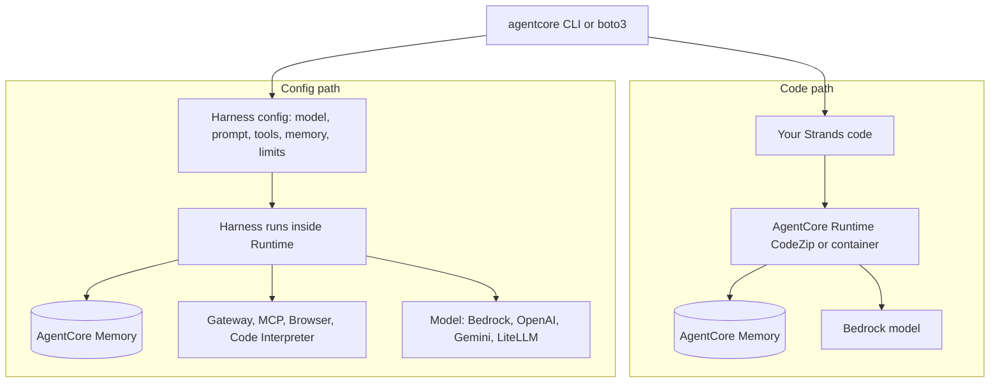

> **Honesty note.** The syllabus gives only titles for lessons 111 to 113. The lab steps below are built from official AWS pages (harness and Runtime "Get started"). **No AWS command in this file was run in this session.** The only code that was executed is the offline simulator in §8, and its output is regenerated from the block printed here.

## 0. Before you start
- **Essential:** an AWS account with budget alarms ([00-foundations/01](aip:00-foundations/01-aws-account-iam-and-cli-setup)); model access working in your Region ([01/01](aip:01-bedrock-genai-fundamentals/01-bedrock-overview-and-converse-api)).
- **Helpful:** Node.js/npm and Python 3.10+ (the AgentCore CLI and boto3 prerequisites); Docker only if you choose container deployment.
- **Optional advanced:** CloudWatch Logs and X-Ray reading.

## 1. Simple explanation
You will build the same idea two ways. In the **code path**, you write a Strands agent in Python and let AgentCore Runtime host it; if you have several agents you can put Agent Squad in front to route. In the **config path**, you do not write the loop at all: you create an AgentCore **harness**, say which model, tools and memory it should use, and call it. The first teaches you what is inside an agent; the second shows how little you need for a standard one.


```figure
flow code-vs-config
```

## 2. Structured explanation
1. **Decide the path:** harness (config, no loop code) unless you need your own framework, graphs or bidirectional streaming ([03/04 §5.2](aip:03-agentic-ai/04-agentcore-runtime-memory-gateway-identity-policy-evaluations)).
2. **Code path (✅ Runtime "Get started"):** `agentcore create --name MyProject --template agent-python-strands` creates a Python CodeZip Runtime named `agent` with an AgentCore Memory resource; `agentcore dev --mode browser` opens a local Agent Inspector; `agentcore build`, `agentcore deploy`, `agentcore status`, then `agentcore invoke --runtime agent --payload '{"prompt":"..."}'`.
3. **Config path (✅ harness "Get started"):** `agentcore create --name MyResearchAgent` (config-based), `cd`, `agentcore deploy`, `agentcore invoke --harness ... --session-id ... --prompt ...`. Or call the API: `aws bedrock-agentcore-control create-harness` / `get-harness` until `READY`, then `InvokeHarness` through `boto3`.
4. **Agent Squad in the code path:** add routing inside your Runtime code ([03/03 §5.5](aip:03-agentic-ai/03-strands-agents-and-agent-squad)).
5. **Clean up** everything ([§8.11](#8-11-step-by-step-aws-lab-shown-not-run)).

## 3. Analogy
**Cooking from a recipe kit versus from scratch.** The harness is the meal kit: choose the dish (model, tools) and it arrives ready to cook. The Runtime path is a fully equipped kitchen: more freedom, more work, and you wash up (containers, versions).

*Where it breaks:* a meal kit has a fixed menu; the harness is flexible (any Bedrock, OpenAI, Gemini or LiteLLM-compatible model, MCP tools, skills) ✅, so the real limit is "you cannot change the loop", not "you cannot change the content".

## 4. The seven questions

**WHAT?** Two labs: (a) a Strands agent (optionally with Agent Squad routing) hosted on AgentCore Runtime; (b) an AgentCore harness created from config.

**WHY?** To feel the difference between owning the loop and configuring it, and to practise the cost and cleanup discipline agentic labs need.

**WHEN?** After 03/03 and 03/04. Run them in a sandbox account.

**WHERE?** A Region where the needed capabilities exist. From the Region table I read ✅: Runtime microVMs are available in every listed Region; the **harness and Memory are not** (missing in US West N. California, Milan, Spain, Malaysia, Hyderabad, Thailand). 

**HOW?** §8.

**WHAT IF?**
| Situation | Effect | Remedy |
|---|---|---|
| Harness session id shorter than 33 characters | Invalid: `runtimeSessionId` must be **at least 33 characters** ✅ | Use a UUID |
| Agent reaches `maxIterations` | `messageStop` has `stopReason` `max_iterations_exceeded` ✅ | Raise the limit deliberately or fix the task |
| Time limit hit | `timeout_exceeded` ✅ | Shorten work or raise `timeoutSeconds` |
| Token budget used | `max_output_tokens_exceeded` ✅ | Raise `maxTokens` or simplify |
| Lambda hook denies | `hook_stopped` ✅ | Review the hook rule |
| `agentcore dev --mode browser` on a harness | It **deploys** the project and invokes the deployed harness in AWS; it does not run locally ✅ | Expect cloud charges |
| You omit the model in the SDK call | Default is a Claude Sonnet model on Bedrock as stated on the page ✅ (the exact name changes; do not hard-code) | Always set the model explicitly in real projects |

**WHY NOT?** Do not run these in a production account; do not leave sessions or Memory running; do not paste real secrets into prompts.

## 5. Technical depth

### 5.1 Architecture of the two labs

*Reading the arrows:* the same CLI or SDK drives both paths. In the code path your Strands code is packaged and run by Runtime and may call Memory and a model. In the config path you describe the agent and the harness runs the loop inside Runtime, calling the model and tools you configured.

### 5.2 Harness stream events and stop reasons (✅ page read)
Events: `messageStart`, `contentBlockStart`, `contentBlockDelta` (text, tool-use input, tool result, reasoning), `contentBlockStop`, `messageStop` (with `stopReason`), `metadata` (token usage and latency), `hookEvent`, `runtimeClientError`. Stop reasons: `end_turn`, `tool_use`, `tool_result`, `max_tokens`, `max_iterations_exceeded`, `timeout_exceeded`, `max_output_tokens_exceeded`, `hook_stopped`. If the final `messageStop` is `tool_use`, the harness is waiting for an inline function result.

### 5.3 Other harness facts (✅)
Sessions are stateful and isolated in a microVM with filesystem and shell; model can be switched mid-session; tools: Gateway, remote MCP servers, built-in Browser and Code Interpreter, inline functions; skills from Git, S3 or a curated catalog; can mount S3 Files or EFS; **immutable versions and named endpoints** (roll back by pointing an endpoint at an older version); can be called from Step Functions via an `InvokeHarness` state; **export to Strands code** when configuration is not enough; no separate harness charge, you pay for the underlying capabilities. `--user-id` sends an end-user id, but it does not replace inbound authentication ✅.

### 5.4 The note for EU users (lesson 111), reconstructed
The lesson text is not available to me ❌. What the official pages let me say safely: (1) AgentCore Runtime, Gateway, Identity, Policy and Evaluations are listed in Frankfurt, Ireland, London, Paris, Stockholm (and Milan, Spain for some); the **harness and Memory are listed in Frankfurt, Ireland, London, Paris and Stockholm, not in Milan or Spain** ✅. (2) A Bedrock model may not be available in your EU Region directly; the harness CLI page names a `global.`-prefixed model identifier, which signals a **cross-Region inference profile** (see [verification-log §10](aip:meta/verification-log)): requests may be processed in other Regions, which matters for data-residency rules. Check the profile's Regions before sending personal data. (3) Always confirm model access for your Region in the console.

## 6. Worked example
*Problem:* Compare cost-of-effort for a "research assistant".

| Aspect | Harness | Runtime + Strands |
|---|---|---|
| Lines of code | None for the loop | Your agent code |
| Switch model | Config change | Code change and deploy |
| Custom graph/workflow | Not supported ✅ | Yes |
| Streaming | Built in | You implement |
| Where limits live | `maxIterations`, `timeoutSeconds`, `maxTokens` | Your code |
| Good for | Standard tool-using agents | Custom orchestration, any framework |

## 7. Knowledge checkpoints
1. Which stop reason tells you the iteration limit was hit?
2. What is the minimum length of `runtimeSessionId`?
3. Does `agentcore dev --mode browser` run a harness locally?
4. Which AgentCore capabilities are missing in Milan according to the Region table?

## 7b. Practice questions (exam-style, original) — answers in §14

**Q1.** A team wants an agent with a chosen model, some MCP tools and long-term memory, without writing an orchestration loop. Which option fits best?
A. AgentCore harness
B. A custom Step Functions state machine only
C. Amazon Lex V1
D. SageMaker Ground Truth

**Q2.** (Select TWO) Which are true about `InvokeHarness` sessions?
A. `runtimeSessionId` must be at least 33 characters
B. Reusing the same session id continues the conversation in the same environment
C. Each call must use a new random session id
D. Session ids are ignored
E. The session id replaces inbound authentication

**Q3.** A harness run ends with `stopReason` `max_iterations_exceeded`. What does it mean?
A. The model returned an empty answer
B. The configured `maxIterations` limit was reached
C. The token budget was used
D. A Lambda hook denied the call

**Q4.** Which statement about `agentcore dev --mode browser` for a harness project is correct?
A. It runs the harness fully offline
B. It deploys the project and invokes the deployed harness in AWS, so charges can apply
C. It deletes the harness
D. It only validates JSON

**Q5.** A company in Spain wants to use the AgentCore harness. According to the Region table, what is true?
A. The harness is available in Europe (Spain)
B. The harness is not listed for Europe (Spain); use a listed Region that satisfies residency rules
C. Only Memory is unavailable
D. Harness works everywhere

**Q6.** (Select TWO) Why might you choose Runtime with Strands over the harness?
A. You need a custom graph or workflow pattern
B. You need bidirectional streaming
C. You want zero code
D. You want to avoid containers entirely in every case
E. You want a hosted agent without isolation

**Q7.** After the lab, which cleanup step is easy to forget but can keep billing?
A. Deleting the local README
B. Deleting AgentCore resources such as Memory, Runtimes, harnesses and any knowledge-base vector store
C. Closing the browser tab
D. Changing the terminal theme

**Q8.** What does a `global.`-prefixed Bedrock model identifier suggest?
A. A single-Region model
B. A cross-Region inference profile where processing may occur in other Regions
C. A deprecated model
D. A fine-tuned model

## 8. Hands-on lab

### 8.1 Objective
(a) Run an offline simulator of harness limits and stream events so you can predict stop reasons; (b) follow the step-by-step AWS lab for the harness and for a Strands agent on Runtime; (c) clean up.

### 8.2 Prerequisites
Offline: Python 3. AWS part: AWS credentials in a supported Region; AgentCore CLI installed per the "Get started with the AgentCore CLI" page ❌ (install command not re-verified); for the SDK path Python 3.10+ and `boto3` ✅.

### 8.3 AWS services
Offline: none. AWS part: AgentCore harness or Runtime, AgentCore Memory, Bedrock models, CloudWatch, IAM, optionally ECR/S3 for deployment.

### 8.4 IAM permissions
Harness needs an **execution role** it can assume (minimum permissions are on the harness security page, `harness-security.html#harness-execution-role-policy` ✅). Your user needs permission to call `bedrock-agentcore-control` (create/get/delete harness) and `bedrock-agentcore` (`InvokeHarness`) plus `iam:PassRole` for the role ❌ exact action names not verified; check the service authorization reference.

### 8.5 Region notes
See §4 WHERE and §5.4.

### 8.6 Architecture
See §5.1.

### 8.7 Cost
No separate harness charge; you pay for the underlying capabilities (Runtime, Memory, Gateway, model tokens, logs) ✅. Prices ❌ not quoted; check the AgentCore pricing page. Keep sessions short, delete resources the same day, and set a budget alarm.

### 8.8 Code (offline simulator)
```python lab-run
import uuid

def valid_session_id(s):
    return len(s) >= 33          # rule stated on the harness page

def run_harness(task_steps, max_iterations=5, timeout_seconds=30, max_tokens=500, step_seconds=10, step_tokens=120,
                deny_tool=None):
    """Teaching model of the loop limits. Returns the event names and the final stopReason."""
    events, elapsed, used = ["messageStart"], 0, 0
    for i, step in enumerate(task_steps, start=1):
        if i > max_iterations:
            return events + ["messageStop:max_iterations_exceeded"]
        if elapsed + step_seconds > timeout_seconds:
            return events + ["messageStop:timeout_exceeded"]
        if used + step_tokens > max_tokens:
            return events + ["messageStop:max_output_tokens_exceeded"]
        if step == deny_tool:
            return events + ["hookEvent:deny", "messageStop:hook_stopped"]
        elapsed += step_seconds
        used += step_tokens
        events.append(f"contentBlockDelta:{step}")
    return events + ["metadata", "messageStop:end_turn"]

sid = str(uuid.UUID("12345678-1234-5678-1234-567812345678"))
print("uuid session id ok:", valid_session_id(sid), "length", len(sid))
print("short id ok:", valid_session_id("abc-123"))

print(run_harness(["search", "read"]))
print(run_harness(["a", "b", "c", "d"], max_iterations=3)[-1])
print(run_harness(["a", "b", "c", "d"], timeout_seconds=25)[-1])
print(run_harness(["a", "b", "c", "d"], max_tokens=300)[-1])
print(run_harness(["search", "delete_all", "read"], deny_tool="delete_all")[-2:])

REGIONS = {"Frankfurt": (True, True), "Ireland": (True, True), "London": (True, True), "Paris": (True, True),
           "Stockholm": (True, True), "Milan": (True, False), "Spain": (True, False)}   # (Runtime microVMs, harness+Memory) from the table read on 2026-10-26
for name, (rt, hm) in REGIONS.items():
    print(f"{name:10s} runtime={rt} harness+memory={hm}")
```

### 8.9 Captured output
Generated on 2026-10-26 by extracting the block above from this file and running it (Python 3). It is a teaching model of the documented stop reasons, not harness output. The Region rows are copied from the table I read; re-check the live table.
```text lab-out
uuid session id ok: True length 36
short id ok: False
['messageStart', 'contentBlockDelta:search', 'contentBlockDelta:read', 'metadata', 'messageStop:end_turn']
messageStop:max_iterations_exceeded
messageStop:timeout_exceeded
messageStop:max_output_tokens_exceeded
['hookEvent:deny', 'messageStop:hook_stopped']
Frankfurt  runtime=True harness+memory=True
Ireland    runtime=True harness+memory=True
London     runtime=True harness+memory=True
Paris      runtime=True harness+memory=True
Stockholm  runtime=True harness+memory=True
Milan      runtime=True harness+memory=False
Spain      runtime=True harness+memory=False
```

### 8.10 Explanation
- The limits are checked before each step, so the first limit that would be crossed decides the `stopReason`.
- A deny from a hook stops the invocation (`hook_stopped`), which is how guard rails around dangerous tools show up in the stream.
- A UUID is 36 characters, safely over the 33-character minimum.

### 8.11 Step-by-step AWS lab (shown, not run)
**A. Harness via CLI (✅ commands from the harness page)**
```bash
agentcore create --name MyResearchAgent
cd MyResearchAgent
agentcore deploy
agentcore invoke --harness MyResearchAgent --session-id "$(uuidgen)" \
  --prompt 'Research three tropical vacation options under USD $3,000, within five hours of New York City.'
agentcore status
```
**B. Harness via API (✅ commands from the harness page)**
```bash
aws bedrock-agentcore-control create-harness --harness-name "MyHarness" \
  --execution-role-arn "arn:aws:iam::123456789012:role/MyHarnessRole"
aws bedrock-agentcore-control get-harness --harness-id "MyHarness-XyZ1234567"   # repeat until status is READY
```
Then call `InvokeHarness` with `boto3.client("bedrock-agentcore")`, passing `harnessArn`, a `runtimeSessionId` of at least 33 characters and `messages`; read `response["stream"]` events as in §5.2.

**C. Strands agent on Runtime (✅ commands from the Runtime page)**
```bash
agentcore create --name MyProject --template agent-python-strands
cd MyProject
agentcore dev --mode browser      # local Runtime and Agent Inspector
agentcore build
agentcore deploy
agentcore status
agentcore invoke --runtime agent --payload '{"prompt":"Hello, what can you do?"}'
```
The generated code is in `app/agent/main.py` ✅. To add routing, put an Agent Squad orchestrator in that file and register several Strands-based agents ([03/03 §5.5](aip:03-agentic-ai/03-strands-agents-and-agent-squad)) ❌ (not run).

**D. Clean up (do not skip).** Delete the harness (`DeleteHarness` ✅ exists; CLI sub-command ❌ not verified), the Runtime, Memory resources, deployed endpoints, ECR images and S3 artefacts created by `agentcore deploy`, CloudWatch log groups, and the IAM execution role. Check the AgentCore console and Cost Explorer next day.

### 8.12 Common errors
| Error | Cause | Fix |
|---|---|---|
| `ValidationException` on session id | Fewer than 33 characters ✅ | Use `uuidgen` |
| Access denied on create | Missing execution role or `iam:PassRole` | Create role per harness security page |
| Model access error | Model/Region not enabled | Check Bedrock access in the Region |
| Harness not in Region | Capability not offered there ✅ | Use a listed Region |
| `max_iterations_exceeded` | Loop too long | Better prompt/tools or higher limit |
| Unexpected charges | Resources left running | Clean up (D) |

### 8.13 Security recommendations
Use a dedicated sandbox account; least-privilege execution role; no secrets in prompts or events; inbound authentication on anything exposed (a user id is not authentication ✅); review Gateway/Policy before connecting real tools; delete the lab the same day.

## 9. What can go wrong?
| Failure | Why | Symptoms | Investigate | Fix | Prevent |
|---|---|---|---|---|---|
| **Lab cost creep** | Left resources | Daily charges | Cost Explorer | Delete | Budget alarm, checklist |
| **Wrong Region** | Capability gap | Deploy fails | Region table ✅ | Switch Region | Check first |
| **Data residency surprise** | Cross-Region inference | Compliance issue | Profile Regions | Regional model/profile | Review before use |
| **Runaway session** | Weak limits | Cost/time | `stopReason`, metrics | Set limits | Defaults |
| **Over-permissive role** | Convenience | Blast radius | IAM review | Least privilege | Templates |
| **Doc drift** | Fast-moving CLI | Commands fail | CLI help | Use `--help`, docs | Pin versions |

## 10. Common misconceptions
1. **"The harness is only a demo feature."** It is GA with versions and endpoints ✅.
2. **"`dev` runs locally for harnesses."** It deploys and invokes in AWS ✅.
3. **"Session id = user identity."** Neither session nor user id replaces authentication ✅.
4. **"EU Regions have everything."** Milan and Spain lack the harness and Memory ✅.
5. **"Model ids are timeless."** The pages show different default models in different places; look them up.

## 11. Exam notes
- **Pattern:** "no-code/low-code managed agent with model and tool config" → harness.
- **Pattern:** "own framework, custom loop, hosted with isolation" → Runtime.
- **Trap:** equating harness with Agents Classic; the harness is the recommended closest replacement ✅ but a different service.
- **Trap:** ignoring Region availability and cross-Region processing.
- **Compare:** Strands (library) vs harness (managed, Strands-powered) vs Runtime (hosting) vs Agent Squad (router).

## 12. Summary and revision cards
- Harness: `agentcore create/deploy/invoke --harness`, or `create-harness` + `InvokeHarness`.
- Runtime: `agentcore create --template agent-python-strands`, `build`, `deploy`, `invoke --runtime`.
- Stop reasons: `end_turn`, `max_iterations_exceeded`, `timeout_exceeded`, `max_output_tokens_exceeded`, `hook_stopped`.
- Session id ≥ 33 characters.

**Cards.** Q: Harness default behaviour for model if omitted in the SDK example? A: a Claude Sonnet model on Bedrock (name changes; look it up). · Q: Does `--user-id` authenticate? A: No.

## 13. References
| Source | URL | Verified |
|---|---|---|
| Harness: get started | https://docs.aws.amazon.com/bedrock-agentcore/latest/devguide/harness-get-started.html | 2026-10-26 |
| Runtime: get started with the CLI | https://docs.aws.amazon.com/bedrock-agentcore/latest/devguide/runtime-get-started-cli.html | 2026-10-26 |
| Harness vs Runtime | https://docs.aws.amazon.com/bedrock-agentcore/latest/devguide/harness-vs-runtime.html | 2026-10-26 |
| Supported Regions | https://docs.aws.amazon.com/bedrock-agentcore/latest/devguide/agentcore-regions.html | 2026-10-26 |
| Cross-Region inference | see [verification-log §10](aip:meta/verification-log) | 2026-10-23 |

**Unverified here:** CLI installation command; the content of lessons 111 to 113; IAM action names; delete/cleanup CLI sub-commands; pricing; console labels.

## 14. Answers to checkpoints and practice questions
**Checkpoints.** 1) `max_iterations_exceeded`. 2) 33 characters. 3) No: it deploys and invokes the deployed harness in AWS. 4) The harness and AgentCore Memory (Runtime microVMs and the other services are listed).

**Practice questions.**
- **Q1 → A.** Harness is config-driven with model, MCP tools and memory. The others are not agent harnesses.
- **Q2 → A, B.** C and D are false; E is false (session id is not authentication).
- **Q3 → B.** C is `max_output_tokens_exceeded`; D is `hook_stopped`.
- **Q4 → B.** It does not run the harness locally ✅.
- **Q5 → B.** The harness is not listed for Spain ✅.
- **Q6 → A, B.** Graph/workflow patterns and bidirectional streaming are not supported by the harness ✅. C is the harness's strength; D and E are wrong.
- **Q7 → B.** Memory, Runtimes, endpoints, images and vector stores can keep costing.
- **Q8 → B.** `global.` indicates a cross-Region inference profile (see verification log §10).
