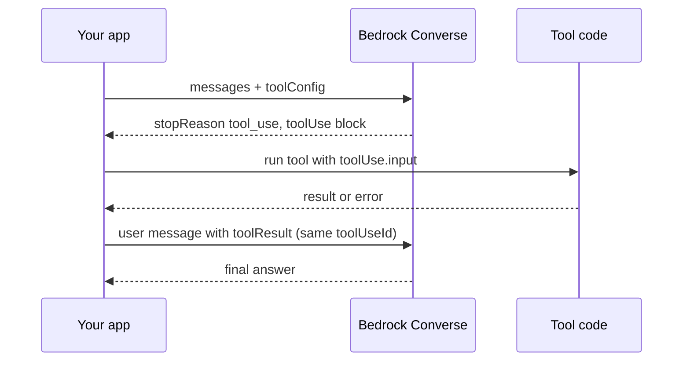
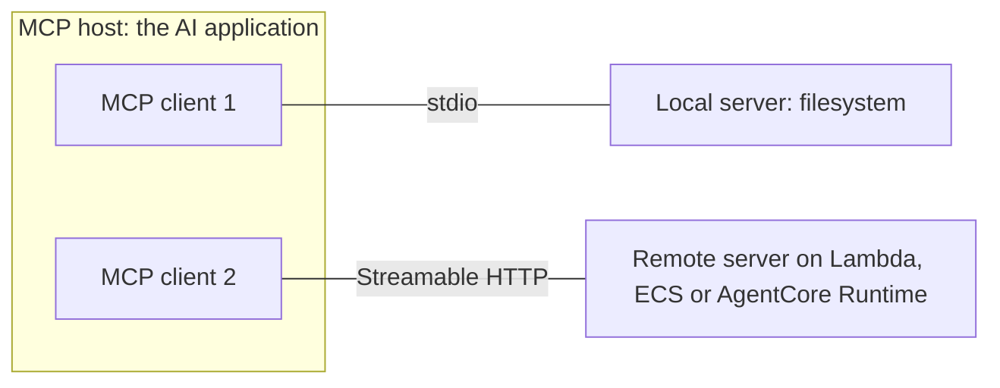
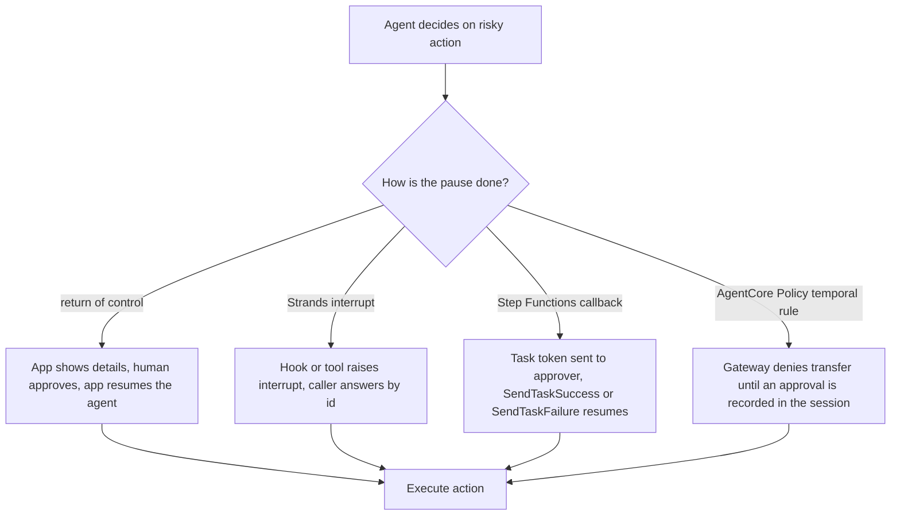

## 0. Before you start
- **Essential:** the agent loop; JSON; what an API is.
- **Helpful:** JSON-RPC (a simple "method + params → result" message format); AWS Step Functions basics (state machines).
- **Optional advanced:** OAuth, Server-Sent Events.

## 1. Simple explanation
A model cannot call your systems by itself; it can only *ask* for a tool to be run. **Tool use** is the agreed way to ask: you describe tools, the model replies "please call X with these arguments", your code runs it and sends the result back. **MCP (Model Context Protocol)** is an open standard so any agent can talk to any tool server the same way, like a USB-C port for AI. **OpenAPI** is how REST APIs describe themselves, so they can be turned into tools. **Human in the loop** means some steps pause until a person approves, because some actions (money, deletion, email) should never be fully automatic.


```figure
flow tool-use-loop
```

## 2. Structured explanation
1. **Tool use in Bedrock** ✅: you pass `toolConfig` to the Converse API; the model returns `stopReason: tool_use` with a `toolUse` block; **your code runs the tool** (client-side) and sends back a `toolResult`. A **server-side** mode exists where Bedrock invokes a Lambda function or AgentCore Gateway for you (currently on the Responses API) ✅.
2. **MCP** ✅: host (the AI application) creates one client per **server**; two layers (data: JSON-RPC 2.0; transport: stdio or Streamable HTTP); server primitives **tools, resources, prompts**; client primitive **elicitation** (asks the user for more input).
3. **OpenAPI → tools:** Agents Classic action groups accept an OpenAPI schema (up to 11 operations per group) ✅; AgentCore Gateway turns **OpenAPI, Smithy or Lambda** definitions into MCP tools ✅.
4. **Where MCP servers run on AWS:** AgentCore Runtime can host MCP servers ✅; Lambda or ECS/Fargate are common for remote servers (stateless Streamable HTTP lets replicas scale without session stickiness) 🟡.
5. **Human in the loop (HITL)** options (§5.5): return of control, Strands interrupts, Step Functions callback with a task token, AgentCore Policy (temporal approval rules), Quick Automate approvals.

## 3. Analogy
**A restaurant.** The diner (user) talks to the waiter (agent). The waiter cannot cook; they hand a ticket to the kitchen (tool). MCP is the standard ticket format so any waiter works with any kitchen. OpenAPI is the kitchen's printed menu. HITL is the manager's countersignature required on tickets over a certain value.

*Where it breaks:* a kitchen ticket is fixed; a model may invent arguments, and the "menu" can be attacked (a malicious tool description or result can carry hidden instructions).

## 4. The seven questions

**WHAT?** Tool use = model requests, app executes. MCP = open protocol for exposing tools, resources and prompts. HITL = a deliberate pause for human judgement.

**WHY?** One protocol means one integration per tool instead of one per agent framework. Schemas validate arguments. HITL limits damage from mistakes and manipulation.

**WHEN?** Use MCP when many agents or clients should reuse the same tools; plain Converse tools for a single app; Gateway to expose existing APIs; HITL for irreversible, costly or regulated actions.

**WHERE?** MCP servers: locally (stdio) or remotely (Streamable HTTP) on Lambda, ECS/Fargate, or AgentCore Runtime ✅/🟡. Tool definitions: Converse `toolConfig`, action groups, Gateway targets.

**HOW?** §5.

**WHAT IF?**
| Situation | Effect | Remedy |
|---|---|---|
| Model does not support `toolChoice` value | `ValidationException` ✅ | Use `auto` or check the model |
| Model without tool support | Fails with "This model doesn't support tool use." ✅ | Pick a tool-capable model |
| Tool use plus streaming on certain models | Some reject tools on `ConverseStream` ✅ | Use `Converse` |
| Tool throws an error | You can send `toolResult` with `status: "error"` ✅ | Return a clear message so the model can recover |
| Guardrails and tool blocks | Content/PII filters do not evaluate `toolUse.input`, `toolResult` or `toolSpec` ([01/07](aip:01-bedrock-genai-fundamentals/07-bedrock-guardrails)) ✅ | Validate in your code |
| Task token waits forever | Up to the 1-year execution quota ✅ | Set `HeartbeatSeconds` / timeouts |
| MCP list of tools changes | Notification is best-effort ✅ | Poll too |

**WHY NOT?** Not MCP for a one-off internal function called by one app; a direct function call is simpler. Not HITL for high-volume low-risk actions where approvals become rubber stamps.

## 5. Technical depth

```figure
flow mcp-transport
```


### 5.1 The Converse tool-use loop (✅ official example shape)

*Reading the arrows:* the model never calls the tool. Bedrock returns a request; your app runs it and replies with a `toolResult` carrying the **same `toolUseId`** so the model can match result to request. For tools you define, Bedrock generates the id with a `tooluse_` prefix; for some models the provider's own id is passed through, so do not assume the format ✅.

`toolConfig` shape ✅: `{"tools": [{"toolSpec": {"name", "description", "inputSchema": {"json": {...JSON Schema...}}}}]}`; optional `toolChoice` is `auto` (default), `any` or `tool`; `any`/`tool` are model-dependent ✅. Strict schema adherence: `"strict": true` ([01/08](aip:01-bedrock-genai-fundamentals/08-prompt-management-flows-and-structured-output)).

### 5.2 MCP architecture (✅ modelcontextprotocol.io, protocol version dated 2026-07-28)

*Reading the arrows:* the host creates one client per server, each with a dedicated connection. Local servers over **stdio** usually serve one client; remote servers over **Streamable HTTP** (HTTP POST with optional Server-Sent Events, OAuth recommended) serve many.

Facts ✅ for the dated spec version: messages are **JSON-RPC 2.0**; MCP is described as **stateless**, with the protocol version and client capabilities carried in each request's `_meta`; `server/discover` returns versions, capabilities and identity (optional for clients); `tools/list` and `tools/call` list and run tools; each tool has `name`, `title`, `description`, `inputSchema`; results carry a `content` array; list changes use opt-in `subscriptions/listen` and `notifications/tools/list_changed` (best effort). **Sampling and logging are deprecated** as of `2026-07-28`; **elicitation** remains; a Tasks extension handles long-running requests. Older MCP versions used an initialize handshake and stateful sessions, so SDKs and tutorials differ by version ❌ (I read only the dated page).

### 5.3 Hosting MCP servers on AWS
| Option | Notes |
|---|---|
| **AgentCore Runtime** ✅ | Documented topics for deploying MCP servers (and stateful MCP features), plus A2A and AG-UI; session isolation; inbound auth through Identity |
| **AWS Lambda** 🟡 | Stateless Streamable HTTP works well; 15-minute ceiling; response streaming and framework adapters vary; cold starts |
| **ECS/Fargate** 🟡 | Always-on containers behind a load balancer; stateless mode avoids session affinity |
| **AgentCore Gateway** ✅ | Not a server host but an MCP front door: wraps Lambda, OpenAPI, Smithy and remote MCP servers; semantic tool search; auth in/out |

No official Lambda/ECS MCP page was found in my search ❌; the exam guide names skill 2.1.7 ("MCP servers on Lambda/ECS"), so know the trade-offs: Lambda = serverless and bursty; ECS = long-lived, stateful or heavy servers.

### 5.4 OpenAPI and tool design
- **Action group with OpenAPI** ✅: the schema defines paths, methods, parameters and descriptions; the Lambda receives `apiPath`, `httpMethod`, `parameters`, `requestBody` ([03/01 §5.2](aip:03-agentic-ai/01-llm-agents-and-bedrock-agents-classic)).
- **Gateway** ✅: OpenAPI and Smithy targets become MCP tools; Lambda targets need a tool schema ❌ (exact format not verified).
- **Good tool design:** one clear purpose per tool; names that state an action; descriptions that say *when* to use it and *when not*; `required` fields; enums for closed sets; small outputs (large outputs waste context); idempotent where possible; clear error messages the model can act on.
- **Security:** treat tool descriptions and results as untrusted (prompt injection); validate arguments on the server; least privilege; authenticate callers.

### 5.5 Human-in-the-loop patterns

*Reading the arrows:* all four patterns end at the same place, execution, but differ in who owns the pause. Return of control and interrupts keep the pause inside the agent conversation; Step Functions makes it a durable workflow state; Policy enforces it at the tool boundary regardless of agent code.

**Step Functions callback ✅:** a Task with `.waitForTaskToken` pauses until `SendTaskSuccess`/`SendTaskFailure` returns the token; the token comes from the Context object as `$$.Task.Token`; it can wait up to the one-year execution quota unless `HeartbeatSeconds` is set (then `SendTaskHeartbeat` keeps it alive, and silence fails with `States.Timeout`); tokens must come from principals in the **same account**; **Standard** workflows support `.waitForTaskToken`, Express workflows only Request Response ✅. The Bedrock optimized integration supports Request Response, `.sync` and `.waitForTaskToken` (Standard); the AgentCore integration supports Request Response only ✅. For `InvokeModel`, `Body` up to 256 KiB, larger payloads via `Input` S3Uri ✅.

**Quick Automate** (Amazon Quick, [03/07](aip:03-agentic-ai/07-amazon-q-apps-and-amazon-quick)) lists human-in-the-loop approvals and audit trails ✅. **Amazon Augmented AI (A2I)** is the SageMaker human-review service but its status is ❌ unverified ([verification-log §2](aip:meta/verification-log)).

**Exam skill 2.1.2 (ReAct/CoT with Step Functions):** a Step Functions state machine can express a *fixed* reason-act loop (Choice + Task states + Retry/Catch + a loop counter), which is more auditable than a free-running agent (my design summary; the Bedrock `InvokeModel` task state itself is ✅ in the Step Functions docs).

## 6. Worked example
*Problem:* An HR agent can look up leave balances (safe) and approve leave over 10 days (needs a manager).

| Step | Design |
|---|---|
| 1 | Tools exposed through Gateway from an OpenAPI spec: `getLeaveBalance`, `requestLeave` |
| 2 | Policy permits `getLeaveBalance` for any authenticated employee |
| 3 | `requestLeave` for more than 10 days starts a Step Functions workflow with `.waitForTaskToken`; the manager gets a message with the token |
| 4 | Manager approves in the HR app, which calls `SendTaskSuccess` (or `SendTaskFailure`) |
| 5 | `HeartbeatSeconds` and a timeout escalate to a deputy if nobody answers |
| 6 | Audit: Step Functions history plus CloudWatch |

## 7. Knowledge checkpoints
1. Who executes the tool in client-side tool use?
2. Name MCP's three server primitives and its two transports.
3. Which Step Functions workflow type supports `.waitForTaskToken`?
4. Why must `toolResult` echo the `toolUseId`?

## 7b. Practice questions (exam-style, original) — answers in §14

**Q1.** In Bedrock client-side tool use, what does the model return when it wants a tool run?
A. The tool's final output
B. `stopReason: tool_use` with a `toolUse` block holding `toolUseId`, `name` and `input`
C. A signed URL
D. An IAM policy

**Q2.** (Select TWO) Which are MCP server primitives?
A. Tools
B. Resources
C. Hypervisors
D. Subnets
E. Checkpoints

**Q3.** A company wants many different agents and IDE assistants to reuse the same internal tools through one standard protocol. Which choice best fits?
A. A custom REST client per agent
B. An MCP server (for example behind AgentCore Gateway)
C. Direct database credentials in prompts
D. Fine-tuning each model

**Q4.** A workflow must wait for a manager's approval that may take days, and survive restarts. Which fits best?
A. An in-memory Python `input()` call
B. Step Functions Standard workflow with `.waitForTaskToken`
C. An Express workflow with `.waitForTaskToken`
D. A Lambda function that sleeps for two days

**Q5.** (Select TWO) Which are good tool-design practices?
A. A description that says when to use the tool and when not
B. Marking mandatory parameters as `required`
C. Returning megabytes of raw data to the model
D. Accepting free-text SQL from the model and running it as admin
E. Using one tool named `doEverything`

**Q6.** What happens if a Step Functions task using `.waitForTaskToken` never gets a token back and no heartbeat is set?
A. It fails after 60 seconds
B. It can wait until the execution reaches the one-year quota
C. It automatically approves
D. It restarts the state machine

**Q7.** An agent's `toolResult` fails to match any request. What is the most likely cause?
A. The result used a different `toolUseId` than the request
B. The result was too short
C. The Region was wrong
D. Guardrails were enabled

**Q8.** Which statement about AgentCore Gateway and MCP is correct?
A. Gateway converts OpenAPI, Smithy and Lambda definitions into MCP-compatible tools
B. Gateway only hosts stdio servers
C. Gateway replaces IAM
D. Gateway cannot front remote MCP servers

## 8. Hands-on lab: tool-use loop, a mini MCP server and an approval token

### 8.1 Objective
Run offline simulators of (1) the Converse tool-use message flow with an error result, (2) MCP-style `tools/list` and `tools/call` messages with argument validation, and (3) a Step Functions-style callback with heartbeat timeout.

### 8.2 Prerequisites
Python 3 only. None of this calls AWS or a real MCP SDK.

### 8.3 AWS services
None offline. Maps to Bedrock Converse, MCP, Step Functions.

### 8.4 IAM permissions
Offline: none. Real: `bedrock:InvokeModel` (Converse uses it) on the model; `states:SendTaskSuccess`/`SendTaskFailure`/`SendTaskHeartbeat` for approvers ❌ action names should be checked in the Step Functions IAM reference.

### 8.5 Region notes
Tool-use support varies by model and Region ([01/01](aip:01-bedrock-genai-fundamentals/01-bedrock-overview-and-converse-api)).

### 8.6 Architecture
See §5.1, §5.2, §5.5.

### 8.7 Cost
Offline: none.

### 8.8 Code
```python lab-run
import json, uuid

# ---- 1. Converse-style tool-use loop (shapes follow the AWS docs; the "model" is scripted) ----
TOOL_CONFIG = {"tools": [{"toolSpec": {"name": "top_song", "description": "Get the most popular song on a radio station.",
    "inputSchema": {"json": {"type": "object", "properties": {"sign": {"type": "string"}}, "required": ["sign"]}}}}]}

def fake_converse(messages, toolConfig):
    last = messages[-1]["content"][0]
    if "text" in last:
        sign = last["text"].split()[-1]
        return {"stopReason": "tool_use", "output": {"message": {"role": "assistant", "content": [
            {"toolUse": {"toolUseId": "tooluse_demo01", "name": "top_song", "input": {"sign": sign}}}]}}}
    res = last["toolResult"]
    text = res["content"][0].get("text") or json.dumps(res["content"][0]["json"], sort_keys=True)
    verb = "could not look that up: " if res.get("status") == "error" else "result: "
    return {"stopReason": "end_turn", "output": {"message": {"role": "assistant", "content": [{"text": verb + text}]}}}

def top_song(sign):
    if sign != "WZPZ":
        raise KeyError(f"Station {sign} not found.")
    return {"song": "Elemental Hotel", "artist": "8 Storey Hike"}

def converse_loop(question):
    messages = [{"role": "user", "content": [{"text": question}]}]
    resp = fake_converse(messages, TOOL_CONFIG)
    if resp["stopReason"] == "tool_use":
        messages.append(resp["output"]["message"])
        tu = resp["output"]["message"]["content"][0]["toolUse"]
        try:
            tr = {"toolUseId": tu["toolUseId"], "content": [{"json": top_song(**tu["input"])}]}
        except KeyError as e:
            tr = {"toolUseId": tu["toolUseId"], "content": [{"text": e.args[0]}], "status": "error"}
        messages.append({"role": "user", "content": [{"toolResult": tr}]})
        resp = fake_converse(messages, TOOL_CONFIG)
    return resp["output"]["message"]["content"][0]["text"]

print(converse_loop("Top song on WZPZ"))
print(converse_loop("Top song on WXYZ"))

# ---- 2. MCP-style server: tools/list and tools/call over JSON-RPC 2.0 ----
TOOLS = [{"name": "weather_current", "title": "Weather", "description": "Get current weather for a location.",
          "inputSchema": {"type": "object", "properties": {"location": {"type": "string"}}, "required": ["location"]}}]

def mcp_handle(req):
    m, p = req["method"], req.get("params", {})
    if m == "tools/list":
        return {"jsonrpc": "2.0", "id": req["id"], "result": {"resultType": "complete", "tools": TOOLS}}
    if m == "tools/call":
        tool = next((t for t in TOOLS if t["name"] == p["name"]), None)
        if tool is None:
            return {"jsonrpc": "2.0", "id": req["id"], "error": {"code": -32602, "message": "unknown tool"}}
        missing = [k for k in tool["inputSchema"]["required"] if k not in p.get("arguments", {})]
        if missing:
            return {"jsonrpc": "2.0", "id": req["id"], "error": {"code": -32602, "message": "missing " + ",".join(missing)}}
        return {"jsonrpc": "2.0", "id": req["id"], "result": {"resultType": "complete",
                "content": [{"type": "text", "text": f"Sunny in {p['arguments']['location']}"}]}}
    return {"jsonrpc": "2.0", "id": req["id"], "error": {"code": -32601, "message": "method not found"}}

for req in [{"jsonrpc": "2.0", "id": 1, "method": "tools/list"},
            {"jsonrpc": "2.0", "id": 2, "method": "tools/call", "params": {"name": "weather_current", "arguments": {"location": "Pune"}}},
            {"jsonrpc": "2.0", "id": 3, "method": "tools/call", "params": {"name": "weather_current", "arguments": {}}},
            {"jsonrpc": "2.0", "id": 4, "method": "tools/call", "params": {"name": "nope", "arguments": {}}}]:
    r = mcp_handle(req)
    print(req["id"], "->", "error: " + r["error"]["message"] if "error" in r else
          ("tools: " + ",".join(t["name"] for t in r["result"]["tools"]) if "tools" in r["result"] else r["result"]["content"][0]["text"]))

# ---- 3. Approval with a task token and a heartbeat timeout (Step Functions callback idea) ----
class Callback:
    def __init__(self, heartbeat_seconds):
        self.token = "tok-" + uuid.UUID(int=7).hex[:8]
        self.hb, self.last_beat, self.state = heartbeat_seconds, 0, "WAITING"
    def tick(self, now):
        if self.state == "WAITING" and now - self.last_beat > self.hb:
            self.state = "FAILED States.Timeout"
    def heartbeat(self, now): self.last_beat = now
    def send_task_success(self, token, now):
        self.tick(now)
        if self.state == "WAITING" and token == self.token:
            self.state = "APPROVED"

a = Callback(heartbeat_seconds=600)
a.heartbeat(300)
a.send_task_success(a.token, now=800)
print("approver within heartbeat:", a.state)
b = Callback(heartbeat_seconds=600)
b.send_task_success(b.token, now=900)
print("approver too late:", b.state)
c = Callback(heartbeat_seconds=600)
c.send_task_success("wrong-token", now=100)
print("wrong token:", c.state)
print("token has 'tok-' prefix:", c.token.startswith("tok-"))
```

### 8.9 Captured output
Generated on 2026-10-26 by extracting the block above from this file and running it (Python 3). It is not Bedrock, MCP SDK or Step Functions output.
```text lab-out
result: {"artist": "8 Storey Hike", "song": "Elemental Hotel"}
could not look that up: Station WXYZ not found.
1 -> tools: weather_current
2 -> Sunny in Pune
3 -> error: missing location
4 -> error: unknown tool
approver within heartbeat: APPROVED
approver too late: FAILED States.Timeout
wrong token: WAITING
token has 'tok-' prefix: True
```

### 8.10 Explanation
- Part 1 follows the documented message shapes: `toolUse` → `toolResult` with the same `toolUseId`, and `status: "error"` for failures.
- Part 2 shows that an MCP server is just request handlers for `tools/list` and `tools/call` with schema checks. A real server uses an SDK and a transport; the dated spec also wraps every request with `_meta` (omitted here for brevity ✅ noted).
- Part 3 shows why a heartbeat matters: without a timely heartbeat or approval the task fails with a timeout, instead of waiting for a year.

### 8.11 Optional AWS lab (shown, not run ❌)
1. Call Converse with a `toolConfig` on a tool-capable model ([official example](https://docs.aws.amazon.com/bedrock/latest/userguide/tool-use-client-side.html)), run the tool, send `toolResult`.
2. Step Functions (Standard) state machine with a callback task, shown as ASL (valid JSON, checked offline only for syntax):
```json
{
  "StartAt": "AskManager",
  "States": {
    "AskManager": {
      "Type": "Task",
      "Resource": "arn:aws:states:::sqs:sendMessage.waitForTaskToken",
      "HeartbeatSeconds": 600,
      "Parameters": {
        "QueueUrl": "https://sqs.us-east-1.amazonaws.com/123456789012/approvals",
        "MessageBody": {"request.$": "$", "TaskToken.$": "$$.Task.Token"}
      },
      "ResultPath": "$.approval",
      "End": true
    }
  }
}
```
This mirrors the AWS callback example (queue URL is a placeholder). An approver's app calls `SendTaskSuccess` or `SendTaskFailure` with the token.
3. Delete the state machine, queue and any test roles.

### 8.12 Common errors
| Error | Cause | Fix |
|---|---|---|
| `ValidationException` about `toolChoice` | Model lacks `any`/`tool` ✅ | Use `auto` |
| "This model doesn't support tool use." ✅ | Wrong model | Pick another |
| Tool not called | Weak description | Rewrite |
| `States.Timeout` | Heartbeat/timeout elapsed ✅ | Heartbeats; shorter chain |
| Token rejected | Cross-account principal ✅ | Same-account principal |
| MCP client sees stale tools | Notifications are best-effort ✅ | Re-list periodically |

### 8.13 Security recommendations
Validate every tool argument server-side; scope tool credentials; authenticate MCP clients (OAuth is recommended for Streamable HTTP ✅); treat tool descriptions/results as untrusted; log approvals with who/when; protect task tokens like secrets; require approvals for irreversible actions.

## 9. What can go wrong?
| Failure | Why | Symptoms | Investigate | Fix | Prevent |
|---|---|---|---|---|---|
| **Tool poisoning / injection** | Hostile description or result | Agent follows attacker text | Trace tool I/O | Sanitise, allow-list servers | Registry, Policy |
| **Approval fatigue** | Too many prompts | Rubber-stamping | Approval stats | Risk-tier approvals | Only for high risk |
| **Stuck workflow** | No heartbeat | Hung executions | Step Functions console | Heartbeat/timeout | Defaults |
| **Wrong arguments** | Vague schema | Bad calls | Logs | Stricter schema, enums | Tests |
| **Tool sprawl** | Hundreds of tools | Wrong tool chosen | Selection metrics | Semantic tool search ✅ | Curate |
| **Version mismatch** | MCP spec changes | Client/server errors | Version negotiation | Pin SDKs | Compatibility tests |
| **Oversized results** | Whole tables returned | Context blow-up | Token metrics | Paginate | Output limits |

## 10. Common misconceptions
1. **"The model executes the tool."** Your app (or Bedrock server-side mode) does ✅.
2. **"MCP is an AWS service."** It is an open standard; AWS offers hosting and gateways.
3. **"Guardrails check tool arguments."** Not the tool blocks ✅.
4. **"HITL means a human reads every output."** It means targeted approval gates.
5. **"Express workflows can wait for callbacks."** Only Standard ✅.
6. **"Every MCP tutorial matches today's spec."** The protocol versions differ.

## 11. Exam notes
- **Pattern:** "standard way for many agents to use tools" → MCP.
- **Pattern:** "expose existing REST API to agents" → OpenAPI → action group or Gateway.
- **Pattern:** "approval before a risky action, durable, auditable" → Step Functions callback (or return of control for in-app UI).
- **Pattern:** "deterministic ReAct-like loop with retries" → Step Functions with Bedrock task states.
- **Trap:** assuming Express supports callbacks; assuming Guardrails validate tool args.
- **Compare:** MCP (protocol) vs OpenAPI (API description) vs Gateway (managed translation) vs action group (Classic).

## 12. Summary and revision cards
- Tool use: `toolConfig` → `tool_use` → run → `toolResult` (same id).
- MCP: host/client/server; tools, resources, prompts; stdio or Streamable HTTP; JSON-RPC 2.0.
- HITL: return of control, Strands interrupts, Step Functions `.waitForTaskToken`, Policy.
- Heartbeats prevent year-long hangs.

**Cards.** Q: Where does the task token live? A: `$$.Task.Token`. · Q: MCP list method? A: `tools/list`. · Q: Tool-call method? A: `tools/call`.

## 13. References
| Source | URL | Verified |
|---|---|---|
| Bedrock tool use and client-side tool use | https://docs.aws.amazon.com/bedrock/latest/userguide/tool-use.html · .../tool-use-client-side.html | 2026-10-26 |
| MCP introduction and architecture | https://modelcontextprotocol.io/docs/getting-started/intro · https://modelcontextprotocol.io/docs/2026-07-28/learn/architecture.md | 2026-10-26 |
| Return of control | https://docs.aws.amazon.com/bedrock/latest/userguide/agents-returncontrol.html | 2026-10-26 |
| Step Functions service integration patterns | https://docs.aws.amazon.com/step-functions/latest/dg/connect-to-resource.html | 2026-10-26 |
| Step Functions and Bedrock | https://docs.aws.amazon.com/step-functions/latest/dg/connect-bedrock.html | 2026-10-26 |
| AgentCore Gateway targets | https://docs.aws.amazon.com/bedrock-agentcore/latest/devguide/gateway-supported-targets.html | 2026-10-26 |
| Strands interrupts | https://strandsagents.com/latest/documentation/docs/user-guide/concepts/interrupts/ | 2026-10-26 |

**Unverified here:** official AWS guidance for MCP on Lambda/ECS; Lambda target tool-schema format in Gateway; Step Functions IAM action names; A2I status.

## 14. Answers to checkpoints and practice questions
**Checkpoints.** 1) Your application code (client-side), or Bedrock itself in server-side mode. 2) Tools, resources, prompts; stdio and Streamable HTTP. 3) Standard. 4) So the model can match the result to the request.

**Practice questions.**
- **Q1 → B.** The model returns a request; it does not run the tool.
- **Q2 → A, B.** Prompts are the third primitive; C, D, E are not MCP.
- **Q3 → B.** One standard protocol; A repeats work per agent; C is insecure; D does not give tool access.
- **Q4 → B.** Standard workflows can wait up to the year quota; Express only supports Request Response ✅; A and D are not durable.
- **Q5 → A, B.** C wastes context; D is unsafe; E is vague.
- **Q6 → B.** Up to the one-year quota ✅; use `HeartbeatSeconds`.
- **Q7 → A.** The id must match the request.
- **Q8 → A.** Gateway converts OpenAPI/Smithy/Lambda and can front MCP servers; B, C, D are false.
