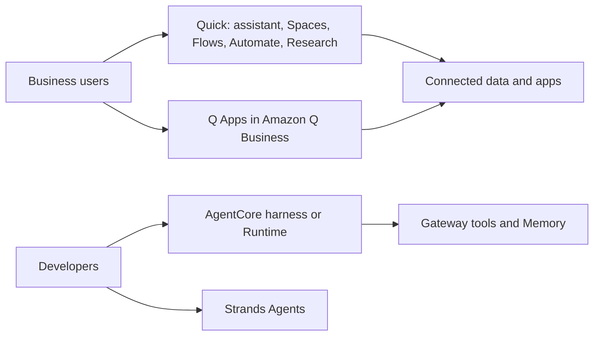

> **Evidence level.** Both docs.aws.amazon.com Quick and Q Apps pages I fetched returned only a title. Facts below come from the AWS Quick product and pricing pages, the AWS launch blog and a Quick user-guide mirror (✅ where stated), and search summaries (🟡). The syllabus gives only titles for lessons 117 to 125.

## 0. Before you start
- **Essential:** what a knowledge base and RAG are ([01/03](aip:01-bedrock-genai-fundamentals/03-retrieval-augmented-generation-rag)); what an agent is.
- **Helpful:** IAM Identity Center (single sign-on for AWS); BI dashboards.
- **Optional advanced:** Amazon Q Business data-source connectors.

## 1. Simple explanation
Not every company wants to build agents with code. **Amazon Q Apps** (inside **Amazon Q Business**) lets employees turn a prompt or a good chat into a small shareable AI app with a few input and output cards. **Amazon Quick** is AWS's broader workplace AI product: a chat assistant and custom chat agents, shared **Spaces** of company knowledge, **Flows** and **Automate** for repeatable work, **Research** for cited reports, and **Quick Sight** for dashboards. They are the "no-code, business user" end of AWS's agent story, opposite to Strands and AgentCore.


```figure
flow quick-landscape
```

## 2. Structured explanation
1. **Q Apps** 🟡: create from a conversation (a "Create Amazon Q App" button; the assistant drafts a prompt to edit) or from a plain-language prompt in the Q Apps Creator; an app is a set of **cards** that take inputs and generate text outputs; share privately or publish to the company **library**; others can use, duplicate and customise without changing the original; Q Apps must be enabled for the Q Business application and users sign in through IAM Identity Center.
2. **Quick** naming ✅: announced **October 9, 2025** as *Amazon Quick Suite*, described as an evolution of QuickSight ("Quick Sight: the former Amazon QuickSight"); the product pages now say **Amazon Quick**; the exam guide lists **Amazon Quick** and **Amazon Quick Sight** ✅.
3. **Quick components** ✅ (launch blog; names on the current page differ slightly): *Quick Index* (knowledge foundation), *Quick Research*, *Quick Sight*, *Quick Flows*, *Quick Automate*, *Spaces*, *chat agents*; the product page also lists a desktop app, apps built without code, and deliverables (documents, presentations, spreadsheets).
4. **Chat and agents:** a built-in assistant plus custom chat agents (system prompt + Spaces + action integrations) ✅. A chat agent *step in a flow* is single-turn ✅.
5. **Grounding:** answers draw on connected data and Spaces; Research "grounds insights to original sources" so users can verify ✅; Spaces keep access permissions ✅. Detailed grounding mechanics ❌ not verified.
6. **Flows and Automate:** Flows turn a described task into a shareable workflow ✅; Automate targets complex multi-step, cross-team processes with multi-agent workflows, a UI agent, human-in-the-loop approvals, monitoring and audit trails ✅.
7. **Security, pricing, limits** (§5.4).

## 3. Analogy
**A well-staffed office versus a workshop.** Strands and AgentCore are the workshop: you build the machines. Quick is the office: you hire an assistant, hand them the shared folder (Space), give recurring chores (Flows), and ask for a researched report. Q Apps is a template drawer where any employee can photocopy a good form and share it.

*Where it breaks:* in an office the assistant sees what its manager sees. Quick's value and risk depend on exactly which data sources are connected and which permissions flow through; mis-scoped Spaces still leak information.

## 4. The seven questions

**WHAT?** Q Apps = lightweight shareable AI apps in Amazon Q Business. Quick = an AI workspace with assistant, agents, Spaces, Flows, Automate, Research, apps and Sight (BI).

**WHY?** Business users get AI workflows without developers; IT keeps SSO, RBAC and governance.

**WHEN?** Choose Quick/Q Apps for business-user productivity, internal Q&A over documents and repeatable office tasks. Choose Strands/AgentCore for customer-facing or deeply custom agents.

**WHERE?** Region lists are not given on the pages I read ❌. Check the console and the Quick documentation.

**HOW?** §5 and §8.

**WHAT IF?**
| Situation | Effect | Remedy |
|---|---|---|
| Existing QuickSight customer upgrades | AWS says data connectivity, user access, content, security controls, permissions and privacy settings "remain exactly the same" ✅ | Still review permissions |
| Chat agent step in a flow needs a dialogue | It is single-turn ✅ | Use chat for multi-turn |
| Space includes broad documents | Everyone with Space access can ask about them | Scope Spaces narrowly |
| Usage exceeds the included agent hours | Professional: overages not currently possible; Enterprise: overage metered ✅ (page undated) | Monitor usage |
| Q Apps not enabled | Users cannot create/publish apps 🟡 | Enable in the Q Business console |

**WHY NOT?** Not for pixel-level custom UX, custom orchestration, or when you need the agent's loop in your own code and VPC controls (use AgentCore). Not as the place to put regulated data until you have checked data-handling terms ❌ (the pages I read make no statement about model training).

## 5. Technical depth

### 5.1 Where these sit in the AWS agent stack

*Reading the arrows:* business users work in Quick or Q Apps, which read from connected sources; developers use code-first or config-first agent services, which reach tools through Gateway. Overlap exists, but the audience and control level differ.

### 5.2 Chat agents, Spaces and Flows ✅
- A **chat agent** bundles domain knowledge, instructions and tools, reusable across flows ✅.
- A **Space** groups files or connected datasets for a role, project or function, preserving permissions ✅.
- A **flow** is built from natural-language instructions and can include chat-agent steps and a Research step (for account plans, policy reviews, prior-art research, industry reports) ✅ (mirror of the user guide).

### 5.3 Research and Apps ✅
Research produces a cited report using enterprise sources, the public internet and third-party datasets (product page). Apps lets users build custom web apps without coding (product page). Quick Sight adds natural-language BI, dashboards, executive summaries and what-if scenarios (launch blog).

### 5.4 Security, pricing and limits (lesson 124)
| Topic | What the pages say |
|---|---|
| Permissions | Spaces maintain access permissions ✅; Automate has role management, HITL approvals, audit trails ✅ |
| Governance (Professional/Enterprise tiers) | RBAC, SSO, data sovereignty, admin controls ✅ (product page) |
| Model training on customer data | Not stated on the pages I read ❌ |
| Pricing structure | Per-user subscription **plus** consumption (launch blog ✅); consumption is metered as **agent hours** per second for Chat, Research, Flows, Automate, artifact generation and custom agents, and index storage for Quick Index (pricing page ✅) |
| Tiers on the pricing page (undated; read 2026-10-26) | Free (1 user), Plus (up to 300 users), Max (5x usage and index storage), Professional and Enterprise (organization tiers needing an AWS account, with an account infrastructure fee) ✅. Example list prices on the page: Plus $20/user/month annual; Professional $20 plus $250 account fee; Enterprise $40 plus $250 account fee; Enterprise overage $3 per agent hour and $5 per GB-month ✅. **Do not memorise prices**; they change. |
| Entitlements | Professional 8 agent hours and 25 GB index per user per month; Enterprise 18 hours and 50 GB ✅ (page) |
| Trial | 30-day Enterprise trial for up to 25 users ✅ (page) |
| Limits | Not found beyond the above ❌ |

## 6. Worked example
*Problem:* A sales team wants (a) a Q&A assistant over product sheets and win/loss notes, (b) a weekly account summary email, (c) occasional deep research on a prospect.

| Step | Quick feature |
|---|---|
| 1 | Create a **Space** with the sheets and notes; share it with the sales group |
| 2 | Create a **chat agent** with instructions and that Space |
| 3 | Build a **flow** that runs the agent step per account and drafts the summary |
| 4 | Use **Research** for prospect reports with citations |
| 5 | Review permissions, usage (agent hours) and cost monthly |

## 7. Knowledge checkpoints
1. What is a Q App made of, and how can it be shared?
2. What are Spaces for, and what do they preserve?
3. What unit is Quick consumption metered in?
4. Why can a chat agent step in a flow not hold a conversation?

## 7b. Practice questions (exam-style, original) — answers in §14

**Q1.** Business users without coding skills want to turn a useful prompt into a small shared AI tool inside their company's Q Business environment. Which feature fits?
A. Amazon Q Apps
B. AgentCore Runtime
C. SageMaker Ground Truth
D. AWS Glue DataBrew

**Q2.** (Select TWO) Which are Amazon Quick capabilities according to AWS?
A. Chat agents
B. Spaces
C. GPU training clusters
D. VPC peering
E. Bedrock Guardrails policy engine

**Q3.** A company wants a customer-facing agent with a custom loop, session isolation and VPC control. Which is the better fit?
A. Amazon Quick chat agent
B. AgentCore Runtime with a framework such as Strands
C. Q Apps
D. Quick Sight

**Q4.** Which statement about Spaces is correct?
A. They group files or datasets for a role/project and maintain access permissions
B. They are GPU instance pools
C. They store model weights
D. They replace IAM

**Q5.** A flow step uses a chat agent. A designer expects multi-turn clarification inside that step. What should they know?
A. The step is single-turn and does not support back-and-forth conversation
B. It supports unlimited turns
C. It only works in the CLI
D. It requires Provisioned Throughput

**Q6.** (Select TWO) Which statements about Quick pricing are consistent with AWS's pricing page?
A. There are per-user tiers plus consumption measured in agent hours
B. Quick Index storage is metered
C. Pricing is only per token
D. There is no consumption component
E. The service is free for all organizations forever

**Q7.** Which pair correctly maps naming history?
A. QuickSight became part of Quick Suite (Oct 2025) and the product is now called Amazon Quick, with Quick Sight as its BI part
B. Quick replaced Amazon Bedrock
C. Quick Suite replaced AWS Glue
D. Quick Sight is a GPU service

**Q8.** What should be reviewed first before connecting a broad document repository to a Quick Space?
A. Who will have access to that Space and what the sources' permissions are
B. The GPU quota
C. The CloudFront price class
D. The Lambda timeout

## 7c. Module 03 mixed review (replaces a Quiz 3 exam; original questions, all in §14)

**R1.** Which AgentCore capability enforces deterministic allow/deny on tool calls outside agent code?
A. Policy with a Gateway
B. Memory
C. Browser
D. Evaluations

**R2.** (Select TWO) In Bedrock Agents Classic, which are true?
A. It is in maintenance mode and closed to new customers from July 30, 2026
B. Return of control hands the call details to the caller
C. Agents have an end-of-life date next month
D. One action group can have unlimited Lambda functions
E. Knowledge Bases are also closed to new customers

**R3.** A long chat needs the user's preference remembered next week. Which capability?
A. Long-term memory
B. A larger context window
C. Fine-tuning
D. Prompt caching

**R4.** What does the Strands default model provider equal?
A. Amazon Bedrock
B. OpenAI
C. Ollama
D. None

**R5.** Which Step Functions workflow type supports `.waitForTaskToken`?
A. Standard
B. Express
C. Both
D. Neither

**R6.** Which is the best fit for exposing an OpenAPI-described REST API to MCP-capable agents with managed auth?
A. AgentCore Gateway
B. AgentCore Code Interpreter
C. S3 Vectors
D. Amazon Transcribe

**R7.** (Select TWO) Which statements about the AgentCore harness are correct?
A. It is configuration-based and powered by Strands
B. It runs inside Runtime and each session is an isolated microVM
C. It requires you to write the agent loop
D. It supports custom graph workflows
E. It is only available in US East (N. Virginia)

**R8.** An evaluation of live agent traces for helpfulness and tool selection should use:
A. AgentCore Evaluations (online evaluation)
B. DynamoDB TTL
C. S3 Intelligent-Tiering
D. Route 53

## 8. Hands-on lab: Space-style permission filtering with citations (offline) and a usage meter

### 8.1 Objective
Show offline why Spaces and grounded answers must respect permissions, and how consumption metering works in principle. The "rates" in the meter are **hypothetical teaching numbers**, not Quick's.

### 8.2 Prerequisites
Python 3 only.

### 8.3 AWS services
None offline. Concepts: Amazon Quick Spaces, Research citations, agent-hour metering.

### 8.4 IAM permissions
Offline: none.

### 8.5 Region notes
Not stated on the pages I read ❌.

### 8.6 Architecture
Question → permission filter on Space documents → retrieve best matches → answer with citations.

### 8.7 Cost
Offline: none.

### 8.8 Code
```python lab-run
import re
from collections import Counter

SPACE = [
    {"id": "d1", "title": "Pricing sheet", "text": "enterprise tier price per user and support plan", "groups": {"sales", "all"}},
    {"id": "d2", "title": "Win loss notes", "text": "customer chose us for support and price", "groups": {"sales"}},
    {"id": "d3", "title": "Salary bands", "text": "salary bands per grade and support staff pay", "groups": {"hr"}},
]

def words(t):
    return re.findall(r"[a-z]+", t.lower())

def answer(question, user_groups, top_k=2):
    allowed = [d for d in SPACE if d["groups"] & user_groups]            # permissions first
    q = Counter(words(question))
    scored = sorted(((sum(q[w] for w in set(words(d["text"]))), d["id"], d) for d in allowed), key=lambda x: (-x[0], x[1]))
    hits = [(s, d) for s, _, d in scored if s > 0][:top_k]
    if not hits:
        return "No answer found in the sources you can access."
    cites = ", ".join(f"[{d['id']}] {d['title']}" for _, d in hits)
    return f"Answer drawn from {len(hits)} source(s). Citations: {cites}"

print("sales user :", answer("what support and price do customers want", {"sales", "all"}))
print("hr user    :", answer("what support and price do customers want", {"hr"}))
print("outsider   :", answer("salary bands", {"guest"}))

HYPOTHETICAL_RATE = {"fast": 1.0, "balanced": 2.0, "smart": 3.0}     # made-up multipliers to show the idea only
def agent_hours(seconds, mode):
    return seconds / 3600 * HYPOTHETICAL_RATE[mode]

used = agent_hours(1800, "balanced") + agent_hours(600, "smart") + agent_hours(7200, "fast")
included = 8.0
print(f"used {used:.2f} agent-hours (hypothetical rates) of {included:.0f} included -> remaining {included - used:.2f}")
```

### 8.9 Captured output
Generated on 2026-10-26 by extracting the block above from this file and running it (Python 3). Not Quick output.
```text lab-out
sales user : Answer drawn from 2 source(s). Citations: [d1] Pricing sheet, [d2] Win loss notes
hr user    : Answer drawn from 1 source(s). Citations: [d3] Salary bands
outsider   : No answer found in the sources you can access.
used 3.50 agent-hours (hypothetical rates) of 8 included -> remaining 4.50
```

### 8.10 Explanation
- The permission filter runs **before** retrieval, so a user can never receive text from a document they cannot read, and citations let them verify.
- The HR user cannot see the sales documents even though the question matches them; the sales user cannot see salary bands. The HR user does get one citation, to the salary sheet, only because the word "support" appears in it: retrieval can return weakly related text, so citations matter for judging it.
- The meter only shows that consumption adds up per second across modes; real rates come from AWS.

### 8.11 Optional console lab (shown, not run ❌)
**Q Apps (lesson 118, 🟡):** in an Amazon Q Business application with Q Apps enabled, start a conversation, choose *Create Amazon Q App*, review the drafted prompt, generate the app, edit the cards, publish to the library or share privately, then run it as another user. **Quick (lesson 125):** sign in to Amazon Quick, create a Space with a small set of non-sensitive files, create a chat agent that uses it, ask questions, build a simple flow, and run a Research task. Use a free or trial tier and non-sensitive data. Exact console labels ❌ not verified. **Cleanup:** delete flows, agents, Spaces and uploaded files; cancel or downgrade the subscription if you created one; remove Q Business applications and IAM Identity Center test users.

### 8.12 Common errors
| Problem | Cause | Fix |
|---|---|---|
| Users cannot create Q Apps | Not enabled / no Identity Center access 🟡 | Enable and grant access |
| Answers miss documents | Source not connected or permissions block it | Check connectors and ACLs |
| Unexpected cost | Long-running flows/research | Track agent hours |
| Cannot hold a dialogue in a flow step | Single-turn step ✅ | Use chat |

### 8.13 Security recommendations
Least-privilege Spaces; classify data before connecting; use SSO/RBAC; review audit trails; avoid pasting secrets; delete trial resources.

## 9. What can go wrong?
| Failure | Why | Symptoms | Investigate | Fix | Prevent |
|---|---|---|---|---|---|
| **Over-broad Space** | Convenience | Data exposure | Access review | Narrow scope | Data classification |
| **Stale knowledge** | Source not refreshed | Wrong answers | Index freshness | Sync sources | Schedules |
| **Cost surprise** | Agent hours/storage | Bills grow | Usage view | Limits, tiers | Budgets |
| **Shadow AI apps** | Anyone publishes Q Apps | Unreviewed apps | Library audit | Governance process | Publishing rules |
| **Wrong product** | Using Quick for a developer need | Missing control | Requirements | Use AgentCore | Decision table |

## 10. Common misconceptions
1. **"Quick is just QuickSight renamed."** It adds assistant, agents, Spaces, Flows, Automate and Research; Sight is one part ✅.
2. **"Q Apps are agents."** They are lightweight card-based apps 🟡.
3. **"A Space is a vector store."** It is a permissioned collection of context for Quick; internals ❌ not verified.
4. **"Flows can hold conversations."** The chat-agent step is single-turn ✅.
5. **"Prices on the pricing page are stable."** The page is undated.

## 11. Exam notes
- **Pattern:** "business users, no-code, internal Q&A and workflows" → Amazon Quick / Q Business.
- **Pattern:** "developer-built, customer-facing, custom orchestration" → Strands + AgentCore.
- **Trap:** confusing Quick (workspace) with Quick Sight (BI) or with Bedrock (models).
- **Compare:** Q Apps (shareable cards) vs Quick Flows (workflows) vs Bedrock Flows (developer workflows, [01/08](aip:01-bedrock-genai-fundamentals/08-prompt-management-flows-and-structured-output)) vs Step Functions.

## 12. Summary and revision cards
- Q Apps: cards, library, Identity Center 🟡.
- Quick: assistant, chat agents, Spaces, Flows, Automate, Research, Apps, Sight.
- Pricing: per-user tiers + agent hours + index storage.
- Flow chat-agent step: single turn.

**Cards.** Q: Quick Suite announcement date? A: Oct 9, 2025. · Q: Metered unit? A: agent hours. · Q: Space preserves? A: access permissions.

## 13. References
| Source | URL | Verified |
|---|---|---|
| Amazon Quick product page | https://aws.amazon.com/quick/ | 2026-10-26 |
| Amazon Quick pricing (undated page) | https://aws.amazon.com/quick/pricing/ | 2026-10-26 |
| Launch blog (Oct 9, 2025) | https://aws.amazon.com/blogs/aws/reimagine-the-way-you-work-with-ai-agents-in-amazon-quick-suite/ | 2026-10-26 |
| Quick user guide (flows, chat agent steps; China mirror) | https://docs.amazonaws.cn/quick/latest/userguide/ai-response-steps.html | 2026-10-26 |
| Q Apps launch and web experience | https://aws.amazon.com/blogs/aws/amazon-q-apps-now-generally-available-enables-users-to-build-their-own-generative-ai-apps/ | 2026-10-26 (🟡 search summary only) |
| Quick docs home | https://docs.aws.amazon.com/quick/ | fetch returned title only ❌ |

**Unverified here:** Regions, limits, model-training/data-use statements, Q Apps official docs, grounding internals, console labels, and whether Q Apps/Q Business have availability notices.

## 14. Answers to checkpoints and practice questions
**Checkpoints.** 1) Cards that take inputs and produce outputs; shared privately or published to the library 🟡. 2) Grouping files/datasets for a role or project; they preserve access permissions. 3) Agent hours (plus index storage). 4) The step is single-turn by design.

**Practice questions.**
- **Q1 → A.** Q Apps; B is for developer-hosted agents; C and D are unrelated.
- **Q2 → A, B.** C, D, E are not Quick capabilities.
- **Q3 → B.** Custom loop, isolation and VPC control are AgentCore Runtime strengths.
- **Q4 → A.** Spaces are context collections, not infrastructure or IAM.
- **Q5 → A.** Single-turn ✅.
- **Q6 → A, B.** C and D contradict the page; E is not stated.
- **Q7 → A.** The launch blog and exam guide support this mapping ✅.
- **Q8 → A.** Scope and permissions come first.

**Module 03 review (7c).**
- **R1 → A.** Policy via Gateway. Memory stores context, Browser automates web, Evaluations scores quality.
- **R2 → A, B.** C is false (no end-of-life date); D false (one Lambda); E false (KBs unaffected).
- **R3 → A.** Long-term memory persists facts across sessions. Context windows do not persist; fine-tuning is not for per-user facts; caching saves cost.
- **R4 → A.** Bedrock is the default.
- **R5 → A.** Standard only.
- **R6 → A.** Gateway converts OpenAPI/Lambda/Smithy and handles auth.
- **R7 → A, B.** C and D are wrong (no loop code; graphs need Runtime); E is wrong (many Regions).
- **R8 → A.** Online evaluation samples live traces.
