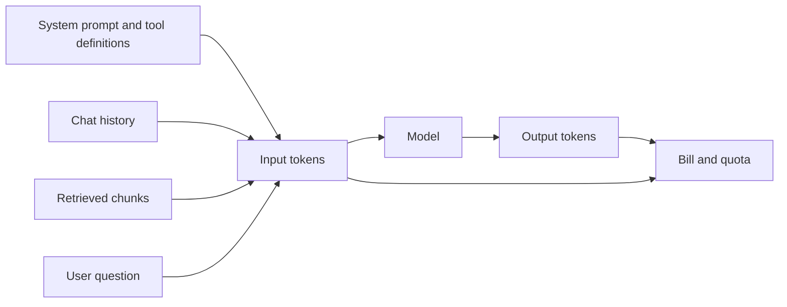
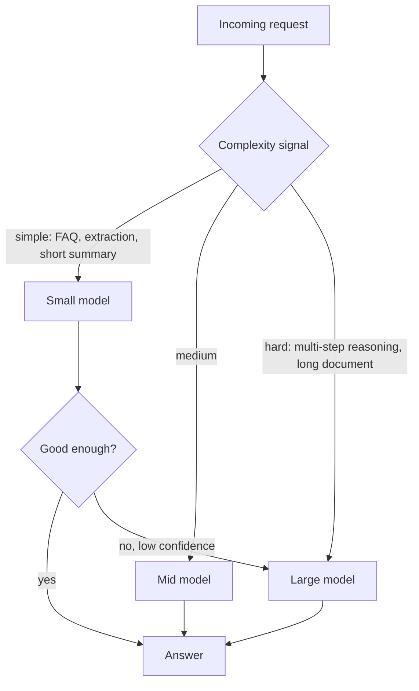

## 0. Before you start
- **Essential:** what a token is ([00-foundations/02](aip:00-foundations/02-llm-and-genai-basics)); that you pay for input and output tokens; the Converse API request shape.
- **Helpful:** CloudWatch metrics and Logs Insights basics; what a Region is.
- **Optional advanced:** how tokenizers differ between model families; AWS Cost and Usage Reports.

## 1. Simple explanation
A foundation model is billed (and rate-limited) by the **token**, a small chunk of text. Every word you send in and every word the model writes back costs tokens. **Token efficiency** means getting the same quality of answer from fewer tokens: shorter prompts, trimmed chat history, capped answer length. **Cost-effective model selection** means not hiring a surgeon to put on a plaster: easy questions go to a small, cheap model, and only hard questions go to a big, expensive one. Together they are the two biggest levers on a GenAI bill.


```figure
flow token-anatomy
```

## 2. Structured explanation
1. **Measure first.** Estimate tokens *before* a call with the `CountTokens` API (free; the count matches what would be charged) ✅, and measure *after* a call with the `usage` block and CloudWatch metrics ✅.
2. **Attribute usage.** Know who spends what: model invocation logs with `requestMetadata` ✅, application inference profiles with cost allocation tags ✅, IAM principal in `identity.arn` ✅.
3. **Shrink the input.** Prompt compression, context pruning (drop old turns, summarise them), retrieve fewer and better chunks, put static instructions in a prompt cache ([04/02](aip:04-operational-efficiency/02-throughput-utilization-and-intelligent-caching)).
4. **Cap the output.** `maxTokens`, stop sequences, and an explicit "answer in at most N sentences" instruction ✅ (`maxTokens` also changes how much quota a request reserves, §5.2).
5. **Pick the model per request.** Tiered usage by complexity (cascade or router), Bedrock **intelligent prompt routing** ✅, and the pricing options that trade latency for cost (service tiers, batch, global cross-Region inference) ✅/🟡.
6. **Prove it.** Compare *price-to-performance* on your own evaluation set; never swap models on price alone ([07 governance/QA](aip:meta/syllabus-coverage-map) covers evaluation in depth).

## 3. Analogy
**A taxi company's fleet.** Most trips are one passenger across town (small car). A few are eight people with luggage (minibus). Sending a minibus to every call wastes fuel; sending a small car to the airport group fails. A dispatcher (router) picks the vehicle, and a meter (token counter) shows what each trip cost. Telling drivers "no detours" is the `maxTokens` cap.

*Where it breaks:* a taxi's fuel use is visible from the road, but a model's "detour" (a rambling answer) is only visible after you have paid for it. Also, the dispatcher itself costs something: a classifier or router call is overhead, and a wrong routing decision costs quality, not just money.

## 4. The seven questions

**WHAT?** Token efficiency = reducing tokens per useful answer. Cost-effective model selection = matching model capability and price to the difficulty of each request.

**WHY?** Token spend scales with traffic. Quota (tokens per minute) also scales with tokens, so waste costs money *and* throughput ([04/02](aip:04-operational-efficiency/02-throughput-utilization-and-intelligent-caching)). Fewer tokens usually also means lower latency.

**WHEN?** As soon as there is real traffic: prompts that were fine for 100 requests a day hurt at 100,000. Revisit when a model family releases a cheaper tier, when your average conversation length grows, or when a new feature adds long documents.

**WHERE?** At the application layer (prompt builder, history manager, router), in Bedrock request parameters (`inferenceConfig`), in Bedrock features (intelligent prompt routing, prompt caching), and in observability (CloudWatch, invocation logs, cost tags).

**HOW?** §5.

**WHAT IF?**
| Situation | Effect | Remedy |
|---|---|---|
| `maxTokens` too low | Answer cut off mid-sentence (`stopReason: max_tokens`) ✅ | Raise it to fit a normal answer; ask the model to be brief rather than relying on truncation |
| `maxTokens` far too high | Larger up-front quota reservation, fewer concurrent requests ✅ ([04/02 §5.2](aip:04-operational-efficiency/02-throughput-utilization-and-intelligent-caching)) | Set to a realistic p95 of output length |
| Pruning drops a fact the user needs | Wrong or "forgetful" answer | Summarise instead of deleting; keep pinned facts; test with a golden set |
| Router sends a hard question to the small model | Poor answer, possibly retried on the big model (you pay twice) | Confidence check + escalate; measure escalation rate |
| Intelligent prompt routing on non-English prompts | Documented as optimised for English only ✅ | Evaluate on your language before relying on it |
| Estimating tokens with "characters / 4" | Off for code, other languages, images | Use `CountTokens` for anything that matters ✅ |

**WHY NOT?** Do not compress prompts so hard that the model loses the instructions that keep it safe or accurate. Do not route on cost alone for regulated or high-stakes answers. Do not add a router for a workload with a single, uniform request type: the extra hop is pure overhead.

## 5. Technical depth

```figure
context-budget
```


### 5.1 Where tokens go

*Reading the arrows:* four sources feed the input; the model produces the output; both sides feed the bill and the quota. The cheapest tokens are the ones never sent. Usually the system prompt is *constant* per request (a cache candidate), history grows every turn (prune or summarise), retrieved chunks are the most tunable (fewer, better, reranked), and the user question is small.

### 5.2 Measuring and capping tokens ✅
- **`CountTokens`** returns the input token count that *would* be charged if the same input were sent for inference; it is **free**; it accepts an `InvokeModel` body or a `Converse` body (`messages`, `system`); IAM action `bedrock:CountTokens`. Counting is **model-specific** because tokenizers differ. Some Claude models do not support it on `bedrock-runtime`; the page describes using Anthropic's `count_tokens` on the `bedrock-mantle` endpoint instead (IAM action `bedrock-mantle:CountTokens`) ✅.
- **After the call**, the Converse `usage` block reports token counts; with prompt caching, `inputTokens` is only the **non-cached** input, so `total input = inputTokens + cacheReadInputTokens + cacheWriteInputTokens` ✅.
- **Runtime metrics** (namespace `AWS/Bedrock`) ✅: `InputTokenCount`, `OutputTokenCount`, `CacheReadInputTokenCount`, `CacheWriteInputTokenCount`, `Invocations`, `InvocationLatency`, `InvocationThrottles`, `EstimatedTPMQuotaUsage` (an approximation: the page says not to use it as the sole indicator for capacity planning). Dimension `ModelId`. An automatic CloudWatch **Bedrock dashboard** has a "Token Counts by Model" widget ✅.
- **Caps:** `inferenceConfig.maxTokens`, `stopSequences`, and instructions such as "reply in two sentences". Inference parameter names and defaults vary by model ✅.

### 5.3 Attribution: who spent the tokens? ✅
| Mechanism | How it works | Shows up in |
|---|---|---|
| **Model invocation logging** | Off by default; enable per Region; S3 and/or CloudWatch Logs; each record has `modelId`, `identity.arn`, `input.inputTokenCount`, `output.outputTokenCount` | Logs Insights, Athena |
| **Per-request metadata** | `requestMetadata` (Converse/ConverseStream) or `X-Amzn-Bedrock-Request-Metadata` header (InvokeModel); max 16 entries, key and value ≤ 256 characters; not on `bedrock-mantle`; recorded only if logging is enabled in that Region | Invocation logs (not Cost Explorer) |
| **Application inference profile** | You create it (`CreateInferenceProfile`: `inferenceProfileName`, `modelSource`, optional `tags`); invoke with its ARN; tags act as cost allocation tags | Cost Explorer and CUR, plus per-profile CloudWatch metrics |
| **IAM principal attribution** | Caller identity captured automatically in logs | Logs |

Two exam-relevant cautions ✅: request metadata is **not** a cost allocation tag (it never appears in Cost Explorer or CUR); and nothing in Bedrock *forces* callers to send it, so put it in a shared client or gateway. Do not put PII in metadata values.

### 5.4 Shrinking the input
- **Context pruning with a budget:** keep the system prompt, keep the newest turns that fit, drop (or summarise) the oldest. The lab does this.
- **Summarise old turns** with a cheap model; keep the summary plus the last few turns. (Agent memory in [03/02](aip:03-agentic-ai/02-multi-agent-workflows-and-agent-memory) uses the same idea.)
- **Retrieve less, rank better:** fewer chunks after reranking beat many chunks without it ([01/05](aip:01-bedrock-genai-fundamentals/05-chunking-embeddings-reranking-and-rag-evaluation)).
- **Prompt compression:** remove filler, use compact formats, avoid repeating instructions. Measure quality after each change; shorter is not always better.
- **Prompt caching** for the unchanging prefix: cache reads are billed at the model's cache-read rate and (for most models) do not count against the token quota ✅ ([04/02 §5.4](aip:04-operational-efficiency/02-throughput-utilization-and-intelligent-caching)).
- **Do not stuff tools:** tool definitions are input tokens on *every* call. Give an agent only the tools it needs (semantic tool selection in AgentCore Gateway, [03/04](aip:03-agentic-ai/04-agentcore-runtime-memory-gateway-identity-policy-evaluations)).

### 5.5 Choosing the model per request

*Reading the arrows:* a cheap signal (rules, a small classifier model, or a router) sends each request to the cheapest model likely to succeed; a confidence or validation check can escalate a weak small-model answer to the large model. The cost of escalation is the small call *plus* the large call, so a high escalation rate erases the saving.

**Bedrock intelligent prompt routing** ✅ (official page):
- One serverless endpoint that routes between models **in the same family** and predicts which gives the best response quality for each prompt, aiming at quality and cost.
- **Default routers** are pre-configured (select Amazon Nova and Meta Llama models; which are available depends on the Region); **configured routers** let you pick exactly **two** models of one family, a **fallback model** and a **response quality difference** (for example, with a 10% difference and Nova Lite as fallback, the router moves to Nova Pro only if its predicted quality is more than 10% better).
- API: `CreatePromptRouter` (`--prompt-router-name`, `--models`, `--fallback-model`, `--routing-criteria '{"responseQualityDifference": 0.5}'`), plus `GetPromptRouter`, `ListPromptRouters`, `DeletePromptRouter`. The response says which model served the request.
- **Limitations:** optimised only for **English**; cannot adapt using your application's performance data; may not be optimal for specialised use cases.
- The model table on that page listed Nova Lite/Pro and Llama 3.x entries when read; another example in the page text names a Claude model. Check the page for the current list ❌ (I did not rely on it).

**Other cost levers (know the trade-off):**
| Lever | Trade-off | Status |
|---|---|---|
| **Flex service tier** (`service_tier: "flex"`) | Discount, longer/variable latency; for evaluations, summarisation, agentic work that can wait | ✅ exists; discount size 🟡 (pricing page; one search summary said 50% to Standard) |
| **Priority tier** | Faster, price premium | ✅ |
| **Batch inference** | Asynchronous; pricing page advertises a discount for a subset of models | ✅ exists; "50%" 🟡 |
| **Global cross-Region inference** | About 10% saving versus geographic profile; data may be processed anywhere in supported commercial Regions | ✅ ([04/04](aip:04-operational-efficiency/04-backoff-connection-pooling-and-cross-region-inference)) |
| **Prompt caching** | Cache-write may cost more than normal input; reads cheaper | ✅ |
| **Smaller model + better prompt** | Needs evaluation effort | design |
| **Distillation / fine-tuning a small model** | Upfront cost; ([01/02](aip:01-bedrock-genai-fundamentals/02-model-customization-finetuning-and-lora)) | ✅ earlier |

**Price-to-performance measure:** `cost per 1,000 *acceptable* answers = cost per 1,000 calls / acceptance rate`. A model that is twice as cheap but acceptable half as often costs the same per good answer, before counting retries and human review.

## 6. Worked example

```figure
model-cascade
```

*Problem:* A support bot handles 100,000 requests a day. Each request sends 3,000 input tokens (a 1,500-token system prompt and tool list, 1,000 tokens of history, 400 of retrieved text, 100 for the question) and the model writes about 600 tokens. 70% of questions are simple.

| Step | Change | Effect on tokens per request |
|---|---|---|
| 1 | Measure with `usage` and invocation logs; find p95 output is 350, not 600; the "long" answers are rambling | baseline 3,000 in / 600 out |
| 2 | Cap `maxTokens` at 450 and add "answer in at most five sentences" | output about 330 |
| 3 | Prune history to the last four turns plus a summary | input 3,000 → about 2,300 |
| 4 | Cache the 1,500-token constant prefix | 1,500 tokens read from cache on most calls ([04/02](aip:04-operational-efficiency/02-throughput-utilization-and-intelligent-caching)) |
| 5 | Route the 70% simple questions to a small model; escalate when a validator fails | most traffic on the cheap model |
| 6 | Re-run a golden set; confirm acceptance rate did not drop | proves it |

The lab (§8) reproduces steps 2, 3 and 5 with made-up prices so you can see the shape of the saving.

## 7. Knowledge checkpoints
1. Is the `CountTokens` API free, and does its count match what you would be charged?
2. Does `requestMetadata` appear as a cost allocation tag in Cost Explorer?
3. In intelligent prompt routing, how many models can a configured router choose between?
4. With prompt caching on, what does `inputTokens` in the response represent?
5. Why can setting `maxTokens` very high reduce throughput even if answers stay short? (Hint: [04/02](aip:04-operational-efficiency/02-throughput-utilization-and-intelligent-caching).)

## 7b. Practice questions (exam-style, original) — answers in §14

**Q1.** A team wants to know, before sending a large document to a model, how many input tokens it will consume, without paying for the check. What should they use?
A. Send the request with `maxTokens` set to 1
B. The Bedrock `CountTokens` API with the same model
C. Divide the character count by 4 and treat it as exact
D. Enable Provisioned Throughput and read the model-unit report

**Q2.** (Select TWO) Which statements about per-request metadata on Amazon Bedrock are correct?
A. It is recorded in model invocation logs when logging is enabled in the Region
B. It automatically becomes an AWS cost allocation tag in Cost Explorer
C. Converse supports it through the `requestMetadata` field
D. Bedrock rejects any request that omits it
E. It is supported on the `bedrock-mantle` endpoint

**Q3.** A company needs cost reports by business unit that appear natively in Cost Explorer for on-demand Bedrock calls. Which approach fits best?
A. Application inference profiles with cost allocation tags, one per business unit
B. A bigger `maxTokens` value
C. Turning off model invocation logging
D. Using one shared IAM role for all teams

**Q4.** A chatbot's token cost rises every turn because the whole conversation is resent. Which change best reduces cost while preserving continuity?
A. Delete all history after each answer
B. Keep the system prompt and the newest turns within a token budget, and summarise older turns
C. Increase the temperature
D. Switch to a model with a larger context window and send everything

**Q5.** (Select TWO) Which are valid reasons a tiered "small model first, escalate if needed" design might not save money?
A. A high escalation rate means many requests pay for two model calls
B. The router or classifier call itself adds cost and latency
C. Small models never support the Converse API
D. Token counts are identical across all models
E. Cache reads are free of charge on every model

**Q6.** Bedrock intelligent prompt routing is being evaluated for a French-language customer service bot. What is the most important documented caution?
A. Routers only work with image inputs
B. It is optimised only for English prompts, so evaluate on your language first
C. It requires Provisioned Throughput
D. It can only route between models from different providers

**Q7.** A batch of nightly report summaries does not need an answer for hours. Which option best lowers cost for this workload?
A. Priority service tier
B. Batch inference (or the Flex tier where supported), which trade latency for lower price
C. Latency-optimized inference
D. A larger `temperature`

**Q8.** When you configure a prompt router with Nova Lite as the fallback model and a 10% response quality difference, when does it use the other model?
A. Always
B. Only if the other model's predicted response quality is more than 10% better than the fallback model's
C. Only when the request is longer than 10 tokens
D. Never; the fallback model handles everything

## 8. Hands-on lab: token budget, pruning and a cascade with made-up prices

### 8.1 Objective
Reproduce the logic of context pruning, output capping and a small-then-large cascade, offline, so you can see where the saving comes from.

### 8.2 Prerequisites
Python 3 only. Nothing here calls AWS. Prices are **illustrative units**, not real prices.

### 8.3 AWS services
None offline. Concepts map to Bedrock Converse, `CountTokens`, intelligent prompt routing.

### 8.4 IAM permissions
Offline: none. Real: `bedrock:InvokeModel` (also used by Converse), `bedrock:CountTokens` for the counting call ✅.

### 8.5 Region notes
Model, `CountTokens` and prompt-router availability vary by Region and model; check the model card and the prompt-routing page ✅.

### 8.6 Architecture
§5.1 and §5.5.

### 8.7 Cost
Offline: none. For a real run, count tokens first (free) and keep `maxTokens` small.

### 8.8 Code
```python lab-run
import math

def approx_tokens(text):
    # crude heuristic (about 4 characters per token); real counts come from CountTokens
    return max(1, math.ceil(len(text) / 4))

# ---- 1. Context pruning to a token budget ----
SYSTEM = "You are a helpful support assistant for ACME. Be brief."
TURNS = [("user", "Hi, my router keeps dropping the connection every evening."),
         ("assistant", "Sorry to hear that. Which router model do you have, and what do the lights show?"),
         ("user", "It is an ACME R7. The internet light blinks orange."),
         ("assistant", "Orange blinking means the line is syncing. Please power it off for 30 seconds and retry."),
         ("user", "Done. Still blinking orange after five minutes."),
         ("assistant", "Thanks. Let's check the line from your side. Is the phone socket cover loose?"),
         ("user", "Yes, I wiggled it and now the light is green. What was that about?")]

def prune(system, turns, budget):
    used = approx_tokens(system)
    kept = []
    for role, text in reversed(turns):
        t = approx_tokens(text)
        if used + t > budget:
            break
        kept.append((role, text))
        used += t
    kept.reverse()
    return kept, used

full = approx_tokens(SYSTEM) + sum(approx_tokens(t) for _, t in TURNS)
kept, used = prune(SYSTEM, TURNS, budget=60)
print("full history tokens:", full)
print("pruned to budget 60:", used, "tokens,", len(kept), "of", len(TURNS), "turns kept")
print("oldest kept turn starts:", kept[0][1][:30])

# ---- 2. Output cap: effect on cost per 1,000 requests (illustrative units per 1M tokens) ----
PRICE = {"small": (1.0, 4.0), "large": (10.0, 40.0)}   # (input, output) units per 1M tokens, made up

def cost(model, tin, tout, n=1000):
    pin, pout = PRICE[model]
    return n * (tin * pin + tout * pout) / 1_000_000

print("large, 3000 in / 600 out :", round(cost("large", 3000, 600), 2))
print("large, 2300 in / 330 out :", round(cost("large", 2300, 330), 2))

# ---- 3. Cascade: small first, escalate when a validator fails ----
def cascade_cost(p_simple, p_small_ok_on_simple, tin, tout):
    # simple requests go to small; a share of them fail validation and escalate (small + large);
    # hard requests go straight to large
    simple = p_simple * (p_small_ok_on_simple * cost("small", tin, tout)
                         + (1 - p_small_ok_on_simple) * (cost("small", tin, tout) + cost("large", tin, tout)))
    hard = (1 - p_simple) * cost("large", tin, tout)
    return simple + hard

base = cost("large", 2300, 330)
# with these prices the cascade only pays off while the small model succeeds more often than
# (small cost / large cost) of the time on simple requests
print("break-even small-model success rate:", round(cost("small", 2300, 330) / base, 2))
for ok in (0.95, 0.60, 0.05):
    c = cascade_cost(0.7, ok, 2300, 330)
    print(f"cascade, small succeeds {int(round(ok*100))}% of simple: {c:.2f} ({'cheaper' if c < base else 'dearer'} than all-large {base:.2f})")

# ---- 4. Price per ACCEPTABLE answer ----
def per_good(cost_per_1000, acceptance):
    return cost_per_1000 / acceptance

print("small  :", round(per_good(cost("small", 2300, 330), 0.55), 2))
print("large  :", round(per_good(cost("large", 2300, 330), 0.92), 2))
```

### 8.9 Captured output
Generated on 2026-10-26 by extracting the block above from this file and running it (Python 3). It is **not** Bedrock output, and the prices are invented units.
```text lab-out
full history tokens: 133
pruned to budget 60: 51 tokens, 2 of 7 turns kept
oldest kept turn starts: Thanks. Let's check the line f
large, 3000 in / 600 out : 54.0
large, 2300 in / 330 out : 36.2
break-even small-model success rate: 0.1
cascade, small succeeds 95% of simple: 14.66 (cheaper than all-large 36.20)
cascade, small succeeds 60% of simple: 23.53 (cheaper than all-large 36.20)
cascade, small succeeds 5% of simple: 37.47 (dearer than all-large 36.20)
small  : 6.58
large  : 39.35
```

### 8.10 Explanation
- Part 1: the pruner keeps the system prompt and the newest turns that fit. The oldest turns disappear first; production code would summarise them instead of dropping them.
- Part 2: output capping and pruning cut cost in proportion to the tokens removed; output tokens usually cost several times more than input tokens (the invented ratio here is 4 to 1, real ratios vary by model ✅ check pricing).
- Part 3: the cascade only wins while the small model succeeds often enough. A failed small attempt is wasted money on top of the large call, so the break-even success rate equals the small-to-large cost ratio (0.1 with these invented prices). Below it, the escalated requests pay twice and the design becomes dearer than "always large". Real routers also add their own cost, which moves the break-even up.
- Part 4: judge by cost per *acceptable* answer, not cost per call.

### 8.11 Optional AWS lab (shown, not run against AWS ❌)
1. Count tokens (free) for a Converse-shaped input ✅ (shape from the AWS page):
```python
import boto3
rt = boto3.client("bedrock-runtime")
resp = rt.count_tokens(
    modelId="MODEL_ID_FROM_YOUR_REGION",
    input={"converse": {
        "messages": [{"role": "user", "content": [{"text": "What is its population?"}]}],
        "system": [{"text": "You're an expert in geography."}]}})
print(resp["inputTokens"])
```
2. Call Converse with a cap and request metadata, then read `usage`:
```python
r = rt.converse(
    modelId="MODEL_ID_FROM_YOUR_REGION",
    messages=[{"role": "user", "content": [{"text": "Summarise our refund policy in two sentences."}]}],
    inferenceConfig={"maxTokens": 200, "temperature": 0.2},
    requestMetadata={"team": "support", "feature": "faq", "environment": "dev"})
print(r["usage"], r["stopReason"])
```
3. Turn on model invocation logging in the Bedrock console (Settings), then run this Logs Insights query ✅ (from the AWS logging page) against the log group:
```text
fields identity.arn as principal,
       input.inputTokenCount as inTokens,
       output.outputTokenCount as outTokens
| stats sum(inTokens) as totalInput, sum(outTokens) as totalOutput, count() as calls by principal
| sort totalInput desc
```
4. Create an application inference profile for cost tags (`CreateInferenceProfile`: `inferenceProfileName`, `modelSource`, `tags`) and invoke through its ARN ✅ fields; exact CLI flag spelling ❌ not verified here, use `aws bedrock create-inference-profile help`.
5. Clean up: delete the inference profile and **turn invocation logging off or set log retention**, because logs contain prompts and answers.

### 8.12 Common errors
| Error | Cause | Fix |
|---|---|---|
| `ValidationException` on `count_tokens` | Model not supported on `bedrock-runtime` for counting ✅ | Use the model card; for some Claude models use the `bedrock-mantle` `count_tokens` route ✅ |
| `ValidationException` about metadata | More than 16 entries or values over 256 characters ✅ | Trim |
| `InvalidSignatureException` with the metadata header | Header not in `SignedHeaders` ✅ | Use the SDK parameter, which signs it for you |
| `stopReason: max_tokens` | Cap too low | Raise the cap or ask for brevity |
| No metadata in logs | Logging not enabled in that Region ✅ | Enable logging in the call's Region |

### 8.13 Security recommendations
Invocation logs hold prompts and responses: encrypt the bucket or log group (KMS), restrict who can read them, and set retention. Do not put PII or credentials in request metadata ✅. Give the routing and counting code least-privilege IAM.

## 9. What can go wrong?
| Failure | Why | Symptoms | Investigate | Fix | Prevent |
|---|---|---|---|---|---|
| **Silent token bloat** | History, tools or retrieved text grow release by release | Cost per request creeping up | `InputTokenCount` per request over time | Prune, summarise, trim tools | Token budget test in CI |
| **Over-pruning** | Budget too tight | Bot forgets earlier facts | Golden conversations | Summaries, pinned facts | Evaluate quality on every change |
| **Router regret** | Hard questions sent to small model | Bad answers, thumbs-down | Escalation and complaint rates | Better signal, escalate on low confidence | Offline evaluation of the router |
| **Unattributed spend** | No tags, shared role | "Who spent this?" | Logs by `identity.arn`, profile tags | Profiles, metadata in a shared client | Org standard for tagging |
| **Truncated answers** | Cap too low | Cut-off text | `stopReason` counts | Raise cap | Alarm on `max_tokens` rate |
| **Wrong estimate** | Heuristic token counts | Budget surprises | Compare to `usage` | `CountTokens` | Use real counts for budgets |

## 10. Common misconceptions
1. **"Cheaper model = cheaper system."** Retries, escalations and human review change the real price per acceptable answer.
2. **"Request metadata gives me cost reports in Cost Explorer."** It does not ✅; application inference profiles do.
3. **"`CountTokens` costs money."** It is free ✅.
4. **"Output limits only matter for cost."** They also change quota reservation and latency ✅.
5. **"Intelligent prompt routing picks any model I like."** A router chooses between two models of the same family ✅.

## 11. Exam notes
- **Keywords → answer:** "estimate tokens before calling" → `CountTokens`; "attribute cost per team/app in Cost Explorer" → application inference profile with cost allocation tags; "per-call attribution in logs" → request metadata; "route by complexity" → intelligent prompt routing or a custom cascade; "non-urgent bulk" → batch or Flex.
- **Traps:** assuming metadata becomes a billing tag; assuming a router can span providers; picking the biggest model "to be safe".
- **Compare:** prompt routing (Bedrock-managed, same family) vs custom router (your logic, any models) vs Step Functions Choice state (deterministic rules).
- Domain 4 is about 12% of the exam (about 8 questions, [exam-guide-map](aip:meta/exam-guide-map)).

## 12. Summary and revision cards
- Measure (`CountTokens`, `usage`, CloudWatch), attribute (profiles, metadata, logs), shrink input, cap output, route by difficulty, judge by cost per acceptable answer.
- Metadata is for logs; profile tags are for billing.

**Cards.** Q: Is `CountTokens` charged? A: No. · Q: Max metadata entries per request? A: 16. · Q: Models per configured prompt router? A: Exactly two, same family. · Q: Router language caution? A: Optimised for English.

## 13. References
| Source | URL | Verified |
|---|---|---|
| Count tokens | https://docs.aws.amazon.com/bedrock/latest/userguide/count-tokens.html | 2026-10-26 |
| How tokens are counted | https://docs.aws.amazon.com/bedrock/latest/userguide/quotas-token-burndown.html | 2026-10-26 |
| Runtime CloudWatch metrics | https://docs.aws.amazon.com/bedrock/latest/userguide/monitoring-runtime-metrics.html | 2026-10-26 |
| Model invocation logging | https://docs.aws.amazon.com/bedrock/latest/userguide/model-invocation-logging.html | 2026-10-26 |
| Per-request metadata tagging | https://docs.aws.amazon.com/bedrock/latest/userguide/cost-mgmt-request-metadata.html | 2026-10-26 |
| Inference profiles and creating one | https://docs.aws.amazon.com/bedrock/latest/userguide/inference-profiles.html · .../inference-profiles-create.html | 2026-10-26 |
| Intelligent prompt routing | https://docs.aws.amazon.com/bedrock/latest/userguide/prompt-routing.html | 2026-10-26 |
| Service tiers | https://docs.aws.amazon.com/bedrock/latest/userguide/service-tiers-inference.html | 2026-10-26 |
| Exam guide, Domain 4 | https://docs.aws.amazon.com/aws-certification/latest/ai-professional-01/ai-professional-01-domain4.html | 2026-10-26 |

**Unverified here:** real Bedrock prices and the Flex/batch discount percentages (pricing page changes; 🟡 search summary only); the current model list for prompt routers; CLI flag spelling for `create-inference-profile`.

## 14. Answers to checkpoints and practice questions
**Checkpoints.** 1) Yes, free; yes, it matches the charge for the same input ✅. 2) No; it lands in invocation logs only ✅. 3) Two (same family), plus a fallback model that is one of them ✅. 4) Only the non-cached input tokens ✅. 5) The `maxTokens` value is added to input tokens as an up-front quota deduction ✅.

**Practice questions.**
- **Q1 → B.** `CountTokens` is free and matches billing; A still invokes the model and costs money; C is a rough heuristic; D is irrelevant.
- **Q2 → A, C.** B is false (not a billing tag); D is false (not enforced); E is false (not supported on `bedrock-mantle`) ✅.
- **Q3 → A.** Application inference profile tags are cost allocation tags; B, C, D do not give attribution (D removes it).
- **Q4 → B.** Budgeted recent turns plus summary keeps continuity and cuts tokens; A loses context; C changes randomness only; D increases cost.
- **Q5 → A, B.** Escalation doubles the calls and the router has its own cost; C and D are false; E is not true for every model (cache reads are billed at a reduced rate, not free) ✅.
- **Q6 → B.** The page says it is optimised for English prompts only ✅.
- **Q7 → B.** Non-urgent bulk work suits batch or Flex; A costs more; C reduces latency, not cost; D is unrelated.
- **Q8 → B.** The fallback model is the anchor; the router switches only when the predicted quality gain exceeds the configured difference ✅.
