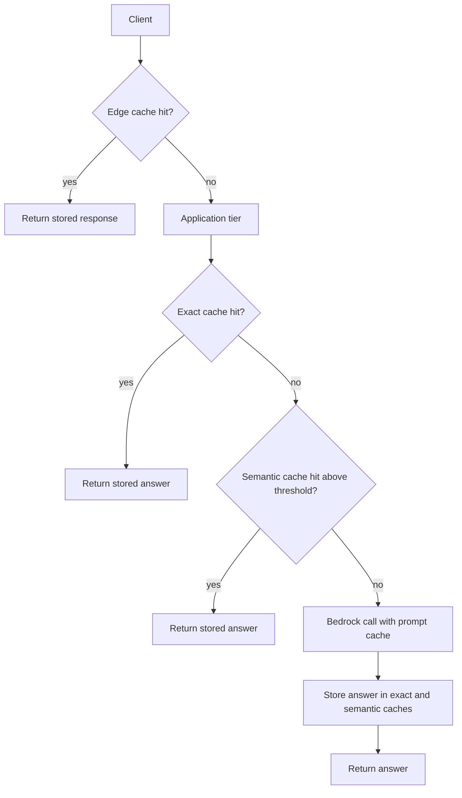
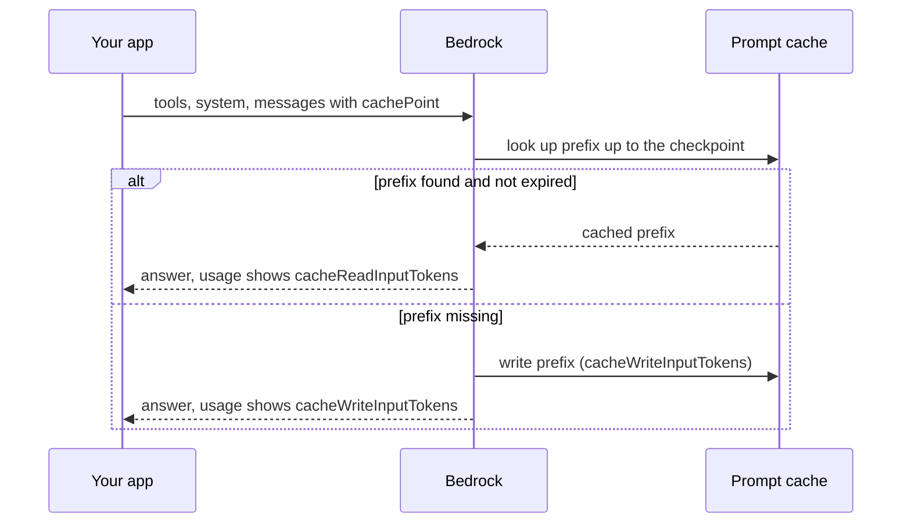

## 0. Before you start
- **Essential:** what a token is and that quotas are counted in tokens per minute (TPM) and sometimes requests per minute (RPM); what a cache hit and a TTL (time to live) are.
- **Helpful:** CloudWatch metrics; the idea of a queue between a producer and a worker.
- **Optional advanced:** vector similarity (cosine), HNSW indexes, SigV4 signing.

## 1. Simple explanation
Bedrock gives each account a speed limit, measured in tokens per minute. **Throughput work** is about getting the most useful tokens through that limit, using the right kind of capacity for the job: on-demand for normal traffic, batch for big offline jobs, Provisioned Throughput or the Reserved tier for steady, predictable load. **Caching** is the other big lever: the cheapest model call is the one you never make. You can cache at four levels: the model's own *prompt cache* (re-use an unchanged prompt prefix), an *exact-match* cache (same request, same answer), a *semantic* cache (a similar question gets a stored answer), and an *edge* cache in front of your API. Each has a different risk of serving a wrong or stale answer.


```figure
flow cache-layers
```

## 2. Structured explanation
1. **Know the limit.** Per-model, per-Region token quotas count input and output together; output tokens burn quota at a model-specific rate; `max_tokens` is reserved up front ✅ (§5.2).
2. **Choose capacity by shape of load:** spiky interactive → on-demand (+ cross-Region inference, [04/04](aip:04-operational-efficiency/04-backoff-connection-pooling-and-cross-region-inference)); offline bulk → batch inference; steady high load or a custom model → Provisioned Throughput; mission-critical with no tolerance for capacity errors → Reserved tier ✅ (§5.3).
3. **Shape your own traffic:** bounded concurrency, token-aware rate limiting, queues, and gradual ramp-up ✅ (§5.5).
4. **Monitor utilization:** `InvocationThrottles`, token metrics, `EstimatedTPMQuotaUsage` (approximate), latency percentiles ✅.
5. **Cache in layers:** prompt cache → exact cache → semantic cache → edge cache. Put the cheapest, safest layer first (§5.4, §5.6, §5.7).
6. **Protect correctness:** cache keys must include everything that changes the answer (model, parameters, tenant, permissions, prompt version); expire entries; never cache personal answers where another user could read them.

## 3. Analogy
**A restaurant kitchen.** Throughput is how many dishes the kitchen can plate per minute (the quota). Batch is the catering order done at night; Provisioned Throughput is renting a dedicated chef. Caching is the prepared-sauce shelf: *prompt caching* is the mise en place for the part of the recipe that never changes; an *exact-match cache* is a plate already made for the same order; a *semantic cache* is the waiter saying "the last table asked for almost this, will that do?"; an *edge cache* is a hot counter at the front door.

*Where it breaks:* a sauce does not go off in five minutes, but a prompt-cache entry does (TTL), and a "similar" plate may be the wrong dish: a semantic cache can serve a confidently wrong answer to a question that differs in one critical word.

## 4. The seven questions

**WHAT?** Throughput = tokens (and requests) the system can process per unit time. Utilization = how much of the capacity you pay for or are allowed you actually use. Caching = reusing earlier work (model prefix processing, or whole answers) instead of repeating it.

**WHY?** Quota limits and capacity errors (HTTP 429/503/529) hit production before cost does; caching lowers both cost and latency ✅ (cache reads are billed at a reduced rate and, for prompt caching, do not count toward the TPM quota).

**WHEN?** Prompt caching: long, repeated prefixes (system prompt, tools, a document the user keeps asking about). Exact cache: deterministic, repeated requests (temperature 0, FAQs, report generation). Semantic cache: many users asking the same thing in different words, answers that do not change by user. Batch: nightly or bulk jobs. Provisioned Throughput / Reserved: steady, forecastable, or latency-critical load.

**WHERE?** Prompt caching: inside Bedrock (`cachePoint` in Converse; `cache_control` in InvokeModel for Claude) ✅. Exact/semantic caches: your application tier (DynamoDB, ElastiCache). Edge: API Gateway stage cache, CloudFront ([§5.7](#5-7-edge-caching-for-llm-apis)).

**HOW?** §5.

**WHAT IF?**
| Situation | Effect | Remedy |
|---|---|---|
| `max_tokens` set to 32,000 but answers are ~1,000 tokens | Up-front deduction is huge; fewer concurrent requests ✅ | Set `max_tokens` near the real p95 |
| Prompt prefix below the model's minimum for a checkpoint | Request succeeds, prefix is not cached ✅ | Add content to the stable prefix or accept no caching |
| `ttl` field sent to a model that supports only 5 minutes | Can cause `ValidationException` ✅ | Omit `ttl` for those models |
| Static content comes after dynamic content | Prefix changes every call → cache misses ✅ | Order: tools → system → messages; stable first |
| Changed `tools` | Invalidates `system` and `messages` caches (processing order is tools → system → messages) ✅ | Keep tool lists stable |
| Batch job with Converse type and `toolConfig` | Records fail with 400 ✅ | Use the `InvokeModel` type with native `modelInput` |
| Prompt caching with batch inference | Not supported ✅ | Use on-demand for cached prompts |
| Semantic threshold too low | Wrong answers served confidently | Raise threshold, add exact-match guards, evaluate |
| Same cache key for two tenants | Data leakage | Put tenant and permission scope in the key |

**WHY NOT?** Do not cache personalised or permission-dependent answers in a shared cache. Do not cache with a high temperature if you need variety. Do not buy Provisioned Throughput for spiky or small workloads (it bills hourly until deleted ✅).

## 5. Technical depth

```figure
prompt-cache
```


### 5.1 The layers in one picture

*Reading the arrows:* a request tries the cheapest, most trustworthy layer first. Only a miss in every layer reaches the model, and even then the model's prompt cache can skip re-processing the unchanged prefix. After a model call, the answer is written back to the application caches. Each "yes" arrow is a call you did not pay for, and also a place where staleness or wrong-user leakage can enter.

### 5.2 How Bedrock counts tokens against quota ✅
Per-model, per-Region quotas on `bedrock-runtime` count **input and output tokens together** (tokens per minute, TPM, and tokens per day, TPD). Some models also have RPM quotas. Quotas are shared across the inference APIs that call the same model on this endpoint ✅.

| Moment | What is deducted |
|---|---|
| **Start of request** | `Total input tokens + max_tokens` (throttled if this exceeds the quota) |
| **During processing** | Adjusted periodically for actual output |
| **End of request** | `InputTokenCount + CacheWriteInputTokenCount + (OutputTokenCount × burndown rate)`; unused reservation is returned; `CacheReadInputTokenCount` is **not** counted |

- **Burndown rate:** how many quota tokens one output token consumes. The page lists **5x** for older Anthropic models, **10x** and **15x** for some newer Anthropic and OpenAI models, and **1:1** for others, "unless otherwise specified in the model card". The numbers are model-specific and change; look them up per model ✅.
- You are billed for **actual** tokens, not burndown-adjusted quota: with a 5x model, 1,000 input + 100 output uses 1,500 quota tokens but is billed for 1,100 ✅.
- **`bedrock-mantle`** is different: separate input-token and output-token quotas, no RPM quota; the input check includes `max_tokens`; unused reservation is replenished ✅. Allocations for the two endpoints are independent.
- **A quota is an upper bound, not a guarantee** ✅: on-demand requests can be queued or get transient capacity errors in busy periods.

### 5.3 Choosing capacity ✅
| Option | What it is | Best for | Watch out |
|---|---|---|---|
| **On-demand (Standard tier)** | Default; shared capacity; per-model quotas | Most interactive traffic | Quota is not a guarantee; ramp gradually |
| **Priority tier** | `service_tier: "priority"`; faster, price premium; no reservation | Customer-facing flows that need speed but not 24x7 reservation | Shares your on-demand quota with default/flex |
| **Flex tier** | `service_tier: "flex"`; discount, higher/variable latency | Evaluations, summarisation, agentic work that can wait | Support varies by model |
| **Reserved tier** | Reserved prioritised capacity, 1 or 3 months, fixed price per 1K TPM, billed monthly; minimum 100,000 input TPM and 10,000 output TPM; contact your AWS account team; overflow goes to Standard; targets 99.5% uptime | Mission-critical, intolerant of downtime | Billing continues until the reservation is deleted; size it on `InputTokenCount + CacheWriteInputTokens` |
| **Provisioned Throughput** | Buy **model units (MUs)** for a model; hourly billing; commitment none / 1 month / 6 months (longer = cheaper per hour); required to use a **customized** model; **inference profiles do not support it** | Steady high volume, custom models | Billing continues until you delete it; no-commitment can be deleted any time |
| **Batch inference** | Asynchronous JSONL in S3 → results in S3 (§5.5) | Large offline jobs | Not for provisioned models; prompt caching not supported |
| **Cross-Region inference** | Spreads on-demand requests across Regions ([04/04](aip:04-operational-efficiency/04-backoff-connection-pooling-and-cross-region-inference)) | Higher effective throughput, fewer capacity errors | IAM/SCP setup |

Service-tier facts ✅: on-demand quota is **shared** across priority, default and flex; the **reserved** capacity is separate; the served tier is visible in the response, CloudTrail, and CloudWatch (`ServiceTier`, `ResolvedServiceTier`).

### 5.4 Prompt caching in detail ✅

*Reading the arrows:* the first request with a new prefix pays to **write** the cache; later requests with the *identical* prefix **read** it. A hit resets the TTL; no hits within the TTL and the entry expires.

Facts ✅ from the AWS page:
- **Two types:** *implicit* (best effort, no request changes; keep static content first) and *explicit* (you add `cachePoint` checkpoints). Support varies by model and API; the page says to check the model card. A model's support never guarantees a hit; check the usage fields.
- **Minimum tokens per checkpoint** depends on the model and "currently range[s] from 512 to 4,096"; the minimum applies to the whole prefix before the checkpoint (across `tools`, `system`, `messages`), not per section. If a checkpoint is placed too early, the request still succeeds but is not cached.
- **Max 4 checkpoints** per request for the Claude and Nova rows in the table; for newer OpenAI models "up to four cache writes".
- **TTL** resets on each hit; many models support **5 minutes**; some also support **1 hour** (`"ttl": "1h"` in the Converse `cachePoint`, or in `cache_control` for InvokeModel). Models that support only 5 minutes must **omit** `ttl`. Mixed TTLs in one request: longer TTL entries must come **before** shorter ones.
- **Order:** checkpoints are processed `tools` → `system` → `messages`; changing an earlier section invalidates later ones.
- **Simplified management (Anthropic models):** one checkpoint at the end of the static content; the system looks back up to about **20 content blocks** for the longest cached prefix.
- **Billing:** cache reads at the cache-read rate; tokens not read from cache at the standard input rate; **cache writes may cost more** than standard input depending on the model. **Quota:** `CacheReadInputTokenCount` does not count toward TPM; `CacheWriteInputTokenCount` does.
- **Response fields (Converse):** `cacheReadInputTokens`, `cacheWriteInputTokens`, `cacheDetails` (TTL used). With caching on, `inputTokens` is the **non-cached** input only: `total input = inputTokens + cacheReadInputTokens + cacheWriteInputTokens`.
- **Where:** Converse/ConverseStream, InvokeModel (`WithResponseStream`), Prompt management, the console playground. **Only on-demand** endpoints, **not batch**. Works with cross-Region inference, which "may lead to increased cache writes" in busy times.
- Model IDs and per-model minimums are not copied into this guide ❌ (they change; read the table on the day).

### 5.5 Batch inference ✅
- Input: one or more `.jsonl` files in S3, each line `{"recordId": "...", "modelInput": {...}}`. With the `InvokeModel` type (default) `modelInput` matches that model's native body; with `Converse` it matches the Converse request body. If you omit `recordId`, Bedrock adds one in the output. **Output order is not guaranteed** to match input order, so join on `recordId`.
- Create: `CreateModelInvocationJob` on the control plane. Required: `jobName`, `roleArn` (service role), `modelId`, `inputDataConfig`, `outputDataConfig`. Optional: `modelInvocationType`, `timeoutDurationInHours`, `tags`, `vpcConfig`, `clientRequestToken` (idempotency).
- Quotas to check in Service Quotas: minimum records per job, records per input file, records per job, input file size, job size.
- Not supported for provisioned models; Converse-type records with `toolConfig` fail with 400 (use InvokeModel type for tool calling); structured outputs work with both types. Job-state notifications can come through EventBridge instead of polling.
- Pricing: see the pricing page; a discount for a subset of models is advertised 🟡 (not hard-coded here).

### 5.6 Exact-match and semantic caches
- **Exact-match ("deterministic request hashing", "result fingerprinting"):** normalise the request (trim, collapse whitespace; do **not** lower-case if case matters), add everything that changes the answer (model ID or inference profile, temperature, `maxTokens`, system prompt version, tenant/permission scope), hash it (SHA-256), look it up in DynamoDB with a TTL attribute ([02/08](aip:02-data-management/08-amazon-dynamodb-for-genai)) or ElastiCache. Perfect precision, low recall.
- **Semantic cache:** embed the question, search a vector index for the nearest stored question, return its stored answer when similarity ≥ a threshold, otherwise call the model and store the new pair. The AWS ElastiCache walkthrough ✅ uses **ElastiCache for Valkey 8.2 or later**, **Titan Text Embeddings V2** (1,024 dimensions), an **HNSW** index with **COSINE** distance, a lookup of top-k (k = 3), a **`min_similarity` of 0.8 in the sample code** (a starting example, not a recommendation), a read-through flow (search → on miss call the LLM → store), and a TTL via `EXPIRE`. It describes a cache miss as a Bedrock call taking roughly 500 to 6,000 ms and a lookup as microseconds. AWS-reported savings (up to 86% cost, up to 88% latency) are from AWS's own experiments 🟡; your workload will differ.
- **Risks:** near-miss questions get the wrong answer (§8: "within 30 days" vs "after 30 days"), stale answers after a policy changes, cross-tenant leakage, and caching content the user is not allowed to see. Mitigate with high thresholds, per-tenant namespaces, short TTLs, version stamps in the key, invalidation on source updates, and a cheap verifier for risky categories.
- **Which store?** DynamoDB for exact keys ✅ (not a similarity engine); ElastiCache vector search ✅, OpenSearch or pgvector ([02/05](aip:02-data-management/05-amazon-opensearch-for-genai), [02/07](aip:02-data-management/07-rds-aurora-and-pgvector)) when you need similarity.

### 5.7 Edge caching for LLM APIs
- **API Gateway REST API stage cache** ✅: enabled per stage; dedicated cache instance (creating or deleting takes about 4 minutes); default TTL **300 s**, maximum **3,600 s**, 0 disables; **only `GET` methods are cached by default** (others need method overrides); max cacheable response **1,048,576 bytes**; cache keys can be query strings, headers or paths and are **required** when caching a resource; billed **hourly** by cache size (no Free Tier); "best-effort"; flush with `flush-stage-cache`; clients can send `Cache-Control: max-age=0` to bypass if authorised (`execute-api:InvalidateCache`). Metrics `CacheHitCount` and `CacheMissCount`. Encrypt cached data if responses are sensitive.
- LLM endpoints are usually **POST**, so a stage cache needs deliberate configuration and a cache key that includes the user's scope; for personalised answers do not use it.
- **CloudFront** (edge caching of static or public GenAI outputs) was **not read** for this guide ❌; use it for public, non-personalised content and verify the cache-key and TTL behaviour on the CloudFront docs.

### 5.8 Keeping the system's own capacity right
- **Bound concurrency** at the client (semaphore, worker pool) and **limit by tokens**, not by request count, because request sizes vary ✅.
- **Queue** work (SQS) between producers and model workers so spikes become queue depth rather than errors; scale workers on queue depth ([06 app-building tools](aip:meta/syllabus-coverage-map) covers Lambda, SQS, auto scaling; their limits were not re-verified here ❌).
- **Ramp gradually** after launch or a model/Region switch; hold each step, watch 429/503/529, latency percentiles and token use, step up one dimension at a time, and drop back on trouble ✅.
- **Use feature flags** to shift traffic between models gradually ✅ (AppConfig later).
- **Sustained 503/529:** stop the ramp, shed low-priority work, use cross-Region inference or evaluate Provisioned Throughput ✅.

## 6. Worked example

```figure
throughput-capacity
```

*Problem:* A policy Q&A assistant sends a 1,500-token system prompt plus a 4,000-token policy document with every question (users ask 10 to 40 questions per document per session) and receives 5,000 requests per minute at peak on a model with a 5x burndown rate and a 6,000,000 TPM quota.

| Step | Observation / change | Effect |
|---|---|---|
| 1 | Without caching each request is ~5,600 input + ~300 output; quota use ≈ 5,600 + 300×5 = 7,100 per request | 5,000 req/min needs 35.5M TPM, 6× the quota |
| 2 | Put `cachePoint` after the document; users ask several questions within 5 minutes, so the TTL keeps refreshing | Most requests read 5,500 tokens from cache; those reads do not count toward TPM ✅ |
| 3 | Quota use per cached request ≈ 100 uncached input + 300×5 = 1,600 | 5,000 req/min needs 8M TPM; still above 6M |
| 4 | Lower `maxTokens` from 4,096 to 600 so the up-front reservation is small | Admission headroom improves (reservation per request drops from ~4,200 to ~700) |
| 5 | Exact-match cache for the 20 most common question + document-version pairs | Fewer model calls altogether |
| 6 | Use a global/geographic cross-Region profile and request a quota increase with the burndown rate included in the calculation ✅ | Remaining gap closed |
| 7 | Ramp traffic in steps; alarm on `InvocationThrottles` | Safe launch |

(The figures in this example are invented to show the arithmetic; real quotas and burndown rates are per model and Region.)

## 7. Knowledge checkpoints
1. Name the three parts of a request's final quota deduction.
2. What happens if you place a cache checkpoint before the prefix reaches the model's minimum token count?
3. Which API Gateway methods are cached by default, and what is the default TTL?
4. Can batch inference use prompt caching? Can inference profiles use Provisioned Throughput?
5. Why must batch output be joined on `recordId`?

## 7b. Practice questions (exam-style, original) — answers in §14

**Q1.** An assistant sends the same 6,000-token manual with every question. Which feature reduces cost and latency for the repeated portion?
A. Batch inference
B. Bedrock prompt caching with a checkpoint after the manual
C. Increasing `temperature`
D. Provisioned Throughput on a different model

**Q2.** (Select TWO) Which statements about Bedrock prompt caching are correct?
A. Cache reads do not count toward the token-per-minute quota
B. Changing the `tools` section can invalidate the cached `system` and `messages` prefixes
C. A cache checkpoint always guarantees a cache hit
D. Prompt caching works with batch inference
E. `inputTokens` in the response includes cached tokens

**Q3.** Throttling appears even though real answers are short. The application sets `max_tokens` to 32,000 on every call. What is the likely cause?
A. The up-front quota deduction includes `max_tokens`, so each request reserves far more than it uses
B. Short answers are billed at a higher rate
C. Cached tokens are counted twice
D. The model refuses to answer short questions

**Q4.** A company runs a fine-tuned (customized) model and needs predictable throughput. What is required?
A. On-demand access with a quota increase only
B. Purchase Provisioned Throughput for the custom model
C. Use the Flex tier
D. Use prompt routing

**Q5.** (Select TWO) A team builds a semantic cache in front of Bedrock. Which risks should the design address?
A. A similar-looking question with a different critical word may get the wrong cached answer
B. Cached answers for one tenant may be served to another if the key ignores tenant scope
C. Vector search always returns the exact question
D. A cache can never go stale
E. Embedding models cannot be used for caching

**Q6.** A nightly job summarises 500,000 documents and can take hours. Which choice fits best?
A. Batch inference with JSONL input and output in S3
B. A single synchronous Converse call per document with no concurrency limits
C. Reserved tier
D. API Gateway caching

**Q7.** An API Gateway stage cache was enabled for an LLM endpoint that uses POST, yet nothing is cached. Why?
A. Only `GET` methods are cached by default; other methods need method-level overrides
B. API Gateway cannot cache JSON
C. The TTL maximum is 5 seconds
D. Caching requires Provisioned Throughput

**Q8.** After a launch, error rates show sustained HTTP 503 from Bedrock. What is the best first response?
A. Immediately triple the retry count
B. Stop ramping, return to the last stable rate, bound concurrency, shed low-priority work, and consider cross-Region inference or Provisioned Throughput
C. Increase `max_tokens`
D. Disable invocation logging

## 8. Hands-on lab: quota arithmetic, a prompt-cache model, and three kinds of application cache

### 8.1 Objective
Reproduce the AWS token-burndown examples, simulate how a prompt cache with a minimum size, a TTL and prefix matching behaves, build an exact-match key, and see a toy semantic cache both help and mislead.

### 8.2 Prerequisites
Python 3 only. Nothing here calls AWS. The prompt-cache model follows the documented rules (minimum prefix, 5-minute TTL refreshed on hits, prefix match, order of sections) but is a simplification, not Bedrock's implementation.

### 8.3 AWS services
None offline. Maps to Bedrock quotas, prompt caching, batch inference, ElastiCache, DynamoDB.

### 8.4 IAM permissions
Offline: none. Real: `bedrock:InvokeModel`; for batch `bedrock:CreateModelInvocationJob` plus a service role with S3 access ❌ (action and role policy details are in the batch prerequisites page, not read).

### 8.5 Region notes
Prompt caching is available wherever the supported models are available ✅. Quotas are per model and Region.

### 8.6 Architecture
§5.1 and §5.4.

### 8.7 Cost
Offline: none.

### 8.8 Code
```python lab-run
import hashlib, json, math, re

# ---- 1. Quota arithmetic (formulas and examples from the AWS "How tokens are counted" page) ----
def reserve(input_tokens, cache_write, max_tokens):
    return input_tokens + cache_write + max_tokens          # cache reads are not counted

def settle(input_tokens, cache_write, output_tokens, burndown):
    return input_tokens + cache_write + output_tokens * burndown

print("scenario 1 reserve/settle:", reserve(3000, 1000, 32000), settle(3000, 1000, 1000, 5))
print("scenario 2 reserve/settle:", reserve(3000, 1000, 1250), settle(3000, 1000, 1000, 5))
print("1000 in + 100 out at 5x: quota", settle(1000, 0, 100, 5), "billed tokens", 1000 + 100)
TPM = 1_000_000   # invented quota for the illustration
print("requests admitted per minute by reservation:", TPM // reserve(3000, 1000, 32000), "vs", TPM // reserve(3000, 1000, 1250))

# ---- 2. Prompt-cache model: prefix match, minimum size, TTL refreshed on hit ----
class PromptCache:
    def __init__(self, min_tokens, ttl=300):
        self.min_tokens, self.ttl, self.store = min_tokens, ttl, {}   # prefix key -> (tokens, expires_at)

    def call(self, t, segments, checkpoint_after):
        """segments: list of (content_id, tokens) in order tools, system, messages; checkpoint after that index."""
        total = sum(n for _, n in segments)
        prefix = tuple(c for c, _ in segments[:checkpoint_after + 1])
        prefix_tokens = sum(n for _, n in segments[:checkpoint_after + 1])
        read = write = 0
        hit = self.store.get(prefix)
        if hit and hit[1] >= t:
            read = prefix_tokens
            self.store[prefix] = (prefix_tokens, t + self.ttl)       # a hit refreshes the TTL
        elif prefix_tokens >= self.min_tokens:
            write = prefix_tokens
            self.store[prefix] = (prefix_tokens, t + self.ttl)
        uncached = total - read - write
        return {"inputTokens": uncached, "cacheRead": read, "cacheWrite": write, "total": total}

pc = PromptCache(min_tokens=1024)
doc, sysA, sysB = ("doc-v1", 3000), ("sysA", 1500), ("sysB", 1500)
calls = [(0,   [sysA, doc, ("q1", 50)], 1, "first call"),
         (60,  [sysA, doc, ("q2", 40)], 1, "same prefix, 60 s later"),
         (350, [sysA, doc, ("q3", 45)], 1, "290 s after the last hit: still alive"),
         (700, [sysA, doc, ("q4", 45)], 1, "350 s after the last hit: expired"),
         (710, [sysB, doc, ("q5", 45)], 1, "system prompt changed"),
         (720, [("tiny", 200), ("q6", 30)], 0, "prefix below the minimum")]
for t, segs, cp, label in calls:
    r = pc.call(t, segs, cp)
    assert r["inputTokens"] + r["cacheRead"] + r["cacheWrite"] == r["total"]
    print(f"t={t:>3} {label:<40} read={r['cacheRead']:>4} write={r['cacheWrite']:>4} inputTokens={r['inputTokens']:>4}")

# ---- 3. Exact-match key: normalise, include everything that changes the answer ----
def exact_key(model, prompt, temperature, max_tokens, prompt_version, tenant):
    norm = re.sub(r"\s+", " ", prompt).strip()
    blob = json.dumps([model, norm, temperature, max_tokens, prompt_version, tenant], sort_keys=True)
    return hashlib.sha256(blob.encode()).hexdigest()[:12]

k1 = exact_key("model-a", "How do I reset  my password?", 0, 300, "v3", "acme")
k2 = exact_key("model-a", "  How do I reset my password? ", 0, 300, "v3", "acme")
k3 = exact_key("model-a", "How do I reset my password?", 0.7, 300, "v3", "acme")
k4 = exact_key("model-a", "How do I reset my password?", 0, 300, "v3", "globex")
print("same after whitespace normalisation:", k1 == k2)
print("different temperature gives a different key:", k1 != k3)
print("different tenant gives a different key:", k1 != k4)

# ---- 4. Toy semantic cache (bag-of-words cosine; real systems use embeddings) ----
def vec(text):
    words = re.findall(r"[a-z0-9]+", text.lower())
    v = {}
    for w in words:
        v[w] = v.get(w, 0) + 1
    return v

def cosine(a, b):
    dot = sum(a[w] * b.get(w, 0) for w in a)
    na = math.sqrt(sum(x * x for x in a.values()))
    nb = math.sqrt(sum(x * x for x in b.values()))
    return dot / (na * nb)

CACHE = [("Can I cancel my order within 30 days?", "Yes: free cancellation within 30 days.")]
def lookup(q, threshold):
    best = max(CACHE, key=lambda item: cosine(vec(q), vec(item[0])))
    s = cosine(vec(q), vec(best[0]))
    return (best[1] if s >= threshold else None), round(s, 2)

for q in ["Can I cancel my order within 30 days", "Can I cancel my order after 30 days?", "How do I update my address?"]:
    ans, s = lookup(q, threshold=0.8)
    print(f"{q!r:<44} similarity={s} -> {'HIT: ' + ans if ans else 'miss'}")

# ---- 5. Batch input lines and joining shuffled output by recordId ----
lines = [json.dumps({"recordId": f"DOC{i:03d}",
                     "modelInput": {"messages": [{"role": "user", "content": [{"text": f"Summarise document {i}."}]}],
                                    "inferenceConfig": {"maxTokens": 200}}}) for i in (1, 2, 3)]
assert all({"recordId", "modelInput"} <= set(json.loads(l)) for l in lines)
shuffled_output = [{"recordId": "DOC003", "text": "s3"}, {"recordId": "DOC001", "text": "s1"}, {"recordId": "DOC002", "text": "s2"}]
by_id = {r["recordId"]: r["text"] for r in shuffled_output}
print("joined by recordId:", [by_id[json.loads(l)["recordId"]] for l in lines])
```

### 8.9 Captured output
Generated on 2026-10-26 by extracting the block above from this file and running it (Python 3). It is a model of the documented rules, **not** Bedrock output.
```text lab-out
scenario 1 reserve/settle: 36000 9000
scenario 2 reserve/settle: 5250 9000
1000 in + 100 out at 5x: quota 1500 billed tokens 1100
requests admitted per minute by reservation: 27 vs 190
t=  0 first call                               read=   0 write=4500 inputTokens=  50
t= 60 same prefix, 60 s later                  read=4500 write=   0 inputTokens=  40
t=350 290 s after the last hit: still alive    read=4500 write=   0 inputTokens=  45
t=700 350 s after the last hit: expired        read=   0 write=4500 inputTokens=  45
t=710 system prompt changed                    read=   0 write=4500 inputTokens=  45
t=720 prefix below the minimum                 read=   0 write=   0 inputTokens= 230
same after whitespace normalisation: True
different temperature gives a different key: True
different tenant gives a different key: True
'Can I cancel my order within 30 days'       similarity=1.0 -> HIT: Yes: free cancellation within 30 days.
'Can I cancel my order after 30 days?'       similarity=0.87 -> HIT: Yes: free cancellation within 30 days.
'How do I update my address?'                similarity=0.29 -> miss
joined by recordId: ['s1', 's2', 's3']
```

### 8.10 Explanation
- Part 1 reproduces the AWS examples: scenario 1 reserves 36,000 and settles at 9,000; scenario 2 reserves 5,250 and settles at the same 9,000. A tight `max_tokens` lets many more requests be admitted per minute even though the final cost is identical.
- Part 2 shows write on the first call, read on the second, a hit that **refreshes** the TTL (the third call still hits), expiry after a gap longer than the TTL, a miss when anything earlier in the prefix changes, and no caching (but no failure) when the prefix is under the minimum. Every row satisfies `inputTokens + cacheRead + cacheWrite = total`.
- Part 3: the key must include model, parameters, prompt version and tenant; whitespace normalisation raises the hit rate without changing meaning.
- Part 4: the paraphrase hits (good), the unrelated question misses (good), but "after 30 days" hits the "within 30 days" answer (bad). Real embeddings behave differently, but the same class of error exists, which is why thresholds must be tuned on your data and risky categories need an exact or verified path.
- Part 5: batch results must be joined on `recordId`, never on position.

### 8.11 Optional AWS lab (shown, not run against AWS ❌)
1. **Prompt caching with Converse** (shape from the AWS page ✅). Use a model whose card lists explicit caching, and a prefix longer than its minimum:
```json
{
  "system": [
    {"text": "You answer questions about the attached policy. Be concise."},
    {"cachePoint": {"type": "default"}}
  ],
  "messages": [
    {"role": "user", "content": [
      {"text": "<policy text here, longer than the model's minimum>"},
      {"cachePoint": {"type": "default"}},
      {"text": "What is the notice period?"}
    ]}
  ]
}
```
Send it twice within five minutes and compare `usage.cacheWriteInputTokens` (first call) with `usage.cacheReadInputTokens` (second call). (The `<policy text here...>` is a placeholder inside a JSON string, so the block is valid JSON.) For a model that supports the 1-hour TTL, use `{"type": "default", "ttl": "1h"}`; for 5-minute-only models omit `ttl`.
2. **Batch job (console):** Bedrock console → Batch inference → Create job; choose a model, the invocation type, an S3 input folder with a `.jsonl` file of `recordId`/`modelInput` lines, an S3 output folder and a service role. Check the quotas page first.
3. **API Gateway stage cache (CLI patch, from the AWS page ✅):**
```json
[
  {"op": "replace", "path": "/cacheClusterEnabled", "value": "true"},
  {"op": "replace", "path": "/cacheClusterSize", "value": "0.5"},
  {"op": "replace", "path": "/*/*/caching/enabled", "value": "true"}
]
```
Save as `patch.json` and apply with `aws apigateway update-stage --rest-api-id <id> --stage-name prod --patch-operations file://patch.json`. Caching is billed **hourly**; flush and **disable the cache when done**.
4. **Semantic cache:** follow the AWS ElastiCache for Valkey walkthrough (Valkey 8.2 or later, Titan Text Embeddings V2, HNSW, COSINE) ✅; delete the replication group afterwards (it bills while it exists).
5. **Clean up:** delete batch buckets/objects, the API Gateway cache, the ElastiCache group, and any Provisioned Throughput (hourly billing continues until deleted ✅).

### 8.12 Common errors
| Error | Cause | Fix |
|---|---|---|
| `ValidationException` mentioning `ttl` | `ttl` sent to a model that supports only 5 minutes ✅ | Omit `ttl` |
| No `cacheReadInputTokens` ever | Prefix under the minimum, changed prefix, expired TTL, or the model has no explicit caching ✅ | Check minimum, order, TTL, model card |
| Throttled at low volume | Large `max_tokens` reservation, or burndown ✅ | Lower `max_tokens`; size quota with the burndown rate |
| Batch record fails with 400 | Converse type with `toolConfig` ✅ | Use `InvokeModel` type |
| Stage cache never hits | POST not cached by default ✅; missing cache key parameter | Method override and cache key |
| `InvalidSignatureException` with metadata header | Not signed ✅ | Use the SDK parameter |

### 8.13 Security recommendations
Scope cache keys by tenant and permissions; encrypt caches holding user content (ElastiCache and API Gateway both support encryption options ❌ details not read); set TTLs that match data sensitivity; never cache secrets; log cache hits for audit; restrict who can flush or invalidate (`execute-api:InvalidateCache` ✅); protect batch S3 buckets and the service role with least privilege.

## 9. What can go wrong?

```figure
semantic-cache
```

| Failure | Why | Symptoms | Investigate | Fix | Prevent |
|---|---|---|---|---|---|
| **Prompt cache never hits** | Prefix changes (timestamps, user IDs early in the prompt), under minimum, TTL expiry | `cacheRead` stays 0 | Diff two request prefixes; usage fields | Move dynamic text after the checkpoint | Keep static first; CI test of prefix stability |
| **Cost goes up after enabling caching** | Cache-write rate higher; prefix used once | `cacheWrite` large, reads small ✅ | Ratio of reads to writes | Cache only prefixes reused often | Measure net cost |
| **Throttling at low traffic** | Huge `max_tokens` | 429 with small outputs ✅ | `max_tokens` vs real output | Lower it | Review caps |
| **Wrong cached answer** | Threshold too low or stale entry | User complaints | Sample cache hits | Raise threshold, shorten TTL, invalidate on updates | Evaluate hit quality |
| **Cross-tenant leak** | Key ignores tenant | Seeing others' data | Review keys | Add scope; flush | Security review |
| **Retry storm on capacity errors** | Unbounded retries | Rising 503/529 ✅ | Retry counts | Bounded retries, shed load | Retry budget ([04/04](aip:04-operational-efficiency/04-backoff-connection-pooling-and-cross-region-inference)) |
| **Idle Provisioned Throughput** | Bought for a spike | Paying with no traffic ✅ | Utilization metrics | Delete if no commitment | Capacity review |

## 10. Common misconceptions
1. **"Prompt caching caches the answer."** It caches the processed *prefix*; the model still generates a fresh answer ✅.
2. **"A checkpoint guarantees a hit."** It never does ✅.
3. **"Quota is a guarantee."** It is an upper bound ✅.
4. **"Burndown changes my bill."** It changes quota use, not billed tokens ✅.
5. **"Semantic cache = RAG."** RAG retrieves *documents* to ground a new answer; a semantic cache returns a *previous answer*.
6. **"Provisioned Throughput works with inference profiles."** Currently not supported ✅.
7. **"API Gateway caches everything once enabled."** Only `GET` by default ✅.

## 11. Exam notes
- **Pattern:** "same long context repeated, reduce cost/latency" → prompt caching. "Many users ask the same question in different words" → semantic cache (ElastiCache/OpenSearch vector). "Identical requests" → exact-match cache (DynamoDB + TTL, hashing). "Offline, large, not urgent" → batch (or Flex). "Custom model needs capacity" → Provisioned Throughput. "Cannot tolerate capacity errors" → Reserved tier / cross-Region inference.
- **Traps:** thinking batch supports caching; thinking prompt cache reads count toward quota; forgetting `max_tokens` counts at the start; caching personalised answers in a shared cache.
- **Compare:** prompt cache (model side, prefix) vs semantic cache (app side, whole answer) vs API Gateway cache (HTTP layer).
- Skill names in the exam guide ✅: "semantic caching, result fingerprinting, edge caching, deterministic request hashing, prompt caching" (4.1.4); "batching strategies, capacity planning, utilization monitoring, auto-scaling configurations, provisioned throughput optimization" (4.1.3).

## 12. Summary and revision cards
- Quota math: reserve `input + cache write + max_tokens`, settle `input + cache write + output × burndown`; cache reads excluded.
- Capacity: on-demand → priority/flex → reserved → provisioned → batch.
- Four cache layers; cheapest and safest first; key = everything that changes the answer.

**Cards.** Q: Default API Gateway cache TTL? A: 300 s (max 3,600). · Q: Max prompt-cache checkpoints per request? A: 4 (Claude/Nova rows). · Q: Batch output order? A: Not guaranteed; use `recordId`. · Q: Does `CacheReadInputTokenCount` hit TPM? A: No.

## 13. References
| Source | URL | Verified |
|---|---|---|
| Prompt caching | https://docs.aws.amazon.com/bedrock/latest/userguide/prompt-caching.html | 2026-10-26 |
| How tokens are counted (burndown) | https://docs.aws.amazon.com/bedrock/latest/userguide/quotas-token-burndown.html | 2026-10-26 |
| Scaling and throughput best practices | https://docs.aws.amazon.com/bedrock/latest/userguide/scaling-throughput-best-practices.html | 2026-10-26 |
| Service tiers | https://docs.aws.amazon.com/bedrock/latest/userguide/service-tiers-inference.html | 2026-10-26 |
| Provisioned Throughput | https://docs.aws.amazon.com/bedrock/latest/userguide/prov-throughput.html | 2026-10-26 |
| Batch inference, data format, create job | https://docs.aws.amazon.com/bedrock/latest/userguide/batch-inference.html · .../batch-inference-data.html · .../batch-inference-create.html | 2026-10-26 |
| Runtime CloudWatch metrics | https://docs.aws.amazon.com/bedrock/latest/userguide/monitoring-runtime-metrics.html | 2026-10-26 |
| Semantic cache with ElastiCache for Valkey | https://docs.aws.amazon.com/AmazonElastiCache/latest/dg/semantic-caching-implementation.html | 2026-10-26 |
| API Gateway caching | https://docs.aws.amazon.com/apigateway/latest/developerguide/api-gateway-caching.html | 2026-10-26 |

**Unverified here:** per-model minimums, TTLs and burndown rates (they change; read the model card on the day); the batch price discount; CloudFront caching behaviour; batch IAM role policy; Lambda/SQS scaling limits.

## 14. Answers to checkpoints and practice questions
**Checkpoints.** 1) Input tokens, cache-write tokens, and output tokens × burndown (the initial deduction is input + `max_tokens`) ✅. 2) The request succeeds but the prefix is not cached ✅. 3) `GET`; 300 seconds ✅. 4) No (not supported with batch); no (inference profiles do not support Provisioned Throughput) ✅. 5) Output order is not guaranteed to match input order ✅.

**Practice questions.**
- **Q1 → B.** Prompt caching reuses the processed prefix; A is offline; C is unrelated; D does not help repeated context.
- **Q2 → A, B.** C is false (no guarantee); D is false (on-demand only); E is false (`inputTokens` is non-cached only) ✅.
- **Q3 → A.** `max_tokens` is deducted up front; B, C, D are invented.
- **Q4 → B.** Customized models must use Provisioned Throughput ✅.
- **Q5 → A, B.** C and D are false; E is false (embeddings are the standard approach).
- **Q6 → A.** Batch is built for large asynchronous jobs; B risks throttling; C is for mission-critical latency; D is for HTTP responses.
- **Q7 → A.** Only `GET` is cached by default ✅.
- **Q8 → B.** More retries amplify load ✅; A and C worsen it; D is irrelevant.
