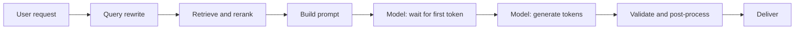
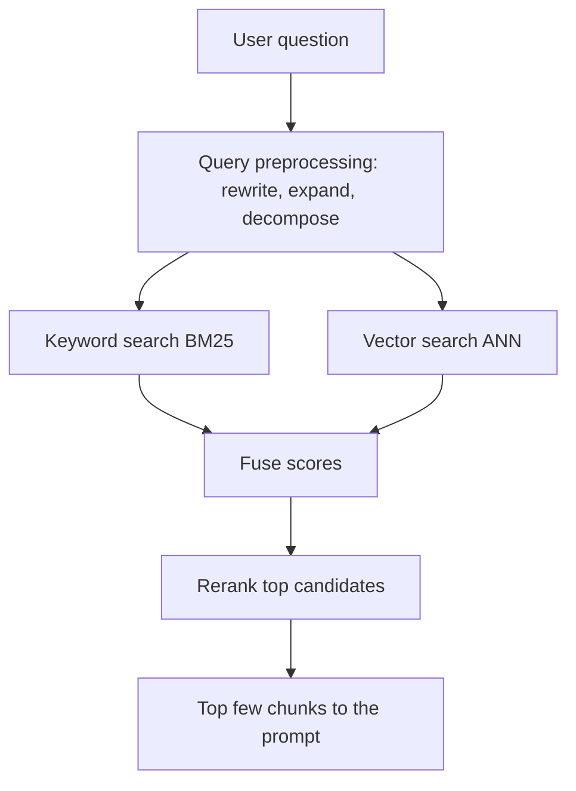

## 0. Before you start
- **Essential:** what latency means (time until the answer), what a streaming response is, what a retrieval step does in RAG.
- **Helpful:** percentiles (p50, p95); CloudWatch metrics; the idea of "recall" in search.
- **Optional advanced:** HNSW graphs, reciprocal rank fusion, two-proportion z-tests.

## 1. Simple explanation
"Fast" has three meanings in a GenAI app: how soon the user sees *something*, how long until the *whole* answer is done, and how many users you can serve at once. **Responsive design** mostly attacks the first one: stream the answer, run independent steps in parallel, pre-compute what is predictable, and use a faster model tier where it matters. **Retrieval performance** is about getting the right passages quickly: well-tuned indexes, cleaned-up queries, keyword plus meaning search combined, and a reranker. **Tuning for a use case** means picking temperature, top-p and top-k to suit the job (strict extraction versus creative writing) and proving each change with an A/B test. **System-level performance** means measuring (profiling) before optimising anything.


```figure
flow latency-pipeline
```

## 2. Structured explanation
1. **Decide which latency you are fixing:** time to first token (TTFT, how soon text starts), total time, or tail latency (p95/p99).
2. **Make it feel fast:** stream with `ConverseStream`/`InvokeModelWithResponseStream` ✅; show progress; return partial results.
3. **Make it actually faster:** shorter prompts and outputs; a smaller model; latency-optimized inference or Priority tier where available ✅; fewer sequential round trips; parallel calls; pre-computation; caching ([04/02](aip:04-operational-efficiency/02-throughput-utilization-and-intelligent-caching)).
4. **Fix retrieval:** index parameters, filters, smaller `k` plus reranking, query rewriting, hybrid search ([§5.3](#5-3-retrieval-performance-skill-4-2-2)).
5. **Tune generation parameters** per use case and **A/B test** them ([§5.4](#5-4-parameters-and-a-b-testing-skill-4-2-4)).
6. **Profile end to end:** per-stage timing, tokens per second, throttles; find the slowest stage before changing anything ([§5.5](#5-5-profiling-the-whole-pipeline-skill-4-2-6)).

## 3. Analogy
**A pizza restaurant.** TTFT is how fast the waiter brings bread (streaming = bread first while the pizza cooks). Total time is when the pizza lands. Parallel requests are three cooks working on three pizzas at once instead of one cook doing them in a row. Pre-computation is making dough in the morning. Retrieval is the pantry: it is only fast if shelves are organised (index), the order slip is clear (query rewriting), and you check both the label and the contents (hybrid search). Profiling is timing each station instead of shouting "faster!" at the whole kitchen.

*Where it breaks:* a cook can speed up by working harder; a model's speed is mostly fixed by its size and your prompt. You change *what you ask*, not how hard it works. Also, bread served while the pizza cooks is real progress, but a half-finished AI answer can be wrong at the start and corrected later, so streaming interacts with output validation and guardrails.

## 4. The seven questions

**WHAT?** Responsiveness = perceived and actual speed of the system. Retrieval performance = speed and relevance of context lookup. Use-case optimisation = choosing model parameters and designs that suit the task. FM system performance = measured, end-to-end efficiency of the whole pipeline.

**WHY?** Users abandon slow interfaces; slow retrieval delays every RAG answer; wrong parameters cause weak or wildly variable output; unmeasured "optimisations" often move the bottleneck instead of removing it.

**WHEN?** Streaming: any chat or long answer. Latency-optimized/Priority: time-critical, user-facing paths. Parallelism: independent sub-tasks. Pre-computation: predictable questions (daily summaries, product FAQs). Retrieval tuning: when relevance or retrieval time dominates. A/B tests: before and after any prompt, parameter or model change.

**WHERE?** In the client (progressive rendering), the app tier (parallel calls, queues, cache), Bedrock request options (`performanceConfig`, `service_tier`, streaming APIs), the retrieval layer (OpenSearch, Knowledge Bases, S3 Vectors, pgvector), and the observability stack (CloudWatch, invocation logs, tracing).

**HOW?** §5.

**WHAT IF?**
| Situation | Effect | Remedy |
|---|---|---|
| Streaming with a guardrail that must see the full answer | Early tokens may be shown before a late block | Use the guardrail's streaming modes ([01/07](aip:01-bedrock-genai-fundamentals/07-bedrock-guardrails)) or buffer risky content |
| Latency-optimized quota used up | Request is served with standard latency and **charged at standard rates** ✅ | Watch the served configuration in the response/CloudTrail |
| Latency-optimized on an unsupported model | Not available; the page lists specific models in specific Regions and calls the feature a preview ✅ | Check the model card; use Priority tier or a smaller model |
| Retrieval returns many loosely related chunks | Longer prompt, slower, worse answers | Rerank and cut `k`; filters |
| Temperature 0 expected to be perfectly deterministic | Same input may still vary slightly between runs ❌ not a documented guarantee | Treat as "less random", not "identical" |
| A/B test with too little traffic | Noise looks like a win | Pre-decide sample size and metric |
| Optimising the model call when retrieval is the slow stage | No user-visible change | Profile first |

**WHY NOT?** Do not stream when a downstream system needs a complete, validated JSON document. Do not run parallel calls that share a rate limit you are already hitting (you will only create throttling). Do not tune parameters without an evaluation set.

## 5. Technical depth

```figure
latency-stream
```


### 5.1 Where the time goes

*Reading the arrows:* every stage adds time and each depends on the previous one. Streaming overlaps `generate` and `deliver` (the user reads while the model writes). Parallelism overlaps independent branches (for example, retrieval and a profile lookup). Caching removes whole stages. Latency of the model stage is roughly *time to first token + output tokens ÷ tokens per second*, so a long answer is slow whatever else you do.

### 5.2 Responsive-system techniques (skill 4.2.1)
| Technique | What it improves | Notes |
|---|---|---|
| **Response streaming** | Perceived latency (TTFT) | `ConverseStream` and `InvokeModelWithResponseStream`; CloudWatch publishes **`TimeToFirstToken`** (ms) for streaming APIs ✅; some models reject tool use on `ConverseStream` ([03/06](aip:03-agentic-ai/06-mcp-openapi-tools-and-human-in-the-loop)) ✅ |
| **Latency-optimized inference** | Actual latency on supported models | Set `performanceConfig.latency` to `optimized` (default is `standard`); no extra setup or fine-tuning; if the latency-optimization quota is used up the request is served at standard latency and charged at **standard** rates; visible in response and CloudTrail; metrics appear under `model-id+latency-optimized` in CloudWatch ✅. The AWS page marks it **preview** and, when read, listed a short set of models (Nova Pro, Claude 3.5 Haiku, Llama 3.1 70B/405B) in a few US Regions through cross-Region inference; the 405B model fell back to standard above 11K total tokens ✅. Do not rely on that list; check the model card ❌ |
| **Priority service tier** | Fastest response times for a price premium; no reservation; `service_tier: "priority"` | ✅ ([04/02 §5.3](aip:04-operational-efficiency/02-throughput-utilization-and-intelligent-caching)) |
| **Smaller or faster model** | Both TTFT and tokens/sec | Evaluate quality ([01](aip:04-operational-efficiency/01-token-efficiency-and-cost-effective-model-selection)) |
| **Parallel requests** | Total time of independent steps | Total = slowest branch, not the sum; respect quotas (bounded concurrency) ✅ |
| **Pre-computation** | Moves work off the request path | Predictable queries: nightly summaries, popular FAQs, embeddings of new documents; store in DynamoDB/S3 ([02/08](aip:02-data-management/08-amazon-dynamodb-for-genai)) |
| **Shorter prompt and output** | TTFT and generation time | [04/01](aip:04-operational-efficiency/01-token-efficiency-and-cost-effective-model-selection) |
| **Fewer agent loops** | Each loop is a model call | Plan up front; limit iterations ([03/01](aip:03-agentic-ai/01-llm-agents-and-bedrock-agents-classic)) |
| **Benchmarking** | Knowing the baseline | Measure TTFT, total latency, tokens/sec and p95 with realistic prompts |

### 5.3 Retrieval performance (skill 4.2.2)

*Reading the arrows:* the question is cleaned or split first; keyword and vector searches run (in parallel) and their scores are **fused**; a reranker reorders only a short candidate list; the model gets a few high-quality chunks. Each stage trades speed for relevance, so tune them together.

- **Index optimisation:** the HNSW knobs `m`, `ef_construction`, `ef_search`; replicas for query throughput; dimension reduction/quantization to save memory; the trade-offs are tabulated in [02/05 §5.6](aip:02-data-management/05-amazon-opensearch-for-genai). OpenSearch defaults and exact parameter syntax ❌ not re-verified here. pgvector equivalents are in [02/07](aip:02-data-management/07-rds-aurora-and-pgvector); S3 Vectors index modes in [02/06](aip:02-data-management/06-s3-vectors-and-keeping-vector-stores-current).
- **Query preprocessing:** rewrite vague queries, expand abbreviations, decompose multi-part questions (Knowledge Bases offer `QUERY_DECOMPOSITION` ✅ per [01/03 §5.3](aip:01-bedrock-genai-fundamentals/03-retrieval-augmented-generation-rag)); keep the rewrite model small and fast.
- **Hybrid search with custom scoring:** combine BM25 and vector scores. Two common fusion methods: **weighted sum of normalised scores** (you choose the weights; scores must be normalised first because BM25 and cosine live on different scales) and **reciprocal rank fusion (RRF)** (score = Σ 1 ÷ (k + rank); ignores raw scores, so no normalisation is needed). The lab implements both. OpenSearch supports a hybrid query plus a search pipeline with normalisation and combination processors; Knowledge Bases expose `overrideSearchType: HYBRID` on stores with a text field ([02/05 §5.7](aip:02-data-management/05-amazon-opensearch-for-genai)). The OpenSearch documentation pages for the hybrid query and normalization processor loaded only as navigation text, so their exact parameter names and minimum versions are ❌ **not verified** here.
- **Rerank last, on few candidates:** retrieve a generous `k` cheaply, rerank down to a handful ([01/05 §5.5](aip:01-bedrock-genai-fundamentals/05-chunking-embeddings-reranking-and-rag-evaluation)).
- **Metadata filters** shrink the search space and also improve correctness (tenant, date, type).
- **Operational:** cache query embeddings for popular queries; keep the vector index warm; watch index health and data quality ([07](aip:meta/syllabus-coverage-map) covers vector-store operations, skill 4.3.5).

### 5.4 Parameters and A/B testing (skill 4.2.4)
Definitions ✅ (AWS "inference parameters" page):
| Parameter | Lower value | Higher value |
|---|---|---|
| **Temperature** | Steeper distribution: more deterministic, higher-probability tokens | Flatter distribution: more random, more lower-probability tokens |
| **Top K** | Consider fewer candidate tokens (fixed pool size) | Consider more candidates |
| **Top P** | Consider a smaller share of cumulative probability (pool size varies per token) | Consider a larger share |
| **Max tokens / response length** | Shorter answers | Longer allowed |
| **Stop sequences** | n/a | Generation stops when one is produced |

The page's own example: next-token candidates `horses 0.7, zebras 0.2, unicorns 0.1`; **Top K = 2** keeps horses and zebras; **Top P = 0.7** keeps only horses; **Top P = 0.9** keeps horses and zebras ✅ (the lab reproduces this). Ranges and defaults are **model-specific**; Anthropic and Amazon models name some parameters differently ❌ check per model.

| Use case | Typical direction (rule of thumb, not an AWS rule) |
|---|---|
| Extraction, classification, SQL/JSON generation, factual Q&A over retrieved text | Low temperature, tight top-p/top-k, short `maxTokens`, stop sequences, structured output ([01/08](aip:01-bedrock-genai-fundamentals/08-prompt-management-flows-and-structured-output)) |
| Summarisation | Low to medium temperature, length limit |
| Brainstorming, marketing copy | Higher temperature and top-p |
| Code generation | Low temperature |
| Agents choosing tools | Low temperature for stable tool selection |

Change **one** thing at a time, and usually adjust temperature *or* top-p, not both, because they both reshape the same distribution (common guidance, not an AWS page) 🟡.

**A/B testing a change** (prompt, model, parameter, retrieval setting):
1. Define one primary metric (task success, human or LLM-judge score, cost per acceptable answer, latency) and guard-rail metrics (safety, p95 latency, cost).
2. Randomly but **deterministically** assign each user/session to A or B (hash of experiment name + user ID) so the same user sees the same variant.
3. Decide the sample size in advance; do not stop when the numbers look good.
4. Compare with a statistical test (the lab uses a two-proportion z-score); also review samples by hand.
5. Roll out gradually with a feature flag (AWS AppConfig later; [06](aip:meta/syllabus-coverage-map)); monitor; keep the ability to roll back. Prompt versions live in Prompt management ([01/08](aip:01-bedrock-genai-fundamentals/08-prompt-management-flows-and-structured-output)). Formal Bedrock evaluation features are covered with module 07.

### 5.5 Profiling the whole pipeline (skill 4.2.6)
- **Per-call data** ✅: CloudWatch `InvocationLatency` (request sent → last token received), `TimeToFirstToken` (streaming), `InputTokenCount`, `OutputTokenCount`, `InvocationThrottles`, `InvocationClientErrors`, `InvocationServerErrors`; model invocation logs (off by default; S3 and/or CloudWatch Logs; bodies up to 100 KB inline) with `identity.arn` and optional `requestMetadata` ([04/01 §5.3](aip:04-operational-efficiency/01-token-efficiency-and-cost-effective-model-selection)). The metric page notes that latency rises can come from *longer responses* or from *service-side throughput* changes and points to an output-tokens-per-second (OTPS) diagnosis page ✅ (that page itself was not read ❌; the lab uses a simple tokens ÷ seconds estimate of my own).
- **Per-stage data** (retrieval vs rerank vs model vs tools): put timers or tracing around each stage; AWS X-Ray/CloudWatch tracing and GenAI observability are covered in module 07 ([coverage map](aip:meta/syllabus-coverage-map)) ❌ not re-verified here.
- **Pattern:** compute p50/p95 per stage, find the largest contributor, change one thing, re-measure.
- **Efficient service communication** (skill 4.2.6): reuse SDK clients and HTTP connections instead of creating one per request; size the connection pool for your concurrency; keep long-lived connections alive through NAT/VPC endpoints (idle drop after **350 s**, fix with TCP keep-alive; [verification-log §8](aip:meta/verification-log)); keep calls to the same Region; avoid chatty sequences of tiny calls; batch embeddings requests where the API allows. Details of pools and retries are in [04/04](aip:04-operational-efficiency/04-backoff-connection-pooling-and-cross-region-inference).
- **Vector database query optimisation:** measure query latency and recall together; tune `ef_search`/`k`; add replicas for throughput; check filters are not forcing slow post-filtering ❌ engine-specific behaviour not verified here.

## 6. Worked example

```figure
token-sampler
```

*Problem:* A claims assistant takes 12 seconds to answer. Users complain that "nothing happens". Profiling (p50) shows: query rewrite 0.9 s, retrieval 1.8 s, rerank 0.7 s, model TTFT 1.4 s, generation 5.6 s (320 tokens), validation 0.4 s, and a customer-profile lookup 1.2 s that runs *before* retrieval.

| Step | Change | Result |
|---|---|---|
| 1 | Stream the answer to the UI | User sees text at about 6.0 s instead of 12 s; total unchanged |
| 2 | Run the profile lookup in parallel with query rewrite and retrieval | Saves about 1.2 s of the critical path |
| 3 | Cut `k` from 20 to 8 and rerank only those | Retrieval + rerank drops (measure); prompt gets shorter |
| 4 | Ask for at most 150 words; set `maxTokens` | Generation falls roughly in proportion to tokens ([04/01](aip:04-operational-efficiency/01-token-efficiency-and-cost-effective-model-selection)) |
| 5 | Try latency-optimized inference or the Priority tier on the generation call | Cheaper to try than to build; verify model support ✅ |
| 6 | A/B test steps 3 and 4 against answer quality (judge score) and p95 latency | Prevents a fast but worse system |

## 7. Knowledge checkpoints
1. Which CloudWatch metric measures the time from request to the first streamed token?
2. If you set `performanceConfig.latency` to `optimized` and the optimisation quota is exhausted, how is the request served and charged?
3. What is the difference between Top K and Top P?
4. Why must BM25 and cosine scores be normalised before a weighted sum, but not before RRF?
5. Why assign users to A/B variants with a hash instead of random choice per request?

## 7b. Practice questions (exam-style, original) — answers in §14

**Q1.** Users see a blank screen for eight seconds before a long answer appears. Which change most directly improves perceived responsiveness?
A. Increase `temperature`
B. Stream the response with `ConverseStream` and render tokens as they arrive
C. Add a second Region
D. Disable CloudWatch metrics

**Q2.** (Select TWO) Which statements about Bedrock latency-optimized inference are correct?
A. It is requested through `performanceConfig` with `latency` set to `optimized`
B. If the latency-optimization quota is exhausted, the request is served with standard latency and charged at standard rates
C. It works for every model in every Region
D. It requires fine-tuning your model first
E. It is always billed at a lower price than standard

**Q3.** Three independent summarisation sub-tasks take 2.0 s, 1.8 s and 0.9 s when run one after another. If they are run concurrently (within quota), about how long should the group take?
A. 0.9 s
B. 2.0 s
C. 4.7 s
D. 8.0 s

**Q4.** A RAG system returns relevant chunks but in a poor order, and answers are sometimes wrong. Which addition is most targeted?
A. A reranker applied to the top candidates
B. A higher temperature
C. More replicas of the model
D. A longer system prompt

**Q5.** (Select TWO) Which are valid reasons to use hybrid search?
A. Queries contain exact identifiers or rare terms that pure embeddings can miss
B. Semantic similarity alone sometimes misses keyword matches, and keyword search alone misses paraphrases
C. Hybrid search removes the need for any index
D. Hybrid search guarantees identical results every time
E. Hybrid search only works with images

**Q6.** An extraction task that must return the same fields each time gives inconsistent output. Which parameter change is most appropriate to try first?
A. Raise temperature
B. Lower temperature (and tighten top-p/top-k), with a structured output format
C. Remove stop sequences
D. Increase `maxTokens` to the maximum

**Q7.** A team wants to know whether a new prompt improves resolution rate. Which design is best?
A. Deploy it to everyone and compare to last month
B. Randomly but consistently assign users to the old or new prompt, pre-define sample size and metrics, and compare
C. Ask three colleagues which they prefer
D. Switch prompts every hour

**Q8.** Latency rose from 6 s to 9 s average. Output length per request is unchanged. Which interpretation is best supported?
A. The model is writing longer answers
B. Generation speed (tokens per second) dropped, so look at service-side throughput, throttling, retries, or the network path
C. Users typed longer questions
D. The temperature was changed

## 8. Hands-on lab: streaming timeline, sampling, A/B assignment, hybrid fusion, and latency diagnosis

### 8.1 Objective
Reproduce the AWS sampling example, compute perceived versus total latency, assign A/B variants deterministically and test a difference, fuse keyword and vector rankings two ways, and classify a latency increase.

### 8.2 Prerequisites
Python 3 only. Nothing here calls AWS. Timings and scores are invented to show the arithmetic.

### 8.3 AWS services
None offline. Maps to Bedrock streaming, inference parameters, OpenSearch/Knowledge Bases hybrid search, CloudWatch metrics.

### 8.4 IAM permissions
Offline: none. Real: `bedrock:InvokeModelWithResponseStream` for streaming (the page names the API; confirm the IAM action in the Bedrock authorization reference ❌).

### 8.5 Region notes
Latency-optimized inference and service tiers are model- and Region-specific ✅.

### 8.6 Architecture
§5.1 and §5.3.

### 8.7 Cost
Offline: none.

### 8.8 Code
```python lab-run
import hashlib, math

# ---- 1. Perceived vs total latency, and parallel vs sequential steps (invented timings) ----
def timeline(ttft_ms, out_tokens, tokens_per_s, streaming):
    total = ttft_ms + out_tokens / tokens_per_s * 1000
    first_visible = ttft_ms if streaming else total
    return round(first_visible), round(total)

for streaming in (False, True):
    fv, tot = timeline(1400, 320, 57, streaming)
    print(f"streaming={streaming!s:<5} first text at {fv} ms, finished at {tot} ms")

steps = {"summary_a": 2000, "summary_b": 1800, "summary_c": 900}
print("sequential:", sum(steps.values()), "ms   parallel (slowest branch):", max(steps.values()), "ms")

# ---- 2. Sampling parameters on the AWS example distribution ----
P = {"horses": 0.7, "zebras": 0.2, "unicorns": 0.1}

def fmt(d):
    return " ".join(f"{k}={v:.3f}" for k, v in d.items())

def temperature(probs, t):
    logits = {k: math.log(p) / t for k, p in probs.items()}
    z = sum(math.exp(v) for v in logits.values())
    return {k: math.exp(v) / z for k, v in logits.items()}

def top_k(probs, k):
    keep = dict(sorted(probs.items(), key=lambda kv: -kv[1])[:k])
    s = sum(keep.values())
    return {w: p / s for w, p in keep.items()}

def top_p(probs, p):
    keep, cum = {}, 0.0
    for w, pr in sorted(probs.items(), key=lambda kv: -kv[1]):
        keep[w] = pr
        cum += pr
        if cum >= p - 1e-9:
            break
    s = sum(keep.values())
    return {w: pr / s for w, pr in keep.items()}

print("temperature 0.5:", fmt(temperature(P, 0.5)))
print("temperature 1.0:", fmt(temperature(P, 1.0)))
print("temperature 2.0:", fmt(temperature(P, 2.0)))
print("top_k 2        :", fmt(top_k(P, 2)))
print("top_p 0.7      :", fmt(top_p(P, 0.7)))
print("top_p 0.9      :", fmt(top_p(P, 0.9)))

# ---- 3. Deterministic A/B assignment and a two-proportion z-score ----
def variant(experiment, user_id):
    h = int(hashlib.sha256(f"{experiment}:{user_id}".encode()).hexdigest(), 16)
    return "B" if h % 100 < 50 else "A"

print("stable per user:", variant("prompt-v2", "u17") == variant("prompt-v2", "u17"))

state = 12345
def uniform():
    global state
    state = (state * 1103515245 + 12345) % (2 ** 31)
    return state / 2 ** 31

counts = {"A": [0, 0], "B": [0, 0]}      # [users, successes]
for i in range(4000):
    v = variant("prompt-v2", f"user{i}")
    p_success = 0.60 if v == "A" else 0.64   # invented "true" rates
    counts[v][0] += 1
    counts[v][1] += uniform() < p_success

nA, sA = counts["A"]; nB, sB = counts["B"]
pA, pB = sA / nA, sB / nB
pool = (sA + sB) / (nA + nB)
z = (pB - pA) / math.sqrt(pool * (1 - pool) * (1 / nA + 1 / nB))
print(f"A: {sA}/{nA} = {pA:.3f}   B: {sB}/{nB} = {pB:.3f}   z = {z:.2f}   |z| > 1.96: {abs(z) > 1.96}")

# ---- 4. Hybrid retrieval: weighted sum of normalised scores vs reciprocal rank fusion ----
docs = {"d1": (12.0, 0.52), "d2": (3.0, 0.91), "d3": (9.5, 0.80), "d4": (0.0, 0.88), "d5": (11.0, 0.40)}   # (keyword score, vector similarity)

def ranks(scores):
    order = sorted(scores, key=lambda d: -scores[d])
    return {d: i + 1 for i, d in enumerate(order)}

def minmax(scores):
    lo, hi = min(scores.values()), max(scores.values())
    return {d: (s - lo) / (hi - lo) for d, s in scores.items()}

kw = {d: s[0] for d, s in docs.items()}
vec = {d: s[1] for d, s in docs.items()}
weighted = {d: 0.5 * minmax(kw)[d] + 0.5 * minmax(vec)[d] for d in docs}
rk, rv = ranks(kw), ranks(vec)
rrf = {d: 1 / (60 + rk[d]) + 1 / (60 + rv[d]) for d in docs}

def order(scores):
    return " > ".join(sorted(scores, key=lambda d: -scores[d]))

print("keyword only :", order(kw))
print("vector only  :", order(vec))
print("weighted 50/50:", order(weighted))
print("RRF (k=60)   :", order(rrf))

# ---- 5. Diagnose a latency increase with output tokens per second (my own simple estimate) ----
windows = {"baseline": (6000, 300), "longer answers": (9000, 450), "slower service": (9000, 300)}   # (avg latency ms, avg output tokens)
base_tps = windows["baseline"][1] / (windows["baseline"][0] / 1000)
for name, (lat, toks) in windows.items():
    tps = toks / (lat / 1000)
    verdict = "same speed" if abs(tps - base_tps) < 2 else ("slower generation" if tps < base_tps else "faster generation")
    print(f"{name:<15} latency {lat} ms, {toks} tokens, {tps:.1f} tokens/s -> {verdict}")
```

### 8.9 Captured output
Generated on 2026-10-26 by extracting the block above from this file and running it (Python 3). It is **not** Bedrock or OpenSearch output; the numbers are invented or computed.
```text lab-out
streaming=False first text at 7014 ms, finished at 7014 ms
streaming=True  first text at 1400 ms, finished at 7014 ms
sequential: 4700 ms   parallel (slowest branch): 2000 ms
temperature 0.5: horses=0.907 zebras=0.074 unicorns=0.019
temperature 1.0: horses=0.700 zebras=0.200 unicorns=0.100
temperature 2.0: horses=0.523 zebras=0.279 unicorns=0.198
top_k 2        : horses=0.778 zebras=0.222
top_p 0.7      : horses=1.000
top_p 0.9      : horses=0.778 zebras=0.222
stable per user: True
A: 1170/1966 = 0.595   B: 1285/2034 = 0.632   z = 2.38   |z| > 1.96: True
keyword only : d1 > d5 > d3 > d2 > d4
vector only  : d2 > d4 > d3 > d1 > d5
weighted 50/50: d3 > d2 > d1 > d4 > d5
RRF (k=60)   : d1 > d2 > d3 > d4 > d5
baseline        latency 6000 ms, 300 tokens, 50.0 tokens/s -> same speed
longer answers  latency 9000 ms, 450 tokens, 50.0 tokens/s -> same speed
slower service  latency 9000 ms, 300 tokens, 33.3 tokens/s -> slower generation
```

### 8.10 Explanation
- Part 1: streaming leaves the total unchanged but moves the first visible text to the time-to-first-token. Parallel branches cost the slowest branch, not the sum.
- Part 2: temperature sharpens (0.5) or flattens (2.0) the distribution; Top K and Top P cut the pool differently. The Top K = 2, Top P = 0.7 and Top P = 0.9 cases match the AWS page's example.
- Part 3: the same user always lands in the same variant. With about 4,000 users and a 4-point lift in the invented true rates, the printed z-score clears 1.96. The z-score grows with the square root of the sample size, so the same observed rates measured on a quarter of the users would give about half the z-score and would not clear 1.96. That is why you decide the sample size before you start.
- Part 4: fusion changes the order. Keyword-only favours d1 and d5; vector-only favours d2 and d4. The weighted sum puts d3 first because it is good on both lists. RRF puts d1 and d2 level (each is first in one list and fourth in the other, so their scores tie exactly; the printed order of the tie comes from dictionary order, not relevance) with d3 (third in both) a hair behind. Different fusion methods can disagree, so evaluate them on your own queries. RRF ignores raw scores, so there is nothing to normalise.
- Part 5: "longer answers" has the same tokens per second as the baseline, so the slowdown is a longer output. "Slower service" has a lower rate, so look at service-side throughput, throttling and retries.

### 8.11 Optional AWS lab (shown, not run against AWS ❌)
1. **Streaming and time to first token:** call `converse_stream` with a short prompt; in CloudWatch → Metrics → `AWS/Bedrock`, graph `TimeToFirstToken` and `InvocationLatency` for the model ID ✅.
2. **Latency-optimized request (shape from the AWS page ✅):**
```json
{"performanceConfig": {"latency": "optimized"}}
```
Add that field to a Converse request for a model whose card lists the feature. Check the response and CloudTrail for the latency setting that was actually served.
3. **Priority tier:** add `"service_tier": "priority"` where the API accepts it (model-dependent ✅) and compare latency with the default.
4. **Invocation logging query for the heaviest callers** ([04/01 §8.11](aip:04-operational-efficiency/01-token-efficiency-and-cost-effective-model-selection)).
5. **Clean up:** turn off or expire invocation logging; delete test dashboards.

### 8.12 Common errors
| Error | Cause | Fix |
|---|---|---|
| Feature accepted but no speed-up | Quota for latency optimization used; request served at standard ✅ | Check served latency in response/CloudTrail |
| `ValidationException` on a parameter | Parameter or range not supported by that model ✅ | Read the model's parameter page |
| Streaming output cut or rejected | Model/tool/guardrail combination unsupported ✅ | Test the exact combination |
| A/B result flips between days | Too little data, novelty effect | Pre-registered sample size; longer window |
| Hybrid scores look wrong | Scores not normalised | Normalise or use RRF |

### 8.13 Security recommendations
Do not log secrets or personal data in A/B experiment tables or latency traces; keep invocation logs access-controlled and encrypted; make sure a faster path (cache, smaller model, pre-computed answer) still enforces the same authorization and guardrails.

## 9. What can go wrong?
| Failure | Why | Symptoms | Investigate | Fix | Prevent |
|---|---|---|---|---|---|
| **Optimising the wrong stage** | No profile | No change in total time | Per-stage timings | Fix the largest stage | Profile first |
| **Streaming hides a late guardrail block** | Partial text already shown | User sees then loses text | Guardrail mode | Streaming-aware guardrails, buffering | Design the UX for retractions |
| **Parallel calls trigger throttling** | Shared quota | More 429s | `InvocationThrottles` | Bounded concurrency | Token-aware limiter ([04/04](aip:04-operational-efficiency/04-backoff-connection-pooling-and-cross-region-inference)) |
| **Retrieval slower after "more context"** | Large `k`, no rerank | Higher latency, worse answers | Retrieval and prompt size | Smaller `k` + rerank | Evaluate recall vs latency |
| **Over-tuned parameters** | Tuned on a small sample | Quality drops in production | Hold-out set | A/B at scale | Evaluation set |
| **Stale pre-computed answers** | Source changed | Outdated content | Compare source version | Invalidate on updates | Version in the key |
| **New connection per request** | Client created in the handler | High TTFT, many TLS handshakes | Connection metrics | Reuse client | Code review |

## 10. Common misconceptions
1. **"Streaming makes the model faster."** It makes the *start* arrive sooner; total time is unchanged.
2. **"Latency-optimized inference is always faster and cheaper."** It is a preview feature for specific models and falls back (at standard price) when its quota is spent ✅.
3. **"Temperature 0 means identical output every time."** Not a documented guarantee ❌.
4. **"Top-k and top-p are the same."** Fixed pool size versus cumulative-probability pool ✅.
5. **"Hybrid search = vector search with filters."** Hybrid fuses keyword *scores* with vector scores; filters only restrict the candidate set.
6. **"More retrieved chunks always improves answers."** More chunks add tokens, latency and noise.

## 11. Exam notes
- **Pattern:** "improve perceived response time for long answers" → streaming. "Time-critical, supported model" → latency-optimized inference or Priority tier. "Independent sub-tasks" → parallel requests. "Predictable queries" → pre-computation. "Relevance poor despite good recall" → reranker. "Exact IDs missed by semantic search" → hybrid search. "Determine which prompt/parameter is better" → A/B test.
- **Traps:** assuming higher temperature fixes inconsistent extraction; assuming parallelism is free under a shared quota; confusing Top K (count) with Top P (cumulative share).
- **Compare:** latency-optimized inference (per-request option) vs Priority tier (service tier) vs Provisioned Throughput (capacity).
- Exam-guide skill names ✅: "pre-computation to perform predictable queries, latency-optimized Amazon Bedrock models for time-sensitive applications, parallel requests for complex workflows, response streaming, performance benchmarking" (4.2.1); "index optimization, query preprocessing, hybrid search implementation with custom scoring" (4.2.2); "model-specific parameter configurations, A/B testing…, temperature and top-k/top-p selection" (4.2.4); "API call profiling…, vector database query optimization…, latency reduction techniques specific to LLM inference, efficient service communication patterns" (4.2.6).

## 12. Summary and revision cards
- Stream to improve perceived latency; parallelise independent steps; pre-compute predictable work; try latency-optimized/Priority where supported.
- Retrieval: tune index, rewrite queries, fuse keyword and vector, rerank few candidates, filter.
- Parameters: low temperature for exact tasks; Top K = pool size; Top P = cumulative share; test changes with A/B.
- Profile before optimising.

**Cards.** Q: Metric for first streamed token? A: `TimeToFirstToken`. · Q: Fusion without normalisation? A: RRF. · Q: Default `performanceConfig.latency`? A: `standard`. · Q: Why hash-based A/B assignment? A: Stable per user.

## 13. References
| Source | URL | Verified |
|---|---|---|
| Latency-optimized inference | https://docs.aws.amazon.com/bedrock/latest/userguide/latency-optimized-inference.html | 2026-10-26 |
| Service tiers | https://docs.aws.amazon.com/bedrock/latest/userguide/service-tiers-inference.html | 2026-10-26 |
| Inference parameters | https://docs.aws.amazon.com/bedrock/latest/userguide/inference-parameters.html | 2026-10-26 |
| Runtime CloudWatch metrics | https://docs.aws.amazon.com/bedrock/latest/userguide/monitoring-runtime-metrics.html | 2026-10-26 |
| Model invocation logging | https://docs.aws.amazon.com/bedrock/latest/userguide/model-invocation-logging.html | 2026-10-26 |
| Scaling and throughput best practices | https://docs.aws.amazon.com/bedrock/latest/userguide/scaling-throughput-best-practices.html | 2026-10-26 |
| Exam guide, Domain 4 | https://docs.aws.amazon.com/aws-certification/latest/ai-professional-01/ai-professional-01-domain4.html | 2026-10-26 |

**Unverified here:** OpenSearch hybrid query and normalization-processor syntax and versions; the OTPS diagnosis page; current latency-optimized model list; IAM action names for streaming; X-Ray/GenAI tracing specifics; guidance that temperature and top-p should not both be changed (🟡 general advice).

## 14. Answers to checkpoints and practice questions
**Checkpoints.** 1) `TimeToFirstToken` ✅. 2) Served at standard latency and charged at standard rates ✅. 3) Top K keeps a fixed number of the most likely tokens; Top P keeps tokens until their cumulative probability reaches P, so the pool size varies ✅. 4) BM25 and cosine scores are on different scales, so a weighted sum needs normalised inputs; RRF uses only ranks. 5) So the same user always sees the same variant and results are not contaminated.

**Practice questions.**
- **Q1 → B.** Streaming shows tokens early; A changes randomness; C and D do not help the blank screen.
- **Q2 → A, B.** C is false (specific models/Regions); D is false (no setup or fine-tuning needed); E is false (pricing differs; fallback is charged at standard) ✅.
- **Q3 → B.** Total is the slowest branch, about 2.0 s, ignoring overhead and assuming quota allows concurrency.
- **Q4 → A.** A reranker reorders candidates; B, C, D do not address ordering.
- **Q5 → A, B.** C, D, E are false.
- **Q6 → B.** Lower randomness plus structure; A and C increase variability; D does nothing for consistency.
- **Q7 → B.** Controlled, consistent assignment with pre-defined metrics; A confounds time; C is anecdotal; D is not a valid design.
- **Q8 → B.** Tokens per second fell; with unchanged output length, suspect service-side throughput, throttling or retries.
