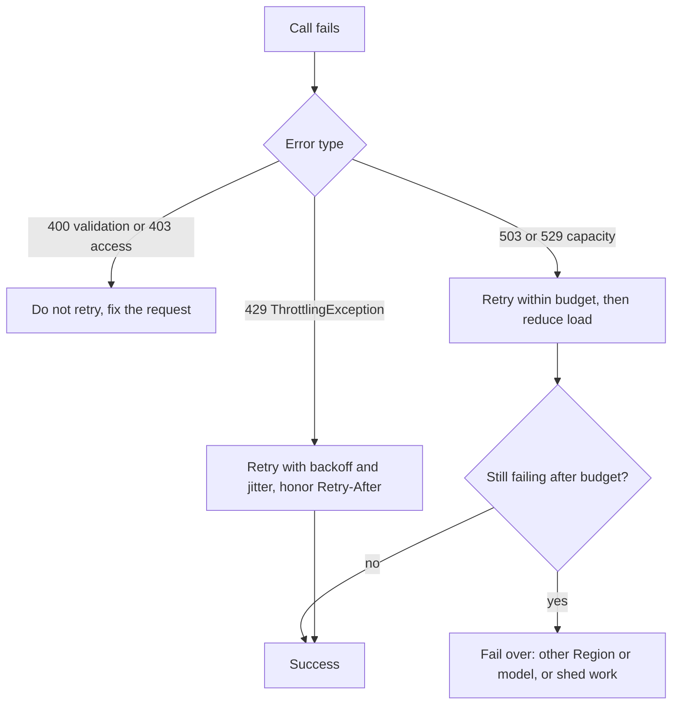
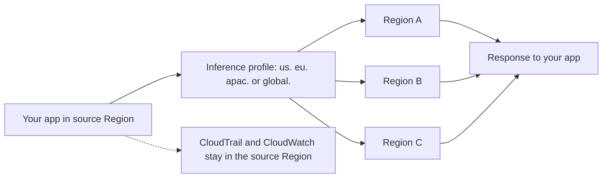

## 0. Before you start
- **Essential:** HTTP status codes (429, 503); what an SDK is; the idea of a Region.
- **Helpful:** IAM policy structure (Effect, Action, Resource, Condition); what a Service Control Policy (SCP) is.
- **Optional advanced:** TCP keep-alive; Little's Law (concurrency = arrival rate × time in system).

## 1. Simple explanation
When Bedrock says "too busy", the worst response is to ask again immediately, from every client, at the same moment: that turns a small problem into a stampede. **Exponential backoff with jitter** means waiting a little, then a bit longer, then longer still, with a random twist so clients do not retry in lockstep. **Connection pooling** means keeping a set of ready-made connections to the service instead of opening a new one for every call, and making the pool large enough for the number of calls in flight. **Cross-Region inference** lets Bedrock send your request to whichever Region in a group has spare capacity, which raises effective throughput and resilience, at the cost of some IAM and data-location homework.


```figure
flow cris-routing
```

## 2. Structured explanation
1. **Classify errors.** Retry only transient ones: throttling (HTTP 429) and capacity errors (503, 529); never retry validation or permission errors ✅.
2. **Back off with jitter.** SDK default retry modes do this for you; set a bounded attempt count that fits your latency budget ✅.
3. **Honor server hints.** If `Retry-After` is present, wait at least that long ✅.
4. **Bound the damage.** Limit concurrency, queue, shed low-priority work, and ramp gradually ✅ ([04/02 §5.8](aip:04-operational-efficiency/02-throughput-utilization-and-intelligent-caching)).
5. **Pool connections.** Reuse one client; size `max_pool_connections` to your concurrency; set connect/read timeouts separately from retries; use TCP keep-alive behind NAT ✅.
6. **Spread load across Regions.** Call a cross-Region inference profile (geographic or global) ✅; set IAM and SCPs correctly.
7. **Measure.** `InvocationThrottles`, 5xx counts, latency percentiles; CloudTrail `inferenceRegion` ✅.

## 3. Analogy
**A busy phone line.** If the line is busy, you do not redial every millisecond; you wait a bit, then longer, and each person waits a slightly different time so the first free moment is not hit by a thousand callers at once (backoff + jitter). Having an operator who keeps ten lines already open (a connection pool) is faster than dialling each time, but ten lines are not enough if fifty people call together. Cross-Region inference is a company with several call centres: if one is full, the call is routed to another.

*Where it breaks:* a phone call has no cost when it fails, but a retried model call can create **duplicate work and duplicate cost**, and if the original request actually completed, a retry may do the action twice (non-idempotent tools). Also, call centres in different countries raise data-location questions that a phone line does not.

## 4. The seven questions

**WHAT?** Backoff = increasing waits between retries. Jitter = randomness in those waits. Connection pool = reusable open connections held by the client. Cross-Region inference (CRIS) = routing an on-demand request to another Region through an inference profile.

**WHY?** Capacity and quota errors are normal at scale ✅ ("A quota is an upper bound, not a guarantee"). Without jitter, synchronized retries cause retry surges ✅. Without pooling, connection setup (TCP + TLS) adds latency to every call. CRIS gives higher effective throughput and resilience.

**WHEN?** Always for production callers. Use geographic CRIS when data must stay within a geography; global CRIS when you want about 10% lower token pricing and maximum capacity and your compliance rules allow worldwide processing ✅.

**WHERE?** Backoff and pooling: in the SDK client configuration (`botocore.config.Config`, environment variables, shared config file) and any HTTP library. CRIS: in the `modelId` you pass (an inference profile ID or ARN) and in IAM/SCP policies.

**HOW?** §5.

**WHAT IF?**
| Situation | Effect | Remedy |
|---|---|---|
| Retry count too high | Retries amplify load during sustained 503/529 ✅ | Bounded budget; stop ramping; shed load |
| Retry count 1 (no retries) | Every transient blip surfaces as an error | Use the default or a modest budget |
| Read timeout shorter than a legitimate long generation | Timeouts cause duplicate work ✅ | Set timeouts from the model's documented maximum duration |
| Pool smaller than concurrency | Connections beyond the pool are not kept for reuse; extra handshakes and warnings 🟡 | Raise `max_pool_connections` |
| NAT or interface endpoint drops idle connections after 350 s | Next call on a stale connection fails ✅ | `tcp_keepalive=True` and OS keep-alive below 350 s ([verification-log §8](aip:meta/verification-log)) |
| SCP allows only the source Region | Geographic CRIS fails when routed to a blocked destination ✅ | Allow all destination Regions or add an inference-profile exception |
| Global CRIS but SCP lacks `unspecified` | Requests fail ✅ | Allow `aws:RequestedRegion: unspecified` or use the inference-profile exception |
| Data-residency rule is strict | Global CRIS may process anywhere ✅ | Use geographic profiles or none; verify destinations |

**WHY NOT?** Do not use adaptive retry mode as a general default (it can delay the *first* request and slows every request from a client when one resource throttles) ✅. Do not use global CRIS if your compliance framework forbids processing outside defined geographies ✅. Do not retry non-idempotent side effects blindly.

## 5. Technical depth

```figure
backoff-jitter
```


### 5.1 Error handling decision

*Reading the arrows:* client mistakes are never retried. Throttling and capacity errors are retried with growing, randomised waits inside a fixed budget. If the budget is spent, change something (another Region or model, or drop low-priority work) rather than retrying harder. ✅ Source for statuses and guidance: [scaling and throughput best practices](https://docs.aws.amazon.com/bedrock/latest/userguide/scaling-throughput-best-practices.html).

HTTP statuses on `bedrock-runtime` ✅: **429** = request not admitted (a `ThrottlingException` means you exceeded an account quota or service rate limit; some operations also use 429 for `ModelNotReadyException`); **503** = temporary inability to serve because of demand or capacity (*not* your quota); **529** `overloaded_error` from some model APIs = temporary capacity shortage, honor `Retry-After` if present and add jitter.

### 5.2 How the AWS SDKs back off ✅
> **Read this first:** the AWS SDKs and Tools Reference page says the behavior described below "requires opting in until it becomes the default behavior": set `AWS_NEW_RETRIES_2026=true`. Without it the SDK uses pre-2026 behavior, which differs in backoff timing, retry quota costs and service defaults.

| Mode | Behavior | Use |
|---|---|---|
| **standard** (default) | Exponential backoff with full jitter, a **retry quota** (token bucket), error-type-specific delays | Default for all workloads |
| **adaptive** | Standard + a client-side rate limiter per client that can delay the initial request | Single-resource, throttling-heavy, latency-tolerant clients; not for multi-resource or multi-tenant clients; not a general default |
| **legacy** | Pre-standard SDK behavior; varies by SDK | Backward compatibility only |

- **Settings:** `AWS_RETRY_MODE`/`retry_mode` (default `standard`), `AWS_MAX_ATTEMPTS`/`max_attempts` (**total attempts including the first request**; default **3**, so one request plus two retries; `1` disables retries). Precedence: client config in code > environment variable > shared config file > SDK default.
- **Delay formula (full jitter):** `delay = random(0, 1) × min(20,000 ms, base × 2^retry)` where `retry` starts at 0 for the first retry; **base 50 ms** for transient errors and **1,000 ms** for throttling errors; **cap 20 s**.
- **Server-directed timing:** if an `x-amz-retry-after` header is present the SDK clamps the server delay between the computed backoff and computed backoff + 5 s.
- **Retry quota:** capacity 500 tokens; a transient retry costs 14, a throttling retry costs 5; success after a retry restores the last retry's cost; a first-try success restores 1. When depleted, the SDK stops retrying and returns the error ("fail fast"). The page states approximate sustained-failure rates (about 22% transient, 32% throttling at 3 attempts) before the quota drains; the lab does not reproduce those figures ❌.
- **Which errors:** transient (`RequestTimeout`, `InternalError`, I/O failures, HTTP 500/502/503/504 without a recognised code) and throttling (`ThrottlingException`, `TooManyRequestsException`, `LimitExceededException`, ...). Errors such as `AccessDeniedException` and `ValidationException` are not retried.

**botocore `Config`** ✅ (botocore reference):
| Setting | Meaning | Default |
|---|---|---|
| `max_pool_connections` | Connections kept in the pool | **10** |
| `connect_timeout` | Seconds to establish a connection | **60** |
| `read_timeout` | Seconds to wait reading from a connection | **60** |
| `retries={"total_max_attempts": N, "mode": "standard"}` | Total attempts incl. the first (preferred; maps to `AWS_MAX_ATTEMPTS`) | standard defaults to 3 |
| `retries={"max_attempts": N}` | Retries after the first request; "typically four" if unset in the service model | per service model |
| `tcp_keepalive` | TCP keep-alive on new connections | **False** |

The Bedrock best-practices page gives an example budget of **six total attempts** and shows `Config(retries={"total_max_attempts": 6, "mode": "standard"})` for boto3, `max_retries=5` for the OpenAI and Anthropic SDKs (those count only retries) ✅. Configure **connect/read timeouts separately from retries**, based on the model's maximum inference duration; a timeout shorter than a valid long generation causes avoidable retries and duplicate work ✅.

### 5.3 Connection pooling
- A **connection pool** keeps open connections so each call skips the TCP and TLS handshake.
- **Size it to the concurrency you really run.** Little's Law: connections in flight ≈ request rate × average call duration. LLM calls last seconds, so in-flight counts are large even at modest request rates (the lab shows 40 requests/s × 8 s = 320 in flight).
- **Reuse clients:** create the SDK client once (outside the request handler / at module level) and share it; do not build a client per request. (boto3 low-level clients are generally described as thread-safe; I did not re-read that page ❌.)
- **Keep connections alive** through middleboxes: NAT gateways, interface VPC endpoints and NLBs drop idle connections after 350 s ✅ → `tcp_keepalive=True` plus an OS interval below 350 s.
- **Pool size is not a rate limiter.** A big pool lets you send more at once, which can hit the Bedrock quota harder. Pair it with a token-aware limiter and bounded concurrency ✅.

### 5.4 Protecting the system: budgets, breakers, queues
- **Retry budget:** cap total attempts and total time per operation ("six total attempts: the initial request and up to five retries" is the AWS example) ✅. Worst-case wall time = attempts × read timeout + sum of backoff windows (the lab computes it).
- **Circuit breaker (pattern 🟡):** after N consecutive failures stop calling for a cool-down, then probe. Complements the SDK's retry quota.
- **Bulkheads and priorities (pattern 🟡):** separate pools/queues for interactive and batch traffic; shed batch first.
- **Queue + workers:** SQS between producer and model workers; scale workers on queue depth; dead-letter queue for poison requests ([06 app-building tools](aip:meta/syllabus-coverage-map); limits ❌ not re-verified here).
- **Idempotency:** Converse/InvokeModel do not take an idempotency token (batch `CreateModelInvocationJob` has `clientRequestToken` ✅); for agent tools with side effects use your own idempotency keys, so a retried call does not charge a card twice.
- **Ramp-up** after launches and model/Region switches in controlled steps ✅ ([04/02 §5.8](aip:04-operational-efficiency/02-throughput-utilization-and-intelligent-caching)).

### 5.5 Cross-Region inference (CRIS)

*Reading the arrows:* you call an inference profile from your **source Region**; Bedrock picks a destination Region from the profile's list and returns the answer to you. Logs and metrics remain in the source Region, so observability is centralised, and the destination can be found in CloudTrail (`additionalEventData.inferenceRegion`) ✅.

| Feature | Geographic CRIS | Global CRIS |
|---|---|---|
| Routing | Within a geography (for example US, EU, APAC) | Any supported commercial Region worldwide |
| Profile ID prefix | Geography prefix such as `us`, `eu`, `apac`, `in` | `global.` |
| Data residency | Within the geographic boundary | Anywhere supported; assess your compliance rules |
| Price | Standard pricing | **Approximately 10% savings** versus geographic ✅ |
| SCP | Allow **all destination Regions** of the profile (or inference-profile exception) | Allow `"aws:RequestedRegion": "unspecified"` (or inference-profile exception) |
| Quotas | "Cross-region model inference requests/tokens per minute" quotas in Service Quotas | "Global cross-region model inference requests/tokens per minute"; manage in the **source Region** |
| Typical use | Compliance-bound workloads | Cost and capacity optimisation |

Common facts ✅ (official CRIS page): there is **no additional routing cost**; price is calculated from the **source Region**; CRIS can route to Regions **not manually enabled** in your account; data stays on the AWS network and is encrypted in transit; prompts and outputs "might move outside of your source Region", and any abuse-detection storage happens in the destination Region (geographic page); profiles **do not support Provisioned Throughput**; CRIS works with on-demand inference, **batch inference**, Agents, Knowledge Base response generation, model evaluation, Prompt management and Flows (support differs slightly between the geographic and global pages: the global page lists on-demand, batch, Agents, model evaluation, Prompt management, Flows); **prompt caching works with CRIS** and "at times of high demand… may lead to increased cache writes"; the page recommends bounded retries and multi-Region or multi-model fallback to meet an availability target.

**IAM for geographic CRIS** ✅: allow `bedrock:InvokeModel` on (1) the inference profile, (2) the foundation model in the source Region, and (3) the foundation model in **every destination Region** of the profile. The second statement uses the condition `bedrock:InferenceProfileArn` to limit the model permission to that profile. Skeleton (placeholders; shape from the AWS page):
```json
{
  "Version": "2012-10-17",
  "Statement": [
    {
      "Sid": "GrantGeoCrisInferenceProfileAccess",
      "Effect": "Allow",
      "Action": "bedrock:InvokeModel",
      "Resource": ["arn:aws:bedrock:us-east-1:111122223333:inference-profile/us.MODEL_ID"]
    },
    {
      "Sid": "GrantGeoCrisModelAccess",
      "Effect": "Allow",
      "Action": "bedrock:InvokeModel",
      "Resource": [
        "arn:aws:bedrock:us-east-1::foundation-model/MODEL_ID",
        "arn:aws:bedrock:us-east-2::foundation-model/MODEL_ID",
        "arn:aws:bedrock:us-west-2::foundation-model/MODEL_ID"
      ],
      "Condition": {
        "StringEquals": {
          "bedrock:InferenceProfileArn": "arn:aws:bedrock:us-east-1:111122223333:inference-profile/us.MODEL_ID"
        }
      }
    }
  ]
}
```
**IAM for global CRIS** ✅ is a **three-part** policy: (1) the Regional inference profile `...:inference-profile/global.MODEL`, with `aws:RequestedRegion` = your Region; (2) the Regional foundation model, with your Region and the `InferenceProfileArn` condition; (3) the **Region-less global foundation-model ARN** `arn:aws:bedrock:::foundation-model/MODEL` with `aws:RequestedRegion` = `unspecified` and the `InferenceProfileArn` condition. All three are required; removing one disables global CRIS.
```json
{
  "Version": "2012-10-17",
  "Statement": [
    {
      "Sid": "GrantGlobalCrisInferenceProfileRegionAccess",
      "Effect": "Allow",
      "Action": "bedrock:InvokeModel",
      "Resource": ["arn:aws:bedrock:us-east-1:111122223333:inference-profile/global.MODEL_ID"],
      "Condition": {"StringEquals": {"aws:RequestedRegion": "us-east-1"}}
    },
    {
      "Sid": "GrantGlobalCrisInferenceProfileInRegionModelAccess",
      "Effect": "Allow",
      "Action": "bedrock:InvokeModel",
      "Resource": ["arn:aws:bedrock:us-east-1::foundation-model/MODEL_ID"],
      "Condition": {"StringEquals": {
        "aws:RequestedRegion": "us-east-1",
        "bedrock:InferenceProfileArn": "arn:aws:bedrock:us-east-1:111122223333:inference-profile/global.MODEL_ID"}}
    },
    {
      "Sid": "GrantGlobalCrisInferenceProfileGlobalModelAccess",
      "Effect": "Allow",
      "Action": "bedrock:InvokeModel",
      "Resource": ["arn:aws:bedrock:::foundation-model/MODEL_ID"],
      "Condition": {"StringEquals": {
        "aws:RequestedRegion": "unspecified",
        "bedrock:InferenceProfileArn": "arn:aws:bedrock:us-east-1:111122223333:inference-profile/global.MODEL_ID"}}
    }
  ]
}
```
**SCP to explicitly disable global CRIS** ✅ (deny when the Region is `unspecified` and the profile ARN matches `global.*`):
```json
{
  "Effect": "Deny",
  "Action": "bedrock:*",
  "Resource": "*",
  "Condition": {
    "StringEquals": {"aws:RequestedRegion": "unspecified"},
    "ArnLike": {"bedrock:InferenceProfileArn": "arn:aws:bedrock:*:*:inference-profile/global.*"}
  }
}
```
The page also explains an **inference-profile exception**: because `bedrock:InferenceProfileArn` is populated for the foundation-model evaluations (not for the profile evaluation), a Region-deny SCP can exempt cross-Region routing for specific profiles without allowlisting `unspecified` or the destination Regions for other services; it **cannot bypass** the Region restriction on the originating call ✅. For AWS Control Tower, do not hand-edit managed SCPs (drift); follow the Control Tower mechanisms ✅.

**Data-residency check:** the Verification log (§10) records that the prefix alone should not be trusted for residency; call `GetInferenceProfile` from every source Region you use and read `models[].modelArn` to see the destinations.

**Application inference profiles** can wrap a system (cross-Region) profile so you get CRIS *and* cost tags ✅ ([04/01 §5.3](aip:04-operational-efficiency/01-token-efficiency-and-cost-effective-model-selection)).

**Quotas** ✅: manage cross-Region and global quotas in Service Quotas **in the source Region**; when sizing an increase, include the model's **burndown rate** ([04/02 §5.2](aip:04-operational-efficiency/02-throughput-utilization-and-intelligent-caching)); the global page says global CRIS can be used from "over 20" source Regions and that this is a global limit.

## 6. Worked example
*Problem:* A bank's call-summary service in `eu-west-1` is rate-limited at peak (HTTP 429 and occasional 503). Rules: customer data must stay in the EU.

| Step | Decision | Why |
|---|---|---|
| 1 | Keep the SDK on `standard` mode, set a retry budget (for example six total attempts), honor `Retry-After` | Transient errors are expected |
| 2 | Switch the `modelId` to the **EU geographic** inference profile, not the global one | Data must stay in the EU |
| 3 | Update IAM with the profile ARN, the source-Region model ARN and **every EU destination Region's** model ARN; update the SCP to allow those Regions or add the inference-profile exception | Otherwise routing fails |
| 4 | Verify destinations with `GetInferenceProfile` and CloudTrail `inferenceRegion` | Evidence for the auditors |
| 5 | Raise `max_pool_connections` to match concurrency (lab: 320 in flight) and enable TCP keep-alive | Avoid pool starvation and stale connections |
| 6 | Add a token-aware limiter and a queue; shed low-priority summaries when 503s persist | Prevent retry storms |
| 7 | Request a quota increase for the EU cross-Region quota in the source Region, including burndown | Real headroom |
| 8 | Alarm on `InvocationThrottles` and 5xx; ramp traffic in steps | Safe operation |

## 7. Knowledge checkpoints
1. Which HTTP status indicates a capacity problem rather than exceeding your account quota?
2. In botocore, which setting counts the first request: `total_max_attempts` or `max_attempts`?
3. What is the default `max_pool_connections`?
4. Which `aws:RequestedRegion` value must an SCP allow for global cross-Region inference?
5. Where do CloudTrail and CloudWatch record cross-Region requests?

## 7b. Practice questions (exam-style, original) — answers in §14

**Q1.** Many workers retry immediately after receiving 429 errors and the service gets worse. Which change is best?
A. Remove all retries
B. Use exponential backoff with jitter and a bounded retry budget
C. Use a fixed 1 ms delay
D. Increase `max_tokens`

**Q2.** (Select TWO) Which errors should normally be retried with backoff?
A. `ThrottlingException` (HTTP 429)
B. A transient 503 `ServiceUnavailable`
C. `ValidationException` for a malformed request
D. `AccessDeniedException` for missing IAM permissions
E. An expired credentials error that will fail again

**Q3.** A Python service creates a new `boto3` client on every request, and latency is high. What is the best improvement?
A. Create the client once, reuse it, and size `max_pool_connections` to the concurrency
B. Use a different Region for each request
C. Disable retries
D. Reduce `read_timeout` to 1 second

**Q4.** (Select TWO) Which are true of global cross-Region inference?
A. The inference profile ID starts with `global.`
B. Requests can be processed in any supported commercial Region worldwide
C. It guarantees data never leaves the source Region
D. It supports Provisioned Throughput
E. It requires no IAM changes

**Q5.** A company's SCP allows only `us-east-1`. A user calls a US geographic cross-Region profile from `us-east-1`, and requests fail when routed to `us-east-2`. What is the right fix?
A. Allow the profile's destination Regions in the SCP or add an inference-profile exception
B. Change the SCP to deny `bedrock:*`
C. Lower the temperature
D. Switch to a smaller model

**Q6.** A workload must keep all inference inside the EU. Which is the best choice?
A. Global cross-Region inference
B. An EU geographic cross-Region profile, with destinations verified and IAM/SCP allowing them
C. Any profile; the prefix does not matter
D. Provisioned Throughput through an inference profile

**Q7.** What does the SDK retry quota (token bucket) do?
A. It stops retrying when too many retries have been consumed without enough successes, so the client fails fast
B. It limits the number of tokens per model response
C. It encrypts retries
D. It forces adaptive mode

**Q8.** After 503 errors persist for several minutes, which action best matches AWS guidance?
A. Triple the retry attempts
B. Stop ramping, return to the last stable rate, bound concurrency, shed low-priority work, and consider cross-Region inference or Provisioned Throughput
C. Raise `max_tokens`
D. Remove the connection pool

## 7c. Mixed review for Quiz 4 (operational efficiency and optimization)
**R1.** A chatbot's input tokens grow every turn. Which is the best first fix? A. Larger model B. Prune or summarise history within a token budget C. Higher temperature D. Disable streaming
**R2.** The same 5,000-token policy document prefixes every request. Which feature cuts cost and latency? A. Batch inference B. Prompt caching C. Priority tier only D. Semantic cache only
**R3.** Users ask the same question in different words, and answers are identical for everyone. Which cache fits? A. Exact-match hash cache B. Semantic cache with a tuned similarity threshold and tenant-safe keys C. API Gateway cache on a POST method with no key D. Prompt cache
**R4.** `max_tokens` is 32,000 on every call but answers average 800 tokens, and throttling is frequent. What is the cause and fix? A. Burndown; use batch B. Up-front quota deduction includes `max_tokens`; lower it C. Cached tokens double-counted; disable caching D. RPM; add a Region
**R5.** A nightly job of 200,000 prompts can wait hours. Which is best? A. Synchronous Converse in a loop B. Batch inference (JSONL in S3) C. Latency-optimized inference D. Reserved tier
**R6.** Which pairing is correct? A. Top K: cumulative probability share B. Top P: fixed number of candidates C. Top K: fixed candidate count; Top P: cumulative probability share D. Temperature: maximum length

**Answers (7c).** R1 → B. R2 → B (also fits the first rule: static prefix first). R3 → B (A misses paraphrases; C is unsafe; D caches prefixes, not answers). R4 → B ([04/02 §5.2](aip:04-operational-efficiency/02-throughput-utilization-and-intelligent-caching)). R5 → B. R6 → C.

## 8. Hands-on lab: jitter, retry quota, pool sizing, worst-case time and an SCP check

### 8.1 Objective
Compute SDK-style backoff windows, show why jitter spreads retries, simulate the retry quota during an outage, size a connection pool with Little's Law, compute worst-case wall time for a retry configuration, and test a Region allowlist against geographic and global profiles.

### 8.2 Prerequisites
Python 3 only. Nothing here calls AWS. The retry model follows the AWS SDK retry page (formula, base delays, cap, token costs) but is a simulation, not the SDK.

### 8.3 AWS services
None offline. Maps to the AWS SDKs, Bedrock `bedrock-runtime`, IAM/SCP and CloudTrail.

### 8.4 IAM permissions
Offline: none. Real CRIS use needs the policies in §5.5; `bedrock:GetInferenceProfile` to inspect an inference profile ❌ action name should be checked in the Bedrock authorization reference.

### 8.5 Region notes
Profiles and their destination Regions depend on the model and source Region ✅. Check the "Supported Regions and models for inference profiles" page on the day.

### 8.6 Architecture
§5.1 and §5.5.

### 8.7 Cost
Offline: none.

### 8.8 Code
```python lab-run
import json

# ---- 1. Backoff windows (AWS SDK retry page: delay = random(0,1) * min(20000, base * 2**retry)) ----
def window(base_ms, retry):
    return min(20_000, base_ms * 2 ** retry)

print("retry  transient window (ms)  throttling window (ms)")
for r in (0, 1, 2, 3, 5, 6, 9, 10):
    print(f"{r:>5}  {window(50, r):>22}  {window(1000, r):>22}")

state = 2024
def uniform():
    global state
    state = (state * 1103515245 + 12345) % (2 ** 31)
    return state / 2 ** 31

# 1,000 clients all fail at the same moment and retry once (transient error, 50 ms base)
no_jitter = [window(50, 0)] * 1000
jitter = [uniform() * window(50, 0) for _ in range(1000)]
def buckets(delays, width=10):
    return len({int(d // width) for d in delays})
print("distinct 10 ms slots used by 1000 first retries: no jitter =", buckets(no_jitter), " full jitter =", buckets(jitter))

# ---- 2. Retry quota (token bucket): capacity 500, transient retry costs 14, throttling retry costs 5, success +1 ----
def run_outage(failure_requests, max_attempts=3, cost=14):
    tokens, full_retry_requests, blocked = 500, 0, 0
    for _ in range(failure_requests):
        retries_done = 0
        for _attempt in range(max_attempts - 1):
            if tokens >= cost:
                tokens -= cost
                retries_done += 1
            else:
                blocked += 1
                break
        if retries_done == max_attempts - 1:
            full_retry_requests += 1
    return tokens, full_retry_requests, blocked

tokens, full, blocked = run_outage(100)
print(f"100 requests failing for good: {full} got all their retries, {blocked} were cut short, tokens left {tokens}")
tokens2, full2, blocked2 = run_outage(100, cost=5)
print(f"same with throttling-cost retries (5): {full2} got all their retries, {blocked2} were cut short, tokens left {tokens2}")
refill = min(500, tokens + 300 * 1)     # 300 first-try successes restore 1 token each
print("after 300 first-try successes the bucket holds:", refill)

# ---- 3. Pool sizing with Little's Law: in-flight = rate x duration ----
rate_per_s, avg_call_s = 40, 8
in_flight = rate_per_s * avg_call_s
print(f"{rate_per_s} requests/s x {avg_call_s} s = {in_flight} connections in flight; botocore default pool = 10 -> raise max_pool_connections to at least {in_flight}")

# ---- 4. Worst-case wall time for a retry configuration ----
def worst_case_s(total_attempts, read_timeout_s, base_ms):
    backoffs = sum(window(base_ms, r) for r in range(total_attempts - 1)) / 1000
    return total_attempts * read_timeout_s + backoffs
print("6 attempts, 60 s read timeout, throttling base:", worst_case_s(6, 60, 1000), "s")
print("3 attempts, 20 s read timeout, throttling base:", worst_case_s(3, 20, 1000), "s")

# ---- 5. Region allowlist vs cross-Region profiles (rules from the AWS CRIS pages) ----
def scp_allows(allowed, profile_kind, destinations):
    if profile_kind == "geographic":
        return all(d in allowed for d in destinations)
    if profile_kind == "global":
        return "unspecified" in allowed
    raise ValueError(profile_kind)

US_DEST = ["us-east-1", "us-east-2", "us-west-2"]    # destinations of the example US profile on the AWS page
for allowed in (["us-east-1"], US_DEST, ["us-east-1", "unspecified"]):
    print(f"allowlist {allowed!s:<48} geographic ok: {scp_allows(allowed, 'geographic', US_DEST)!s:<5} global ok: {scp_allows(allowed, 'global', [])}")

# ---- 6. Where was the request processed? Read CloudTrail additionalEventData.inferenceRegion (sample event is invented) ----
event = json.loads('{"eventSource":"bedrock.amazonaws.com","eventName":"Converse","awsRegion":"us-east-1","additionalEventData":{"inferenceRegion":"us-west-2"}}')
print("called in", event["awsRegion"], "processed in", event["additionalEventData"]["inferenceRegion"])
```

### 8.9 Captured output
Generated on 2026-10-26 by extracting the block above from this file and running it (Python 3). It models the documented rules and is **not** SDK, Bedrock or CloudTrail output.
```text lab-out
retry  transient window (ms)  throttling window (ms)
    0                      50                    1000
    1                     100                    2000
    2                     200                    4000
    3                     400                    8000
    5                    1600                   20000
    6                    3200                   20000
    9                   20000                   20000
   10                   20000                   20000
distinct 10 ms slots used by 1000 first retries: no jitter = 1  full jitter = 5
100 requests failing for good: 17 got all their retries, 83 were cut short, tokens left 10
same with throttling-cost retries (5): 50 got all their retries, 50 were cut short, tokens left 0
after 300 first-try successes the bucket holds: 310
40 requests/s x 8 s = 320 connections in flight; botocore default pool = 10 -> raise max_pool_connections to at least 320
6 attempts, 60 s read timeout, throttling base: 391.0 s
3 attempts, 20 s read timeout, throttling base: 63.0 s
allowlist ['us-east-1']                                    geographic ok: False global ok: False
allowlist ['us-east-1', 'us-east-2', 'us-west-2']          geographic ok: True  global ok: False
allowlist ['us-east-1', 'unspecified']                     geographic ok: False global ok: True
called in us-east-1 processed in us-west-2
```

### 8.10 Explanation
- Part 1: windows double each retry until the 20-second cap; throttling errors start 20 times higher (1,000 ms) than transient ones (50 ms). Without jitter all 1,000 clients retry in the same instant; full jitter spreads them over the window.
- Part 2: when every request fails, the 500-token bucket pays for only a few full retry sequences, then retries are blocked and the client fails fast. Cheaper throttling retries (5 tokens) last far longer. First-try successes refill the bucket slowly.
- Part 3: 40 requests per second at 8 seconds each means 320 calls in flight; the default pool of 10 is far too small.
- Part 4: attempts × read timeout dominate worst-case time; long read timeouts times many attempts can exceed any user's patience, so match the budget to the latency target.
- Part 5: a single-Region allowlist breaks a US geographic profile; allowing all destinations fixes it; the global profile needs `unspecified`.
- Part 6: the CloudTrail field `additionalEventData.inferenceRegion` shows where the request was processed.

### 8.11 Optional AWS lab (shown, not run against AWS ❌)
1. **SDK configuration** (shape from the AWS best-practices page ✅), with pool and keep-alive added from the botocore reference ✅:
```python
import boto3
from botocore.config import Config

config = Config(
    retries={"total_max_attempts": 6, "mode": "standard"},
    max_pool_connections=64,
    connect_timeout=10,
    read_timeout=120,
    tcp_keepalive=True,
)
bedrock = boto3.client("bedrock-runtime", config=config)   # create once, reuse everywhere
```
Set `AWS_NEW_RETRIES_2026=true` if you want the updated retry behavior described by the AWS SDK reference ✅. The values 64, 10 and 120 are **examples to adapt**, not recommendations.
2. **Call a geographic profile:** use the profile ID (for example the model's `us.` or `eu.` ID from the "Supported Regions and models for inference profiles" page) as `modelId` in `converse`. Add the IAM statements from §5.5 first.
3. **Check destinations:** `aws bedrock get-inference-profile --inference-profile-identifier <profile-id>` and read `models[].modelArn` (command name ❌ not verified in this session; use `aws bedrock help`). Then look at CloudTrail `Converse` events for `additionalEventData.inferenceRegion`.
4. **Alarm:** CloudWatch alarm on `InvocationThrottles` and `InvocationServerErrors` (namespace `AWS/Bedrock`) ✅.
5. **Clean up:** remove test IAM policies and alarms.

### 8.12 Common errors
| Error | Cause | Fix |
|---|---|---|
| `AccessDeniedException` only with a CRIS profile | Missing profile ARN or a destination Region's model ARN ✅ | Add all three resource types |
| Works in one Region, fails in another | SCP blocks a destination Region ✅ | Allow destinations or inference-profile exception |
| Global profile fails under a Region-allowlist SCP | `unspecified` not allowed ✅ | Allow it or use the exception |
| Intermittent failures after idle periods | Idle connection dropped at 350 s ✅ | TCP keep-alive |
| Latency spikes under load | Pool exhausted | Raise `max_pool_connections` |
| Retries seem different across SDKs | `total_max_attempts` vs `max_retries` semantics ✅ | Read each SDK's setting |

### 8.13 Security recommendations
Grant CRIS permissions to specific profiles with the `bedrock:InferenceProfileArn` condition rather than broad wildcards ✅; document which Regions can process data; do not log full prompts to shared destinations; store credentials in roles, not code; test SCP changes in a sandbox OU first; for Control Tower use its supported mechanisms ✅.

## 9. What can go wrong?
| Failure | Why | Symptoms | Investigate | Fix | Prevent |
|---|---|---|---|---|---|
| **Retry storm** | No jitter, high attempt count, shared failure | 503 climbs, latency explodes | Retry counts, client logs | Jitter, retry budget, shed load | Standard mode, limiter ✅ |
| **Duplicate side effects** | Retried a non-idempotent call | Double actions | Tool logs | Idempotency keys | Design tools idempotent |
| **Adaptive-mode stalls** | One throttled resource slows a shared client | Latency on unrelated calls ✅ | Per-client metrics | Separate clients or standard mode | Do not default to adaptive |
| **Timeout shorter than inference** | `read_timeout` too low | Timeouts then retries ✅ | Timeout counts vs durations | Raise timeout | Size from model max duration |
| **CRIS blocked by SCP/IAM** | Destination Regions or `unspecified` not allowed ✅ | `AccessDenied` | Policy simulator, CloudTrail | Fix policy | Pre-launch test |
| **Residency surprise** | Used global profile | Processed outside geography ✅ | `inferenceRegion` | Switch to geographic | Compliance review |
| **Prompt-cache churn** | CRIS under high demand ✅ | More cache writes | `CacheWriteInputTokenCount` | Accept or pin Region | Monitor ratio |
| **Quota not raised in source Region** | Wrong Region in Service Quotas ✅ | Persistent 429 | Service Quotas in the source Region | Request there | Runbook |

## 10. Common misconceptions
1. **"More retries = more reliable."** Unbounded retries make sustained outages worse ✅.
2. **"Jitter is optional polish."** It prevents synchronized retry surges ✅.
3. **"A larger connection pool raises my Bedrock quota."** It only lets you send more at once.
4. **"Cross-Region inference costs extra."** No additional routing cost; global is about 10% cheaper than geographic ✅.
5. **"The `eu.` prefix guarantees EU-only processing."** Verify destinations ([verification-log §10](aip:meta/verification-log)).
6. **"CRIS works with Provisioned Throughput."** Not currently ✅.
7. **"`max_attempts` and `total_max_attempts` are the same."** One counts retries, the other total attempts ✅.

## 11. Exam notes
- **Pattern:** "429/503 under load" → backoff with jitter + bounded retries; "increase effective throughput without Provisioned Throughput" → cross-Region inference; "keep data inside a geography" → geographic profile; "lowest token cost, no geography limit" → global profile; "AccessDenied only on cross-Region profile" → IAM/SCP for destination Regions.
- **Traps:** thinking global CRIS needs no IAM changes; assuming retries are always safe; forgetting `unspecified` in the SCP; mixing up where quotas are managed (source Region).
- **Compare:** CRIS (on-demand, spread across Regions) vs Provisioned Throughput (dedicated, no profiles) vs batch (asynchronous) vs application-level multi-Region failover (you build it).
- Exam-guide skill names ✅: "batching strategies, capacity planning, utilization monitoring, auto-scaling configurations, provisioned throughput optimization" (4.1.3); "token processing optimization, batch inference strategies, concurrent model invocation management" (4.2.3); "efficient service communication patterns" (4.2.6).

## 12. Summary and revision cards
- Retry transient errors only; exponential backoff + full jitter; bounded attempts; honor `Retry-After`; retry quota stops runaway retries.
- Pool: reuse the client; default 10 connections; in-flight = rate × duration; keep-alive below 350 s.
- CRIS: geographic vs global; three-part IAM for global; SCP `unspecified`; quotas in source Region; logs in source Region; no PT.

**Cards.** Q: Backoff cap? A: 20 s. · Q: Transient / throttling base delay? A: 50 ms / 1,000 ms. · Q: Default botocore pool? A: 10. · Q: Global CRIS price effect? A: About 10% cheaper. · Q: Where is `inferenceRegion` logged? A: CloudTrail `additionalEventData`.

## 13. References
| Source | URL | Verified |
|---|---|---|
| Scaling and throughput best practices | https://docs.aws.amazon.com/bedrock/latest/userguide/scaling-throughput-best-practices.html | 2026-10-26 |
| AWS SDKs retry behavior | https://docs.aws.amazon.com/sdkref/latest/guide/feature-retry-behavior.html | 2026-10-26 |
| botocore Config reference | https://docs.aws.amazon.com/botocore/latest/reference/config.html | 2026-10-26 |
| Cross-Region inference (overview) | https://docs.aws.amazon.com/bedrock/latest/userguide/cross-region-inference.html | 2026-10-26 |
| Geographic CRIS | https://docs.aws.amazon.com/bedrock/latest/userguide/geographic-cross-region-inference.html | 2026-10-26 |
| Global CRIS | https://docs.aws.amazon.com/bedrock/latest/userguide/global-cross-region-inference.html | 2026-10-26 |
| Inference profiles | https://docs.aws.amazon.com/bedrock/latest/userguide/inference-profiles.html | 2026-10-26 |
| Runtime CloudWatch metrics | https://docs.aws.amazon.com/bedrock/latest/userguide/monitoring-runtime-metrics.html | 2026-10-26 |
| Exam guide, Domain 4 | https://docs.aws.amazon.com/aws-certification/latest/ai-professional-01/ai-professional-01-domain4.html | 2026-10-26 |

**Unverified here:** `GetInferenceProfile` CLI/IAM names; `ModelNotReadyException` and other exception statuses beyond what the best-practices page states; boto3 client thread-safety statement; SQS/auto-scaling limits; the SDK page's 22%/32% drain rates (quoted, not reproduced); the profile and Region lists for any specific model (they change; read the supported-Regions page).

## 14. Answers to checkpoints and practice questions
**Checkpoints.** 1) 503 (and 529 for some model APIs); 429 means the request was not admitted ✅. 2) `total_max_attempts` includes the first request; `max_attempts` counts retries ✅. 3) 10 ✅. 4) `unspecified` ✅. 5) In the source Region ✅.

**Practice questions.**
- **Q1 → B.** Jitter spreads retries; A removes resilience; C causes a stampede; D is unrelated.
- **Q2 → A, B.** C, D, E fail again if retried.
- **Q3 → A.** Reuse the client and size the pool; B, C, D do not address connection setup.
- **Q4 → A, B.** C is false; D is false (profiles do not support Provisioned Throughput); E is false (three-part IAM) ✅.
- **Q5 → A.** Geographic routing needs all destination Regions allowed, or the exception ✅.
- **Q6 → B.** Geographic profile with verified destinations; A may leave the EU; C is wrong (prefix alone is not proof); D is unsupported.
- **Q7 → A.** The token bucket makes the client fail fast when retries are not paying off ✅.
- **Q8 → B.** More retries amplify load ✅.
