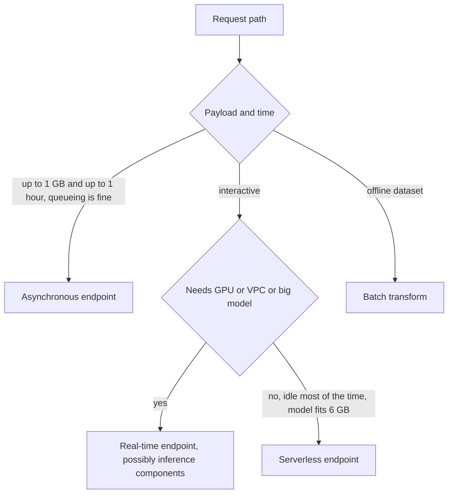
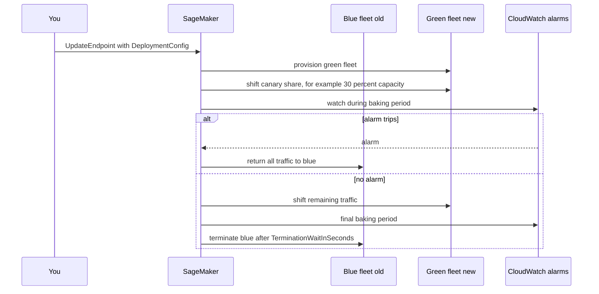

## 0. Before you start
- **Essential:** what a model artifact is (weights in a file); what a container image is; CloudWatch alarms.
- **Helpful:** the difference between training (learning weights) and inference (using them); GPU versus CPU.
- **Optional advanced:** model parallelism, quantization, KV cache.

## 1. Simple explanation
Amazon Bedrock lets you *use* models that AWS hosts. **Amazon SageMaker AI** is the toolbox for when you want to *own the machine*: you choose the model files, the container, the instance type and how traffic reaches it. It covers the ML lifecycle: prepare data (processing jobs), train or fine-tune, then **host** the model on an **endpoint** (a managed HTTPS address backed by instances you choose). Because a bad model update can hurt real users, SageMaker has **deployment guardrails**: shift traffic to the new version gradually, watch CloudWatch alarms, and roll back automatically. For large language models there are extra tools to make hosting cheaper and faster: quantization, compilation, speculative decoding and faster model loading.


```figure
flow endpoint-picker
```

## 2. Structured explanation
1. **Prepare:** processing jobs and data tools ([02/02](aip:02-data-management/02-sagemaker-data-wrangler-and-data-preparation)).
2. **Train or customize:** training jobs; JumpStart fine-tuning ([05/04](aip:05-sagemaker/04-neo-unified-studio-pipelines-and-jumpstart)). The exam guide says you must know how to *deploy and manage* custom models, not design training algorithms ([exam-guide-map](aip:meta/exam-guide-map)).
3. **Package:** a SageMaker *model* = container image + model artifact location + execution role ✅.
4. **Choose the endpoint type** ✅: real-time, serverless, or asynchronous (§5.1).
5. **Share instances smartly:** *inference components* host several models on one endpoint ✅ (§5.2).
6. **Update safely:** blue/green (all at once, canary, linear) or rolling deployments with auto-rollback ✅ (§5.3).
7. **Make FMs cheaper/faster:** inference recommendations, or manual optimization: compilation, quantization, speculative decoding, fast model loading ✅ (§5.4).
8. **Scale and watch:** automatic scaling for endpoints ✅ (page exists; settings not re-read ❌), CloudWatch.

## 3. Analogy
**A restaurant kitchen you rent.** Bedrock is ordering from a hotel's room service: you do not choose the stove. SageMaker is renting a kitchen: you pick the equipment (instance type), bring your own recipe (model artifact + container), and decide how many cooks are on shift (instances, copies). A *deployment guardrail* is a trial service for a new menu: first 10% of tables get the new dish; if complaints (alarms) pop up, the kitchen switches back at once.

*Where it breaks:* a kitchen's staff are paid only when cooking, but an endpoint's instances bill while they exist, even idle, unless you use scale-to-zero (async, serverless, inference components) ✅. Also, a bad dish affects one table; a bad model can silently give plausible but wrong answers, so alarms must watch quality-related signals as well as errors.

## 4. The seven questions

**WHAT?** SageMaker AI hosting = managed endpoints running your containers on instances you choose. Deployment guardrails = managed traffic shifting and auto-rollback. Inference optimization = techniques that shrink or speed up generative models.

**WHY?** Control (any open model, custom code, specific GPUs), data and network control, predictable performance, cost options at scale, and a managed update path.

**WHEN?** Use SageMaker when you need a model Bedrock does not offer, full control of the serving stack, a custom or fine-tuned open-weight model you must host yourself, or specific accelerators. Use Bedrock when a hosted model fits: less to operate. (Custom models can also be deployed on Bedrock; see [01/02](aip:01-bedrock-genai-fundamentals/02-model-customization-finetuning-and-lora).)

**WHERE?** Regional service; endpoints run in an AWS-managed fleet and can be attached to your VPC (not for serverless ✅); artifacts live in S3 in the **same Region** as the model ✅; containers come from ECR.

**HOW?** §5.

**WHAT IF?**
| Situation | Effect | Remedy |
|---|---|---|
| New endpoint config uses a different production variant name | Blue/green or rolling guardrail deployments need the **same variant name** ✅ | Keep the variant name |
| Endpoint uses a Marketplace container or Inf1 instances | Guardrails unavailable; falls back to blue/green **all at once** with **no final baking period** ✅ | Plan manual safeguards |
| Rolling deployment on a serverless or multi-variant endpoint | Not supported ✅ | Use blue/green or another approach |
| Async endpoint receives synchronous invoke | Not allowed: an `AsyncInferenceConfig` means async only ✅ | Use `InvokeEndpointAsync` |
| Serverless endpoint for a GPU LLM | GPUs unsupported ✅ | Real-time endpoint or inference components |
| Alarm trips during canary bake | Traffic rolls back to blue ✅ | Fix and redeploy |
| Idle real-time endpoint | Still billing | Delete, or use scale-to-zero options |
| Quantized model loses accuracy | May be less accurate than the source ✅ | Evaluate before switching |

**WHY NOT?** Do not run your own endpoint for a workload a Bedrock model already serves well. Do not use the largest GPU "to be safe". Do not skip alarms: guardrails without alarms cannot roll back anything.

## 5. Technical depth

```figure
traffic-shift
```


### 5.1 Choosing an endpoint type ✅
| Type | Best for | Key facts |
|---|---|---|
| **Real-time** | Interactive, low-latency inference | Always-on instances; supports deployment guardrails |
| **Serverless** | Idle periods between spurts; tolerates cold starts | Memory 1,024 to 6,144 MB (1 GB steps), 5 GB ephemeral disk, container image ≤ 10 GB; max concurrency per endpoint up to 200; 50 serverless endpoints per Region; account-wide concurrency 1,000 (some Regions) or 500; **no GPUs**, no VPC config, no network isolation, no data capture, no multi-model endpoints, no multiple variants, no Model Monitor; optional **provisioned concurrency** (≤ max concurrency); cold start visible in `OverheadLatency`; a real-time endpoint cannot be converted to serverless |
| **Asynchronous** | Large payloads (up to **1 GB**), long processing (up to **1 hour**), near-real-time needs | Requests queued; payload in S3, `InvokeEndpointAsync`; result in S3; optional SNS notifications; can **scale to zero** |
| **Batch transform** | Offline scoring of a dataset | Appears as the Transform step in Pipelines ✅ ([05/04](aip:05-sagemaker/04-neo-unified-studio-pipelines-and-jumpstart)); details ❌ not re-read |

Three ways to deploy ✅: **JumpStart in Studio** (low-code, popular open models), **`ModelBuilder`** in the SageMaker Python SDK (your own model, fine control), **CloudFormation / Boto3 with CI/CD** (repeatable, at scale).


*Reading the arrows:* start from the request shape. Huge or slow requests that can wait go async; interactive requests that need GPUs, VPC settings or a large model go real-time; small CPU models with idle gaps fit serverless; whole datasets go to batch. The lab encodes these rules.

### 5.2 Inference components: many models, one endpoint ✅
An **inference component** is a hosting object that deploys a model to an endpoint and states how much of the endpoint's CPU, accelerators and memory each copy uses. Benefits from the AWS page: host several models on the same infrastructure; add or remove models without recreating the endpoint; update each model independently; choose how many **copies** per model and a minimum; **scale a copy down to zero** to make room for another. Packaging happens when you deploy a `Model` with `EndpointType.INFERENCE_COMPONENT_BASED`, through Studio, or via Boto3.
- Flow: `create_model` (optional) → `create_endpoint_config` (production variant with instance type; optional `ManagedInstanceScaling` with min/max instance count) → `create_endpoint` → `create_inference_component` (`Specification` with `Container.Image` + `ArtifactUrl` or a model name, `ComputeResourceRequirements` such as `NumberOfCpuCoresRequired` and `MinMemoryRequiredInMb`; `RuntimeConfig.CopyCount`).
- Console: for **Memory**, minimum 128 MB; the **GPUs** field exists only on accelerator instances; **View availability** shows total, allocated and available capacity so you do not over-allocate ✅.
- You invoke a model on the endpoint through `InvokeEndpoint` ✅ (selecting the component).
- **Compatibility in Studio** ✅: models on one endpoint need the same IAM role, VPC (subnets and security groups) and network-isolation setting.
- Do not confuse with **multi-model endpoints**, which load models from a shared S3 location into one container; GPU multi-model endpoints use NVIDIA Triton 🟡 (search summary).

### 5.3 Deployment guardrails ✅

*Reading the arrows:* SageMaker builds the new fleet beside the old one, sends a small share of traffic, and watches the alarms you named. A trip sends everything back to the old fleet. No trip means the rest of the traffic moves, there is a final bake, and the old fleet is deleted after the termination wait.

| Mode | How traffic moves |
|---|---|
| **All at once** | All traffic shifts to green; alarms monitor for the baking period; then blue is terminated |
| **Canary** | Two steps: a small canary (**must be ≤ 50% of the green fleet's capacity**), bake, then the rest |
| **Linear** | *n* equal steps, each followed by a bake |
| **Rolling** | Replace instances in batches you size (instance count or capacity %), alarms during bake, then clean up the old instances |

API shape ✅ (from the canary page): `UpdateEndpoint` with `DeploymentConfig = {"BlueGreenUpdatePolicy": {"TrafficRoutingConfiguration": {"Type": "CANARY", "CanarySize": {"Type": "CAPACITY_PERCENT", "Value": 30}, "WaitIntervalInSeconds": 600}, "TerminationWaitInSeconds": 600, "MaximumExecutionTimeoutInSeconds": 1800}, "AutoRollbackConfiguration": {"Alarms": [{"AlarmName": "..."}]}}`. `CreateEndpoint` can store a deployment config; a later update reuses it with `RetainDeploymentConfig=True` (creating it does not itself run a blue/green update). Progress is visible through `DescribeEndpoint` or EventBridge (not available if the endpoint uses excluded features).

**Limits** ✅: guardrails apply **only to real-time and asynchronous** endpoints; same variant name required; Marketplace containers and Inf1 instances fall back to all-at-once with no final bake; rolling is also unavailable for serverless and multi-variant endpoints. You must create the CloudWatch alarms first (they are the rollback trigger).

### 5.4 Optimizing foundation-model deployments ✅
SageMaker AI offers two approaches (page "Inference optimization"):
1. **Inference recommendations (recommended for most customers):** SageMaker analyzes your model and workload, evaluates instance types, applies optimizations and returns validated deployment-ready configurations with real performance metrics.
2. **Manual optimization:** you choose techniques, run optimization jobs, evaluate latency, throughput and price. Many models also ship **pre-optimized versions** you can deploy directly.

| Technique | What it does | Trade-off |
|---|---|---|
| **Compilation** | Ahead-of-time compile for the target hardware; no accuracy loss; faster deployment and scale-out because no just-in-time compile. GPU: **TensorRT-LLM**; Trainium/Inferentia: **AWS Neuron SDK** | Tied to hardware type |
| **Quantization** | Lower-precision weights/activations (formats listed: **INT4-AWQ**, **FP8**, **INT8-SmoothQuant**; supported formats vary by model) so the model fits smaller, cheaper GPUs | May be less accurate |
| **Speculative decoding** | A small **draft** model proposes several tokens; the larger **target** model verifies them in parallel; lowers latency "without compromising the quality"; SageMaker offers a pre-built draft model or you bring your own | Needs a good draft model |
| **Fast model loading** | Pre-shards the model and stores weights in equal chunks so weights stream from S3 straight to GPUs | Helps start-up and scale-out speed |

🟡 A search summary of the "create an optimization job" page says GPU instances offer quantization and speculative decoding, Inferentia instances offer compilation, you are billed for the instance used when a job applies quantization or compilation, and speculative-decoding jobs carry no additional cost; I did not read that page myself ❌. Optimization jobs are created with `CreateOptimizationJob` (name from the CLI reference search result 🟡).

**Memory planning for LLMs (exam skill 2.2.2):** weights alone need about *parameters × bytes per parameter* (16-bit = 2 bytes, 8-bit = 1, 4-bit = 0.5); you also need room for the KV cache (grows with context length and concurrency) and activations, so total memory > weights. Tensor parallelism splits a model across GPUs. The lab computes the weight-only part.

**Bedrock versus SageMaker (exam decision):**
| Need | Prefer |
|---|---|
| Use a hosted FM through an API, little ops | Bedrock |
| Bring your own open-weight model, custom container, specific GPUs | SageMaker AI |
| Bedrock-compatible customization (LoRA etc.) with serverless-style use | Bedrock custom model import / deployment ([01/02](aip:01-bedrock-genai-fundamentals/02-model-customization-finetuning-and-lora)) |
| Many small models sharing GPUs | SageMaker inference components |
| Capacity guarantees for a Bedrock model | Provisioned Throughput ([04/02](aip:04-operational-efficiency/02-throughput-utilization-and-intelligent-caching)) |

## 6. Worked example
*Problem:* A bank fine-tunes an open-weight 70-billion-parameter model and wants it behind a private endpoint, updated monthly without customer-visible incidents. Documents are short; chat is interactive.

| Step | Decision | Why |
|---|---|---|
| 1 | Real-time endpoint on accelerator instances (not serverless) | GPUs needed ✅ |
| 2 | Run inference recommendations; try quantization (FP8) and speculative decoding | Fit fewer/cheaper GPUs, lower latency; evaluate accuracy ✅ |
| 3 | Put the model in a VPC with network isolation as required | Serverless could not do this anyway ✅ |
| 4 | CloudWatch alarms on 5xx rate and p95 latency | Needed for auto-rollback ✅ |
| 5 | Monthly update through canary at 20% capacity, 15-minute bake | Limits blast radius ✅ |
| 6 | Add a second small classifier as another inference component on the same endpoint | Share the hardware ✅ |
| 7 | Register each model version ([05/03](aip:05-sagemaker/03-model-registry-and-lineage-tracking)) and deploy only `Approved` versions | Governance |
| 8 | Delete the endpoint in test accounts when idle | Avoid idle billing |

## 7. Knowledge checkpoints
1. Which two endpoint types do deployment guardrails support?
2. What is the maximum canary size as a share of the green fleet?
3. What are the memory bounds and the GPU support of serverless inference?
4. Name three manual optimization techniques for LLM hosting and one trade-off each.
5. What does an inference component let you do that a plain model-per-variant endpoint does not?

## 7b. Practice questions (exam-style, original) — answers in §14

**Q1.** A model update must be tested on a small part of production traffic first, with automatic rollback if latency alarms fire. Which SageMaker AI capability fits?
A. Serverless inference
B. Deployment guardrails with canary traffic shifting and CloudWatch alarms
C. Neo compilation
D. Batch transform

**Q2.** (Select TWO) Which are true of SageMaker Serverless Inference?
A. It supports GPUs
B. It can scale down to zero when idle
C. Memory sizes range from 1,024 MB to 6,144 MB
D. It supports deployment guardrails via rolling updates
E. It can be converted from an existing instance-based real-time endpoint

**Q3.** Requests carry payloads up to 800 MB and take up to 20 minutes, and callers can wait for a result in S3. Which endpoint type is the best fit?
A. Real-time
B. Serverless
C. Asynchronous
D. Multi-variant real-time

**Q4.** A team hosts six small models that each use little GPU. They want them on one endpoint, each scaled and updated independently. What should they use?
A. Six separate serverless endpoints
B. Inference components on one endpoint
C. A single container with six hard-coded models
D. Provisioned Throughput

**Q5.** (Select TWO) Which are valid reasons to apply quantization to an LLM before hosting?
A. Run on smaller or cheaper accelerators
B. Reduce memory needed for weights
C. Guarantee identical accuracy
D. Remove the need for evaluation
E. Make deployment guardrails unnecessary

**Q6.** A deployment-guardrail canary is configured with `CanarySize` 70% of capacity. What is wrong?
A. Nothing
B. The canary should be at most 50% of the green fleet's capacity
C. Canary needs a Marketplace container
D. Canary must use Inf1 instances

**Q7.** An endpoint uses a Marketplace container and the team starts a canary deployment. What happens?
A. The canary runs normally
B. It falls back to blue/green all at once with no final baking period
C. SageMaker deletes the endpoint
D. Rolling is used instead

**Q8.** Which technique uses a small draft model to propose tokens that a larger model verifies?
A. Compilation
B. Fast model loading
C. Speculative decoding
D. Quantization

## 8. Hands-on lab: choosing endpoint types, a canary simulation and capacity arithmetic

### 8.1 Objective
Encode the documented endpoint-type rules, simulate a canary rollout with and without an alarm trip, check inference-component capacity, and compute weight-only memory for quantization.

### 8.2 Prerequisites
Python 3 only. Nothing here calls AWS. Capacities are invented to show the arithmetic.

### 8.3 AWS services
None offline. Maps to SageMaker endpoints, deployment guardrails, inference components.

### 8.4 IAM permissions
Offline: none. Real: `sagemaker:CreateModel`, `CreateEndpointConfig`, `CreateEndpoint`, `UpdateEndpoint`, `CreateInferenceComponent`, `InvokeEndpoint`, plus `cloudwatch:PutMetricAlarm`; and `iam:PassRole` for the execution role ❌ (action list should be checked in the SageMaker authorization reference). Studio-created resources are auto-tagged, so policies must allow tagging ✅.

### 8.5 Region notes
Instance types, serverless and optimization features vary by Region ✅. The model artifact bucket must be in the same Region as the model ✅.

### 8.6 Architecture
§5.1 and §5.3.

### 8.7 Cost
Offline: none. Real endpoints bill while they exist; GPU instances are expensive; always delete test endpoints. Prices ❌ not quoted.

### 8.8 Code
```python lab-run
# ---- 1. Endpoint-type chooser (rules taken from the SageMaker AI deployment pages) ----
SERVERLESS_MEMORY_MB = (1024, 2048, 3072, 4096, 5120, 6144)

def choose(payload_mb, seconds, needs_gpu, needs_vpc, model_gb, interactive):
    if payload_mb > 1024 or seconds > 3600:
        return "none of real-time/async fits as stated: split the work or use batch transform"
    if payload_mb > 6 or seconds > 60:           # my own rough threshold for 'synchronous is awkward'
        return "asynchronous"
    if needs_gpu or needs_vpc or model_gb > 6:
        return "real-time (consider inference components)"
    if interactive:
        return "serverless (accept cold starts) or real-time if latency is strict"
    return "asynchronous"

cases = [("chat LLM", 0.1, 30, True, True, 40, True),
         ("nightly 800 MB scan", 800, 1200, False, False, 2, False),
         ("small CPU classifier, sporadic", 0.01, 1, False, False, 0.3, True),
         ("2 GB payload", 2048, 100, False, False, 1, False)]
for name, *args in cases:
    print(f"{name:<32} -> {choose(*args)}")

def serverless_memory_for(model_gb):
    need = int(model_gb * 1024)
    return next((m for m in SERVERLESS_MEMORY_MB if m >= need), None)

print("serverless memory for a 1.5 GB model:", serverless_memory_for(1.5), "MB;  for a 7 GB model:", serverless_memory_for(7))

# ---- 2. Canary rollout: green fleet of 10 instances, canary 30 percent, alarm may trip during the bake ----
def canary(fleet, canary_pct, wait_s, term_s, max_exec_s, alarm_trips_in_bake):
    if canary_pct > 50:
        return ["REJECTED: canary size must be <= 50% of the green fleet"]
    log = [f"provision green fleet of {fleet}"]
    canary_instances = max(1, round(fleet * canary_pct / 100))
    log.append(f"shift {canary_pct}% to green ({canary_instances} instances) and bake {wait_s}s")
    if alarm_trips_in_bake:
        log.append("ALARM tripped -> roll back: 100% of traffic to blue")
        return log
    log.append("no alarm -> shift remaining traffic, final bake")
    total = wait_s + term_s
    log.append(f"terminate blue after {term_s}s (about {total}s of waiting, limit {max_exec_s}s: {'ok' if total <= max_exec_s else 'would time out'})")
    return log

for trips in (False, True):
    print("--- alarm trips:", trips)
    for line in canary(10, 30, 600, 600, 1800, trips):
        print("  ", line)
print("--- canary 70%")
print("  ", canary(10, 70, 600, 600, 1800, False)[0])

# ---- 3. Inference components: do the copies fit on the endpoint? (capacities invented) ----
ENDPOINT = {"gpus": 8, "vcpus": 96, "memory_mb": 400_000}
def fits(components):
    used = {"gpus": 0, "vcpus": 0, "memory_mb": 0}
    for name, gpus, vcpus, mem, copies in components:
        used["gpus"] += gpus * copies; used["vcpus"] += vcpus * copies; used["memory_mb"] += mem * copies
    ok = all(used[k] <= ENDPOINT[k] for k in used)
    return ok, used

comps = [("llm-a", 4, 24, 120_000, 1), ("classifier", 1, 4, 16_000, 3), ("reranker", 1, 8, 20_000, 1)]
print("fits:", fits(comps))
comps_over = [("llm-a", 4, 24, 120_000, 2), ("classifier", 1, 4, 16_000, 1)]
print("two copies of llm-a plus a classifier:", fits(comps_over)[0], "(gpus needed", fits(comps_over)[1]["gpus"], "of", ENDPOINT["gpus"], ")")
comps_scaled = [("llm-a", 4, 24, 120_000, 2), ("classifier", 1, 4, 16_000, 0)]
print("classifier scaled to zero copies frees room:", fits(comps_scaled)[0])

# ---- 4. Weight-only memory for quantization (excludes KV cache and activations) ----
def weights_gb(params_billion, bits):
    return params_billion * 1e9 * bits / 8 / 1e9

for bits, label in ((16, "16-bit"), (8, "8-bit (FP8 or INT8)"), (4, "4-bit (INT4)")):
    print(f"70B parameters at {label:<20}: {weights_gb(70, bits):>6.1f} GB of weights")

# ---- 5. Speculative decoding: expected tokens accepted per target-model step (standard analysis, not an AWS figure) ----
def expected_tokens(alpha, k):
    return (1 - alpha ** (k + 1)) / (1 - alpha)
for alpha in (0.5, 0.8, 0.9):
    print(f"draft proposes 4 tokens, acceptance {alpha}: about {expected_tokens(alpha, 4):.2f} tokens per target step")
```

### 8.9 Captured output
Generated on 2026-10-26 by extracting the block above from this file and running it (Python 3). It models the documented rules; it is **not** SageMaker output.
```text lab-out
chat LLM                         -> real-time (consider inference components)
nightly 800 MB scan              -> asynchronous
small CPU classifier, sporadic   -> serverless (accept cold starts) or real-time if latency is strict
2 GB payload                     -> none of real-time/async fits as stated: split the work or use batch transform
serverless memory for a 1.5 GB model: 2048 MB;  for a 7 GB model: None
--- alarm trips: False
   provision green fleet of 10
   shift 30% to green (3 instances) and bake 600s
   no alarm -> shift remaining traffic, final bake
   terminate blue after 600s (about 1200s of waiting, limit 1800s: ok)
--- alarm trips: True
   provision green fleet of 10
   shift 30% to green (3 instances) and bake 600s
   ALARM tripped -> roll back: 100% of traffic to blue
--- canary 70%
   REJECTED: canary size must be <= 50% of the green fleet
fits: (True, {'gpus': 8, 'vcpus': 44, 'memory_mb': 188000})
two copies of llm-a plus a classifier: False (gpus needed 9 of 8 )
classifier scaled to zero copies frees room: True
70B parameters at 16-bit              :  140.0 GB of weights
70B parameters at 8-bit (FP8 or INT8) :   70.0 GB of weights
70B parameters at 4-bit (INT4)        :   35.0 GB of weights
draft proposes 4 tokens, acceptance 0.5: about 1.94 tokens per target step
draft proposes 4 tokens, acceptance 0.8: about 3.36 tokens per target step
draft proposes 4 tokens, acceptance 0.9: about 4.10 tokens per target step
```

### 8.10 Explanation
- Part 1: the limits (1 GB, 1 hour, serverless memory steps, no GPU on serverless) come from the AWS pages; the "6 MB or 60 seconds" boundary for when synchronous gets awkward is my own rough threshold, not an AWS number.
- Part 2: a 30% canary with a 600 s bake and 600 s termination wait fits inside a 1,800 s limit (provisioning time is extra and is not modelled); a tripped alarm returns all traffic to blue; a 70% canary is rejected.
- Part 3: capacity is a simple sum per resource; scaling a component to zero copies frees room.
- Part 4: quantization cuts weight memory in proportion to bit width; real deployments also need KV cache and overhead.
- Part 5: speculative decoding's benefit depends on how often the target accepts the draft's tokens (a standard result from the literature, 🟡 general knowledge).

### 8.11 Optional AWS lab (shown, not run against AWS ❌)
1. **Console (JumpStart deploy):** SageMaker Studio → Models → choose a model → Deploy; pick an instance type (recommended or pre-benchmarked "Alternate configurations" for popular LLMs) and instance counts; for several models on one endpoint use **Add model** and set CPU cores, minimum copies and memory per model ✅ (Studio deploy page).
2. **Boto3 inference component** (shape from the AWS page ✅):
```python
import boto3
sm = boto3.client("sagemaker")
sm.create_inference_component(
    InferenceComponentName="my-component",
    EndpointName="my-endpoint",
    VariantName="AllTraffic",
    Specification={
        "Container": {"Image": "IMAGE_URI", "ArtifactUrl": "s3://my-bucket/model.tar.gz"},
        "ComputeResourceRequirements": {"NumberOfCpuCoresRequired": 1, "MinMemoryRequiredInMb": 1024}},
    RuntimeConfig={"CopyCount": 2})
```
3. **Canary update** (from the AWS page ✅; replace placeholders and create the CloudWatch alarm first):
```json
{
  "BlueGreenUpdatePolicy": {
    "TrafficRoutingConfiguration": {
      "Type": "CANARY",
      "CanarySize": {"Type": "CAPACITY_PERCENT", "Value": 30},
      "WaitIntervalInSeconds": 600
    },
    "TerminationWaitInSeconds": 600,
    "MaximumExecutionTimeoutInSeconds": 1800
  },
  "AutoRollbackConfiguration": {"Alarms": [{"AlarmName": "my-endpoint-5xx-alarm"}]}
}
```
Pass this as `DeploymentConfig` to `UpdateEndpoint` with the new `EndpointConfigName` (same production variant name).
4. **Clean up:** delete inference components, endpoints, endpoint configs, models, alarms and S3 artifacts. **Endpoints bill while they exist.**

### 8.12 Common errors
| Error | Cause | Fix |
|---|---|---|
| `AccessDenied` creating resources from Studio | Policy lacks tagging permission ✅ | Add tag permissions |
| Update rejected / falls back to all-at-once | Marketplace container, Inf1, or variant-name mismatch ✅ | Check the Exclusions page |
| `ValidationError` converting real-time to serverless | Not supported ✅ | Create a new serverless endpoint |
| Throttled serverless calls | Over the endpoint's max concurrency ✅ | Raise max concurrency (≤ 200) or provisioned concurrency |
| Endpoint stuck `Creating` for long | Large model download / health-check timeout | Adjust model-download and container-startup timeouts (Studio advanced options ✅) |
| Model bucket error | Bucket not in the model's Region ✅ | Same Region |

### 8.13 Security recommendations
Least-privilege execution role (S3 read for artifacts, ECR pull, CloudWatch logs); KMS key for the storage volume; VPC and network isolation for sensitive models ✅ (not on serverless); private ECR images; do not bake secrets into containers; restrict who can call `InvokeEndpoint` and `UpdateEndpoint`; log and alarm on 4xx/5xx and latency.

## 9. What can go wrong?
| Failure | Why | Symptoms | Investigate | Fix | Prevent |
|---|---|---|---|---|---|
| **Bad model reaches everyone** | All-at-once without alarms | Error spike | Deployment history | Roll back | Canary + alarms |
| **Alarms never trip** | Alarm on wrong metric/threshold | Silent regression | Alarm config | Alarm on latency, 5xx, custom quality metric | Test alarms |
| **GPU out of memory** | Model + KV cache > memory | Container crash | Logs | Quantize, more GPUs, shorter context | Memory planning |
| **Cold-start latency** | Serverless or scale-from-zero | First request slow | `OverheadLatency` | Provisioned concurrency / keep warm | Pick right type |
| **Idle cost** | Forgotten endpoints | Bill with no traffic | Cost Explorer | Delete / scale to zero | Tag + schedule |
| **Component over-allocation** | Sum exceeds endpoint | Create fails | View availability | Resize | Capacity sheet |
| **Quality drop after quantization** | Lower precision | Worse answers | Eval set | Different format or none | Evaluate first |

## 10. Common misconceptions
1. **"SageMaker and Bedrock are alternatives for the same thing."** Bedrock is a managed API for hosted FMs; SageMaker hosts models you bring and configure.
2. **"Serverless inference can run my LLM."** No GPUs ✅.
3. **"Guardrails work on every endpoint."** Only real-time and async, with exclusions ✅.
4. **"Canary can be any size."** At most 50% ✅.
5. **"Quantization is free."** It may lose accuracy ✅.
6. **"Speculative decoding degrades quality."** The AWS page says it speeds up without compromising quality ✅ (verification is by the target model).

## 11. Exam notes
- **Patterns:** "gradual rollout with automatic rollback" → deployment guardrails (canary/linear + alarms); "payload up to 1 GB, long processing" → async; "idle periods, tolerate cold starts, no GPU" → serverless; "many models on shared instances" → inference components; "fit LLM on cheaper GPUs" → quantization; "lower latency without changing output quality" → speculative decoding; "deploy custom model on Bedrock capacity" → Provisioned Throughput.
- **Traps:** serverless + GPU; guardrails on serverless; canary > 50%; assuming Bedrock needs endpoints.
- **Compare:** endpoint types; blue/green vs rolling; compilation vs quantization.

## 12. Summary and revision cards
- Real-time, serverless (≤ 6 GB, no GPU), async (≤ 1 GB, ≤ 1 h, scale to zero), batch.
- Inference components share instances; copies scale to zero.
- Guardrails: all-at-once / canary (≤ 50%) / linear / rolling + CloudWatch alarms + auto-rollback.
- FM optimization: recommendations first; compile, quantize, speculative decode, fast load.

**Cards.** Q: Async max payload / time? A: 1 GB / 1 hour. · Q: Serverless memory range? A: 1,024 to 6,144 MB. · Q: Canary max? A: 50% of green capacity. · Q: GPU compilation library? A: TensorRT-LLM.

## 13. References
| Source | URL | Verified |
|---|---|---|
| Deploy models for inference | https://docs.aws.amazon.com/sagemaker/latest/dg/deploy-model.html | 2026-10-26 |
| Deploy models for real-time inference (inference components) | https://docs.aws.amazon.com/sagemaker/latest/dg/realtime-endpoints-deploy-models.html | 2026-10-26 |
| Deployment guardrails, canary, exclusions | https://docs.aws.amazon.com/sagemaker/latest/dg/deployment-guardrails.html · .../deployment-guardrails-blue-green-canary.html · .../deployment-guardrails-exclusions.html | 2026-10-26 |
| Asynchronous inference | https://docs.aws.amazon.com/sagemaker/latest/dg/async-inference.html | 2026-10-26 |
| Serverless inference | https://docs.aws.amazon.com/sagemaker/latest/dg/serverless-endpoints.html | 2026-10-26 |
| Inference optimization | https://docs.aws.amazon.com/sagemaker/latest/dg/model-optimize.html | 2026-10-26 |

**Unverified here:** the create-optimization-job page (🟡 search summary only); automatic scaling settings; multi-model endpoint details; training-job specifics; prices and instance types; IAM action list for SageMaker; a page titled "inference-optimization.html" and "inference-components.html" loaded as title only, so the pages above were used instead.

## 14. Answers to checkpoints and practice questions
**Checkpoints.** 1) Real-time and asynchronous ✅. 2) 50% ✅. 3) 1,024 to 6,144 MB; no GPUs ✅. 4) Compilation (hardware-specific), quantization (accuracy), speculative decoding (needs a draft model), fast loading (prep step) ✅. 5) Host several models on one endpoint with per-model resources, independent scaling (copies, even zero) and independent updates ✅.

**Practice questions.**
- **Q1 → B.** Guardrails give canary shifting and auto-rollback; A, C, D do not.
- **Q2 → B, C.** A is false (no GPUs); D is false (rolling unsupported on serverless); E is false (cannot convert) ✅.
- **Q3 → C.** Up to 1 GB and 1 hour, results in S3 ✅.
- **Q4 → B.** Inference components share the endpoint ✅.
- **Q5 → A, B.** C, D, E are false; quantization may reduce accuracy and still needs evaluation ✅.
- **Q6 → B.** Max 50% ✅.
- **Q7 → B.** Exclusion fallback ✅.
- **Q8 → C.** Draft/target is speculative decoding ✅.
