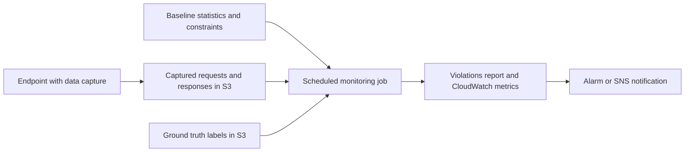

## 0. Before you start
- **Essential:** what labeled data is; what "drift" means (the data or behavior in production no longer looks like training); what a baseline is.
- **Helpful:** precision/recall/F1; what a processing job is; EventBridge + Lambda + SNS alerting.
- **Optional advanced:** PSI, the KS statistic, Shapley values.

## 1. Simple explanation
Three SageMaker services help keep machine-learning models trustworthy. **Ground Truth** helps people label data (this photo is a cat; this review is positive) so a model can learn. **Model Monitor** watches a live model and warns when the incoming data or the model's accuracy drifts away from what it saw in training. **Clarify** measures unfair bias and explains *why* a model made a prediction. AWS has now **closed all three to new customers** and does not plan new features: existing customers keep using them, and AWS points everyone to open-source tools plus CloudWatch and QuickSight. The ideas stay important, and the exam still lists these services, so learn both what they do and what replaces them.


```figure
flow model-monitor
```

## 2. Structured explanation
1. **Status first** ✅: Ground Truth, Model Monitor and Clarify each carry the notice "no longer open to new customers. Existing customers can continue to use the service as normal. AWS continues to invest in security and availability improvements … but we do not plan to introduce new features." This is **maintenance mode**, not a retirement date.
2. **Ground Truth:** build labeled datasets with a workforce (Mechanical Turk, a private team, or a Marketplace vendor), built-in or custom task UIs, and optional *automated data labeling*.
3. **Model Monitor** (four monitor types): data quality, model quality, bias drift, feature-attribution drift.
4. **Clarify:** pre-training bias, post-training bias, Shapley feature attributions, partial dependence plots, and monitoring of bias and attribution drift.
5. **Replacements** ✅ (Model Monitor page): open-source SageMaker AI monitoring solutions (SageMaker AI **MLflow Apps** + **Evidently AI**), **QuickSight** governance dashboards, **CloudWatch** metrics with anomaly detection. For Clarify: standardized bias metrics via pandas/scikit-learn, **SHAP**, MLflow, CloudWatch, QuickSight and **Bedrock Evaluations** for FM evaluation ([verification-log §3](aip:meta/verification-log)).
6. **For generative AI:** these three are mostly *classical-ML* tools. FM quality, safety and bias are covered by Bedrock Evaluations and Guardrails ([01/07](aip:01-bedrock-genai-fundamentals/07-bedrock-guardrails)), and by LLM-as-a-judge techniques in module 07.

## 3. Analogy
**A hospital's quality team.** Ground Truth is the panel of doctors who label scans so the AI can learn. Model Monitor is the weekly audit of whether today's patients still look like the ones the AI was trained on, and whether its diagnoses still agree with later test results. Clarify is the fairness review ("does it treat groups differently?") and the "explain this diagnosis" report. Maintenance mode is the hospital announcing that this department keeps its current staff but hires nobody new.

*Where it breaks:* a hospital audit is run by people; Model Monitor runs scheduled processing jobs that cost instance-hours until you delete the schedule ✅. And "drift" is statistical: a drift alarm means "different", not "wrong".

## 4. The seven questions

**WHAT?** Labeling workflow (Ground Truth), production monitoring (Model Monitor), fairness and explainability analysis (Clarify).

**WHY?** Models are only as good as their labels; production data changes; regulators and customers ask for fair, explainable decisions ✅ (Clarify page lists regulatory, business and data-science motivations).

**WHEN?** Label data before training; monitor from the day a model is deployed; analyze bias before training (data), after training (model) and in production.

**WHERE?** Ground Truth: console / API labeling jobs with data and manifests in S3. Model Monitor: scheduled processing jobs against endpoint data capture or batch inputs. Clarify: processing jobs using the Clarify container, optionally with a shadow endpoint ✅.

**HOW?** §5.

**WHAT IF?**
| Situation | Effect | Remedy |
|---|---|---|
| New AWS account wants Model Monitor | Not open to new customers ✅ | Use MLflow + Evidently + CloudWatch/QuickSight |
| Existing monitoring schedule left running | Recurring processing-job instances keep billing ✅ | Delete the schedule (`DeleteMonitoringSchedule`); history is kept ✅ |
| Ground truth labels arrive weeks later | Model-quality monitoring lags | Reconcile by inference ID when labels arrive ✅ |
| Drift alarm fires on a harmless seasonal change | False alarm | Tune thresholds, lookback windows |
| Using Bedrock Guardrails to measure tabular lending bias | Wrong tool: not a replacement for tabular-ML bias/explainability ([verification-log §3](aip:meta/verification-log)) | Use bias metrics + SHAP |
| Clarify post-training analysis without an endpoint | Clarify creates a temporary *shadow endpoint* from your model name and deletes it afterwards ✅ | Provide model name or endpoint |

**WHY NOT?** Do not start a new project on these services without checking their status; do not treat a drift score as a quality score; do not collect protected attributes without a lawful purpose.

## 5. Technical depth

```figure
drift-monitor
```


### 5.1 Ground Truth ✅
- **Workforce options:** Amazon Mechanical Turk (over 500,000 independent contractors), a **private workforce** of your employees or contractors, or a **vendor** found in AWS Marketplace.
- **Task types:** built-in task types (for example bounding boxes) or a custom workflow with your own labeling UI template (HTML components).
- **Automated data labeling:** an optional process that uses ML to decide which data needs human labeling, reducing time and manual effort.
- **Data layout:** an S3 bucket holds the data to be labeled, an **input manifest** and an **output manifest** (labeling results). Events appear in CloudWatch under `/aws/sagemaker/LabelingJobs`.
- **Streaming labeling jobs:** a perpetually running job that receives new objects as they arrive.
- **Status:** maintenance mode ✅. (A search summary also showed a "7/30/26" date on a Ground Truth security page; I could not confirm what it refers to ❌.)
- **Quality idea (generic, ❌ not from the AWS page):** collect several labels per item and consolidate (for example majority vote), tracking agreement per annotator. The lab shows this concept.

### 5.2 Model Monitor ✅

*Reading the arrows:* the endpoint writes what it sees to S3; a scheduled job compares that data (and, for quality, later-arriving ground truth) against a baseline created from training data; violations and metrics go to a report and CloudWatch where an alarm can notify you.

| Monitor | What it checks | Notes |
|---|---|---|
| **Data quality** | Drift in input features vs training baseline: statistics (mean, standard deviation, min, max, unique count) and constraints (type, completeness, ranges) | A Deequ-based engine on scheduled processing jobs ✅ |
| **Model quality** | Prediction accuracy: merges ground-truth labels from S3 with predictions; accuracy, precision, recall, F1, AUC, RMSE, MAE | Needs labels; may arrive late ✅ |
| **Bias drift** | Fairness metrics over time against a bias baseline across protected attributes | Uses Clarify ✅ |
| **Feature attribution drift** | Changes in which features drive predictions | Uses Clarify ✅ |

API names in the replacement guidance ✅: `DefaultModelMonitor`, `ModelQualityMonitor`, `ModelBiasMonitor`, `ModelExplainabilityMonitor` (SDK classes) and `CreateMonitoringSchedule`; `ListMonitoringSchedules` / `DeleteMonitoringSchedule` to find and remove schedules. Monitoring schedules run Processing Job instances (for example `ml.m5.xlarge`) on a schedule.

### 5.3 What replaces it ✅
The AWS page lists **seven open-source monitoring solutions** (in the `aws-samples` repository) built on SageMaker AI MLflow Apps and Evidently AI, including a batch pipeline, a real-time endpoint monitor, a QuickSight dashboard solution, LLM inference monitoring, and Grafana-based resource and LLM quality observability. Recommended starting points: the **Predictive ML Batch Monitoring Pipeline** (Batch Transform) and **Predictive ML Endpoint Monitoring** (real-time with Data Capture). Details from the page:
- **Data drift:** Evidently `DataDriftPreset` computing **PSI** (Population Stability Index) and **KS** statistics per feature; `DataSummaryPreset` surfaces missing values, outliers, integrity problems. Default alert in the batch pipeline: when **more than 30% of features drift**.
- **Model quality:** Evidently `ClassificationPreset` (ROC-AUC, precision, recall, F1, confusion matrix) with a pattern for **delayed ground truth reconciled by inference ID**. Default thresholds in the endpoint solution's Lambda: **F1 0.70, Accuracy 0.80, ROC AUC 0.75**.
- **Bias drift:** per-segment metrics (selection rate, true/false positive rates, precision/recall) compared with the training baseline; thresholds are yours; alerts via SNS.
- **CloudWatch:** custom metrics and **anomaly detection** alarms; endpoint metrics such as invocation latency, model errors, CPU/GPU utilization.
- **Scale:** compute scales to zero when idle; EventBridge-triggered Lambda; Athena Iceberg tables for drift history.

### 5.4 Clarify ✅
- **Analyses:** pre-training bias metrics (dataset), post-training bias metrics (needs predictions), **Shapley values** (feature attributions; needs a trained model), **partial dependence plots**.
- **How a job runs:** Clarify processing container reads the dataset and a JSON analysis configuration from S3; for post-training analyses it needs predictions from an endpoint or a **shadow endpoint** it creates and deletes; results (JSON of bias metrics and global attributions, visual report, local attribution files) go to S3.
- **In production:** monitor bias drift and feature-attribution drift; **online explainability** from an endpoint.
- **Why it exists** ✅: regulatory (discriminatory impact), business (explain loan decisions), data science (debug noisy features). Fairness depends on context and stakeholders; consider it at every lifecycle stage.
- **Status:** no longer open to new customers; replacements listed in [verification-log §3](aip:meta/verification-log).
- Specific metric names (for example class imbalance, difference in proportions of labels) exist in the Clarify pages but were **not read** here ❌. The lab uses a plain selection-rate gap.

### 5.5 Where this meets generative AI
| Question | Classical ML (these services) | Generative AI |
|---|---|---|
| Is production input drifting? | Data quality drift (PSI/KS) | Prompt/topic drift, token bursts, retrieval quality (module 07) |
| Is quality dropping? | Model quality with ground truth | LLM-as-a-judge, golden datasets, hallucination rate |
| Is it fair? | Bias metrics by segment | Bias testing of prompts and outputs ([01/09](aip:01-bedrock-genai-fundamentals/09-prompt-engineering-misuse-and-bias)), Bedrock Evaluations |
| Why this answer? | SHAP | Citations, traces, reasoning logs |
| Human labels? | Ground Truth | Human evaluation workflows (A2I status ❌ unverified, [verification-log §2](aip:meta/verification-log)) |

## 6. Worked example
*Problem:* A bank's loan-approval classifier is hosted on SageMaker. A regulator wants evidence of fairness at launch and ongoing monitoring. The bank's account predates the closure.

| Step | Action | Notes |
|---|---|---|
| 1 | Pre-training: compare approval rates and label balance across protected groups in the training data | Clarify if available to the account; else pandas/scikit-learn metrics ✅ |
| 2 | Post-training: bias metrics and SHAP attributions on a validation set | Keep the reports for audit |
| 3 | Deploy with data capture | Needed for drift monitoring |
| 4 | Schedule data-quality and model-quality monitoring (existing customers) or deploy the MLflow + Evidently solution | Plan migration since no new features ✅ |
| 5 | Reconcile delayed outcomes (repayment) with predictions by inference ID | Model quality when labels arrive ✅ |
| 6 | Alarm on drift share and segment gaps; page the model owner | SNS ✅ |
| 7 | When a drift alarm fires: investigate, retrain, register a new version ([05/03](aip:05-sagemaker/03-model-registry-and-lineage-tracking)), canary-deploy ([05/01](aip:05-sagemaker/01-sagemaker-ai-deployment-guardrails-and-fm-optimization)) | Closes the loop |
| 8 | Delete old monitoring schedules after migration | Stops instance cost ✅ |

## 7. Knowledge checkpoints
1. What does "no longer open to new customers" mean for an existing Model Monitor user?
2. Name the four Model Monitor monitor types.
3. Which statistics does Evidently's data-drift preset compute per feature, according to the AWS replacement page?
4. Why does model-quality monitoring need an "inference ID"?
5. Is Bedrock Guardrails a replacement for Clarify on tabular models?

## 7b. Practice questions (exam-style, original) — answers in §14

**Q1.** A company with an existing account has Model Monitor schedules running. AWS announces Model Monitor is closed to new customers. What is accurate?
A. Existing schedules stop immediately
B. Existing customers can continue to use it, but no new features are planned
C. It is replaced by Bedrock Guardrails
D. It is retired on a fixed shutdown date shown on the page

**Q2.** (Select TWO) Which are Ground Truth workforce options?
A. Amazon Mechanical Turk
B. A private workforce of employees or contractors
C. Bedrock Agents
D. A Lambda function
E. AWS Glue DataBrew only

**Q3.** A model's input features slowly change from what they were at training. Which Model Monitor type detects this?
A. Model quality
B. Data quality
C. Bias drift
D. Feature attribution drift

**Q4.** Ground-truth outcomes for predictions arrive 30 days late. Which design is most appropriate for model-quality monitoring?
A. Compute accuracy immediately using predictions as labels
B. Store predictions with an inference ID and reconcile labels as they arrive
C. Disable monitoring
D. Use a larger instance

**Q5.** (Select TWO) Which are Clarify capabilities?
A. Pre-training bias metrics on a dataset
B. Shapley-value feature attributions for a trained model
C. Creating a labeling workforce
D. Provisioning a vector database
E. Replacing CloudTrail

**Q6.** A team wants to stop recurring Model Monitor processing-job costs after migrating to an open-source solution. What should they do?
A. Delete the monitoring schedules
B. Delete the training data
C. Disable the S3 bucket
D. Scale the endpoint to zero

**Q7.** Which combination does AWS recommend as a replacement for Model Monitor?
A. Open-source SageMaker AI monitoring solutions (MLflow Apps + Evidently AI), QuickSight dashboards and CloudWatch
B. Only CloudTrail
C. Only Bedrock Knowledge Bases
D. Only AWS Config

**Q8.** For evaluating a foundation model's output quality, which statement is most accurate?
A. Clarify is the recommended replacement for all FM evaluation
B. Bedrock Evaluations is named as guidance for foundation-model evaluation, while tabular bias needs bias metrics and SHAP
C. Ground Truth measures hallucination automatically
D. Model Monitor evaluates prompts natively

## 8. Hands-on lab: PSI drift, constraints, delayed labels, segment gaps and label consensus

### 8.1 Objective
Reproduce the logic that Model Monitor and its replacements apply: PSI and KS for drift, a constraint check, a delayed-label join with threshold alerts, a segment selection-rate gap, and majority-vote consolidation of crowd labels.

### 8.2 Prerequisites
Python 3 only. Nothing here calls AWS. The data are invented. The PSI "rule-of-thumb" bands are common practice, not AWS thresholds (🟡).

### 8.3 AWS services
None offline. Maps to Model Monitor / MLflow + Evidently, Clarify, Ground Truth.

### 8.4 IAM permissions
Offline: none. Real: SageMaker execution roles for processing jobs, S3 access for baselines and captured data ❌ (exact actions not listed here).

### 8.5 Region notes
Check that the services are available in the Region and for your account before designing around them ✅ (closed to new customers).

### 8.6 Architecture
§5.2.

### 8.7 Cost
Offline: none. Real monitoring schedules bill instance-hours per run ✅.

### 8.8 Code
```python lab-run
import math

# ---- 1. PSI and KS between a baseline and a current feature sample ----
def hist(values, edges):
    counts = [0] * (len(edges) - 1)
    for v in values:
        for i in range(len(edges) - 1):
            if edges[i] <= v < edges[i + 1] or (i == len(edges) - 2 and v == edges[-1]):
                counts[i] += 1
                break
    total = sum(counts)
    return [max(c / total, 1e-4) for c in counts]       # floor avoids log(0)

def psi(base, cur, edges):
    b, c = hist(base, edges), hist(cur, edges)
    return sum((ci - bi) * math.log(ci / bi) for bi, ci in zip(b, c))

def ks(base, cur):
    pts = sorted(set(base) | set(cur))
    fb = lambda x: sum(v <= x for v in base) / len(base)
    fc = lambda x: sum(v <= x for v in cur) / len(cur)
    return max(abs(fb(p) - fc(p)) for p in pts)

base = [20 + (i % 40) for i in range(400)]                 # ages 20..59, even spread
same = [20 + ((i * 7) % 40) for i in range(400)]           # same distribution, different order
shifted = [35 + (i % 40) for i in range(400)]              # ages 35..74
edges = [0, 30, 40, 50, 60, 100]
for name, cur in (("same", same), ("shifted", shifted)):
    p = psi(base, cur, edges)
    band = "stable" if p < 0.1 else ("some shift" if p < 0.25 else "major shift")
    print(f"{name:<8} PSI = {p:.3f} ({band}), KS = {ks(base, cur):.3f}")

features = {"age": 0.41, "income": 0.03, "tenure": 0.02, "region": 0.35, "channel": 0.02}   # per-feature drift scores (invented)
drifted = [f for f, s in features.items() if s > 0.25]
share = len(drifted) / len(features)
print("drifted features:", drifted, f"share = {share:.0%}", "-> ALERT" if share > 0.30 else "-> ok")

# ---- 2. Data-quality constraints (completeness, type, range) ----
rows = [{"age": 34, "income": 52000}, {"age": None, "income": 61000}, {"age": 29, "income": -5}, {"age": 41, "income": 58000}]
def check(rows):
    problems = []
    for col, lo, hi in (("age", 18, 100), ("income", 0, 1_000_000)):
        vals = [r[col] for r in rows]
        complete = sum(v is not None for v in vals) / len(vals)
        if complete < 1.0:
            problems.append(f"{col}: completeness {complete:.2f} < 1.00")
        bad = [v for v in vals if v is not None and not (lo <= v <= hi)]
        if bad:
            problems.append(f"{col}: out of range {bad}")
    return problems
for p in check(rows):
    print("violation:", p)

# ---- 3. Delayed ground truth joined by inference ID, then threshold checks (thresholds from the AWS replacement page) ----
predictions = {"i1": 1, "i2": 0, "i3": 1, "i4": 1, "i5": 0, "i6": 0, "i7": 1, "i8": 0}
labels_arrived = {"i1": 1, "i2": 0, "i3": 0, "i4": 1, "i5": 0, "i6": 1, "i7": 1}          # i8 not known yet
joined = [(predictions[i], y) for i, y in labels_arrived.items()]
tp = sum(p == 1 and y == 1 for p, y in joined); fp = sum(p == 1 and y == 0 for p, y in joined)
fn = sum(p == 0 and y == 1 for p, y in joined); tn = sum(p == 0 and y == 0 for p, y in joined)
acc = (tp + tn) / len(joined); prec = tp / (tp + fp); rec = tp / (tp + fn); f1 = 2 * prec * rec / (prec + rec)
print(f"labelled {len(joined)} of {len(predictions)} predictions: accuracy {acc:.2f}, precision {prec:.2f}, recall {rec:.2f}, F1 {f1:.2f}")
for name, value, floor in (("F1", f1, 0.70), ("accuracy", acc, 0.80)):
    print(f"  {name} {value:.2f} vs threshold {floor:.2f}:", "ALERT" if value < floor else "ok")

# ---- 4. Segment selection-rate gap (a plain fairness measure; thresholds are yours to define) ----
decisions = [("A", 1), ("A", 1), ("A", 0), ("A", 1), ("B", 0), ("B", 1), ("B", 0), ("B", 0), ("B", 0)]
rate = {}
for seg in ("A", "B"):
    d = [x for s, x in decisions if s == seg]
    rate[seg] = sum(d) / len(d)
print("selection rates:", {k: round(v, 2) for k, v in rate.items()}, "gap =", round(abs(rate["A"] - rate["B"]), 2))
print("ALERT" if abs(rate["A"] - rate["B"]) > 0.20 else "ok", "(example threshold 0.20)")

# ---- 5. Crowd labels: majority vote and agreement (generic concept, not Ground Truth's exact algorithm) ----
votes = {"img1": ["cat", "cat", "dog"], "img2": ["dog", "dog", "dog"], "img3": ["cat", "dog", "bird"]}
for item, v in votes.items():
    top = max(sorted(set(v)), key=v.count)          # sorted(): ties (img3 has three different votes) resolve the same way every run
    agree = v.count(top) / len(v)
    print(f"{item}: label={top} agreement={agree:.2f}", "(send to expert review)" if agree < 0.6 else "")
```

### 8.9 Captured output
Generated on 2026-10-26 by extracting the block above from this file and running it (Python 3). It models the logic; it is **not** Model Monitor, Evidently, Clarify or Ground Truth output.
```text lab-out
same     PSI = 0.000 (stable), KS = 0.000
shifted  PSI = 5.127 (major shift), KS = 0.375
drifted features: ['age', 'region'] share = 40% -> ALERT
violation: age: completeness 0.75 < 1.00
violation: income: out of range [-5]
labelled 7 of 8 predictions: accuracy 0.71, precision 0.75, recall 0.75, F1 0.75
  F1 0.75 vs threshold 0.70: ok
  accuracy 0.71 vs threshold 0.80: ALERT
selection rates: {'A': 0.75, 'B': 0.2} gap = 0.55
ALERT (example threshold 0.20)
img1: label=cat agreement=0.67 
img2: label=dog agreement=1.00 
img3: label=bird agreement=0.33 (send to expert review)
```

### 8.10 Explanation
- Part 1: identical distributions give a PSI near zero; a shifted distribution gives a large PSI and KS. The "share of drifted features above 30%" alert mirrors the batch-pipeline default in the AWS replacement page.
- Part 2: constraints are simple rules on completeness and ranges (the Model Monitor data-quality idea).
- Part 3: only labeled records can be scored, so the join by inference ID matters; thresholds mirror the defaults quoted for the endpoint-monitoring Lambda.
- Part 4: you define the fairness definition and the allowed gap.
- Part 5: items with low agreement go to expert review. `img3` has three different votes, so the "winning" label is arbitrary (the code breaks the tie alphabetically only so the output is the same every run); that is exactly why low-agreement items need a human.

### 8.11 Optional AWS lab (shown, not run against AWS ❌)
1. **Existing customers only:** list and delete old schedules ✅ (commands from the AWS page):
```text
aws sagemaker list-monitoring-schedules
aws sagemaker delete-monitoring-schedule --monitoring-schedule-name "my-data-quality-monitor"
```
2. **Replacement:** follow the `aws-samples` "Predictive ML Endpoint Monitoring" solution (notebook, then CDK Lambdas) ✅; set the S3 EventBridge notification as in the page:
```json
{"EventBridgeConfiguration": {}}
```
(passed as the `--notification-configuration` of `aws s3api put-bucket-notification-configuration`).
3. **CloudWatch alternative:** publish custom metrics and create an anomaly-detection alarm ✅ ([CloudWatch anomaly detection](https://docs.aws.amazon.com/AmazonCloudWatch/latest/monitoring/CloudWatch_Anomaly_Detection.html)).
4. **Clean up:** delete schedules, the CDK stack, SNS topics, MLflow apps and S3 data.

### 8.12 Common errors
| Error | Cause | Fix |
|---|---|---|
| Can't create a Model Monitor schedule in a new account | Closed to new customers ✅ | Use the replacement solutions |
| Drift alarms every day | Thresholds too tight, seasonality | Tune thresholds and lookback |
| Quality metrics missing | Ground truth not joined (no inference ID) ✅ | Log an ID with each prediction |
| Costs continue after migration | Schedules still run ✅ | Delete schedules |
| Bias metric looks fine overall but not per group | Aggregate hides segments | Segment-sliced metrics ✅ |

### 8.13 Security recommendations
Captured data may contain personal information: encrypt S3 and restrict access; minimise retention; keep protected attributes under strict access control and use them only for fairness analysis; encrypt SNS topics; log who changes thresholds; for Ground Truth use a private workforce for sensitive data.

## 9. What can go wrong?
| Failure | Why | Symptoms | Investigate | Fix | Prevent |
|---|---|---|---|---|---|
| **Silent drift** | No monitoring | Accuracy decays unnoticed | Compare to baseline | Add monitoring | Day-one schedule |
| **Alert fatigue** | Over-sensitive thresholds | Ignored alarms | Alarm history | Tune; tier alerts | Review quarterly |
| **Label leakage into monitoring** | Join mistakes | Impossible accuracy | Join keys | Use inference IDs | Test join |
| **Fairness blind spot** | Only aggregate metrics | Complaints from a group | Segment metrics | Slice by attributes | Fairness review |
| **Orphaned schedules** | Never deleted ✅ | Surprise bill | List schedules | Delete | Tagging |
| **Dependency on closed service** | Maintenance mode ✅ | No new features | Roadmap check | Migrate plan | Architecture review |

## 10. Common misconceptions
1. **"Deprecated means shut down."** The pages say closed to new customers; existing use continues ✅.
2. **"Model Monitor checks the model's explanations."** Only the feature-attribution monitor does, via Clarify.
3. **"Drift equals accuracy loss."** Drift is a change in distribution; accuracy needs labels.
4. **"Guardrails measure bias in a credit model."** Not a replacement for tabular bias analysis ([verification-log §3](aip:meta/verification-log)).
5. **"Ground Truth is a source of real-time ground truth about production."** It labels training/evaluation data; production labels come from outcomes.

## 11. Exam notes
- **Patterns:** "label images/text with humans" → Ground Truth; "detect drift in production features" → Model Monitor data quality (or replacement); "explain individual predictions" → Clarify/SHAP; "detect bias in training data" → Clarify pre-training bias.
- **Traps:** assuming these services are retired; confusing Clarify with Bedrock Guardrails; forgetting that model-quality monitoring needs labels.
- **Compare:** Model Monitor (SageMaker-hosted ML) vs CloudWatch metrics vs Bedrock model invocation logging and Evaluations (FMs).
- The exam's service scope still lists Ground Truth, Model Monitor and Clarify ([service-scope](aip:meta/service-scope)); skim the facts, not the future.

## 12. Summary and revision cards
- All three: closed to new customers, existing use continues, no new features.
- Ground Truth: Mechanical Turk / private / vendor; manifests in S3; automated labeling.
- Model Monitor: data quality, model quality, bias drift, attribution drift; scheduled processing jobs.
- Clarify: bias (pre/post), SHAP, PDP, shadow endpoint.
- Replacement: MLflow + Evidently + CloudWatch + QuickSight.

**Cards.** Q: Default drift alert in the batch solution? A: more than 30% of features drift. · Q: Drift statistics? A: PSI and KS. · Q: How to stop monitoring cost? A: delete schedules.

## 13. References
| Source | URL | Verified |
|---|---|---|
| Model Monitor availability change | https://docs.aws.amazon.com/sagemaker/latest/dg/model-monitor-availability-change.html | 2026-10-26 |
| Ground Truth overview | https://docs.aws.amazon.com/sagemaker/latest/dg/sms.html | 2026-10-26 |
| Clarify processing jobs and fairness overview | https://docs.aws.amazon.com/sagemaker/latest/dg/clarify-configure-processing-jobs.html | 2026-10-26 |
| Clarify availability change | https://docs.aws.amazon.com/sagemaker/latest/dg/clarify-availability-change.html | earlier (verification-log §3) |

**Unverified here:** Clarify metric names, Ground Truth annotation consolidation details, A2I status, any end-of-support date.

## 14. Answers to checkpoints and practice questions
**Checkpoints.** 1) They can continue as normal; AWS keeps making security and availability improvements but plans no new features ✅. 2) Data quality, model quality, bias drift, feature attribution drift ✅. 3) PSI and KS ✅. 4) To join late ground truth with the right prediction ✅. 5) No; it is not a replacement for tabular bias/explainability ✅.

**Practice questions.**
- **Q1 → B.** The page says existing customers can continue as normal ✅; no date was stated.
- **Q2 → A, B.** The third option is a vendor from Marketplace ✅; C, D, E are not workforces.
- **Q3 → B.** Input feature drift is data quality ✅.
- **Q4 → B.** Reconcile by inference ID ✅.
- **Q5 → A, B.** C is Ground Truth; D and E are unrelated.
- **Q6 → A.** Schedules spin up Processing Job instances on a schedule ✅.
- **Q7 → A.** ✅.
- **Q8 → B.** ✅ (verification-log §3); A, C, D are false.
