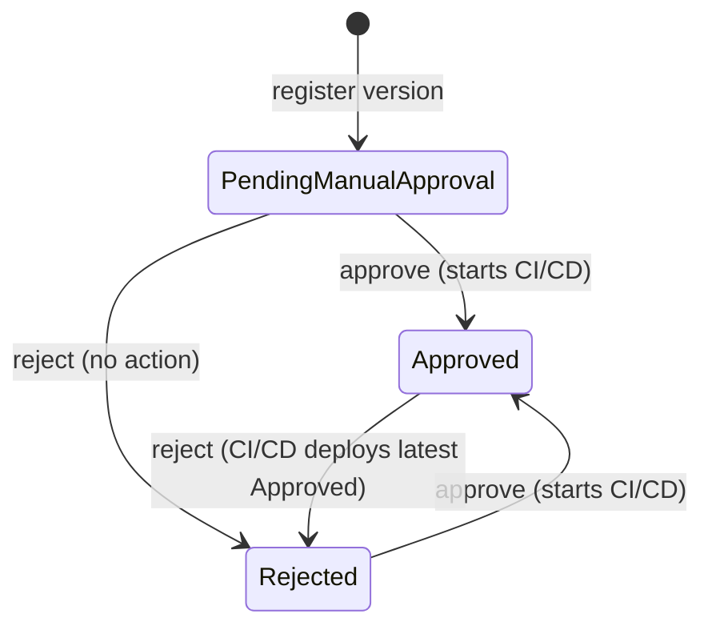
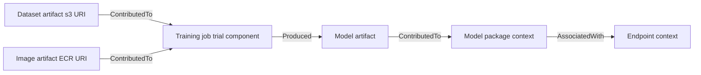
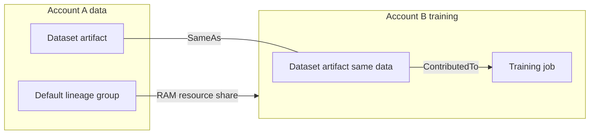

## 0. Before you start
- **Essential:** what a model version is; what an IAM resource policy is.
- **Helpful:** AWS Resource Access Manager (RAM) shares resources between accounts; CI/CD (a pipeline that builds and deploys automatically).
- **Optional advanced:** graph traversal; SageMaker Experiments (trials and trial components).

## 1. Simple explanation
When many model versions exist, you need two answers: *which version is approved to run in production?* and *where did it come from?* The **Model Registry** is the catalog: a **model group** holds every version of "the churn model", each version has an **approval status**, and flipping a version to `Approved` can trigger deployment. **Lineage tracking** is the family tree: SageMaker records which data, code, training job, model and endpoint are connected, so an auditor can ask "what data trained the model serving this endpoint?" and get an answer. **Cross-account lineage** lets that family tree span several AWS accounts (for example a data account, a training account and a production account) when the accounts share their lineage.


```figure
flow registry-approval
```

## 2. Structured explanation
1. **Create a Model Group** for one problem; **register a model version** each time a pipeline run produces a candidate ✅. New versions start as `PendingManualApproval` ✅.
2. **Evaluate**, then set the **approval status** to `Approved` or `Rejected` (manually, or in a pipeline Condition step) ✅.
3. **Approval can start CI/CD** deployment when you use the SageMaker-provided project templates ✅ (§5.2).
4. **Group Model Groups into Collections** for organisation ✅.
5. **Lineage entities** are created automatically for jobs, pipelines, endpoints and models; you can add your own ✅.
6. **Query lineage** with `QueryLineage` starting from an ARN ✅.
7. **Cross-account:** share the default lineage group through **AWS RAM**; the other account accepts the invitation; both can associate and query across accounts ✅.

## 3. Analogy
**A car dealership's service book.** The registry is the showroom list: each car model has versions, and only those stamped "approved" may be sold. Lineage is the build record: which factory, which parts supplier, which inspector. Cross-account lineage is two companies (supplier and manufacturer) agreeing to open their records to each other so a recall can trace a faulty part across both.

*Where it breaks:* a car's service book is complete by default; SageMaker lineage records only what SageMaker (or you) captured. Work done outside SageMaker jobs or pipelines leaves gaps unless you create entities manually ✅.

## 4. The seven questions

**WHAT?** Model Registry = versioned catalog with approval status and metadata. Lineage = metadata graph of ML workflow entities and their relationships.

**WHY?** Governance, reproducibility, audit, safe promotion to production, quick rollback, and answering regulators ✅ ("establish model governance by tracking model lineage artifacts for auditing and compliance verification").

**WHEN?** From the first model that could reach production. Cross-account when data, training and production live in separate accounts (common in multi-account landing zones).

**WHERE?** Model Registry in SageMaker Studio and APIs; lineage visible in Studio and through the lineage APIs. Note: the lineage page describes Studio Classic, which is "maintained for existing workloads but no longer available for onboarding" ✅; the same APIs apply.

**HOW?** §5.

**WHAT IF?**
| Situation | Effect | Remedy |
|---|---|---|
| Version moved `Approved` → `Rejected` with project templates | CI/CD deploys the **latest version that is still `Approved`** ✅ | Keep earlier good versions approved for fast rollback |
| `PendingManualApproval` → `Rejected` | No action ✅ | Fine; record the reason |
| `Rejected` → `Approved` | CI/CD deploys it ✅ | Make sure it was re-evaluated |
| Cross-account principal lacks `QueryLineage` in the resource policy | Cannot traverse shared lineage ✅ | Resource policy must allow all seven actions |
| Resource share accepted late | Shared lineage invisible until accepted ✅ (invitation) | Accept in RAM |
| Only some lineage entities should be shared | Not possible: share all or none in a lineage group ✅ | Use separate accounts for sensitive work |
| Artifact for the same data in two accounts | SageMaker links them with `SameAs` associations ✅ | Query across |

**WHY NOT?** Do not rely on lineage as proof of quality (it proves *origin*, not goodness). Do not share the lineage group with accounts that should not see your datasets' locations and job parameters.

## 5. Technical depth

```figure
flow lineage
```


### 5.1 Model Registry ✅
- **Capabilities** (page list): catalog models for production; manage versions; associate metadata such as training metrics; view **Model Card** information; view lineage; define a staging construct; manage approval status; deploy to production; automate deployment with CI/CD; share models with other users.
- **Structure:** **Model (Package) Group** → **model versions**; optional **Collections** group Model Groups.
- **Typical workflow:** create a Model Group → a pipeline trains a model → for each run register a model version in the group → add the group to one or more Collections ✅.
- **Registering from a pipeline:** the `RegisterModel` step registers a versioned model package group entry ([05/04](aip:05-sagemaker/04-neo-unified-studio-pipelines-and-jumpstart)).
- **Serverless endpoints** can host a model registered in the registry ✅ (serverless page).

### 5.2 Approval status and CI/CD ✅

*Reading the arrows:* a registered version waits in `PendingManualApproval`. Approving triggers deployment (when you use the provided project templates). Rejecting an approved version triggers CI/CD to deploy the latest version that is still approved, which is the registry's **rollback** mechanism.
- API: `update_model_package(ModelPackageArn=..., ModelApprovalStatus="Approved")` (Boto3) ✅; console: Studio → Models → Registered models → version → **Deploy** tab (the dropdown beside the status) ✅. A pipeline Condition step can set status automatically.
- The status only *initiates* deployment when a CI/CD flow (for example project templates) listens to it ✅; the status field alone does not deploy anything.

### 5.3 Lineage tracking ✅
**Entities** (page):
| Entity | Meaning | Examples |
|---|---|---|
| **Artifact** | URI-addressable object or data | Dataset (S3 URI), image (ECR path), model artifact |
| **Action** | An action or activity, usually with input/output artifacts | Workflow step, model deployment |
| **Context** | Logical grouping of entities | Endpoint, model package; experiments and trials are contexts |
| **Trial component** | A stage of a trial | Processing, training, transform jobs |
| **Association** | A link between entities with an optional `AssociationType` | See below |

**Association types** (SageMaker does not restrict use): `ContributedTo` (training data contributed to a training job), `AssociatedWith` (an approval workflow associated with a deployment), `DerivedFrom` (a digest output derived from original inputs), `Produced` (a training job produced a model artifact), `SameAs` (the same entity in different accounts).

**Common properties:** `Type` (`ActionType`, `ArtifactType`, `ContextType`), `Source` (the underlying URI, for example an `EndpointArn`), optional `Metadata` (`ProjectId`, `GeneratedBy`, `Repository`, `CommitId`). SageMaker **reuses existing entities** (for example one artifact per unique `SourceUri`).

**How it is created:** automatically for processing, training and batch-transform jobs (trial components, trials, experiments), and for other workflow steps; you can add entities manually to model custom steps ✅. **Querying:** `QueryLineage` finds relationships; you can also reproduce a workflow from the artifacts it recorded, if you still have the exact dataset ✅.


*Reading the arrows:* each arrow reads "source relation destination". Following arrows backward from the endpoint answers "which model package, model artifact, training job, dataset and image are behind this endpoint?" That backward walk is what `QueryLineage` automates.

### 5.4 Cross-account lineage ✅

*Reading the arrows:* Account A shares its lineage group through AWS RAM. When Account B's SageMaker creates an artifact for the same data, it links the two artifacts with a `SameAs` association, so a query from B can walk into A's lineage.
- **One default lineage group per account** (`sagemaker-default-lineage-group`), created when the first lineage entity is created; every entity belongs to it; you share this group — **all entities or none**.
- **Setup:** create a resource share in the RAM console; associations take a few minutes; the other account must **accept the invitation**.
- **Resource policy** must allow all seven actions: `sagemaker:DescribeAction`, `DescribeArtifact`, `DescribeContext`, `DescribeTrialComponent`, `AddAssociation`, `DeleteAssociation`, `QueryLineage`; resource `arn:aws:sagemaker:REGION:ACCOUNT:lineage-group/sagemaker-default-lineage-group`.
- **Using it:** call `DescribeAction/Artifact/Context/TrialComponent` with an ARN from the other account; `AddAssociation`/`DeleteAssociation` between entities in different accounts (SageMaker checks you have permission on **both**); `QueryLineage` returns everything you can access, own or shared. Authorization for `QueryLineage` is validated on the `StartArns` through the lineage group's resource policy.

Example resource policy ✅ (shape from the AWS page; the account IDs are placeholders):
```json
{
  "Version": "2012-10-17",
  "Statement": [
    {
      "Sid": "FullLineageAccess",
      "Effect": "Allow",
      "Principal": {"AWS": "111122223333"},
      "Action": [
        "sagemaker:DescribeAction",
        "sagemaker:DescribeArtifact",
        "sagemaker:DescribeContext",
        "sagemaker:DescribeTrialComponent",
        "sagemaker:AddAssociation",
        "sagemaker:DeleteAssociation",
        "sagemaker:QueryLineage"
      ],
      "Resource": "arn:aws:sagemaker:us-west-2:111111111111:lineage-group/sagemaker-default-lineage-group"
    }
  ]
}
```

### 5.5 Registry vs lineage vs related tools
| Need | Tool |
|---|---|
| Which version may run in production? | Model Registry approval status |
| Where did this model come from? | Lineage (`QueryLineage`) |
| Human-readable model documentation | Model Cards (shown in the registry ✅) |
| Data lineage in the lake (tables, jobs) | AWS Glue / data catalog lineage ([02/03](aip:02-data-management/03-aws-glue-data-quality-and-cloudwatch-metrics); module 07) |
| Prompt versions for FMs | Bedrock Prompt management ([01/08](aip:01-bedrock-genai-fundamentals/08-prompt-management-flows-and-structured-output)) |
| API audit trail | CloudTrail (module 07) |

## 6. Worked example
*Problem:* A retailer has three accounts: `data` (curated datasets), `ml-dev` (training) and `prod` (serving). An auditor asks, for a prediction served last month, which data produced the model.

| Step | Action | Why |
|---|---|---|
| 1 | Each training pipeline registers its model into one Model Group in `ml-dev` | Versioned catalog ✅ |
| 2 | An evaluation Condition step sets `PendingManualApproval`; a risk officer sets `Approved` | Human gate ✅ |
| 3 | Approval triggers the CI/CD project to deploy to `prod` (canary, [05/01](aip:05-sagemaker/01-sagemaker-ai-deployment-guardrails-and-fm-optimization)) | Safe promotion ✅ |
| 4 | `data` shares its default lineage group via RAM; `ml-dev` and `prod` accept | Cross-account lineage ✅ |
| 5 | `prod` resource policy grants the auditor's role the seven lineage actions | Least privilege on audit ✅ |
| 6 | Auditor calls `QueryLineage` from the endpoint's ARN upstream | Walks endpoint → model package → model artifact → training job → dataset artifact, `SameAs` into `data` ✅ |
| 7 | If the model misbehaves: set it `Rejected`; CI/CD redeploys the latest `Approved` version | Rollback ✅ |

## 7. Knowledge checkpoints
1. What approval status does a new model version start with?
2. What happens when an `Approved` version is changed to `Rejected` (with the provided project templates)?
3. How many default lineage groups can an account have, and can you share only some entities?
4. Which association type links the same entity across accounts?
5. Which seven actions must the lineage resource policy allow?

## 7b. Practice questions (exam-style, original) — answers in §14

**Q1.** A team wants an approval gate so only reviewed model versions can be promoted, with a record of each decision. Which service feature fits?
A. Neo compilation
B. SageMaker Model Registry approval status
C. Ground Truth labeling
D. Serverless inference

**Q2.** After a bad release, an engineer sets the current `Approved` version to `Rejected`. With SageMaker project templates, what happens?
A. Nothing
B. CI/CD deploys the latest version that is still `Approved`
C. The endpoint is deleted
D. The model group is deleted

**Q3.** (Select TWO) Which are lineage tracking entities?
A. Artifact
B. Action
C. Subnet
D. Lambda layer
E. Bucket policy

**Q4.** An auditor needs to trace an endpoint back to the training dataset across two AWS accounts. What is required?
A. Copy all data to one bucket
B. Share the lineage group via AWS RAM, have the other account accept, and allow the lineage actions in the resource policy
C. Use CloudWatch Logs Insights only
D. Enable Model Monitor

**Q5.** (Select TWO) Which statements about cross-account lineage are correct?
A. An account can have several default lineage groups, each shareable separately
B. You may share a subset of entities from the group
C. The receiving account must accept the resource share invitation
D. `SameAs` associations link artifacts for the same data in different accounts
E. Cross-account lineage needs Glue crawlers

**Q6.** What does `PendingManualApproval` → `Rejected` trigger with project templates?
A. A deployment
B. No action
C. A rollback
D. A new training job

**Q7.** Which API shows the lineage graph relationships starting from a given ARN?
A. `QueryLineage`
B. `InvokeEndpoint`
C. `CreateModelPackage`
D. `DescribeEndpointConfig`

**Q8.** Why can a registry's `Approved` flag alone fail to deploy a model?
A. Approval only records a status; a CI/CD flow (for example project templates) must act on it
B. Approved models cannot be deployed
C. It requires Neo
D. It requires Ground Truth

## 8. Hands-on lab: an approval state machine, a lineage walk and a resource-policy check

### 8.1 Objective
Simulate the registry's approval transitions and rollback rule, walk a lineage graph upstream (including a `SameAs` hop across accounts that depends on sharing), and validate a lineage resource policy.

### 8.2 Prerequisites
Python 3 only. Nothing here calls AWS. The graph and ARNs are invented.

### 8.3 AWS services
None offline. Maps to SageMaker Model Registry, lineage APIs, AWS RAM.

### 8.4 IAM permissions
Offline: none. Real: the seven lineage actions in §5.4; `sagemaker:CreateModelPackageGroup`, `CreateModelPackage`, `UpdateModelPackage` for the registry ❌ (list to be checked in the SageMaker authorization reference); `ram:CreateResourceShare` for sharing ❌.

### 8.5 Region notes
Lineage group ARNs include the Region; the page shows Studio lineage details for logged and registered model versions in four Regions (`us-east-1`, `us-west-2`, `ap-northeast-1`, `eu-west-1`) in one Studio flow ✅; verify for your Region.

### 8.6 Architecture
§5.2 and §5.4.

### 8.7 Cost
Offline: none. The registry and lineage features themselves are metadata; the endpoints and jobs they track bill separately ❌ (no pricing page read).

### 8.8 Code
```python lab-run
# ---- 1. Approval transitions and what CI/CD does (rules from the AWS 'Update the Approval Status' page) ----
ACTIONS = {
    ("PendingManualApproval", "Approved"): "start CI/CD deployment of this version",
    ("PendingManualApproval", "Rejected"): "no action",
    ("Rejected", "Approved"): "start CI/CD deployment of this version",
    ("Approved", "Rejected"): "start CI/CD to deploy the latest version that is still Approved",
}

class Registry:
    def __init__(self):
        self.versions = {}      # version number -> status
    def register(self, n):
        self.versions[n] = "PendingManualApproval"
    def set_status(self, n, new):
        old = self.versions[n]
        action = ACTIONS.get((old, new))
        if action is None:
            return f"v{n}: {old} -> {new}: not a listed transition"
        self.versions[n] = new
        return f"v{n}: {old} -> {new}: {action}"
    def deploy_target(self):
        approved = [n for n, s in self.versions.items() if s == "Approved"]
        return max(approved) if approved else None

r = Registry()
for n in (1, 2, 3):
    r.register(n)
print(r.set_status(1, "Approved"), "| serving v", r.deploy_target(), sep="")
print(r.set_status(2, "Approved"), "| serving v", r.deploy_target(), sep="")
print(r.set_status(3, "Rejected"), "| serving v", r.deploy_target(), sep="")
print(r.set_status(2, "Rejected"), "| serving v", r.deploy_target(), sep="")
print(r.set_status(3, "Rejected"))

# ---- 2. Lineage walk upstream from an endpoint (edges are source --type--> destination) ----
EDGES = [
    ("B:image-ecr", "ContributedTo", "B:training-job"),
    ("B:training-job", "Produced", "B:model-artifact"),
    ("B:model-artifact", "ContributedTo", "B:model-package"),
    ("B:model-package", "AssociatedWith", "P:endpoint"),
    ("B:dataset-s3", "SameAs", "A:dataset-s3"),
    ("A:dataset-s3", "SameAs", "B:dataset-s3"),
    ("B:dataset-s3", "ContributedTo", "B:training-job"),
]
def upstream(start, shared_accounts):
    seen, order, stack = {start}, [], [start]
    while stack:
        node = stack.pop()
        for src, kind, dst in EDGES:
            if dst == node and src not in seen:
                if src.split(":")[0] != node.split(":")[0] and kind != "SameAs" and src.split(":")[0] not in shared_accounts:
                    continue
                if kind == "SameAs" and src.split(":")[0] not in shared_accounts:
                    continue
                seen.add(src); order.append((src, kind)); stack.append(src)
    return order

print("walk with accounts A and B shared with P:")
for node, kind in upstream("P:endpoint", {"P", "B", "A"}):
    print("  ", node, f"({kind})")
print("walk when account A did not share its lineage group:")
for node, kind in upstream("P:endpoint", {"P", "B"}):
    print("  ", node, f"({kind})")

# ---- 3. Cross-account resource policy check (seven actions required by the AWS page) ----
REQUIRED = {"sagemaker:DescribeAction", "sagemaker:DescribeArtifact", "sagemaker:DescribeContext",
            "sagemaker:DescribeTrialComponent", "sagemaker:AddAssociation", "sagemaker:DeleteAssociation",
            "sagemaker:QueryLineage"}
good = set(REQUIRED)
bad = REQUIRED - {"sagemaker:QueryLineage"}
for label, actions in (("complete policy", good), ("policy missing QueryLineage", bad)):
    missing = sorted(REQUIRED - actions)
    print(f"{label}: {'ok' if not missing else 'missing ' + ', '.join(missing)}")
```

### 8.9 Captured output
Generated on 2026-10-26 by extracting the block above from this file and running it (Python 3). It models the documented rules; it is **not** SageMaker output.
```text lab-out
v1: PendingManualApproval -> Approved: start CI/CD deployment of this version| serving v1
v2: PendingManualApproval -> Approved: start CI/CD deployment of this version| serving v2
v3: PendingManualApproval -> Rejected: no action| serving v2
v2: Approved -> Rejected: start CI/CD to deploy the latest version that is still Approved| serving v1
v3: Rejected -> Rejected: not a listed transition
walk with accounts A and B shared with P:
   B:model-package (AssociatedWith)
   B:model-artifact (ContributedTo)
   B:training-job (Produced)
   B:image-ecr (ContributedTo)
   B:dataset-s3 (ContributedTo)
   A:dataset-s3 (SameAs)
walk when account A did not share its lineage group:
   B:model-package (AssociatedWith)
   B:model-artifact (ContributedTo)
   B:training-job (Produced)
   B:image-ecr (ContributedTo)
   B:dataset-s3 (ContributedTo)
complete policy: ok
policy missing QueryLineage: missing sagemaker:QueryLineage
```

### 8.10 Explanation
- Part 1: approving v1 then v2 serves v2; rejecting the unapproved v3 changes nothing; rejecting v2 rolls serving back to v1 (the "latest still Approved" rule). Re-rejecting an already rejected version is not a listed transition.
- Part 2: when both accounts share, the walk from the endpoint reaches the training job, model, image and the dataset, and crosses to account A through the `SameAs` link. Without A's share, the walk stops at B's own copy of the dataset.
- Part 3: all seven actions are required; losing `QueryLineage` breaks cross-account traversal.

### 8.11 Optional AWS lab (shown, not run against AWS ❌)
1. **Registry:** SageMaker Studio → Models → Registered models → create a Model Group; register a version from a training job or pipeline; open the version → **Deploy** tab → change approval status.
2. **Approve with Boto3** (code from the AWS page ✅):
```python
import boto3
sm = boto3.client("sagemaker")
sm.update_model_package(ModelPackageArn="MODEL_PACKAGE_ARN", ModelApprovalStatus="Approved")
```
3. **Query lineage:** use the `QueryLineage` API with `StartArns` set to the endpoint context's ARN and direction set to ancestors (parameter names ❌ not re-read; see the API reference).
4. **Share lineage:** AWS RAM console → create resource share → select the account's `sagemaker-default-lineage-group` → add the other account → the other account accepts → attach the resource policy above.
5. **Clean up:** delete test model groups/versions, RAM shares and any endpoints.

### 8.12 Common errors
| Error | Cause | Fix |
|---|---|---|
| Version approved but nothing deployed | No CI/CD flow listens to the status ✅ | Use project templates or build an EventBridge-driven deploy |
| `AccessDenied` on `QueryLineage` of a shared entity | Resource policy missing an action or principal ✅ | Add all seven actions |
| Shared entities invisible | Invitation not accepted ✅ | Accept in RAM |
| Cannot create association across accounts | No permission on both entities ✅ | Grant `AddAssociation` on both |
| Missing lineage for manual steps | Not captured automatically ✅ | Create entities manually |

### 8.13 Security recommendations
Treat lineage as sensitive metadata (S3 URIs, job parameters, commit IDs); share only with accounts that need it (all-or-none) ✅; restrict `UpdateModelPackage` to a small approver role and require separation of duties (the trainer cannot approve); log approvals in CloudTrail (module 07); use least-privilege resource policies.

## 9. What can go wrong?
| Failure | Why | Symptoms | Investigate | Fix | Prevent |
|---|---|---|---|---|---|
| **Unapproved model in production** | Manual deploy bypassed registry | No registry record | Endpoint config vs registry | Redeploy via CI/CD | Deny direct deploys |
| **No rollback target** | Earlier versions rejected | Nothing to redeploy | Version list | Re-approve a good version | Keep a known-good approved |
| **Broken audit trail** | Work outside SageMaker jobs | Gaps in graph | `QueryLineage` results | Manual entities | Policy to use pipelines |
| **Over-sharing** | Shared the whole lineage group | Other team sees details | Resource share | Remove share | Separate accounts |
| **Approver = trainer** | No separation of duties | Audit finding | IAM roles | Split roles | Access reviews |
| **Stale Studio Classic assumptions** | Docs/UI changed | Missing UI | Use Studio and APIs | Migrate | Read release notes |

## 10. Common misconceptions
1. **"Registering a model deploys it."** No; approval status plus a CI/CD flow does ✅.
2. **"Lineage is only for compliance."** It also reproduces training and debugs data problems ✅.
3. **"I can share one dataset's lineage and hide the rest."** Share all entities in the group or none ✅.
4. **"Cross-account lineage copies data."** It shares metadata, not the data.
5. **"Rejecting a version deletes it."** It changes status; history stays.

## 11. Exam notes
- **Patterns:** "approval workflow before production" → Model Registry; "trace which data trained the deployed model" → lineage / `QueryLineage`; "audit across accounts" → RAM-shared lineage group with resource policy; "roll back to previous approved model" → reject the current version.
- **Traps:** thinking approval alone deploys; thinking partial lineage sharing; confusing lineage (ML metadata) with Glue data lineage or CloudTrail.
- **Compare:** Model Registry (versions/approval) vs Model Cards (documentation) vs Prompt management (FM prompts) vs CloudTrail (API audit).

## 12. Summary and revision cards
- Registry: groups → versions → approval (`PendingManualApproval`, `Approved`, `Rejected`) → CI/CD.
- Lineage: artifact, action, context, trial component, association (`ContributedTo`, `AssociatedWith`, `DerivedFrom`, `Produced`, `SameAs`).
- Cross-account: RAM, one default lineage group, all-or-none, accept invitation, seven actions.

**Cards.** Q: Initial status? A: `PendingManualApproval`. · Q: Rollback trick? A: reject the current approved version. · Q: Cross-account link type? A: `SameAs`.

## 13. References
| Source | URL | Verified |
|---|---|---|
| Model Registry | https://docs.aws.amazon.com/sagemaker/latest/dg/model-registry.html | 2026-10-26 |
| Update approval status | https://docs.aws.amazon.com/sagemaker/latest/dg/model-registry-approve.html | 2026-10-26 |
| Lineage tracking and entities | https://docs.aws.amazon.com/sagemaker/latest/dg/lineage-tracking.html · .../lineage-tracking-entities.html | 2026-10-26 |
| Cross-account lineage | https://docs.aws.amazon.com/sagemaker/latest/dg/xaccount-lineage-tracking.html | 2026-10-26 |

**Unverified here:** `QueryLineage` request parameters, Model Cards details, registry cross-account model sharing mechanics, IAM actions for the registry.

## 14. Answers to checkpoints and practice questions
**Checkpoints.** 1) `PendingManualApproval` ✅. 2) CI/CD deploys the latest version that is still `Approved` ✅. 3) One default lineage group; no, all entities or none ✅. 4) `SameAs` ✅. 5) `DescribeAction`, `DescribeArtifact`, `DescribeContext`, `DescribeTrialComponent`, `AddAssociation`, `DeleteAssociation`, `QueryLineage` ✅.

**Practice questions.**
- **Q1 → B.** ✅
- **Q2 → B.** ✅
- **Q3 → A, B.** Subnets, Lambda layers and bucket policies are not lineage entities.
- **Q4 → B.** ✅
- **Q5 → C, D.** A is false (one default lineage group per account); B is false (all entities or none); E is false ✅.
- **Q6 → B.** ✅
- **Q7 → A.** ✅
- **Q8 → A.** ✅
