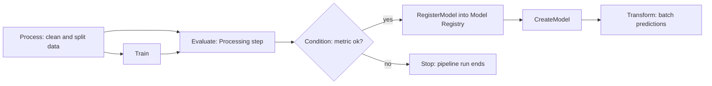

## 0. Before you start
- **Essential:** what a pipeline of steps is; what a model artifact is; the idea of a CI/CD flow.
- **Helpful:** directed acyclic graphs (steps that depend on earlier steps, never in a loop); Amazon EventBridge schedules.
- **Optional advanced:** compilers and intermediate representations; Amazon DataZone.

## 1. Simple explanation
Four loosely related tools finish the SageMaker story. **Neo** compiles a trained model for a specific chip so it runs faster in the cloud or on an edge device. **SageMaker Unified Studio** is one workspace where data, analytics, AI and ML teams share projects instead of hopping between consoles. **SageMaker Pipelines** turns your ML workflow (prepare data → train → evaluate → register) into a repeatable graph of steps that can run on a schedule or on a trigger. **JumpStart** is the shop window: pick a pre-built or foundation model, deploy it with a few clicks, and optionally fine-tune it.


```figure
flow sm-pipeline
```

## 2. Structured explanation
1. **Neo** ✅: train once, run anywhere; a compiler (framework → intermediate representation → optimized machine code) plus a runtime per target platform. Targets are cloud instances (including Inferentia) and edge devices.
2. **Unified Studio** ✅: "part of the next generation of Amazon SageMaker", a unified development experience bringing together AWS data, analytics, AI and ML services; you work in **projects** in a **domain** set up by administrators; sign in with SSO or IAM credentials.
3. **Pipelines** ✅: a DAG of steps defined in the drag-and-drop UI, the Pipelines SDK or the pipeline definition JSON; structure comes from data dependencies between steps; features include parameters, caching, retry policies, selective execution, scheduling, cross-account support, local mode.
4. **JumpStart** ✅🟡: deploy and fine-tune publicly available and proprietary foundation models from Studio or the Python SDK; proprietary models need a Marketplace subscription; some need an EULA acceptance.
5. **Put together:** Pipeline trains and registers → Registry approval → deployment with guardrails → monitoring → retrain ([05/01](aip:05-sagemaker/01-sagemaker-ai-deployment-guardrails-and-fm-optimization), [05/02](aip:05-sagemaker/02-ground-truth-model-monitor-and-clarify), [05/03](aip:05-sagemaker/03-model-registry-and-lineage-tracking)).

## 3. Analogy
**A factory assembly line with a showroom.** Pipelines is the assembly line: raw material (data) goes through stations (steps) in order, with a quality inspector (Condition step) who rejects bad units before they reach the warehouse (Registry). Neo is the custom tailoring that fits a product to each customer's equipment. JumpStart is the showroom of ready-made models. Unified Studio is the open-plan office where the data, analytics and ML teams work in one room.

*Where it breaks:* a physical assembly line makes identical products, but an ML pipeline's output depends on data that changes between runs. Caching a step is safe only if its inputs (data, code, parameters) truly did not change.

## 4. The seven questions

**WHAT?** Neo = model compilation/optimization for target hardware. Unified Studio = shared workspace for data, analytics and AI. Pipelines = workflow orchestration for ML. JumpStart = hub of deployable/fine-tunable models.

**WHY?** Lower inference cost and latency on specific hardware (Neo); fewer silos (Unified Studio); repeatability, automation and auditability (Pipelines); speed to first deployment (JumpStart).

**WHEN?** Neo: models to run on edge devices or specific cloud chips. Pipelines: any workflow you will run more than once or must audit. JumpStart: start from an existing open or proprietary model. Unified Studio: when several roles must collaborate on data and AI in one governed workspace.

**WHERE?** Regional SageMaker services; Pipelines steps run SageMaker jobs; JumpStart models deploy to SageMaker endpoints.

**HOW?** §5.

**WHAT IF?**
| Situation | Effect | Remedy |
|---|---|---|
| Evaluation metric fails the Condition step | Pipeline run stops; no `RegisterModel` ✅ | Fix data/model; rerun |
| Same inputs rerun | Step caching can reuse earlier results (feature exists ✅; key details ❌ not read) | Disable caching if inputs aren't fully captured |
| A step fails transiently | Retry policy can retry the step ✅ | Configure retries |
| JumpStart model requires a licence | Deployment needs EULA acceptance; proprietary models need a Marketplace subscription 🟡 | Accept/subscribe first |
| Neo target mismatch | Compiled model won't run on another chip | Compile per target |
| Tried to use Unified Studio without a domain | Needs an administrator-created domain ✅ | Ask admin |

**WHY NOT?** Do not build a Pipeline for a one-off experiment. Do not pick JumpStart when you need a model Bedrock already offers as a managed API with less operations. Do not forget that endpoints created from JumpStart bill until deleted.

## 5. Technical depth

### 5.1 Neo ✅
- **Purpose:** hand-tuning models for each platform's hardware is difficult; Neo optimizes models automatically for inference.
- **Inputs:** Gluon, Keras, MXNet, PyTorch, TensorFlow, TensorFlow-Lite and ONNX models; **targets:** Android, Linux and Windows machines on processors from Ambarella, ARM, Intel, Nvidia, NXP, Qualcomm, Texas Instruments and Xilinx; and cloud instances including Inferentia. Tested with computer-vision models from the model zoos.
- **How it works:** the compiler reads exported models, converts framework operations to a **framework-agnostic intermediate representation**, optimizes, generates binary code (a shared object library) and stores the model definition and parameters separately; a **runtime** per target loads the compiled model.
- **Precision:** can optimize FP32 models or models quantized to INT8 or FP16.
- **Create:** compilation job via console, CLI, notebook or SDK; deploy to a SageMaker endpoint or an **AWS IoT Greengrass** device.
- Tied to the *deploy options* page: Neo appears under "cost optimization" ✅. Do not confuse with the newer LLM "compilation" optimization technique (TensorRT-LLM / Neuron SDK) in [05/01 §5.4](aip:05-sagemaker/01-sagemaker-ai-deployment-guardrails-and-fm-optimization): same idea (hardware-specific compile), different feature.
- Edge fleet management features were not read ❌ (do not assume a particular edge management service is current).

### 5.2 SageMaker Unified Studio ✅
- Described as part of "the next generation of Amazon SageMaker": a single place to **build, deploy, execute and monitor workflows** across data, analytics, AI and ML.
- Administrators manage users, groups and **domains**; users join **projects** to create and share data, compute and other resources. Access through SSO or IAM credentials using the domain URL.
- The docs also reference fine-tuning foundation models inside Unified Studio (search result 🟡) and a separate "next-generation SageMaker" documentation set.
- The page I read does not list integrated services, Regions, quotas or the relationship to Amazon DataZone ❌; treat the catalogue, lakehouse and Bedrock integrations as unverified.

### 5.3 SageMaker Pipelines ✅

*Reading the arrows:* this is the AWS example DAG. Arrows come from **data dependencies**: a step uses another step's output properties as input. Evaluate needs Train's model and Process's test set. The Condition step checks a metric (the example uses mean-squared error below a limit); only on success does the run register the model, create it, and run a batch Transform. If the condition fails, the run stops.

- **Definition:** drag-and-drop UI, Pipelines SDK, or JSON definition; the DAG JSON captures step requirements and relationships.
- **Step types seen in the docs** ✅: Processing, Training, Condition, RegisterModel, CreateModel, Transform; also Tuning, Lambda, callback, Fail, ClarifyCheck and QualityCheck steps are listed in the topic index ("ClarifyCheck and QualityCheck steps" page) ✅ names only; details ❌.
- **Capabilities listed in the topic index** ✅: pipeline **parameters**; **@step decorator** to lift-and-shift Python code; passing data between steps (property files); **caching** pipeline steps; **retry policy** for steps; **selective execution**; baseline calculation and drift detection with ClarifyCheck/QualityCheck; **schedule runs** through EventBridge; SageMaker **Experiments** integration; **local mode**; **cross-account** support; IAM access management.
- **Link to the registry:** `RegisterModel` registers a model package in a Model Group, normally with `PendingManualApproval` ([05/03](aip:05-sagemaker/03-model-registry-and-lineage-tracking)); Condition steps can set approval status automatically ✅.
- **Link to lineage:** pipelines create lineage automatically ([05/03 §5.3](aip:05-sagemaker/03-model-registry-and-lineage-tracking)).
- **Relation to AWS Step Functions / CodePipeline:** Pipelines is ML-specific and SageMaker-native; Step Functions orchestrates arbitrary AWS services (including SageMaker jobs); CodePipeline automates software delivery. Choice guidance is covered in module 06 ❌ not verified here.

### 5.4 JumpStart ✅🟡
- **Deploy paths** ✅ (SageMaker deploy page): **JumpStart in Studio** for low-code deployment of pre-trained models from a catalog to pre-configured endpoints; `ModelBuilder` for your own model; CloudFormation for scale.
- **What it offers** 🟡 (search summary of several JumpStart pages): publicly available foundation models onboarded and maintained by SageMaker; proprietary third-party models (**subscribe in AWS Marketplace first**); fine-tune, deploy and evaluate through the Studio UI or the Python SDK (`ModelTrainer` to train, `ModelBuilder` to deploy); not every model supports fine-tuning; some models need an **EULA** acceptance for deployment or fine-tuning; some models offer **alternate deployment configurations** tuned for one use case and performance goal.
- **Studio deploy flow** ✅: Models → select → Deploy → endpoint name → instance type (for JumpStart LLMs, **Alternate configurations** shows pre-benchmarked options for cost or performance, with optional max total tokens, max input token length and max concurrent requests) → initial and maximum instance counts → for several models set CPU cores, minimum copies, minimum/maximum memory per model → advanced options (IAM role, VPC, KMS key, network isolation, timeouts) → Deploy.
- **Compatibility** ✅: models on a shared endpoint need the same IAM role, VPC and network-isolation setting.
- **JumpStart vs Bedrock:** JumpStart gives you the endpoint (and the bill, and the operations); Bedrock gives a managed API. Choose JumpStart for models Bedrock lacks, special hardware, or full control.

## 6. Worked example
*Problem:* A retailer wants a weekly pipeline that retrains a demand-forecasting model, deploys it only if it beats the current one, and keeps the audit trail. A separate team wants a small vision model to run on store cameras. A third team wants to try an open LLM quickly.

| Need | Choice | Why |
|---|---|---|
| Weekly retraining and gating | SageMaker Pipelines: Process → Train → Evaluate → Condition → RegisterModel; EventBridge weekly schedule | Repeatable, gated ✅ |
| Approval and deploy | Registry approval → CI/CD → canary deploy | [05/03](aip:05-sagemaker/03-model-registry-and-lineage-tracking), [05/01](aip:05-sagemaker/01-sagemaker-ai-deployment-guardrails-and-fm-optimization) |
| Store-camera model | Neo compile for the camera's chip; deploy via IoT Greengrass | Edge target ✅ |
| Quick LLM trial | JumpStart in Studio with a benchmarked configuration; delete the endpoint after | Fast to try ✅ |
| Data scientists + analysts + engineers collaborating | Unified Studio project in one domain | Shared workspace ✅ |

## 7. Knowledge checkpoints
1. What defines the structure (edges) of a SageMaker pipeline DAG?
2. What happens to a pipeline run when the Condition step's check fails (in the AWS example)?
3. Name two frameworks Neo can optimize and two kinds of deployment targets.
4. What two things might be required before deploying a proprietary JumpStart model?
5. Who creates a Unified Studio domain?

## 7b. Practice questions (exam-style, original) — answers in §14

**Q1.** A team wants model training, evaluation, conditional registration and batch scoring to run automatically each week with no manual steps. Which service fits best?
A. SageMaker Pipelines
B. Ground Truth
C. SageMaker Neo
D. JumpStart only

**Q2.** (Select TWO) In SageMaker Pipelines, which statements are correct?
A. Step order follows data dependencies between steps
B. A Condition step can stop a run if a metric check fails
C. Pipelines can only be built in code, not in a UI
D. Pipelines cannot be scheduled
E. `RegisterModel` deletes the model

**Q3.** A model must run on an ARM-based edge camera with minimal latency. Which feature compiles it for that target?
A. Ground Truth
B. SageMaker Neo
C. Model Monitor
D. Clarify

**Q4.** A data engineer, an analyst and a data scientist need one governed place to collaborate on data and AI projects. Which fits best?
A. SageMaker Unified Studio
B. Amazon Neptune
C. AWS Snowball
D. Amazon Lex

**Q5.** (Select TWO) Which are true about deploying JumpStart foundation models?
A. Proprietary models need a prior AWS Marketplace subscription
B. Some models require EULA acceptance
C. Every model supports fine-tuning
D. Deployment never creates billable resources
E. JumpStart removes the need for IAM roles

**Q6.** Which pipeline design prevents a poor model from being registered?
A. A Condition step on an evaluation metric before `RegisterModel`
B. Registering first and deleting later
C. Skipping evaluation
D. Using Neo

**Q7.** Neo's compiler first converts framework-specific operations into what?
A. A framework-agnostic intermediate representation
B. A Docker image
C. A CloudFormation template
D. A vector index

**Q8.** Which statement about Neo precision is correct?
A. Neo can optimize FP32 models and models quantized to INT8 or FP16
B. Neo works only with INT4
C. Neo requires Python 2
D. Neo only supports text models

## 7c. Mixed review for Quiz 5 (managing models with SageMaker AI)
**R1.** A canary deployment for a real-time endpoint is limited to what share of the green fleet? A. 10% B. 50% C. 90% D. 100%
**R2.** A team needs the Model Monitor equivalent but has a new account. What do AWS pages recommend? A. Open-source MLflow + Evidently with CloudWatch and QuickSight B. Ground Truth C. Neo D. Wait for Model Monitor to reopen
**R3.** An approved model version is rejected. With project templates, what is deployed? A. Nothing B. The latest version still Approved C. A random version D. The rejected version
**R4.** Which inference option fits payloads up to 1 GB, processing up to an hour, scale to zero? A. Serverless B. Real-time C. Asynchronous D. Batch transform only
**R5.** Who can share lineage across accounts and how? A. Copy files by hand B. AWS RAM share of the default lineage group, accepted by the other account C. S3 replication D. CloudFront
**R6.** Which technique pairs a small draft model with a larger verifier? A. Quantization B. Speculative decoding C. Fast model loading D. Neo

**Answers (7c).** R1 → B ([05/01](aip:05-sagemaker/01-sagemaker-ai-deployment-guardrails-and-fm-optimization)). R2 → A ([05/02](aip:05-sagemaker/02-ground-truth-model-monitor-and-clarify)). R3 → B ([05/03](aip:05-sagemaker/03-model-registry-and-lineage-tracking)). R4 → C. R5 → B. R6 → B.

## 8. Hands-on lab: a pipeline executor, step caching, and a JumpStart readiness check

### 8.1 Objective
Build a tiny DAG runner that orders steps by data dependency, gates registration with a Condition step, caches unchanged steps and retries a flaky step; compute precision-driven model size; and check JumpStart prerequisites.

### 8.2 Prerequisites
Python 3 only. Nothing here calls AWS or the SageMaker SDK. The runner is a teaching model, not the Pipelines API or its JSON schema.

### 8.3 AWS services
None offline. Maps to SageMaker Pipelines, Model Registry, Neo, JumpStart.

### 8.4 IAM permissions
Offline: none. Real: a pipeline execution role that can run the job types in the steps, read/write S3 and register models ❌ (see the Pipelines IAM page); `sagemaker:CreatePipeline`, `StartPipelineExecution` ❌.

### 8.5 Region notes
SageMaker features, instance types and JumpStart models vary by Region ✅.

### 8.6 Architecture
§5.3.

### 8.7 Cost
Offline: none. Real pipeline runs bill the jobs they start; endpoints bill while they exist.

### 8.8 Code
```python lab-run
import hashlib, json

# ---- 1. A DAG whose edges come from data dependencies (a step lists the steps whose outputs it uses) ----
STEPS = {
    "process":  {"needs": [], "fn": lambda ins: {"train_rows": 8000, "test_rows": 2000}},
    "train":    {"needs": ["process"], "fn": lambda ins: {"model": "m-" + str(ins["process"]["train_rows"])}},
    "evaluate": {"needs": ["train", "process"], "fn": lambda ins: {"mse": 0.8 if ins["train"]["model"] else 9.9}},
    "register": {"needs": ["evaluate"], "fn": lambda ins: {"registered": True, "status": "PendingManualApproval"}},
}

def topo(steps):
    done, order = set(), []
    while len(order) < len(steps):
        ready = [n for n, s in steps.items() if n not in done and all(d in done for d in s["needs"])]
        if not ready:
            raise ValueError("cycle detected")
        for n in sorted(ready):
            order.append(n); done.add(n)
    return order

print("execution order:", " -> ".join(topo(STEPS)))

# ---- 2. Run with a Condition (mse must be below a limit), caching, and retries ----
CACHE = {}
runs = {"count": 0}
def run(steps, mse_limit, flaky_fail_times=0):
    outputs, log = {}, []
    attempts_left = {"train": flaky_fail_times}
    for name in topo(steps):
        s = steps[name]
        ins = {d: outputs[d] for d in s["needs"]}
        key = hashlib.sha256(json.dumps([name, ins], sort_keys=True).encode()).hexdigest()[:8]
        if key in CACHE:
            outputs[name] = CACHE[key]; log.append(f"{name}: cache hit {key}")
        else:
            for attempt in range(1, 4):
                if attempts_left.get(name, 0) > 0:
                    attempts_left[name] -= 1
                    log.append(f"{name}: attempt {attempt} failed, retrying")
                    continue
                runs["count"] += 1
                fn = s["fn"]
                outputs[name] = fn(ins); CACHE[key] = outputs[name]
                log.append(f"{name}: ran (attempt {attempt}) -> {outputs[name]}")
                break
        # the Condition is evaluated whether the step ran or came from the cache
        if name == "evaluate" and outputs[name]["mse"] >= mse_limit:
            log.append(f"condition failed: mse {outputs[name]['mse']} >= {mse_limit} -> stop, nothing registered")
            return log
    return log

for line in run(STEPS, mse_limit=1.0, flaky_fail_times=1):
    print(line)
print("--- second run, same inputs")
for line in run(STEPS, mse_limit=1.0):
    print(line)
print("--- stricter condition")
for line in run(STEPS, mse_limit=0.5):
    print(line)
print("steps actually executed across the three runs:", runs["count"])

# ---- 3. Precision and model size (Neo accepts FP32 or quantized INT8/FP16 models) ----
def size_mb(params_million, bits):
    return params_million * 1e6 * bits / 8 / 1e6
for bits, label in ((32, "FP32"), (16, "FP16"), (8, "INT8")):
    print(f"25M-parameter vision model as {label}: {size_mb(25, bits):.0f} MB")

# ---- 4. JumpStart readiness check (rules summarised from AWS pages; the model records are invented) ----
def ready(model, subscribed, eula_accepted, instance_ok):
    problems = []
    if model["proprietary"] and not subscribed:
        problems.append("subscribe in AWS Marketplace")
    if model["needs_eula"] and not eula_accepted:
        problems.append("accept the EULA")
    if not instance_ok:
        problems.append("choose an instance type the model supports")
    return problems or ["ready to deploy (remember to delete the endpoint afterwards)"]

print(ready({"proprietary": False, "needs_eula": True}, False, False, True))
print(ready({"proprietary": True, "needs_eula": False}, False, False, True))
print(ready({"proprietary": False, "needs_eula": False}, False, False, True))
```

### 8.9 Captured output
Generated on 2026-10-26 by extracting the block above from this file and running it (Python 3). It is a teaching model of the documented behavior, **not** SageMaker Pipelines output.
```text lab-out
execution order: process -> train -> evaluate -> register
process: ran (attempt 1) -> {'train_rows': 8000, 'test_rows': 2000}
train: attempt 1 failed, retrying
train: ran (attempt 2) -> {'model': 'm-8000'}
evaluate: ran (attempt 1) -> {'mse': 0.8}
register: ran (attempt 1) -> {'registered': True, 'status': 'PendingManualApproval'}
--- second run, same inputs
process: cache hit 232a5462
train: cache hit 7f14d6fe
evaluate: cache hit 063c4c34
register: cache hit 6f5d71f1
--- stricter condition
process: cache hit 232a5462
train: cache hit 7f14d6fe
evaluate: cache hit 063c4c34
condition failed: mse 0.8 >= 0.5 -> stop, nothing registered
steps actually executed across the three runs: 4
25M-parameter vision model as FP32: 100 MB
25M-parameter vision model as FP16: 50 MB
25M-parameter vision model as INT8: 25 MB
['accept the EULA']
['subscribe in AWS Marketplace']
['ready to deploy (remember to delete the endpoint afterwards)']
```

### 8.10 Explanation
- Part 1: the order comes only from which steps use which outputs; `evaluate` needs both `train` and `process`.
- Part 2: the first run retries `train` once, executes everything and registers a model in `PendingManualApproval`. The second run with identical inputs hits the cache for every step. A stricter limit makes the Condition fail: the run stops and nothing is registered; the cached steps do not execute again.
- Part 3: halving the bit width halves the stored size; Neo's accepted precisions are FP32 or quantized INT8/FP16 ✅.
- Part 4: JumpStart prerequisites (Marketplace subscription for proprietary models, EULA, supported instance) are the checks; the rules come from search summaries 🟡.

### 8.11 Optional AWS lab (shown, not run against AWS ❌)
1. **JumpStart (console):** SageMaker Studio → JumpStart/Models → pick a model → Deploy; read the license/EULA; choose **Alternate configurations** (cost or performance) for popular LLMs; set instance count; deploy; test; **delete the endpoint** ✅ (Studio deploy flow).
2. **Pipelines (console):** Studio → Pipelines → create from a template or the visual editor; add Process, Train, Evaluate, Condition and RegisterModel; add an EventBridge schedule ✅ (features listed in the Pipelines topic index).
3. **Neo:** create a compilation job (console/CLI/SDK) for a small ONNX or PyTorch vision model and a target device; deploy to an endpoint or Greengrass ✅. Exact job parameters ❌ not read; use the Neo compilation page.
4. **Unified Studio:** ask an administrator for a domain URL; create a project ✅.
5. **Clean up:** endpoints, pipelines' created resources, S3 artifacts, schedules, projects.

### 8.12 Common errors
| Error | Cause | Fix |
|---|---|---|
| Pipeline step skipped unexpectedly | Cache reused it ✅ | Disable caching or change inputs |
| Condition step references wrong output | Property path mistake | Inspect step properties |
| JumpStart deploy blocked | Missing subscription/EULA 🟡 | Subscribe/accept |
| Neo model fails on device | Wrong target compilation | Recompile for that target ✅ |
| `AccessDenied` in Studio | Tagging permission missing ✅ ([05/01](aip:05-sagemaker/01-sagemaker-ai-deployment-guardrails-and-fm-optimization)) | Add tag permissions |

### 8.13 Security recommendations
Run pipelines under a least-privilege execution role; encrypt S3 artifacts; restrict who can start/modify pipelines and approve models (separation of duties); review model licences before deploying; use VPC and network isolation for sensitive models ✅; delete idle endpoints and schedules.

## 9. What can go wrong?
| Failure | Why | Symptoms | Investigate | Fix | Prevent |
|---|---|---|---|---|---|
| **Stale cache** | Inputs changed outside the cache key | Old results reused | Step logs | Bust cache | Capture all inputs |
| **Silent bad model** | No Condition gate | Poor model registered | Registry versions | Add gate | Template |
| **Cost from leftover endpoints** | JumpStart trials | Bill | Endpoint list | Delete | Tagging, schedule |
| **Licence violation** | Ignored EULA | Compliance issue | Model card | Review | Process |
| **Unsupported Neo operator** | Model uses unsupported op | Compile fails | Job logs | Modify model | Test early |
| **Domain sprawl** | Unmanaged Unified Studio projects | Access confusion | Admin console | Governance | Naming, access reviews |

## 10. Common misconceptions
1. **"Pipelines and Step Functions are the same."** Pipelines is ML-specific orchestration; Step Functions is a general workflow service.
2. **"Neo is only for edge."** It supports cloud instances (including Inferentia) too ✅.
3. **"JumpStart models are free."** Endpoints and Marketplace models cost money.
4. **"A cached pipeline step always reflects fresh data."** Only if inputs changed.
5. **"Unified Studio replaces Studio."** It is the next-generation workspace; the relationship to Studio and other tools was not fully read ❌.

## 11. Exam notes
- **Patterns:** "automate retrain → evaluate → register → deploy" → Pipelines (+ Registry); "run on edge/specific chip" → Neo; "quickly deploy an open model" → JumpStart; "collaborative workspace for data+AI" → Unified Studio.
- **Traps:** assuming JumpStart = Bedrock; assuming Pipelines runs non-ML workflows better than Step Functions; assuming Neo trains models.
- **Compare:** Pipelines vs Step Functions vs CodePipeline (module 06); Neo vs LLM compilation.

## 12. Summary and revision cards
- Neo: compiler + runtime; many frameworks; edge and cloud; FP32/FP16/INT8.
- Pipelines: DAG by data dependencies; Condition, RegisterModel; parameters, caching, retries, schedules, cross-account.
- JumpStart: deploy/fine-tune public and proprietary models; subscription/EULA; delete endpoints.
- Unified Studio: shared projects in admin-created domains.

**Cards.** Q: What gives Pipelines its edges? A: Data dependencies. · Q: Neo intermediate step? A: Framework-agnostic IR. · Q: Pipeline stops when? A: Condition fails (in the example).

## 13. References
| Source | URL | Verified |
|---|---|---|
| Neo | https://docs.aws.amazon.com/sagemaker/latest/dg/neo.html | 2026-10-26 |
| Pipelines overview | https://docs.aws.amazon.com/sagemaker/latest/dg/pipelines-overview.html | 2026-10-26 |
| Unified Studio user guide | https://docs.aws.amazon.com/sagemaker-unified-studio/latest/userguide/what-is-sagemaker-unified-studio.html | 2026-10-26 |
| Deploy models (JumpStart in Studio) | https://docs.aws.amazon.com/sagemaker/latest/dg/deploy-model.html · .../realtime-endpoints-deploy-models.html | 2026-10-26 |
| JumpStart foundation models (search results) | https://docs.aws.amazon.com/sagemaker/latest/dg/jumpstart-foundation-models.html · .../jumpstart-foundation-models-use-studio-updated-deploy.html | 🟡 2026-10-26 |

**Unverified here:** the JumpStart overview page itself (fetch returned title only); Pipelines step-type pages and caching key rules; Unified Studio service integrations; Neo edge-management features and any availability notices.

## 14. Answers to checkpoints and practice questions
**Checkpoints.** 1) Data dependencies between steps ✅. 2) The run stops ✅. 3) Examples: PyTorch, TensorFlow, ONNX; cloud instances (incl. Inferentia) and edge devices ✅. 4) A Marketplace subscription and EULA acceptance 🟡. 5) An administrator ✅.

**Practice questions.**
- **Q1 → A.** ✅
- **Q2 → A, B.** C is false (UI, SDK, JSON); D is false (schedules via EventBridge); E is false ✅.
- **Q3 → B.** ✅
- **Q4 → A.** ✅
- **Q5 → A, B.** C, D, E are false 🟡.
- **Q6 → A.** ✅
- **Q7 → A.** ✅
- **Q8 → A.** ✅
