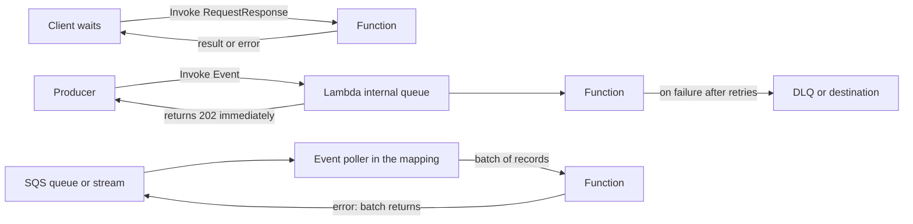
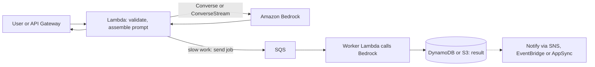

## 0. Before you start
- **Essential:** what a function is; what an HTTP request/response is; the idea of an IAM role ([IAM and CLI setup](aip:00-foundations/01-aws-account-iam-and-cli-setup)).
- **Helpful:** how a Bedrock call looks ([Converse API](aip:01-bedrock-genai-fundamentals/01-bedrock-overview-and-converse-api)); what a queue is.
- **Optional advanced:** Lambda concurrency models; VPC networking for Lambda.

## 1. Simple explanation
AWS Lambda runs your small piece of code only when something asks for it, and you pay only while it runs. You do not manage servers. In a GenAI application Lambda is the "glue": a user request or an event arrives, Lambda cleans it up, calls Amazon Bedrock, shapes the answer and passes it on. Lambda can be called in three ways: **synchronously** (the caller waits for the answer), **asynchronously** (the caller drops the event off and leaves), or **by polling** (Lambda itself reads batches from a queue or stream). Each way has different rules for retries and errors, and the exam likes to ask which one fits a situation.


```figure
flow lambda-invocation-modes
```

## 2. Structured explanation
1. **Function** = your code + configuration (memory, timeout, role, environment variables). Lambda creates an **execution environment** (a small sandbox) per concurrent request and may reuse it for later requests ✅.
2. **Three invocation styles** ✅ (`lambda-invocation.html`):
   - *Synchronous* (`InvocationType=RequestResponse`): you wait; on error **you** retry.
   - *Asynchronous* (`InvocationType=Event`): Lambda queues the event, returns `202` at once and retries on its own.
   - *Event source mapping* (poll-based): Lambda reads batches from SQS, Kinesis, DynamoDB Streams, Kafka, Amazon MQ, DocumentDB and invokes your function with each batch.
3. **Triggers vs event source mappings** ✅: S3, SNS and API Gateway *push* (the trigger lives in the other service); queue and stream sources are *polled* by a Lambda-managed resource.
4. **Response streaming** ✅: send the first bytes of an answer before it is complete (helps time to first token). Function URLs or `InvokeWithResponseStream` do it; API Gateway REST APIs can also stream ([06/02](aip:06-app-building-tools/02-api-gateway-and-genai-applications)).
5. **Durable functions** ✅ (new): ordinary Lambda code with checkpoint-and-replay that can run for up to a year and pause (wait) without compute charges; positioned for AI workflows and human-in-the-loop.
6. **Lambda with Bedrock:** create the `bedrock-runtime` client outside the handler, call `Converse` (or `ConverseStream`), give the execution role only the model permissions it needs, set the function timeout above the model's worst-case latency, and choose sync, streaming or async by how long answers take.

## 3. Analogy
**A restaurant kitchen with three kinds of orders.** A *synchronous* order is a customer at the counter who waits for the dish. An *asynchronous* order is a takeaway slip left in a tray: the kitchen promises to make it and will re-make it if the first attempt is burnt. A *polled* order is a cook who walks to the ticket rail every few seconds, grabs up to ten tickets, and cooks them together.

*Where it breaks:* a kitchen sees one order at a time, but Lambda can run thousands of copies of the cook at once; the real limits are concurrency and downstream throttling, not kitchen space. And the rail (queue) can hand the same ticket out twice, so cooking must be safe to repeat (idempotent).

## 4. The seven questions

**WHAT?** Lambda is event-driven serverless compute. For GenAI it hosts orchestration code: pre-processing, prompt assembly, tool code, post-processing.

**WHY?** No servers to patch, scale to zero, per-request billing, and native triggers from many AWS services.

**WHEN?** Short request/response work, event processing, tool functions for agents, glue between services. **Not** for work that must run longer than 15 minutes in one invocation (use Step Functions, durable functions, ECS/Batch, or SageMaker) ✅.

**WHERE?** Regional service; the function, its event sources and (usually) Bedrock sit in the same Region. For private access to Bedrock from a VPC-attached function, use a Bedrock runtime VPC endpoint or a NAT path ([08-security](aip:08-security/01-least-privilege-iam-identity-center-and-data-masking) later; see the NAT idle-timeout fix in [verification-log](aip:meta/verification-log)).

**HOW?** §5.

**WHAT IF?**
| Situation | Effect | Remedy |
|---|---|---|
| Bedrock call takes longer than the function timeout | Invocation ends with a timeout error; Bedrock may still finish and you may still be billed for the tokens | Set timeout above worst-case latency; use streaming or async |
| Async function fails | Lambda retries twice more (waits 1 min, then 2 min), then discards unless a DLQ/destination exists ✅ | Configure an on-failure destination or DLQ |
| Throttled async invoke (429/5xx) | Event returns to the queue and is retried for up to 6 hours ✅ | Raise concurrency or reduce the producer rate |
| Polled batch has one bad record | Whole batch is retried (stream shards pause) unless you use partial batch responses ✅ | Report item failures; make the code idempotent |
| Payload larger than limits | Request rejected | Store in S3 and pass a reference |
| Client disconnects during a streamed response | Function keeps running and you pay for the full duration ✅ | Watch timeouts; stop work on your own signal |

**WHY NOT?** Do not use Lambda as a long-lived agent loop host, as a stateful WebSocket server, or for GPU inference. Do not rely on a single synchronous call for a slow model behind a 29-second API Gateway limit ([06/02](aip:06-app-building-tools/02-api-gateway-and-genai-applications)).

## 5. Technical depth

### 5.1 Quotas that matter for GenAI ✅ (`gettingstarted-limits.html`, read 2026-10-26)
| Item | Value on the page |
|---|---|
| Timeout | default 3 s (`configuration-timeout.html`); maximum 900 s. Lambda Managed Instances functions, for async and event-source-mapping invocations, up to 5,400 s |
| Memory | 128 to 10,240 MB; CPU scales with memory; one vCPU at 1,769 MB |
| Payload | 6 MB request and 6 MB response (synchronous); **200 MB per streamed response**; 1 MB (asynchronous) |
| Streaming bandwidth | first 6 MB uncapped; then 2 MBps for the rest |
| Environment variables | 4 KB total |
| `/tmp` | 512 to 10,240 MB |
| Concurrency | 1,000 concurrent executions per Region by default (can be raised); new accounts have reduced quotas that AWS raises with usage |
| Scaling rate | per function, 1,000 execution environments every 10 seconds |
| Synchronous invocation rate | each execution environment serves up to 10 requests per second, so the limit is 10 × concurrency |
| Zip package | 50 MB zipped (API/SDK), 250 MB unzipped including layers; container image up to 10 GB |

*Related names on the same page* ✅: **Lambda Managed Instances**, **Lambda MicroVMs** (maximum 8 hours) and **Lambda Web Functions** have their own quota tables. They are named here so the words are not a surprise; they are not studied in this guide.

### 5.2 The three invocation styles

*Reading the arrows:* the top path is synchronous: the caller holds the connection and sees the error. The middle path is asynchronous: Lambda confirms `202` first, then reads from its own queue and invokes the function; failures go to a dead-letter queue or an on-failure destination. The bottom path is polling: an *event poller* reads batches from SQS or a stream and invokes the function; a returned error sends the whole batch back (for streams the shard is blocked until success or expiry).

### 5.3 Asynchronous error handling ✅ (`invocation-async-error-handling.html`)
- A function error is retried **two more times**, with a **one-minute** wait before the second attempt and a **two-minute** wait before the third.
- Throttling (429) and system (5xx) errors return the event to the queue; Lambda retries for **up to 6 hours** by default with an interval that increases exponentially from 1 second to a maximum of 5 minutes.
- Events can be delivered more than once even without errors, so write idempotent code.
- An event that expires or fails all attempts is discarded. Capture it with a **dead-letter queue** (the failed event), or with an **on-failure destination** (an invocation record that also covers timeouts and runtime errors) ✅.
- You can lower retries or maximum event age (the exact allowed ranges were not on the page I read ❌).

### 5.4 Event source mappings ✅ (`invocation-eventsourcemapping.html`)
- Sources: DocumentDB, DynamoDB, Kinesis, Amazon MQ, MSK, self-managed Kafka, SQS.
- Each event is processed **at least once**; duplicates can occur. Make code idempotent.
- A batch is sent when **one of three things happens**: the batching window ends, the batch size is reached, or the payload hits **6 MB**. The default window for Kinesis, DynamoDB and SQS is 0 seconds; you can set 0 to 300 seconds.
- On an error the whole batch is reprocessed; for ordered sources processing pauses on that shard. Stream sources can bound the number of retries and send a record of discarded batches to a destination.
- **Provisioned mode** (MSK, Kafka, SQS): dedicated pollers; for SQS each poller handles up to 1 MB/s or 10 concurrent invokes; minimum pollers 2 to 200, maximum 2 to 10,000 on the page I read ✅. It costs extra, and for SQS it cannot be combined with the maximum concurrency setting.

### 5.5 SQS as a Lambda source ✅ (`services-sqs-configure.html`)
- Set the queue **visibility timeout to at least six times the function timeout** (plus the batching window if one is set) so Lambda can retry after throttling.
- The function timeout must not exceed the queue visibility timeout; Lambda checks this when you create the mapping.
- Set the source queue's `maxReceiveCount` (the DLQ redrive rule) to **at least 5**.
- Standard queue batch size up to 10,000 records (FIFO: 10). Use *partial batch responses* so only failed messages return to the queue. The SQS side is in [06/08](aip:06-app-building-tools/08-sqs-eventbridge-sns-and-appflow).

### 5.6 Response streaming ✅ (`configuration-response-streaming.html`)
- Native streaming is supported on **Node.js managed runtimes**. Other languages, **including Python**, need a custom runtime with the Runtime API integration, or the Lambda Web Adapter.
- Entry points: function URLs (`RESPONSE_STREAM` invoke mode), the `InvokeWithResponseStream` API, or an API Gateway REST proxy integration.
- Not available in every Region; function URLs do not stream inside a VPC (use `InvokeWithResponseStream` through a Lambda interface VPC endpoint). The Lambda console always shows buffered output.
- A streamed response is not interrupted when the client disconnects, and you are billed for the full function duration.

### 5.7 Lambda with Bedrock: the pattern

*Reading the arrows:* the top loop is the fast path where Lambda calls Bedrock and answers directly. The lower branch is the slow path: put a job on SQS, let a worker Lambda call Bedrock, store the result, and notify the user when it is ready (details of SQS/SNS/EventBridge in [06/08](aip:06-app-building-tools/08-sqs-eventbridge-sns-and-appflow)).

Checklist (all items follow earlier modules):
1. **Create the client once**, outside the handler, so warm invocations reuse connections ([04/04](aip:04-operational-efficiency/04-backoff-connection-pooling-and-cross-region-inference)).
2. **Timeouts:** the function timeout must exceed the SDK read timeout times the retries you allow; SDK defaults (60 s timeouts, 3 total attempts in standard mode) are in 04/04 ✅.
3. **IAM:** the execution role needs the Bedrock invoke actions scoped to the model ARN (and the inference-profile ARNs when you use cross-Region inference, see 04/04 for the three-part policy). Add the basic logging permission for CloudWatch Logs.
4. **Model choice by environment variable or AppConfig**, not code ([06/03](aip:06-app-building-tools/03-appconfig-and-dynamic-foundation-model-selection)).
5. **Streaming** when a human is watching ([06/02](aip:06-app-building-tools/02-api-gateway-and-genai-applications)); **async** when nobody is waiting.
6. **Errors:** map throttling to backoff and a fallback model, validation errors to a 4xx. See Bedrock error codes in the [verification log](aip:meta/verification-log).
7. **Do not log raw prompts** that may contain personal data unless that is a decision (see module 07/08).

### 5.8 Durable functions versus Step Functions ✅ (`durable-functions.html`)
| | Lambda durable functions | Step Functions |
|---|---|---|
| Where the workflow lives | Inside Lambda; ordinary code in JavaScript, TypeScript, Python, Java, Go, C# | Separate managed service; graph-based Amazon States Language or visual designer |
| Strength | Workflows tightly coupled with application code | Orchestration across AWS services, visual design, native integrations to 220+ services, zero infrastructure |
| Duration | Up to one year; waits suspend without compute charges | Standard up to one year; Express five minutes ([06/04](aip:06-app-building-tools/04-step-functions-states-circuit-breaker-and-prompt-chaining)) |
| Mechanism | Checkpoints and replay: the code re-runs from the start and skips completed steps | State machine transitions |
Replay means your code must be deterministic around the durable operations (a generic property of replay-based systems; the best-practice page was not read ❌).

## 6. Worked example
*Problem:* An HR chatbot behind API Gateway calls Claude through Bedrock. Typical answers take 4 to 25 seconds; a few take 40+. The first deployment used the Lambda default timeout and users saw random errors.

| Step | What to do | Why |
|---|---|---|
| 1 | Raise the Lambda timeout (e.g. to 120 s) and set the SDK read timeout below it | The default 3 s is shorter than most model answers ✅ |
| 2 | Note API Gateway's 29-second integration limit | A slow answer will hit the gateway limit before Lambda times out ([06/02](aip:06-app-building-tools/02-api-gateway-and-genai-applications)) |
| 3 | Switch interactive chat to streaming (`ConverseStream` + REST response streaming or `InvokeWithResponseStream`) | Time to first byte drops; allows runs longer than 29 s |
| 4 | Move report generation to async: SQS → worker Lambda → S3 → SNS notification | Nobody waits; retries are automatic |
| 5 | Add a DLQ with `maxReceiveCount` 5 and visibility timeout ≥ 6 × function timeout | Failed jobs are captured, not looped forever ✅ |
| 6 | Alarm on `Throttles`, `Errors`, `Duration` and DLQ depth | Production visibility (module 07) |

## 7. Knowledge checkpoints
1. Which invocation type returns `202` immediately?
2. How many times does Lambda retry a failed asynchronous invocation, and with what waits?
3. What three conditions end a batching window for an event source mapping?
4. What is the maximum size of a streamed Lambda response, and which Lambda runtime supports streaming natively?
5. What visibility timeout should an SQS queue have relative to its Lambda function's timeout?

## 7b. Practice questions (exam-style, original) — answers in §14

**Q1.** A user-facing chat feature invokes Lambda, which calls a Bedrock model that sometimes needs 20 seconds. The Lambda function keeps timing out at 3 seconds. What is the most direct fix?
A. Increase the function timeout above the model's worst-case latency
B. Increase the function memory to 10,240 MB
C. Move the function into a VPC
D. Switch to asynchronous invocation

**Q2.** (Select TWO) Which statements about Lambda asynchronous invocation are correct?
A. Lambda returns a 202 status after queuing the event
B. A function error is retried automatically, twice by default
C. The caller receives the function's return value in the response
D. Failed events are always kept forever without configuration
E. Retries are never attempted when the function is throttled

**Q3.** A team sends 20 MB of generated text from a Python Lambda function to a browser as one response. What limit blocks a normal synchronous response, and what is one way around it?
A. 6 MB response limit; stream the response (up to 200 MB) or store the file in S3 and return a link
B. 1 MB limit; compress it
C. 4 KB limit; split into environment variables
D. No limit applies

**Q4.** An SQS queue feeds a Lambda function whose timeout is 60 seconds. Which queue visibility timeout follows AWS guidance?
A. 30 seconds
B. 60 seconds
C. At least 360 seconds
D. 0 seconds

**Q5.** (Select TWO) A function processes records from a Kinesis stream. One record in each batch fails intermittently. Which actions reduce harm?
A. Make the processing idempotent because records may be delivered more than once
B. Use partial batch responses or bounded retries with an on-failure destination
C. Assume the whole batch is skipped on any error
D. Increase the function memory only
E. Convert the stream into a synchronous API

**Q6.** A workflow must wait three days for a human approval and then call Bedrock, and the team wants to write it as ordinary Python inside the Lambda service with no separate state machine. Which feature fits?
A. Lambda durable functions
B. Lambda response streaming
C. Provisioned concurrency
D. A function URL

**Q7.** You need to capture asynchronous invocation timeouts and runtime errors as records with details for troubleshooting. Which is correct?
A. Configure an on-failure destination
B. Only a dead-letter queue can do this
C. Use API Gateway caching
D. Enable response streaming

**Q8.** Which design correctly separates a fast interactive path from slow report generation for a Bedrock-based app?
A. Fast path: Lambda calls Bedrock directly (streaming if helpful); slow path: SQS → worker Lambda → result store → notification
B. Put every request in one synchronous 15-minute Lambda call
C. Poll Bedrock from the browser every second
D. Store prompts in environment variables over 4 KB

## 8. Hands-on lab: invocation rules, latency budgets and the SQS visibility check

### 8.1 Objective
Reproduce, offline, the documented Lambda rules: the async retry timeline, how many throttle retries fit in six hours, which timeouts a latency distribution would break, which payloads fit which invocation type, and the SQS visibility-timeout formula. Then read (and syntax-check) a Lambda handler that calls Bedrock.

### 8.2 Prerequisites
Python 3 for the simulator. For the optional AWS part: an account, the AWS CLI, Bedrock model access, and permissions to create a Lambda function and role ([IAM and CLI setup](aip:00-foundations/01-aws-account-iam-and-cli-setup)).

### 8.3 AWS services
Offline: none. Optional: Lambda, Bedrock, CloudWatch Logs, IAM.

### 8.4 IAM permissions
Offline: none. Real: the function's execution role needs CloudWatch Logs write permission plus the Bedrock invoke actions on the model (and inference-profile) ARN you use. Exact action names for `Converse` follow 01/01; scope to ARNs, never `*`.

### 8.5 Region notes
Create the function in a Region where your chosen model (or inference profile) is available. Response streaming is not in every Region ✅. Do not hard-code model IDs: read them from the Bedrock console or `list-foundation-models` the day you run the lab.

### 8.6 Architecture
§5.2 and §5.7.

### 8.7 Cost
Offline: none. Real: Lambda bills requests and duration; Bedrock bills tokens; a streamed response bills for the full duration even if the client leaves ✅. Check the pricing pages before running anything at volume.

### 8.8 Code

**A. The offline simulator** (every number printed below comes from this block):
```python lab-run
# ---- 1. Async invocation: a function error is retried twice (waits 60 s, then 120 s) ----
def async_timeline(outcomes):
    waits = [60, 120]
    t, log = 0, []
    for attempt, res in enumerate(outcomes, start=1):
        log.append(f"t={t:>4}s attempt {attempt}: {res}")
        if res == "ok":
            return log + ["-> succeeded"]
        if attempt > len(waits):
            return log + ["-> discarded (kept only if a DLQ or on-failure destination exists)"]
        t += waits[attempt - 1]
    return log + ["-> still retrying"]

for title, outcomes in (("succeeds on the 3rd try", ["error", "error", "ok"]),
                        ("always fails", ["error", "error", "error"])):
    print("async:", title)
    for line in async_timeline(outcomes):
        print("  ", line)

# ---- 2. Throttle retries: interval grows from 1 s to a 5-minute cap, for up to 6 hours ----
# AWS documents only the start (1 s), the cap (5 min) and the 6-hour window; doubling is an ILLUSTRATIVE assumption.
elapsed, interval, tries = 0, 1, 0
while elapsed + interval <= 6 * 3600:
    elapsed += interval
    tries += 1
    interval = min(300, interval * 2)
print(f"throttle retries that fit in 6 h under the doubling model: {tries}")

# ---- 3. Which timeout breaks which share of calls? (latencies are INVENTED, in seconds) ----
latencies = [1.2, 1.8, 2.4, 2.9, 3.1, 3.6, 4.2, 5.0, 6.3, 7.7,
             9.8, 12.4, 15.0, 18.6, 21.0, 24.5, 27.9, 30.2, 41.0, 58.0]
for label, limit in (("Lambda default 3 s", 3), ("API Gateway default 29 s", 29), ("Lambda 120 s", 120)):
    over = sum(1 for x in latencies if x > limit)
    print(f"{label:<26} -> {over:>2} of {len(latencies)} calls time out ({100 * over / len(latencies):.0f}%)")

# ---- 4. Payload limits per invocation style (from the Lambda quotas page) ----
LIMIT_MB = {"sync": 6, "async": 1, "stream": 200}
def fits(style, size_mb):
    return size_mb <= LIMIT_MB[style]
for style, size in (("sync", 20), ("stream", 20), ("async", 2), ("async", 0.5)):
    print(f"{style:<6} payload {size:>4} MB fits: {fits(style, size)}")

# ---- 5. SQS visibility timeout rule: at least 6 x function timeout (+ batching window) ----
def min_visibility(function_timeout_s, batch_window_s=0):
    return 6 * function_timeout_s + batch_window_s
print("function timeout 60 s, no window ->", min_visibility(60), "s minimum visibility timeout")
print("function timeout 60 s, window 30 s ->", min_visibility(60, 30), "s minimum visibility timeout")
```

**B. The Lambda handler** (needs AWS; this repo only syntax-checks it — it was **not** run against AWS):
```python snippet
import json
import os

import boto3
from botocore.config import Config

# Created once per execution environment and reused by warm invocations
bedrock = boto3.client(
    "bedrock-runtime",
    config=Config(read_timeout=90, connect_timeout=5, retries={"max_attempts": 3, "mode": "standard"}),
)
MODEL_ID = os.environ["MODEL_ID"]          # set in the function configuration, never hard-coded


def handler(event, context):
    body = json.loads(event.get("body") or "{}")
    prompt = body.get("prompt", "").strip()
    if not prompt:
        return {"statusCode": 400, "body": json.dumps({"error": "prompt is required"})}

    # Leave headroom: if less than 15 s remain, do not start a new model call
    if context.get_remaining_time_in_millis() < 15000:
        return {"statusCode": 504, "body": json.dumps({"error": "not enough time left"})}

    resp = bedrock.converse(
        modelId=MODEL_ID,
        messages=[{"role": "user", "content": [{"text": prompt}]}],
        inferenceConfig={"maxTokens": 512, "temperature": 0.2},
    )
    text = resp["output"]["message"]["content"][0]["text"]
    usage = resp.get("usage", {})
    return {
        "statusCode": 200,
        "headers": {"Content-Type": "application/json"},
        "body": json.dumps({"answer": text, "inputTokens": usage.get("inputTokens"), "outputTokens": usage.get("outputTokens")}),
    }
```

### 8.9 Captured output
Generated on 2026-10-26 by extracting block A from this file and running it (Python 3). It is an offline model of the documented rules, **not** Lambda output; block B was not run.
```text lab-out
async: succeeds on the 3rd try
   t=   0s attempt 1: error
   t=  60s attempt 2: error
   t= 180s attempt 3: ok
   -> succeeded
async: always fails
   t=   0s attempt 1: error
   t=  60s attempt 2: error
   t= 180s attempt 3: error
   -> discarded (kept only if a DLQ or on-failure destination exists)
throttle retries that fit in 6 h under the doubling model: 79
Lambda default 3 s         -> 16 of 20 calls time out (80%)
API Gateway default 29 s   ->  3 of 20 calls time out (15%)
Lambda 120 s               ->  0 of 20 calls time out (0%)
sync   payload   20 MB fits: False
stream payload   20 MB fits: True
async  payload    2 MB fits: False
async  payload  0.5 MB fits: True
function timeout 60 s, no window -> 360 s minimum visibility timeout
function timeout 60 s, window 30 s -> 390 s minimum visibility timeout
```

### 8.10 Explanation
- Part 1 follows the documented retry rule: waits of 60 s and 120 s, then discard.
- Part 2: AWS gives the 6-hour window, the 1-second start and the 5-minute cap but not the exact curve, so the count is a model.
- Part 3 shows why a default timeout hurts: a distribution that looks fine at the median still loses its tail. Latencies are invented.
- Part 4: a 20 MB answer does not fit a synchronous response but fits a streamed one.
- Part 5: the SQS rule is a minimum, not a recommendation to stop at the minimum.
- Handler: client outside the handler; read timeout below the function timeout; input check before spending tokens; remaining-time guard; token usage returned for cost tracking.

### 8.11 Optional AWS lab (shown, not run against AWS ❌)
1. Create an IAM role for Lambda; attach the AWS managed basic execution policy and an inline policy allowing the Bedrock invoke action on your chosen model ARN only.
2. Create a function (Python runtime), paste block B, set the environment variable `MODEL_ID`, timeout 120 s, memory 512 MB.
3. Invoke with `aws lambda invoke --function-name <name> --cli-binary-format raw-in-base64-out --payload '{"body":"{\"prompt\":\"Say hello in one sentence\"}"}' out.json` and read `out.json` (the flag is required by CLI v2 ✅).
4. Invoke asynchronously with `--invocation-type Event` and observe the `202` ✅; then break the model ID and watch the retries in CloudWatch Logs.
5. Clean up: delete the function, the role and the log group.

### 8.12 Common errors
| Error | Cause | Fix |
|---|---|---|
| `Task timed out after 3.00 seconds` | Default timeout | Raise the timeout |
| `AccessDeniedException` from Bedrock | Role lacks invoke permission or model access | Add scoped permission; check model access |
| `ThrottlingException` | Quota burn (see 04/04) | Backoff, fallback model, quota request |
| Duplicate side effects | At-least-once delivery | Idempotency key |
| `RequestEntityTooLargeException` | Payload over 6 MB sync / 1 MB async | Pass an S3 reference |
| Streamed Python handler returns whole body at once | Python lacks native streaming | Use a custom runtime or the Lambda Web Adapter ✅ |

### 8.13 Security recommendations
Least-privilege role scoped to specific model ARNs; no secrets in environment variables (use Secrets Manager, module 08); validate and size-limit input before building prompts; apply Guardrails ([01/07](aip:01-bedrock-genai-fundamentals/07-bedrock-guardrails)); log token counts rather than raw prompts by default; set reserved concurrency to cap spend.

## 9. What can go wrong?
| Failure | Why | Symptoms | Investigate | Fix | Prevent |
|---|---|---|---|---|---|
| **Timeout storm** | Timeout below model latency | Random 5xx, partial work, retries | `Duration` p99 vs timeout | Raise timeout, stream | Load test with real prompts |
| **Retry amplification** | Async + SDK retries + upstream retries | Many duplicate Bedrock calls, cost spike | Invocation counts vs requests | Idempotency, lower retries | One retry layer owns retries |
| **Poison message loop** | No DLQ, visibility too short | Same message processed forever | Queue metrics, logs | Add DLQ, `maxReceiveCount` ≥ 5 | Alarm on DLQ depth |
| **Concurrency exhaustion** | Burst against 1,000 default | `Throttles` metric | Service Quotas | Reserved/raised concurrency | Smooth producers with a queue |
| **Cold-start latency** | New environments, big packages | Slow first requests | `Init Duration` in logs | Smaller package, provisioned concurrency | Keep imports lean |
| **VPC egress failure** | No path to Bedrock | Connect timeouts | VPC route/endpoint | Bedrock runtime VPC endpoint or NAT | Test inside the VPC |
| **Unbilled-looking cost** | Streaming to a disconnected client | High duration, no readers | Duration vs client logs | Cancel work on disconnect signal | Cap output tokens |

## 10. Common misconceptions
1. **"Lambda can run any length of job."** Maximum 15 minutes per invocation on standard functions ✅.
2. **"Async invocation returns the answer."** It returns `202`; results go to destinations or storage.
3. **"A trigger and an event source mapping are the same."** Triggers are push configurations stored in the other service; mappings are Lambda resources that poll ✅.
4. **"Python Lambda can stream out of the box."** Native streaming is Node.js; Python needs a custom runtime or the Web Adapter ✅.
5. **"Retries guarantee exactly-once."** Both async queues and mappings are at-least-once ✅.

## 11. Exam notes
- **Patterns:** "caller must wait" → synchronous; "fire-and-forget with automatic retry" → asynchronous; "process queue/stream records" → event source mapping; "wait days for approval" → Step Functions callback or durable function; "slow model behind a 29 s gateway" → streaming or async.
- **Keywords:** `InvocationType`, `Event`, DLQ vs on-failure destination, visibility timeout, partial batch response, `InvokeWithResponseStream`, idempotent.
- **Traps:** assuming Lambda timeouts default to something generous (default is 3 s); confusing the 6 MB sync limit with the 200 MB streamed limit; picking Lambda for a multi-hour job.
- **Compare:** Lambda vs Step Functions vs durable functions (§5.8); Lambda vs SageMaker endpoints for model hosting ([05/01](aip:05-sagemaker/01-sagemaker-ai-deployment-guardrails-and-fm-optimization)).

## 12. Summary and revision cards
- Lambda: serverless glue; sync, async, polled.
- Limits: 15 min, 6 MB sync, 1 MB async, 200 MB streamed, 1,000 concurrency default.
- Async: 2 retries (1 min, 2 min); throttles retried up to 6 h; DLQ or destination.
- Mappings: at-least-once; batch ends on window, size or 6 MB.
- SQS source: visibility ≥ 6 × timeout; `maxReceiveCount` ≥ 5.
- Bedrock from Lambda: client outside handler, timeouts, scoped IAM, stream or async.

**Cards.** Q: Default Lambda timeout? A: 3 seconds. · Q: Streaming limit? A: 200 MB per response. · Q: Which style retries for you? A: Asynchronous.

## 13. References
| Source | URL | Verified |
|---|---|---|
| Lambda quotas | https://docs.aws.amazon.com/lambda/latest/dg/gettingstarted-limits.html | 2026-10-26 |
| Invocation methods | https://docs.aws.amazon.com/lambda/latest/dg/lambda-invocation.html | 2026-10-26 |
| Asynchronous invocation and error handling | https://docs.aws.amazon.com/lambda/latest/dg/invocation-async.html · .../invocation-async-error-handling.html | 2026-10-26 |
| Event source mappings | https://docs.aws.amazon.com/lambda/latest/dg/invocation-eventsourcemapping.html | 2026-10-26 |
| SQS event source configuration | https://docs.aws.amazon.com/lambda/latest/dg/services-sqs-configure.html | 2026-10-26 |
| Response streaming | https://docs.aws.amazon.com/lambda/latest/dg/configuration-response-streaming.html | 2026-10-26 |
| Function timeout | https://docs.aws.amazon.com/lambda/latest/dg/configuration-timeout.html | 2026-10-26 |
| Durable functions | https://docs.aws.amazon.com/lambda/latest/dg/durable-functions.html | 2026-10-26 |

**Unverified here:** allowed ranges for async maximum event age and retry attempts; durable-function best-practice (determinism) page; exact `Converse` IAM action list (see 01/01); provisioned concurrency details; Lambda pricing; Bedrock VPC endpoint service name.

## 14. Answers to checkpoints and practice questions
**Checkpoints.** 1) Asynchronous (`Event`) ✅. 2) Two retries; waits of 1 minute and 2 minutes ✅. 3) Batching window reached, batch size reached, payload 6 MB ✅. 4) 200 MB; Node.js managed runtimes ✅. 5) At least six times the function timeout (plus any batching window) ✅.

**Practice questions.**
- **Q1 → A.** The timeout is shorter than the model latency. B adds CPU, not time. C does not change time limits. D changes the pattern but the user still needs an answer; it is not the "most direct" fix.
- **Q2 → A, B.** C is false (the caller gets only the 202). D is false (events are discarded without a DLQ/destination). E is false (throttled events are retried for up to 6 hours) ✅.
- **Q3 → A.** 6 MB sync response limit; streamed responses allow 200 MB (and Python needs a custom runtime or Web Adapter), or return an S3 pre-signed link. B, C, D are wrong ✅.
- **Q4 → C.** 6 × 60 = 360 s minimum. A and B are shorter than the function timeout or too short to allow retries; D is invalid ✅.
- **Q5 → A, B.** C is wrong (the batch is retried, and ordered shards pause). D and E do not address failures ✅.
- **Q6 → A.** Durable functions wait without compute charges and use ordinary code. B streams output. C pre-warms. D is an HTTP endpoint ✅.
- **Q7 → A.** On-failure destinations record failed invocations including timeouts and runtime errors; a DLQ keeps the failed event but not those details ✅.
- **Q8 → A.** B violates the 15-minute and user-wait constraints. C is polling the wrong thing. D misuses a 4 KB limit ✅.
