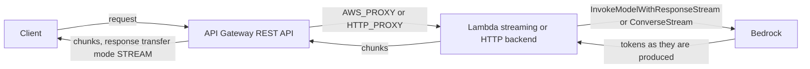
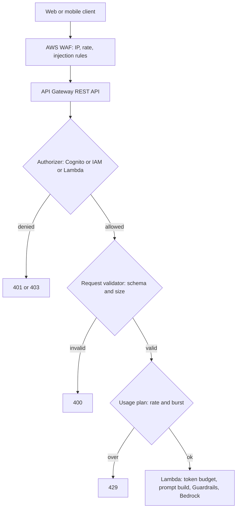

## 0. Before you start
- **Essential:** what an HTTP API is (method, path, status code, headers); what a JSON body is.
- **Helpful:** REST vs WebSocket; what a token bucket is (a bucket that refills at a steady rate; each request takes one token).
- **Optional advanced:** CloudFront edge locations; VTL mapping templates.

## 1. Simple explanation
Amazon API Gateway is the front door of your application. It gives you a public (or private) web address, checks who is calling, checks the request is well-formed, slows down callers who are too fast, and then hands the request to a backend such as Lambda. For GenAI it is the place where you decide how users reach a model safely: who may call, how often, how big a request may be, and whether the answer is returned all at once or streamed word by word. Its biggest trap for GenAI is time: by default a REST API gives up after **29 seconds**, and many model answers take longer.


```figure
flow apigw-front-door
```

## 2. Structured explanation
1. **Three API types** ✅: **REST APIs** (richest features), **HTTP APIs** (cheaper, fewer features), **WebSocket APIs** (two-way, persistent connection).
2. **Integration types:** Lambda (proxy), HTTP backends, AWS service integrations, private integrations through VPC links/load balancers, mock.
3. **Controls** (REST): authorizers (IAM, Cognito, Lambda authorizer), request validation, usage plans and API keys, throttling, caching, AWS WAF, resource policies, canary releases, X-Ray ✅.
4. **Time and size limits** ✅: integration timeout 29 s by default on REST; payload 10 MB; streaming REST responses up to 15 minutes.
5. **GenAI gateway pattern:** API Gateway handles authentication, validation, throttling and logging; Lambda (or another backend) holds the model-calling logic.
6. **Real-time patterns:** REST response streaming (also usable for server-sent events), WebSockets with `@connections` callbacks, or AppSync subscriptions ([06/06](aip:06-app-building-tools/06-mlflow-appsync-and-amplify)).

## 3. Analogy
**A hotel reception desk.** Reception checks your ID (authorizer), checks your booking form is filled in properly (request validation), limits how many guests enter per minute (throttling), and then calls the right room (backend). A REST API is reception that insists on a reply within 29 seconds; the streaming option is reception passing messages along as the room speaks.

*Where it breaks:* reception can turn guests away politely, but API Gateway's throttles and usage-plan quotas are **best-effort targets**, not hard guarantees ✅, so they must not be your only cost control.

## 4. The seven questions

**WHAT?** A managed service to create, publish, secure and monitor APIs at any scale.

**WHY?** Offload authentication, throttling, validation, TLS, logging and versioning from your code; give clients a stable URL.

**WHEN?** Whenever clients (web, mobile, partners) call your GenAI backend over HTTP; use WebSocket APIs for chat-like two-way flows.

**WHERE?** Regional service. Endpoint types for REST: edge-optimized, Regional, private; HTTP APIs: Regional only ✅.

**HOW?** §5.

**WHAT IF?**
| Situation | Effect | Remedy |
|---|---|---|
| Backend takes over 29 s on a REST API | Gateway returns an integration-timeout error even if the backend continues | Stream the response, raise the limit (Regional/private), or go async |
| Caller exceeds throttle limits | `429 Too Many Requests` ✅ | Client backoff; raise limits; per-client usage plans |
| Body fails validation | 400 before the backend is invoked (REST) ✅ | Fix the request; keep the schema strict |
| Streaming enabled and you also enabled caching | Not supported together ✅ | Choose one per method |
| WebSocket client idle | Closed after 10 minutes; max connection lifetime 2 hours ✅ | Client reconnect and heartbeat |
| API key leaks | Anyone can call within the plan | Never use keys for auth; use IAM/Cognito/Lambda authorizer ✅ |

**WHY NOT?** Do not put a long-running model call behind a buffered REST API and hope. Do not use HTTP APIs if you need API keys, usage plans, WAF, request validation or response streaming ✅. Do not rely on usage plans to stop a bill ✅.

## 5. Technical depth

```figure
latency-stream
```


### 5.1 REST vs HTTP vs WebSocket ✅ (`http-api-vs-rest.html`)
| Feature | REST API | HTTP API | Notes |
|---|---|---|---|
| Endpoint types | Edge-optimized, Regional, Private | Regional only | |
| IAM, Cognito, Lambda authorizer | Yes | Yes | |
| JWT authorizer | No (use a Lambda authorizer) | Yes | |
| Resource policies | Yes | No | |
| AWS WAF | Yes | No | |
| API keys, per-client rate limiting, usage plans | Yes | No | |
| Request validation | Yes | No | |
| Caching | Yes | No | see [04/02 §5.7](aip:04-operational-efficiency/02-throughput-utilization-and-intelligent-caching) |
| Request body transformation (VTL) | Yes | No | |
| Canary release | Yes | No | |
| Execution logs, X-Ray | Yes | No | access logs + metrics exist for both |
| **Response streaming** | **Yes** | **No** | the table lists it under Integrations |
| Mock integrations | Yes | No | |
The page's one-line advice: choose REST if you need API keys, per-client throttling, request validation, WAF integration or private endpoints; choose HTTP if you do not need REST's features.

### 5.2 Limits that shape GenAI designs ✅ (`limits.html`, `api-gateway-execution-service-limits-table.html`, `http-api-quotas.html`)
| Item | REST | HTTP |
|---|---|---|
| Integration timeout | 50 ms to **29 s** (all integration types); can be raised above 29 s only for Regional and private APIs, not edge-optimized, and raising may require lowering your Region-level throttle quota | maximum **30 s**, not adjustable |
| Payload | 10 MB | 10 MB |
| Idle connection timeout | 310 s | (not listed) |
| Account throttle (per Region, all API types) | **10,000 requests per second** with a token-bucket burst of **5,000**; some Regions default to 2,500 RPS and 1,250 burst | same account throttle |
| Cache TTL | default 300 s, 0 to 3,600 s; cached response up to 1,048,576 bytes | no cache |
| Lambda authorizer response (HTTP) | | 10 s |
| WebSocket | idle 10 min and 2 h maximum connection lifetime (status code 1001) ✅; binary media types not supported (1003) | |

### 5.3 Throttling and usage plans ✅
- API Gateway uses a **token bucket**: steady **rate** (tokens per second) and **burst** (bucket size). Over the limit → `429`. Throttles and quotas are **best-effort targets**, not guaranteed ceilings.
- Four kinds of settings: AWS Regional limits (cannot change), account limits (can request increase; cannot exceed AWS limits), per-API/stage/method limits, and **per-client** limits tied to API keys in usage plans (cannot exceed account limits).
- Order of application: (1) per-client or per-method limits in a usage plan, (2) per-method stage limits, (3) account-level limits per Region, (4) AWS Regional throttling.
- **API keys identify callers for metering; they are not authentication.** "Don't use API keys for authentication or authorization" — use IAM, a Lambda authorizer or a Cognito user pool. One key can reach *all* APIs in its usage plan. Usage plans "are not hard limits… Don't rely on usage plan quotas or throttling to control costs"; use AWS Budgets and AWS WAF ✅.
- Usage plans count **requests**, not tokens. A request with a 100-token answer and one with a 4,000-token answer count the same (my design note: enforce tokens per tenant in your backend, e.g. a counter in DynamoDB, and cap `maxTokens` in code).

### 5.4 Response streaming for REST APIs ✅ (`response-transfer-mode.html`)

*Reading the arrows:* the model emits tokens, the backend forwards them as chunks, and the gateway passes them on without waiting for the full answer. The page lists these considerations:
- Set the integration **response transfer mode** to `STREAM` (the default is `BUFFERED`). Only for `HTTP_PROXY` or `AWS_PROXY` integrations, **REST APIs only**; request streaming is not supported.
- A stream can last **up to 15 minutes**. Idle timeouts: **5 minutes** for Regional or private endpoints, **30 seconds** for edge-optimized.
- Not supported while streaming: **endpoint caching**, **content encoding**, and **VTL response transformation**.
- Bandwidth: the first **10 MB** of a streamed response is unrestricted; beyond that **2 MB/s**.
- Streaming exceeds the 10 MB payload limit and the 29-second limit **without** a timeout increase; it lowers time-to-first-byte for chatbots and also suits server-sent events.
- If a connection closes on timeout, the Lambda function might **keep running**; streaming incurs extra cost.
- Not read: the exact console field, CLI or OpenAPI property name for the transfer mode ❌ (use the console path in the lab or check `aws apigateway update-integration help`).

### 5.5 WebSocket APIs ✅ (`apigateway-websocket-api-overview.html`)
- Routes: `$connect`, `$disconnect`, `$default`, plus custom routes chosen by a **route selection expression** such as `${request.body.action}`. Non-JSON messages go to `$default`.
- Backend → client: return a route response, or POST to the `@connections` callback API with the connection ID.
- Closing codes: 1001 idle 10 min or 2 h lifetime; 1003 binary; 1008 too many requests; 1009 message too big.
- Use for chat UIs where the server also pushes events; for long jobs a pattern is "client sends job → SQS → worker → `@connections` push". SSE through REST streaming is simpler if you only need server-to-client text.

### 5.6 The GenAI gateway pattern

*Reading the arrows:* each diamond is a gate that rejects cheaply before a billable model call. Order matters for cost: WAF and authorizer first, then schema/size validation, then throttling, then the backend. Add a per-tenant **token budget** check inside the Lambda, because the gateway counts requests, not tokens.

Other GenAI gateway ideas: a header or stage variable chooses the backend (see dynamic selection in [06/03](aip:06-app-building-tools/03-appconfig-and-dynamic-foundation-model-selection)); canary releases shift 10% of traffic to a new prompt/model version (REST only); structured access logs record latency and status per tenant ([module 07](aip:07-governance-qa/01-agent-tracing-evaluation-metrics-and-bedrock-model-evaluations)). An AWS-service integration that calls Bedrock directly with VTL mapping templates is possible in principle (REST AWS integrations plus mapping templates are documented generally), but I did not find or read a Bedrock-specific API Gateway recipe ❌.

### 5.7 Request validation as a token guard
REST API **request validators** check the body against a JSON Schema model and required parameters, returning 400 before any backend runs. A schema can bound string length (`maxLength`) and number ranges. That is a *character* limit, not a token limit; use it as a cheap first filter and count real tokens in the backend (token estimation: [04/01](aip:04-operational-efficiency/01-token-efficiency-and-cost-effective-model-selection)).

A request model for a chat endpoint (checked as valid JSON by this repo's tooling):
```json
{
  "$schema": "http://json-schema.org/draft-04/schema#",
  "title": "ChatRequest",
  "type": "object",
  "required": ["prompt"],
  "properties": {
    "prompt": { "type": "string", "minLength": 1, "maxLength": 4000 },
    "maxTokens": { "type": "integer", "minimum": 1, "maximum": 1024 },
    "sessionId": { "type": "string", "maxLength": 64 }
  },
  "additionalProperties": false
}
```
The Draft-4 `$schema` line follows the usual API Gateway model convention; confirm supported JSON Schema drafts on the model page before relying on newer keywords ❌.

## 6. Worked example
*Problem:* A multi-tenant support assistant behind API Gateway sometimes returns `504` after 29 seconds, one tenant occasionally floods the API, and finance wants to cap spend per tenant.

| Need | Design | Why |
|---|---|---|
| Authenticate users | Cognito user pool authorizer on a REST API | Standard identity; not API keys ✅ |
| Cap request rate per tenant | One API key + usage plan per tenant, plus WAF rate rule | Per-client throttling is REST-only ✅ |
| Stop oversized prompts early | Request validator with the model in §5.7 | 400 before Lambda or Bedrock |
| Avoid the 29 s limit | Lambda streaming + REST transfer mode `STREAM` (15 min, 5-min idle) | Also lowers time-to-first-byte ✅ |
| Cap spend | Token counter per tenant in DynamoDB, enforced in Lambda; AWS Budgets alarm | Usage plans do not count tokens and are best-effort ✅ |
| Roll out a new prompt | REST canary release at 10% | Canary is REST-only ✅ |

## 7. Knowledge checkpoints
1. What is the default maximum integration timeout for a REST API, and for an HTTP API?
2. Which API type supports response streaming?
3. Why must you not use API keys for authorization?
4. What happens to caching when a method uses response streaming?
5. How long can a WebSocket connection live, and what closes it earlier?

## 7b. Practice questions (exam-style, original) — answers in §14

**Q1.** A chatbot behind a REST API returns an integration-timeout error when answers take about 40 seconds. Which change lets the same architecture show a long answer without raising the integration timeout?
A. Enable response streaming with the transfer mode set to STREAM and stream the model output
B. Enable API caching
C. Switch the endpoint to edge-optimized
D. Add an API key

**Q2.** (Select TWO) Which features are available on REST APIs but not on HTTP APIs?
A. Request validation
B. Per-client usage plans and API keys
C. JWT authorizer
D. Custom domain names
E. Lambda proxy integration

**Q3.** A company wants to give each customer a request-rate limit and a monthly request quota on a GenAI API. Which API Gateway capability is designed for this?
A. Usage plans with API keys on a REST API
B. HTTP API routes
C. WebSocket `$default` route
D. Mock integrations

**Q4.** A team plans to rely on usage-plan quotas to guarantee that monthly Bedrock spend never exceeds a budget. What is the correct assessment?
A. Quotas are best-effort and count requests, not tokens, so add backend token limits and AWS Budgets
B. Quotas are hard limits and count tokens
C. Quotas apply only to WebSocket APIs
D. Quotas replace the need for authentication

**Q5.** (Select TWO) Which statements about REST API response streaming are correct?
A. It supports `AWS_PROXY` and `HTTP_PROXY` integrations
B. Endpoint caching is not supported while streaming
C. It works on HTTP APIs
D. It supports request streaming
E. It works with VTL response transformation

**Q6.** A client sends a 50-character prompt expected to be at most 4,000 characters, but one request contains 1 MB of text. Where is the cheapest place to reject it?
A. A request validator with a JSON Schema model on the REST API
B. Inside Bedrock
C. After the model responds
D. In a CloudWatch alarm

**Q7.** A chat UI needs the server to push messages to the browser at any time over a persistent connection. Which API type fits?
A. WebSocket API
B. REST API with caching
C. HTTP API without integrations
D. Private REST API with mock integration

**Q8.** What is the correct order in which API Gateway applies throttling settings?
A. Usage-plan per-client/per-method → stage per-method → account-level per Region → AWS Regional
B. AWS Regional → account → stage → usage plan
C. Account only
D. Random

## 8. Hands-on lab: a gateway rules simulator (throttling, precedence, timeouts, validation, TTFB)

### 8.1 Objective
Model, offline, the documented API Gateway rules: a token-bucket throttle, the order in which limits apply, which timeouts a slow model breaks, request validation, and why streaming improves time to first byte.

### 8.2 Prerequisites
Python 3 only. For the optional AWS part: an account with permission to create API Gateway APIs and Lambda functions; the Lambda function from [06/01 block B](aip:06-app-building-tools/01-lambda-integration-patterns-and-lambda-with-bedrock) is a good backend.

### 8.3 AWS services
Offline: none. Optional: API Gateway, Lambda, Bedrock, Cognito, CloudWatch.

### 8.4 IAM permissions
Offline: none. Real: you need API Gateway administration permission to build the API and a Lambda resource-based permission allowing API Gateway to invoke the function (the console adds it for you ❌ exact action names not read).

### 8.5 Region notes
Default account throttle is 10,000 RPS (2,500 in some newer Regions) ✅. Response streaming and Lambda streaming are not in every Region.

### 8.6 Architecture
§5.4 and §5.6.

### 8.7 Cost
Offline: none. Real: REST API requests, data transfer and (if enabled) cache hours; streaming "incurs a cost" ✅; Lambda duration; Bedrock tokens. Check the API Gateway pricing page ❌.

### 8.8 Code

**A. The offline simulator:**
```python lab-run
import json

# ---- 1. Token bucket: rate = tokens per second, burst = bucket size ----
def throttle(rate, burst, arrival_times_ms):
    tokens, last, ok, throttled = float(burst), 0.0, 0, 0
    for t in arrival_times_ms:
        tokens = min(burst, tokens + (t - last) / 1000.0 * rate)
        last = t
        if tokens >= 1:
            tokens -= 1
            ok += 1
        else:
            throttled += 1
    return ok, throttled

spike = [i * 2 for i in range(50)]              # 50 requests in 100 ms
steady = [i * 125 for i in range(40)]           # 8 requests per second for 5 s
print("rate 10/s, burst 20, 50-request spike  ->", throttle(10, 20, spike), "(accepted, throttled -> HTTP 429)")
print("rate 10/s, burst 20, steady 8/s for 5 s ->", throttle(10, 20, steady))

# ---- 2. Which limit applies? order: usage plan -> stage method -> account -> AWS Regional ----
def effective_limit(usage_plan=None, stage_method=None, account=10000, regional=10000):
    chosen = usage_plan if usage_plan is not None else stage_method if stage_method is not None else account
    return min(chosen, account, regional)      # per-client and per-stage limits cannot exceed account/AWS limits
print("no per-client or per-stage setting       ->", effective_limit())
print("stage method 500 rps                     ->", effective_limit(stage_method=500))
print("usage plan 50 rps (beats stage 500)      ->", effective_limit(usage_plan=50, stage_method=500))
print("usage plan asks 20000 rps                ->", effective_limit(usage_plan=20000), "(capped by the account limit)")

# ---- 3. Does the call survive? (limits from the API Gateway pages; backend times are invented) ----
def outcome(api, backend_seconds, silent_gap_seconds=0):
    if api == "REST buffered":
        return "ok" if backend_seconds <= 29 else "integration timeout (29 s default)"
    if api == "HTTP API":
        return "ok" if backend_seconds <= 30 else "integration timeout (30 s max)"
    if api == "REST stream (Regional)":
        if silent_gap_seconds > 300:
            return "idle timeout (5 min)"
        return "ok" if backend_seconds <= 900 else "stream timeout (15 min)"
    raise ValueError(api)
for api, secs, gap in (("REST buffered", 12, 0), ("REST buffered", 40, 0), ("HTTP API", 40, 0),
                       ("REST stream (Regional)", 120, 2), ("REST stream (Regional)", 400, 350),
                       ("REST stream (Regional)", 1000, 2)):
    print(f"{api:<24} backend {secs:>4} s, longest silence {gap:>3} s -> {outcome(api, secs, gap)}")

# ---- 4. Request validation: the checks the model in section 5.7 expresses ----
def validate(body):
    errors = []
    if "prompt" not in body:
        errors.append("prompt is required")
    else:
        p = body["prompt"]
        if not isinstance(p, str) or not 1 <= len(p) <= 4000:
            errors.append("prompt must be a string of 1 to 4000 characters")
    mt = body.get("maxTokens")
    if mt is not None and (not isinstance(mt, int) or not 1 <= mt <= 1024):
        errors.append("maxTokens must be an integer from 1 to 1024")
    extra = set(body) - {"prompt", "maxTokens", "sessionId"}
    if extra:
        errors.append("unexpected fields: " + ", ".join(sorted(extra)))
    return (400, errors) if errors else (200, [])
for body in ({"prompt": "Hello"}, {"prompt": "x" * 5000}, {"maxTokens": 99999}, {"prompt": "hi", "role": "admin"}):
    shown = json.dumps(body)[:45]
    print(f"{shown:<47} -> {validate(body)}")

# ---- 5. Time to first byte: buffered vs streamed (speeds are INVENTED) ----
ttft, tokens_per_s, answer_tokens = 0.8, 40, 600
buffered = ttft + answer_tokens / tokens_per_s
print(f"buffered: client sees the first byte after {buffered:.1f} s; streamed: after {ttft:.1f} s")
```

**B. Optional console steps** are in §8.11 (nothing in this repo creates the API for you).

### 8.9 Captured output
Generated on 2026-10-26 by extracting block A from this file and running it (Python 3). It is an offline teaching model of the documented rules, **not** API Gateway output.
```text lab-out
rate 10/s, burst 20, 50-request spike  -> (20, 30) (accepted, throttled -> HTTP 429)
rate 10/s, burst 20, steady 8/s for 5 s -> (40, 0)
no per-client or per-stage setting       -> 10000
stage method 500 rps                     -> 500
usage plan 50 rps (beats stage 500)      -> 50
usage plan asks 20000 rps                -> 10000 (capped by the account limit)
REST buffered            backend   12 s, longest silence   0 s -> ok
REST buffered            backend   40 s, longest silence   0 s -> integration timeout (29 s default)
HTTP API                 backend   40 s, longest silence   0 s -> integration timeout (30 s max)
REST stream (Regional)   backend  120 s, longest silence   2 s -> ok
REST stream (Regional)   backend  400 s, longest silence 350 s -> idle timeout (5 min)
REST stream (Regional)   backend 1000 s, longest silence   2 s -> stream timeout (15 min)
{"prompt": "Hello"}                             -> (200, [])
{"prompt": "xxxxxxxxxxxxxxxxxxxxxxxxxxxxxxxxx   -> (400, ['prompt must be a string of 1 to 4000 characters'])
{"maxTokens": 99999}                            -> (400, ['prompt is required', 'maxTokens must be an integer from 1 to 1024'])
{"prompt": "hi", "role": "admin"}               -> (400, ['unexpected fields: role'])
buffered: client sees the first byte after 15.8 s; streamed: after 0.8 s
```

### 8.10 Explanation
- Part 1: the bucket starts full (burst), so a spike is absorbed up to the burst size and the rest gets 429; a steady rate below the refill rate is never throttled.
- Part 2: the first configured setting in the documented order is used, and it cannot exceed account or AWS limits.
- Part 3: buffered REST breaks at 29 s, HTTP API at 30 s; a Regional stream tolerates a long answer if chunks keep flowing (silence over 5 minutes breaks it) up to 15 minutes. Backend times are invented.
- Part 4: schema checks run before any backend; they bound characters, not tokens.
- Part 5: streaming moves the first byte from the end of generation to the start; speeds are invented.

### 8.11 Optional AWS lab (shown, not run against AWS ❌)
1. Create a REST API with a `POST /chat` method and a Lambda proxy integration to your function.
2. Create a request model from §5.7 and attach a **body validator** to the method; test with an oversize body (expect 400).
3. Create a usage plan (rate/burst/quota) and an API key; require the key on the method, deploy to a stage and associate the plan. Call with and without `x-api-key`. Remember the key is for metering, not security ✅.
4. Add a Cognito user pool authorizer (module 08) for real authentication.
5. Streaming: set the integration's response transfer mode to `STREAM` (console), use a streaming-capable backend (Node.js Lambda or Web Adapter) and `curl -N` to watch chunks. Field names ❌ not verified.
6. Load test lightly and watch for `429`; read the CloudWatch metrics; clean up the API, plan, key and log groups.

### 8.12 Common errors
| Error | Cause | Fix |
|---|---|---|
| `504 Endpoint request timed out` | Integration timeout 29 s | Stream, async, or raise (Regional/private) |
| `403 Forbidden` with a valid key | Method needs authorizer/IAM; key is not auth | Fix authorization |
| `429 Too Many Requests` | Throttle or plan limit | Client backoff; adjust limits |
| `400 Invalid request body` | Validator rejected body | Fix payload or schema |
| Cached stale answer | Cache enabled on a GenAI method | Do not cache per-user answers; see 04/02 |
| Stream arrives all at once | Transfer mode still BUFFERED or backend not streaming | Set STREAM; stream from the backend |

### 8.13 Security recommendations
Authenticate with Cognito/IAM/Lambda authorizer, not API keys; attach AWS WAF (REST) for rate and injection rules; enforce HTTPS only; restrict CORS to known origins; avoid logging full prompts or tokens; per-tenant usage plans plus backend token budgets; use private APIs or VPC links for internal consumers.

## 9. What can go wrong?
| Failure | Why | Symptoms | Investigate | Fix | Prevent |
|---|---|---|---|---|---|
| **Gateway 504 while Lambda succeeds** | 29 s limit hit first | Users see errors, logs show success | Compare gateway latency and Lambda duration | Stream or async | Design for time budget |
| **Key-only security** | API keys used as auth | Unauthorized use of a leaked key | Access logs | Real authorizer | Policy: keys meter, never authorize |
| **Cost runaway** | Plans count requests, best-effort | Bill above forecast | Token metrics, Budgets | Token budgets, WAF | Backend caps on `maxTokens` |
| **Cache serves wrong user's answer** | Cache key missing user/session | Data leakage | Cache key settings | Disable cache or key by user | No caching of personalized answers |
| **Throttle collateral damage** | Shared account throttle | Other APIs get 429 | Account metrics | Per-stage limits | Separate accounts for noisy workloads |
| **WebSocket zombie sessions** | No heartbeat | Idle disconnects at 10 min | `$disconnect` logs | Ping and reconnect | Client heartbeat |
| **Streaming cost surprise** | Function keeps running after disconnect | Duration high | Lambda duration vs client logs | Stop work on disconnect | Output token caps |

## 10. Common misconceptions
1. **"An API key secures my API."** No; AWS says not to use keys for authentication or authorization ✅.
2. **"HTTP APIs are just cheaper REST APIs."** They lack WAF, validation, caching, usage plans and response streaming ✅.
3. **"29 seconds is a hard ceiling."** On Regional and private REST APIs it can be raised, subject to throttle trade-offs; streaming avoids it ✅.
4. **"Usage plans cap my bill."** They are best-effort and count requests ✅.
5. **"Streaming works with every feature."** Not with caching, content encoding or VTL response transformation ✅.

## 11. Exam notes
- **Patterns:** "long model answers with a REST API" → response streaming; "per-customer rate limits and quotas" → REST usage plans + API keys (still use a real authorizer); "two-way chat push" → WebSocket API (or AppSync); "reject bad input cheaply" → request validators; "protect from floods and injection" → WAF.
- **Traps:** treating API keys as authentication; choosing HTTP API when the scenario needs validation/WAF/usage plans; assuming usage plans count tokens; forgetting that the gateway and Lambda have separate timeouts.
- **Compare:** REST vs HTTP vs WebSocket (§5.1); API Gateway streaming vs Lambda function URL streaming ([06/01](aip:06-app-building-tools/01-lambda-integration-patterns-and-lambda-with-bedrock)); API Gateway vs AppSync ([06/06](aip:06-app-building-tools/06-mlflow-appsync-and-amplify)).

## 12. Summary and revision cards
- REST: full features; 29 s default timeout; streaming up to 15 min; 10 MB payload.
- HTTP: cheaper, 30 s max, no keys/WAF/validation/caching/streaming.
- WebSocket: routes, `@connections`, 10-min idle, 2-h lifetime.
- Throttle: token bucket; 10,000 RPS default with 5,000 burst; 429; best-effort.
- Keys meter, they do not authorize. Validate early; count tokens in the backend.

**Cards.** Q: Default REST integration timeout? A: 29 seconds. · Q: Which API type streams responses? A: REST. · Q: Do usage plans count tokens? A: No, requests.

## 13. References
| Source | URL | Verified |
|---|---|---|
| Choose between REST and HTTP APIs | https://docs.aws.amazon.com/apigateway/latest/developerguide/http-api-vs-rest.html | 2026-10-26 |
| API Gateway quotas | https://docs.aws.amazon.com/apigateway/latest/developerguide/limits.html · .../api-gateway-execution-service-limits-table.html · .../http-api-quotas.html | 2026-10-26 |
| Throttling | https://docs.aws.amazon.com/apigateway/latest/developerguide/api-gateway-request-throttling.html | 2026-10-26 |
| Usage plans and API keys | https://docs.aws.amazon.com/apigateway/latest/developerguide/api-gateway-api-usage-plans.html | 2026-10-26 |
| Response streaming (REST) | https://docs.aws.amazon.com/apigateway/latest/developerguide/response-transfer-mode.html | 2026-10-26 |
| WebSocket APIs | https://docs.aws.amazon.com/apigateway/latest/developerguide/apigateway-websocket-api-overview.html | 2026-10-26 |

**Unverified here:** the console/CLI/OpenAPI spelling for the streaming transfer mode; request-validator and model pages (supported JSON Schema drafts); a Bedrock-specific API Gateway AWS-integration recipe; Lambda authorizer caching TTLs; API Gateway pricing.

## 14. Answers to checkpoints and practice questions
**Checkpoints.** 1) REST 29 seconds (adjustable for Regional/private); HTTP API 30 seconds maximum ✅. 2) REST ✅. 3) A leaked key reaches all APIs in its usage plan; AWS says use IAM, a Lambda authorizer or Cognito ✅. 4) Caching is not supported while streaming ✅. 5) Up to 2 hours; idle for 10 minutes closes it ✅.

**Practice questions.**
- **Q1 → A.** Streaming avoids the 29 s limit without a timeout increase. B caches answers. C does not change the limit (edge-optimized cannot be raised). D is irrelevant ✅.
- **Q2 → A, B.** C is HTTP-only; D and E exist on both ✅.
- **Q3 → A.** Usage plans (REST) give per-client throttling and quotas. HTTP APIs do not have them ✅.
- **Q4 → A.** Best-effort and request-based ✅. B and C are false; D is nonsense.
- **Q5 → A, B.** C is false (REST only). D is false (request streaming not supported). E is false (VTL response transformation not supported) ✅.
- **Q6 → A.** Validators reject before any backend runs. B and C come after cost is incurred; D only observes.
- **Q7 → A.** WebSocket APIs allow backend-initiated pushes ✅.
- **Q8 → A.** The documented order ✅.
