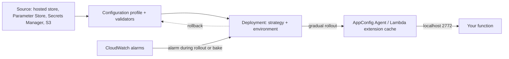

## 0. Before you start
- **Essential:** what an environment variable is; why changing code means redeploying.
- **Helpful:** JSON; CloudWatch alarms; the idea of a canary rollout.
- **Optional advanced:** feature-flag targeting by user or segment.

## 1. Simple explanation
Normally, the name of the AI model your application uses is written in code or a setting that needs a redeploy to change. AWS AppConfig lets you keep settings such as "which model", "how creative (temperature)", "which prompt version" and "is the kill switch on" outside the code, and change them **safely while the app is running**. You roll the change out slowly (for example 10% of traffic first), watch alarms, and AppConfig rolls back by itself if something breaks. For GenAI this means you can switch from one model or provider to another, test a cheaper model on a few users, or turn a feature off in minutes without shipping new code.


```figure
flow appconfig-rollout
```

## 2. Structured explanation
1. **Application → environment → configuration profile** ✅. A profile says where configuration data lives and what type it is: **feature flags** or **free-form** configuration. The data can sit in the AppConfig **hosted configuration store**, Secrets Manager, Systems Manager Parameter Store or S3 ✅.
2. **Validators** check data before it is deployed; if validation fails during deployment AppConfig rolls back ✅.
3. **Deployment strategy** decides how fast a change spreads: type (linear or exponential), step percentage (growth factor), deployment time, and **bake time** (the monitoring period after 100%) ✅.
4. **Monitoring and rollback:** AppConfig watches the CloudWatch alarms you connect; if one fires during the deployment or bake time it rolls back ✅ (it needs permission to read the alarms).
5. **Retrieval:** your code asks the **AppConfig Agent** (for Lambda, a layer/extension that serves `localhost:2772`) which caches the configuration and polls in the background; or call `StartConfigurationSession` and `GetLatestConfiguration` yourself ✅. Retrieval is metered.
6. **Dynamic FM selection:** keep model IDs (or inference-profile ARNs), inference parameters, prompt version, fallback chain, canary percentage and a kill switch in one configuration; the application reads it on each request (from the local cache) and calls Bedrock accordingly.

## 3. Analogy
**A restaurant menu board that the manager can change from the office.** The kitchen (your code) reads the board each time; the manager can swap today's special for a different dish for 10% of tables first, watch the complaints, and wipe the board back automatically if complaints spike.

*Where it breaks:* the board is read by many kitchens at once, each with its own copy that refreshes every so often (45 seconds by default in the Lambda extension ✅). So a change is not instant everywhere; it arrives as deployment steps plus polling delay.

## 4. The seven questions

**WHAT?** AWS AppConfig is a capability of AWS Systems Manager for deploying feature flags and dynamic configuration safely (validators, gradual rollout, alarm-based rollback) ✅.

**WHY?** Change application behavior in production without redeploying code; reduce the risk of bad configuration with validators, staged rollout and automatic rollback; run experiments ✅.

**WHEN?** Model or provider switching, prompt-version selection, temperature/`maxTokens` tuning, allow/block lists, throttling limits, logging levels, kill switches, A/B tests ✅.

**WHERE?** Regional; the data plane is read by Lambda, ECS, EKS, EC2 and other compute through the AppConfig Agent ✅.

**HOW?** §5.

**WHAT IF?**
| Situation | Effect | Remedy |
|---|---|---|
| New model ID is invalid | A validator can reject the deployment before it goes out; otherwise runtime errors raise an alarm and trigger rollback ✅ | Add a validator and an alarm on model errors |
| Alarm fires during bake time | Deployment rolls back ✅ | Fix, redeploy |
| Poll interval is long | Instances keep the old value until their next poll ✅ | Tune interval vs cost |
| Many cold starts | Each new execution environment has its own cache and may call AppConfig again; retrievals are billed ✅ | Use the extension and prefetch |
| A poll to AppConfig times out | The extension skips that poll and returns the previously cached data ✅ | Keep the poll timeout sensible |
| AppConfig is unreachable and nothing is cached yet | Not documented on the pages I read ❌ | Always ship a safe default in code |
| You want a fixed user to keep one variant | Use entity-based gradual deployment (Agent ≥ 2.0.136060) ✅ | Stable per-user assignment |

**WHY NOT?** Do not store secrets in plain configuration (use Secrets Manager; AppConfig can deploy from it ✅). Do not use AppConfig as a high-write datastore. Do not expect instant changes. Do not skip a code-level default.

## 5. Technical depth

```figure
traffic-shift {"preset": "appconfig"}
```


### 5.1 Resources and flow ✅ (`what-is-appconfig.html`)

*Reading the arrows:* data flows from a source through a profile (with validators) into a deployment that releases it step by step to the agent's local cache; your function reads from `localhost:2772`. CloudWatch alarms feed back into the deployment: an alarm during rollout or bake triggers rollback.

Steps AppConfig performs on a deployment ✅: (1) retrieve data from the source, (2) validate, (3) deliver to the AppConfig Agent; the delivered configuration becomes the deployed version.

### 5.2 Deployment strategies ✅ (`appconfig-creating-deployment-strategy*.html`)
| Setting | Meaning |
|---|---|
| Type | **Linear**: equal increments of the growth factor across the deployment time (e.g. 20% growth over 10 hours = 20% every 2 hours). **Exponential**: `G * (2^N)`; with `G`=2 the rollout is 2%, 4%, 8%, … until 100% |
| Step percentage / growth factor | Percentage of callers targeted in each step |
| Deployment time | A window in which deployment proceeds in intervals; not a timeout |
| Bake time | Time after 100% during which AppConfig keeps watching alarms before calling the deployment complete |

Predefined strategies ✅:
| Name | Behavior |
|---|---|
| `AppConfig.Linear20PercentEvery6Minutes` | 20% every six minutes (30-minute deployment); 30-minute bake; **AWS recommended** for production |
| `AppConfig.Canary10Percent20Minutes` | Exponential, 10% growth factor over 20 minutes; 10-minute bake; AWS recommended |
| `AppConfig.AllAtOnce` | All targets immediately; 10-minute bake |
| `AppConfig.Linear50PercentEvery30Seconds` | Half of targets every 30 seconds (one-minute deployment, one-minute bake); testing/demos only |
You can also create custom strategies. **Entity-based gradual deployments** (AppConfig Agent 2.0.136060 or later) make sure a user or segment that received a configuration version keeps that version during the rollout, regardless of which compute resource serves them ✅.

### 5.3 Feature flags and experimentation
- Profile types: **feature flags** and **free-form** ✅. Flags are stored in the hosted store in a feature flag format with data and metadata ✅.
- Flag **attributes** are typed (string, number, boolean, string array, number array) with constraints (regex, enum, min, max); the word `enabled` is reserved; attributes are returned to the application **only when the flag is enabled** ✅.
- **Multi-variant flags** return different values depending on request context evaluated against rules ✅.
- **AppConfig experimentation** (A/B tests and gradual rollouts on production traffic, with CloudWatch metrics and export of assignment data to warehouses) is described on the overview page ✅. The detail pages were not read ❌.
- For model routing a free-form JSON profile is simplest; use a flag when the decision is a yes/no or a few variants.

### 5.4 The AppConfig Agent Lambda extension ✅
- Add it as a **layer**. Your function calls an HTTP endpoint on **`localhost:2772`** (configurable with `AWS_APPCONFIG_EXTENSION_HTTP_PORT`).
- The extension keeps a **local cache**. On each invocation it checks the time since the last retrieval; if the elapsed time exceeds the **poll interval** it calls AppConfig for newly deployed data. Each Lambda execution environment keeps its own cache.
- Environment variables (defaults): `AWS_APPCONFIG_EXTENSION_POLL_INTERVAL_SECONDS` = **45**; `AWS_APPCONFIG_EXTENSION_POLL_TIMEOUT_MILLIS` = **3000 ms** (on timeout it skips this poll and returns cached data); `AWS_APPCONFIG_EXTENSION_MAX_CONNECTIONS` = 3; `AWS_APPCONFIG_EXTENSION_PREFETCH_LIST` (fetch configurations at start-up to cut cold-start time); `AWS_APPCONFIG_EXTENSION_ROLE_ARN` for cross-account retrieval (one account only).
- Request path form: `/applications/<application>/environments/<environment>/configurations/<profile>` (as in the prefetch example).
- IAM for retrieval: `appconfig:StartConfigurationSession` and `appconfig:GetLatestConfiguration` on the configuration resource ✅.
- Time for a change to appear in a function = deployment strategy time + poll interval (the page says it depends on both) ✅.

### 5.5 Dynamic model selection: configuration design
Compare ways to choose a model at run time:
| Option | Changes without redeploy? | Gradual rollout and auto-rollback? | Good for |
|---|---|---|---|
| Hard-coded in code | No | No | Prototypes |
| Lambda environment variable | Needs a function configuration update | No | Stable settings |
| Systems Manager Parameter Store read directly | Yes | No | Simple values, secrets-lite |
| **AppConfig** | **Yes** | **Yes** (strategies, bake, alarms) | Model/provider switches, thresholds, kill switches |
| Bedrock Prompt Management | Prompt versions | via application logic | Prompt text and variants ([01/08](aip:01-bedrock-genai-fundamentals/08-prompt-management-flows-and-structured-output)) |
| Bedrock intelligent prompt routing | Automatic between two models of one family | n/a | Cost/quality routing inside Bedrock ([04/01](aip:04-operational-efficiency/01-token-efficiency-and-cost-effective-model-selection)) |
| API Gateway stage variables | Per stage | Canary on REST | Environment pointers ([06/02](aip:06-app-building-tools/02-api-gateway-and-genai-applications)) |

A routing configuration (free-form JSON; model names are placeholders, not real IDs):
```json
{
  "schemaVersion": 3,
  "killSwitch": false,
  "promptVersion": "support-v7",
  "primary":  { "model": "MODEL_PRIMARY",  "temperature": 0.2, "maxTokens": 512 },
  "fallback": [
    { "model": "MODEL_SECOND", "temperature": 0.2, "maxTokens": 512 },
    { "model": "MODEL_CHEAP",  "temperature": 0.0, "maxTokens": 256 }
  ],
  "experiment": { "name": "cheap-model-test", "candidate": "MODEL_CHEAP", "percent": 10 }
}
```
Design rules: put model identifiers and inference-profile ARNs in config, never the credentials; version the schema; keep a **safe default in code**; log which configuration version served each request; combine with the circuit breaker and fallback in [06/04](aip:06-app-building-tools/04-step-functions-states-circuit-breaker-and-prompt-chaining) and with cross-Region inference profiles ([04/04](aip:04-operational-efficiency/04-backoff-connection-pooling-and-cross-region-inference)).

Reading it in Lambda (syntax-checked only; **not** run against AWS):
```python snippet
import json
import urllib.request

APP, ENV, PROFILE = "genai-app", "prod", "model-routing"
URL = f"http://localhost:2772/applications/{APP}/environments/{ENV}/configurations/{PROFILE}"
SAFE_DEFAULT = {"killSwitch": False, "primary": {"model": "MODEL_PRIMARY", "temperature": 0.2, "maxTokens": 256}, "fallback": []}


def load_config():
    try:
        with urllib.request.urlopen(URL, timeout=2) as resp:     # served from the extension's local cache
            return json.loads(resp.read())
    except Exception:
        return SAFE_DEFAULT                                      # never fail a request because config is unavailable
```

## 6. Worked example
*Problem:* A support bot uses an expensive model. The team wants to test a cheaper model on 10% of users, switch everyone back in minutes if answer quality or errors worsen, and move to a different provider's model next quarter without a release.

| Step | Action | Why |
|---|---|---|
| 1 | Create application `genai-app`, environment `prod`, free-form profile `model-routing` with the JSON above | Config outside code ✅ |
| 2 | Add a JSON validator (schema or Lambda) so a typo or unsupported temperature is rejected before rollout | Validators ✅ (validator types ❌ not read) |
| 3 | Create CloudWatch alarms: Bedrock error rate, p95 latency, user thumbs-down rate; connect them to the environment | Auto rollback ✅ |
| 4 | Deploy with `AppConfig.Canary10Percent20Minutes` or a custom strategy with a long bake | Gradual + bake ✅ |
| 5 | Use entity-based assignment so each user sees one variant during the test | Consistency ✅ |
| 6 | Log `configVersion`, `model`, `promptVersion` with each response | Debugging and A/B analysis (module 07) |
| 7 | To change provider: add the new model as primary in a new config version; the code is unchanged because it speaks the Converse API | The Converse API gives one request shape across models ([01/01](aip:01-bedrock-genai-fundamentals/01-bedrock-overview-and-converse-api)) |

## 7. Knowledge checkpoints
1. Name the two configuration profile types in AppConfig.
2. What is "bake time"?
3. What local address does the Lambda extension serve, and what is the default poll interval?
4. Which AppConfig feature keeps a user on the same version throughout a rollout?
5. Name two things you should always keep in code even when the model name lives in AppConfig.

## 7b. Practice questions (exam-style, original) — answers in §14

**Q1.** A team must switch the Bedrock model used by a production Lambda function, gradually, and roll back automatically if error alarms fire. Which service fits best?
A. AWS AppConfig with a gradual deployment strategy and CloudWatch alarms
B. Lambda environment variables edited by hand
C. A larger Lambda memory setting
D. Amazon SQS

**Q2.** (Select TWO) Which are built-in safety features of AWS AppConfig?
A. Validators that check configuration before deployment
B. Automatic rollback when a monitored CloudWatch alarm fires
C. Automatic model fine-tuning
D. Guaranteed instant propagation to every instance
E. Automatic Bedrock Guardrails creation

**Q3.** A Lambda function using the AppConfig extension reads configuration from which endpoint?
A. `localhost:2772`
B. The public internet at a vendor URL
C. An S3 pre-signed URL only
D. The Lambda Runtime API

**Q4.** A team deploys a configuration with `AppConfig.AllAtOnce` and an alarm fires after 5 minutes. What happens?
A. The deployment rolls back because bake time monitoring is still running
B. Nothing; AllAtOnce has no monitoring
C. The alarm is ignored
D. The environment is deleted

**Q5.** (Select TWO) For an exponential deployment with a growth factor of 2, what are correct statements?
A. The rollout targets approximately 2%, 4%, 8% of callers in successive steps
B. The formula is `G * (2^N)`
C. It is identical to a linear deployment
D. Deployment time is a hard timeout
E. It cannot use bake time

**Q6.** Why might a new Lambda execution environment see an older model setting for up to a minute after a deployment completes?
A. Each environment caches configuration and refreshes after the poll interval
B. Bedrock caches model IDs
C. API Gateway caches configuration
D. IAM propagation always takes a minute

**Q7.** A team wants each user to consistently see either the old or the new prompt/model variant during a canary test, regardless of which Lambda instance serves them. Which AppConfig capability is designed for this?
A. Entity-based gradual deployments via the AppConfig Agent
B. Bake time
C. Hosted configuration store
D. Cross-account role ARN

**Q8.** Which statement about secrets is correct?
A. Do not store secrets in plain configuration; AppConfig can deploy configuration from Secrets Manager
B. Always put API keys in feature flag attributes
C. AppConfig encrypts nothing and offers no KMS integration
D. Secrets must be hard-coded

## 8. Hands-on lab: a rollout, rollback and routing simulator

### 8.1 Objective
Reproduce, offline, how AppConfig-style rollouts, bake-time rollback, validators, a fallback chain with a kill switch, and stable per-user assignment behave.

### 8.2 Prerequisites
Python 3 only for the simulator. Optional AWS part: an AWS account, the Lambda from [06/01](aip:06-app-building-tools/01-lambda-integration-patterns-and-lambda-with-bedrock), and permission to use AppConfig.

### 8.3 AWS services
Offline: none. Optional: AppConfig, Lambda (with the AppConfig Agent layer), CloudWatch, Bedrock.

### 8.4 IAM permissions
Offline: none. Real: the function role needs `appconfig:StartConfigurationSession` and `appconfig:GetLatestConfiguration` on the configuration ✅; AppConfig needs permission to read CloudWatch alarms for automatic rollback ✅ (exact policy not read ❌).

### 8.5 Region notes
Create AppConfig resources in the same Region as the compute that reads them; the extension can read a different Region with `AWS_APPCONFIG_EXTENSION_SERVICE_REGION` ✅.

### 8.6 Architecture
§5.1 and §5.5.

### 8.7 Cost
Offline: none. Real: AppConfig is pay-as-you-go by configuration retrieval; the Agent reduces calls ✅. Price figures ❌ not read.

### 8.8 Code
```python lab-run
import hashlib
import math

# ---- 1. Rollout schedules (formulas from the AppConfig deployment strategy page) ----
def exponential_steps(g):
    steps, n = [], 0
    while True:
        pct = g * (2 ** n)
        steps.append(min(100, pct))
        if pct >= 100:
            return steps
        n += 1

def linear_steps(growth, duration_min):
    n = math.ceil(100 / growth)
    return [(round(duration_min * i / n), min(100, growth * i)) for i in range(1, n + 1)]

print("exponential, growth factor 2 :", exponential_steps(2))
print("exponential, growth factor 10:", exponential_steps(10))
print("linear 20% over 30 min (minute, percent):", linear_steps(20, 30))

# ---- 2. Time for the last caller to see the change = deployment time + poll interval (worst case) ----
def worst_case_lag(deployment_min, poll_s):
    return deployment_min * 60 + poll_s
print("worst-case lag, 30-min deployment, 45 s poll:", worst_case_lag(30, 45), "seconds")

# ---- 3. Bake-time rollback: an alarm during rollout or bake rolls back ----
def deploy(steps_minutes, bake_minutes, alarm_at_minute=None):
    end_rollout = steps_minutes
    end_bake = steps_minutes + bake_minutes
    if alarm_at_minute is not None and alarm_at_minute <= end_bake:
        return f"ROLLED BACK at minute {alarm_at_minute} (alarm during {'rollout' if alarm_at_minute <= end_rollout else 'bake time'})"
    return f"COMPLETE at minute {end_bake}"
print("no alarm            :", deploy(30, 30))
print("alarm at minute 12  :", deploy(30, 30, 12))
print("alarm at minute 45  :", deploy(30, 30, 45))
print("alarm at minute 90  :", deploy(30, 30, 90))

# ---- 4. Validator: reject bad configs before they ship (placeholder model names, not real IDs) ----
ALLOWED = {"MODEL_PRIMARY", "MODEL_SECOND", "MODEL_CHEAP"}
def validate(cfg):
    errs = []
    for label, m in [("primary", cfg.get("primary"))] + [(f"fallback[{i}]", f) for i, f in enumerate(cfg.get("fallback", []))]:
        if not m or m.get("model") not in ALLOWED:
            errs.append(f"{label}: model not in allow-list")
        elif not 0 <= m.get("temperature", 0) <= 1:
            errs.append(f"{label}: temperature outside 0..1")
        elif not 1 <= m.get("maxTokens", 0) <= 1024:
            errs.append(f"{label}: maxTokens outside 1..1024")
    return errs or ["valid"]
good = {"primary": {"model": "MODEL_PRIMARY", "temperature": 0.2, "maxTokens": 512},
        "fallback": [{"model": "MODEL_CHEAP", "temperature": 0.0, "maxTokens": 256}]}
bad = {"primary": {"model": "MODEL_TYPO", "temperature": 0.2, "maxTokens": 512},
       "fallback": [{"model": "MODEL_CHEAP", "temperature": 1.7, "maxTokens": 256}]}
print("good config:", validate(good))
print("bad config :", validate(bad))

# ---- 5. Routing: kill switch, fallback chain, stable per-user experiment bucket ----
def bucket(user_id):
    return int(hashlib.sha256(user_id.encode()).hexdigest(), 16) % 100

def pick_model(cfg, user_id, healthy):
    if cfg.get("killSwitch"):
        return "KILL SWITCH ON: return a static message, no model call"
    exp = cfg.get("experiment")
    if exp and bucket(user_id) < exp["percent"] and exp["candidate"] in healthy:
        return exp["candidate"] + " (experiment)"
    for m in [cfg["primary"]["model"]] + [f["model"] for f in cfg.get("fallback", [])]:
        if m in healthy:
            return m
    return "NO MODEL HEALTHY: return a graceful error"

cfg = {"killSwitch": False, "primary": {"model": "MODEL_PRIMARY"},
       "fallback": [{"model": "MODEL_SECOND"}, {"model": "MODEL_CHEAP"}],
       "experiment": {"candidate": "MODEL_CHEAP", "percent": 10}}
users = ["u%03d" % i for i in range(1000)]
in_exp = sum(1 for u in users if bucket(u) < 10)
print("users in the 10% experiment (of 1000):", in_exp)
exp_user = next(u for u in users if bucket(u) < 10)
other_user = next(u for u in users if bucket(u) >= 10)
healthy_now = {"MODEL_PRIMARY", "MODEL_CHEAP"}
print("experiment user", exp_user, "x5:", {pick_model(cfg, exp_user, healthy_now) for _ in range(5)})
print("other user     ", other_user, "x5:", {pick_model(cfg, other_user, healthy_now) for _ in range(5)})
print("primary down          :", pick_model({**cfg, "experiment": None}, "u001", {"MODEL_SECOND", "MODEL_CHEAP"}))
print("everything down       :", pick_model({**cfg, "experiment": None}, "u001", set()))
print("kill switch           :", pick_model({**cfg, "killSwitch": True}, "u001", {"MODEL_PRIMARY"}))
```

### 8.9 Captured output
Generated on 2026-10-26 by extracting the block above from this file and running it (Python 3). It models the documented AppConfig formulas and ideas; it is **not** AppConfig output and the user-bucketing hash is my own illustration, not the Agent's algorithm.
```text lab-out
exponential, growth factor 2 : [2, 4, 8, 16, 32, 64, 100]
exponential, growth factor 10: [10, 20, 40, 80, 100]
linear 20% over 30 min (minute, percent): [(6, 20), (12, 40), (18, 60), (24, 80), (30, 100)]
worst-case lag, 30-min deployment, 45 s poll: 1845 seconds
no alarm            : COMPLETE at minute 60
alarm at minute 12  : ROLLED BACK at minute 12 (alarm during rollout)
alarm at minute 45  : ROLLED BACK at minute 45 (alarm during bake time)
alarm at minute 90  : COMPLETE at minute 60
good config: ['valid']
bad config : ['primary: model not in allow-list', 'fallback[0]: temperature outside 0..1']
users in the 10% experiment (of 1000): 88
experiment user u020 x5: {'MODEL_CHEAP (experiment)'}
other user      u000 x5: {'MODEL_PRIMARY'}
primary down          : MODEL_SECOND
everything down       : NO MODEL HEALTHY: return a graceful error
kill switch           : KILL SWITCH ON: return a static message, no model call
```

### 8.10 Explanation
- Part 1: the exponential list is `G * 2^N` capped at 100; the linear list gives 20% every 6 minutes across 30 minutes, matching the predefined strategy.
- Part 2: lag is the deployment window plus the poll interval.
- Part 3: an alarm in the rollout window or in bake time rolls back; after bake time the deployment is complete and the guard is gone (a later alarm would need a new deployment).
- Part 4: the validator rejects both a typo'd model and an out-of-range temperature before rollout.
- Part 5: a stable hash assigns each user to the same bucket every time, so the experiment user always gets the candidate and the other user always gets the primary. The share in the experiment is statistical (the printed count is close to, not exactly, 10% of 1,000 users). The fallback chain walks to the first healthy model; the kill switch bypasses model calls.

### 8.11 Optional AWS lab (shown, not run against AWS ❌)
1. Console: AppConfig → create application `genai-app` → environment `prod` (attach your CloudWatch alarms as monitors) → configuration profile `model-routing`, free-form, hosted store, paste the JSON from §5.5 and add a validator.
2. Create a deployment strategy (or pick `AppConfig.Canary10Percent20Minutes`) and deploy version 1.
3. Add the AppConfig Agent Lambda extension layer to the function; set `AWS_APPCONFIG_EXTENSION_PREFETCH_LIST` to the profile; use the §5.5 snippet.
4. Deploy version 2 with a different primary model; call the function repeatedly and watch the answer metadata change after the poll interval.
5. Break the config on purpose (an invalid model name) and see the validator or alarm stop it; trigger an alarm to see rollback.
6. CLI command names (`create-application`, `create-environment`, `create-configuration-profile`, `create-hosted-configuration-version`, `start-deployment`) were not read from the CLI reference ❌; run `aws appconfig help`.
7. Clean up the deployment, profile, environment, application and layer.

### 8.12 Common errors
| Error | Cause | Fix |
|---|---|---|
| `AccessDenied` on retrieval | Role lacks `StartConfigurationSession`/`GetLatestConfiguration` | Add scoped permissions |
| Old model still used | Poll interval not elapsed or deployment still rolling | Wait; check deployment status |
| Rollback you did not expect | Alarm in bake window | Check alarm and metrics |
| Connection refused to `localhost:2772` | Extension layer missing or port changed | Add layer; check port variable |
| Cost spike on AppConfig | Frequent cold starts / no Agent | Use the extension; prefetch |
| Cross-account config unreadable | Wrong role or wrong account design | The extension reads one account only ✅ |

### 8.13 Security recommendations
Least-privilege retrieval policy; validators on every profile; no secrets in plain configuration; restrict who may start deployments (separation of duties, CloudTrail audit ✅); KMS encryption is available ✅; log configuration versions, not prompt contents; require approvals for production strategies.

## 9. What can go wrong?
| Failure | Why | Symptoms | Investigate | Fix | Prevent |
|---|---|---|---|---|---|
| **Bad model name rolled out** | No validator | Elevated Bedrock errors | Deployment history, alarms | Roll back to prior version | Allow-list validator |
| **Alarm too slow** | Metric period longer than bake time | Rollback never triggers | Alarm period vs bake | Shorten period or lengthen bake | Design alarms with the strategy |
| **Mixed versions** | Polling plus gradual steps | Users see different behavior | Logs with config version | Entity-based deployment | Log config version |
| **Cold-start cost** | New environments refetch | Higher bill, slower start | Retrieval counts | Extension + prefetch | Reuse environments |
| **Config as hidden code** | Logic creeping into JSON | Hard to test | Review diffs | Keep config declarative | Schema + review |
| **No fallback** | Single model configured | Outage when throttled | Error rate | Fallback chain, CRIS | Chaos testing |
| **Everything depends on AppConfig** | No safe default | Failures if unreachable | Agent logs | Safe default in code | Test with the agent disabled |

## 10. Common misconceptions
1. **"AppConfig changes apply instantly."** They follow the strategy and the poll interval ✅.
2. **"It stores feature flags only."** It also handles free-form configuration, from several sources ✅.
3. **"Rollback is manual."** Automatic with CloudWatch alarms during rollout and bake time ✅.
4. **"Model switching needs a redeploy."** Not if the model ID is configuration and the code uses the Converse API.
5. **"AppConfig replaces Prompt Management."** They overlap on prompt versions but serve different jobs: AppConfig chooses *which* version/model and rolls out safely; Prompt Management stores and versions prompt text.

## 11. Exam notes
- **Patterns:** "switch FM / provider without code changes" → AppConfig (plus Converse API); "gradual rollout with automatic rollback" → AppConfig deployment strategy + CloudWatch alarm; "A/B test of two models" → AppConfig experimentation or flags; "kill switch" → feature flag.
- **Keywords:** configuration profile, validator, deployment strategy, bake time, AppConfig Agent, extension, entity-based.
- **Traps:** using environment variables and calling it "dynamic"; forgetting alarms are needed for rollback; assuming instant propagation.
- **Compare:** AppConfig vs Parameter Store (no rollout/rollback) vs Prompt Management (prompt text) vs intelligent prompt routing (Bedrock-managed routing between two models).

## 12. Summary and revision cards
- AppConfig = safe dynamic configuration: validators, gradual deployment, bake time, alarm rollback.
- Profiles: feature flags or free-form; sources: hosted, Secrets Manager, Parameter Store, S3.
- Lambda: extension on `localhost:2772`, poll default 45 s, per-environment cache.
- Predefined strategies: Linear20PercentEvery6Minutes, Canary10Percent20Minutes, AllAtOnce, Linear50PercentEvery30Seconds.
- Keep a safe default in code.

**Cards.** Q: Exponential formula? A: G × 2^N. · Q: Default extension poll interval? A: 45 seconds. · Q: What triggers rollback? A: A monitored CloudWatch alarm during rollout or bake time.

## 13. References
| Source | URL | Verified |
|---|---|---|
| What is AWS AppConfig | https://docs.aws.amazon.com/appconfig/latest/userguide/what-is-appconfig.html | 2026-10-26 |
| Deployment strategies (concept and predefined) | https://docs.aws.amazon.com/appconfig/latest/userguide/appconfig-creating-deployment-strategy.html · .../appconfig-creating-deployment-strategy-predefined.html | 2026-10-26 |
| Using the AppConfig Agent with Lambda | https://docs.aws.amazon.com/appconfig/latest/userguide/appconfig-integration-lambda-extensions.html · .../appconfig-integration-lambda-extensions-how-it-works.html · .../appconfig-integration-lambda-extensions-config.html | 2026-10-26 |
| Creating a feature flag profile | https://docs.aws.amazon.com/appconfig/latest/userguide/appconfig-creating-configuration-and-profile-feature-flags.html | 2026-10-26 |

**Unverified here:** the configuration-profile creation page and validator types (fetch returned a title only); feature-flag JSON format; AppConfig quotas (fetch returned a title only); IAM policy for alarm rollback; CLI command syntax; pricing; behavior when AppConfig is unreachable.

## 14. Answers to checkpoints and practice questions
**Checkpoints.** 1) Feature flags and free-form configurations ✅. 2) The period after 100% rollout during which AppConfig monitors alarms before completing; an alarm triggers rollback ✅. 3) `localhost:2772`; 45 seconds ✅. 4) Entity-based gradual deployments (Agent 2.0.136060 or later) ✅. 5) A safe default configuration and the code that calls the model API (and error handling/fallback).

**Practice questions.**
- **Q1 → A.** Gradual deployment strategy + alarm rollback is the AppConfig design. B has no gradual rollout or rollback; C and D are unrelated ✅.
- **Q2 → A, B.** C, D, E are not AppConfig features ✅.
- **Q3 → A.** The extension serves a local HTTP endpoint ✅.
- **Q4 → A.** AllAtOnce still has a 10-minute bake with alarm monitoring ✅.
- **Q5 → A, B.** C is wrong (exponential differs from linear). D is wrong (deployment time is a window, not a timeout). E is wrong (bake time applies to strategies) ✅.
- **Q6 → A.** Per-environment cache with poll interval ✅.
- **Q7 → A.** Entity-based gradual deployment ✅.
- **Q8 → A.** AppConfig can deploy from Secrets Manager; plain config is not for secrets ✅. (C is false: KMS integration is stated on the overview page.)
