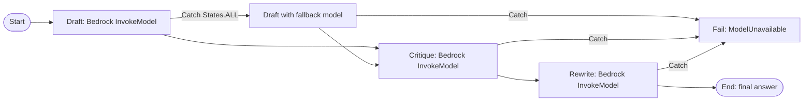
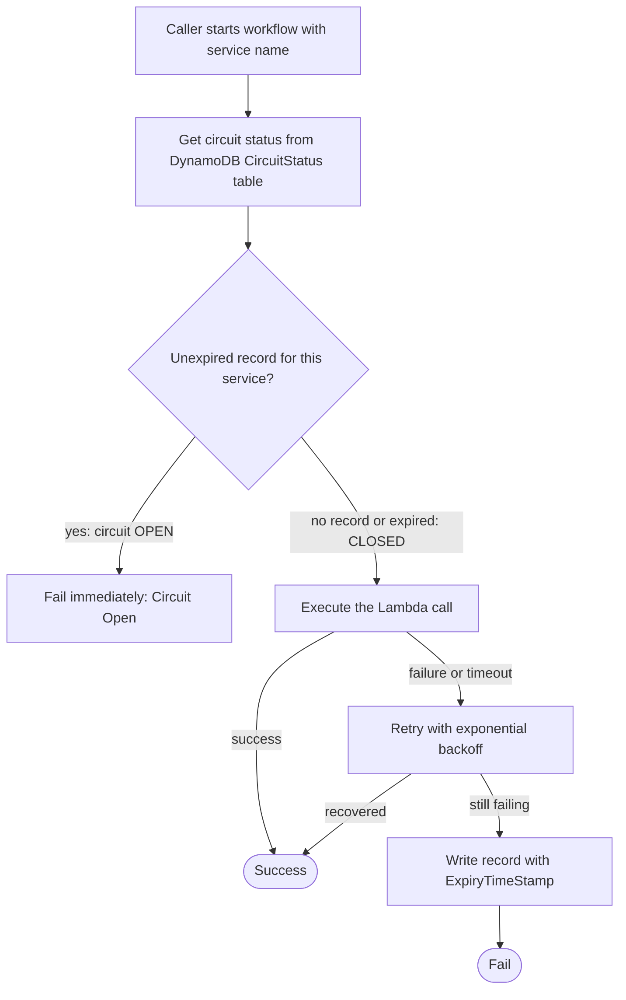

## 0. Before you start
- **Essential:** what a flowchart is; what JSON is; what "retry" and "fallback" mean.
- **Helpful:** Lambda basics ([06/01](aip:06-app-building-tools/01-lambda-integration-patterns-and-lambda-with-bedrock)); DynamoDB items and TTL ([02/08](aip:02-data-management/08-amazon-dynamodb-for-genai)).
- **Optional advanced:** JSONata expressions; Distributed Map for large batches.

## 1. Simple explanation
AWS Step Functions lets you draw and run a multi-step process as a **state machine**: a map of boxes (states) and arrows. One box calls a model, the next checks the result, another waits for a person, another retries when something fails. You get a built-in record of every run. For GenAI it is the clean way to build **prompt chains** (draft → critique → rewrite), **fallbacks** (try model A, then model B), **approvals** and **safe failure** without burying all that logic in code. It can call Amazon Bedrock directly, without a Lambda function in between.


```figure
flow prompt-chain
```

## 2. Structured explanation
1. **State machine** = workflow definition in the Amazon States Language (ASL, JSON). Each **state** has a `Type` and usually a `Next` or `End` ✅.
2. **Eight state types** ✅: Task, Choice, Parallel, Map, Pass, Wait, Succeed, Fail.
3. **Two workflow types** ✅: **Standard** (up to one year, exactly-once, 90-day history, supports every integration pattern) and **Express** (up to five minutes, high volume, at-least-once for async, at-most-once for sync, no `.sync` or `.waitForTaskToken`). The type cannot be changed after creation.
4. **Error handling** ✅: `Retry` (with backoff, jitter) and `Catch` (go to a fallback state). Retries run before catchers.
5. **Service integrations** ✅: an *optimized* Bedrock integration (`InvokeModel`, `CreateModelCustomizationJob`) plus AWS SDK integrations for other APIs.
6. **Circuit breaker** ✅ (AWS Prescriptive Guidance): track a failing dependency in a table with an expiry, fail fast while the circuit is open, retry after it expires.

## 3. Analogy
**A railway timetable with switches.** Each station is a state; tracks are `Next` arrows; a switch is a Choice; a spare track is the Catch route that takes the train round a broken bridge. The signalman (retry policy) holds the train for a few minutes and tries the bridge again before using the spare track. A circuit breaker is a **sign at the junction** saying "bridge closed until 10:15" so trains stop wasting time driving to it.

*Where it breaks:* a train carries one load; a state machine passes JSON, and the size of that JSON is capped (256 KiB per state input or output ✅), which matters when prompts and documents are large.

## 4. The seven questions

**WHAT?** A serverless orchestration service for workflows with state, retries, branching, parallelism, waits and human approvals.

**WHY?** Visual, auditable control flow; built-in retry/catch/timeout; no glue code for waiting; direct integrations with 220+ services (the durable-functions page states the figure) ✅.

**WHEN?** Prompt chaining, multi-model fallbacks, RAG with pre/post steps, agent-like loops with a fixed structure, batch document processing, human approvals, long-running jobs.

**WHERE?** Regional. Express workflows can sit behind API Gateway or Lambda for synchronous work; Standard workflows are started by EventBridge, API, schedules or other workflows.

**HOW?** §5.

**WHAT IF?**
| Situation | Effect | Remedy |
|---|---|---|
| A state has no `Retry` or `Catch` and fails | The **whole execution** fails ✅ | Add retry/catch on Task, Parallel, Map |
| State output exceeds 256 KiB | `States.DataLimitExceeded`, which `States.ALL` does **not** catch ✅ | Keep large payloads in S3 and pass references; or catch the name explicitly |
| Standard history reaches 25,000 events | Execution fails ✅ | Split into child executions or restart |
| Express workflow uses `.waitForTaskToken` | Not supported ✅ | Use Standard |
| Task never reports back | Hangs until timeout | Set `TimeoutSeconds` and `HeartbeatSeconds` ✅ |
| Retries repeated by many executions at once | Synchronized retry storms | `JitterStrategy: FULL` ✅ |

**WHY NOT?** Do not use Step Functions for a single Lambda call with no branching. Do not use Express for non-idempotent actions such as payments (at-least-once) ✅. Do not push big documents through state JSON.

## 5. Technical depth

```figure
circuit-breaker
```


### 5.1 The eight states ✅ (`workflow-states.html`)
| State | Purpose |
|---|---|
| Task | One unit of work (Lambda, service API, activity, HTTP call) |
| Choice | Branch on conditions |
| Parallel | Run branches at the same time |
| Map | Repeat the same steps for each item of an array (Distributed Map for very large sets, Standard only ✅) |
| Pass | Pass or reshape data; no work |
| Wait | Pause for a time or until a date |
| Succeed / Fail | Stop with success / failure |
Common fields: `Type`, optional `Comment`, and `Next` or `End` (except Succeed/Fail) ✅.

### 5.2 Standard vs Express ✅ (`choosing-workflow-type.html`)
| | Standard | Express |
|---|---|---|
| Max duration | 1 year | 5 minutes |
| Semantics | Exactly-once | Async: at-least-once; Sync: at-most-once |
| History | API, console, 90 days (30 on request) | CloudWatch Logs only |
| Billing | State transitions | Executions, duration, memory |
| `.sync` job-run and `.waitForTaskToken` | Yes | **No** |
| Distributed Map, activities | Yes | No |
| Typical GenAI use | Approvals, long chains, batch | High-volume short chains behind an API |

### 5.3 Error handling ✅ (`concepts-error-handling.html`)
- **Retry fields:** `ErrorEquals` (required), `IntervalSeconds` (default **1**), `MaxAttempts` (default **3**; 0 = never retry), `BackoffRate` (default **2.0**), `MaxDelaySeconds` (caps the wait), `JitterStrategy` (`FULL` or `NONE`; default `NONE`; FULL picks a random wait between 0 and the computed delay).
- **Catch fields:** `ErrorEquals`, `Next`, optional `ResultPath` (JSONPath default `$` overwrites the input with the error output unless you set a path that preserves it).
- **Order:** retriers are scanned in order; if retries are exhausted or no retrier matches, catchers are scanned; **Retry first, then Catch** ✅.
- A retrier's counters apply across all visits to that retrier within one state execution. Retries count as state transitions for billing.
- **Names:** `States.ALL` (wildcard; must be alone and last; does **not** catch `States.DataLimitExceeded` or `States.Runtime`), `States.TaskFailed` (any error except `States.Timeout`), `States.Timeout`, `States.HeartbeatTimeout`, `States.Permissions`, `States.DataLimitExceeded`, `States.Runtime` (not retriable).
- Catchers exist on Task, Parallel and Map, **not** for top-level execution failures.
- Lambda-specific advice: handle `Lambda.ServiceException`, `Lambda.SdkClientException` and `Lambda.TooManyRequestsException`; newer runtimes report timeouts as `Sandbox.Timedout` ✅.

### 5.4 Quotas that bite ✅ (`service-quotas.html`)
| Item | Value |
|---|---|
| Input or output of a task, state or execution | **256 KiB** (UTF-8) |
| Standard execution time / Express | 1 year / 5 minutes |
| Standard execution history | 25,000 events |
| Execution history retention | 90 days (30 on request) |
| State machine definition | 1 MB |
| Open Standard executions | 1,000,000 per account per Region |
| HTTP Task duration | 60 seconds |
| Distributed Map child executions in parallel | 10,000 per Map Run (dispatch up to 1,000 per second Express, 100 per second Standard) |
| New accounts | reduced state-transition quotas that AWS raises with usage |

### 5.5 Calling Bedrock from a state ✅ (`connect-bedrock.html`)
- **Optimized integration:** Resource `arn:aws:states:::bedrock:invokeModel`. Arguments: `ModelId` (required), `Body` (model-specific; Step Functions does not validate it), `ContentType` and `Accept` (default `application/json`), and two Step-Functions-only fields: `Input` (read the request body from an S3 URI) and `Output` (write the response to an S3 URI; the state result becomes a reference). Use `Body` up to **256 KiB**; larger bodies should use `Input`.
- `CreateModelCustomizationJob` supports Request Response and `.sync` (wait for the job) ✅.
- IAM: Step Functions generates least-privilege policies in the console; grant `bedrock:InvokeModel` on specific foundation-model or provisioned-model ARNs, and `iam:PassRole` for customization jobs. Avoid wildcards ✅.
- **Other Bedrock APIs** (for example Converse) are reachable through AWS SDK integrations ✅ (the page points to them). The resource ARN shape for those (`arn:aws:states:::aws-sdk:<service>:<action>`) is from general knowledge ❌ and the Bedrock runtime action name is not confirmed.
- The AWS sample "Perform AI prompt-chaining with Amazon Bedrock" ✅ chains prompts in sequence, uses Amazon Nova Lite ("available by default… no additional model access configuration"), and deploys via CloudFormation (up to 10 minutes). "Standard charges apply."

### 5.6 A prompt chain with a fallback model

*Reading the arrows:* the main path runs Draft, Critique and Rewrite. Each Task retries with backoff first; if retries fail, the Catch arrow sends the execution to a fallback model (for the draft) or to a Fail state (for the rest). Using Fail with a clear error name lets the caller show a graceful message.

A definition for this chain (ASL, JSONata mode; model names are placeholders; the `Body` shape depends on the model; this JSON is parsed and cross-checked by script, **not deployed**):
```json
{
  "Comment": "Prompt chain: draft, critique, rewrite, with a fallback model",
  "QueryLanguage": "JSONata",
  "StartAt": "Draft",
  "States": {
    "Draft": {
      "Type": "Task",
      "Resource": "arn:aws:states:::bedrock:invokeModel",
      "Arguments": {
        "ModelId": "MODEL_PRIMARY",
        "Body": { "prompt": "", "max_tokens": 300 },
        "ContentType": "application/json",
        "Accept": "*/*"
      },
      "TimeoutSeconds": 60,
      "Retry": [
        { "ErrorEquals": ["States.TaskFailed"], "IntervalSeconds": 2, "MaxAttempts": 3, "BackoffRate": 2.0, "MaxDelaySeconds": 20, "JitterStrategy": "FULL" }
      ],
      "Catch": [ { "ErrorEquals": ["States.ALL"], "Next": "DraftWithFallbackModel" } ],
      "Assign": { "draft": "" },
      "Next": "Critique"
    },
    "DraftWithFallbackModel": {
      "Type": "Task",
      "Resource": "arn:aws:states:::bedrock:invokeModel",
      "Arguments": {
        "ModelId": "MODEL_FALLBACK",
        "Body": { "prompt": "", "max_tokens": 300 },
        "ContentType": "application/json",
        "Accept": "*/*"
      },
      "TimeoutSeconds": 60,
      "Catch": [ { "ErrorEquals": ["States.ALL"], "Next": "ModelUnavailable" } ],
      "Assign": { "draft": "" },
      "Next": "Critique"
    },
    "Critique": {
      "Type": "Task",
      "Resource": "arn:aws:states:::bedrock:invokeModel",
      "Arguments": {
        "ModelId": "MODEL_PRIMARY",
        "Body": { "prompt": "", "max_tokens": 200 },
        "ContentType": "application/json",
        "Accept": "*/*"
      },
      "TimeoutSeconds": 60,
      "Retry": [
        { "ErrorEquals": ["States.TaskFailed"], "IntervalSeconds": 2, "MaxAttempts": 2, "BackoffRate": 2.0, "JitterStrategy": "FULL" }
      ],
      "Catch": [ { "ErrorEquals": ["States.ALL"], "Next": "ModelUnavailable" } ],
      "Assign": { "critique": "" },
      "Next": "Rewrite"
    },
    "Rewrite": {
      "Type": "Task",
      "Resource": "arn:aws:states:::bedrock:invokeModel",
      "Arguments": {
        "ModelId": "MODEL_PRIMARY",
        "Body": { "prompt": "", "max_tokens": 400 },
        "ContentType": "application/json",
        "Accept": "*/*"
      },
      "TimeoutSeconds": 60,
      "Retry": [
        { "ErrorEquals": ["States.TaskFailed"], "IntervalSeconds": 2, "MaxAttempts": 2, "BackoffRate": 2.0, "JitterStrategy": "FULL" }
      ],
      "Catch": [ { "ErrorEquals": ["States.ALL"], "Next": "ModelUnavailable" } ],
      "End": true
    },
    "ModelUnavailable": {
      "Type": "Fail",
      "Error": "ModelUnavailable",
      "Cause": "All configured models failed after retries"
    }
  }
}
```
The field names `Arguments`, `Assign`, `QueryLanguage` and the `` syntax follow the Bedrock integration page's example and the JSONata mode; the exact shape of `$states.result` for `invokeModel` (the `Body` property used above) was not confirmed on the page I read ❌.

### 5.7 Circuit breaker for a dependency ✅ (AWS Prescriptive Guidance, `circuit-breaker.html`)

*Reading the arrows:* the workflow first reads a table of degraded services. An unexpired record means the circuit is open and the call fails at once without touching the dependency. No record (or an expired one, removed by DynamoDB TTL) means closed: call the dependency, retry with backoff, and if it still fails write a record that expires later, which opens the circuit for that period.

Points from the page ✅: the sample uses **Express** workflows; DynamoDB can be replaced by **ElastiCache (Redis OSS)** for speed; administrators should be able to force the circuit open or closed (edit the expiry); the **first failing call defines the expiry** so later calls do not extend it forever; log the calls rejected while open. The page describes open and closed, **not** a separate half-open state: after expiry the next call is the probe.

The page's ASL fragment for the decision (JSONPath style; a fragment, not a complete state machine):
```text
"Is Circuit Closed": {
    "Type": "Choice",
    "Choices": [
    { "Variable": "$.CircuitStatus", "StringEquals": "OPEN", "Next": "Circuit Open" },
    { "Variable": "$.CircuitStatus", "StringEquals": "", "Next": "Execute Lambda" }
    ]
},
"Circuit Open": { "Type": "Fail" }
```

**For GenAI:** the dependency is a model, a Region, or a tool API. Open the circuit on repeated throttling or timeouts, route to a fallback model or a cached answer, and close after the expiry. This complements Bedrock cross-Region inference (see [04/04](aip:04-operational-efficiency/04-backoff-connection-pooling-and-cross-region-inference)) and dynamic routing configuration ([06/03](aip:06-app-building-tools/03-appconfig-and-dynamic-foundation-model-selection)). Which-to-use rule of thumb (my summary): retries for brief blips; circuit breaker for outages that outlast the retry budget.

### 5.8 Agents and humans with Step Functions
- A **fixed ReAct-like loop**: Task (model) → Choice (tool needed?) → Task (tool) → loop counter → stop condition (exam skill 2.1.2/2.1.3). A counter and a `Wait`/timeout prevent infinite loops. Details and the callback pattern are in [03/06 §5.5](aip:03-agentic-ai/06-mcp-openapi-tools-and-human-in-the-loop).
- **Human approval:** Standard workflows with `.waitForTaskToken` (not Express) ✅.
- **Batch GenAI:** Distributed Map over S3 objects (Standard only) with a concurrency cap, because Bedrock quotas will usually throttle before Step Functions does ([04/02](aip:04-operational-efficiency/02-throughput-utilization-and-intelligent-caching)).

## 6. Worked example
*Problem:* A legal-summary service must (1) summarize a contract, (2) critique the summary, (3) rewrite it, (4) ask a lawyer to approve if the contract value exceeds a threshold, (5) survive model outages, and (6) keep an audit trail.

| Step | Design | Why |
|---|---|---|
| 1 | Standard workflow | Approval can take days; audit history 90 days ✅ |
| 2 | Three Bedrock Task states (as in §5.6) | Prompt chain; each has Retry with jitter then Catch |
| 3 | Fallback model state for the first step | Resilience (skill 1.2.3) |
| 4 | Choice on contract value → SQS task with `.waitForTaskToken` | Human in the loop ✅ |
| 5 | Circuit status check in front of each model call (§5.7) | Avoid hammering a throttled model |
| 6 | Large contract text kept in S3; states pass the S3 URI | 256 KiB state limit ✅ |
| 7 | Execution history + CloudWatch alarms on `ExecutionsFailed` and `ExecutionThrottled` ✅ | Audit and operations |

## 7. Knowledge checkpoints
1. Name the eight state types.
2. What are the default values of `IntervalSeconds`, `MaxAttempts` and `BackoffRate`?
3. Which runs first when a state has both `Retry` and `Catch`?
4. Which workflow type supports `.waitForTaskToken`?
5. What does an unexpired record in the circuit-breaker table mean?

## 7b. Practice questions (exam-style, original) — answers in §14

**Q1.** A GenAI workflow must wait several days for a human to approve a generated contract summary before continuing. Which Step Functions configuration works?
A. Standard workflow with a `.waitForTaskToken` task
B. Express workflow with `.waitForTaskToken`
C. Express workflow with a Wait state of three days
D. A Choice state only

**Q2.** (Select TWO) Which statements about `Retry` and `Catch` are correct?
A. If a state has both, retriers are applied before catchers
B. `States.ALL` must appear alone in `ErrorEquals` and in the last retrier or catcher
C. `States.ALL` catches `States.DataLimitExceeded`
D. The default `MaxAttempts` is 10
E. Catchers handle top-level execution failures

**Q3.** A prompt-chain state returns a 400 KiB model response and the next state fails. What is the best fix?
A. Write large outputs to S3 (for Bedrock use the `Output` S3 URI) and pass the reference, because task input and output are limited to 256 KiB
B. Increase Step Functions memory
C. Switch to an Express workflow
D. Add a Wait state

**Q4.** A downstream model API has been timing out for ten minutes. Retries keep consuming capacity. Which pattern stops the repeated calls and detects recovery?
A. Circuit breaker with an expiring status record
B. Increase `MaxAttempts` to 99
C. Remove the timeout
D. Use `States.Runtime`

**Q5.** (Select TWO) Which are true of Express workflows?
A. Maximum duration five minutes
B. They do not support the `.waitForTaskToken` or `.sync` patterns
C. They run for up to a year
D. They are exactly-once for asynchronous executions
E. They keep execution history in the Step Functions API for 90 days

**Q6.** A team wants many parallel retries from thousands of executions not to hit a model at the same instant. Which Retry setting helps?
A. `JitterStrategy` set to `FULL`
B. `BackoffRate` set to 0
C. `MaxDelaySeconds` set to 0
D. `IntervalSeconds` set to 99,999,999

**Q7.** Which integration lets a state call Bedrock `InvokeModel` without a Lambda function, and which field lets you read a large request body from S3?
A. The optimized `bedrock:invokeModel` integration; the `Input` field with an S3 URI
B. Only Lambda can call Bedrock
C. The HTTP task; the `Body` field
D. The `Pass` state; the `Output` field

**Q8.** Where does the AWS circuit-breaker sample store the status of degraded services, and how are expired entries cleaned up?
A. A DynamoDB table; DynamoDB time to live
B. An S3 bucket; lifecycle rules
C. CloudTrail; retention
D. Lambda environment variables; redeploy

## 8. Hands-on lab: a Retry/Catch interpreter, a circuit breaker and a prompt chain

### 8.1 Objective
Reproduce, offline, the documented Retry/Catch example from the Step Functions error-handling page, the backoff arithmetic, an AWS-style circuit breaker with expiring records, a three-step prompt chain with stubbed models, and the 256 KiB state-payload check.

### 8.2 Prerequisites
Python 3 only. For the optional AWS part: an AWS account and the prompt-chaining sample from the Step Functions console.

### 8.3 AWS services
Offline: none. Optional: Step Functions, Bedrock, CloudFormation (sample), IAM.

### 8.4 IAM permissions
Offline: none. Real: the state machine's execution role needs `bedrock:InvokeModel` on the model ARN (the console creates a least-privilege role) ✅.

### 8.5 Region notes
Use a Region where the model is available. The sample page says Amazon Nova Lite is available by default where Bedrock is available ✅.

### 8.6 Architecture
§5.6 and §5.7.

### 8.7 Cost
Offline: none. Real: Standard workflows bill state transitions (retries count) ✅; Bedrock bills tokens; the sample deploys other billable resources ✅.

### 8.8 Code
```python lab-run
import json

# ---- 1. A Retry/Catch interpreter that reproduces the "complex retry scenario" on the AWS error-handling page ----
def run_task(errors, retriers, catchers):
    used, log = {}, []
    for err in errors:
        matched = None
        for i, r in enumerate(retriers):
            if err in r["ErrorEquals"] or "States.ALL" in r["ErrorEquals"]:
                matched = i
                break                                   # the first matching retrier decides
        if matched is not None:
            r = retriers[matched]
            n = used.get(matched, 0)
            if n < r.get("MaxAttempts", 3):
                wait = r.get("IntervalSeconds", 1) * r.get("BackoffRate", 2.0) ** n
                used[matched] = n + 1
                log.append(f"{err}: retrier {matched + 1}, retry {n + 1}, wait {wait:g} s")
                continue
        for c in catchers:
            if err in c["ErrorEquals"] or "States.ALL" in c["ErrorEquals"]:
                log.append(f"{err}: retries exhausted or none matched -> Catch -> {c['Next']}")
                return log
        log.append(f"{err}: no catcher -> the whole execution fails")
        return log
    log.append("task succeeded")
    return log

retriers = [{"ErrorEquals": ["ErrorA", "ErrorB"], "IntervalSeconds": 1, "BackoffRate": 2.0, "MaxAttempts": 2},
            {"ErrorEquals": ["ErrorC"], "IntervalSeconds": 5}]
catchers = [{"ErrorEquals": ["States.ALL"], "Next": "Z"}]
print("AWS example, failures ErrorA, ErrorB, ErrorC, ErrorB:")
for line in run_task(["ErrorA", "ErrorB", "ErrorC", "ErrorB"], retriers, catchers):
    print("  ", line)

# ---- 2. Backoff arithmetic from the same page ----
def waits(interval, attempts, rate, max_delay=None):
    out = []
    for k in range(attempts):
        w = interval * rate ** k
        out.append(min(w, max_delay) if max_delay else w)
    return out
print("IntervalSeconds 3, MaxAttempts 3, BackoffRate 2          ->", waits(3, 3, 2))
print("same with MaxDelaySeconds 5                              ->", waits(3, 3, 2, 5))
print("FULL jitter for IntervalSeconds 2, rate 2, 3 attempts    ->", [f"random 0..{w:g}" for w in waits(2, 3, 2)])

# ---- 3. Circuit breaker in the style of the AWS pattern: an expiring record opens the circuit ----
def simulate_breaker(down_from, down_to, ttl, retries, use_breaker):
    table, rows, total = {}, [], 0
    for t in range(0, 61, 5):
        down = down_from <= t < down_to
        if use_breaker and table.get("model", -1) > t:
            rows.append(f"t={t:>2}  FAIL fast (circuit open until t={table['model']})  downstream calls: 0")
            continue
        attempts, ok = 0, False
        for _ in range(retries + 1):
            attempts += 1
            if not down:
                ok = True
                break
        total += attempts
        if ok:
            rows.append(f"t={t:>2}  SUCCESS                                          downstream calls: {attempts}")
        else:
            if use_breaker:
                table["model"] = t + ttl
            rows.append(f"t={t:>2}  FAIL after {attempts} attempts                        downstream calls: {attempts}")
    return rows, total
rows, with_cb = simulate_breaker(10, 40, 15, 2, True)
for r in rows:
    print(r)
_, without_cb = simulate_breaker(10, 40, 15, 2, False)
print(f"downstream calls over the whole run (outage from t=10 to t=39): with breaker {with_cb}, without breaker {without_cb}")

# ---- 4. A prompt chain with stubbed models, and the 256 KiB state limit ----
def draft(topic):    return f"{topic}: first draft."
def critique(text):  return f"weakness 1 of '{text}'; weakness 2; weakness 3"
def rewrite(text, c): return f"{text} (revised using: {c[:20]}...)"
state = {"topic": "refund policy"}
state["draft"] = draft(state["topic"])
state["critique"] = critique(state["draft"])
state["final"] = rewrite(state["draft"], state["critique"])
print("chain result:", state["final"])

LIMIT = 256 * 1024
def check_payload(obj):
    size = len(json.dumps(obj).encode("utf-8"))
    return size, ("ok" if size <= LIMIT else "States.DataLimitExceeded (States.ALL does NOT catch it)")
print("payload for the chain state :", check_payload(state))
print("payload with a 300 KiB text :", check_payload({"text": "x" * 300 * 1024}))
print("pass an S3 reference instead:", check_payload({"s3Uri": "s3://example-bucket/contracts/c-001.txt"}))

# ---- 5. Which workflow type? (rules from the Standard vs Express table) ----
def workflow_type(max_seconds, needs_callback_or_sync_job, non_idempotent):
    if max_seconds > 300 or needs_callback_or_sync_job or non_idempotent:
        return "Standard"
    return "Express (short, high-volume, idempotent)"
print("2-minute chain behind an API  ->", workflow_type(120, False, False))
print("approval that takes days      ->", workflow_type(3 * 86400, True, False))
print("payment capture               ->", workflow_type(30, False, True))
```

### 8.9 Captured output
Generated on 2026-10-26 by extracting the block above from this file and running it (Python 3). It is an offline model; the first section reproduces the worked example printed on the AWS error-handling page. It is **not** Step Functions output.
```text lab-out
AWS example, failures ErrorA, ErrorB, ErrorC, ErrorB:
   ErrorA: retrier 1, retry 1, wait 1 s
   ErrorB: retrier 1, retry 2, wait 2 s
   ErrorC: retrier 2, retry 1, wait 5 s
   ErrorB: retries exhausted or none matched -> Catch -> Z
IntervalSeconds 3, MaxAttempts 3, BackoffRate 2          -> [3, 6, 12]
same with MaxDelaySeconds 5                              -> [3, 5, 5]
FULL jitter for IntervalSeconds 2, rate 2, 3 attempts    -> ['random 0..2', 'random 0..4', 'random 0..8']
t= 0  SUCCESS                                          downstream calls: 1
t= 5  SUCCESS                                          downstream calls: 1
t=10  FAIL after 3 attempts                        downstream calls: 3
t=15  FAIL fast (circuit open until t=25)  downstream calls: 0
t=20  FAIL fast (circuit open until t=25)  downstream calls: 0
t=25  FAIL after 3 attempts                        downstream calls: 3
t=30  FAIL fast (circuit open until t=40)  downstream calls: 0
t=35  FAIL fast (circuit open until t=40)  downstream calls: 0
t=40  SUCCESS                                          downstream calls: 1
t=45  SUCCESS                                          downstream calls: 1
t=50  SUCCESS                                          downstream calls: 1
t=55  SUCCESS                                          downstream calls: 1
t=60  SUCCESS                                          downstream calls: 1
downstream calls over the whole run (outage from t=10 to t=39): with breaker 13, without breaker 25
chain result: refund policy: first draft. (revised using: weakness 1 of 'refun...)
payload for the chain state : (230, 'ok')
payload with a 300 KiB text : (307212, 'States.DataLimitExceeded (States.ALL does NOT catch it)')
pass an S3 reference instead: (52, 'ok')
2-minute chain behind an API  -> Express (short, high-volume, idempotent)
approval that takes days      -> Standard
payment capture               -> Standard
```

### 8.10 Explanation
- Part 1: the output matches the page: the first two errors use retrier 1 with waits of 1 s and 2 s; the third uses retrier 2 with 5 s; the fourth hits retrier 1's `MaxAttempts` limit and goes to the Catch.
- Part 2: waits double; `MaxDelaySeconds` caps them; with FULL jitter each wait becomes a random value up to the computed one.
- Part 3: with the breaker, calls during the outage mostly fail fast; without it, every call burns its full retry budget on a service that is down.
- Part 4: the chain passes state forward; the 300 KiB text breaks the limit, the S3 reference does not.
- Part 5: a transcription of the Standard vs Express guidance.

### 8.11 Optional AWS lab (shown, not run against AWS ❌)
1. Step Functions console → Create state machine → **Create from template** → "Perform AI prompt-chaining with Amazon Bedrock" → *Run a demo* (deploys with CloudFormation, up to 10 minutes) → review input → Start execution ✅.
2. In Graph view, open each state to read input, output, variables and events ✅.
3. Edit a copy: add the Retry/Catch blocks from §5.6; point the model ID at a model you have access to.
4. Force a failure (invalid model ID) and watch Catch send execution to the fail state; check the execution history.
5. Add `.waitForTaskToken` to an SQS task for an approval (Standard) as in [03/06](aip:03-agentic-ai/06-mcp-openapi-tools-and-human-in-the-loop).
6. Clean up the stack/state machine and any DynamoDB table.

### 8.12 Common errors
| Error | Cause | Fix |
|---|---|---|
| `States.DataLimitExceeded` | Payload over 256 KiB | S3 reference |
| `States.Permissions` | Execution role lacks Bedrock permission | Add scoped permission |
| `States.Timeout` | Task slower than `TimeoutSeconds` | Raise timeout or stream elsewhere |
| `States.Runtime` not caught | `States.ALL` cannot catch it; not retriable | Fix the definition (null path, etc.) |
| `ExecutionLimitExceeded` | Over 1,000,000 open executions | Request increase / reduce backlog |
| Throttling at Bedrock inside Map | Too much parallelism | Lower Map concurrency; backoff |

### 8.13 Security recommendations
Least-privilege execution role (specific model ARNs, `iam:PassRole` only where needed ✅); encrypt payloads and logs; do not put secrets or personal data in state JSON (history is retained 90 days ✅); log to CloudWatch with care for prompts; restrict who can start or modify state machines; version and alias state machines for safe rollout.

## 9. What can go wrong?
| Failure | Why | Symptoms | Investigate | Fix | Prevent |
|---|---|---|---|---|---|
| **Payload overflow** | Documents inside state JSON | `DataLimitExceeded` | Execution events | S3 pointers | Design for 256 KiB |
| **Silent infinite loop** | Agent-like loop without counter | Huge history, cost | Event count (25,000 cap) | Counter + stop condition | Loop guard |
| **Retry storm** | No jitter, high concurrency | Throttling spikes | Retry metrics | Jitter, lower concurrency | `JitterStrategy: FULL` |
| **Breaker stuck open** | Expiry too long or extended on each failure | Needless fallbacks | Table records | Shorter TTL, admin override | Expiry set by first failure |
| **Wrong workflow type** | Express for payments or callbacks | Duplicates or unsupported pattern | Type, requirements | Recreate as Standard (type immutable) ✅ | Decide up front |
| **Hung approval** | No timeout | Stuck executions | Console | `TimeoutSeconds`, `HeartbeatSeconds` | Defaults |
| **Cost surprise** | Retries count as transitions | Bill | Billing, metrics | Reduce retries | Budget alarms |

## 10. Common misconceptions
1. **"Step Functions retries forever."** Default `MaxAttempts` is 3 ✅.
2. **"`States.ALL` catches everything."** Not `States.DataLimitExceeded` nor `States.Runtime` ✅.
3. **"Express is just a cheaper Standard."** Different semantics (at-least-once), 5-minute limit, no `.sync`/`.waitForTaskToken` ✅.
4. **"A circuit breaker replaces retries."** They work together: retries for blips, breaker for sustained outages.
5. **"Workflow type can be changed later."** It cannot ✅.

## 11. Exam notes
- **Patterns:** "chain prompts, retry, fallback, audit" → Step Functions; "wait for a human" → Standard + callback token; "stop calling a failing dependency" → circuit breaker (DynamoDB/ElastiCache); "high-volume short workflows" → Express; "batch over S3 objects" → Distributed Map.
- **Keywords:** ASL, Retry, Catch, `States.ALL`, `JitterStrategy`, `.waitForTaskToken`, Standard/Express, Distributed Map, optimized integration.
- **Traps:** Express with callbacks; forgetting the 256 KiB limit; assuming Catch runs before Retry; confusing circuit breaker with retry.
- **Compare:** Step Functions vs Lambda durable functions ([06/01 §5.8](aip:06-app-building-tools/01-lambda-integration-patterns-and-lambda-with-bedrock)) vs SageMaker Pipelines ([05/04](aip:05-sagemaker/04-neo-unified-studio-pipelines-and-jumpstart)) vs Bedrock Flows ([01/08](aip:01-bedrock-genai-fundamentals/08-prompt-management-flows-and-structured-output)) vs CodePipeline ([06/05](aip:06-app-building-tools/05-codepipeline-codebuild-and-codedeploy)).

## 12. Summary and revision cards
- Eight states; Standard (1 year, exactly-once) vs Express (5 min).
- Retry (1 s, 3 attempts, ×2) then Catch; jitter helps; `States.ALL` limits.
- 256 KiB per payload; 25,000 history events; 90-day history.
- Optimized Bedrock integration: `InvokeModel` with S3 `Input`/`Output`.
- Circuit breaker: expiring record = open; fail fast; expiry = probe.

**Cards.** Q: Express and callbacks? A: Not supported. · Q: Which runs first, Retry or Catch? A: Retry. · Q: State payload limit? A: 256 KiB.

## 13. References
| Source | URL | Verified |
|---|---|---|
| Workflow states | https://docs.aws.amazon.com/step-functions/latest/dg/workflow-states.html | 2026-10-26 |
| Error handling | https://docs.aws.amazon.com/step-functions/latest/dg/concepts-error-handling.html | 2026-10-26 |
| Choosing workflow type | https://docs.aws.amazon.com/step-functions/latest/dg/choosing-workflow-type.html | 2026-10-26 |
| Service quotas | https://docs.aws.amazon.com/step-functions/latest/dg/service-quotas.html | 2026-10-26 |
| Bedrock integration | https://docs.aws.amazon.com/step-functions/latest/dg/connect-bedrock.html | 2026-10-26 |
| Prompt-chaining sample | https://docs.aws.amazon.com/step-functions/latest/dg/sample-bedrock-prompt-chaining.html | 2026-10-26 |
| Circuit breaker pattern | https://docs.aws.amazon.com/prescriptive-guidance/latest/cloud-design-patterns/circuit-breaker.html | 2026-10-26 |

**Unverified here:** Bedrock-specific error names inside Step Functions; the `$states.result` shape for `invokeModel`; the `aws-sdk:` resource ARN for Converse; Map `MaxConcurrency` field page; pricing; the "Durable functions or Step Functions" comparison page; the Compute Blog version of the circuit breaker.

## 14. Answers to checkpoints and practice questions
**Checkpoints.** 1) Task, Choice, Parallel, Map, Pass, Wait, Succeed, Fail ✅. 2) 1 second, 3 attempts, 2.0 ✅. 3) Retry ✅. 4) Standard ✅. 5) The dependency is degraded and the circuit is open: fail immediately ✅.

**Practice questions.**
- **Q1 → A.** Standard supports callbacks and year-long waits. B is unsupported in Express; C exceeds Express's five minutes; D cannot wait ✅.
- **Q2 → A, B.** C false (cannot catch it). D false (default 3). E false (catchers are for Task, Parallel, Map) ✅.
- **Q3 → A.** 256 KiB limit; use S3 and `Output`/`Input` ✅. B, C, D do not change the limit.
- **Q4 → A.** Circuit breaker. B worsens it; C removes protection; D is an error name ✅.
- **Q5 → A, B.** C is Standard. D is false (Express async is at-least-once). E is false (Express history goes to CloudWatch Logs) ✅.
- **Q6 → A.** Full jitter randomizes waits ✅.
- **Q7 → A.** Optimized integration with `Input` S3 URI ✅.
- **Q8 → A.** DynamoDB `CircuitStatus` table with TTL ✅.
