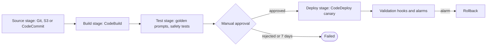
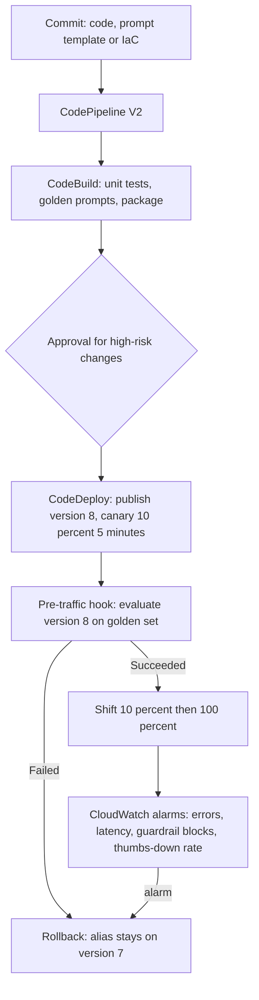

## 0. Before you start
- **Essential:** what source control and a "build" are; what a deployment is.
- **Helpful:** Lambda versions and aliases; YAML syntax.
- **Optional advanced:** CloudFormation/CDK/SAM for infrastructure as code; EventBridge triggers.

## 1. Simple explanation
Three AWS services make the "ship it safely" conveyor belt. **CodeBuild** compiles your code and runs your tests on a temporary machine and hands back a package. **CodeDeploy** puts a package onto servers, Lambda functions or containers, and can move traffic over slowly and roll back. **CodePipeline** is the conveyor belt that connects them: when source code changes it starts a run, builds, tests, asks a person to approve if you want, and deploys. For GenAI apps you add one more idea: a **quality gate** that sends test prompts to the new version and refuses to release it if the answers get worse.


```figure
flow cicd-pipeline
```

## 2. Structured explanation
1. **CodePipeline** ✅: a pipeline is a series of **stages**; each stage has **actions** (types: source, build, test, deploy, approval, invoke) that run in series or parallel; **artifacts** move between actions through an artifact store; **transitions** connect stages and can be disabled.
2. **CodeBuild** ✅: fully managed build service; you pay for build minutes; commands come from a **buildspec** (`buildspec.yml`); builds run in prepackaged or custom environments; scales on demand.
3. **CodeDeploy** ✅: deploys to **EC2/on-premises, AWS Lambda and Amazon ECS**; deployment types in-place (EC2/on-premises only) and blue/green; for Lambda and ECS traffic shifts are **canary, linear or all-at-once**; an **AppSpec** file describes the deployment and its hook functions.
4. **How they connect:** CodePipeline Source → CodeBuild (build/test) → manual approval → CodeDeploy (deploy) → validation hooks and alarms.
5. **GenAI additions:** golden-prompt tests in the build stage, an evaluation gate in a CodeDeploy pre-traffic hook, canary traffic shifting for a new prompt or model version, alarm-based rollback, and AppConfig for config-only changes ([06/03](aip:06-app-building-tools/03-appconfig-and-dynamic-foundation-model-selection)).

## 3. Analogy
**A parcel depot.** CodePipeline is the conveyor that moves each parcel from station to station. CodeBuild is the packing station that checks and boxes the goods. CodeDeploy is the delivery driver who first delivers to one house (canary), waits for a call to say it is fine, then delivers to the street, and drives back if anyone complains.

*Where it breaks:* a delivered parcel cannot be un-delivered, but a deployment can be rolled back by shifting traffic to the previous Lambda version. And data written by a bad version (for example wrong answers cached or stored) does not disappear on rollback.

## 4. The seven questions

**WHAT?** A set of developer services for continuous integration (build/test) and continuous delivery/deployment.

**WHEN?** Whenever code, infrastructure or prompts change and you want repeatable, auditable, low-risk releases. Different from SageMaker Pipelines (ML training/registry workflows, [05/04](aip:05-sagemaker/04-neo-unified-studio-pipelines-and-jumpstart)) and from Step Functions (runtime orchestration, [06/04](aip:06-app-building-tools/04-step-functions-states-circuit-breaker-and-prompt-chaining)).

**WHY?** Fewer manual steps, tested releases, the ability to stop and roll back, and an audit trail.

**WHERE?** Regional; the artifact store is S3; CodeBuild runs in a service-managed environment (or your VPC); CodeDeploy acts on Lambda/ECS/EC2 in the target account and Region.

**HOW?** §5.

**WHAT IF?**
| Situation | Effect | Remedy |
|---|---|---|
| Two commits arrive while a stage is busy (default mode) | A stage handles one execution at a time; a newer waiting execution **supersedes** an older waiting one ✅ | Use QUEUED or PARALLEL mode (V2 pipelines) if every commit must run |
| A manual approval is never answered | After **seven days** the action counts as failed ✅ | Respond or redesign |
| A buildspec command fails | The phase fails; remaining `commands` are skipped but `finally` commands still run ✅ | Put cleanup in `finally` |
| Lambda validation hook never calls back | CodeDeploy treats the deployment as failed after **one hour** ✅ | Always report Succeeded/Failed |
| Alarm fires during a canary shift | Deployment can be stopped and rolled back (alarm rollback) ✅ | Attach alarms to the deployment group |
| Inactive pipeline with polling-based source | After 30 days inactive, polling is disabled ✅ | Use event-based change detection |

**WHY NOT?** Do not use CodeDeploy canaries for a prompt-only change if AppConfig suffices. Do not run long model evaluations inside a pre-traffic hook beyond its one-hour limit. Do not store secrets in plain buildspec variables.

## 5. Technical depth

```figure
traffic-shift {"preset": "codedeploy"}
```


### 5.1 CodePipeline concepts ✅ (`concepts.html`)

*Reading the arrows:* each rectangle is a stage with actions inside; arrows are transitions. A change flows left to right. The diamond is a manual approval action, the pipeline stops there until someone responds or seven days pass. After deployment, hooks and alarms decide whether to keep or roll back.

Key points ✅:
- **Action types:** `source`, `build`, `test`, `deploy`, `approval`, `invoke`.
- **Executions:** a pipeline can process several executions at the same time, but **a stage processes one at a time** (it is locked). The execution waiting to enter a busy stage is the *inbound execution*. **SUPERSEDED** is the default mode: a newer execution replaces the waiting one (the older one stops with status `Superseded`). **QUEUED** and **PARALLEL** modes also exist.
- **Statuses:** `InProgress`, `Stopping`, `Stopped`, `Succeeded`, `Superseded`, `Failed`. Failed or stopped executions can usually be retried; a stage can be **rolled back** to a previous successful execution (V2).
- **Transitions** can be disabled; when several executions wait at a disabled transition only the latest continues once enabled.
- **Triggers:** manual; EventBridge (recommended for CodeCommit or S3 sources); webhooks (WebhookV2 supports Git tags and filters on branches, tags, file paths and pull-request events for GitHub, GitLab, Bitbucket). Polling is disabled for pipelines inactive more than 30 days.
- **Variables:** pipeline-level and action-emitted values resolved at run time.
- **Conditions and rules** (stage gates): *entry* conditions, *on failure* (roll back) and *on success* (for example check alarms, roll back if alarms exist); results include fail or roll back the stage.
- **Manual approval** ✅: pauses until someone with permission approves or rejects; can notify an SNS topic, show a review URL and comments; **rejected or no response within seven days = failed**.

**V1 vs V2 pipeline types** ✅ (`pipeline-types-planning.html`): V2 adds pipeline-level variables, triggers with Git tag/branch/file-path/pull-request filters, stage conditions, stage rollback, QUEUED and PARALLEL execution modes, source revision overrides, the Commands action and automatic stage retry; V1 does not. Pricing differs by type; figures were not used here ❌ (pricing page not read).

### 5.2 CodeBuild and the buildspec ✅ (`welcome.html`, `build-spec-ref.html`)
- **Phases:** `install` → `pre_build` → `build` → `post_build`. Names cannot be changed. A `finally` block per phase runs even if a command in `commands` fails; the phase fails if any command fails.
- **`on-failure`** per phase: `ABORT`, `CONTINUE`, `RETRY`, `RETRY-<count>`, `RETRY-<regex>`, `RETRY-<count>-<regex>` (count 0–100). Not supported with Lambda compute or reserved capacity. Whether a retry reruns the phase or the build was worded as "retry the build" on the page; I model it as "retry up to N times" ❌.
- **Version `0.2`** is recommended: all commands run in the **same shell instance** (0.1 ran each command in a separate shell).
- **Variables:** `env/variables` (plain text, discouraged for sensitive values), `env/parameter-store` (needs `ssm:GetParameters` on the service role), `env/secrets-manager` (pattern `key: secret-id:json-key:version-stage:version-id`), `env/exported-variables` (export to later CodePipeline stages; **secrets and `AWS_`-prefixed variables cannot be exported**). Names starting `CODEBUILD_` are reserved.
- **Precedence** for a variable defined in several places: the **start-build call** wins, then the **project definition**, then the **buildspec** (lowest).
- **Secrets masking** hides Parameter Store and Secrets Manager values in logs, but only the **exact stored string**; a transformed (for example Base64-encoded) value is not masked.
- **Artifacts:** `files`, `base-directory`, `name`, `discard-paths`, `secondary-artifacts`. **Reports:** test and coverage report groups (JUnit XML default, Cucumber JSON, NUnit, TestNG, JaCoCo, Cobertura and more).
- **Cache:** `key` (exact match), `fallback-keys` (up to five, matched by prefix), `action` (`restore` or `save`; default both), `paths`.
- Billing: pay for build minutes ✅.

A buildspec for a GenAI Lambda app (YAML is not machine-checked in this repo; field names follow the page):
```yaml
version: 0.2
env:
  parameter-store:
    EVAL_THRESHOLD: /genai-app/eval/threshold
  exported-variables:
    - GIT_SHORT
phases:
  install:
    runtime-versions:
      python: 3.x
    commands:
      - pip install -r requirements.txt
  pre_build:
    commands:
      - pytest tests/unit --junitxml=reports/unit.xml
    finally:
      - echo "pre_build finished"
  build:
    commands:
      - pytest tests/golden            # golden prompts against a test model alias; fail the build on regressions
      - export GIT_SHORT=$(echo $CODEBUILD_RESOLVED_SOURCE_VERSION | cut -c1-7)
      - zip -r function.zip app/
  post_build:
    commands:
      - echo "package ready"
reports:
  unit-tests:
    files:
      - reports/unit.xml
    file-format: JUNITXML
artifacts:
  files:
    - function.zip
    - appspec.yaml
cache:
  key: pip-$(codebuild-hash-files requirements.txt)
  paths:
    - '/root/.cache/pip/**/*'
```
(`CODEBUILD_RESOLVED_SOURCE_VERSION` is a CodeBuild built-in variable; the full variable list was not read here ❌.)

### 5.3 CodeDeploy ✅ (`welcome.html`, `deployment-configurations.html`, `reference-appspec-file-structure-*.html`)
- **Compute platforms:** EC2/On-Premises, **AWS Lambda**, Amazon ECS. **All Lambda and ECS deployments are blue/green**; in-place is only for EC2/on-premises.
- **Lambda deployments** shift traffic between two versions of a function behind an alias using **canary, linear or all-at-once** configurations. Predefined names ✅:
  - `CodeDeployDefault.LambdaCanary10Percent5Minutes`, `…10Minutes`, `…15Minutes`, `…30Minutes` (10% first; the rest after the wait)
  - `CodeDeployDefault.LambdaLinear10PercentEvery1Minute`, `…Every2Minutes`, `…Every3Minutes`, `…Every10Minutes`
  - `CodeDeployDefault.LambdaAllAtOnce`
  - ECS: `ECSLinear10PercentEvery1Minutes`, `ECSLinear10PercentEvery3Minutes`, `ECSCanary10Percent5Minutes`, `ECSCanary10Percent15Minutes`, `ECSAllAtOnce` (with a Network Load Balancer only all-at-once is supported). You can create custom canary/linear configurations (not for CloudFormation-managed ECS blue/green).
- **AppSpec for Lambda** ✅: a `resources` section naming the function, **alias**, `currentversion` and `targetversion`, and a `hooks` section with **`BeforeAllowTraffic`** (run before traffic is shifted) and **`AfterAllowTraffic`** (run after all traffic is shifted). Each hook is one Lambda function that must report **`Succeeded` or `Failed`** to CodeDeploy with `PutLifecycleEventHookExecutionStatus`, passing the deployment ID and the lifecycle-event hook execution ID; if CodeDeploy is not notified within **one hour** the deployment is considered failed.
- **Rollback:** CodeDeploy can automatically or manually stop and roll back deployments on errors ✅ (alarm-based rollback settings were not read ❌).
- EC2 hooks (for completeness): `ApplicationStop`, `BeforeInstall`, `AfterInstall`, `ApplicationStart`, `ValidateService`, plus load-balancer hooks; script `timeout` default and maximum **3,600 s** ✅.

An AppSpec for a Lambda canary (structure per the resources and hooks pages; the top-level `version` value is not shown on the pages I read ❌):
```yaml
version: 0.0
resources:
  - GenAiChat:
      type: "AWS::Lambda::Function"
      properties:
        name: genai-chat
        alias: live
        currentversion: "7"
        targetversion: "8"
hooks:
  - BeforeAllowTraffic: genai-prehook
  - AfterAllowTraffic: genai-posthook
```

A pre-traffic hook that runs a smoke/evaluation check (syntax-checked only; **not** run against AWS):
```python snippet
import json
import os

import boto3

lam = boto3.client("lambda")
codedeploy = boto3.client("codedeploy")

GOLDEN = [{"q": "What is the refund window?", "must_contain": "30 days"}]


def handler(event, context):
    status = "Failed"
    try:
        passed = 0
        for case in GOLDEN:
            out = lam.invoke(
                FunctionName=os.environ["FUNCTION_NAME"],
                Qualifier=os.environ["TARGET_VERSION"],          # the new version, before it receives traffic
                Payload=json.dumps({"body": json.dumps({"prompt": case["q"]})}),
            )
            answer = json.loads(out["Payload"].read()).get("body", "")
            passed += case["must_contain"] in answer
        if passed / len(GOLDEN) >= float(os.environ.get("MIN_PASS_RATE", "0.8")):
            status = "Succeeded"
    finally:
        codedeploy.put_lifecycle_event_hook_execution_status(
            deploymentId=event["DeploymentId"],
            lifecycleEventHookExecutionId=event["LifecycleEventHookExecutionId"],
            status=status,
        )
```

### 5.4 A GenAI release flow

*Reading the arrows:* a commit runs through build and tests; CodeDeploy publishes a new Lambda version and, before any traffic moves, the pre-traffic hook evaluates it on a golden set. Only if that passes does the alias start shifting 10% then the rest; alarms watching production metrics can abort and roll back.

What goes through which channel:
| Change | Preferred channel | Why |
|---|---|---|
| Application code, dependencies | CodePipeline + CodeDeploy canary | Versioned, testable |
| Model ID, temperature, fallback chain, kill switch | AppConfig ([06/03](aip:06-app-building-tools/03-appconfig-and-dynamic-foundation-model-selection)) | No redeploy; staged rollout |
| Prompt text | Bedrock Prompt Management versions or a prompt file in source control | Auditable ([01/08](aip:01-bedrock-genai-fundamentals/08-prompt-management-flows-and-structured-output)) |
| Infrastructure | IaC (CloudFormation/CDK/SAM) in the pipeline | Repeatable |
| Customized model artifacts | SageMaker Model Registry approval + deployment guardrails ([05/03](aip:05-sagemaker/03-model-registry-and-lineage-tracking), [05/01](aip:05-sagemaker/01-sagemaker-ai-deployment-guardrails-and-fm-optimization)) | Lineage, rollback |
| Evaluation thresholds | Parameter Store / pipeline variables | Tune without code edits |

## 6. Worked example
*Problem:* A team updates a support bot's system prompt and swaps a retrieval parameter. Last time a prompt tweak made the bot refuse refund questions and it went unnoticed for a day.

| Step | Design | Why |
|---|---|---|
| 1 | Prompt template and code live in Git; the pipeline is V2 with a Git-tag trigger for releases | Auditable; triggers with filters need V2 ✅ |
| 2 | CodeBuild runs unit tests, then `tests/golden` (30 question/expected-keyword cases) against a test alias | Regression gate in CI |
| 3 | Manual approval only when the diff touches the system prompt | Human review for risky changes ✅ |
| 4 | CodeDeploy `LambdaCanary10Percent5Minutes` with the AppSpec in §5.3 | 10% first, then the rest ✅ |
| 5 | `BeforeAllowTraffic` hook runs the golden set on the new version; below 80% → `Failed` → no traffic moves | Stop before users are exposed |
| 6 | Alarms on error rate, p95 latency, guardrail blocks and refusal rate | Catch what tests missed |
| 7 | Log version + prompt hash with every response | Trace regressions ([module 07](aip:07-governance-qa/01-agent-tracing-evaluation-metrics-and-bedrock-model-evaluations)) |

## 7. Knowledge checkpoints
1. Name the six CodePipeline action types.
2. In SUPERSEDED mode, what happens to an execution waiting for a busy stage when a newer one arrives?
3. Which buildspec phase names exist, and what does `finally` do?
4. Which CodeDeploy compute platforms use only blue/green?
5. What must a CodeDeploy Lambda validation hook do, and how long does CodeDeploy wait?

## 7b. Practice questions (exam-style, original) — answers in §14

**Q1.** A team wants a new Lambda version of a chatbot to receive 10% of traffic for 5 minutes, then the rest, with automatic rollback if an alarm fires. Which service and configuration fit?
A. CodeDeploy with `CodeDeployDefault.LambdaCanary10Percent5Minutes` and alarms on the deployment group
B. CodeBuild with a larger compute type
C. CodePipeline manual approval only
D. Systems Manager Run Command

**Q2.** (Select TWO) Which statements about a CodeBuild buildspec are correct?
A. Phases are `install`, `pre_build`, `build` and `post_build`
B. Commands in a `finally` block run even if a command in `commands` fails
C. Version 0.1 is recommended because each command gets a fresh shell
D. Secrets stored in Secrets Manager can be encoded with Base64 in a build command and will still be masked in logs
E. Environment variables in the buildspec override those passed in the start-build call

**Q3.** A pipeline needs a person to review a new system prompt before production, but nobody replies for eight days. What is the result?
A. The approval action fails after seven days and the execution does not continue
B. The pipeline deploys automatically after seven days
C. The approval is auto-approved
D. The pipeline waits forever

**Q4.** Two developers merge within a minute while the Deploy stage is still running the earlier release. With default settings, what happens to the older waiting execution?
A. It is superseded by the newer execution and stops
B. Both run in parallel in the same stage
C. The Deploy stage fails
D. The pipeline is deleted

**Q5.** (Select TWO) Which are true of CodeDeploy deployments to AWS Lambda?
A. Traffic is shifted between function versions using an alias
B. Deployment configurations can be canary, linear or all-at-once
C. In-place deployments are the default
D. The AppSpec must list server scripts for `ApplicationStop`
E. Validation hooks never need to report a result

**Q6.** A pre-traffic hook function runs an evaluation but never calls CodeDeploy back. What will CodeDeploy conclude?
A. The deployment fails if it is not notified within one hour
B. The deployment succeeds after one minute
C. The hook is retried forever
D. Traffic shifts anyway

**Q7.** Which pipeline type is required for triggers that filter on Git tags, branches or file paths and for stage rollback?
A. V2
B. V1
C. Either
D. Neither

**Q8.** A change only swaps the default model and temperature of a running chatbot, with no code change. Which channel is most appropriate?
A. AppConfig deployment with a gradual strategy and alarms
B. A full CodePipeline run with an AWS CodeBuild image rebuild
C. Editing the Lambda code in the console
D. Re-creating the VPC

## 8. Hands-on lab: pipeline, build and deploy rule simulators

### 8.1 Objective
Model, offline, five documented behaviors: the SUPERSEDED execution mode, buildspec phases with `finally` and retries, variable precedence and cache fallback keys, CodeDeploy Lambda traffic plans with rollback, and a golden-set evaluation gate.

### 8.2 Prerequisites
Python 3 only. Optional AWS part: an AWS account, a Git repository, the Lambda from [06/01](aip:06-app-building-tools/01-lambda-integration-patterns-and-lambda-with-bedrock).

### 8.3 AWS services
Offline: none. Optional: CodePipeline, CodeBuild, CodeDeploy, Lambda, S3, CloudWatch, IAM.

### 8.4 IAM permissions
Offline: none. Real: a CodePipeline service role, a CodeBuild service role (including `ssm:GetParameters` if you use Parameter Store variables ✅), a CodeDeploy service role, and permission for the hook function to call `codedeploy:PutLifecycleEventHookExecutionStatus` ❌ (action name inferred from the API name; check the IAM reference).

### 8.5 Region notes
All three services and the artifact bucket must be in the Region of the pipeline for the same-Region pieces; the SNS topic for approvals must be in the pipeline's Region ✅.

### 8.6 Architecture
§5.1 and §5.4.

### 8.7 Cost
Offline: none. Real: CodeBuild bills build minutes ✅; CodePipeline pricing depends on pipeline type ✅ (figures not read ❌); Lambda, S3 and Bedrock test calls bill normally. Golden-set evaluations call a model, so keep the set small.

### 8.8 Code
```python lab-run
import re

# ---- 1. CodePipeline SUPERSEDED mode: a stage runs one execution at a time; a newer waiting execution replaces an older one ----
def run_superseded(arrivals, stage_minutes):
    log, cur, waiting = [], None, None
    def finish_until(t):
        nonlocal cur, waiting
        while cur and cur[2] <= t:
            log.append(f"t={cur[2]:>2}: {cur[0]} finishes the stage")
            if waiting:
                name, waiting = waiting, None
                cur = (name, cur[2], cur[2] + stage_minutes)
                log.append(f"t={cur[1]:>2}: {name} enters the stage")
            else:
                cur = None
    for name, t in sorted(arrivals, key=lambda a: a[1]):
        finish_until(t)
        if cur is None:
            cur = (name, t, t + stage_minutes)
            log.append(f"t={t:>2}: {name} enters the stage")
        elif waiting:
            log.append(f"t={t:>2}: {name} supersedes {waiting} ({waiting} stops with status Superseded)")
            waiting = name
        else:
            log.append(f"t={t:>2}: {name} waits (stage locked by {cur[0]})")
            waiting = name
    finish_until(10 ** 9)
    return log
for line in run_superseded([("exec-1", 0), ("exec-2", 3), ("exec-3", 6)], 10):
    print(line)

# ---- 2. Buildspec phases: finally always runs; the phase fails if any command fails; on-failure RETRY-n ----
def run_phase(name, commands, finally_cmds, on_failure="default", attempt_results=None):
    # commands: list of (label, ok); attempt_results: optional per-attempt override of the first command
    max_attempts = 1
    m = re.fullmatch(r"RETRY(?:-(\d+))?", on_failure)
    if m:
        max_attempts = 1 + (int(m.group(1)) if m.group(1) else 3)
    for attempt in range(1, max_attempts + 1):
        ok_all, log = True, []
        for i, (label, ok) in enumerate(commands):
            if i == 0 and attempt_results:
                ok = attempt_results[min(attempt, len(attempt_results)) - 1]
            if not ok:
                log.append(f"{name} attempt {attempt}: '{label}' FAILED, remaining commands skipped")
                ok_all = False
                break
            log.append(f"{name} attempt {attempt}: '{label}' ok")
        for label, ok in finally_cmds:
            log.append(f"{name} attempt {attempt}: finally '{label}' ran")
            ok_all = ok_all and ok
        for l in log:
            print("  ", l)
        if ok_all:
            return "phase succeeded"
    return "ABORT: phase failed" if on_failure == "ABORT" else ("CONTINUE to next phase" if on_failure == "CONTINUE" else "phase failed (default transitions not modeled)")
print("build with a failing test, on-failure ABORT:")
print("  ->", run_phase("build", [("pytest", False), ("zip", True)], [("cleanup", True)], "ABORT"))
print("flaky test, on-failure RETRY-2 (fails twice, passes on the third try):")
print("  ->", run_phase("build", [("pytest", False), ("zip", True)], [("cleanup", True)], "RETRY-2", [False, False, True]))
print("failing test, on-failure CONTINUE:")
print("  ->", run_phase("build", [("pytest", False)], [], "CONTINUE"))

# ---- 3. Variable precedence (start-build > project > buildspec) and cache fallback keys ----
def resolve(name, start_build=None, project=None, buildspec=None):
    for source, value in (("start-build call", start_build), ("project definition", project), ("buildspec", buildspec)):
        if value is not None and name in value:
            return value[name], source
    return None, "undefined"
print("MODEL_STAGE ->", resolve("MODEL_STAGE", {"MODEL_STAGE": "canary"}, {"MODEL_STAGE": "prod"}, {"MODEL_STAGE": "dev"}))
print("LOG_LEVEL   ->", resolve("LOG_LEVEL", None, {"LOG_LEVEL": "info"}, {"LOG_LEVEL": "debug"}))
print("REGION_NOTE ->", resolve("REGION_NOTE", None, None, {"REGION_NOTE": "from buildspec"}))

def restore(key, fallback_keys, caches):
    if key in caches:
        return f"exact hit: {key}"
    for fb in fallback_keys[:5]:
        hits = [c for c in caches if c.startswith(fb)]
        if hits:
            return f"fallback prefix '{fb}' matched: {hits}"
    return "cache miss"
caches = ["pip-aaa111", "npm-bbb222"]
print("cache:", restore("pip-ccc333", ["pip-", "npm-"], caches))
print("cache:", restore("pip-aaa111", ["pip-"], caches))
print("cache:", restore("go-ddd444", ["go-"], caches))

# ---- 4. CodeDeploy Lambda traffic plans (names are real predefined configs; step timing is a model of 'every N minutes') ----
def plan(config):
    m = re.fullmatch(r"CodeDeployDefault\.Lambda(Canary|Linear)(\d+)Percent(?:Every)?(\d+)Minutes?", config)
    if config == "CodeDeployDefault.LambdaAllAtOnce":
        return [(0, 100)]
    kind, pct, mins = m.group(1), int(m.group(2)), int(m.group(3))
    if kind == "Canary":
        return [(0, pct), (mins, 100)]
    steps = 100 // pct
    return [(i * mins, pct * (i + 1)) for i in range(steps)]
for cfg in ("CodeDeployDefault.LambdaCanary10Percent5Minutes", "CodeDeployDefault.LambdaLinear10PercentEvery2Minutes", "CodeDeployDefault.LambdaAllAtOnce"):
    print(cfg.replace("CodeDeployDefault.", ""), "->", [f"{p}% at +{t} min" for t, p in plan(cfg)])

def deploy(config, hook_ok=True, alarm_at_minute=None):
    if not hook_ok:
        return "BeforeAllowTraffic hook reported Failed: no traffic moved, alias stays on the old version"
    steps = plan(config)
    if alarm_at_minute is not None and alarm_at_minute < steps[-1][0]:
        reached = max(p for t, p in steps if t <= alarm_at_minute)
        return f"alarm at minute {alarm_at_minute}: rolled back, alias returns to the old version (only {reached}% had been shifted)"
    return "all traffic on the new version"
c = "CodeDeployDefault.LambdaCanary10Percent5Minutes"
print("healthy         :", deploy(c))
print("hook failed     :", deploy(c, hook_ok=False))
print("alarm at min 3  :", deploy(c, alarm_at_minute=3))

# ---- 5. A golden-set evaluation gate (stub answers are INVENTED) ----
GOLDEN = [("refund window", "30 days"), ("support hours", "9 to 5"), ("shipping time", "3 to 5 days"), ("warranty", "one year"), ("returns address", "Dock 4")]
ANSWERS = {
    "old": {"refund window": "Refunds are accepted within 30 days.", "support hours": "We are open 9 to 5.", "shipping time": "Usually 3 to 5 days.", "warranty": "One year warranty, see one year terms.", "returns address": "Send to Dock 4."},
    "new": {"refund window": "I cannot help with refunds.", "support hours": "We are open 9 to 5.", "shipping time": "Usually 3 to 5 days.", "warranty": "Covered for one year.", "returns address": "I cannot share addresses."},
}
def pass_rate(version):
    ok = sum(1 for q, kw in GOLDEN if kw.lower() in ANSWERS[version][q].lower())
    return ok / len(GOLDEN)
for version in ("old", "new"):
    rate = pass_rate(version)
    print(f"version {version}: pass rate {rate:.0%} -> hook reports {'Succeeded' if rate >= 0.8 else 'Failed'} (threshold 80%)")
```

### 8.9 Captured output
Generated on 2026-10-26 by extracting the block above from this file and running it (Python 3). It is an offline model of documented rules (the traffic-step timing and stub answers are my own illustration), **not** CodePipeline, CodeBuild or CodeDeploy output.
```text lab-out
t= 0: exec-1 enters the stage
t= 3: exec-2 waits (stage locked by exec-1)
t= 6: exec-3 supersedes exec-2 (exec-2 stops with status Superseded)
t=10: exec-1 finishes the stage
t=10: exec-3 enters the stage
t=20: exec-3 finishes the stage
build with a failing test, on-failure ABORT:
   build attempt 1: 'pytest' FAILED, remaining commands skipped
   build attempt 1: finally 'cleanup' ran
  -> ABORT: phase failed
flaky test, on-failure RETRY-2 (fails twice, passes on the third try):
   build attempt 1: 'pytest' FAILED, remaining commands skipped
   build attempt 1: finally 'cleanup' ran
   build attempt 2: 'pytest' FAILED, remaining commands skipped
   build attempt 2: finally 'cleanup' ran
   build attempt 3: 'pytest' ok
   build attempt 3: 'zip' ok
   build attempt 3: finally 'cleanup' ran
  -> phase succeeded
failing test, on-failure CONTINUE:
   build attempt 1: 'pytest' FAILED, remaining commands skipped
  -> CONTINUE to next phase
MODEL_STAGE -> ('canary', 'start-build call')
LOG_LEVEL   -> ('info', 'project definition')
REGION_NOTE -> ('from buildspec', 'buildspec')
cache: fallback prefix 'pip-' matched: ['pip-aaa111']
cache: exact hit: pip-aaa111
cache: cache miss
LambdaCanary10Percent5Minutes -> ['10% at +0 min', '100% at +5 min']
LambdaLinear10PercentEvery2Minutes -> ['10% at +0 min', '20% at +2 min', '30% at +4 min', '40% at +6 min', '50% at +8 min', '60% at +10 min', '70% at +12 min', '80% at +14 min', '90% at +16 min', '100% at +18 min']
LambdaAllAtOnce -> ['100% at +0 min']
healthy         : all traffic on the new version
hook failed     : BeforeAllowTraffic hook reported Failed: no traffic moved, alias stays on the old version
alarm at min 3  : alarm at minute 3: rolled back, alias returns to the old version (only 10% had been shifted)
version old: pass rate 100% -> hook reports Succeeded (threshold 80%)
version new: pass rate 60% -> hook reports Failed (threshold 80%)
```

### 8.10 Explanation
- Part 1: exec-2 waits behind exec-1 and is superseded by exec-3, which enters when the stage unlocks.
- Part 2: the failed test skips `zip` but `finally` still runs; `RETRY-2` allows two retries; `CONTINUE` moves on.
- Part 3: the start-build value wins over the project value which wins over the buildspec; fallback keys match by prefix.
- Part 4: canary shifts 10% then the rest; linear steps add 10% each interval; a failed pre-traffic hook moves nothing; an alarm rolls back.
- Part 5: the new version fails the golden set because two answers regress, so the hook reports `Failed`.

### 8.11 Optional AWS lab (shown, not run against AWS ❌)
1. Put the Lambda code, the buildspec of §5.2 and the AppSpec of §5.3 in a repository.
2. Create a CodeBuild project (source: your repo; service role with logging and Parameter Store read) and test with *Start build*.
3. Create a CodePipeline V2: Source → Build (CodeBuild) → Approval (optional, SNS) → Deploy (CodeDeploy). Create a CodeDeploy application on the **AWS Lambda** platform with a deployment group and the `LambdaCanary10Percent5Minutes` configuration.
4. Push a change; watch the stages. Make the golden test fail on purpose and see the build stop; make the hook fail and see no traffic move.
5. Add a CloudWatch alarm to the deployment group and trigger it during the canary to see rollback.
6. Clean up the pipeline, build project, CodeDeploy app, artifact bucket and roles.

### 8.12 Common errors
| Error | Cause | Fix |
|---|---|---|
| Build fails on `ssm:GetParameters` | Service role missing the permission | Add it ✅ |
| Secret appears in logs | Value transformed (not an exact match) | Store the transformed form ✅ |
| Execution status `Superseded` | Newer commit replaced it ✅ | Use QUEUED/PARALLEL (V2) if needed |
| Deployment fails after an hour | Hook did not report back ✅ | Always call `PutLifecycleEventHookExecutionStatus` |
| `AccessDenied` creating the deployment | CodeDeploy service role incomplete | Attach the service role policy |
| Approval stuck | No approver permission or SNS misconfigured ✅ | Fix IAM and topic Region |

### 8.13 Security recommendations
Separate roles per service with least privilege; no secrets in plain variables (use Parameter Store or Secrets Manager ✅); do not export secrets (not allowed ✅); encrypt the artifact bucket; require approvals for production; restrict who can edit pipelines and buildspecs; keep test prompts free of real personal data; scan dependencies in the build.

## 9. What can go wrong?
| Failure | Why | Symptoms | Investigate | Fix | Prevent |
|---|---|---|---|---|---|
| **Silent regression** | No evaluation gate | Bad answers in production | Compare versions | Add golden set + hook | Quality gates |
| **Flaky gate** | Non-deterministic model outputs | Random failures | Re-run variance | Lower temperature, wider thresholds | Stable test settings |
| **Stuck approval** | No approver response | Pipeline idle 7 days | Pipeline status | Approve/reject | SNS + owners |
| **Superseded release** | Default mode drops waiting executions | Missing release | Execution list | QUEUED mode (V2) | Choose mode deliberately |
| **Hook timeout** | Evaluation too slow | Deployment fails at 1 hour | Hook logs | Smaller golden set | Budget the hook time |
| **Rollback loses data fixes** | Rollback only moves traffic | Data written by bad version remains | Data checks | Data repair job | Idempotent writes |
| **Config drift** | Console edits bypass pipeline | Prod differs from Git | Config history | Re-deploy from Git | IaC only |

## 10. Common misconceptions
1. **"CodePipeline builds code."** It orchestrates; CodeBuild builds.
2. **"CodeDeploy only deploys to servers."** It also deploys Lambda and ECS ✅.
3. **"Lambda deployments can be in-place."** All Lambda and ECS deployments are blue/green ✅.
4. **"A manual approval waits forever."** Seven days, then failed ✅.
5. **"SageMaker Pipelines and CodePipeline are the same."** One is ML workflow orchestration, the other software delivery.

## 11. Exam notes
- **Patterns:** "build and test" → CodeBuild; "shift traffic gradually with rollback" → CodeDeploy canary/linear; "orchestrate stages with approvals" → CodePipeline; "validate before traffic" → `BeforeAllowTraffic` hook; "change only configuration" → AppConfig.
- **Keywords:** buildspec, `finally`, artifacts, AppSpec, alias, `LambdaCanary10Percent5Minutes`, manual approval, V2 triggers.
- **Traps:** thinking canary exists for EC2 in-place deployments; forgetting hooks must call back; using CodeDeploy for prompt-only changes.
- **Compare:** CodePipeline vs Step Functions vs SageMaker Pipelines vs Bedrock Flows; AppConfig vs CodeDeploy for rollouts.

## 12. Summary and revision cards
- CodePipeline: stages, actions, artifacts, SUPERSEDED default, 7-day approval, V2 features.
- CodeBuild: buildspec phases, `finally`, 0.2, env precedence, caching, pay per minute.
- CodeDeploy: EC2/Lambda/ECS; Lambda/ECS always blue/green; canary/linear/all-at-once; hooks must report within an hour.
- GenAI: golden-set gate + canary + alarms; AppConfig for config-only changes.

**Cards.** Q: Lambda hook names? A: `BeforeAllowTraffic`, `AfterAllowTraffic`. · Q: Default execution mode? A: SUPERSEDED. · Q: Which wins for a variable, buildspec or start-build? A: Start-build.

## 13. References
| Source | URL | Verified |
|---|---|---|
| CodePipeline concepts | https://docs.aws.amazon.com/codepipeline/latest/userguide/concepts.html | 2026-10-26 |
| Pipeline types | https://docs.aws.amazon.com/codepipeline/latest/userguide/pipeline-types.html · .../pipeline-types-planning.html | 2026-10-26 |
| Manual approvals | https://docs.aws.amazon.com/codepipeline/latest/userguide/approvals.html | 2026-10-26 |
| What is CodeBuild | https://docs.aws.amazon.com/codebuild/latest/userguide/welcome.html | 2026-10-26 |
| Buildspec reference | https://docs.aws.amazon.com/codebuild/latest/userguide/build-spec-ref.html | 2026-10-26 |
| What is CodeDeploy | https://docs.aws.amazon.com/codedeploy/latest/userguide/welcome.html | 2026-10-26 |
| Deployment configurations | https://docs.aws.amazon.com/codedeploy/latest/userguide/deployment-configurations.html | 2026-10-26 |
| AppSpec hooks and resources | https://docs.aws.amazon.com/codedeploy/latest/userguide/reference-appspec-file-structure-hooks.html · .../reference-appspec-file-structure-resources.html | 2026-10-26 |

**Unverified here:** CodePipeline and CodeBuild pricing; CodeCommit availability for new customers; CodeBuild compute types, Lambda compute and build-phase transition rules; CodeDeploy alarm-rollback settings page; the AppSpec top-level `version` value and `PutLifecycleEventHookExecutionStatus` IAM action name; the CodeBuild built-in variable list.

## 14. Answers to checkpoints and practice questions
**Checkpoints.** 1) source, build, test, deploy, approval, invoke ✅. 2) It is superseded by the newer execution and stops with status Superseded ✅. 3) `install`, `pre_build`, `build`, `post_build`; `finally` commands run even if a command in `commands` fails ✅. 4) AWS Lambda and Amazon ECS ✅. 5) Report Succeeded or Failed using `PutLifecycleEventHookExecutionStatus`; one hour ✅.

**Practice questions.**
- **Q1 → A.** CodeDeploy canary config. B builds code, C only pauses, D is for instance commands ✅.
- **Q2 → A, B.** C false (0.2 recommended). D false (a transformed secret is not masked). E false (start-build wins) ✅.
- **Q3 → A.** Seven days then failed ✅.
- **Q4 → A.** SUPERSEDED default ✅.
- **Q5 → A, B.** C false (all Lambda deployments are blue/green); D is EC2-only; E false (must report) ✅.
- **Q6 → A.** One-hour rule ✅.
- **Q7 → A.** V2 ✅.
- **Q8 → A.** Config-only change through AppConfig; B and C are heavier or unsafe; D irrelevant.
