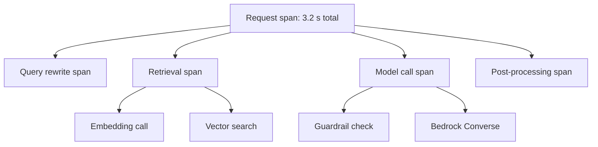
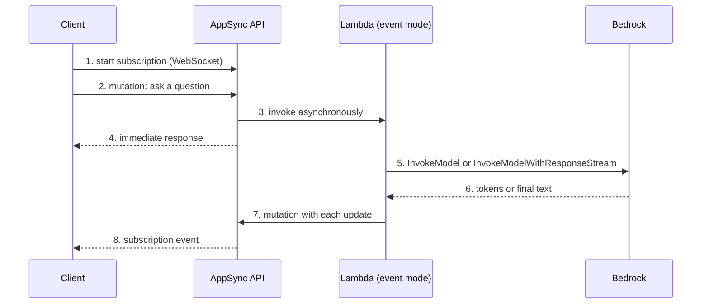

## 0. Before you start
- **Essential:** what an "experiment" is (trying variations and recording what you changed and what happened); what GraphQL is (a query language where the client asks for exactly the fields it wants).
- **Helpful:** WebSockets (a connection that stays open so the server can push); what a front-end framework is.
- **Optional advanced:** OpenTelemetry-style tracing; GraphQL resolvers.

## 1. Simple explanation
Three different helpers sit around a GenAI application. **MLflow** is a lab notebook: every time you try a prompt, a model or a setting, it records the settings, the scores and the cost, and for a running app it can record a **trace**, a step-by-step diary of one request (retrieval, model call, tool call). **AWS AppSync** is a smart front door for apps that want live updates: clients ask for data with GraphQL and can **subscribe** to results that arrive later, which suits an AI answer that takes a while. **AWS Amplify** is a toolkit and host for building web and mobile front ends quickly, with a code-first backend and ready-made AI building blocks.


```figure
flow appsync-subscription
```

## 2. Structured explanation
1. **Managed MLflow on SageMaker AI** ✅: tracks experiments, runs, parameters, metrics and artifacts; has **tracing** for generative AI apps; syncs with the SageMaker Model Registry; models can be deployed with `ModelBuilder`; access control through IAM; audit through CloudTrail; lifecycle events through EventBridge. Two forms exist: **MLflow Tracking Servers** and the newer **MLflow Apps**.
2. **AWS AppSync** ✅: GraphQL APIs and **Events** (pub/sub over WebSockets) with managed security, caching, merged APIs and JavaScript/TypeScript resolvers. It can call **Amazon Bedrock directly** (`InvokeModel`, `Converse`) for short calls.
3. **AWS Amplify** ✅: **Amplify Hosting** (Git-based continuous deployment for web apps) and **Amplify Gen 2** (TypeScript, code-first backend). The **Amplify AI kit** 🟡 adds *conversation* and *generation* routes for Bedrock models.
4. **How to choose:** need to compare experiments or trace app behavior → MLflow; need real-time, typed, subscription-style delivery of AI results → AppSync; need to ship a full-stack web/mobile app fast → Amplify (which uses AppSync under the hood for data and AI routes).

## 3. Analogy
**A cooking show.** MLflow is the producer's logbook: which recipe, which oven setting, what score the judges gave, and a minute-by-minute record of one cooking attempt (the trace). AppSync is the live broadcast: viewers tune in (subscribe) and see the dish being finished without asking again. Amplify is the ready-made studio set you rent so you can start filming the same day.

*Where it breaks:* the logbook only helps if you write to it consistently; and a live broadcast can show an unfinished (wrong) dish, so you still need safety checks (Guardrails) before pushing text to viewers.

## 4. The seven questions

**WHAT?** MLflow = experiment tracking and tracing; AppSync = managed GraphQL and real-time pub/sub; Amplify = front-end hosting plus a code-first backend toolkit.

**WHY?** Reproducible comparison of prompts/models, root-causing bad answers by tracing, real-time AI UX without running WebSocket servers, and faster delivery of apps.

**WHEN?** MLflow: prompt/model/parameter experiments and production tracing. AppSync: chat or progress UIs, mobile apps that need offline-friendly typed APIs, fan-out of AI results to many subscribers. Amplify: prototypes and production web/mobile apps on AWS.

**WHERE?** MLflow Tracking Servers: all commercial Regions with Studio except China (CLI-only in a few); MLflow Apps: a list of 16 Regions on the page ✅. AppSync and Amplify are Regional services (AppSync invokes Bedrock models in the **same Region** as the API ✅).

**HOW?** §5.

**WHAT IF?**
| Situation | Effect | Remedy |
|---|---|---|
| AppSync resolver calls a model that takes 25 s | Not supported: AppSync handles synchronous Bedrock calls that **complete within 10 seconds** ✅ | Lambda in event mode + mutation + subscription |
| You try to use Bedrock streaming APIs from an AppSync resolver | Not possible ✅ | Do streaming in Lambda and push chunks through mutations |
| MLflow tracking server is too small | Throttled requests for many users | Choose Medium/Large; sizes map to TPS ✅ |
| MLflow artifact larger than 200 MB | SageMaker MLflow has a **200 MB download size limit** ✅ | Keep large files in S3 and log references |
| Conversation route with API-key auth in Amplify AI kit | Not allowed: conversation routes support owner-based auth only 🟡 | Use authenticated users |
| Model in another Region | AppSync cannot invoke it ✅ | Same Region or an inference profile in the same Region |

**WHY NOT?** Do not use AppSync's Bedrock resolver for long generations. Do not treat an MLflow trace as an audit log (use CloudTrail and invocation logs for governance, module 07). Do not use Amplify AI routes where you need custom orchestration beyond the kit's routes.

## 5. Technical depth

```figure
trace-waterfall
```


### 5.1 Managed MLflow on SageMaker AI ✅ (`mlflow.html`)
- **Experiment tracking:** record and compare runs (data, algorithm, hyperparameters, metrics); register the best model in the MLflow Model Registry, which can **auto-register** in the SageMaker Model Registry ([05/03](aip:05-sagemaker/03-model-registry-and-lineage-tracking)); deploy with `ModelBuilder`.
- **Tracing for generative AI apps:** "record the inputs, outputs, and metadata at every step of a generative AI application", linking responses to the code, data or parameters that produced them. Evaluating generative models needs quantitative and qualitative metrics ✅.
- **Components of a Tracking Server:** compute and **backend metadata store** (in the SageMaker service account), and an **artifact store** in **your S3 bucket**. Tracking servers launch in a **single Availability Zone**.
- **Sizes** (tracking servers): Small (default; up to 25 users; sustained 25 TPS, burst 50), Medium (up to 50 users; 50/100), Large (up to 100 users; 100/200) ✅.
- **MLflow Apps** ✅ are the newer packaging: available in 16 listed Regions; semantic versioning; the page names a latest MLflow version, which I deliberately do not copy (look it up the day you build). New apps move to the latest supported version automatically.
- **Security and operations** ✅: IAM RBAC; all MLflow REST APIs are IAM actions under the `sagemaker-mlflow` prefix; CloudTrail logs control-plane calls, and for **MLflow Apps** the data-plane MLflow REST calls are logged as CloudTrail **data events** under the event name `CallMlflowApp` (not logged by default; add an advanced event selector for `AWS::SageMaker::MlflowApp`); EventBridge events for tracking-server lifecycle and for run/model-registry actions.
- **Link to Model Monitor replacement:** AWS recommends MLflow Apps plus Evidently AI for monitoring now that Model Monitor is in maintenance mode ([05/02](aip:05-sagemaker/02-ground-truth-model-monitor-and-clarify)).
- What to log for LLM experiments (my checklist): prompt template version, model ID or profile ARN, temperature/top-p/max tokens, retrieval settings (chunk size, top-k, reranker), input/output token counts, latency, cost, evaluation scores (relevance, faithfulness, safety), and a pointer to the evaluation dataset version.

### 5.2 Traces: seeing inside one request

*Reading the arrows:* a trace is a tree of **spans**. The request span contains child spans for each step; each child records start/end time, inputs, outputs and attributes such as token counts. Looking at a slow or wrong request means finding the child span whose time or content is off.

### 5.3 AWS AppSync ✅ (`what-is-appsync.html`, `resolver-reference-bedrock-js.html`)
- **What it offers:** secure serverless GraphQL and Pub/Sub APIs; one endpoint over several data sources; merged APIs; real-time updates; built-in security, monitoring, logging, tracing and optional caching; pay for requests and delivered real-time messages. **Authorization** modes: API keys, IAM, Cognito, OpenID Connect, Lambda; Private APIs and AWS WAF for enterprise security.
- **AppSync Events** ✅: since 13 March 2025 you can build a real-time pub/sub API on WebSockets with AppSync Events (a separate developer guide); GraphQL **subscriptions** also use serverless WebSockets.
- **Bedrock data source** ✅: resolvers and functions call the `InvokeModel` or `Converse` API of the Bedrock runtime; helpers in `@aws-appsync/utils/ai`; `Converse` requests can carry system prompts, inference config, tool config and **guardrail** settings; `InvokeModel` can carry `guardrailIdentifier`/`guardrailVersion`. Limits: **only synchronous calls that finish within 10 seconds; no Bedrock stream APIs; only foundation models and inference profiles in the same Region as the API**. The page reminds you that you are responsible for preventing vulnerabilities such as prompt injection.
- **Long-running pattern** ✅ (from the same page):

*Reading the arrows:* the client first opens a subscription, then sends a mutation. AppSync starts Lambda in event mode and answers the client immediately, so the user is not blocked. Lambda talks to Bedrock (it may use a streaming API), then sends each chunk back as a mutation. Each mutation triggers the subscription, so the client sees progressive updates.

- **When to prefer API Gateway:** REST/HTTP clients, API keys and usage plans, response streaming without subscriptions ([06/02](aip:06-app-building-tools/02-api-gateway-and-genai-applications)). **When to prefer AppSync:** typed GraphQL, many clients subscribing to the same updates, merged APIs, AI gateway behavior with guardrails in resolvers.

### 5.4 AWS Amplify
- **Amplify Hosting** ✅: Git-based workflow for full-stack serverless web apps with continuous deployment to the AWS CDN; frameworks include Next.js, Nuxt, React, Angular, Vue and static site generators; features include feature branches, custom domains, pull-request previews, end-to-end tests, password-protected branches, redirects/rewrites and atomic deployments.
- **Amplify Gen 2** ✅: a TypeScript, code-first developer experience to define and connect backends (Data, Auth and more); Gen 1 used the CLI and Amplify Studio.
- **Amplify AI kit** 🟡 (docs.amplify.aws, summarized): define AI routes in the data schema with `a.conversation()` (**streaming, multi-turn**; conversations and messages stored automatically in DynamoDB; **owner-based** authorization only; users must be signed in) and `a.generation()` (single synchronous request-response; "just an AppSync Query"; supports authenticated, guest, group and public API key authorization). You need Bedrock access to the models you choose. The model list on the page was not included in the text I got ❌.

A schema sketch (TypeScript; written from the page's description, **not** compiled or deployed ❌; `MODEL_FROM_SUPPORTED_LIST` is a placeholder; argument/return helper names are from memory):
```typescript
import { a, defineData, type ClientSchema } from '@aws-amplify/backend';

const schema = a.schema({
  chat: a.conversation({
    aiModel: a.ai.model('MODEL_FROM_SUPPORTED_LIST'),
    systemPrompt: 'You are a helpful support assistant.',
  }).authorization((allow) => allow.owner()),

  summarize: a.generation({
    aiModel: a.ai.model('MODEL_FROM_SUPPORTED_LIST'),
    systemPrompt: 'Summarize the text in three sentences.',
  })
    .arguments({ text: a.string() })
    .returns(a.customType({ summary: a.string() }))
    .authorization((allow) => allow.authenticated()),
});
export type Schema = ClientSchema<typeof schema>;
export const data = defineData({ schema });
```

### 5.5 Choosing among the real-time options
| Need | Option | Note |
|---|---|---|
| Stream tokens over plain HTTP from a REST API | API Gateway REST response streaming | [06/02 §5.4](aip:06-app-building-tools/02-api-gateway-and-genai-applications) |
| Two-way chat on custom routes | API Gateway WebSocket API | `@connections` callbacks |
| Typed GraphQL with subscriptions, many subscribers | AppSync | Bedrock resolvers only ≤ 10 s, no streaming |
| Pub/sub channels without GraphQL | AppSync Events | WebSocket pub/sub ✅ |
| Whole web app + AI routes quickly | Amplify Gen 2 AI kit | Uses AppSync routes |
| Server-to-server fan-out | EventBridge / SNS | [06/08](aip:06-app-building-tools/08-sqs-eventbridge-sns-and-appflow) |

## 6. Worked example
*Problem:* A team tries three prompt versions and two models for a support bot, wants to pick the best by quality and latency, and wants the final web UI to show answers progressively.

| Step | Action | Why |
|---|---|---|
| 1 | Log each variant as an MLflow run: prompt version, model, parameters, relevance/faithfulness scores, p95 latency, tokens/cost | Compare apples to apples ✅ |
| 2 | Filter out variants over the latency budget, then take the best quality, with cost as tie-breaker | Documented trade-off (module 04) |
| 3 | Turn on tracing in a staging build; inspect the span tree of bad answers | Find whether retrieval or generation failed ✅ |
| 4 | Register the winner (model/prompt artifact) and approve it via the Registry flow | Governance ([05/03](aip:05-sagemaker/03-model-registry-and-lineage-tracking)) |
| 5 | UI: Amplify Hosting + Gen 2; for long answers use the AppSync long-running pattern (Lambda in event mode, mutations, subscription) | Progressive output ✅ |
| 6 | Apply Guardrails before pushing text through mutations | Safety ([01/07](aip:01-bedrock-genai-fundamentals/07-bedrock-guardrails)) |

## 7. Knowledge checkpoints
1. What are the two parts of an MLflow tracking server's storage, and who owns each?
2. What is the maximum duration of a synchronous Bedrock call made from an AppSync resolver, and are Bedrock stream APIs allowed?
3. Name two AppSync authorization modes.
4. What does an Amplify AI kit *conversation route* do that a *generation route* does not?
5. Where do MLflow App data-plane calls show up in CloudTrail?

## 7b. Practice questions (exam-style, original) — answers in §14

**Q1.** A team wants to record prompts, model settings and evaluation scores for many runs and compare them, then register the best model. Which feature fits?
A. Managed MLflow on SageMaker AI experiment tracking and Model Registry
B. AWS AppSync caching
C. Amplify Hosting preview branches
D. AWS WAF

**Q2.** An AppSync resolver must call Bedrock for a 40-second generation and show tokens as they arrive. Which design works?
A. Invoke Lambda in event mode from AppSync, have Lambda call Bedrock (streaming if wanted), send each update as a mutation, and let the client use a subscription
B. Call the Bedrock streaming API directly from the resolver
C. Increase the resolver timeout to 60 seconds
D. Use an AppSync merged API only

**Q3.** (Select TWO) Which are true of AppSync's direct Bedrock integration?
A. It supports `InvokeModel` and `Converse`
B. It supports only synchronous invocations that finish within 10 seconds
C. It supports Bedrock stream APIs
D. It can invoke models in any Region
E. It removes the need to protect against prompt injection

**Q4.** Which statement about MLflow tracking server sizes is correct?
A. Small is the default and suits up to about 25 users; Medium and Large raise the sustained TPS
B. Only one size exists
C. Size is chosen by the artifact bucket's storage class
D. Size is set by the model's token limit

**Q5.** (Select TWO) Which are MLflow-on-SageMaker features named in the documentation?
A. Tracing of inputs, outputs and metadata for generative AI app steps
B. Automatic registration of MLflow models in SageMaker Model Registry
C. Automatic fine-tuning of foundation models
D. Replacement of IAM
E. Automatic creation of Bedrock Guardrails

**Q6.** A product team wants to launch a React front end with Git-based continuous deployment, preview environments for pull requests and a TypeScript code-first backend. Which service fits?
A. AWS Amplify (Hosting and Gen 2)
B. AWS Outposts
C. Amazon Wavelength
D. AWS Glue

**Q7.** Which Amplify AI kit route type is a streaming, multi-turn conversation whose messages are stored automatically?
A. Conversation route
B. Generation route
C. Custom Lambda route only
D. Mutation route

**Q8.** Where can you find the MLflow REST calls made to an MLflow App for auditing?
A. CloudTrail data events (event name `CallMlflowApp`), if you configure an event selector for the MLflow App resource type
B. Always in the management event history by default
C. Only in CloudWatch Alarms
D. They cannot be logged

## 8. Hands-on lab: an experiment tracker, a trace tree and the AppSync pattern

### 8.1 Objective
Model, offline, how experiments are compared under constraints, how a trace tree exposes the slow step, which AppSync pattern a request needs, and how an Amplify route is chosen.

### 8.2 Prerequisites
Python 3 only. The code does not use MLflow, AppSync or Amplify; it models the ideas. Optional AWS part: a SageMaker Studio domain (MLflow) and an AppSync API.

### 8.3 AWS services
Offline: none. Optional: SageMaker AI (MLflow), AppSync, Lambda, Bedrock, Amplify.

### 8.4 IAM permissions
Offline: none. Real: MLflow data-plane actions are IAM actions with the `sagemaker-mlflow` prefix ✅ (the individual action names were not read ❌); AppSync needs a data-source role allowed to invoke the Bedrock model; Lambda needs permission to call AppSync mutations.

### 8.5 Region notes
MLflow Apps are limited to the 16 Regions listed on the page; Tracking Servers are available in most commercial Regions ✅. AppSync can only invoke models in the API's own Region ✅.

### 8.6 Architecture
§5.2 and §5.3.

### 8.7 Cost
Offline: none. Real: tracking servers and apps bill while they exist (prices ❌); AppSync bills requests and real-time messages ✅; Lambda and Bedrock bill normally; Amplify Hosting bills build minutes and data (prices ❌). Stop or delete servers and apps after the lab.

### 8.8 Code
```python lab-run
# ---- 1. Experiment comparison: filter by a latency budget, then pick best quality, cheaper wins ties (all numbers INVENTED) ----
runs = [
    {"run": "r1", "model": "model-large", "prompt": "v1", "temperature": 0.2, "relevance": 0.82, "p95_s": 4.9, "usd_per_1k": 9.0},
    {"run": "r2", "model": "model-large", "prompt": "v2", "temperature": 0.2, "relevance": 0.88, "p95_s": 5.2, "usd_per_1k": 9.6},
    {"run": "r3", "model": "model-small", "prompt": "v2", "temperature": 0.2, "relevance": 0.84, "p95_s": 1.6, "usd_per_1k": 1.1},
    {"run": "r4", "model": "model-small", "prompt": "v3", "temperature": 0.0, "relevance": 0.84, "p95_s": 1.4, "usd_per_1k": 1.0},
    {"run": "r5", "model": "model-small", "prompt": "v1", "temperature": 0.2, "relevance": 0.71, "p95_s": 1.5, "usd_per_1k": 1.0},
]
budget_s = 3.0
eligible = [r for r in runs if r["p95_s"] <= budget_s]
ranked = sorted(eligible, key=lambda r: (-r["relevance"], r["usd_per_1k"]))
print(f"latency budget {budget_s} s -> eligible runs:", [r["run"] for r in eligible])
for r in ranked:
    print(f"  {r['run']}  {r['model']:<11} prompt {r['prompt']}  temp {r['temperature']}  relevance {r['relevance']:.2f}  p95 {r['p95_s']} s  ${r['usd_per_1k']}/1k")
print("winner:", ranked[0]["run"], "(best relevance within budget; cheaper on a tie)")

# ---- 2. A trace tree: where did the time go? (spans are INVENTED) ----
spans = [
    ("request", None, 0.0, 3.2, {}),
    ("query_rewrite", "request", 0.0, 0.3, {"tokens": 60}),
    ("retrieval", "request", 0.3, 1.0, {}),
    ("embedding", "retrieval", 0.3, 0.5, {}),
    ("vector_search", "retrieval", 0.5, 1.0, {"hits": 5}),
    ("model_call", "request", 1.0, 3.0, {"input_tokens": 1800, "output_tokens": 240}),
    ("guardrail", "model_call", 1.0, 1.2, {}),
    ("converse", "model_call", 1.2, 3.0, {}),
    ("post_process", "request", 3.0, 3.2, {}),
]
children = {}
for name, parent, s, e, attrs in spans:
    children.setdefault(parent, []).append((name, s, e, attrs))
def show(parent, depth):
    for name, s, e, attrs in children.get(parent, []):
        extra = f"  {attrs}" if attrs else ""
        print("  " * depth + f"{name}: {e - s:.1f} s{extra}")
        show(name, depth + 1)
show(None, 0)
leaf_times = [(n, e - s) for n, p, s, e, a in spans if n not in children]
print("slowest leaf span:", max(leaf_times, key=lambda x: x[1]))

# ---- 3. Which AppSync pattern does a request need? (rules from the AppSync Bedrock page) ----
def appsync_pattern(expected_seconds, needs_streaming, model_region_matches_api):
    if not model_region_matches_api:
        return "not possible: AppSync can only invoke models/profiles in the API's Region"
    if needs_streaming or expected_seconds > 10:
        return "Lambda in event mode -> Bedrock (stream if needed) -> mutations -> subscription"
    return "direct Bedrock resolver (InvokeModel or Converse)"
for case in ((3, False, True), (12, False, True), (4, True, True), (3, False, False)):
    print(case, "->", appsync_pattern(*case))

# ---- 4. Progressive delivery through subscriptions: time to first token vs waiting for the full answer (INVENTED timings) ----
chunk_times = [1.1, 1.6, 2.1, 2.6, 3.1, 3.6]       # seconds at which each chunk's mutation reaches the client
print(f"subscription: first text after {chunk_times[0]} s, complete after {chunk_times[-1]} s")
print(f"single response (no streaming): first text after {chunk_times[-1]} s")

# ---- 5. Amplify AI kit route choice (rules from the AI kit page, summarized) ----
VALID_AUTH = {"conversation": {"owner"}, "generation": {"authenticated", "guest", "group", "publicApiKey"}}
def amplify_route(multi_turn_streaming, auth):
    route = "conversation" if multi_turn_streaming else "generation"
    if auth not in VALID_AUTH[route]:
        return f"{route} route: auth '{auth}' not supported (allowed: {sorted(VALID_AUTH[route])})"
    return f"{route} route with {auth} auth"
for case in ((True, "owner"), (True, "publicApiKey"), (False, "authenticated"), (False, "publicApiKey")):
    print(case, "->", amplify_route(*case))
```

### 8.9 Captured output
Generated on 2026-10-26 by extracting the block above from this file and running it (Python 3). All numbers are invented; the code models rules documented for AppSync and the Amplify AI kit. It is **not** MLflow, AppSync or Amplify output.
```text lab-out
latency budget 3.0 s -> eligible runs: ['r3', 'r4', 'r5']
  r4  model-small prompt v3  temp 0.0  relevance 0.84  p95 1.4 s  $1.0/1k
  r3  model-small prompt v2  temp 0.2  relevance 0.84  p95 1.6 s  $1.1/1k
  r5  model-small prompt v1  temp 0.2  relevance 0.71  p95 1.5 s  $1.0/1k
winner: r4 (best relevance within budget; cheaper on a tie)
request: 3.2 s
  query_rewrite: 0.3 s  {'tokens': 60}
  retrieval: 0.7 s
    embedding: 0.2 s
    vector_search: 0.5 s  {'hits': 5}
  model_call: 2.0 s  {'input_tokens': 1800, 'output_tokens': 240}
    guardrail: 0.2 s
    converse: 1.8 s
  post_process: 0.2 s
slowest leaf span: ('converse', 1.8)
(3, False, True) -> direct Bedrock resolver (InvokeModel or Converse)
(12, False, True) -> Lambda in event mode -> Bedrock (stream if needed) -> mutations -> subscription
(4, True, True) -> Lambda in event mode -> Bedrock (stream if needed) -> mutations -> subscription
(3, False, False) -> not possible: AppSync can only invoke models/profiles in the API's Region
subscription: first text after 1.1 s, complete after 3.6 s
single response (no streaming): first text after 3.6 s
(True, 'owner') -> conversation route with owner auth
(True, 'publicApiKey') -> conversation route: auth 'publicApiKey' not supported (allowed: ['owner'])
(False, 'authenticated') -> generation route with authenticated auth
(False, 'publicApiKey') -> generation route with publicApiKey auth
```

### 8.10 Explanation
- Part 1: r1 and r2 break the latency budget even though r2 has the best relevance; among the rest, r3 and r4 tie on relevance and r4 is cheaper, so r4 wins.
- Part 2: the tree makes the time visible; the model call dominates and the Bedrock `converse` leaf is the slowest.
- Part 3: only the first case (short, no streaming, same Region) can use the direct resolver.
- Part 4: subscriptions turn one long wait into several early updates.
- Part 5: conversation routes accept owner auth only, so the API-key case is rejected.

### 8.11 Optional AWS lab (shown, not run against AWS ❌)
1. **MLflow:** in SageMaker Studio create an MLflow App (or Tracking Server), note its ARN, install the MLflow SDK and the SageMaker MLflow plugin in a notebook, log a few runs with parameters and metrics, open the MLflow UI via a presigned URL ✅, compare runs, register a model.
2. **Tracing:** enable MLflow tracing in a small RAG script (check the current MLflow docs for the exact call) and inspect the spans ❌ details not read.
3. **AppSync:** create a GraphQL API, add a Bedrock data source and a JavaScript resolver using `converse`; test a short prompt. Then build the long-running pattern with a Lambda in event mode and a subscription.
4. **Amplify:** deploy a sample app with Amplify Hosting; add a `conversation` route (Gen 2); sign in and chat.
5. Clean up: delete MLflow servers/apps, AppSync API, Lambda, Amplify app and Cognito resources.

### 8.12 Common errors
| Error | Cause | Fix |
|---|---|---|
| Resolver times out calling Bedrock | Call exceeds 10 s or uses a stream API ✅ | Event-mode Lambda + subscription |
| `AccessDenied` from MLflow | Missing `sagemaker-mlflow` IAM actions ✅ | Add policy |
| Artifact not downloading | 200 MB limit ✅ | Store large files in S3, log a reference |
| Subscription never fires | Mutation not linked to the subscription | Check schema `@aws_subscribe`-style wiring ❌ not read |
| Conversation route denies guests | Owner-only auth 🟡 | Require sign-in |
| Cross-Region model failure | Model not in the API's Region ✅ | Same Region/profile |

### 8.13 Security recommendations
Apply Guardrails in the Bedrock resolver or Lambda; do not log secrets or personal data into MLflow params, artifacts or traces; restrict MLflow access with IAM and audit with CloudTrail data events ✅; use Cognito/IAM for AppSync, not API keys, for user data; use Private APIs and WAF for internal apps ✅; per-user (owner) authorization for conversations.

## 9. What can go wrong?
| Failure | Why | Symptoms | Investigate | Fix | Prevent |
|---|---|---|---|---|---|
| **Untracked experiments** | Ad hoc notebooks | Cannot reproduce the best prompt | Compare git/run IDs | Log every run | Standard logging helper |
| **Sensitive data in traces** | Raw prompts logged | Compliance risk | Trace contents | Redact/disable | Logging policy |
| **Resolver 10 s timeout** | Long generation | GraphQL error | AppSync logs | Async pattern | Route by expected duration |
| **Subscription leak** | Many idle connections | Cost, limits | Connection metrics | Unsubscribe, timeouts | Client lifecycle code |
| **Tracking server undersized** | Many concurrent users | Throttling, slow UI | TPS vs size ✅ | Larger size | Capacity plan |
| **AI kit on wrong auth** | Conversation + public key | Deploy/runtime error | Schema | Use owner auth | Review routes |
| **Forgotten resources** | Servers/apps left running | Bill | Console/CLI | Delete | Tags + budget |

## 10. Common misconceptions
1. **"MLflow replaces CloudWatch."** MLflow tracks experiments and app traces; CloudWatch monitors operations (module 07).
2. **"AppSync can stream from Bedrock."** Its resolver cannot call stream APIs; use Lambda ✅.
3. **"Amplify is only hosting."** It also provides a code-first backend (Gen 2) and AI routes ✅.
4. **"A trace is an audit trail."** It helps debugging; auditing uses CloudTrail/logs.
5. **"AppSync is a REST gateway."** It is GraphQL plus pub/sub; API Gateway is the REST/WebSocket gateway.

## 11. Exam notes
- **Patterns:** "track and compare experiments, register best" → SageMaker MLflow; "root cause across a GenAI app's steps" → tracing; "progressive AI output to many clients, GraphQL" → AppSync subscriptions with Lambda event-mode; "front end + code-first backend with AI routes" → Amplify Gen 2 AI kit.
- **Keywords:** tracking server, MLflow App, trace/span, subscription, mutation, merged API, Events API, `Converse` resolver, conversation route.
- **Traps:** direct Bedrock resolver for long calls; stream APIs in resolvers; cross-Region models in AppSync; thinking MLflow stores artifacts in the service account (they live in your S3).
- **Compare:** AppSync vs API Gateway ([06/02](aip:06-app-building-tools/02-api-gateway-and-genai-applications)); MLflow vs SageMaker Experiments/Model Registry; Amplify vs hand-built stacks.

## 12. Summary and revision cards
- MLflow: experiments, runs, traces; S3 artifacts in your account; sizes Small/Medium/Large; 200 MB download limit; IAM prefix `sagemaker-mlflow`.
- AppSync: GraphQL + Events; Bedrock `InvokeModel`/`Converse`, ≤10 s, no streaming, same Region; long jobs → Lambda event mode + subscription.
- Amplify: Hosting + Gen 2 (TypeScript); AI kit conversation (owner, streaming) vs generation (sync).

**Cards.** Q: AppSync Bedrock limit? A: Synchronous, within 10 seconds, no stream APIs. · Q: Where are MLflow artifacts? A: Your S3 bucket. · Q: Which Amplify route is multi-turn? A: Conversation.

## 13. References
| Source | URL | Verified |
|---|---|---|
| Managed MLflow on SageMaker AI | https://docs.aws.amazon.com/sagemaker/latest/dg/mlflow.html | 2026-10-26 |
| What is AWS AppSync | https://docs.aws.amazon.com/appsync/latest/devguide/what-is-appsync.html | 2026-10-26 |
| AppSync Bedrock resolver reference | https://docs.aws.amazon.com/appsync/latest/devguide/resolver-reference-bedrock-js.html | 2026-10-26 |
| Amplify Hosting guide | https://docs.aws.amazon.com/amplify/latest/userguide/welcome.html | 2026-10-26 |
| Amplify AI kit | https://docs.amplify.aws/react/ai/set-up-ai/ | 🟡 2026-10-26 |

**Unverified here:** MLflow tracing API calls and the GenAI evaluation features beyond the overview; MLflow IAM action names and sizes for Apps; AppSync subscription wiring pages and quotas; AppSync Events details; Amplify AI kit model list and helper syntax; prices for all three.

## 14. Answers to checkpoints and practice questions
**Checkpoints.** 1) Backend metadata store (in the SageMaker service account) and artifact store (your S3 bucket) ✅. 2) 10 seconds; no ✅. 3) Any two of API keys, IAM, Cognito, OpenID Connect, Lambda ✅. 4) Streaming multi-turn conversations stored automatically (owner-only auth) 🟡. 5) As data events with event name `CallMlflowApp` (resource type `AWS::SageMaker::MlflowApp`) ✅.

**Practice questions.**
- **Q1 → A.** B is caching, C is previews, D is a firewall ✅.
- **Q2 → A.** B is not allowed; C does not exist; D does not run the model ✅.
- **Q3 → A, B.** C and D are false; E is false (you remain responsible) ✅.
- **Q4 → A.** ✅
- **Q5 → A, B.** C, D, E are not MLflow features ✅.
- **Q6 → A.** Hosting plus Gen 2 ✅.
- **Q7 → A.** Conversation route 🟡.
- **Q8 → A.** Data events are not logged by default; you add an advanced event selector ✅.
