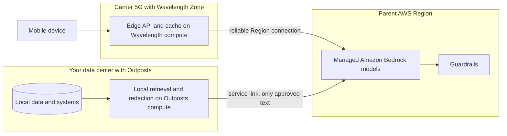

## 0. Before you start
- **Essential:** the idea of an AWS Region and Availability Zone; what "latency" means (the time for a message to travel and come back).
- **Helpful:** VPC subnets and routing; what a 5G carrier network is at a high level.
- **Optional advanced:** Direct Connect and VPN (these are *out of scope* for the exam per [service-scope](aip:meta/service-scope), but you need the idea that the link to the Region exists).

## 1. Simple explanation
Sometimes your AI application cannot live only in a faraway AWS Region. The data may have to stay in your own building (a factory, a hospital, a bank branch), or the users may be on mobile phones and every extra millisecond is noticed. **AWS Outposts** puts AWS-managed servers in **your** data center so you can run AWS services next to your data. **AWS Wavelength** puts AWS compute inside **mobile carriers' 5G networks** so mobile apps reach it in very few hops. Both are extensions of a normal AWS Region, so they still depend on that parent Region for management and for services that do not run locally, which for GenAI usually includes the managed Amazon Bedrock models.


```figure
flow edge-placement
```

## 2. Structured explanation
1. **Outposts** ✅: "a fully managed service that extends AWS infrastructure, services, APIs, and tools to customer premises". AWS installs, operates and monitors the hardware as part of a parent Region. Form factors: **racks** (42U) and **servers** (1U or 2U).
2. **Wavelength** ✅: "deploys standard AWS compute and storage services to the edge of communications service providers' (CSP) networks". You extend a VPC into **Wavelength Zones**, which are logical extensions of a Region managed by the Region's control plane.
3. **Both** talk back to the parent Region through a managed connection (Outposts: the **service link**; Wavelength: the Region connection and a **carrier gateway** to the carrier network).
4. **For GenAI:** keep data, retrieval and pre-/post-processing near the user or data; send what may leave the site to managed Bedrock in the Region; or self-host a model locally if no data may leave.
5. **Decision:** data residency or on-premises systems → Outposts; mobile 5G latency → Wavelength; both are about *where compute runs*, not about which model you use.

## 3. Analogy
**A bakery with branches.** The main bakery (the Region) has every machine. An Outpost is a mini-oven installed inside a customer's own shop so the bread never travels. A Wavelength Zone is a kiosk at the train station so commuters get bread without the trip to the main bakery. The recipes and ordering system are still run by the main bakery.

*Where it breaks:* a kiosk can only make what the mini-oven supports. Most advanced machines (like the managed foundation models of Bedrock) stay in the main bakery, so a local site often still needs a good connection to it.

## 4. The seven questions

**WHAT?** Outposts: AWS-owned, AWS-managed capacity located at your site. Wavelength: AWS infrastructure inside telecom 5G networks.

**WHY?** Local data processing, low latency to on-premises systems, data residency (Outposts); ultra-low latency for mobile and connected devices (Wavelength) ✅.

**WHEN?** Hospitals, factories, financial institutions with local data; mobile gaming/AR/live video and, increasingly, mobile AI assistants where network hops matter.

**WHERE?** Outposts: a customer site, associated with a Region and Availability Zone; service availability varies per Region ✅. Wavelength: Wavelength Zones in carrier locations, each tied to a parent Region ✅.

**HOW?** §5.

**WHAT IF?**
| Situation | Effect | Remedy |
|---|---|---|
| A service you need is not offered on your Outposts form factor | Cannot be created locally (for example EKS nodes, RDS, ElastiCache, S3, EBS are listed for racks but not servers) ✅ | Choose racks or a Region service |
| The Region you are tied to lacks a service on Outposts | Not available (for example S3 on Outposts is "No" for Europe (Spain) and Middle East (UAE) in the tables I read) ✅ | Check the per-Region table before buying |
| You want to call managed Bedrock from the site | The call goes to the parent Region over the connection; latency depends on that link | Co-locate caching, keep prompts small; consider private connectivity (module 08) |
| No data may leave the building | Managed Bedrock cannot be the only inference path | Self-hosted model on local compute 🟡 |
| You assume edge compute makes the model faster | It only removes network distance; model time-to-first-token is unchanged | Measure end-to-end |
| You try to connect an Outpost to another Outpost or Local Zone in the same VPC | Not allowed ✅ | Design separate VPCs/connectivity |

**WHY NOT?** Do not buy Outposts only to reduce latency when users are in the cloud (use a closer Region). Do not use Wavelength for stationary Wi-Fi users (it targets carrier 5G). Do not expect all AWS AI services at the edge.

## 5. Technical depth

### 5.1 AWS Outposts ✅ (`what-is-outposts.html`)
- **Key concepts:** *Outpost site* (customer building meeting power, network and facility needs); *Outpost capacity* (compute and storage, with self-service capacity management); *Outposts racks* (42U, servers, switches, patch panel, power shelf); *ACE racks* (aggregation/core/edge networking for multi-rack deployments, **required when you have four or more compute racks**); *Outposts servers* (1U/2U); *service link* ("network route that enables communication between your Outpost and its associated AWS Region"; each Outpost is an extension of an Availability Zone); *local gateway (LGW)* for rack-to-on-premises traffic; *local network interface* for servers.
- **Resources on Outposts** (racks vs servers) ✅:
| Resource | Racks | Servers |
|---|---|---|
| EC2 instances | Yes | Yes |
| ECS clusters | Yes | Yes |
| EKS nodes | Yes | No |
| EBS volumes | Yes | No |
| S3 on Outposts buckets | Yes | No |
| RDS DB instances | Yes | No |
| ElastiCache nodes | Yes | No |
| EMR clusters | Yes | No |
| Application Load Balancer | Yes | No |
| VPC subnets | Yes | Yes |
| Route 53 Resolver | Yes | No |
| IoT Greengrass | Yes | Yes |
| App Mesh Envoy proxy | Yes | Yes |
- **Per-Region support** varies; the page has tables per geography (for example, Europe (Spain) and Middle East (UAE) show S3 and RDS as not available; UAE also shows Application Load Balancer as not available) ✅.
- **Networking:** subnets on the Outpost belong to a VPC that also spans the Region, so instances on the Outpost talk to Regional resources over private IPs ✅.
- **Pricing:** based on your order (configuration, term and payment option); racks include delivery, installation, maintenance and patching; you also pay for shared resources and data transfer from the Region to the Outpost ✅. Numbers not used.

### 5.2 AWS Wavelength ✅ (`what-is-wavelength.html`)
- **Concepts:** *Wavelength Zone* (carrier location; logical extension of a Region, managed by the Region's control plane); *Wavelength subnet*; *carrier gateway* (inbound from the carrier network and outbound to the carrier network and internet); *Network Border Group*; *Wavelength application*.
- **Resources:** EC2 instances, EBS volumes, VPC subnets and carrier gateways; plus Auto Scaling, EKS and ECS clusters, Systems Manager, CloudWatch, CloudTrail, CloudFormation, and an Application Load Balancer in select zones. These are "part of a VPC that is connected over a reliable connection to an AWS Region for easy access to services running in Regional subnets".
- Use the **parent Region** when calling APIs for resources in a Wavelength Zone ✅.

### 5.3 Where GenAI fits

*Reading the arrows:* on the left, local retrieval and redaction run next to the data and only approved, minimal text crosses the service link to Bedrock. On the right, a mobile device reaches an edge API in the carrier network; that API forwards model calls to Bedrock in the parent Region. The model sits in the Region in both cases.

What the sources say about GenAI placement:
- **Managed Bedrock is a Regional service.** I found no official AWS page announcing Amazon Bedrock models running on Outposts or in Wavelength Zones ❌. A secondary summary of the topic agrees that managed Bedrock is a cloud service.
- 🟡 **AWS Machine Learning blog** ("Implement RAG while meeting data residency requirements using AWS hybrid and edge services", via search summary): describes a **fully local** pattern (both foundation model and data sources on premises, using an Outposts rack and an edge subnet) and a **hybrid** pattern (Bedrock handles some actions in a Region while Lambda calls self-managed models at the edge). I did not read the post itself.
- 🟡 **Wavelength ML:** AWS has material on deploying pre-trained models with SageMaker JumpStart on Wavelength for 5G edge inference, and the Wavelength FAQ (search summary) mentions image/video recognition and inference at the edge with a GPU instance type; a 2020 article said other AWS services such as Lambda, RDS and DynamoDB were not available at the mobile edge (dated; verify). Treat instance types and service lists as ❌.
- **Data residency inside Bedrock** is handled by Region choice and inference routing: in-Region versus cross-Region and global inference profiles ([04/04](aip:04-operational-efficiency/04-backoff-connection-pooling-and-cross-region-inference)). For strict residency use in-Region profiles and check SCPs.
- **Private connectivity** (VPC endpoints, PrivateLink, SCP controls) for Bedrock calls from private networks is covered in [module 08](aip:08-security/01-least-privilege-iam-identity-center-and-data-masking) and the NAT idle-timeout fix in the [verification log](aip:meta/verification-log).

### 5.4 Choosing a location
| Need | Region | Local Zone / Wavelength | Outposts |
|---|---|---|---|
| Managed foundation models (Bedrock) | Yes | Call the parent Region | Call the parent Region |
| Data must remain in my building | No | No | Yes |
| Mobile 5G users, minimal hops | No | Wavelength | No |
| Use the full AWS service catalogue | Yes | Subset ✅ | Subset ✅ (varies by Region and form factor) |
| Operated by | AWS | AWS / carrier location | AWS-managed, at your site |
(Local Zones are mentioned on the Wavelength page only as another zone type a VPC can span; details were not read ❌.)

## 6. Worked example
*Problem:* A hospital group wants a clinical-notes assistant. Patient records must not leave the building unredacted; clinicians in the hospital need answers within about two seconds; the group also builds a patient mobile app that needs a snappy chat for appointment questions.

| Need | Design | Why |
|---|---|---|
| Records stay on site | Outposts rack hosts the record system's read replica (RDS/EC2), vector store and retrieval service | Local data processing ✅ |
| Redaction before leaving | Local service removes direct identifiers; only minimal text goes over the service link to Bedrock in the parent Region, guarded by Guardrails | Data minimization (module 07/08) |
| If *nothing* may leave | Self-host a smaller model on local GPU capacity 🟡 (instance availability ❌) | Fully local pattern |
| Mobile appointment chat | Edge API in a Wavelength Zone for hops; model call to Bedrock in the parent Region; keep prompts small and cache FAQs | Edge reduces network distance only |
| Resilience | Plan for service-link degradation; fall back to cached answers | The link to the Region is a dependency ✅ |
| Approvals | Use in-Region inference profiles to keep processing in a chosen geography | Residency ([04/04](aip:04-operational-efficiency/04-backoff-connection-pooling-and-cross-region-inference)) |

## 7. Knowledge checkpoints
1. What are the two Outposts form factors and which of them cannot host EKS nodes or RDS?
2. What is the Outposts service link?
3. What is a Wavelength Zone and who manages its control plane?
4. Does moving compute to the edge change a model's time to first token?
5. When is an ACE rack required?

## 7b. Practice questions (exam-style, original) — answers in §14

**Q1.** A bank must process customer documents on its own premises but wants AWS-managed infrastructure and the same APIs as the Region. Which service fits?
A. AWS Outposts
B. AWS Wavelength
C. Amazon CloudFront
D. AWS Snowcone only

**Q2.** A mobile game studio wants AI chat features with the lowest possible network latency for players on carrier 5G. Which service places compute inside the carrier network?
A. AWS Wavelength
B. AWS Outposts racks
C. Amazon S3 Glacier
D. AWS Direct Connect

**Q3.** (Select TWO) Which are true of AWS Outposts?
A. It extends AWS infrastructure to customer premises and is managed by AWS as part of a Region
B. Outposts servers support EKS nodes and RDS instances
C. Racks and servers are the two form factors
D. Each Outpost operates independently with no connection to a Region
E. Outposts is a CDN

**Q4.** A team places an LLM-powered assistant in a Wavelength Zone and expects the model answer to arrive instantly. What is the correct view?
A. Edge placement reduces network distance but does not change the model's own time to first token
B. It removes all latency
C. It makes the model smaller
D. It disables Region connectivity

**Q5.** (Select TWO) What is the status of managed Amazon Bedrock models relative to Outposts and Wavelength?
A. Managed Bedrock is called in a Region; edge sites send requests to the parent Region
B. No official page was found stating that managed Bedrock models run inside Outposts or Wavelength Zones
C. Bedrock runs inside every Wavelength Zone
D. Bedrock replaces the service link
E. Bedrock models are installed on Outposts racks automatically

**Q6.** A company needs S3 on Outposts in a particular Region. What should it check first?
A. The per-Region Outposts service availability table
B. Its CloudFront distribution
C. The IAM policy size
D. The Lambda timeout

**Q7.** How many compute racks require an ACE rack?
A. Four or more
B. One
C. Two
D. None, ever

**Q8.** Where do you call APIs to manage resources that live in a Wavelength Zone?
A. The parent Region
B. A special carrier API only
C. The Wavelength Zone ID as a Region
D. A local console on the carrier network

## 8. Hands-on lab: placement rules, an edge latency model and a service-availability checker

### 8.1 Objective
Reproduce, offline, (1) a placement chooser based on the documented purpose of each service, (2) a latency model that shows what edge placement can and cannot fix, and (3) an availability check using the Outposts racks-versus-servers table and two per-Region rows.

### 8.2 Prerequisites
Python 3 only. There is no meaningful hands-on lab for Outposts or Wavelength without hardware or a carrier relationship; this file does not pretend there is.

### 8.3 AWS services
Offline: none. Real use needs an Outposts order or a Wavelength-enabled account and Region ❌ (setup steps not read).

### 8.4 IAM permissions
Offline: none.

### 8.5 Region notes
Availability of Outposts services varies by Region and form factor ✅; Wavelength Zones are tied to specific Regions and carriers ❌ (zone list not read).

### 8.6 Architecture
§5.3.

### 8.7 Cost
Offline: none. Real: Outposts is priced by order (contract term, configuration) ✅; Wavelength has its own pricing page ❌.

### 8.8 Code
```python lab-run
# ---- 1. Placement chooser (rules summarised from the Outposts and Wavelength overview pages) ----
def place(data_must_stay_on_site, users_on_carrier_5g, needs_managed_bedrock, nothing_may_leave_site=False):
    plan = []
    if data_must_stay_on_site:
        plan.append("Outposts: local data, retrieval and redaction next to the data")
    if users_on_carrier_5g:
        plan.append("Wavelength: edge API and cache inside the carrier network")
    if needs_managed_bedrock and nothing_may_leave_site:
        plan.append("CONFLICT: managed Bedrock runs in the Region; use a self-hosted model locally (instance availability unverified)")
    elif needs_managed_bedrock:
        plan.append("Region: call managed Bedrock in the parent Region (send minimal, approved text)")
    return plan or ["Region only: no edge placement needed"]
for case in ((True, False, True, False), (False, True, True, False), (True, False, True, True), (False, False, True, False)):
    print(case, "->")
    for step in place(*case):
        print("    ", step)

# ---- 2. What edge placement fixes: network round trips, not model time (all numbers INVENTED, milliseconds) ----
def end_to_end(client_to_entry_rtt, entry_to_region_rtt, time_to_first_token):
    return client_to_entry_rtt + entry_to_region_rtt + time_to_first_token
ttft = 700
direct = end_to_end(80, 0, ttft)          # phone straight to the Region
via_edge = end_to_end(15, 30, ttft)       # phone to a nearby edge entry point, which calls the Region
print(f"phone -> Region directly      : {direct} ms to first token")
print(f"phone -> edge -> Region       : {via_edge} ms to first token (saves {direct - via_edge} ms, model time unchanged)")
print(f"share of the total that is model time: {100 * ttft / direct:.0f}% direct, {100 * ttft / via_edge:.0f}% via edge")

# ---- 3. Outposts availability: racks vs servers (from the 'AWS resources on Outposts' tables) ----
FORM = {
    "EC2": {"rack": True, "server": True}, "ECS": {"rack": True, "server": True},
    "EKS nodes": {"rack": True, "server": False}, "EBS": {"rack": True, "server": False},
    "S3 on Outposts": {"rack": True, "server": False}, "RDS": {"rack": True, "server": False},
    "ElastiCache": {"rack": True, "server": False}, "ALB": {"rack": True, "server": False},
}
REGION_GAPS = {"Europe (Spain)": {"S3 on Outposts", "RDS"}, "Middle East (UAE)": {"S3 on Outposts", "RDS", "ALB"}}
def check(services, form, region=None):
    problems = []
    for s in services:
        if not FORM[s][form]:
            problems.append(f"{s}: not offered on Outposts {form}s")
        elif region and s in REGION_GAPS.get(region, set()):
            problems.append(f"{s}: not available on Outposts in {region}")
    return problems or ["all requested services are available"]
print("EC2 + EKS on a server      :", check(["EC2", "EKS nodes"], "server"))
print("EC2 + RDS + S3 on a rack   :", check(["EC2", "RDS", "S3 on Outposts"], "rack"))
print("S3 on a rack in Spain      :", check(["S3 on Outposts"], "rack", "Europe (Spain)"))
print("ACE rack needed at 3 racks?", 3 >= 4, "| at 4 racks?", 4 >= 4)
```

### 8.9 Captured output
Generated on 2026-10-26 by extracting the block above from this file and running it (Python 3). The latency numbers are invented; the availability data comes from the Outposts overview page. It is **not** AWS output.
```text lab-out
(True, False, True, False) ->
     Outposts: local data, retrieval and redaction next to the data
     Region: call managed Bedrock in the parent Region (send minimal, approved text)
(False, True, True, False) ->
     Wavelength: edge API and cache inside the carrier network
     Region: call managed Bedrock in the parent Region (send minimal, approved text)
(True, False, True, True) ->
     Outposts: local data, retrieval and redaction next to the data
     CONFLICT: managed Bedrock runs in the Region; use a self-hosted model locally (instance availability unverified)
(False, False, True, False) ->
     Region: call managed Bedrock in the parent Region (send minimal, approved text)
phone -> Region directly      : 780 ms to first token
phone -> edge -> Region       : 745 ms to first token (saves 35 ms, model time unchanged)
share of the total that is model time: 90% direct, 94% via edge
EC2 + EKS on a server      : ['EKS nodes: not offered on Outposts servers']
EC2 + RDS + S3 on a rack   : ['all requested services are available']
S3 on a rack in Spain      : ['S3 on Outposts: not available on Outposts in Europe (Spain)']
ACE rack needed at 3 racks? False | at 4 racks? True
```

### 8.10 Explanation
- Part 1: each need maps to a documented purpose; the conflict line shows why "no data may leave" and "managed Bedrock" cannot both hold.
- Part 2: with invented numbers the edge saves 35 ms but model time dominates either way.
- Part 3: the table lookups reproduce the racks/servers differences and two per-Region gaps from the page.

### 8.11 Optional AWS lab
Not applicable without an Outposts order or a Wavelength-enabled account. Study alternative: read the Outposts "AWS resources" tables and the per-Region support tables, and sketch where each component of a GenAI app would run.

### 8.12 Common errors
| Error | Cause | Fix |
|---|---|---|
| Cannot create EKS nodes on an Outposts server | Racks only ✅ | Use racks or ECS/EC2 |
| Service missing in a Region | Per-Region table ✅ | Check before ordering |
| Edge app slow despite edge placement | Model time dominates or Region calls are slow | Measure, cache, shorten prompts |
| Calls fail when the link degrades | Dependency on service link/Region connection ✅ | Local fallback and caching |
| Wrong Region used for Wavelength API calls | Must use the parent Region ✅ | Set the Region |

### 8.13 Security recommendations
Treat the service link and Region connection as trusted but private paths; use private connectivity (VPC endpoints, PrivateLink) for Bedrock calls (module 08); redact before sending text to the Region; encrypt local storage; restrict physical access to the site (customer responsibility for facility and network requirements ✅); log what leaves the site.

## 9. What can go wrong?
| Failure | Why | Symptoms | Investigate | Fix | Prevent |
|---|---|---|---|---|---|
| **Wrong form factor** | Needed service not on servers | Cannot deploy | Resource table ✅ | Racks | Check tables first |
| **Residency leak** | Raw records sent to Region | Compliance finding | Network and prompt logs | Redact, in-Region profiles | Data-flow review |
| **Link dependency** | Outage between site and Region | Failed model calls | Connection metrics | Caches, fallback | Resilience tests |
| **Edge illusions** | Latency blamed on distance only | No improvement | Per-hop timing | Trace end-to-end | Latency budget |
| **Unavailable service in Region** | Per-Region gaps | Order mismatch | Region table ✅ | Different Region | Verify before purchase |
| **Stale assumptions** | Dated blog claims | Wrong design | Official pages | Re-verify | Date every claim |
| **Cost of idle capacity** | Over-provisioned racks | Bill | Utilization | Right-size | Capacity planning |

## 10. Common misconceptions
1. **"Outposts is a separate cloud."** It is an extension of a Region and depends on it ✅.
2. **"Wavelength runs every AWS service."** It supports a subset (EC2, EBS, VPC, EKS, ECS, etc.) ✅.
3. **"Bedrock models run on my Outposts."** No official source found; managed Bedrock is Regional ❌.
4. **"Edge removes all latency."** It removes network distance only.
5. **"Outposts servers equal racks."** Racks support more services ✅.

## 11. Exam notes
- **Patterns:** "AWS services on premises, local data processing, residency" → Outposts; "ultra-low latency for mobile devices on 5G" → Wavelength; "managed foundation models" → the Region (Bedrock) with private connectivity.
- **Keywords:** service link, local gateway, ACE rack, racks vs servers, Wavelength Zone, carrier gateway, parent Region.
- **Traps:** assuming Bedrock runs at the edge; assuming Outposts works with no Region connection; confusing Wavelength with Local Zones or CloudFront.
- **Compare:** Outposts vs Wavelength vs Local Zones vs Regions; CloudFront (content caching, not compute placement).

## 12. Summary and revision cards
- Outposts: AWS-managed racks/servers at your site; service link to the parent Region; racks support more services than servers.
- Wavelength: AWS compute in carrier 5G networks; zones extend a Region; carrier gateway.
- GenAI: models stay in the Region (managed Bedrock); edge handles data, retrieval, redaction and caching; fully local needs self-hosted models.

**Cards.** Q: Outposts form factors? A: Racks (42U) and servers (1U/2U). · Q: Four or more compute racks need? A: An ACE rack. · Q: Where do you call APIs for a Wavelength Zone? A: The parent Region.

## 13. References
| Source | URL | Verified |
|---|---|---|
| What is AWS Outposts | https://docs.aws.amazon.com/outposts/latest/userguide/what-is-outposts.html | 2026-10-26 |
| What is AWS Wavelength | https://docs.aws.amazon.com/wavelength/latest/developerguide/what-is-wavelength.html | 2026-10-26 |
| AWS ML blog: RAG with data residency using hybrid and edge services | https://aws.amazon.com/blogs/machine-learning/implement-rag-while-meeting-data-residency-requirements-using-aws-hybrid-and-edge-services | 🟡 search summary only |
| AWS ML blog: pre-trained models on Wavelength with JumpStart | https://aws.amazon.com/blogs/machine-learning/deploy-pre-trained-models-on-aws-wavelength-with-5g-edge-using-amazon-sagemaker-jumpstart | 🟡 search summary only |

**Unverified here:** whether any Bedrock capability runs on Outposts/Wavelength; GPU instance types on Outposts/Wavelength; Wavelength Zone lists and carriers; Local Zones details; behavior during service-link outages; both blog posts (not opened); pricing.

## 14. Answers to checkpoints and practice questions
**Checkpoints.** 1) Racks and servers; servers cannot host EKS nodes or RDS ✅. 2) The network route between the Outpost and its associated Region ✅. 3) A zone in a carrier location that is a logical extension of a Region, managed by the Region's control plane ✅. 4) No ✅ (design inference). 5) With four or more compute racks ✅.

**Practice questions.**
- **Q1 → A.** Outposts extends AWS infrastructure to customer premises. B is carrier-edge, C is a CDN, D is not the offered pairing ✅.
- **Q2 → A.** Wavelength places compute in carrier networks ✅.
- **Q3 → A, C.** B false (servers do not list EKS/RDS). D false (service link to the Region). E false ✅.
- **Q4 → A.** ✅ (reasoning, not a documented number).
- **Q5 → A, B.** C, D, E are false or unsupported ❌ (absence of evidence for Bedrock on edge; managed Bedrock is Regional).
- **Q6 → A.** Per-Region tables ✅.
- **Q7 → A.** Four or more ✅.
- **Q8 → A.** Parent Region ✅.
