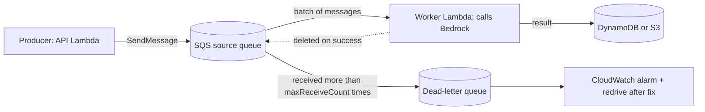
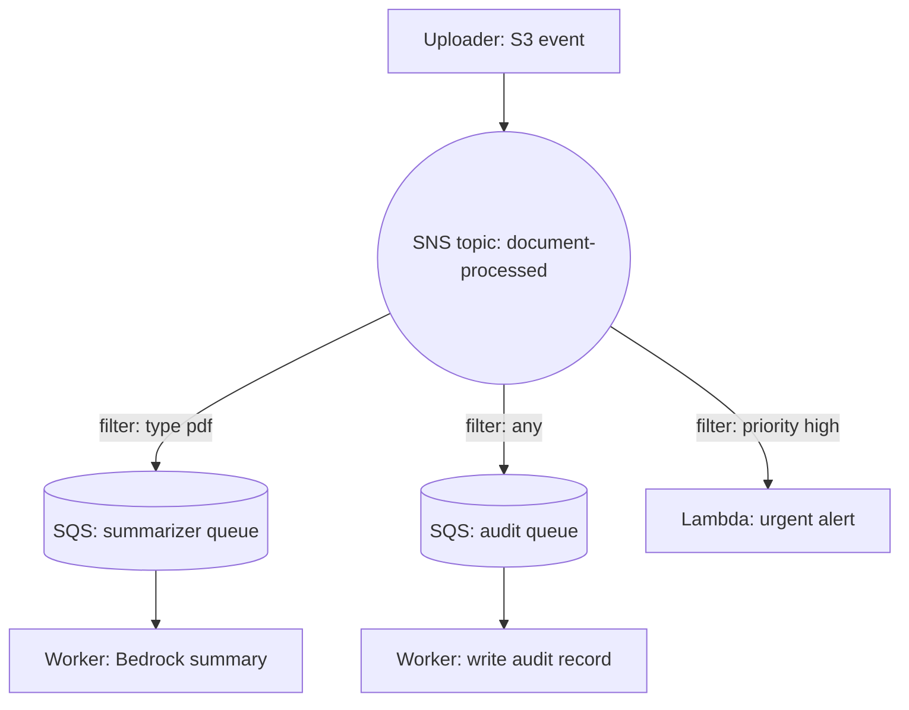

## 0. Before you start
- **Essential:** what a message is; the difference between "wait for the answer" and "leave a note".
- **Helpful:** JSON; what a webhook is; at-least-once vs exactly-once delivery.
- **Optional advanced:** idempotency keys; event schemas.

## 1. Simple explanation
Four services let the parts of an application talk without waiting for each other. **SQS** is a mailbox: producers drop messages in, workers take them out when ready, and messages that keep failing are moved to a "problem" mailbox. **SNS** is a loudspeaker: one message is announced to many listeners (queues, Lambda functions, phones, emails) at once. **EventBridge** is a smart mail sorter: it looks at each event, applies rules, and routes it to the right target; it can also run things on a schedule. **AppFlow** is a no-code courier that copies data between SaaS apps (like Salesforce or Slack) and AWS (like S3). For GenAI they provide **buffering** (protect the model from traffic bursts), **fan-out** (one event, many reactions), **retries with a safety net**, and **fresh data** for your knowledge base.


```figure
flow sns-fanout
```

## 2. Structured explanation
1. **SQS** ✅: standard queues (very high throughput, at-least-once, best-effort ordering) and FIFO queues (ordering within a message group, deduplication, limited throughput unless high-throughput mode). Messages are retained 4 days by default; visibility timeout hides a message while a consumer works on it; dead-letter queues catch failures.
2. **SNS** ✅: publish/subscribe with **topics** (standard and FIFO). Subscribers: SQS, Lambda, HTTP(S), email, mobile push, SMS, Firehose and partner services. **Filter policies** on subscriptions choose which messages each subscriber gets.
3. **EventBridge** ✅: event buses (a new **Custom Event Bus** and the **Custom Event Bus - Classic** with rules and targets), **Pipes** (point-to-point with filtering/enrichment), **Scheduler** (cron/rate/one-time), schema registry. Failed deliveries are retried and can go to a DLQ.
4. **AppFlow** ✅: managed SaaS-to-AWS data flows on demand, on a schedule or on an event; encrypted; optional PrivateLink; can catalog data in Glue.
5. **GenAI patterns:** SQS in front of Bedrock workers (rate smoothing and retries); SNS fan-out of "document processed" events; EventBridge rules to trigger knowledge-base ingestion or evaluation; Scheduler for nightly re-indexing; AppFlow to bring SaaS content into S3 for retrieval.

## 3. Analogy
**A post office.** SQS is a pigeonhole for a single clerk's tasks (each letter handled by one clerk). SNS is a town crier. EventBridge is the sorting machine that reads the address and routes each letter, and can also send a letter every Monday at nine. AppFlow is the courier who fetches parcels from other companies' warehouses.

*Where it breaks:* a pigeonhole letter, once taken, is gone; an SQS message that is taken but not deleted reappears after the visibility timeout (so a slow worker causes duplicates). And a town crier does not remember: SNS delivers to current subscribers, so a new queue only sees future messages.

## 4. The seven questions

**WHAT?** Messaging and integration services for decoupled, event-driven systems.

**WHY?** Absorb bursts (protect Bedrock quotas), retry safely, react to events without polling, schedule work, move SaaS data without code.

**WHEN?** SQS: one consumer group, buffering, retries. SNS: many consumers of the same message. EventBridge: content-based routing, AWS service events, SaaS partner events, schedules. AppFlow: scheduled/event data sync from SaaS to AWS.

**WHERE?** All Regional. Dead-letter queues must be in the same account and Region as the source queue ✅.

**HOW?** §5.

**WHAT IF?**
| Situation | Effect | Remedy |
|---|---|---|
| Worker takes longer than the visibility timeout | The message reappears and is processed again ✅ | Visibility timeout above processing time (Lambda: ≥ 6× timeout) |
| A message keeps failing | After `maxReceiveCount` receives it moves to the DLQ ✅ | Set `maxReceiveCount` ≥ 5 for Lambda sources; alarm on DLQ depth |
| DLQ retention shorter than source retention (standard) | Messages expire in the DLQ sooner than expected because expiry uses the original enqueue time ✅ | Make DLQ retention longer |
| Payload bigger than 1 MiB | SQS rejects it | Store in S3, send a pointer (Extended Client up to 2 GB) ✅ |
| EventBridge target is down | Retries for 24 h / 185 attempts by default (Classic), then the event is dropped unless a DLQ exists ✅ | Configure a DLQ |
| SNS subscriber has no filter policy | Receives every message ✅ | Add a filter policy |
| FIFO queue used with a DLQ and strict order matters | The DLQ can break the order ✅ | Avoid DLQ for strictly ordered flows |

**WHY NOT?** Do not use SQS when you need the answer immediately in the same call. Do not use SNS as a work queue (no per-message visibility/redelivery model like SQS; subscribers need their own queue for buffering). Do not use EventBridge for high-volume ordered streams where Kinesis or SQS FIFO fit better.

## 5. Technical depth

```figure
queue-buffer
```


### 5.1 Amazon SQS ✅ (`quotas-messages.html`, `sqs-dead-letter-queues.html`, `standard-queues.html`)
| Item | Value on the pages |
|---|---|
| Message size | 1 byte to 1,048,576 bytes (1 MiB); larger payloads via the **Extended Client Library** (Java, Python) with a pointer to S3, up to 2 GB; synchronous clients only |
| Retention | default 4 days; 60 seconds to 1,209,600 seconds (14 days) |
| Visibility timeout | default 30 s; 0 to 12 hours |
| Delay (message timer) | 0 to 15 minutes |
| Batch | up to 10 messages per batch request; up to 10 message attributes |
| Standard queue | nearly unlimited API calls per second; **at-least-once** delivery; messages may arrive out of order (best-effort ordering) |
| FIFO queue | `MessageGroupId` required (max 128 characters); each partition limited to 300 transactions per second per API action in the default mode; with batching up to 3,000 messages per second; **high-throughput mode** raises limits by Region (for example up to 70,000 TPS in US East (N. Virginia), US West (Oregon) and Europe (Ireland), 2,400 TPS default elsewhere) |
| Fair queues | in a standard queue, using `MessageGroupId` enables **fair queues** (noisy-neighbour protection); AWS recommends setting it on all messages when used |
| Long polling | set `WaitTimeSeconds` on receive to reduce empty responses |

**Dead-letter queues** ✅: a DLQ must be in the same account and Region as the source. A **redrive policy** on the source gives `maxReceiveCount` (receives before a message moves). A **redrive allow policy** on the DLQ says which source queues may use it (all, specific, or `denyAll`). For standard queues the original enqueue timestamp is kept, so set the DLQ's retention **longer** than the source's; for FIFO the timestamp resets. **DLQ redrive** moves messages back to the source after you fix the bug. Alarm on DLQ depth.


*Reading the arrows:* producers add messages; workers receive batches; a message is hidden during the visibility timeout and removed only when the worker deletes it (for Lambda, when the function succeeds). A message received too often goes to the DLQ, where an alarm tells the team and a redrive can send it back after the bug is fixed.

### 5.2 SQS as a buffer in front of Bedrock
- The queue absorbs bursts; **worker concurrency** sets the model call rate. For Lambda workers, the SQS event source mapping has a maximum-concurrency setting and a provisioned mode with pollers ([06/01 §5.4–5.5](aip:06-app-building-tools/01-lambda-integration-patterns-and-lambda-with-bedrock)); the range for maximum concurrency was not on the page I read ❌.
- Bedrock quotas deduct `input + max_tokens` up front ([04/04](aip:04-operational-efficiency/04-backoff-connection-pooling-and-cross-region-inference)): on `ThrottlingException` do **not** delete the message; let it reappear (visibility timeout) or add backoff; poison messages end in the DLQ.
- Make workers **idempotent**: key = message ID or a business key, store results with a conditional write ([02/08](aip:02-data-management/08-amazon-dynamodb-for-genai)).
- Return results through a store (DynamoDB/S3) plus notification (SNS, EventBridge, AppSync) because the producer is long gone ([06/06](aip:06-app-building-tools/06-mlflow-appsync-and-amplify)).

### 5.3 Amazon SNS ✅ (`welcome.html`, `sns-message-filtering.html`, `sns-fifo-topics.html`)
- Publishers send to a **topic**; subscribers receive via SQS, Lambda, HTTP(S), email, mobile push, SMS, Firehose and service providers. SNS supports **application-to-application (A2A)** and **application-to-person (A2P)** messaging.
- **Fanout:** one message is copied to all subscribed endpoints for parallel asynchronous processing, for example an order SNS topic with several SQS queues, one per consumer. Copying production events to a test environment is possible but consider data privacy ✅.
- **Filter policies** ✅: by default every subscriber receives every message; a filter policy (JSON) on the **subscription** selects a subset by **message attributes or message body** (body filtering assumes well-formed JSON). If all conditions are satisfied the message is delivered. (Matching semantics inside a policy, for example OR within a list of values, are standard SNS behavior but were not on the page I read ❌.)
- **FIFO topics** ✅: strict ordering and deduplication when paired with SQS FIFO queues; message grouping; archiving and replay are described on the page.
- Pricing: per publish and per delivery, varying by endpoint ✅ (numbers not used).


*Reading the arrows:* one published event is delivered to each matching subscription. Each queue buffers independently, so a slow summarizer does not delay the audit writer or the urgent alert.

### 5.4 Amazon EventBridge ✅ (`eb-what-is.html`, `eb-quota.html`, `eb-rule-retry-policy.html`)
- **Two buses:** the **Custom Event Bus** ("routes events to subscribers that you create, retains events for a period that you set, and supports ordered delivery, replay, and non-JSON payloads") and **Custom Event Bus - Classic** ("routes events using rules and targets that you write"). The page recommends starting with the Custom Event Bus for new applications; Classic remains available. Many AWS tutorials still use the Classic model.
- **Pipes** ✅: point-to-point from one source to one target with filtering, enrichment and transformation; commonly a pipe feeds a bus (for example DynamoDB Stream → pipe → bus → many targets).
- **Scheduler** ✅: cron and rate expressions or one-time invocations, flexible delivery windows, retry limits, and maximum retention for failed invocations.
- **Retry policy (Classic rules/targets)** ✅: by default retries for **24 hours and up to 185 times** with exponential backoff and jitter; after that the event is dropped unless you configured a **dead-letter queue**.
- **Custom Event Bus quotas (fixed)** ✅: retention 1 to 365 days; `MaxRetryAttempts` 0 to 185 (default 5); `MaxEventAgeInSeconds` 60 to 86,400 (default 300); batch up to 500 events; invocation timeout 1 to 30 s; up to 100 entries per `PutEvents`; deduplication window 300 s; 5 buses per account by default.
- **Classic quotas** ✅: up to **5 targets per rule** (not adjustable); 300 rules per bus in most Regions (100 in two named Regions); event pattern size 2,048 characters (adjustable); invocation and `PutEvents` throttles vary by Region.
- **Pipes quotas** ✅: 1,000 concurrent pipe executions (3,000 in US East (N. Virginia), US West (Oregon), Europe (Ireland)); 1,000 pipes per account.
- Event patterns are JSON objects matched against events (fields in the pattern must match; a list means "any of these values"); the pattern syntax pages were not read here ❌.

GenAI uses: S3 object-created events → rule → Step Functions or Lambda that starts a knowledge-base ingestion; Bedrock job-state change events → notify; Scheduler nightly re-index; cross-account event sharing ([02/06](aip:02-data-management/06-s3-vectors-and-keeping-vector-stores-current) for keeping stores current).

**SNS vs EventBridge vs SQS (quick table):**
| | SQS | SNS | EventBridge |
|---|---|---|---|
| Model | Queue; pull; one consumer group per message | Topic; push to many | Bus; rules/subscribers route by content; schedules |
| Buffering/retry | Yes (visibility timeout, DLQ) | Push with retry; pair with SQS to buffer | Retries (24 h, 185) + DLQ |
| Filtering | None (consumer decides) | Filter policy on subscription | Event patterns |
| Ordering | FIFO option | FIFO topics | Custom Event Bus supports ordered delivery ✅ |
| Typical GenAI role | Buffer Bedrock calls | Fan-out notifications | Route AWS/SaaS events, schedules |

### 5.5 Amazon AppFlow ✅ (`what-is-appflow.html`)
- Managed integration between SaaS apps (Salesforce, Zendesk, Slack and others) and AWS services (S3, Redshift and others); no code; run **on demand, on a schedule or on an event** (for Salesforce, event ingestion goes through EventBridge); data is encrypted at rest and in transit; **PrivateLink** gives private transfer; flows can catalog data into the Glue Data Catalog; partition and aggregation settings for S3; custom connector SDKs for other sources.
- One use case on the page transfers aggregate data weekly to S3 "at 100GB per flow" ✅.
- **GenAI use:** land SaaS documents or tickets in S3, then trigger knowledge-base ingestion ([01/04](aip:01-bedrock-genai-fundamentals/04-bedrock-knowledge-bases), [02/06](aip:02-data-management/06-s3-vectors-and-keeping-vector-stores-current)). Apply Comprehend PII detection/redaction first when needed ([02/04](aip:02-data-management/04-transcribe-comprehend-and-comprehend-medical)).
- Not read: connector list, quotas, pricing, Region availability ❌.

## 6. Worked example
*Problem:* A company lets users upload contracts for AI summaries. Peaks of 2,000 uploads in a few minutes exceed the team's Bedrock rate limits; failed summaries must not be lost; the audit team needs every upload logged; and the CRM's support tickets should flow into the knowledge base nightly.

| Need | Design | Why |
|---|---|---|
| Absorb the peak | S3 upload → EventBridge rule → SQS `summarize-q`; worker Lambda with a concurrency cap | Queue buffers; workers set model rate ✅ |
| Do not lose failures | `maxReceiveCount` 5, DLQ with longer retention, alarm on DLQ depth | Safety net ✅ |
| Avoid duplicates | Idempotency by object key + version; conditional write to DynamoDB | At-least-once delivery ✅ |
| Audit everything | SNS topic `document-processed` fanning out to `summarize-q` and `audit-q` | Fan-out ✅ |
| Urgent contracts | SNS filter policy on a `priority=high` attribute → Lambda alert | Filtering ✅ |
| Nightly CRM sync | AppFlow scheduled flow to S3 + EventBridge Scheduler to start KB ingestion | No-code ingest, scheduled sync ✅ |
| Big contracts | Payload is an S3 pointer, not the text | 1 MiB SQS limit ✅ |

## 7. Knowledge checkpoints
1. What is the default message retention in SQS, and the range?
2. What does `maxReceiveCount` control?
3. If an SNS subscription has no filter policy, which messages does it receive?
4. What happens by default when EventBridge cannot deliver an event to a Classic rule target?
5. What triggers can start an AppFlow flow?

## 7b. Practice questions (exam-style, original) — answers in §14

**Q1.** A web API accepts document uploads and must call Bedrock for each, but Bedrock throttles during peaks. Which design smooths the load and keeps failed jobs?
A. API → SQS queue → worker Lambda with limited concurrency → DLQ for failures
B. API → direct synchronous Bedrock call in the API handler for each upload
C. API → SNS topic with email subscribers
D. API → AppFlow flow

**Q2.** (Select TWO) Which statements about SQS dead-letter queues are correct?
A. The DLQ must be in the same account and Region as the source queue
B. `maxReceiveCount` is the number of receives before a message moves to the DLQ
C. A DLQ can be in any Region
D. For standard queues the DLQ retention should be shorter than the source retention
E. A DLQ prevents all duplicates

**Q3.** A message larger than 1 MiB must be handled through SQS. Which approach is supported?
A. Store the payload in S3 and send a pointer, for example with the SQS Extended Client Library
B. Increase the queue's maximum message size to 100 MiB
C. Split into environment variables
D. Use SMS delivery

**Q4.** One uploaded-document event must start three independent processors: summarization, auditing and virus scanning, each with its own retry behavior. Which pattern fits best?
A. SNS topic fanning out to three SQS queues
B. A single SQS queue read by all three processors
C. One Lambda function calling three services in sequence
D. Three separate S3 buckets

**Q5.** (Select TWO) Which are true about SNS message filtering?
A. A filter policy is attached to a subscription
B. Without a filter policy a subscriber receives every message
C. Filter policies are attached to the publisher's code
D. SNS can filter only on message body, never on attributes
E. Subscribers cannot be Lambda functions

**Q6.** EventBridge cannot reach a rule's target for hours. What is the documented default for a Classic target, and how do you avoid losing events?
A. It retries for 24 hours and up to 185 times; configure a dead-letter queue for events that still fail
B. It retries once and drops the event; nothing can be done
C. It retries forever
D. It stores events in SNS automatically

**Q7.** A team wants a nightly job to re-index a vector store at 02:00 without running a server. Which service provides cron-style schedules?
A. EventBridge Scheduler
B. AWS AppFlow only
C. SQS delay of 15 minutes repeated
D. Amazon Connect

**Q8.** A company wants Salesforce and Zendesk data copied to S3 on a schedule without writing code, over a private path. Which service fits?
A. Amazon AppFlow (with PrivateLink)
B. Amazon SQS
C. AWS Outposts
D. Amazon Lex

## 7c. Mixed review for Quiz 6 (more tools for building AI applications)
**R1.** An async Lambda invocation fails. How many automatic retries does Lambda make by default? A. 0 B. 2 C. 10 D. Unlimited
**R2.** Which API Gateway type supports response streaming and usage plans? A. HTTP API B. REST API C. Neither D. WebSocket API only
**R3.** In AppConfig, which period after reaching 100% keeps watching alarms before completing? A. Bake time B. Poll interval C. Deployment time D. TTL
**R4.** In Step Functions, which runs first when a state has both Retry and Catch? A. Retry B. Catch C. Random D. Neither
**R5.** A CodeDeploy Lambda validation hook never calls back. After how long is the deployment treated as failed? A. One hour B. One minute C. Seven days D. Never
**R6.** An SQS queue feeds a Lambda function with a 90-second timeout. Minimum visibility timeout per AWS guidance? A. 90 s B. 180 s C. 540 s D. 30 s
**R7.** Which service lets an AppSync-based app give progressive AI updates when a model call takes 30 s? A. Lambda in event mode plus mutations and a subscription B. A direct Bedrock resolver with streaming C. AppConfig D. Wavelength

**Answers (7c).** R1 → B ([06/01](aip:06-app-building-tools/01-lambda-integration-patterns-and-lambda-with-bedrock)). R2 → B ([06/02](aip:06-app-building-tools/02-api-gateway-and-genai-applications)). R3 → A ([06/03](aip:06-app-building-tools/03-appconfig-and-dynamic-foundation-model-selection)). R4 → A ([06/04](aip:06-app-building-tools/04-step-functions-states-circuit-breaker-and-prompt-chaining)). R5 → A ([06/05](aip:06-app-building-tools/05-codepipeline-codebuild-and-codedeploy)). R6 → C (6 × 90 = 540 s; [06/01](aip:06-app-building-tools/01-lambda-integration-patterns-and-lambda-with-bedrock)). R7 → A ([06/06](aip:06-app-building-tools/06-mlflow-appsync-and-amplify)).

## 8. Hands-on lab: a queue with a DLQ, SNS filtering, pattern matching and payload rules

### 8.1 Objective
Reproduce, offline: SQS visibility timeouts causing duplicates, `maxReceiveCount` moving a poison message to a DLQ, SNS-style filter matching with fan-out, EventBridge-style pattern matching and retry arithmetic, and the inline-versus-pointer payload rule.

### 8.2 Prerequisites
Python 3 only. Optional AWS part: an AWS account with SQS, SNS, EventBridge and Lambda permissions.

### 8.3 AWS services
Offline: none. Optional: SQS, SNS, EventBridge, Lambda, CloudWatch.

### 8.4 IAM permissions
Offline: none. Real: SQS send/receive/delete permissions for producers/consumers; SNS publish permission; a queue policy letting the SNS topic send to the queue; EventBridge permission to invoke targets (exact action names ❌ not read).

### 8.5 Region notes
Create everything in one Region; a DLQ must share the source queue's account and Region ✅.

### 8.6 Architecture
§5.1 (queue) and §5.3 (fan-out).

### 8.7 Cost
Offline: none. Real: all four services are pay-per-use ✅; prices ❌ not read. Keep tests tiny and delete resources.

### 8.8 Code
```python lab-run
import json

# ---- 1. SQS: visibility timeout -> duplicates; maxReceiveCount -> DLQ (discrete one-second ticks, two workers) ----
class Queue:
    def __init__(self, visibility, max_receive):
        self.visibility, self.max_receive = visibility, max_receive
        self.msgs, self.dlq = [], []                       # msgs: dicts with body, receives, hidden_until
    def send(self, body):
        self.msgs.append({"body": body, "receives": 0, "hidden_until": 0})
    def receive(self, now):
        for m in list(self.msgs):
            if m["hidden_until"] <= now:
                if m["receives"] >= self.max_receive:      # received too many times without deletion: move to the DLQ
                    self.msgs.remove(m)
                    self.dlq.append(m["body"])
                    continue
                m["receives"] += 1
                m["hidden_until"] = now + self.visibility
                return m
        return None
    def delete(self, m):
        self.msgs.remove(m)

def run(visibility, work_seconds, workers=2, poison=False, ticks=40, max_receive=3):
    q = Queue(visibility, max_receive)
    q.send("poison" if poison else "contract-1")
    state, log = [None] * workers, []
    for now in range(ticks):
        for w in range(workers):
            if state[w] and now >= state[w][1]:
                msg = state[w][0]
                if poison:
                    log.append((now, f"worker {w + 1} failed (message not deleted)"))
                elif msg in q.msgs:
                    q.delete(msg)
                    log.append((now, f"worker {w + 1} finished and deleted the message"))
                else:
                    log.append((now, f"worker {w + 1} finished, but the message was already deleted: the work was done twice"))
                state[w] = None
            if state[w] is None:
                m = q.receive(now)
                if m:
                    state[w] = (m, now + work_seconds)
                    log.append((now, f"worker {w + 1} received it (receive #{m['receives']})"))
    return log, q

print("A) work takes 20 s, visibility timeout 10 s, two workers:")
log, q = run(visibility=10, work_seconds=20)
for t, what in log:
    print(f"   t={t:>2}: {what}")
print("B) poison message, visibility 5 s, maxReceiveCount 3:")
log, q = run(visibility=5, work_seconds=1, poison=True, workers=1)
for t, what in log:
    print(f"   t={t:>2}: {what}")
print("   in the DLQ:", q.dlq, "| left in the source queue:", len(q.msgs))
print("C) healthy: work 5 s, visibility 30 s:")
log, q = run(visibility=30, work_seconds=5, workers=1)
for t, what in log:
    print(f"   t={t:>2}: {what}")
print("   left in the source queue:", len(q.msgs))

# ---- 2. SNS-style filter policy fan-out (AND across keys, OR within a list: standard SNS behaviour) ----
def matches(policy, attrs):
    return all(attrs.get(k) in allowed for k, allowed in policy.items())
subs = {"summarizer-queue": {"type": ["pdf", "docx"]}, "audit-queue": {}, "urgent-lambda": {"priority": ["high"]}}
messages = [{"type": "pdf", "priority": "low"}, {"type": "png", "priority": "high"}, {"type": "docx", "priority": "high"}]
for msg in messages:
    targets = [name for name, pol in subs.items() if matches(pol, msg)]
    print(f"message {json.dumps(msg):<38} -> {targets}")

# ---- 3. EventBridge-style pattern: AND across fields, OR within a list (matching rules summarised, syntax pages not read) ----
def event_matches(pattern, event):
    for key, want in pattern.items():
        have = event.get(key)
        if isinstance(want, dict):
            if not isinstance(have, dict) or not event_matches(want, have):
                return False
        elif have not in want:
            return False
    return True
pattern = {"source": ["app.documents"], "detail-type": ["Document Uploaded"], "detail": {"extension": ["pdf", "docx"]}}
events = [
    {"source": "app.documents", "detail-type": "Document Uploaded", "detail": {"extension": "pdf"}},
    {"source": "app.documents", "detail-type": "Document Uploaded", "detail": {"extension": "png"}},
    {"source": "app.billing", "detail-type": "Document Uploaded", "detail": {"extension": "pdf"}},
]
print("pattern matches:", [event_matches(pattern, e) for e in events])

# ---- 4. Retry windows: whichever limit is reached first ends the retries ----
def delivery_budget(max_age_s, max_attempts):
    return {"max_age_hours": round(max_age_s / 3600, 2), "max_attempts": max_attempts,
            "average_spacing_minutes_if_spread_evenly": round(max_age_s / 60 / max_attempts, 1)}
print("Classic default (24 h, 185 attempts):", delivery_budget(24 * 3600, 185))
print("Custom bus default (300 s, 5 attempts):", delivery_budget(300, 5))

# ---- 5. SQS payload rule: inline vs pointer, and FIFO throughput arithmetic ----
LIMIT = 1_048_576
def how_to_send(size_bytes):
    if size_bytes <= LIMIT:
        return "send inline"
    if size_bytes <= 2 * 1024 ** 3:
        return "store in S3 and send a pointer (Extended Client Library, up to 2 GB)"
    return "too large even for the Extended Client Library"
for size in (200_000, 1_048_576, 1_048_577, 3 * 1024 ** 3):
    print(f"{size:>14,} bytes -> {how_to_send(size)}")
print("FIFO default mode with 10-message batches:", 300 * 10, "messages per second per API action")
```

### 8.9 Captured output
Generated on 2026-10-26 by extracting the block above from this file and running it (Python 3). It is an offline model of documented behavior (the one-second tick queue is a simplification), **not** SQS, SNS or EventBridge output.
```text lab-out
A) work takes 20 s, visibility timeout 10 s, two workers:
   t= 0: worker 1 received it (receive #1)
   t=10: worker 2 received it (receive #2)
   t=20: worker 1 finished and deleted the message
   t=30: worker 2 finished, but the message was already deleted: the work was done twice
B) poison message, visibility 5 s, maxReceiveCount 3:
   t= 0: worker 1 received it (receive #1)
   t= 1: worker 1 failed (message not deleted)
   t= 5: worker 1 received it (receive #2)
   t= 6: worker 1 failed (message not deleted)
   t=10: worker 1 received it (receive #3)
   t=11: worker 1 failed (message not deleted)
   in the DLQ: ['poison'] | left in the source queue: 0
C) healthy: work 5 s, visibility 30 s:
   t= 0: worker 1 received it (receive #1)
   t= 5: worker 1 finished and deleted the message
   left in the source queue: 0
message {"type": "pdf", "priority": "low"}     -> ['summarizer-queue', 'audit-queue']
message {"type": "png", "priority": "high"}    -> ['audit-queue', 'urgent-lambda']
message {"type": "docx", "priority": "high"}   -> ['summarizer-queue', 'audit-queue', 'urgent-lambda']
pattern matches: [True, False, False]
Classic default (24 h, 185 attempts): {'max_age_hours': 24.0, 'max_attempts': 185, 'average_spacing_minutes_if_spread_evenly': 7.8}
Custom bus default (300 s, 5 attempts): {'max_age_hours': 0.08, 'max_attempts': 5, 'average_spacing_minutes_if_spread_evenly': 1.0}
       200,000 bytes -> send inline
     1,048,576 bytes -> send inline
     1,048,577 bytes -> store in S3 and send a pointer (Extended Client Library, up to 2 GB)
 3,221,225,472 bytes -> too large even for the Extended Client Library
FIFO default mode with 10-message batches: 3000 messages per second per API action
```

### 8.10 Explanation
- Part 1A: the first worker needs 20 s but the visibility timeout is 10 s, so the message becomes visible again and the second worker receives it while the first is still busy; both finish the work, so it is done twice. 1B: a poison message is received three times, fails each time, and is moved to the DLQ on the next receive attempt. 1C: the healthy path deletes the message.
- Part 2: AND across keys, OR within a list; an empty policy receives everything.
- Part 3: the same matching idea for EventBridge patterns.
- Part 4: the two defaults are very different budgets, so check which bus type you use.
- Part 5: 1 MiB is the inline limit; the Extended Client handles up to 2 GB.

### 8.11 Optional AWS lab (shown, not run against AWS ❌)
1. **SQS:** create a standard queue `summarize-q` (visibility timeout 60 s) and a DLQ `summarize-dlq` (retention longer); set the redrive policy `maxReceiveCount` 5; send a message; receive it twice without deleting to watch it return; send a "poison" message and watch it land in the DLQ; use DLQ redrive afterwards ✅.
2. **SNS:** create a topic; subscribe two queues; give one a filter policy on a message attribute; publish messages with different attributes; confirm only matching queues receive them. Remember to grant the topic permission to send to the queues.
3. **EventBridge:** create a rule (Classic) with an event pattern for a custom source; target a Lambda; use `put-events` to send matching and non-matching events; set a DLQ on the target; stop the target and observe retries.
4. **Scheduler:** create a schedule (cron) that invokes a Lambda once; delete it after.
5. **AppFlow:** explore the console flow creator with a sample source (needs a SaaS account) ❌.
6. Clean up all queues, topics, rules, schedules, flows, roles and logs.

### 8.12 Common errors
| Error | Cause | Fix |
|---|---|---|
| Duplicate processing | Visibility timeout shorter than work | Raise it; make code idempotent ✅ |
| Messages vanish from the DLQ | DLQ retention shorter than source (standard) ✅ | Increase DLQ retention |
| SNS delivers nothing to SQS | Queue policy lacks the topic permission | Add the permission |
| Subscriber gets everything | No filter policy ✅ | Add one |
| EventBridge target never invoked | Pattern mismatch or permissions | Test pattern; fix role |
| `ThrottlingException` from Bedrock in workers | Too many concurrent consumers | Cap concurrency; backoff |
| FIFO throughput lower than expected | One message group serializes ✅ | Spread across more group IDs |

### 8.13 Security recommendations
Encrypt queues and topics (KMS) and grant `kms:Decrypt` to consumers when queues are encrypted ✅; least-privilege queue and topic policies; do not put personal data in message attributes you filter on or log; restrict who can change DLQ and redrive settings; use VPC endpoints for private access; keep raw documents in S3 with access controls and send only pointers; for AppFlow use PrivateLink and encryption ✅.

## 9. What can go wrong?
| Failure | Why | Symptoms | Investigate | Fix | Prevent |
|---|---|---|---|---|---|
| **Duplicate model calls** | Visibility timeout too short / at-least-once | Higher cost, duplicate answers | Receive counts | Idempotency, longer timeout | Design for repeats |
| **Poison message loop** | No DLQ | Same message forever | Queue age metric | DLQ + alarm | `maxReceiveCount` |
| **Lost events** | EventBridge retries exhausted, no DLQ | Missing reactions | Failed invocation metrics | DLQ on target | Always set a DLQ |
| **Retry storm on Bedrock** | Workers retry instantly | Throttling, cost | Throttle metrics | Backoff, concurrency cap | Queue as the buffer |
| **Filter mistakes** | Wrong attribute names | Missing deliveries | Subscription filters | Fix policy | Test with sample messages |
| **Stale data in the KB** | Sync flow/schedule broken | Old answers | Flow run history | Fix flow | Alarm on freshness |
| **Ordering assumptions** | Standard queue best-effort order ✅ | Out-of-order results | Message IDs | FIFO + group IDs | Order-independent design |

## 10. Common misconceptions
1. **"SQS guarantees exactly-once."** Standard queues are at-least-once ✅.
2. **"SNS stores messages for later subscribers."** It delivers to current subscribers; use SQS to buffer.
3. **"EventBridge only handles AWS service events."** It also takes custom and SaaS events, schedules and pipes ✅.
4. **"A DLQ fixes the failing message."** It only isolates it; you must fix and redrive ✅.
5. **"AppFlow needs custom code."** No-code flows; custom connectors are optional ✅.

## 11. Exam notes
- **Patterns:** "decouple and buffer calls to a throttled model" → SQS (+DLQ); "one event, many consumers" → SNS fan-out to SQS; "route by content, schedule, AWS service events" → EventBridge; "SaaS to S3 with no code" → AppFlow; "strict ordering" → FIFO queue/topic.
- **Keywords:** visibility timeout, `maxReceiveCount`, redrive, long polling, filter policy, fanout, event pattern, rule/target, Scheduler, Pipes, PrivateLink.
- **Traps:** thinking SNS buffers; forgetting DLQ retention; assuming exactly-once; using FIFO with DLQ when order is critical; Lambda visibility rule (6×).
- **Compare:** SQS vs SNS vs EventBridge vs Kinesis; Step Functions callbacks vs SQS for human tasks; AppFlow vs Glue vs DMS (module 09).

## 12. Summary and revision cards
- SQS: 1 MiB, 4-day default retention, 30-s visibility, DLQ with `maxReceiveCount`; standard = at-least-once.
- SNS: topic fan-out; filter policy on subscription; FIFO topics with SQS FIFO.
- EventBridge: buses (Custom and Classic), rules/targets, Pipes, Scheduler; 24 h / 185 retries (Classic) + DLQ.
- AppFlow: no-code SaaS ↔ AWS flows; on demand, scheduled, event.

**Cards.** Q: Inline SQS limit? A: 1 MiB. · Q: Where must a DLQ live? A: Same account and Region. · Q: Do subscribers filter in SNS by default? A: No; they get everything.

## 13. References
| Source | URL | Verified |
|---|---|---|
| SQS message quotas | https://docs.aws.amazon.com/AWSSimpleQueueService/latest/SQSDeveloperGuide/quotas-messages.html | 2026-10-26 |
| SQS dead-letter queues | https://docs.aws.amazon.com/AWSSimpleQueueService/latest/SQSDeveloperGuide/sqs-dead-letter-queues.html | 2026-10-26 |
| SQS standard queues | https://docs.aws.amazon.com/AWSSimpleQueueService/latest/SQSDeveloperGuide/standard-queues.html | 2026-10-26 |
| Lambda with SQS | https://docs.aws.amazon.com/lambda/latest/dg/services-sqs-configure.html | 2026-10-26 |
| What is Amazon SNS / filtering / FIFO | https://docs.aws.amazon.com/sns/latest/dg/welcome.html · .../sns-message-filtering.html · .../sns-fifo-topics.html | 2026-10-26 |
| What is EventBridge, quotas, retry policy | https://docs.aws.amazon.com/eventbridge/latest/userguide/eb-what-is.html · .../eb-quota.html · .../eb-rule-retry-policy.html | 2026-10-26 |
| What is Amazon AppFlow | https://docs.aws.amazon.com/appflow/latest/userguide/what-is-appflow.html | 2026-10-26 |

**Unverified here:** SQS FIFO deduplication window and exactly-once details; SQS queue-level quotas page; SNS message-size and rate quotas; SNS filter-policy operator semantics; EventBridge event-pattern syntax pages and Scheduler quotas; AppFlow connector list, quotas, Regions, pricing; EventBridge/SNS/SQS IAM action names; all prices.

## 14. Answers to checkpoints and practice questions
**Checkpoints.** 1) 4 days; 60 seconds to 14 days ✅. 2) The number of times a consumer can receive a message before it moves to the DLQ ✅. 3) Every message ✅. 4) It retries for 24 hours and up to 185 times with exponential backoff and jitter, then drops the event unless a DLQ is configured ✅. 5) On demand, on a schedule, or on an event ✅.

**Practice questions.**
- **Q1 → A.** Queue buffer, concurrency cap and DLQ. B couples users to Bedrock rate limits; C and D do not process documents ✅.
- **Q2 → A, B.** C is false (same Region). D is false (DLQ retention should be longer). E is false ✅.
- **Q3 → A.** Extended Client pattern; B cannot exceed 1 MiB; C/D nonsense ✅.
- **Q4 → A.** SNS fan-out to SQS gives independent buffering and retries. B makes consumers compete for messages. C couples them. D is irrelevant ✅.
- **Q5 → A, B.** C false (subscription-level). D false (attributes or body). E false (Lambda is a subscriber type) ✅.
- **Q6 → A.** ✅
- **Q7 → A.** Scheduler supports cron/rate/one-time ✅.
- **Q8 → A.** AppFlow with PrivateLink ✅.
