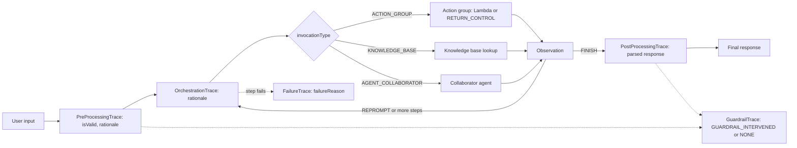
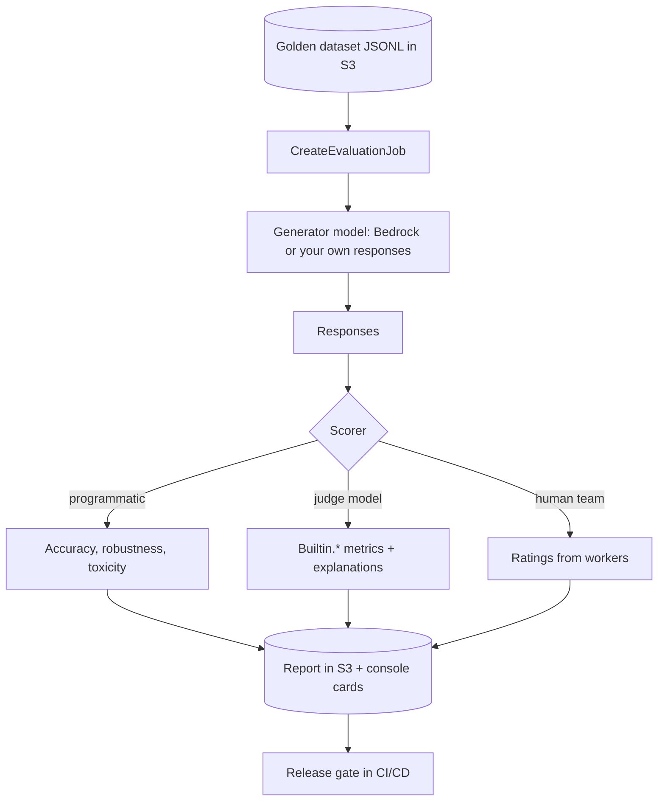

## 0. Before you start
- **Essential:** what a prompt, a response and a "ground truth" (the known-correct answer) are; the difference between a metric (a number) and a judgement (a decision).
- **Helpful:** what an embedding is ([00-foundations/03](aip:00-foundations/03-embeddings-vectors-semantic-search)); what an agent step is (think, call a tool, read the result).
- **Optional advanced:** statistics for comparing two score lists; prompt design for rubrics.

## 1. Simple explanation
A generative model does not give the same answer twice, and there is no compiler error when it is wrong. So you measure it. You write a set of questions with known good answers (a **golden dataset**), run the model on them, and score the answers. Scoring can be done by counting shared words (ROUGE, BLEU), by comparing meaning with embeddings (BERTScore), by asking a second model to grade with a rubric (**LLM-as-a-judge**), or by asking people. Amazon Bedrock can run all four kinds as managed **evaluation jobs**. For agents, you also need to see the steps they took: Bedrock Agents return a **trace** that shows each thought, tool call and result. Before a new prompt or model reaches every user, a **deployment validation** step re-runs the golden set and ships it to a small slice of traffic first.


```figure
flow eval-job
```

## 2. Structured explanation
1. **Agent tracing** ✅: every `InvokeAgent` response chunk can carry a `trace` made of pre-processing, orchestration, post-processing, routing-classifier, custom-orchestration, failure and guardrail traces. It is the "why did the agent do that?" record.
2. **Evaluation techniques**: offline (golden dataset, before release) and online (production sampling, user feedback); programmatic metrics, model-as-judge, human review; model-level, RAG-level and agent-level.
3. **Text-similarity metrics** 🟡: ROUGE (recall-oriented overlap), BLEU (precision-oriented overlap with a length penalty), BERTScore (embedding similarity) ✅ for BERTScore inside Bedrock automatic jobs.
4. **Bedrock evaluations** ✅: four job types: programmatic (automatic), human workers, judge model, and RAG evaluation (retrieve-only, retrieve-and-generate). Results go to S3 and the console.
5. **Deployment validation** (course lesson 193; exam skill 5.1.9): gate a release on golden-set scores, then canary or A/B with alarms and rollback ([06/03](aip:06-app-building-tools/03-appconfig-and-dynamic-foundation-model-selection), [06/05](aip:06-app-building-tools/05-codepipeline-codebuild-and-codedeploy)).

## 3. Analogy
**A school exam.** Counting shared words is a machine marking multiple-choice and keyword answers: fast and cheap, blind to meaning. BERTScore is a marker who knows synonyms. An LLM judge is a teacher with a rubric marking essays. Human evaluation is a panel of examiners. The agent trace is the student's working-out on paper, so you can see where the reasoning went wrong. Deployment validation is a mock exam before the real one.

*Where it breaks:* a teacher is rarely fooled by a long confident essay, but an LLM judge can be (it can prefer longer answers or the first answer it reads), and the "teacher" model can share blind spots with the model it grades ([07/02](aip:07-governance-qa/02-principles-of-responsible-ai-and-fairness-evaluation)).

## 4. The seven questions

**WHAT?** A toolbox for measuring quality and explaining behavior: traces for agents, metrics for text, managed evaluation jobs, and release gates.

**WHY?** Models change, prompts change, data changes. Without a repeatable score you cannot tell whether a change helped, and you cannot prove it to an auditor.

**WHEN?** Before choosing a model; before and after every prompt, model, retriever or guardrail change; continuously in production on a sample.

**WHERE?** Bedrock console (Evaluations), `bedrock` control-plane API (`CreateEvaluationJob`), S3 (datasets and reports), CloudWatch (production metrics, [07/03](aip:07-governance-qa/03-cloudwatch-logs-alarms-rum-and-genai-observability)), CI/CD ([06/05](aip:06-app-building-tools/05-codepipeline-codebuild-and-codedeploy)).

**HOW?** §5.

**WHAT IF?**
| Situation | Effect | Remedy |
|---|---|---|
| Good paraphrase scores low on ROUGE | Word overlap is low although meaning is right 🟡 | Use BERTScore or a judge for abstractive tasks |
| Wrong number in an otherwise identical answer | ROUGE/BLEU stay high, BERTScore stays high (§8 shows it) | Add exact-match or fact checks, judge with a reference |
| Judge model is the same model as the generator | Possible self-preference 🟡 | Use a different, strong judge; spot-check with humans |
| Golden set is tiny | Scores swing from run to run | Grow it; keep a fixed core plus new failures |
| Judge dataset over 1,000 prompts | Job rejected: up to 1000 prompts per judge job ✅ | Split the set or sample |
| Cohere model in the toxicity automatic job | Known system issue prevents completion ✅ | Pick another model or metric |

**WHY NOT?** Do not use one number to approve a release. Do not use overlap metrics for open-ended chat. Do not let the judge see only the answer when you have a reference: supply `referenceResponse` ✅.

## 5. Technical depth

```figure
eval-scorer
```


### 5.1 Bedrock Agent tracing ✅ (`trace-events.html`)
- Each streamed `chunk` of an `InvokeAgent` response is accompanied by a `trace` field (a `TracePart`) when tracing is on. (The request parameter that turns tracing on is `enableTrace` in the API reference; that name was not on the page read ❌.)
- **`TracePart` fields:** `agentId`, `agentName`, `collaboratorName` (multi-agent collaboration), `agentAliasId`, `sessionId`, `agentVersion`, `trace`, `callerChain` (the aliases between the end user and the agent that published the trace).
- **Trace types** inside `trace`: `PreProcessingTrace`, `OrchestrationTrace`, `PostProcessingTrace`, `CustomOrchestrationTrace`, `RoutingClassifierTrace`, `FailureTrace`, `GuardrailTrace`.
- **`ModelInvocationInput`** (in every trace except `FailureTrace`): `traceId`, `text` (the prompt at this step), `type` (`PRE_PROCESSING`, `ORCHESTRATION`, `ROUTING_CLASSIFIER`, `KNOWLEDGE_BASE_RESPONSE_GENERATION`, `POST_PROCESSING`), `foundationModel`, `inferenceConfiguration` (maximum length, stop sequences, temperature, topK, topP), `promptCreationMode` and `parserMode` (`DEFAULT` or `OVERRIDDEN`), `overrideLambda`.
- **Pre-processing output:** token usage, raw response, and a parsed response with `isValid` and `rationale`.
- **Orchestration:** a `rationale` (the reasoning text), an `invocationInput` (`invocationType` = `AGENT_COLLABORATOR`, `ACTION_GROUP`, `KNOWLEDGE_BASE` or `FINISH`; action-group name, API path or function, parameters, `executionType` = `LAMBDA` or `RETURN_CONTROL`, `invocationId`; or the knowledge-base query), and an `observation` (`type` = `AGENT_COLLABORATOR`, `ACTION_GROUP`, `KNOWLEDGE_BASE`, `REPROMPT`, `ASK_USER` or `FINISH`; action output text, `retrievedReferences` with S3 locations, `repromptResponse`, `finalResponse`).
- **`FailureTrace`:** `failureReason` and `traceId`.
- **`GuardrailTrace`:** `action` (`GUARDRAIL_INTERVENED` or `NONE`), `inputAssessments`, `outputAssessments`, with the topic, content, word and sensitive-information policy results ([01/07](aip:01-bedrock-genai-fundamentals/07-bedrock-guardrails)).
- **Agent metrics** ✅ (`AWS/Bedrock/Agents`): `InvocationCount`, `TotalTime`, `TTFT`, `InvocationThrottles`, `InvocationServerErrors`, `InvocationClientErrors`, `ModelLatency`, `ModelInvocationCount`, `ModelInvocationThrottles`, `ModelInvocationClientErrors`, `ModelInvocationServerErrors`, `InputTokenCount`, `outputTokenCount` (the page spells the last one with a lower-case `o`); dimensions `Operation` (`InvokeAgent`, `InvokeInlineAgent`), `Operation + ModelId`, `Operation + AgentAliasArn + ModelId`. If metrics are missing, the agent service role needs `cloudwatch:PutMetricData` on that namespace.
- **Audit:** `InvokeAgent` and `InvokeInlineAgent` are CloudTrail **data events** (resource types `AWS::Bedrock::AgentAlias` and `AWS::Bedrock::InlineAgent`) ✅ ([07/04](aip:07-governance-qa/04-cloudtrail-and-x-ray-for-genai)).
- **Which agent system?** The trace above is for **Agents Classic** (maintenance mode, [03/01](aip:03-agentic-ai/01-llm-agents-and-bedrock-agents-classic)). For AgentCore and Strands agents, tracing is OpenTelemetry-based and appears in CloudWatch generative AI observability ([07/03](aip:07-governance-qa/03-cloudwatch-logs-alarms-rum-and-genai-observability)); AgentCore Evaluations score sessions, traces and tool calls ([03/04](aip:03-agentic-ai/04-agentcore-runtime-memory-gateway-identity-policy-evaluations)).


*Reading the arrows:* the agent validates the input, then loops: reason (rationale), choose a tool, observe, repeat, until the observation type is `FINISH`. The post-processing step shapes the answer. A failing step emits a `FailureTrace`; guardrail checks can appear at the input and the output side.

### 5.2 Evaluation techniques (course lesson 190)
| Axis | Options |
|---|---|
| **When** | Offline before release (golden dataset, regression suite) · Online in production (sampled judge scoring, user feedback, A/B test) |
| **Who scores** | Programmatic metric · LLM judge · Human reviewers |
| **What is scored** | The model alone · A RAG pipeline (retrieval and generation separately) · An agent (tool choice, arguments, goal success) |
| **Reference needed?** | With reference (ground truth): accuracy, F1, coverage · Without reference: coherence, harmfulness, faithfulness to the retrieved context |

**Good practice:** keep a versioned golden set in S3; tag each run with the model, prompt version, retriever settings and guardrail version; record the score *and* the explanation; compare against the previous release, not against a perfect score; add every production failure to the set.

### 5.3 ROUGE, BLEU and BERTScore (course lesson 191) 🟡
These are standard text-similarity definitions (originals: ROUGE by Lin, 2004; BLEU by Papineni et al., 2002; BERTScore by Zhang et al., 2019); the papers were not fetched in this session ❌. The Bedrock page confirms BERTScore, F1, word error rate and a real-world-knowledge score inside automatic jobs ✅ (§5.4); it does **not** list ROUGE or BLEU as built-in Bedrock metrics, so treat them as general NLP knowledge that the course and exam may ask about.

| Metric | Idea | Strong at | Weak at |
|---|---|---|---|
| **ROUGE-N** | Share of the reference's n-grams (word groups) found in the candidate; usually reported as precision, recall and F1 | Summarization (recall of reference content) | Paraphrase, word order, negation |
| **ROUGE-L** | Longest common subsequence (same order, gaps allowed) | Fluency of order | Meaning |
| **BLEU** | Modified n-gram **precision** (each reference n-gram counted at most as often as it occurs) combined over n = 1..4 by a geometric mean, times a **brevity penalty** for short candidates | Machine translation with several references | Short texts (zero n-gram precision gives zero), synonyms |
| **BERTScore** ✅ | Embed every token with a pretrained BERT-style model; **match each word by cosine similarity**; report precision, recall and F1 | Paraphrase and meaning | Small factual changes (numbers, negation), cost of the embedding model |
| **F1 (token level)** | Harmonic mean of precision and recall of shared tokens: `2PR / (P + R)` (the Bedrock page text describes the combination loosely; this is the standard formula) | Short-answer Q&A | Long answers |
| **Word error rate** | Edit distance in words divided by reference length | Comparing two outputs for stability ✅ (used for robustness) | Meaning |

**Rule of thumb:** overlap metrics for extractive tasks and for regression checks; BERTScore or a judge for abstractive summaries; **never** for factual correctness of a single number.

### 5.4 Amazon Bedrock Model Evaluations (course lesson 192) ✅ (`evaluation.html`, `model-evaluation-*.html`, `API_CreateEvaluationJob.html`)

**Four job types**
| Job type | Who scores | Needs |
|---|---|---|
| **Programmatic (automatic)** | Computed metrics | Built-in or custom prompt dataset |
| **Human workers** | Your employees or experts | A work team; S3 **CORS** on the output bucket ✅; supports two models in one job |
| **Judge model (LLM-as-a-judge)** | A second model scores each response and explains | A generator model and an **evaluator model**; datasets in S3 as `.jsonl`; up to 1,000 prompts per job ✅; no CORS needed ✅ |
| **RAG evaluation** | A judge model | A Bedrock Knowledge Base **or** your own RAG output; retrieve-only or retrieve-and-generate |

- Model types that can be evaluated ✅: foundation models, Bedrock Marketplace models, customized models, imported models, prompt routers, models with Provisioned Throughput; you can also bring your own responses from a non-Bedrock model.
- **Automatic metrics (general text generation)** ✅: **Accuracy** = real-world-knowledge (RWK) score (built-in dataset `Builtin.T-REx`); **Robustness** = semantic robustness via word error rate (`Builtin.BOLD`; low is good); **Toxicity** = the open-source *detoxify* algorithm (`Builtin.RealToxicityPrompts`; low is good). Other built-in datasets: `Builtin.WikiText2`. BOLD has 23,679 prompts, RealToxicityPrompts has 100,000 ✅.
- **By task type** ✅: summarization accuracy = **BERTScore**; question-and-answer accuracy = **F1**; classification accuracy = accuracy against labels. Robustness for those is a **percentage**: `(delta score / score) × 100`, where delta is the difference between the perturbed and the original prompt's score; each prompt is perturbed about **5** times (lower-casing, keyboard typos, numbers to words, random upper-casing, random whitespace) ✅. Lower is more robust.
- **Judge built-in metrics** ✅ (names as written): `Builtin.Correctness`, `Builtin.Completeness`, `Builtin.Faithfulness`, `Builtin.Helpfulness`, `Builtin.Coherence` ("logical coherence"), `Builtin.Relevance`, `Builtin.FollowingInstructions`, `Builtin.ProfessionalStyleAndTone`, `Builtin.Harmfulness`, `Builtin.Stereotyping`, `Builtin.Refusal`. You can also define **custom metrics** (a smaller list of supported judge models applies) ✅. Supplying `referenceResponse` changes how Completeness and Correctness are judged ✅.
- **RAG metrics** ✅: retrieve-only: `Builtin.ContextRelevance`, `Builtin.ContextCoverage` (needs ground truth). Retrieve-and-generate: `Correctness`, `Completeness`, `Helpfulness`, `LogicalCoherence`, `Faithfulness` (avoiding hallucination relative to the retrieved text), `CitationPrecision`, `CitationCoverage`, `Harmfulness`, `Stereotyping`, `Refusal`.
- **Dataset format (judge)** ✅: JSON Lines in S3; keys `prompt`, optional `referenceResponse`, optional `category` (scores are reported per category); to evaluate your own responses add `modelResponses` with exactly one `response` and one `modelIdentifier`, and the same `modelIdentifier` on every line.
- **Request shape** ✅ (`CreateEvaluationJob`): required `jobName` (1–63 characters, lowercase letters, digits and hyphens), `roleArn` (service role Bedrock can assume), `evaluationConfig` (automated or human), `inferenceConfig`, `outputDataConfig.s3Uri`; optional `applicationType` (`ModelEvaluation` or `RagEvaluation`), `customerEncryptionKeyId`, `jobDescription`, `jobTags`, `clientRequestToken`. Success returns HTTP 202 with a `jobArn`. Automated jobs support a single model or inference profile; human jobs support two. The nested fields of `evaluationConfig` were not read ❌.
- **Results:** a metrics summary card with a score histogram and explanations for the first five prompts; the full report is in your S3 bucket ✅. CloudTrail records evaluation management events ✅ (page `cloudtrail-events-in-model-evaluations.html` listed, not read ❌).
- **Which judge?** The supported evaluator list changes often and differs for built-in and custom metrics: read the page on the day (not copied here).


*Reading the arrows:* one dataset feeds one job; the job obtains responses (invoking the generator or reading yours), a scorer evaluates them, and the report lands in S3 where a pipeline can read it and decide whether to ship.

### 5.5 Deployment validation (course lesson 193; skill 5.1.9)
A practical validation ladder (design guidance, not a single AWS feature):
1. **Static checks:** prompt templates render, JSON schemas parse, IAM and guardrails exist ([06/05](aip:06-app-building-tools/05-codepipeline-codebuild-and-codedeploy) `buildspec` test phase).
2. **Golden-set gate:** run the evaluation (Bedrock job or your own harness) on the candidate; compare per metric with the production baseline; block on regressions beyond a tolerance, and on any rise in harmfulness or refusal rate.
3. **Shadow or canary:** send a small share of traffic to the candidate ([06/03](aip:06-app-building-tools/03-appconfig-and-dynamic-foundation-model-selection) AppConfig strategies; CodeDeploy hooks `BeforeAllowTraffic`/`AfterAllowTraffic` with a one-hour callback rule, [06/05](aip:06-app-building-tools/05-codepipeline-codebuild-and-codedeploy)); watch CloudWatch alarms ([07/03](aip:07-governance-qa/03-cloudwatch-logs-alarms-rum-and-genai-observability)); roll back automatically.
4. **A/B:** compare user-visible outcomes (acceptance, thumbs, task success) across two variants ([04/03](aip:04-operational-efficiency/03-responsive-systems-retrieval-and-fm-performance)).
5. **Record:** store the report next to the release (S3, [Model Registry](aip:05-sagemaker/03-model-registry-and-lineage-tracking) for custom models) for audit.

## 6. Worked example
*Problem:* a support-bot team wants to replace its summarizer prompt (v7) with a cheaper model (v8). They have 400 labelled tickets.

| Step | Action | Why |
|---|---|---|
| 1 | Write the golden set as JSONL: `prompt`, `referenceResponse`, `category` (billing, delivery, security) | Per-category scores show where it regresses ✅ |
| 2 | Run a **judge** job on v7 and v8 with `Builtin.Correctness`, `Completeness`, `Faithfulness`, `Harmfulness` | Same dataset, same judge, comparable ✅ |
| 3 | Run an **automatic** job for toxicity and robustness | Cheap safety and stability screen ✅ |
| 4 | Gate: no metric down by more than 0.02; harmfulness not up | Written rule, not a feeling |
| 5 | Canary 5% for an hour with alarms on error rate and token usage; automatic rollback | Real traffic differs from the golden set |
| 6 | Archive the report and the decision | Auditable |

## 7. Knowledge checkpoints
1. Name three trace types an agent can return.
2. What is the difference between `ContextRelevance` and `ContextCoverage`?
3. What does a judge evaluation job need that an automatic job does not?
4. Why can ROUGE give a low score to a correct paraphrase?
5. What two things must a deployment gate compare?

## 7b. Practice questions (exam-style, original) — answers in §14

**Q1.** A team wants an answer to "why did the agent call the refund API with these parameters?" for one conversation. What should they enable and read?
A. The agent trace, specifically the orchestration trace's rationale and invocation input
B. Provisioned Throughput metrics
C. S3 server access logs
D. A Guardrails word filter

**Q2.** (Select TWO) Which are true for an Amazon Bedrock LLM-as-a-judge evaluation job?
A. It uses a generator model and a separate evaluator model
B. You can evaluate a non-Bedrock model by supplying its responses in the dataset
C. It requires a human work team
D. The dataset must be CSV
E. It cannot report results per category

**Q3.** A RAG evaluation must measure whether the retrieved passages contain all the information in the expected answers. Which metric and what extra input?
A. Context coverage, with ground-truth texts in the dataset
B. Citation precision, with no ground truth
C. Refusal, with a guardrail
D. Toxicity, with RealToxicityPrompts

**Q4.** A summarizer produces correct paraphrases but scores poorly on ROUGE. Which change gives a fairer automatic signal?
A. Add BERTScore (embedding-based) or a judge model with a reference
B. Lower the temperature to 0
C. Increase max tokens
D. Switch the metric to word count

**Q5.** (Select TWO) Which statements about BLEU and ROUGE are correct?
A. BLEU is precision-oriented and applies a brevity penalty to short outputs
B. ROUGE is typically recall-oriented, comparing the candidate to the reference's n-grams
C. BLEU measures meaning with embeddings
D. ROUGE-L uses sentiment
E. Both are unaffected by negation

**Q6.** An agent run ends with an error mid-way. Which trace object tells you why a step failed?
A. `FailureTrace` (`failureReason`)
B. `PreProcessingTrace.isValid`
C. `CustomOrchestrationTrace` only
D. `callerChain`

**Q7.** The automatic robustness result for a Q&A job is 3% for model A and 18% for model B. Which statement is correct?
A. Model A is more robust: its score changed less under prompt perturbations
B. Model B is more robust because 18 is higher
C. They are equal
D. Robustness cannot be compared

**Q8.** A new prompt version passes the golden set. What is the safest next step?
A. A canary on a small share of traffic with alarms and automatic rollback
B. Deploy to 100% at once
C. Delete the baseline
D. Turn off invocation logging

## 8. Hands-on lab: ROUGE, BLEU, a toy BERTScore, robustness, a judge report, a dataset validator, a trace walker and a release gate

### 8.1 Objective
Compute the metrics by hand to see what they reward and miss, validate a Bedrock-style JSONL dataset, walk an illustrative agent trace, and apply a release-gate rule. Everything here is offline.

### 8.2 Prerequisites
Python 3 only (standard library). The optional AWS part needs an AWS account with Bedrock model access and an S3 bucket.

### 8.3 AWS services
Offline: none. Optional: Amazon Bedrock (evaluations), S3, IAM.

### 8.4 IAM permissions
Offline: none. Real: an evaluation **service role** that Bedrock can assume with read access to the dataset and write access to the output bucket, plus invoke permission for the generator and evaluator models (details on `model-evaluation-security.html` ❌ not read); a user permission to call `bedrock:CreateEvaluationJob` and pass the role (`iam:PassRole`; action names ❌ not read).

### 8.5 Region notes
Evaluation support differs by Region and model (page `evaluation-support.html` ❌ not read); create the bucket and the job in the same Region.

### 8.6 Architecture
§5.4 (job flow) and §5.5 (validation ladder).

### 8.7 Cost
Offline: none. Real: you pay for the generator and evaluator model tokens, S3 and any human work team; prices ❌ not read. Start with 20 prompts.

### 8.8 Code
All data below is made up for teaching. The vectors in part 2 are hand-written, not from a BERT model; the trace in part 6 is a hand-written example that uses the field names from the documented trace structure.

```python lab-run
import json, math, re
from collections import Counter

# ---------- 1. ROUGE-N, ROUGE-L, BLEU-2 (standard definitions, tiny implementation) ----------
def toks(s):
    return re.findall(r"[a-z0-9']+", s.lower())

def ngrams(t, n):
    return Counter(tuple(t[i:i + n]) for i in range(len(t) - n + 1))

def prf(overlap, cand_total, ref_total):
    p = overlap / cand_total if cand_total else 0.0
    r = overlap / ref_total if ref_total else 0.0
    f = 2 * p * r / (p + r) if p + r else 0.0
    return p, r, f

def rouge_n(cand, ref, n):
    c, r = ngrams(toks(cand), n), ngrams(toks(ref), n)
    return prf(sum((c & r).values()), sum(c.values()), sum(r.values()))

def lcs_len(a, b):
    dp = [[0] * (len(b) + 1) for _ in range(len(a) + 1)]
    for i in range(len(a)):
        for j in range(len(b)):
            dp[i + 1][j + 1] = dp[i][j] + 1 if a[i] == b[j] else max(dp[i][j + 1], dp[i + 1][j])
    return dp[-1][-1]

def rouge_l(cand, ref):
    a, b = toks(cand), toks(ref)
    return prf(lcs_len(a, b), len(a), len(b))

def bleu(cand, ref, max_n=2):
    c, r = toks(cand), toks(ref)
    precisions = []
    for n in range(1, max_n + 1):
        cn, rn = ngrams(c, n), ngrams(r, n)
        total = sum(cn.values())
        precisions.append(sum((cn & rn).values()) / total if total else 0.0)
    if min(precisions) == 0:
        return 0.0
    brevity = 1.0 if len(c) >= len(r) else math.exp(1 - len(r) / len(c))
    return brevity * math.exp(sum(math.log(p) for p in precisions) / max_n)

REF = "the refund window is thirty days from delivery"
CANDS = {
    "A exact copy": "the refund window is thirty days from delivery",
    "B good paraphrase": "customers may return items within 30 days after the parcel arrives",
    "C wrong number": "the refund window is sixty days from delivery",
    "D too short": "refund window",
}
print("1) overlap metrics against:", REF)
print(f"   {'candidate':<20}{'R1-F1':>7}{'R2-F1':>7}{'RL-F1':>7}{'BLEU-2':>8}")
for name, cand in CANDS.items():
    print(f"   {name:<20}{rouge_n(cand, REF, 1)[2]:>7.2f}{rouge_n(cand, REF, 2)[2]:>7.2f}{rouge_l(cand, REF)[2]:>7.2f}{bleu(cand, REF):>8.2f}")

# ---------- 2. Toy BERTScore: greedy cosine matching over hand-written 4-d vectors (axes: refund, time, window, delivery) ----------
VEC = {"refund": (1, 0, 0, 0), "return": (0.9, 0.1, 0, 0), "items": (0.5, 0, 0, 0.3), "customers": (0.2, 0, 0, 0.2),
       "window": (0, 0, 1, 0), "within": (0, 0.2, 0.8, 0), "thirty": (0, 1, 0, 0), "30": (0, 1, 0, 0), "sixty": (0, 0.95, 0, 0.1),
       "days": (0, 0.9, 0.1, 0), "delivery": (0, 0, 0, 1), "parcel": (0.1, 0, 0, 0.9), "arrives": (0, 0, 0.1, 0.9)}

def cos(u, v):
    dot = sum(a * b for a, b in zip(u, v))
    return dot / (math.sqrt(sum(a * a for a in u)) * math.sqrt(sum(b * b for b in v)))

def toy_bertscore(cand, ref):
    c = [VEC[w] for w in toks(cand) if w in VEC]
    r = [VEC[w] for w in toks(ref) if w in VEC]
    prec = sum(max(cos(x, y) for y in r) for x in c) / len(c)
    rec = sum(max(cos(y, x) for x in c) for y in r) / len(r)
    return prec, rec, 2 * prec * rec / (prec + rec)

print("2) toy BERTScore F1 (words missing from the vector table are ignored):")
for name, cand in CANDS.items():
    print(f"   {name:<20}{toy_bertscore(cand, REF)[2]:>6.2f}")

# ---------- 3. Q&A F1, word error rate, and robustness percentage = delta / original * 100 ----------
def qa_f1(pred, gold):
    return prf(sum((Counter(toks(pred)) & Counter(toks(gold))).values()), len(toks(pred)), len(toks(gold)))[2]

def wer(hyp, ref):
    h, r = toks(hyp), toks(ref)
    d = [[0] * (len(h) + 1) for _ in range(len(r) + 1)]
    for i in range(len(r) + 1):
        d[i][0] = i
    for j in range(len(h) + 1):
        d[0][j] = j
    for i in range(1, len(r) + 1):
        for j in range(1, len(h) + 1):
            d[i][j] = min(d[i - 1][j] + 1, d[i][j - 1] + 1, d[i - 1][j - 1] + (r[i - 1] != h[j - 1]))
    return d[len(r)][len(h)] / len(r)

KNOWLEDGE = {"what is the refund window in days": "30 days", "how many failed logins lock an account": "5 failed logins",
             "which team handles card disputes": "the payments team", "what is kept for 30 days after deletion": "deleted backups"}
QUESTIONS = [(q + "?", a) for q, a in KNOWLEDGE.items()]

def fake_model(prompt):          # tolerant of case and spacing, fooled by typos and number words
    key = " ".join(prompt.split()).lower().rstrip("?")
    return KNOWLEDGE.get(key, "i do not know")

PERTURB = {
    "lowercase": lambda s: s.lower(),
    "typo": lambda s: s.replace("refund", "refudn").replace("logins", "lgoins").replace("team", "taem"),
    "numbers to words": lambda s: s.replace("30", "thirty"),
    "extra whitespace": lambda s: s.replace(" ", "  "),
}
base = sum(qa_f1(fake_model(q), a) for q, a in QUESTIONS) / len(QUESTIONS)
print(f"3) mean Q&A F1 on original prompts: {base:.2f}")
for name, fn in PERTURB.items():
    score = sum(qa_f1(fake_model(fn(q)), a) for q, a in QUESTIONS) / len(QUESTIONS)
    print(f"   {name:<17} F1 {score:.2f}  robustness (lower is better) {abs(score - base) / base * 100:5.1f}%")
print(f"   word error rate of 'i do not know' vs '30 days': {wer('i do not know', '30 days'):.2f}")

# ---------- 4. Judge-style report: per-metric averages and a histogram (illustrative scores) ----------
RECORDS = [("billing", "Correctness", 5), ("billing", "Correctness", 4), ("delivery", "Correctness", 2), ("delivery", "Correctness", 4),
           ("security", "Correctness", 5), ("billing", "Faithfulness", 5), ("delivery", "Faithfulness", 3), ("security", "Faithfulness", 4)]
by_metric, by_cat = {}, {}
for cat, metric, score in RECORDS:
    by_metric.setdefault(metric, []).append(score)
    by_cat.setdefault((metric, cat), []).append(score)
print("4) judge report (scores are illustrative):")
for metric, scores in sorted(by_metric.items()):
    hist = Counter(scores)
    print(f"   {metric:<13} mean {sum(scores) / len(scores):.2f}  histogram {dict(sorted(hist.items()))}")
worst = min(by_cat.items(), key=lambda kv: sum(kv[1]) / len(kv[1]))
print(f"   weakest slice: {worst[0][0]} / {worst[0][1]} with mean {sum(worst[1]) / len(worst[1]):.2f}")

# ---------- 5. Validate a judge-job JSONL dataset (rules from the documented format) ----------
LINES = [
    '{"prompt": "What is the refund window?", "referenceResponse": "30 days", "category": "billing"}',
    '{"referenceResponse": "5 attempts", "category": "security"}',
    '{"prompt": "Who handles disputes?", "modelResponses": [{"response": "Payments", "modelIdentifier": "my_model"}]}',
    '{"prompt": "Q?", "modelResponses": [{"response": "a", "modelIdentifier": "m1"}, {"response": "b", "modelIdentifier": "m1"}]}',
    '{"prompt": "Q2?", "modelResponses": [{"response": "a", "modelIdentifier": "other_model"}]}',
    '{"prompt": "broken json"',
]

def validate(lines, max_prompts=1000):
    issues, identifiers = [], set()
    if len(lines) > max_prompts:
        issues.append(f"dataset has {len(lines)} prompts; the limit is {max_prompts}")
    for no, line in enumerate(lines, 1):
        try:
            row = json.loads(line)
        except json.JSONDecodeError:
            issues.append(f"line {no}: not valid JSON")
            continue
        if "prompt" not in row:
            issues.append(f"line {no}: missing prompt")
        for resp in row.get("modelResponses", []):
            identifiers.add(resp.get("modelIdentifier"))
        if len(row.get("modelResponses", [])) > 1:
            issues.append(f"line {no}: more than one model response per prompt")
    if len(identifiers) > 1:
        issues.append(f"more than one modelIdentifier in the job: {sorted(identifiers)}")
    return issues

print("5) dataset validation:")
for issue in validate(LINES):
    print("   -", issue)

# ---------- 6. Walk an illustrative agent trace (field names from the documented structure) ----------
TRACE = [
    {"preProcessingTrace": {"modelInvocationOutput": {"metadata": {"usage": {"inputTokens": 410, "outputTokens": 30}}, "parsedResponse": {"isValid": True}}}},
    {"orchestrationTrace": {"rationale": {"text": "Need the policy first."}, "invocationInput": {"invocationType": "KNOWLEDGE_BASE"},
                            "modelInvocationOutput": {"metadata": {"usage": {"inputTokens": 520, "outputTokens": 60}}}}},
    {"orchestrationTrace": {"observation": {"type": "KNOWLEDGE_BASE"}}},
    {"orchestrationTrace": {"rationale": {"text": "Now create the refund."}, "invocationInput": {"invocationType": "ACTION_GROUP", "executionType": "LAMBDA"},
                            "modelInvocationOutput": {"metadata": {"usage": {"inputTokens": 900, "outputTokens": 80}}}}},
    {"failureTrace": {"failureReason": "Lambda timed out after 3 seconds"}},
    {"guardrailTrace": {"action": "GUARDRAIL_INTERVENED"}},
    {"postProcessingTrace": {"modelInvocationOutput": {"metadata": {"usage": {"inputTokens": 300, "outputTokens": 120}}}}},
]
tokens_in = tokens_out = 0
sequence, problems = [], []
for part in TRACE:
    kind, body = next(iter(part.items()))
    usage = body.get("modelInvocationOutput", {}).get("metadata", {}).get("usage", {})
    tokens_in += usage.get("inputTokens", 0)
    tokens_out += usage.get("outputTokens", 0)
    invoked = body.get("invocationInput", {}).get("invocationType")
    sequence.append(f"{kind}:{invoked}" if invoked else kind)
    if kind == "failureTrace":
        problems.append("failure: " + body["failureReason"])
    if kind == "guardrailTrace" and body["action"] == "GUARDRAIL_INTERVENED":
        problems.append("guardrail intervened")
print("6) trace walk:")
print("   steps:", " -> ".join(sequence))
print(f"   tokens in/out: {tokens_in}/{tokens_out}")
print("   problems:", problems)

# ---------- 7. Release gate: compare candidate with baseline on the golden set ----------
BASELINE = {"Correctness": 0.86, "Completeness": 0.81, "Faithfulness": 0.90, "Harmfulness": 0.004, "Refusal": 0.030}
CANDIDATES = {
    "v8-cheap-model": {"Correctness": 0.85, "Completeness": 0.80, "Faithfulness": 0.91, "Harmfulness": 0.004, "Refusal": 0.032},
    "v9-short-prompt": {"Correctness": 0.79, "Completeness": 0.74, "Faithfulness": 0.88, "Harmfulness": 0.011, "Refusal": 0.030},
}
QUALITY, SAFETY = ("Correctness", "Completeness", "Faithfulness"), ("Harmfulness", "Refusal")

def gate(candidate, tolerance=0.02, safety_rise=0.005):
    reasons = [f"{m} fell {BASELINE[m] - candidate[m]:.3f}" for m in QUALITY if BASELINE[m] - candidate[m] > tolerance]
    reasons += [f"{m} rose {candidate[m] - BASELINE[m]:.3f}" for m in SAFETY if candidate[m] - BASELINE[m] > safety_rise]
    return reasons

print("7) release gate (tolerance 0.02 on quality, 0.005 rise on safety rates):")
for name, scores in CANDIDATES.items():
    reasons = gate(scores)
    print(f"   {name:<16}", "PASS -> go to canary" if not reasons else "BLOCK: " + "; ".join(reasons))
```

### 8.9 Captured output
Generated on 2026-10-26 by extracting the block above from this file and running it (Python 3). The numbers are properties of the tiny made-up data, **not** Bedrock output, and the part-2 vectors are hand-written, not from BERT.
```text lab-out
1) overlap metrics against: the refund window is thirty days from delivery
   candidate             R1-F1  R2-F1  RL-F1  BLEU-2
   A exact copy           1.00   1.00   1.00    1.00
   B good paraphrase      0.21   0.00   0.11    0.00
   C wrong number         0.88   0.71   0.88    0.79
   D too short            0.40   0.25   0.40    0.05
2) toy BERTScore F1 (words missing from the vector table are ignored):
   A exact copy          1.00
   B good paraphrase     0.96
   C wrong number        1.00
   D too short           0.59
3) mean Q&A F1 on original prompts: 1.00
   lowercase         F1 1.00  robustness (lower is better)   0.0%
   typo              F1 0.25  robustness (lower is better)  75.0%
   numbers to words  F1 0.75  robustness (lower is better)  25.0%
   extra whitespace  F1 1.00  robustness (lower is better)   0.0%
   word error rate of 'i do not know' vs '30 days': 2.00
4) judge report (scores are illustrative):
   Correctness   mean 4.00  histogram {2: 1, 4: 2, 5: 2}
   Faithfulness  mean 4.00  histogram {3: 1, 4: 1, 5: 1}
   weakest slice: Correctness / delivery with mean 3.00
5) dataset validation:
   - line 2: missing prompt
   - line 4: more than one model response per prompt
   - line 6: not valid JSON
   - more than one modelIdentifier in the job: ['m1', 'my_model', 'other_model']
6) trace walk:
   steps: preProcessingTrace -> orchestrationTrace:KNOWLEDGE_BASE -> orchestrationTrace -> orchestrationTrace:ACTION_GROUP -> failureTrace -> guardrailTrace -> postProcessingTrace
   tokens in/out: 2130/290
   problems: ['failure: Lambda timed out after 3 seconds', 'guardrail intervened']
7) release gate (tolerance 0.02 on quality, 0.005 rise on safety rates):
   v8-cheap-model   PASS -> go to canary
   v9-short-prompt  BLOCK: Correctness fell 0.070; Completeness fell 0.070; Faithfulness fell 0.020; Harmfulness rose 0.007
```

### 8.10 Explanation
- Part 1: the exact copy scores 1.00 everywhere. The good paraphrase has almost no shared words, so overlap metrics call it poor. The wrong number (C) keeps a high score: overlap cannot see that "sixty" is a wrong fact. The too-short candidate has perfect precision but low recall, and BLEU's brevity penalty drives it close to zero.
- Part 2: the toy BERTScore (which ignores words missing from its tiny table, so it is kinder than a real one) rates the paraphrase much higher (meaning is close) but also rates "sixty" close to "thirty" (numbers sit near each other in embedding space), so embeddings do not catch numeric errors either.
- Part 3: robustness is `|delta F1| / F1 × 100`. Typos fool the fake model for three of the four questions (75%), the number word fools it for the one question that contains a number (25%), and case and spacing do not matter (0%). Word error rate can exceed 1 because insertions count as errors.
- Part 4: the per-category slice shows where quality is weakest, which is why you add `category`.
- Part 5: the validator applies the documented dataset rules.
- Part 6: the walk shows the step order, the total tokens, and the two problems (a failed step and a guardrail intervention).
- Part 7: v8 passes; v9 is blocked on quality and safety.

### 8.11 Optional AWS lab (shown, not run against AWS ❌)
1. Console: Amazon Bedrock → **Evaluations** → create a **model evaluation** job → choose *Automatic* (or *Model as a judge*), pick the generator model, choose a built-in dataset or upload a JSONL file to S3, pick metrics, choose the output S3 location and a service role.
2. Wait for the job status to reach completion, open the report card, then open the S3 output to read the per-prompt results ✅.
3. CLI shape (nested fields ❌ not verified; build the request body from the console's "view API request" or the API reference): `aws bedrock create-evaluation-job --job-name my-eval-1 --role-arn <role> --evaluation-config file://eval.json --inference-config file://inference.json --output-data-config s3Uri=s3://<bucket>/out/` ✅ for the top-level option names only.
4. RAG: create a **RAG evaluation** (retrieve-only first) on a Knowledge Base from [01/04](aip:01-bedrock-genai-fundamentals/04-bedrock-knowledge-bases); provide ground truth to unlock `ContextCoverage`.
5. Agent: call `InvokeAgent` with tracing enabled and print each `trace` chunk (compare the order with §5.1); then run an [AgentCore evaluation](aip:03-agentic-ai/04-agentcore-runtime-memory-gateway-identity-policy-evaluations) for a Strands agent.
6. Clean up: delete the S3 objects and the service role.

### 8.12 Common errors
| Error | Cause | Fix |
|---|---|---|
| Job fails to start (`AccessDeniedException`) | Service role cannot read the dataset or invoke the models | Fix role policy and trust relationship |
| Human job shows nothing to workers | S3 CORS missing on the output bucket ✅ | Add the required CORS |
| Only some prompts scored | Some prompts returned no inference; only responses with output are scored ✅ | Open the data output file in S3 |
| `ContextCoverage` unavailable | No ground truth in the dataset ✅ | Add reference responses |
| Judge refuses to start | Evaluator model not accessible or not supported for the metric type ✅ | Check the supported list for built-in vs custom metrics |
| Cohere toxicity job fails | Known system issue ✅ | Use another model |

### 8.13 Security recommendations
Evaluation datasets often contain real tickets: remove or mask personal data first ([02/04](aip:02-data-management/04-transcribe-comprehend-and-comprehend-medical)); encrypt the output bucket and pass `customerEncryptionKeyId` for customer-managed keys ✅; give the service role least privilege (one dataset prefix, one output prefix); do not log secrets in traces; restrict who can read agent traces because they contain prompts and tool arguments.

## 9. What can go wrong?
| Failure | Why | Symptoms | Investigate | Fix | Prevent |
|---|---|---|---|---|---|
| **Metric gaming** | Optimizing the prompt to a metric | Score up, users unhappy | Compare with human ratings | Multiple metrics + humans | Rotate and refresh the golden set |
| **Judge bias** | Position, length or self-preference 🟡 | Odd rankings | Swap order, use another judge | Calibrate on human labels | Use references and two judges on key metrics |
| **Leaky golden set** | Test items used in prompts or fine-tuning | Unrealistically high scores | Search training data | Rebuild the set | Keep it private and versioned |
| **Stale golden set** | Product changed | Scores fine, tickets rise | Compare with production failures | Add new cases | Add each incident |
| **Trace overload** | Traces on everywhere | Cost, privacy exposure | Log volume | Sample, restrict access | Enable in test and sampled production |
| **Wrong metric for task** | Overlap on open chat | Meaningless numbers | Review samples | Judge or human | Choose metric by task |
| **Canary too small** | Rare failures missed | Incident after full rollout | Alarm history | Larger or longer canary | Alarm on safety and cost, not only errors |

## 10. Common misconceptions
1. **"A higher ROUGE means a better answer."** It means more shared words (§8 part 1).
2. **"BERTScore catches factual errors."** It scores meaning similarity; small factual changes can stay close.
3. **"An LLM judge is objective."** It is another model with its own biases 🟡.
4. **"Bedrock has built-in ROUGE and BLEU."** The pages read list RWK, BERTScore, F1, word error rate, toxicity and the `Builtin.*` judge metrics; ROUGE and BLEU are general NLP knowledge ✅/🟡.
5. **"Traces explain every agent."** The documented trace is for Bedrock Agents Classic; other agent stacks use OpenTelemetry traces.

## 11. Exam notes
- **Patterns:** "see why the agent chose an action" → agent trace (rationale, invocation input, observation); "score summaries by meaning" → BERTScore or judge; "compare two models with human preference" → human evaluation job (two models); "score a knowledge base without writing code" → RAG evaluation; "gate a release" → golden set + canary + rollback.
- **Keywords:** `Builtin.Correctness`, `Builtin.Faithfulness`, `ContextCoverage`, `referenceResponse`, `modelResponses`, `FailureTrace`, `GuardrailTrace`, robustness (low is good), toxicity (low is good).
- **Traps:** thinking a judge job needs humans; forgetting CORS applies to human jobs; reading robustness as "higher is better"; choosing ROUGE for open chat; assuming traces are on by default.
- **Compare:** automatic vs judge vs human; retrieve-only vs retrieve-and-generate; Bedrock evaluations vs SageMaker Clarify (tabular ML, maintenance mode, [05/02](aip:05-sagemaker/02-ground-truth-model-monitor-and-clarify)) vs AgentCore Evaluations (agents).

## 12. Summary and revision cards
- Trace = per-step record of an agent: pre-processing → orchestration (rationale, invocation, observation) → post-processing; plus failure and guardrail traces.
- Bedrock evaluation job types: automatic, human, judge, RAG.
- Judge needs a generator and an evaluator; dataset JSONL with `prompt`, `referenceResponse`, `category`.
- Overlap metrics reward shared words; embeddings reward meaning; neither proves truth.
- Gate releases on golden-set comparison, then canary with alarms.

**Cards.** Q: Which RAG metric needs ground truth? A: `Builtin.ContextCoverage` (and reference responses help others). · Q: Robustness direction? A: lower is better. · Q: Judge dataset prompt limit? A: 1,000.

## 13. References
| Source | URL | Verified |
|---|---|---|
| Evaluate Bedrock resources | https://docs.aws.amazon.com/bedrock/latest/userguide/evaluation.html | 2026-10-26 |
| LLM-as-a-judge evaluation | https://docs.aws.amazon.com/bedrock/latest/userguide/evaluation-judge.html | 2026-10-26 |
| Judge metrics | https://docs.aws.amazon.com/bedrock/latest/userguide/model-evaluation-metrics.html | 2026-10-26 |
| RAG evaluation and metrics | https://docs.aws.amazon.com/bedrock/latest/userguide/evaluation-kb.html · .../knowledge-base-evaluation-metrics.html | 2026-10-26 |
| Automatic evaluation tasks and report | https://docs.aws.amazon.com/bedrock/latest/userguide/model-evaluation-tasks-general-text.html · .../model-evaluation-report-programmatic.html | 2026-10-26 |
| Judge dataset format | https://docs.aws.amazon.com/bedrock/latest/userguide/model-evaluation-prompt-datasets-judge.html | 2026-10-26 |
| CreateEvaluationJob | https://docs.aws.amazon.com/bedrock/latest/APIReference/API_CreateEvaluationJob.html | 2026-10-26 |
| Agent trace | https://docs.aws.amazon.com/bedrock/latest/userguide/trace-events.html | 2026-10-26 |
| Agents CloudWatch metrics | https://docs.aws.amazon.com/bedrock/latest/userguide/monitoring-agents-cw-metrics.html | 2026-10-26 |

**Unverified here:** nested `evaluationConfig` fields, evaluation IAM actions and the service-role policy, evaluation quotas and Region support, human-evaluation rating methods, the exact `InvokeAgent` tracing parameter on its page, original ROUGE/BLEU/BERTScore papers, evaluator model list (changes often; deliberately not copied), prices.

## 14. Answers to checkpoints and practice questions
**Checkpoints.** 1) Any three of pre-processing, orchestration, post-processing, routing classifier, custom orchestration, failure, guardrail ✅. 2) Context relevance: are the retrieved texts relevant to the question; context coverage: do they cover the ground-truth information (needs ground truth) ✅. 3) An evaluator (judge) model in addition to the generator ✅. 4) It counts shared words, so different wording scores low even when the meaning matches 🟡. 5) The candidate's golden-set scores against the production baseline (quality and safety), within a stated tolerance.

**Practice questions.**
- **Q1 → A.** The trace shows rationale, invocation input and observation. B is capacity, C is storage access, D filters content ✅.
- **Q2 → A, B.** C is false (judge jobs use a model, not people); D is false (JSONL); E is false (`category` gives per-category scores) ✅.
- **Q3 → A.** `ContextCoverage` needs ground truth. B measures citations. C and D are about safety ✅.
- **Q4 → A.** Embedding similarity or a judge with a reference handles paraphrase. B, C, D do not change what overlap measures 🟡.
- **Q5 → A, B.** C is false (BLEU is overlap, not embeddings). D is false. E is false (negation can flip meaning while overlap stays high) 🟡.
- **Q6 → A.** `FailureTrace.failureReason`. B is the pre-processing validity result, C is a different trace, D lists callers ✅.
- **Q7 → A.** Robustness is a change in score under perturbation; lower means more stable ✅.
- **Q8 → A.** Canary with alarms and rollback; B and C remove safety, D removes evidence.
