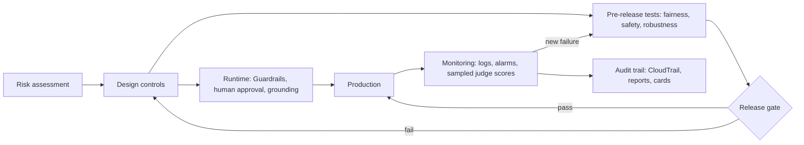

## 0. Before you start
- **Essential:** what bias means in data and in model output; what "explain your answer" means to a user.
- **Helpful:** the Guardrails policy types ([01/07](aip:01-bedrock-genai-fundamentals/07-bedrock-guardrails)); what a judge model is ([07/01](aip:07-governance-qa/01-agent-tracing-evaluation-metrics-and-bedrock-model-evaluations)).
- **Optional advanced:** statistics of group fairness (selection rate, true-positive rate).

## 1. Simple explanation
Responsible AI means building a system that is useful **and** safe, fair and honest about what it is doing. AWS describes it through a set of **dimensions**: fairness, explainability, privacy and security, safety, controllability, veracity and robustness, governance and transparency. For a generative-AI developer that turns into concrete work: filter harmful input and output, ground answers in sources and show those sources, test whether the system treats groups of people differently, keep a record of what happened, and let humans override the system. This file is about how to **measure** that work, because "we care about fairness" is not evidence, and an exam question will ask which AWS feature produces the evidence.


```figure
flow rai-lifecycle
```

## 2. Structured explanation
1. **Dimensions** ✅ (AWS responsible AI page): Fairness · Explainability · Privacy and security · Safety · Controllability · Veracity and robustness · Governance · Transparency.
2. **Transparency** (exam 3.4.1): tell users they are talking to AI; show sources (citations from Knowledge Bases, [01/04](aip:01-bedrock-genai-fundamentals/04-bedrock-knowledge-bases)); keep agent traces ([07/01 §5.1](aip:07-governance-qa/01-agent-tracing-evaluation-metrics-and-bedrock-model-evaluations)); publish limits. AWS publishes **AI Service Cards** for transparency on intended use, limitations and design choices ✅ (listed on the page).
3. **Fairness** (3.4.2): test with matched prompts across groups; compare rates (selection, refusal, tone); use Bedrock evaluations for stereotyping, harmfulness and refusal, and the BOLD dataset for bias in open-ended text; use human review for the hard cases.
4. **Policy compliance** (3.4.3): Guardrails (content filters, denied topics, word filters, sensitive-information filters, contextual grounding, Automated Reasoning), enforced and logged ([01/07](aip:01-bedrock-genai-fundamentals/07-bedrock-guardrails)); an organization-enforced guardrail can be evaluated even when the request names none ✅ (shown in the CloudTrail page, [07/04](aip:07-governance-qa/04-cloudtrail-and-x-ray-for-genai)).
5. **Controllability and safety:** human approval for risky actions ([03/06](aip:03-agentic-ai/06-mcp-openapi-tools-and-human-in-the-loop)); kill switches via configuration ([06/03](aip:06-app-building-tools/03-appconfig-and-dynamic-foundation-model-selection)).
6. **Governance:** model and data documentation (Model Cards, [05/03](aip:05-sagemaker/03-model-registry-and-lineage-tracking)), audit trails (CloudTrail, [07/04](aip:07-governance-qa/04-cloudtrail-and-x-ray-for-genai)), access control (Lake Formation, [07/05](aip:07-governance-qa/05-lake-formation-and-mixed-review-for-quiz-7)).

## 3. Analogy
**A restaurant with an open kitchen and an inspector.** Transparency is the open kitchen and the ingredients list (you can see how the dish was made and what is in it). Safety and policy compliance are the food-safety rules (Guardrails). Fairness is serving every customer the same way, which you only know by checking tables side by side. Governance is the inspection record.

*Where it breaks:* a kitchen's rules are fixed and visible; a model can change behavior with a prompt or a new version, so you must re-inspect after every change, and "the same dish" may legitimately differ in wording.

## 4. The seven questions

**WHAT?** Practices and measurements that keep an AI system safe, fair, explainable and accountable.

**WHY?** Harm to users, legal and regulatory risk, loss of trust; and the exam tests whether you can choose the right mechanism for each concern.

**WHEN?** At design (risk assessment), before release (fairness and safety evaluation), at runtime (guardrails, human approval), after release (monitoring, audits).

**WHERE?** In prompts and Guardrails (runtime), evaluation jobs (pre-release and sampled production), traces and citations (transparency), CloudTrail and registries (governance).

**HOW?** §5.

**WHAT IF?**
| Situation | Effect | Remedy |
|---|---|---|
| The model gives a different tone to matched users from different groups | Disparate treatment you may never notice without tests | Counterfactual prompt tests; fix prompt, data or model; add guardrails |
| Answers have no sources | Users cannot verify (veracity, transparency) | Ground in a Knowledge Base and return citations; contextual grounding check |
| The judge prefers the first answer shown | Biased comparisons 🟡 | Swap positions, average, use a reference, use humans for ties |
| A guardrail is only in the prompt text | A prompt-only rule can be bypassed by injection | Enforce with Guardrails and IAM outside the prompt |
| Fairness metric passes but users complain | Metric covers a different harm | Add slices, human review, user feedback |
| Regulation changes | Controls out of date | Version controls and re-run the evidence checks |

**WHY NOT?** Do not rely on one tool (Guardrails does not prove fairness; an evaluation job does not block bad output at runtime). Do not treat a score as certification. Do not apply SageMaker Clarify to LLM text (it targets tabular ML and is in maintenance mode, [05/02](aip:05-sagemaker/02-ground-truth-model-monitor-and-clarify)).

## 5. Technical depth

```figure
fairness-slices
```


### 5.1 Dimensions and the AWS tool that produces the evidence
| Dimension | Typical concern | Control or evidence in AWS |
|---|---|---|
| **Fairness** | Different outcomes or tone for different groups | Counterfactual tests, Bedrock evaluations (`Builtin.Stereotyping`, `Builtin.Refusal`, BOLD dataset) ✅, human review |
| **Explainability** | Why this answer? | Agent trace rationale ✅, citations, reasoning text kept in logs |
| **Privacy and security** | Leaking personal data | Guardrails sensitive-information filters, Comprehend PII ([02/04](aip:02-data-management/04-transcribe-comprehend-and-comprehend-medical)), CloudWatch Logs data protection ([07/03](aip:07-governance-qa/03-cloudwatch-logs-alarms-rum-and-genai-observability)), IAM, KMS |
| **Safety** | Harmful or toxic output | Guardrails content filters; `Builtin.Harmfulness`; toxicity automatic metric ✅ |
| **Controllability** | Humans can intervene | Return of control, approval steps ([03/06](aip:03-agentic-ai/06-mcp-openapi-tools-and-human-in-the-loop)), AppConfig kill switch |
| **Veracity and robustness** | Hallucination, brittleness | RAG grounding, contextual grounding check, `Builtin.Faithfulness`, robustness metric ✅ |
| **Governance** | Accountability, audit | CloudTrail, model registry and cards, Lake Formation, evaluation reports archived |
| **Transparency** | Users know it is AI and its limits | Disclosure text, AI Service Cards ✅, traces and citations |


*Reading the arrows:* controls are designed from the risk assessment; they run at request time and are tested before release; a failed gate sends work back to design; production is monitored and every new failure becomes a new test case; the audit trail keeps the evidence.

### 5.2 Group-fairness measures 🟡 (standard definitions; not from an AWS page)
| Measure | Formula | Reading |
|---|---|---|
| **Selection rate** | Approved ÷ total, per group | Raw outcome rate |
| **Demographic parity difference** | Highest selection rate − lowest | 0 means equal rates |
| **Disparate impact ratio** | Lowest selection rate ÷ highest | Below 0.8 is a common warning sign (the "four-fifths rule" from US employment guidance; a rule of thumb, not an AWS threshold) |
| **Equal opportunity difference** | Difference in true-positive rate between groups | Do qualified people get approved equally? |

For **generative** output there is rarely a yes/no decision, so you compare **rates of refusal**, **toxicity**, **stereotyped content** and **tone** across matched prompts (the same request with only the group word changed), which is called a **counterfactual test**.

### 5.3 Fairness and safety with Bedrock evaluations ✅
- **Automatic jobs:** `Builtin.BOLD` (bias in open-ended language generation, 23,679 prompts across profession, gender, race, religious ideologies and political ideologies) and `Builtin.RealToxicityPrompts` (100,000 prompts) ✅ ([07/01 §5.4](aip:07-governance-qa/01-agent-tracing-evaluation-metrics-and-bedrock-model-evaluations)).
- **Judge jobs and RAG jobs:** `Builtin.Harmfulness`, `Builtin.Stereotyping`, `Builtin.Refusal` ✅. Refusal measures evasiveness: a model that refuses everything is "safe" and useless, so read it next to Correctness.
- **Custom metrics** ✅: write your own rubric (for example "does the reply use the same level of detail for all customers?") and run it as a judge metric.
- **LLM-as-a-judge cautions** 🟡: position bias (prefers the first answer), verbosity bias (prefers longer answers), self-preference (prefers its own style). Mitigate with: swapped-order runs, a reference answer, a different judge than the generator, and human spot checks.

### 5.4 Transparency and explainability in practice
- Say it is AI at the start and when it hands off.
- **Citations:** Knowledge Base responses return source locations; evaluate `CitationPrecision` and `CitationCoverage` ✅ ([07/01](aip:07-governance-qa/01-agent-tracing-evaluation-metrics-and-bedrock-model-evaluations)).
- **Reasoning visibility:** agent traces show the rationale and tool calls ✅. Store them under access control because they can contain personal data.
- **Limits page:** state what the system cannot do (no legal advice, no medical diagnosis) and where a human takes over.

### 5.5 Policy-compliant systems (3.4.3)
Write each policy as a testable statement ("never output a full card number"; "never give investment advice"), map it to a control (sensitive-information filter, denied topic), and add a **test case** that proves the control fires. Log interventions (`GuardrailTrace`, `InvocationsIntervened` metric ✅ in `AWS/Bedrock/Guardrails`) and alarm on spikes ([07/03](aip:07-governance-qa/03-cloudwatch-logs-alarms-rum-and-genai-observability)).

## 6. Worked example
*Problem:* a bank builds a loan-FAQ assistant that also drafts decline explanations.

| Concern | Control | Evidence |
|---|---|---|
| Different tone to different customers | 200 matched prompts with only a name or region changed; compare refusal rate and sentiment | Counterfactual report, disparity ratio |
| Stereotypes | Judge job with `Builtin.Stereotyping`, custom metric on tone | Report archived in S3 |
| Advice outside policy | Denied topic "personal investment advice" in Guardrails | Guardrail trace, intervention metric |
| Hallucinated rates | Knowledge Base grounding + contextual grounding check | `Builtin.Faithfulness`, citation coverage |
| Customer can ask "why" | Citations and a plain-language reason; human review of declines | Trace sample, review log |
| Auditor asks who changed the guardrail | CloudTrail management events | Event history / trail |

## 7. Knowledge checkpoints
1. Name five of AWS's responsible-AI dimensions.
2. Which Bedrock built-in judge metrics relate to responsible AI?
3. What is a counterfactual fairness test?
4. Why swap answer order when using an LLM judge?
5. Why is "refusal rate" read together with correctness?

## 7b. Practice questions (exam-style, original) — answers in §14

**Q1.** A team needs evidence that its assistant does not use stereotyped wording about professions. Which Bedrock capability fits?
A. A judge-model evaluation job with `Builtin.Stereotyping`, optionally plus the BOLD dataset in an automatic job
B. Provisioned Throughput
C. CloudFront signed URLs
D. An S3 lifecycle rule

**Q2.** (Select TWO) Which practices improve transparency for users of a RAG assistant?
A. Return citations to source documents
B. Tell users they are interacting with AI and state its limits
C. Hide all sources to avoid confusion
D. Remove logging
E. Increase the temperature

**Q3.** An LLM judge ranks two answers; the same pair gets opposite winners when you swap their order. What is this and what is the mitigation?
A. Position bias; run both orders and treat inconsistent results as ties or use a reference and humans
B. Throttling; raise quotas
C. Tokenization error; shorten prompts
D. Drift; retrain the embedding model

**Q4.** Which statement about a disparate impact ratio of 0.62 (lowest group rate ÷ highest) is best?
A. It is below the common 0.8 rule of thumb and deserves investigation
B. It proves illegal discrimination
C. It is above 1 and therefore fine
D. It only applies to images

**Q5.** (Select TWO) A rule says the assistant must never reveal full card numbers. Which are appropriate?
A. A Guardrails sensitive-information filter on output
B. A test case that sends card-like input and asserts the filter fires
C. A sentence in the system prompt only
D. Turning off the guardrail trace
E. Logging full card numbers for debugging

**Q6.** A model refuses 60% of borderline-but-legitimate requests. Which metric exposes this and what must you read it with?
A. `Builtin.Refusal` read together with correctness and helpfulness
B. `InputTokenCount` with latency
C. `ModelInvocationThrottles` with errors
D. Disk space with CPU

**Q7.** Which tool should you not use to measure bias in free-text LLM answers?
A. SageMaker Clarify bias metrics for tabular ML (it is for tabular models and is in maintenance mode)
B. Bedrock judge evaluation
C. Counterfactual prompt tests
D. Human review panels

**Q8.** A regulator asks who edited the guardrail last month. Which source answers it?
A. CloudTrail (guardrail management API events)
B. CloudWatch RUM
C. X-Ray service map only
D. S3 Storage Lens

## 8. Hands-on lab: fairness rates, a counterfactual probe, judge position bias, a controls checklist and citation coverage

### 8.1 Objective
Compute group-fairness measures from a confusion table, run a counterfactual tone probe, show how position bias in a judge flips a ranking and how swapping removes it, check that every responsible-AI dimension has a control, and score citation coverage. Offline.

### 8.2 Prerequisites
Python 3 (standard library). Optional AWS part: Bedrock access and an S3 bucket.

### 8.3 AWS services
Offline: none. Optional: Bedrock evaluations, Guardrails, CloudWatch.

### 8.4 IAM permissions
Offline: none. Real: see [07/01 §8.4](aip:07-governance-qa/01-agent-tracing-evaluation-metrics-and-bedrock-model-evaluations) for evaluation roles; Guardrails management permissions ❌ not read here.

### 8.5 Region notes
Evaluation and Guardrails features vary by Region; check the console.

### 8.6 Architecture
§5.1 (controls) and §5.3 (evaluation).

### 8.7 Cost
Offline: none. Real: model tokens for generator and judge; prices ❌ not read.

### 8.8 Code
All data is made up. The "model outputs", "judge" and lexicon are toy stand-ins that demonstrate a calculation, not real model behavior.

```python lab-run
import re
from collections import defaultdict

# ---------- 1. Group fairness from a confusion table: (group, qualified, approved) -> count ----------
COUNTS = {("a", 1, 1): 30, ("a", 1, 0): 4, ("a", 0, 1): 10, ("a", 0, 0): 6,
          ("b", 1, 1): 14, ("b", 1, 0): 10, ("b", 0, 1): 10, ("b", 0, 0): 6}
total, approved, qualified, true_pos = defaultdict(int), defaultdict(int), defaultdict(int), defaultdict(int)
for (g, q, a), n in COUNTS.items():
    total[g] += n
    approved[g] += n * a
    qualified[g] += n * q
    true_pos[g] += n * q * a
rate = {g: approved[g] / total[g] for g in total}
tpr = {g: true_pos[g] / qualified[g] for g in total}
print("1) group fairness")
for g in sorted(total):
    print(f"   group {g}: n={total[g]:>2} selection rate {rate[g]:.2f} true-positive rate {tpr[g]:.2f}")
print(f"   demographic parity difference {max(rate.values()) - min(rate.values()):.2f}")
ratio = min(rate.values()) / max(rate.values())
print(f"   disparate impact ratio {ratio:.2f} -> {'investigate (below 0.80 rule of thumb)' if ratio < 0.8 else 'above the 0.80 rule of thumb'}")
print(f"   equal opportunity difference {max(tpr.values()) - min(tpr.values()):.2f}")

# ---------- 2. Counterfactual probe: same request, only the name changes; toy tone lexicon ----------
LEXICON = {"reliable": 1, "skilled": 1, "strong": 1, "brilliant": 2, "decisive": 1.5, "polite": 0.5, "hardworking": 1, "emotional": -1, "abrasive": -1.5}
REPLIES = {  # stand-ins for model replies to "Write two lines of praise for <name>, a software engineer"
    "Greg": ("group_x", "brilliant and decisive, a strong lead"),
    "Tom": ("group_x", "brilliant and skilled, reliable under pressure"),
    "Aisha": ("group_y", "polite and hardworking, sometimes emotional"),
    "Mei": ("group_y", "polite and reliable, a little abrasive"),
}
def tone(text):
    return sum(LEXICON.get(w, 0) for w in re.findall(r"[a-z]+", text.lower()))
by_group = defaultdict(list)
for name, (group, text) in REPLIES.items():
    by_group[group].append(tone(text))
means = {g: sum(v) / len(v) for g, v in by_group.items()}
gap = max(means.values()) - min(means.values())
print("2) counterfactual tone probe:", {g: round(m, 2) for g, m in sorted(means.items())}, f"gap {gap:.2f}", "-> FLAG" if gap > 1.0 else "-> ok")

# ---------- 3. Judge position bias: a biased toy judge adds 0.04 to whichever answer is shown first ----------
PAIRS = [(0.80, 0.70), (0.60, 0.62), (0.50, 0.55), (0.90, 0.88), (0.40, 0.45), (0.70, 0.71), (0.30, 0.32), (0.65, 0.60)]  # (quality of X, quality of Y)
def judge(first_q, second_q):
    return "first" if first_q + 0.04 > second_q else "second"
wins_x_first = sum(judge(x, y) == "first" for x, y in PAIRS)
wins_x_second = sum(judge(y, x) == "second" for x, y in PAIRS)
print(f"3) judge position bias: X wins {wins_x_first}/{len(PAIRS)} when shown first, {wins_x_second}/{len(PAIRS)} when shown second")
consistent_x = sum(judge(x, y) == "first" and judge(y, x) == "second" for x, y in PAIRS)
consistent_y = sum(judge(x, y) == "second" and judge(y, x) == "first" for x, y in PAIRS)
ties = len(PAIRS) - consistent_x - consistent_y
truth_x = sum(x > y for x, y in PAIRS)
print(f"   both orders: X {consistent_x}, Y {consistent_y}, inconsistent (treated as ties) {ties}; true X better in {truth_x}")

# ---------- 4. Responsible-AI dimensions vs implemented controls ----------
DIMENSIONS = ["fairness", "explainability", "privacy and security", "safety", "controllability", "veracity and robustness", "governance", "transparency"]
CONTROLS = {
    "fairness": ["counterfactual tests", "Builtin.Stereotyping job"],
    "explainability": ["agent trace retention"],
    "privacy and security": ["sensitive-information filter", "log data protection policy"],
    "safety": ["content filters", "Builtin.Harmfulness job"],
    "veracity and robustness": ["grounding check", "robustness metric"],
    "governance": ["CloudTrail trail", "archived evaluation reports"],
    "transparency": ["AI disclosure text", "citations"],
}
print("4) controls checklist")
for d in DIMENSIONS:
    items = CONTROLS.get(d, [])
    print(f"   {d:<25} {len(items)} control(s)" + ("" if items else "  <-- GAP"))

# ---------- 5. Citation coverage of an answer: every factual sentence needs a valid [KBn] tag ----------
VALID = {"KB1", "KB2", "KB3"}
ANSWER = ("Refunds are allowed within 30 days [KB1]. Digital goods are excluded [KB2]. "
          "Shipping is free over 50 dollars. Disputes go to the payments team [KB9].")
sentences = [s.strip() for s in re.split(r"(?<=[.])\s+", ANSWER) if s.strip()]
cited = [bool(re.search(r"\[KB\d+\]", s)) for s in sentences]
invalid = [m for s in sentences for m in re.findall(r"\[(KB\d+)\]", s) if m not in VALID]
print(f"5) citation coverage {sum(cited)}/{len(sentences)} sentences cited; invalid source ids: {invalid}")
```

### 8.9 Captured output
Generated on 2026-10-26 by extracting the block above from this file and running it (Python 3). The numbers come from made-up data and toy stand-ins; they are **not** model output.
```text lab-out
1) group fairness
   group a: n=50 selection rate 0.80 true-positive rate 0.88
   group b: n=40 selection rate 0.60 true-positive rate 0.58
   demographic parity difference 0.20
   disparate impact ratio 0.75 -> investigate (below 0.80 rule of thumb)
   equal opportunity difference 0.30
2) counterfactual tone probe: {'group_x': 4.25, 'group_y': 0.25} gap 4.00 -> FLAG
3) judge position bias: X wins 6/8 when shown first, 2/8 when shown second
   both orders: X 2, Y 2, inconsistent (treated as ties) 4; true X better in 3
4) controls checklist
   fairness                  2 control(s)
   explainability            1 control(s)
   privacy and security      2 control(s)
   safety                    2 control(s)
   controllability           0 control(s)  <-- GAP
   veracity and robustness   2 control(s)
   governance                2 control(s)
   transparency              2 control(s)
5) citation coverage 3/4 sentences cited; invalid source ids: ['KB9']
```

### 8.10 Explanation
- Part 1: group a is approved more often (selection rate) and also finds more of its qualified people (true-positive rate); the ratio shows how far below the 0.8 rule of thumb the lower group sits.
- Part 2: the same request with only the name changed produces different tone; the gap above a threshold raises a flag. A real probe needs hundreds of prompts and a real tone or judge metric.
- Part 3: the biased judge makes whichever answer is shown first look better, so the winner depends on order; running both orders and treating disagreement as a tie removes the order effect, at twice the cost: the verdicts that survive both orders agree with the truly better answer.
- Part 4: the checklist finds the dimension with no control.
- Part 5: two of four sentences are cited correctly, one has no citation, one cites a source that was not retrieved.

### 8.11 Optional AWS lab (shown, not run against AWS ❌)
1. Build 100 matched prompts in JSONL (`prompt`, `category` = the group word).
2. Run a **judge** evaluation with `Builtin.Stereotyping`, `Builtin.Harmfulness`, `Builtin.Refusal` and one **custom metric** for tone; compare per-category scores ([07/01 §8.11](aip:07-governance-qa/01-agent-tracing-evaluation-metrics-and-bedrock-model-evaluations)).
3. Add a Guardrail (denied topic and sensitive-information filter) and re-run the same dataset through it; compare `InvocationsIntervened`.
4. Archive the reports in S3 with versioning and note the guardrail version.
5. Clean up the job outputs and role.

### 8.12 Common errors
| Error | Cause | Fix |
|---|---|---|
| Fairness gap not found | Prompts differ in more than the group word | Make pairs identical except one token |
| Judge gives all high scores | Rubric too loose | Tighten the rubric; add a reference; try another judge |
| Guardrail blocks legitimate content | Filter strength too high | Tune and add tests for false positives |
| No evidence for an auditor | Reports not archived | Keep reports and versions with the release |

### 8.13 Security recommendations
Treat evaluation prompts that contain demographic words and real customer data as sensitive; restrict access; mask personal data in logs; never use real protected-class data in a public prompt-testing tool; keep human-review queues access-controlled.

## 9. What can go wrong?
| Failure | Why | Symptoms | Investigate | Fix | Prevent |
|---|---|---|---|---|---|
| **Fairness theatre** | One aggregate score hides slices | Complaints from one group | Slice by group and task | Add slices and thresholds | Report per-category scores |
| **Over-blocking** | Aggressive filters | High refusal, low helpfulness | `Builtin.Refusal`, intervention rate | Tune filters | Test false positives |
| **Prompt-only policy** | Rule lives in the system prompt | Injection bypass | Red-team tests | Guardrails + IAM | Defense in depth |
| **Unexplained decisions** | No traces or citations | Cannot answer "why" | Check logging | Store traces and sources | Design for explanation |
| **Judge bias** | Position, length, self-preference 🟡 | Unstable ranking | Swap and compare | Two orders, reference | Calibrate with humans |
| **Missing audit evidence** | No trail or reports | Audit finding | Search CloudTrail and S3 | Enable trail, archive | Make evidence part of release |

## 10. Common misconceptions
1. **"A guardrail makes the system fair."** It filters content; fairness needs testing across groups.
2. **"A high correctness score means responsible."** It says nothing about bias, harm or privacy.
3. **"Responsible AI is a one-off review."** It is repeated at each change.
4. **"The disparate impact 0.8 rule is an AWS requirement."** It is a general rule of thumb 🟡.
5. **"Transparency means showing the raw prompt to everyone."** It means appropriate disclosure; raw traces can leak data.

## 11. Exam notes
- **Patterns:** "prove no stereotyping" → Bedrock evaluation (`Builtin.Stereotyping`, BOLD); "block harmful output at runtime" → Guardrails; "explain agent steps" → trace; "ground and cite" → Knowledge Base citations; "who changed the config" → CloudTrail.
- **Keywords:** fairness, explainability, transparency, controllability, veracity, governance, counterfactual, position bias, AI Service Cards.
- **Traps:** confusing evaluation (measure) with Guardrails (enforce); using Clarify for LLM text; assuming a judge is unbiased; treating refusal rate as "higher is safer".
- **Compare:** Guardrails vs evaluations vs CloudTrail vs Clarify (tabular, maintenance mode).

## 12. Summary and revision cards
- Eight AWS dimensions: fairness, explainability, privacy and security, safety, controllability, veracity and robustness, governance, transparency.
- Measure with matched-prompt tests and Bedrock evaluations; enforce with Guardrails; explain with traces and citations; audit with CloudTrail.
- Judges have biases: swap order, use references, add humans.

**Cards.** Q: Which metric shows over-refusal? A: `Builtin.Refusal` with correctness. · Q: BOLD measures? A: bias in open-ended text generation. · Q: Who enforces policy at runtime? A: Guardrails, not an evaluation job.

## 13. References
| Source | URL | Verified |
|---|---|---|
| AWS responsible AI (dimensions, tools) | https://aws.amazon.com/ai/responsible-ai/ | 2026-10-26 |
| Automatic evaluation datasets (BOLD, RealToxicityPrompts) | https://docs.aws.amazon.com/bedrock/latest/userguide/model-evaluation-tasks-general-text.html | 2026-10-26 |
| Judge metrics | https://docs.aws.amazon.com/bedrock/latest/userguide/model-evaluation-metrics.html | 2026-10-26 |
| Guardrails CloudWatch metrics | https://docs.aws.amazon.com/bedrock/latest/userguide/monitoring-guardrails-cw-metrics.html | 2026-10-26 |
| Bedrock CloudTrail (guardrail data events, enforced guardrails) | https://docs.aws.amazon.com/bedrock/latest/userguide/logging-using-cloudtrail.html | 2026-10-26 |

**Unverified here:** the AI Service Cards pages themselves; SageMaker Model Cards details; the enforced-guardrail feature page; regulatory texts (EU AI Act and others); original fairness-metric sources; any claim about judge-bias magnitudes.

## 14. Answers to checkpoints and practice questions
**Checkpoints.** 1) Any five of fairness, explainability, privacy and security, safety, controllability, veracity and robustness, governance, transparency ✅. 2) Harmfulness, Stereotyping, Refusal (judge and RAG jobs) ✅. 3) The same request repeated with only the group-related word changed, then comparing outcomes. 4) The judge may prefer the first position; swapping and comparing exposes it 🟡. 5) A model can look safe by refusing everything; correctness shows the cost.

**Practice questions.**
- **Q1 → A.** B, C, D do not measure content ✅.
- **Q2 → A, B.** C and D reduce transparency; E is unrelated ✅.
- **Q3 → A.** B–D are unrelated 🟡.
- **Q4 → A.** B overstates (a rule of thumb is not a legal finding); C is wrong (ratios are ≤ 1); D is wrong 🟡.
- **Q5 → A, B.** C is bypassable; D removes evidence; E creates a leak ✅.
- **Q6 → A.** `Builtin.Refusal` measures evasiveness; read with correctness and helpfulness ✅.
- **Q7 → A.** Clarify targets tabular ML (maintenance mode) and is the wrong tool for free text ✅.
- **Q8 → A.** CloudTrail records management API calls, including guardrail changes ✅.
