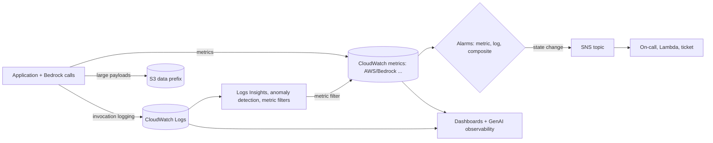

## 0. Before you start
- **Essential:** the difference between a **log** (a text record of one event) and a **metric** (a number over time).
- **Helpful:** JSON; what a percentile is (p99 = 99% of values are at or below it); SNS topics ([06/08](aip:06-app-building-tools/08-sqs-eventbridge-sns-and-appflow)).
- **Optional advanced:** OpenTelemetry; PromQL.

## 1. Simple explanation
Amazon CloudWatch is the AWS service that collects what your application and AWS services say about themselves. **Logs** are the story (what happened, in words). **Metrics** are the dashboard numbers (how many, how fast, how many errors). **Alarms** watch a number and tell you (or act) when it crosses a line. **Logs Insights** lets you ask questions of the logs. **RUM** (real user monitoring) watches the real browsers of your users. For a GenAI app, Bedrock publishes metrics for invocations, latency, tokens and errors automatically, and can write the full request and response of every call to CloudWatch Logs or S3 if you turn **model invocation logging** on. CloudWatch then shows ready-made GenAI dashboards on top.


```figure
flow cw-observability
```

## 2. Structured explanation
1. **Logs** ✅: log events live in log streams, which live in log groups; a log group sets retention, access control and metric filters; two log classes (Standard, Infrequent Access).
2. **Analysis:** **Logs Insights** queries (three query languages), **metric filters** (turn matching log lines into metrics), **anomaly detection**, **data protection policies** (mask sensitive data).
3. **Metrics** ✅: Bedrock publishes to `AWS/Bedrock`, plus `AWS/Bedrock/Guardrails` and `AWS/Bedrock/Agents`.
4. **Alarms** ✅: metric, log, PromQL and composite alarms; three states; M-out-of-N evaluation; four ways to treat missing data.
5. **RUM** ✅: client-side monitoring of web and mobile apps; app monitor, sampling, 30-day retention, link to Application Signals and X-Ray.
6. **Generative AI observability** ✅: Model Invocations dashboard and AgentCore dashboards; needs invocation logging for the content view.
7. **Exam skill 4.3 map:** observability (CloudWatch + X-Ray), invocation logs (Bedrock logging), token metrics (`InputTokenCount`, `OutputTokenCount`), tool metrics (agents, AgentCore), vector store operations (§5.7), golden datasets (continuous evaluation, [07/01](aip:07-governance-qa/01-agent-tracing-evaluation-metrics-and-bedrock-model-evaluations)).

## 3. Analogy
**A hospital ward.** Logs are the nurse's notes. Metrics are the monitor beside the bed (heart rate). An alarm is the beep when a number leaves its safe band; a composite alarm is the ward doctor paged only when several monitors agree something is wrong. Logs Insights is searching the notes for a pattern. RUM is a questionnaire from patients about how it felt to them, not what the equipment measured.

*Where it breaks:* a hospital monitor shows a heartbeat when one exists, but CloudWatch metrics can simply be *missing*, and "no data" can mean healthy (nothing happened) or broken (the sender died). The alarm's missing-data setting exists because the system cannot know which.

## 4. The seven questions

**WHAT?** CloudWatch Logs, Metrics, Alarms, Insights, RUM, and generative AI observability.

**WHY?** To see cost (tokens), quality (guardrail interventions, sampled scores), speed (latency, time to first token), reliability (errors, throttles) and misuse; to alert on them; and to keep audit evidence.

**WHEN?** From the first deploy. Turn on invocation logging **before** you need it: it is off by default ✅ and is not retroactive.

**WHERE?** Regional. Bedrock invocation logging destinations must be in the same account and Region ✅.

**HOW?** §5.

**WHAT IF?**
| Situation | Effect | Remedy |
|---|---|---|
| Invocation logging never enabled | No prompts/responses to investigate an incident ✅ | Enable now; plan retention and masking |
| Metrics filtered by `ModelId` | Failed-before-routing requests are published without that dimension, so you can undercount errors ✅ | Query without a dimension for totals |
| Alarm on a metric that only appears on error | Alarm sits in `INSUFFICIENT_DATA` | Treat missing data as `notBreaching` ✅ |
| Log group has no retention set | Events kept forever (cost) 🟡 | Set retention; archive to S3 |
| Prompts contain personal data | Logs hold personal data | Data protection policy, restricted `logs:Unmask`, S3 with KMS |
| Bedrock call uses another endpoint | Not captured by invocation logging ✅ | Use the `bedrock-runtime` endpoint or the other endpoint's own monitoring page |

**WHY NOT?** Do not log full prompts in production without a privacy decision. Do not alarm on raw errors without a rate or percentage (noise). Do not use RUM for server-side problems (it sees the browser).

## 5. Technical depth

```figure
alarm-eval
```


### 5.1 CloudWatch Logs ✅ (`CloudWatchLogsConcepts.html`, `AnalyzingLogData.html`)
| Concept | Meaning |
|---|---|
| **Log event** | A timestamp and a raw UTF-8 message |
| **Log stream** | Events from one source (one function instance, one host) |
| **Log group** | Streams that share retention, monitoring and access control; no limit on streams per group |
| **Log class** | **Standard** (full features, real-time monitoring) or **Infrequent Access** (cheaper, a subset of features; metric filters need Standard ✅) |
| **Retention** | Set per log group; expired events are deleted automatically |
| **Deletion protection** | Optional; blocks accidental deletion of a log group; off by default ✅ |
| **Metric filter** | Turns matching events into metric data points; **not retroactive** ✅ |

**Metric filter parts** ✅: filter pattern, metric name, namespace, metric value, optional dimensions and unit, and a **default value** (reported in a period when logs are ingested but none match; if no logs are ingested in a minute nothing is reported; you cannot set a default value if you assign dimensions) ✅. Delivery is at least once, so duplicates can occur ✅.

**Logs Insights** ✅: queries run in **Logs Insights QL**, **OpenSearch PPL** or **OpenSearch SQL**; you can run **100 concurrent** Logs Insights QL queries per account and 15 concurrent PPL or SQL queries; queries **time out after 60 minutes**; **results are available for 7 days**; you are **charged by the amount of uncompressed log data scanned** (any language); data from 5 November 2018 on; discovered fields for JSON logs and some AWS service logs; **field indexes** reduce scanned data and cost; **pattern analysis**, saved and parameterized queries, dashboards, natural-language query generation. A query cannot see events older than the log group's creation time. Example from the Bedrock page ✅ (tokens per caller):

```text
fields identity.arn as principal,
       input.inputTokenCount as inTokens,
       output.outputTokenCount as outTokens
| stats sum(inTokens) as totalInput, sum(outTokens) as totalOutput, count() as calls
        by principal
| sort totalInput desc
```

**Log anomaly detection** ✅: a log anomaly detector trains on the previous **two weeks** of events in the log group (training can take up to 15 minutes), learns patterns (static text and dynamic tokens), then flags new patterns, large changes in a pattern or token, and new token values. Each anomaly has a **priority** (severity of the pattern plus deviation); the default visibility period is **21 days**, after which a recurring anomaly is accepted as normal; you can suppress anomalies; creating detectors costs nothing; it is a poor fit for very long JSON lines such as CloudTrail (only the first **1,500** characters are analyzed) and for access logs; roughly 300 patterns or fewer works well; masked data is not scanned. The detector also exists as an on-demand `anomaly detection` command in Logs Insights.

**Data protection policies** ✅: audit and **mask** sensitive data matched by managed or custom data identifiers (credentials, financial, PII, PHI, device identifiers). Masked at **all egress points** (Insights, metric filters, subscription filters); only principals with **`logs:Unmask`** see the raw data; account-level and log-group-level policies both apply; detection happens **at ingestion**, so earlier events are not masked; a `LogEventsWithFindings` metric in `AWS/Logs` is emitted (free) and can drive an alarm; policy size limit 30,720 characters.

### 5.2 Amazon Bedrock model invocation logging ✅ (`model-invocation-logging.html`)
- **Off by default**; logs persist until you delete the logging configuration. APIs: `PutModelInvocationLoggingConfiguration`, `GetModelInvocationLoggingConfiguration`, `DeleteModelInvocationLoggingConfiguration`.
- **Operations covered:** `Converse`, `ConverseStream`, `InvokeModel`, `InvokeModelWithResponseStream`, only through the **`bedrock-runtime`** endpoint (including its OpenAI-compatible Responses and Chat Completions APIs); the `bedrock-mantle` endpoint is not captured.
- **Destinations:** CloudWatch Logs, S3, or both; **same account and Region**. Choose data types: text, image, embedding, video.
- **Size handling:** each record carries the invocation metadata plus input and output JSON bodies **up to 100 KB**; larger bodies and binary data go to S3 under a data prefix (CloudWatch Logs can reference an S3 location for large data); S3 delivers gzipped JSON batches, which you can query with Athena or S3 Select, catalog with Glue, or load into OpenSearch.
- **Permissions:** S3 bucket policy for `bedrock.amazonaws.com` (with `aws:SourceAccount` and `aws:SourceArn` conditions, object ACLs disabled; SSE-KMS needs a key-policy statement for `kms:GenerateDataKey`); for CloudWatch Logs an IAM role trusted by `bedrock.amazonaws.com` with `logs:CreateLogStream` and `logs:PutLogEvents` on the stream `aws/bedrock/modelinvocations`.
- **Record fields:** `schemaType` (`ModelInvocationLog`), `schemaVersion`, `timestamp`, `accountId`, `region`, `requestId`, `operation`, `modelId`, `identity.arn`, optional `requestMetadata`, `input.inputBodyJson`, `input.inputTokenCount`, `output.outputBodyJson`, `output.outputTokenCount`. Group by `identity.arn` to attribute tokens to a caller without request metadata; `requestMetadata` is the only caller-supplied field ([04/01](aip:04-operational-efficiency/01-token-efficiency-and-cost-effective-model-selection): it is not a cost-allocation tag).
- **Delivery metrics** (`AWS/Bedrock`): `ModelInvocationLogsCloudWatchDeliverySuccess` / `Failure`, `ModelInvocationLogsS3DeliverySuccess` / `Failure`, `ModelInvocationLargeDataS3DeliverySuccess` / `Failure`. Alarm on the failure ones: silent logging gaps are an audit risk.

### 5.3 Bedrock CloudWatch metrics ✅ (`monitoring-runtime-metrics.html`, guardrails and agents pages)
| Namespace | Metrics (names as listed) |
|---|---|
| `AWS/Bedrock` | `Invocations`, `InvocationLatency` (ms; request sent to last token), `InvocationClientErrors`, `InvocationServerErrors`, `InvocationThrottles`, `InputTokenCount`, `OutputTokenCount`, `OutputImageCount`, `TimeToFirstToken` (streaming APIs), `EstimatedTPMQuotaUsage` (an approximation: throttling uses the up-front reservation of input tokens plus `max_tokens`, [04/04](aip:04-operational-efficiency/04-backoff-connection-pooling-and-cross-region-inference)), `CacheReadInputTokenCount`, `CacheWriteInputTokenCount`, `LegacyModelInvocations` |
| `AWS/Bedrock/Guardrails` | `Invocations`, `InvocationLatency`, `InvocationClientErrors`, `InvocationServerErrors`, `InvocationThrottles`, `TextUnitCount`, `InvocationsIntervened`, and Automated Reasoning metrics (`FindingCounts`, `TotalFindings`, `Latency`) |
| `AWS/Bedrock/Agents` | listed in [07/01 §5.1](aip:07-governance-qa/01-agent-tracing-evaluation-metrics-and-bedrock-model-evaluations) |

- **Dimensions** ✅: `ModelId` for all runtime metrics; `ModelId + ImageSize + BucketedStepSize` for `OutputImageCount`; `ModelId + ContextWindow` (value `1M`, only for requests billed at a long-context rate, a **subset** of the `ModelId` series). Guardrails: `Operation`, `GuardrailContentSource` (Input/Output), `GuardrailPolicyType` (Content, Topic, Word, SensitiveInformation, ContextualGrounding), `GuardrailArn + GuardrailVersion`.
- **Definitions that matter** ✅: `Invocations` counts accepted requests including later failures; **throttled requests are not counted** in `Invocations`, `InvocationClientErrors` or `InvocationServerErrors`; quota-exceeded rejections count as client errors, not throttles. Throttle counts depend on SDK retry settings.
- **Token metrics for cost:** `InputTokenCount` and `OutputTokenCount` per `ModelId`; multiply by a price you look up that day ❌ (no prices here). Cache metrics show prompt-cache savings ([04/02](aip:04-operational-efficiency/02-throughput-utilization-and-intelligent-caching)).
- `OTPS` diagnosis page for latency increases exists (`monitoring-runtime-otps.html`) ❌ not read.

### 5.4 CloudWatch alarms ✅ (`CloudWatch_Alarms.html`, `alarms-and-missing-data.html`)
- **Types:** *metric alarm* (one metric or a math expression; actions: SNS, EC2, Auto Scaling, investigations, Systems Manager OpsItem or incident), *PromQL alarm* (instant query on metrics ingested through the CloudWatch OTLP endpoint; contributors; pending and recovery periods), *log alarm* (runs a Logs Insights query on a schedule and evaluates M-out-of-N on recent executions, no metric filter needed), *composite alarm* (a rule over other alarms' states; reduces noise; can notify and create investigations, OpsItems or incidents, but **cannot run EC2 or Auto Scaling actions**; cross-account composites are not supported).
- **States:** `OK`, `ALARM`, `INSUFFICIENT_DATA`. Actions fire **only on a state change** (Auto Scaling actions repeat once a minute while the state persists). History is kept **30 days**. `SetAlarmState` tests an alarm; the change lasts until the next evaluation.
- **Evaluation:** `Period × Evaluation Periods` is the window (maximum **7 days** for periods of an hour or more, **1 day** for shorter periods or the custom Lambda data source). **Datapoints to alarm** (M) of **evaluation periods** (N) gives M-out-of-N. CloudWatch retrieves more data points than N (the evaluation range) in case some are missing.
- **Treat missing data** ✅: `notBreaching` (missing counts as good), `breaching` (bad), `ignore` (keep the current state), `missing` (all missing in the range → `INSUFFICIENT_DATA`). **Default `missing`**; `AWS/DynamoDB` metrics default to `ignore`. If enough real points exist the setting is not used; otherwise CloudWatch fills only as many gaps as needed. There is also a **premature-alarm** rule for intermittent data (not modelled in the lab).
- **Practical GenAI alarms:** `InvocationThrottles` rate; `InvocationServerErrors`; p99 `InvocationLatency` or `TimeToFirstToken`; token usage per hour against a budget; guardrail `InvocationsIntervened` spike; `ModelInvocationLogs*DeliveryFailure`; DLQ depth ([06/08](aip:06-app-building-tools/08-sqs-eventbridge-sns-and-appflow)); `LogEventsWithFindings`.
- **Anomaly detection bands** exist for metric alarms (`ANOMALY_DETECTION_BAND` math function, listed on the alarm page; not supported for cross-account alarms ✅).


*Reading the arrows:* the application emits metrics and logs; large payloads go to S3; metric filters turn log patterns into metrics; alarms watch metrics and notify on state changes; dashboards read both metrics and logs.

### 5.5 CloudWatch RUM ✅ (`CloudWatch-RUM.html`)
- **What:** real user monitoring for **web and mobile** apps: page load times, client-side errors, user behavior; mobile screen load, app launch, network errors, crashes, Android ANR and iOS hangs; breakdowns by device, OS and browser; error messages, stack traces and sessions for debugging.
- **How:** create an **app monitor**; RUM generates a **code snippet** that loads the RUM client; the client captures a **percentage of user sessions** (you set it). Clients are open source (web client; ADOT Android and iOS SDKs).
- **Retention:** 30 days, then deleted; keep longer by sending copies to CloudWatch Logs and setting that log group's retention.
- **Integration:** with **Application Signals** (services, SLOs, application map); turn on **X-Ray active tracing** in the app monitor to see client page requests connected to server traces ([07/04](aip:07-governance-qa/04-cloudtrail-and-x-ray-for-genai)). Regions: many, but not all (list on the page).
- **GenAI use:** measure what users feel (time until the first words appear in a streaming chat UI, JavaScript errors in the chat widget, failed calls to your API), which server metrics cannot show. Privacy: decide what the client may capture; do not put prompts in URLs.

### 5.6 CloudWatch generative AI observability ✅ (`GenAI-observability.html`, `model-invocations.html`)
- **Two pre-built capabilities:** **Model Invocations** (metrics on usage, token consumption and a curated invocation-logs table showing input and output content) and **Amazon Bedrock AgentCore agents** (performance and decision metrics for Agents, Memory, built-in tools, gateways and identity). The Model Invocations dashboard works with **any model** used for inference in Bedrock.
- **Needs:** invocation counts and tokens appear out of the box; to see **input and output content** you must enable **Bedrock invocation logging to CloudWatch Logs** ✅. Mask sensitive data with a data protection policy.
- **Dashboard widgets:** invocation count, invocation latency, token counts by model (input vs output), daily token counts by model, requests grouped into six input-token ranges, invocation throttles, invocation error count; filter by model; period override; drill into a request ID and **View in Logs Insights**.
- **Beyond Bedrock:** end-to-end **prompt tracing** across knowledge bases, tools and models; monitors managed, self-hosted and third-party agents; compatible with **Strands**, LangChain and LangGraph; send structured traces from third-party models with the **ADOT SDK** (OpenTelemetry); uses existing Application Signals, alarms, dashboards, sensitive data protection and Logs Insights ✅. Key metrics include invocations, token usage (total, average, input, output), latency (average, P90, P99), error rates, throttling and **cost attribution by application, user role or user** ✅ (page list).
- **AgentCore:** observability for AgentCore agents is documented in the AgentCore guide ([03/04](aip:03-agentic-ai/04-agentcore-runtime-memory-gateway-identity-policy-evaluations)); the exact setup steps were not read ❌.

### 5.7 What to monitor for the exam skills in 4.3
| Layer | Signals | Where |
|---|---|---|
| Model calls | invocations, latency, TTFT, errors, throttles, tokens, cache tokens, estimated TPM use | `AWS/Bedrock` ✅ |
| Prompts and responses | request/response bodies, caller identity | Invocation logs ✅ + Logs Insights |
| Safety | interventions by policy type, blocked rate | `AWS/Bedrock/Guardrails` ✅, `GuardrailTrace` |
| Agents and tools | step traces, tool errors, model latency per step | Agent trace ✅, `AWS/Bedrock/Agents` ✅, AgentCore dashboards ✅ |
| Retrieval / vector store | query latency, empty-result rate, ingestion job status and freshness, index size, throttles | OpenSearch/Aurora/S3 Vectors metrics ([02/05](aip:02-data-management/05-amazon-opensearch-for-genai), [02/06](aip:02-data-management/06-s3-vectors-and-keeping-vector-stores-current), [02/07](aip:02-data-management/07-rds-aurora-and-pgvector)); the specific metric names were not read here ❌; add your own custom metrics for empty-result rate and freshness |
| Quality over time | sampled judge scores, golden-set regressions, thumbs-down rate | Scheduled evaluation job ([07/01](aip:07-governance-qa/01-agent-tracing-evaluation-metrics-and-bedrock-model-evaluations)) + custom metrics |
| User experience | page load, JS errors, time to first visible text | RUM ✅ |
| Cost | token metrics by model and `identity.arn`, request metadata | Metrics + invocation logs ✅ |

## 6. Worked example
*Problem:* an HR assistant is slow and sometimes expensive; a regulator wants proof of who asked what.

| Step | Action | Why |
|---|---|---|
| 1 | Enable invocation logging to **both** CloudWatch Logs (7-day retention) and S3 (long retention, SSE-KMS, object lock policy if required) | Fast search plus durable archive ✅ |
| 2 | Add a log-group **data protection policy** for national IDs and card numbers; grant `logs:Unmask` to a small audit role | Masking at egress ✅ |
| 3 | Dashboard: Model Invocations + p99 `InvocationLatency` + `TimeToFirstToken` | See the slow path ✅ |
| 4 | Alarms: throttles ≥ 1 for 3 of 5 minutes (treat missing as `notBreaching`); delivery failures; guardrail interventions; daily tokens over budget | Early warning ✅ |
| 5 | Composite alarm "throttling AND latency high" pages on-call; single alarms only email | Less noise ✅ |
| 6 | Logs Insights saved query: tokens by `identity.arn`, top callers | Cost attribution ✅ |
| 7 | RUM app monitor on the chat page, 100% sampling during launch | User-perceived latency ✅ |
| 8 | Weekly scheduled evaluation on the golden set; publish the mean as a custom metric and alarm on a drop | Quality drift ([07/01](aip:07-governance-qa/01-agent-tracing-evaluation-metrics-and-bedrock-model-evaluations)) |

## 7. Knowledge checkpoints
1. Is Bedrock model invocation logging on by default? Where can it write?
2. What does a metric filter's default value do?
3. Name the four ways an alarm can treat missing data.
4. Which alarm type can notify but cannot perform EC2 actions?
5. What must be enabled to see prompt and response content in the CloudWatch Model Invocations dashboard?

## 7b. Practice questions (exam-style, original) — answers in §14

**Q1.** A team must keep every Bedrock prompt and response for an audit and also search them quickly last week. Which configuration is best?
A. Enable model invocation logging to both CloudWatch Logs and S3 in the same account and Region
B. Enable CloudTrail data events for `InvokeModel` only
C. Use RUM
D. Turn on X-Ray sampling at 100%

**Q2.** (Select TWO) Which statements about Bedrock model invocation logging are correct?
A. It is disabled by default
B. Destinations must be in the same account and Region
C. It also logs calls made through any endpoint
D. It stores the full body of every payload inline regardless of size
E. It always masks personal data

**Q3.** Which metric shows requests that Bedrock rejected because of rate limits, and are those counted in `Invocations`?
A. `InvocationThrottles`; no, throttled requests are not counted in `Invocations`
B. `InvocationClientErrors`; yes
C. `OutputTokenCount`; yes
D. `TimeToFirstToken`; no

**Q4.** A metric exists only when an error occurs. The alarm stays in `INSUFFICIENT_DATA` for most of the day. What setting fixes this?
A. Treat missing data as `notBreaching`
B. Treat missing data as `breaching`
C. Reduce the alarm period to 1 second
D. Delete the metric

**Q5.** (Select TWO) Which are true of composite alarms?
A. They evaluate a rule over other alarms' states
B. They can reduce alarm noise
C. They can start EC2 Auto Scaling actions
D. They can be created across accounts
E. They replace metric alarms

**Q6.** Logs Insights queries are billed by what?
A. The amount of uncompressed log data scanned
B. The number of fields in the query
C. The number of log groups
D. A flat monthly fee

**Q7.** Log events with card numbers must appear masked to most engineers but visible to the audit team. Which feature?
A. A log group data protection policy; only principals with `logs:Unmask` see raw data
B. A metric filter
C. A subscription filter to S3
D. Log retention

**Q8.** Product wants to know how long real users wait for the first words in the chat UI. Which service measures it?
A. CloudWatch RUM on the web app
B. Bedrock `InvocationLatency` alone
C. CloudTrail
D. Lake Formation

## 8. Hands-on lab: invocation-log analysis, a metric filter, an M-of-N alarm, masking and pattern anomalies

### 8.1 Objective
Reproduce, offline: Logs-Insights-style token aggregation on records shaped like Bedrock invocation logs, a metric filter with a default value, an alarm evaluator checked against rows of the documented missing-data tables, sensitive-data masking, and pattern-based anomaly detection.

### 8.2 Prerequisites
Python 3 (standard library). Optional AWS part: an AWS account with Bedrock model access, CloudWatch and S3.

### 8.3 AWS services
Offline: none. Optional: Bedrock, CloudWatch Logs, CloudWatch alarms, SNS, S3, IAM.

### 8.4 IAM permissions
Offline: none. Real: Bedrock logging configuration permission and `iam:PassRole` for the logging role; the role policy in §5.2; CloudWatch permissions to create log groups, metric filters and alarms; `logs:Unmask` only for the audit role (action names beyond those quoted on the pages were not verified ❌).

### 8.5 Region notes
Create the log group, bucket and logging configuration in the Region where the model calls happen; for cross-Region inference profiles check the page for where logs are written ❌ not read.

### 8.6 Architecture
§5.4 diagram.

### 8.7 Cost
Offline: none. Real: log ingestion and storage, Logs Insights scans, alarms, S3, and custom metrics; prices ❌ not read. Use short retention in a lab and delete everything afterwards.

### 8.8 Code
The log records follow the documented field names; every value is made up and the model IDs are placeholders. The alarm evaluator is a simplified model of the documented rules (it does not model the "premature alarm" rule).

```python lab-run
import json, re
from collections import Counter, defaultdict

# ---------- 1. Logs-Insights-style aggregation over records shaped like Bedrock invocation logs ----------
def rec(ts, rid, role, tin, tout):
    return json.dumps({"schemaType": "ModelInvocationLog", "timestamp": ts, "requestId": rid, "operation": "Converse",
                       "modelId": "example.model-a", "identity": {"arn": f"arn:aws:sts::111122223333:assumed-role/{role}/s"},
                       "input": {"inputTokenCount": tin}, "output": {"outputTokenCount": tout}})
LOGS = [rec("2026-10-26T09:00:05Z", "r1", "app-chat", 800, 300), rec("2026-10-26T09:00:40Z", "r2", "batch-summaries", 2500, 1500),
        rec("2026-10-26T09:01:10Z", "r3", "app-chat", 900, 400), rec("2026-10-26T09:03:02Z", "r4", "batch-summaries", 3000, 1800),
        rec("2026-10-26T09:03:30Z", "r5", "batch-summaries", 2800, 1200), rec("2026-10-26T09:04:11Z", "r6", "app-chat", 700, 250),
        rec("2026-10-26T09:04:50Z", "r7", "batch-summaries", 2600, 1100), rec("2026-10-26T09:05:20Z", "r8", "app-chat", 650, 200)]
rows = [json.loads(x) for x in LOGS]
agg = defaultdict(lambda: [0, 0, 0])
for r in rows:
    key = r["identity"]["arn"].split("/")[-2]
    agg[key][0] += r["input"]["inputTokenCount"]
    agg[key][1] += r["output"]["outputTokenCount"]
    agg[key][2] += 1
print("1) tokens by caller (stats sum() by principal | sort totalInput desc)")
for who, (tin, tout, n) in sorted(agg.items(), key=lambda kv: -kv[1][0]):
    print(f"   {who:<16} totalInput {tin:>5} totalOutput {tout:>5} calls {n}")

# ---------- 2. Metric filter { $.output.outputTokenCount > 1000 }: value 1 per match, default value 0 when logs exist but none match ----------
per_minute = defaultdict(lambda: [0, 0])      # minute -> [events seen, matches]
for r in rows:
    minute = r["timestamp"][11:16]
    per_minute[minute][0] += 1
    per_minute[minute][1] += r["output"]["outputTokenCount"] > 1000
print("2) metric 'LargeOutputs' per minute (default value 0; no logs in a minute -> no data point)")
SERIES = []
for minute in ["09:00", "09:01", "09:02", "09:03", "09:04", "09:05"]:
    if minute in per_minute:
        SERIES.append(per_minute[minute][1])
        print(f"   {minute}: {per_minute[minute][1]}")
    else:
        SERIES.append(None)
        print(f"   {minute}: (missing)")

# ---------- 3. Alarm evaluator: M-out-of-N with an evaluation range of 5 and the four missing-data treatments ----------
def evaluate(points, n, m, treat, current="OK", span=5):
    """points: oldest to newest, 'X' breaching, '0' not breaching, '-' missing."""
    window = [p for p in points[-span:] if p != "-"]
    if len(window) >= n:
        window = window[-n:]
    elif treat == "breaching":
        window += ["X"] * (n - len(window))
    elif treat == "notBreaching":
        window += ["0"] * (n - len(window))
    elif not window:
        return "INSUFFICIENT_DATA" if treat == "missing" else current
    return "ALARM" if window.count("X") >= m else "OK"

# rows of the two worked tables in the missing-data page: (points, N, M) -> expected state per treatment [missing, ignore, breaching, notBreaching]
DOC = {
    ("0-X-X", 3, 3): ["OK", "OK", "OK", "OK"],
    ("0----", 3, 3): ["OK", "OK", "OK", "OK"],
    ("-----", 3, 3): ["INSUFFICIENT_DATA", "RETAIN", "ALARM", "OK"],
    ("0XX-X", 3, 3): ["ALARM", "ALARM", "ALARM", "ALARM"],
    ("0-X-X", 3, 2): ["ALARM", "ALARM", "ALARM", "ALARM"],
    ("00X0X", 3, 2): ["ALARM", "ALARM", "ALARM", "ALARM"],
    ("----0", 3, 2): ["OK", "OK", "ALARM", "OK"],
    ("0-X--", 3, 2): ["OK", "OK", "ALARM", "OK"],
}
checks = good = 0
for (pts, n, m), expected in DOC.items():
    for treat, want in zip(["missing", "ignore", "breaching", "notBreaching"], expected):
        got = evaluate(list(pts), n, m, treat, current="RETAIN")
        checks += 1
        good += got == want
print(f"3) alarm evaluator agrees with {good}/{checks} documented table cells (premature-alarm rows are not modelled)")
print("   not modelled, for example '---X-' with M=2, N=3, treat=missing:", evaluate(list("---X-"), 3, 2, "missing"), "(the page says ALARM)")
flags = ["0", "0", "0"] + ["-" if v is None else ("X" if v >= 1 else "0") for v in SERIES]     # three quiet minutes of history first
print("   alarm on LargeOutputs >= 1, 2 of 3 periods (state at 09:00 ... 09:05; the same under every treatment because real points suffice):")
for treat in ["breaching", "notBreaching", "missing", "ignore"]:
    states = [evaluate(flags[: i + 1], 3, 2, treat) for i in range(3, len(flags))]
    print(f"   {treat:<13}", " ".join(f"{s:<5}" for s in states))
before = evaluate(flags, 3, 2, "ignore")
print(f"   then the sender goes silent for 5 minutes (state before: {before}):")
for treat in ["breaching", "notBreaching", "missing", "ignore"]:
    print(f"   {treat:<13}", evaluate(flags + ["-"] * 5, 3, 2, treat, current=before))

# ---------- 4. Data protection: mask card numbers and e-mails at ingestion, count events with findings ----------
PATTERNS = [("CreditCard", re.compile(r"\b\d(?:[ -]?\d){12,15}\b")), ("EmailAddress", re.compile(r"[\w.+-]+@[\w-]+\.[\w.]+"))]
def protect(message):
    found = []
    for name, rx in PATTERNS:
        if rx.search(message):
            found.append(name)
            message = rx.sub("*" * 8, message)
    return message, found
EVENTS = ["user asked about card 4111 1111 1111 1111 refund", "contact me at jane.doe@example.com please", "what is the refund window"]
with_findings, stored = 0, []
for e in EVENTS:
    masked, found = protect(e)
    stored.append(masked)
    with_findings += bool(found)
print("4) data protection (masked at ingestion; the raw text is only for principals with logs:Unmask)")
for original, masked in zip(EVENTS, stored):
    print(f"   {original!r} -> {masked!r}")
print("   LogEventsWithFindings in this batch:", with_findings)

# ---------- 5. Pattern-based anomaly detection: learn patterns from a baseline, flag unseen patterns ----------
def pattern(msg):
    return re.sub(r"[0-9a-f]{8}-[0-9a-f]{4}-[0-9a-f]{4}-[0-9a-f]{4}-[0-9a-f]{12}|\d+", "<*>", msg)
BASELINE = ["INFO converse ok request 1234 latency 410 ms", "INFO converse ok request 98 latency 388 ms", "INFO converse ok request 77 latency 512 ms",
            "WARN retry 1 after throttling"] * 3
TODAY = ["INFO converse ok request 5 latency 401 ms", "ERROR guardrail service unavailable for request 6", "WARN retry 2 after throttling",
         "ERROR guardrail service unavailable for request 9"]
known = {pattern(m) for m in BASELINE}
unseen = Counter(pattern(m) for m in TODAY if pattern(m) not in known)
print("5) anomaly detection by unseen pattern")
for pat, count in unseen.items():
    print(f"   ANOMALY x{count}: {pat}")
```

### 8.9 Captured output
Generated on 2026-10-26 by extracting the block above from this file and running it (Python 3). It is an offline model with made-up data, **not** CloudWatch or Bedrock output.
```text lab-out
1) tokens by caller (stats sum() by principal | sort totalInput desc)
   batch-summaries  totalInput 10900 totalOutput  5600 calls 4
   app-chat         totalInput  3050 totalOutput  1150 calls 4
2) metric 'LargeOutputs' per minute (default value 0; no logs in a minute -> no data point)
   09:00: 1
   09:01: 0
   09:02: (missing)
   09:03: 2
   09:04: 1
   09:05: 0
3) alarm evaluator agrees with 32/32 documented table cells (premature-alarm rows are not modelled)
   not modelled, for example '---X-' with M=2, N=3, treat=missing: OK (the page says ALARM)
   alarm on LargeOutputs >= 1, 2 of 3 periods (state at 09:00 ... 09:05; the same under every treatment because real points suffice):
   breaching     OK    OK    OK    ALARM ALARM ALARM
   notBreaching  OK    OK    OK    ALARM ALARM ALARM
   missing       OK    OK    OK    ALARM ALARM ALARM
   ignore        OK    OK    OK    ALARM ALARM ALARM
   then the sender goes silent for 5 minutes (state before: ALARM):
   breaching     ALARM
   notBreaching  OK
   missing       INSUFFICIENT_DATA
   ignore        ALARM
4) data protection (masked at ingestion; the raw text is only for principals with logs:Unmask)
   'user asked about card 4111 1111 1111 1111 refund' -> 'user asked about card ******** refund'
   'contact me at jane.doe@example.com please' -> 'contact me at ******** please'
   'what is the refund window' -> 'what is the refund window'
   LogEventsWithFindings in this batch: 2
5) anomaly detection by unseen pattern
   ANOMALY x2: ERROR guardrail service unavailable for request <*>
```

### 8.10 Explanation
- Part 1: the same grouping as the documented Insights query; the batch caller dominates token use.
- Part 2: minutes that have logs but no match report 0; the minute with no logs has no data point (missing).
- Part 3: the evaluator reproduces the documented table cells that do not depend on the premature-alarm rule; the one deviation shown is a documented case my model does not capture. The first timelines show a documented subtlety: with enough real data points in the evaluation range, the missing-data setting is not used at all, so a one-minute gap changes nothing. The second block shows when it matters: after a long silence the same alarm is `ALARM`, `OK`, `INSUFFICIENT_DATA` or unchanged depending only on the setting.
- Part 4: masking happens when the event is stored, so every egress sees the masked text.
- Part 5: the new pattern (the guardrail error, seen twice) is flagged once with its count; the retry pattern was in the baseline.

### 8.11 Optional AWS lab (shown, not run against AWS ❌)
1. Create a log group `/aws/bedrock/invocations` (retention 7 days) and an S3 bucket; apply the bucket policy and IAM role from §5.2.
2. Bedrock console → **Settings** → **Model invocation logging** → choose text (and others), choose **both** destinations, select the role, **Save** ✅.
3. Call `Converse` a few times (any model you can access; see [01/01](aip:01-bedrock-genai-fundamentals/01-bedrock-overview-and-converse-api)). Open CloudWatch → **Generative AI observability** → **Model Invocations** and open a request ID ✅.
4. In **Logs Insights**, run the token query from §5.1 against the log group.
5. Create a metric filter on the log group and an alarm on a Bedrock metric (for example `InvocationThrottles`) with an SNS topic; test with `aws cloudwatch set-alarm-state` ✅ (`SetAlarmState`).
6. Add a **data protection policy** with a managed identifier for credit card numbers; send a test prompt with a fake number and confirm masking.
7. Delete the logging configuration, log group, alarms, topic, bucket and role.

### 8.12 Common errors
| Error | Cause | Fix |
|---|---|---|
| No logs appear | Logging not enabled, wrong Region, or a different endpoint ✅ | Enable on `bedrock-runtime`, same Region |
| Logs missing in CloudWatch | Role lacks `logs:PutLogEvents` on the expected stream ✅ | Fix role policy and trust |
| S3 delivery fails | Bucket policy missing, ACLs enabled, or KMS statement missing ✅ | Apply the documented policies |
| Content not shown in the dashboard | Invocation logging to CloudWatch off ✅ | Enable it |
| Alarm stuck in `INSUFFICIENT_DATA` | Metric not emitted when healthy | Set missing data to `notBreaching` ✅ |
| Error count looks too low by model | Failed-before-routing requests have no `ModelId` dimension ✅ | Query without dimension |
| Metric filter shows nothing | It is not retroactive, or the log group is Infrequent Access ✅ | Create it before the events; use Standard class |
| Unmasked data in old logs | Policy only affects ingestion after creation ✅ | Delete or rotate old log groups |

### 8.13 Security recommendations
Treat prompts and responses as sensitive data: encrypt log groups and the S3 bucket with KMS; restrict `logs:Unmask`, S3 read access and Logs Insights to a small role; use data protection policies; set retention to the shortest value your policy allows; alarm on delivery failures; do not put secrets in prompts; protect the logging role with the `aws:SourceAccount` and `aws:SourceArn` conditions shown on the page ✅.

## 9. What can go wrong?
| Failure | Why | Symptoms | Investigate | Fix | Prevent |
|---|---|---|---|---|---|
| **Blind incident** | Logging off | No evidence | Check configuration | Enable; reproduce | Enable in the launch checklist |
| **Silent logging gap** | Delivery failures | Missing records | `ModelInvocationLogs*DeliveryFailure` | Fix role/bucket | Alarm on failure metrics |
| **Alarm storm** | Per-metric alarms for one cause | Dozens of pages | Alarm history | Composite alarm | Design alarms by symptom |
| **Missing-data confusion** | Wrong treatment | False alarms or false calm | State reason | Choose per metric | Document the choice |
| **Cost explosion in logs** | Full payloads, no retention | Big bill | Ingestion by log group | Retention, S3 for large data, sampling | Review quarterly |
| **PII in logs** | Prompts include personal data | Audit finding | Data protection findings | Masking, scrubbing before logging | Policy from day one |
| **Wrong dimension** | Filtering by `ModelId` | Under-counted errors | Compare with no-dimension query | Use totals | Dashboard both views |
| **RUM mismatch** | Sampling too low | Noisy or absent data | Session counts | Raise sampling | Calibrate after launch |

## 10. Common misconceptions
1. **"Bedrock logs prompts by default."** Invocation logging is disabled by default ✅.
2. **"CloudWatch alarms keep firing while in ALARM."** Actions run on state changes (Auto Scaling excepted) ✅.
3. **"Composite alarms can scale EC2."** They cannot run EC2 or Auto Scaling actions ✅.
4. **"Metric filters work on old logs."** They only see events after creation ✅.
5. **"RUM measures my API."** It measures the client; use metrics and traces for servers.
6. **"Throttled calls count as invocations."** They do not ✅.

## 11. Exam notes
- **Patterns:** "audit every prompt and response" → invocation logging to S3 and/or CloudWatch Logs; "token cost per caller" → Logs Insights on `identity.arn` or metrics by model; "reduce alarm noise" → composite alarm; "mask sensitive log data" → data protection policy; "user-perceived latency" → RUM; "ready-made GenAI dashboards" → CloudWatch generative AI observability.
- **Keywords:** `AWS/Bedrock`, `InvocationThrottles`, `TimeToFirstToken`, metric filter, default value, M-out-of-N, `notBreaching`, `logs:Unmask`, app monitor.
- **Traps:** assuming logging is on; mixing CloudTrail (API audit) with invocation logs (content); forgetting same-Region destinations; forgetting retention and cost; using Infrequent Access with metric filters.
- **Compare:** CloudWatch Logs vs S3 for invocation logs; invocation logs vs CloudTrail ([07/04](aip:07-governance-qa/04-cloudtrail-and-x-ray-for-genai)); RUM vs Synthetics (canaries, not read here ❌); CloudWatch vs X-Ray.

## 12. Summary and revision cards
- Bedrock metrics in `AWS/Bedrock` (+ Guardrails, Agents); invocation logging is off by default, covers `bedrock-runtime`, same account and Region, 100 KB inline limit.
- Alarms: states OK/ALARM/INSUFFICIENT_DATA; M-out-of-N; missing-data options; composite reduces noise.
- Logs Insights: 3 languages, 100 concurrent QL queries, 60-minute timeout, billed by data scanned.
- RUM: client-side, app monitor, 30-day retention. GenAI observability: Model Invocations + AgentCore dashboards.

**Cards.** Q: Default missing-data treatment? A: `missing`. · Q: Who sees unmasked log data? A: Principals with `logs:Unmask`. · Q: Where do over-100 KB bodies go? A: S3 data prefix.

## 13. References
| Source | URL | Verified |
|---|---|---|
| Model invocation logging | https://docs.aws.amazon.com/bedrock/latest/userguide/model-invocation-logging.html | 2026-10-26 |
| Bedrock runtime metrics | https://docs.aws.amazon.com/bedrock/latest/userguide/monitoring-runtime-metrics.html | 2026-10-26 |
| Guardrails and Agents metrics | https://docs.aws.amazon.com/bedrock/latest/userguide/monitoring-guardrails-cw-metrics.html · .../monitoring-agents-cw-metrics.html | 2026-10-26 |
| CloudWatch Logs concepts, Insights | https://docs.aws.amazon.com/AmazonCloudWatch/latest/logs/CloudWatchLogsConcepts.html · .../AnalyzingLogData.html | 2026-10-26 |
| Metric filters | https://docs.aws.amazon.com/AmazonCloudWatch/latest/logs/MonitoringLogData.html | 2026-10-26 |
| Log anomaly detection | https://docs.aws.amazon.com/AmazonCloudWatch/latest/logs/LogsAnomalyDetection.html | 2026-10-26 |
| Data protection (masking) | https://docs.aws.amazon.com/AmazonCloudWatch/latest/logs/mask-sensitive-log-data.html | 2026-10-26 |
| Alarms and missing data | https://docs.aws.amazon.com/AmazonCloudWatch/latest/monitoring/CloudWatch_Alarms.html · .../alarms-and-missing-data.html | 2026-10-26 |
| CloudWatch RUM | https://docs.aws.amazon.com/AmazonCloudWatch/latest/monitoring/CloudWatch-RUM.html | 2026-10-26 |
| Generative AI observability, Model Invocations | https://docs.aws.amazon.com/AmazonCloudWatch/latest/monitoring/GenAI-observability.html · .../model-invocations.html | 2026-10-26 |

**Unverified here:** CloudWatch pricing and free tier; log retention options list and default (the concepts page says expired events are deleted, not the default value); `OTPS` page; Synthetics; OpenSearch/Aurora/S3 Vectors CloudWatch metric names; AgentCore observability setup steps; anomaly-detection alarm syntax; IAM action names beyond those quoted; Application Signals setup.

## 14. Answers to checkpoints and practice questions
**Checkpoints.** 1) No, it is disabled by default; it can write to CloudWatch Logs, S3 or both, in the same account and Region ✅. 2) It is the value reported when logs are ingested in a period but none match (use 0 to avoid gaps); you cannot set it if the metric has dimensions ✅. 3) `notBreaching`, `breaching`, `ignore`, `missing` ✅. 4) A composite alarm ✅. 5) Bedrock invocation logging to CloudWatch Logs ✅.

**Practice questions.**
- **Q1 → A.** Both destinations give fast search and durable archive. B records API calls but not content; C and D are not for prompt audit ✅.
- **Q2 → A, B.** C is false (only `bedrock-runtime`); D is false (over 100 KB goes to S3); E is false (masking needs a data protection policy) ✅.
- **Q3 → A.** Throttled requests are not counted in `Invocations` ✅.
- **Q4 → A.** B would alarm all day; C is impossible; D removes monitoring ✅.
- **Q5 → A, B.** C and D are false; E is false (they build on other alarms) ✅.
- **Q6 → A.** Billed by uncompressed data scanned ✅.
- **Q7 → A.** Data protection policy with `logs:Unmask` for the audit role ✅.
- **Q8 → A.** RUM sees the browser; B sees only the server call ✅.
