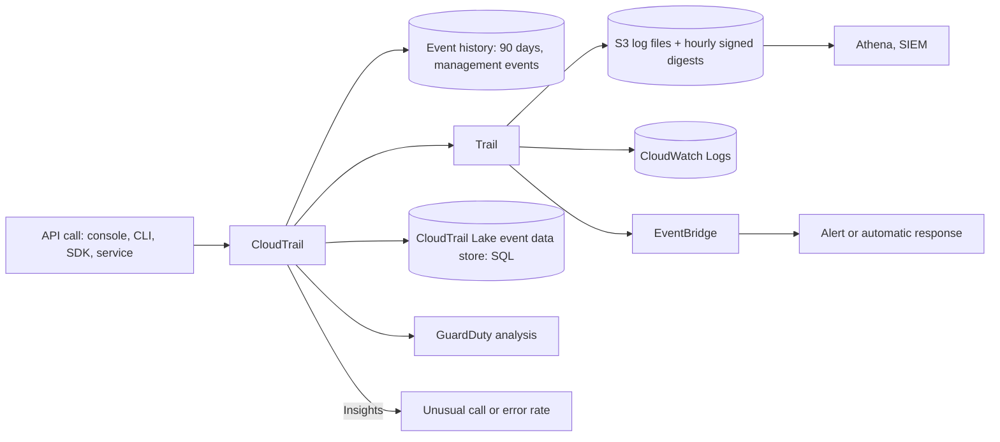
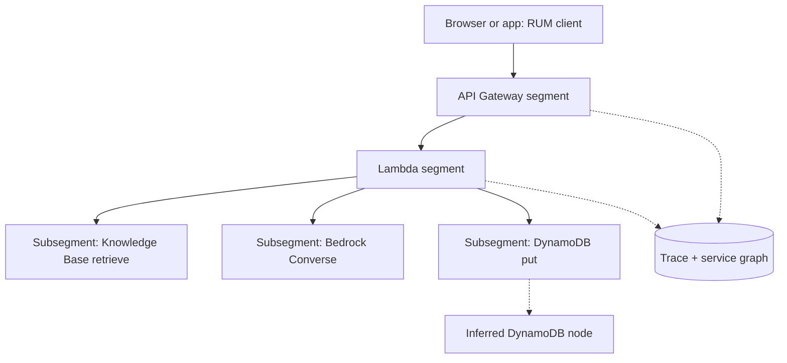

## 0. Before you start
- **Essential:** an **API call** is a request to an AWS service (the console, CLI and SDKs all make them); a **request path** is the chain of services one user request touches.
- **Helpful:** IAM roles and sessions ([00-foundations/01](aip:00-foundations/01-aws-account-iam-and-cli-setup)); what a hash is.
- **Optional advanced:** OpenTelemetry concepts (spans, context propagation).

## 1. Simple explanation
**CloudTrail** answers "who did what, when, from where" for AWS API calls: it is the security camera over your account. It records the *call* (for example, "role `app-chat` called `Converse` on this model at 09:00"), not the secret contents of your prompts. **X-Ray** answers "where did the time go, and where did it break" for **one request** as it travels through API Gateway, Lambda, Bedrock, DynamoDB and more: it is the stopwatch that follows a parcel through every depot. In a GenAI application you use both: CloudTrail for audit and governance, X-Ray (or its OpenTelemetry successor) for performance and troubleshooting, and CloudWatch invocation logs ([07/03](aip:07-governance-qa/03-cloudwatch-logs-alarms-rum-and-genai-observability)) for the prompt and response content.


```figure
flow cloudtrail-pipeline
```

## 2. Structured explanation
1. **CloudTrail records events** ✅: three ways: **Event history** (last 90 days of management events per Region, free, immutable), **trails** (deliver ongoing events to S3, optionally CloudWatch Logs and EventBridge), **CloudTrail Lake** (managed, queryable data lake of event data stores).
2. **Event types** ✅: *management events* (control plane; logged by default), *data events* (data plane, high volume, off by default, extra charge), *Insights events* (unusual API call or error rates). Lesson 204's clarification is the Bedrock-specific split in §5.2.
3. **Integrity** ✅: log file integrity validation (hourly signed digest files).
4. **X-Ray** ✅: segments → subsegments → traces → service graph; sampling; annotations and metadata; groups; error, fault and throttle categories.
5. **Instrumentation direction** ✅: X-Ray SDKs and the daemon are in **maintenance mode** (since 25 February 2026, security fixes only); AWS recommends **OpenTelemetry** with the ADOT distro, the CloudWatch agent or the OpenTelemetry collector, sending to X-Ray or CloudWatch Application Signals.

## 3. Analogy
**A building.** CloudTrail is the **door log and CCTV index**: who entered which room (API) at what time with which badge (identity). It does not record what was said inside the room. X-Ray is a **tracking sticker on a parcel**: each department that handles the parcel stamps arrival and departure times, so you see which department was slow or lost it. Invocation logs are the **meeting minutes** that capture what was actually said.

*Where it breaks:* CloudTrail events can arrive minutes late, are not a strict ordered stack trace ✅, and some actions need *data event* logging switched on or the camera never sees them; and the sticker only follows requests that were **sampled**.

## 4. The seven questions

**WHAT?** CloudTrail: an audit record of AWS API activity. X-Ray: distributed tracing of application requests.

**WHY?** Governance, forensics ("who deleted the guardrail?"), compliance, anomaly detection (CloudTrail); latency breakdown, error location, dependency map (X-Ray).

**WHEN?** CloudTrail: always on (event history) and a multi-Region or organization trail for retention. X-Ray: in services that sit on the request path, with sampling, from the first deployment.

**WHERE?** Regional services; a trail can cover all Regions ✅ and all accounts of an organization ✅.

**HOW?** §5.

**WHAT IF?**
| Situation | Effect | Remedy |
|---|---|---|
| You need `InvokeAgent` history but only have the default trail | Not recorded: agent runtime calls are **data events** ✅ | Add advanced event selectors for `AWS::Bedrock::AgentAlias` |
| Auditor asks for events from 6 months ago | Event history keeps 90 days ✅ | Use a trail to S3 or CloudTrail Lake |
| You count streaming calls in CloudTrail | Each streaming call yields an `AwsApiCall` **and** an `AwsServiceEvent` ✅ | Filter `eventType = AwsApiCall` for call counts |
| Someone asks for the prompt text in CloudTrail | The `InvokeModel` example event carries the model ID, not the prompt ✅ | Use Bedrock invocation logging |
| A trace is missing | Request not sampled, or the upstream service is not traced ✅ | Check sampling and active tracing; downstream Lambda needs the root traced |
| The app still uses the X-Ray SDK | Works, but maintenance mode (security fixes only) ✅ | Plan an OpenTelemetry migration |
| Logs were altered after delivery | Detectable only if integrity validation was enabled ✅ | Enable it; keep digest files safe |

**WHY NOT?** Do not use CloudTrail for prompt content or performance. Do not trace 100% of high-volume traffic without thinking about cost ([X-Ray pricing page](https://aws.amazon.com/xray/pricing/) ❌ not read). Do not rely on the X-Ray console alone for GenAI quality metrics.

## 5. Technical depth

```figure
trace-waterfall
```


### 5.1 CloudTrail basics ✅ (`cloudtrail-user-guide.html`, `logging-insights-events-with-cloudtrail.html`, `cloudtrail-log-file-validation-intro.html`)
| Feature | Details from the pages |
|---|---|
| **Event history** | Viewable, searchable, downloadable, **immutable** record of the past **90 days** of **management events** in a Region; filter on a single attribute; no CloudTrail charge; available automatically |
| **Trails** | Deliver events to an **S3 bucket**, optionally to **CloudWatch Logs** and **EventBridge**; for one account or all accounts via **AWS Organizations**; default console trail applies to all Regions; one copy of ongoing management events to S3 is free of CloudTrail charge (S3 storage is billed) |
| **CloudTrail Lake** | Managed data lake; events in **event data stores** (immutable, ORC format, selected with advanced event selectors); retention up to **3,653 days** (one-year extendable pricing) or **2,557 days** (seven-year pricing); single account or organization; import existing logs; Lake dashboards; query with SQL; pay for ingestion, storage and data scanned |
| **Insights events** | Detect unusual **API call rate** and **API error rate** against a learned baseline, for management events (call rate: write events; error rate: read or write) and for data events (trails only, not event data stores); extra charge; generated in the Region of the activity |
| **Log file integrity validation** | CloudTrail hashes every log file (**SHA-256**) and every hour delivers a **digest file** listing the previous hour's files and hashes, **signed (SHA-256 with RSA)** with a Region-specific key pair; digest files go to the same bucket in a separate folder and chain to the previous digest; validate with the AWS CLI; enabling does not itself validate; protect digests (for example S3 MFA Delete) |
| **GuardDuty** | Analyzes CloudTrail management and event logs to flag suspicious Bedrock API activity (for example removing Guardrails) ✅ |

### 5.2 CloudTrail and Bedrock (lessons 203 and 204) ✅ (`logging-using-cloudtrail.html`)
CloudTrail captures **all** Bedrock API calls as events, but the **category** differs, and that is the clarification the course needed:

| Category | Bedrock operations (as the page states) | Needs a data-event selector? |
|---|---|---|
| **Management events** (logged by default) | Runtime `InvokeModel`, `InvokeModelWithResponseStream`, `Converse`, `ConverseStream`, `ListAsyncInvokes`; the rest of the control-plane operations (for example `CreateAgent`, `StopModelCustomizationJob`, guardrail create/update/delete) | No |
| **Data events** (off by default; extra charge) | `InvokeModelWithBidirectionalStream`, `GetAsyncInvoke`, `StartAsyncInvoke` → resource type `AWS::Bedrock::Model` (and an async-invoke type; the page's spelling of that second type is inconsistent ❌) | Yes |
| | `InvokeAgent` → `AWS::Bedrock::AgentAlias`; `InvokeInlineAgent` → `AWS::Bedrock::InlineAgent` | Yes |
| | `Retrieve`, `RetrieveAndGenerate` → `AWS::Bedrock::KnowledgeBase` | Yes |
| | `InvokeFlow` → `AWS::Bedrock::FlowAlias`; `RenderPrompt` → `AWS::Bedrock::Prompt` | Yes |
| | `ApplyGuardrail` (including guardrail checks during model invocation) → `AWS::Bedrock::Guardrail` | Yes |

- **Selector shape** ✅ (from the page): `aws cloudtrail put-event-selectors --trail-name <name> --advanced-event-selectors '[{"Name": "...", "FieldSelectors": [{"Field": "eventCategory", "Equals": ["Data"]}, {"Field": "resources.type", "Equals": ["AWS::Bedrock::AgentAlias"]}]}]'`; you can also filter on `eventName` and `resources.ARN`.
- **What a Bedrock event contains** ✅: `userIdentity` (type, ARN, access key, account), `eventTime`, `eventSource` (`bedrock.amazonaws.com`), `eventName`, `awsRegion`, `sourceIPAddress`, `userAgent`, `requestParameters` (for `InvokeModel` the example shows `modelId`), `readOnly`, `eventType` (`AwsApiCall`), `managementEvent`, `eventCategory`, `tlsDetails`. The example event shows **no prompt text**.
- **Stream-completion events** ✅: for `InvokeModelWithResponseStream` and `ConverseStream` Bedrock adds an extra event after the stream ends, `eventType = AwsServiceEvent`, carrying `serviceEventDetails.parentRequestId` (the `requestID` of the call), `AdditionalEventData.additionalEntries` with `inputTokens`, `outputTokens` and `inferenceRegion` (which can differ from `awsRegion` for cross-Region inference), and the model in `resources`. It is **not an API call**: it is not authorized, not evaluated by IAM or SCPs. Count invocations, and analyze "was it blocked by policy", only on `eventType = AwsApiCall`.
- **`ApplyGuardrail` events** ✅: `responseElements.action` (`GUARDRAIL_INTERVENED`) and `assessments`; with several guardrails the order is not guaranteed and entries are not attributed to a guardrail; when no guardrail is named and an organization-enforced one applies, `guardrailIdentifier` and `guardrailVersion` read `ENFORCED` (a marker, not an ID).
- **Model evaluation** has its own CloudTrail management events (page listed, not read ❌); the **SageMaker MLflow** `CallMlflowApp` data event is in [06/06](aip:06-app-building-tools/06-mlflow-appsync-and-amplify).
- **`bedrock-mantle` endpoint** calls have their own CloudTrail page (listed ✅, not read ❌).


*Reading the arrows:* every API call becomes an event; the free 90-day history is automatic; a trail copies events to S3 (with signed digests), optionally CloudWatch Logs and EventBridge for alerts; Lake keeps a queryable store; GuardDuty and Insights look for unusual behavior.

### 5.3 AWS X-Ray ✅ (`aws-xray.html`, `xray-concepts.html`, `xray-services-lambda.html`, `xray-sdk-migration.html`)
- **Segment:** work done by one compute resource for a request: host, request, response, start and end times, issues; document up to **64 kB**. **Subsegment:** a finer step (a call to an AWS service, HTTP API or SQL database, or a custom code span). For services that send no segments (such as DynamoDB) X-Ray builds **inferred segments** from the caller's subsegment.
- **Trace:** all segments of one request, tied by a **trace ID**; **service graph** (service map): nodes and edges from the traces. Trace data and service-graph data are kept **30 days**.
- **Tracing header** `X-Amzn-Trace-Id: Root=…;Parent=…;Sampled=1` carries the trace ID, parent and the sampling decision; your app can strip it from untrusted inbound requests.
- **Sampling:** by default **the first request each second and 5% of any additional requests**; configurable rules by service and request properties (rule matching details ❌ not read).
- **Annotations vs metadata:** **annotations** are indexed key-value pairs for filter expressions and `GetTraceSummaries` (**up to 50 per trace**); **metadata** is any JSON value, **not indexed**.
- **Filter expressions** find traces by path or user; **groups** apply a filter expression to produce their own service graph, summaries and CloudWatch metrics (billed by matching retrieved traces).
- **Error categories:** `Error` (4xx), `Fault` (5xx), `Throttle` (429).
- **Lambda** ✅: turn on **active tracing** in the function configuration; Lambda runs the daemon and records a segment for the invocation; you can add subsegments, annotations and metadata, **but not annotations on Lambda's own segment**; if the upstream is already sampled Lambda traces without extra setup; traces link across SQS producers and Lambda consumers; a downstream Lambda needs the root Lambda traced too. API Gateway tracing is a REST API feature ([06/02](aip:06-app-building-tools/02-api-gateway-and-genai-applications)).
- **Permissions** ✅: agents and collectors need `xray:PutTraceSegments`.
- **OpenTelemetry direction** ✅: X-Ray SDKs and the daemon enter **maintenance mode on 25 February 2026** (security issues only); migrate with the **OpenTelemetry SDKs or ADOT** for instrumentation and the **OpenTelemetry collector or the CloudWatch agent (version 1.300025.0 and later)** for collection. Mapping: segment ↔ server span; subsegment ↔ non-server span; annotations/metadata ↔ span attributes (attributes become **metadata** by default; list keys in `aws.xray.annotations` to make annotations); X-Ray daemon ↔ collector; X-Ray sampling rules ↔ OTel sampling (a remote sampler can reuse X-Ray rules in some languages); W3C Trace Context replaces the X-Ray header unless you add the X-Ray propagator (needed for API Gateway). The CloudWatch console experience (Traces, Trace Map) stays the same. Related: Application Signals, CloudWatch OTLP endpoint.


*Reading the arrows:* the request enters API Gateway (first segment), then Lambda (second); inside the function each downstream call is a subsegment; DynamoDB shows as an inferred node built from the subsegment; all pieces join one trace and feed the service graph.

### 5.4 GenAI use of X-Ray
- Put **annotations** on what you filter by: `model_id`, `prompt_version`, `tenant`, `guardrail_version`, `cache_hit`. Put bulky facts (token counts, retrieval IDs) in **metadata**; never put prompts or personal data in either.
- Use traces to split a slow answer into retrieval, model, and post-processing time ([04/03](aip:04-operational-efficiency/03-responsive-systems-retrieval-and-fm-performance)); to see whether retries happen; to find a throttled hop (category `Throttle`).
- A trace shows the instrumented hops; whether a **managed Bedrock call appears as its own X-Ray segment** was not verified ❌: you reliably see your client-side subsegment for the call.
- **Agents:** for Bedrock Agents Classic use the agent trace ([07/01](aip:07-governance-qa/01-agent-tracing-evaluation-metrics-and-bedrock-model-evaluations)); for AgentCore and Strands agents OpenTelemetry traces flow to CloudWatch generative AI observability ([07/03](aip:07-governance-qa/03-cloudwatch-logs-alarms-rum-and-genai-observability)).

### 5.5 CloudTrail vs invocation logs vs X-Ray vs CloudWatch metrics
| Question | Best source |
|---|---|
| Who called which API, from where, when? | CloudTrail ✅ |
| What did the prompt and the answer say? | Bedrock invocation logs ✅ |
| Where did this one request spend its time? | X-Ray / OpenTelemetry traces ✅ |
| How many tokens, errors, throttles this hour? | CloudWatch metrics ✅ |
| Why did the agent choose this tool? | Agent trace ✅ |
| Who changed the guardrail or the logging configuration? | CloudTrail management events ✅ |

## 6. Worked example
*Problem:* a bank's assistant uses an API Gateway REST API, a Lambda function, a Knowledge Base, `Converse` and an agent. Audit wants a 7-year record of who used the model and agent; engineering wants to find why 3% of answers take over 8 seconds.

| Need | Design | Why |
|---|---|---|
| 7-year audit of model use | Organization trail (all Regions) to a locked S3 bucket with SSE-KMS and integrity validation; or CloudTrail Lake with the 7-year option | Management events include `Converse` ✅ |
| Agent and KB audit | Advanced event selectors for `AWS::Bedrock::AgentAlias` and `AWS::Bedrock::KnowledgeBase` data events | Data events are off by default ✅ |
| Alert if someone deletes a guardrail | EventBridge rule on CloudTrail management events for the guardrail API; GuardDuty on | Fast response ✅ |
| Real token counts for chargeback | Stream-completion events (`AwsServiceEvent`) joined on `parentRequestId`, or invocation logs | Tokens are known only after the stream ends ✅ |
| Slow answers | Active tracing on Lambda, API Gateway tracing, annotations `model_id` and `prompt_version`; filter expression `responseTime > 8` | Finds the slow hop ✅ |
| Sampling | Keep defaults for normal traffic; raise sampling for a new release for a week | Cost control ✅ |
| Future-proofing | New code uses OpenTelemetry (ADOT layer) | X-Ray SDK maintenance mode ✅ |

## 7. Knowledge checkpoints
1. How many days of management events are in CloudTrail Event history?
2. Which Bedrock runtime calls are management events and which are data events?
3. What distinguishes a stream-completion event from the API call event?
4. What is the default X-Ray sampling behavior?
5. What is the difference between an annotation and metadata?

## 7b. Practice questions (exam-style, original) — answers in §14

**Q1.** An auditor asks which IAM role called `Converse` on Tuesday last week. The team never created a trail. Where do they look first?
A. CloudTrail Event history (management events, last 90 days)
B. CloudWatch RUM
C. X-Ray service map
D. Bedrock Model Evaluations

**Q2.** A company must log every `InvokeAgent` call. What must they configure?
A. A trail or event data store with advanced event selectors for data events on `AWS::Bedrock::AgentAlias`
B. Nothing: it is a management event
C. A CloudWatch metric filter
D. An S3 lifecycle rule

**Q3.** (Select TWO) Which statements about CloudTrail and Bedrock invocation logging are correct?
A. CloudTrail records who called the API; invocation logging records the request and response bodies
B. The `InvokeModel` CloudTrail example event includes the full prompt text
C. Invocation logging is disabled by default
D. CloudTrail cannot be sent to S3
E. Invocation logging replaces CloudTrail

**Q4.** A dashboard counts model invocations from CloudTrail and doubles the number for streaming calls. Why, and what fixes it?
A. Each streaming call has an extra `AwsServiceEvent`; filter `eventType = AwsApiCall`
B. Throttling duplicates events; raise quotas
C. Cross-Region inference copies events; disable it
D. X-Ray sampling; set it to 0

**Q5.** How can a team prove CloudTrail log files were not modified after delivery?
A. Enable log file integrity validation and validate with the AWS CLI (signed hourly digest files)
B. Turn on S3 Transfer Acceleration
C. Use CloudWatch RUM
D. Store files in an EC2 instance store

**Q6.** A developer wants to search traces for one `model_id`. What should they use?
A. An X-Ray annotation (indexed) with a filter expression
B. X-Ray metadata (not indexed)
C. A CloudTrail Insights event
D. A Lambda environment variable only

**Q7.** (Select TWO) Which statements about X-Ray sampling and tracing are correct?
A. By default the first request each second plus 5% of additional requests are recorded
B. The tracing header carries the sampling decision
C. Every request is always traced
D. Annotations are unlimited per trace
E. Lambda lets you annotate its own invocation segment directly

**Q8.** A team's code uses the X-Ray SDK and daemon. What is the current guidance?
A. They are in maintenance mode (security fixes only); AWS recommends OpenTelemetry-based instrumentation
B. They were removed and no longer work
C. They are required for Application Signals
D. They are the only way to trace Lambda

## 8. Hands-on lab: Bedrock event classification, stream events, digest-chain validation, sampling, trace analysis and OpenTelemetry mapping

### 8.1 Objective
Offline: decide which Bedrock calls need data-event selectors and build the selector JSON; count invocations correctly from stream-completion events and attach token counts; detect a modified or deleted log file with a signed digest chain; model the default sampling; analyze traces (self time, bottleneck, error categories, annotation filtering, service graph); and map OpenTelemetry spans to X-Ray segments.

### 8.2 Prerequisites
Python 3 (standard library). Optional AWS part: an account with CloudTrail, a Lambda function, API Gateway, and Bedrock access.

### 8.3 AWS services
Offline: none. Optional: CloudTrail, S3, Lambda, API Gateway, X-Ray, CloudWatch.

### 8.4 IAM permissions
Offline: none. Real: permission to create trails and put event selectors (`cloudtrail:*` actions listed in the CloudTrail docs ❌ not read), an S3 bucket policy for CloudTrail delivery, `xray:PutTraceSegments` for the tracing role ✅.

### 8.5 Region notes
Event history is per Region; a trail can be multi-Region ✅. Stream-completion events record the inference Region in `inferenceRegion` ✅.

### 8.6 Architecture
§5.2 and §5.3 diagrams.

### 8.7 Cost
Offline: none. Real: management events to one trail copy are free of CloudTrail charge; data events, Insights, Lake and X-Ray traces are billed; prices ❌ not read.

### 8.8 Code
All data is made up. The "signature" in part 3 uses a shared-secret HMAC as a stand-in so the demo runs with the standard library; real CloudTrail signs digests with SHA-256 and RSA and you verify with a public key. Part 4 models the expected value of the default sampling rule; real sampling is probabilistic.

```python lab-run
import hashlib, hmac, json
from collections import Counter, defaultdict

# ---------- 1. Which Bedrock calls need data-event selectors? (categories as stated on the Bedrock CloudTrail page) ----------
MGMT = {"InvokeModel", "InvokeModelWithResponseStream", "Converse", "ConverseStream", "ListAsyncInvokes", "CreateGuardrail", "CreateAgent"}
DATA = {"InvokeModelWithBidirectionalStream": "AWS::Bedrock::Model", "GetAsyncInvoke": "AWS::Bedrock::Model", "StartAsyncInvoke": "AWS::Bedrock::Model",
        "InvokeAgent": "AWS::Bedrock::AgentAlias", "InvokeInlineAgent": "AWS::Bedrock::InlineAgent", "Retrieve": "AWS::Bedrock::KnowledgeBase",
        "RetrieveAndGenerate": "AWS::Bedrock::KnowledgeBase", "InvokeFlow": "AWS::Bedrock::FlowAlias", "RenderPrompt": "AWS::Bedrock::Prompt",
        "ApplyGuardrail": "AWS::Bedrock::Guardrail"}
WORKLOAD = ["Converse", "ConverseStream", "Retrieve", "InvokeAgent", "ApplyGuardrail", "StartAsyncInvoke", "CreateGuardrail"]
needed = sorted({DATA[c] for c in WORKLOAD if c in DATA})
print("1) workload calls:")
for call in WORKLOAD:
    print(f"   {call:<18}", "management event (logged by default)" if call in MGMT else f"DATA event -> resources.type {DATA[call]}")
selectors = [{"Name": f"Log data events on {t}", "FieldSelectors": [{"Field": "eventCategory", "Equals": ["Data"]}, {"Field": "resources.type", "Equals": [t]}]} for t in needed]
print("   selector resource types:", needed)
print("   selector JSON parses:", len(json.loads(json.dumps(selectors))), "selectors")

# ---------- 2. Stream-completion events: count calls on AwsApiCall only, join tokens on parentRequestId ----------
EVENTS = [
    {"eventName": "ConverseStream", "eventType": "AwsApiCall", "requestID": "q1", "role": "app-chat"},
    {"eventName": "ConverseStream", "eventType": "AwsServiceEvent", "requestID": "z1", "parent": "q1", "inputTokens": 1200, "outputTokens": 340},
    {"eventName": "Converse", "eventType": "AwsApiCall", "requestID": "q2", "role": "batch-summaries"},
    {"eventName": "ConverseStream", "eventType": "AwsApiCall", "requestID": "q3", "role": "batch-summaries"},
    {"eventName": "ConverseStream", "eventType": "AwsServiceEvent", "requestID": "z3", "parent": "q3", "inputTokens": 5000, "outputTokens": 900},
]
naive = len(EVENTS)
calls = [e for e in EVENTS if e["eventType"] == "AwsApiCall"]
tokens = {e["parent"]: (e["inputTokens"], e["outputTokens"]) for e in EVENTS if e["eventType"] == "AwsServiceEvent"}
print(f"2) events {naive}, real API calls {len(calls)}")
per_role = defaultdict(lambda: [0, 0, 0])
for c in calls:
    tin, tout = tokens.get(c["requestID"], (0, 0))
    per_role[c["role"]][0] += 1
    per_role[c["role"]][1] += tin
    per_role[c["role"]][2] += tout
for role, (n, tin, tout) in sorted(per_role.items()):
    print(f"   {role:<16} calls {n} stream tokens in/out {tin}/{tout} (non-streaming calls have no stream event)")

# ---------- 3. Digest chain: hash every log file, sign each hourly digest, chain to the previous signature ----------
KEY = b"demo-signing-key"
def sign(payload):
    return hmac.new(KEY, json.dumps(payload, sort_keys=True).encode(), hashlib.sha256).hexdigest()
def make_digest(files, previous_signature):
    body = {"files": {name: hashlib.sha256(data).hexdigest() for name, data in files.items()}, "previous": previous_signature}
    return {"body": body, "signature": sign(body)}
hour1 = {"h1-a.json": b'{"eventName":"Converse"}', "h1-b.json": b'{"eventName":"CreateGuardrail"}'}
hour2 = {"h2-a.json": b'{"eventName":"DeleteGuardrail"}'}
d1 = make_digest(hour1, None)
d2 = make_digest(hour2, d1["signature"])
def validate(digests, store):
    problems, prev = [], None
    for i, d in enumerate(digests, 1):
        if d["signature"] != sign(d["body"]):
            problems.append(f"digest {i}: signature invalid")
        if d["body"]["previous"] != prev:
            problems.append(f"digest {i}: chain broken")
        for name, h in d["body"]["files"].items():
            if name not in store:
                problems.append(f"{name}: file missing")
            elif hashlib.sha256(store[name]).hexdigest() != h:
                problems.append(f"{name}: file modified")
        prev = d["signature"]
    return problems or ["all files and digests valid"]
store = {**hour1, **hour2}
print("3) integrity validation (HMAC stands in for the RSA signature):")
print("   untouched:", validate([d1, d2], store))
tampered = dict(store, **{"h2-a.json": b'{"eventName":"ListGuardrails"}'})
print("   edited file:", validate([d1, d2], tampered))
removed = {k: v for k, v in store.items() if k != "h1-b.json"}
print("   deleted file:", validate([d1, d2], removed))

# ---------- 4. Default X-Ray sampling, expected value: first request each second + 5% of the additional ones ----------
ARRIVALS = [0, 1, 3, 50, 200, 10]
sampled = [min(n, 1) + int(0.05 * max(n - 1, 0)) for n in ARRIVALS]
print("4) requests per second", ARRIVALS, "-> traced", sampled, f"({sum(sampled)} of {sum(ARRIVALS)} = {sum(sampled) / sum(ARRIVALS) * 100:.1f}%)")

# ---------- 5. Trace analysis: self time, bottleneck, error categories, annotations, service graph ----------
def seg(name, parent, start, end, status=200, **ann):
    return {"name": name, "parent": parent, "start": start, "end": end, "status": status, "annotations": ann}
TRACES = {
    "t1": [seg("apigw", None, 0, 2300, model_id="example.model-a", prompt_version="v7"), seg("lambda", "apigw", 50, 2250), seg("kb.retrieve", "lambda", 100, 600),
           seg("bedrock.converse", "lambda", 650, 2100), seg("dynamodb.put", "lambda", 2150, 2200)],
    "t2": [seg("apigw", None, 0, 900, 500, model_id="example.model-a", prompt_version="v7"), seg("lambda", "apigw", 50, 850, 500),
           seg("kb.retrieve", "lambda", 100, 400), seg("bedrock.converse", "lambda", 450, 800, 429)],
    "t3": [seg("apigw", None, 0, 900, model_id="example.model-b", prompt_version="v8"), seg("lambda", "apigw", 20, 880),
           seg("kb.retrieve", "lambda", 60, 300), seg("bedrock.converse", "lambda", 320, 850), seg("dynamodb.put", "lambda", 860, 875)],
}
def category(status):
    return "throttle" if status == 429 else "fault" if status >= 500 else "error" if status >= 400 else "ok"
def self_time(segments):
    out = {}
    for s in segments:
        kids = sum(k["end"] - k["start"] for k in segments if k["parent"] == s["name"])
        out[s["name"]] = (s["end"] - s["start"]) - kids
    return out
print("5) trace analysis")
for tid, segs in TRACES.items():
    st = self_time(segs)
    worst = max(st, key=st.get)
    flags = [f"{s['name']}={category(s['status'])}" for s in segs if s["status"] >= 400]
    print(f"   {tid}: total {segs[0]['end'] - segs[0]['start']} ms, bottleneck {worst} (self time {st[worst]} ms), problems {flags or 'none'}")
hits = [tid for tid, segs in TRACES.items() if segs[0]["annotations"].get("model_id") == "example.model-a"]
print("   filter annotation model_id = example.model-a ->", hits, "(metadata could not be searched this way)")
graph = defaultdict(lambda: {"n": 0, "ms": 0, "bad": 0})
for segs in TRACES.values():
    for s in segs:
        g = graph[s["name"]]
        g["n"] += 1
        g["ms"] += s["end"] - s["start"]
        g["bad"] += s["status"] >= 400
for name, g in graph.items():
    print(f"   service graph node {name:<17} requests {g['n']} mean {g['ms'] // g['n']:>4} ms problems {g['bad']}")

# ---------- 6. OpenTelemetry span -> X-Ray mapping (server span = segment, others = subsegment, attributes = metadata unless listed) ----------
SPANS = [("chat-api", "SERVER", {"http.method": "POST", "model_id": "example.model-a"}), ("kb.retrieve", "CLIENT", {"kb": "kb-123"}), ("format-answer", "INTERNAL", {"chars": 812})]
ANNOTATE = {"model_id"}
print(f"6) OpenTelemetry mapping (aws.xray.annotations = {sorted(ANNOTATE)})")
for name, kind, attrs in SPANS:
    ann = {k: v for k, v in attrs.items() if k in ANNOTATE}
    meta = {k: v for k, v in attrs.items() if k not in ANNOTATE}
    print(f"   {name:<12} {kind:<8} -> {'segment' if kind == 'SERVER' else 'subsegment':<10} annotations {ann} metadata {meta}")
```

### 8.9 Captured output
Generated on 2026-10-26 by extracting the block above from this file and running it (Python 3). It models documented behavior with made-up data; it is **not** CloudTrail or X-Ray output.
```text lab-out
1) workload calls:
   Converse           management event (logged by default)
   ConverseStream     management event (logged by default)
   Retrieve           DATA event -> resources.type AWS::Bedrock::KnowledgeBase
   InvokeAgent        DATA event -> resources.type AWS::Bedrock::AgentAlias
   ApplyGuardrail     DATA event -> resources.type AWS::Bedrock::Guardrail
   StartAsyncInvoke   DATA event -> resources.type AWS::Bedrock::Model
   CreateGuardrail    management event (logged by default)
   selector resource types: ['AWS::Bedrock::AgentAlias', 'AWS::Bedrock::Guardrail', 'AWS::Bedrock::KnowledgeBase', 'AWS::Bedrock::Model']
   selector JSON parses: 4 selectors
2) events 5, real API calls 3
   app-chat         calls 1 stream tokens in/out 1200/340 (non-streaming calls have no stream event)
   batch-summaries  calls 2 stream tokens in/out 5000/900 (non-streaming calls have no stream event)
3) integrity validation (HMAC stands in for the RSA signature):
   untouched: ['all files and digests valid']
   edited file: ['h2-a.json: file modified']
   deleted file: ['h1-b.json: file missing']
4) requests per second [0, 1, 3, 50, 200, 10] -> traced [0, 1, 1, 3, 10, 1] (16 of 264 = 6.1%)
5) trace analysis
   t1: total 2300 ms, bottleneck bedrock.converse (self time 1450 ms), problems none
   t2: total 900 ms, bottleneck bedrock.converse (self time 350 ms), problems ['apigw=fault', 'lambda=fault', 'bedrock.converse=throttle']
   t3: total 900 ms, bottleneck bedrock.converse (self time 530 ms), problems none
   filter annotation model_id = example.model-a -> ['t1', 't2'] (metadata could not be searched this way)
   service graph node apigw             requests 3 mean 1366 ms problems 1
   service graph node lambda            requests 3 mean 1286 ms problems 1
   service graph node kb.retrieve       requests 3 mean  346 ms problems 0
   service graph node bedrock.converse  requests 3 mean  776 ms problems 1
   service graph node dynamodb.put      requests 2 mean   32 ms problems 0
6) OpenTelemetry mapping (aws.xray.annotations = ['model_id'])
   chat-api     SERVER   -> segment    annotations {'model_id': 'example.model-a'} metadata {'http.method': 'POST'}
   kb.retrieve  CLIENT   -> subsegment annotations {} metadata {'kb': 'kb-123'}
   format-answer INTERNAL -> subsegment annotations {} metadata {'chars': 812}
```

### 8.10 Explanation
- Part 1: management calls need nothing extra; every other runtime call in the workload needs a data-event selector for its resource type; the generated JSON follows the page's shape.
- Part 2: five events, three real calls; the two stream events carry the tokens and join on the parent request ID; the non-streaming call has no stream event.
- Part 3: editing or deleting a delivered file is detected because the digest recorded its hash. The code also checks each digest's signature and its link to the previous digest, but this run only exercises the file checks.
- Part 4: at high load the first-per-second reservoir matters little and the 5% rate dominates.
- Part 5: self time is the segment's duration minus its children's (assuming sequential children), which finds the bottleneck; status codes become error, fault and throttle; annotations can be searched, metadata cannot.
- Part 6: shows why you must list keys to get annotations after migrating.

### 8.11 Optional AWS lab (shown, not run against AWS ❌)
1. **CloudTrail:** open Event history, filter **Event source** = `bedrock.amazonaws.com`, find a `Converse` event and read `userIdentity` and `requestParameters` ✅.
2. Create a trail (all Regions) to a new S3 bucket with **log file integrity validation**; add advanced event selectors for `AWS::Bedrock::AgentAlias` and `AWS::Bedrock::KnowledgeBase` (use the CLI shape in §5.2).
3. Call the agent or Knowledge Base, wait for delivery, read the log file from S3 and find the data event.
4. Validate: `aws cloudtrail validate-logs --trail-arn <arn> --start-time <time>` ✅ (command name from the validation topic; flags not verified ❌).
5. **X-Ray:** enable **Active tracing** on a Lambda function ([06/01](aip:06-app-building-tools/01-lambda-integration-patterns-and-lambda-with-bedrock)), enable tracing on an API Gateway REST stage ([06/02](aip:06-app-building-tools/02-api-gateway-and-genai-applications)), call the API, and open CloudWatch → **Traces** / **Trace Map** ✅.
6. Add a subsegment and an annotation around the `Converse` call (OpenTelemetry attributes or the X-Ray SDK) and filter traces by it.
7. Clean up: delete the trail, bucket contents, function, API and log groups.

### 8.12 Common errors
| Error | Cause | Fix |
|---|---|---|
| No `InvokeAgent` events | Data events not enabled ✅ | Add advanced event selectors |
| Duplicate model-call counts | Counting `AwsServiceEvent` ✅ | Filter `eventType = AwsApiCall` |
| Trail delivers nothing | Bucket policy missing | Fix the bucket policy |
| No traces for a function | Active tracing off, or upstream not sampled | Enable; check sampling |
| Cannot add annotation to Lambda segment | Lambda's own segment is read-only ✅ | Create a subsegment and annotate it |
| Annotation filter finds nothing | You stored it as metadata | Use an annotation (or `aws.xray.annotations`) |
| Event history lacks old events | 90-day limit ✅ | Use a trail or Lake |
| `AccessDenied` sending traces | Missing `xray:PutTraceSegments` ✅ | Add the permission |

### 8.13 Security recommendations
Send trails to a dedicated log-archive account with a restrictive bucket policy; enable integrity validation and protect digest files (MFA Delete, object lock); encrypt with KMS; restrict who can stop a trail (CloudTrail is itself a CloudTrail event); alert on `StopLogging`, guardrail deletion and logging-configuration changes; keep prompts and personal data out of annotations and metadata; remove `X-Amzn-Trace-Id` from untrusted inbound requests ✅; give tracing roles only `xray:PutTraceSegments`.

## 9. What can go wrong?
| Failure | Why | Symptoms | Investigate | Fix | Prevent |
|---|---|---|---|---|---|
| **Audit gap** | Data events not logged | No `InvokeAgent` history | Trail selectors | Add selectors (no backfill) | Audit checklist at launch |
| **Overcounting** | Stream events counted | Inflated usage | `eventType` | Filter | Standard queries |
| **Delayed or unordered events** | CloudTrail is not an ordered stack trace ✅ | Odd sequences | Timestamps and IDs | Sort by time and IDs | Do not infer order from file order |
| **Tampered logs** | No validation | Disputed evidence | Run validation | Restore from archive | Enable validation and lock bucket |
| **Cost surprise** | Data events and Insights on everything | Big bill | Event volume | Narrow selectors | Select only needed resources |
| **Trace holes** | Sampling, missing propagation | Missing hops | Header and sampling | Propagate context; adjust rules | Test the whole path |
| **Sensitive annotations** | Prompts in attributes | Data exposure | Search annotations | Remove; rotate | Review instrumentation |
| **Deprecated instrumentation** | X-Ray SDK in maintenance ✅ | Missing new features | SDK versions | Migrate to OpenTelemetry | Use ADOT for new services |

## 10. Common misconceptions
1. **"CloudTrail logs my prompts."** It logs the API call metadata; prompts come from invocation logging ✅.
2. **"All Bedrock calls are data events."** Model invocation is a management event; agents, KB retrieval, flows, prompts and guardrail checks are data events ✅.
3. **"Event history is forever."** It is 90 days ✅.
4. **"A stream-completion event is another call."** It is a service event, not authorized by IAM ✅.
5. **"X-Ray traces everything."** It samples ✅.
6. **"The X-Ray SDK is retired."** Maintenance mode, security fixes only ✅.

## 11. Exam notes
- **Patterns:** "audit who invoked a model" → CloudTrail; "log agent invocations" → data events for `AWS::Bedrock::AgentAlias`; "detect unusual API activity" → CloudTrail Insights / GuardDuty; "prove logs unchanged" → integrity validation; "find slow component in a request path" → X-Ray; "search traces by customer or model" → annotations.
- **Keywords:** management vs data events, advanced event selectors, Event history (90 days), Lake, digest files, `AwsServiceEvent`, segment, subsegment, annotation, sampling, `X-Amzn-Trace-Id`, ADOT.
- **Traps:** confusing CloudTrail with invocation logging; thinking data events are on by default; counting stream events; thinking annotations are unlimited; expecting metadata to be searchable.
- **Compare:** CloudTrail vs CloudWatch Logs vs X-Ray vs Config (resource state history, not read here ❌); trail vs Lake; Insights vs GuardDuty.

## 12. Summary and revision cards
- CloudTrail: Event history 90 days; trails to S3/CloudWatch Logs/EventBridge; Lake for SQL and long retention; Insights; digest files.
- Bedrock: model calls = management events; agents, KB, flows, prompts, guardrails, async/bidirectional = data events (selectors).
- Count calls with `eventType = AwsApiCall`; tokens for streams come from `AwsServiceEvent`.
- X-Ray: segments/subsegments/traces/service graph; default sampling 1/second + 5%; annotations (≤ 50, indexed) vs metadata; OpenTelemetry is the recommended path.

**Cards.** Q: Where are prompt bodies? A: Invocation logs, not CloudTrail. · Q: Resource type for `Retrieve`? A: `AWS::Bedrock::KnowledgeBase`. · Q: Trace and service-graph retention? A: 30 days.

## 13. References
| Source | URL | Verified |
|---|---|---|
| What is CloudTrail | https://docs.aws.amazon.com/awscloudtrail/latest/userguide/cloudtrail-user-guide.html | 2026-10-26 |
| CloudTrail Insights | https://docs.aws.amazon.com/awscloudtrail/latest/userguide/logging-insights-events-with-cloudtrail.html | 2026-10-26 |
| Log file integrity validation | https://docs.aws.amazon.com/awscloudtrail/latest/userguide/cloudtrail-log-file-validation-intro.html | 2026-10-26 |
| Monitor Bedrock API calls with CloudTrail | https://docs.aws.amazon.com/bedrock/latest/userguide/logging-using-cloudtrail.html | 2026-10-26 |
| What is X-Ray; concepts | https://docs.aws.amazon.com/xray/latest/devguide/aws-xray.html · .../xray-concepts.html | 2026-10-26 |
| X-Ray with Lambda | https://docs.aws.amazon.com/xray/latest/devguide/xray-services-lambda.html | 2026-10-26 |
| Migrating to OpenTelemetry | https://docs.aws.amazon.com/xray/latest/devguide/xray-sdk-migration.html | 2026-10-26 |

**Unverified here:** CloudTrail and X-Ray prices; CloudTrail IAM actions and the `validate-logs` flags; X-Ray sampling-rule matching and priority; whether managed Bedrock calls emit X-Ray segments; AWS Config; CloudTrail network activity events; SageMaker, Lake Formation and evaluation CloudTrail pages; the `bedrock-mantle` CloudTrail page.

## 14. Answers to checkpoints and practice questions
**Checkpoints.** 1) 90 days (management events, per Region) ✅. 2) Management: `InvokeModel`, `InvokeModelWithResponseStream`, `Converse`, `ConverseStream`, `ListAsyncInvokes`; data: agents, Knowledge Base retrieval, flows, prompt rendering, guardrail application, async and bidirectional-stream operations ✅. 3) It has `eventType = AwsServiceEvent`, no authorization, token counts, and a `parentRequestId` pointing to the call ✅. 4) The first request each second and 5% of additional requests ✅. 5) Annotations are indexed and searchable (up to 50 per trace); metadata is not indexed ✅.

**Practice questions.**
- **Q1 → A.** `Converse` is a management event, so it is in Event history (90 days). B, C, D are not audit logs ✅.
- **Q2 → A.** `InvokeAgent` is a data event ✅. B is false; C/D irrelevant.
- **Q3 → A, C.** B is false (the example event shows the model ID, not the prompt); D is false; E is false ✅.
- **Q4 → A.** The extra `AwsServiceEvent` is not an API call ✅.
- **Q5 → A.** Signed hourly digest files ✅.
- **Q6 → A.** Annotations are indexed; metadata is not ✅.
- **Q7 → A, B.** C is false (sampling); D is false (up to 50 indexed per trace); E is false (Lambda's own segment cannot be annotated) ✅.
- **Q8 → A.** Maintenance mode since 25 February 2026; OpenTelemetry recommended ✅.
