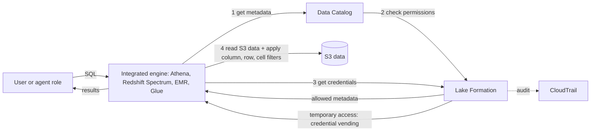

## 0. Before you start
- **Essential:** IAM policies allow or deny API actions on resources; a data lake is data (often in S3) plus a **catalog** that describes it (databases, tables, columns).
- **Helpful:** SQL `SELECT` and `WHERE`; the AWS Glue Data Catalog ([02/03](aip:02-data-management/03-aws-glue-data-quality-and-cloudwatch-metrics)); Athena (an engine that runs SQL on S3 data).
- **Optional advanced:** tag-based access control (ABAC) in IAM; cross-account sharing with AWS RAM ([05/03](aip:05-sagemaker/03-model-registry-and-lineage-tracking)).

## 1. Simple explanation
IAM answers "may this role call this API?" but not "may this person see the salary column of this table, only for their own region?". **AWS Lake Formation** adds that layer. You register where the data lives, describe it in the **Data Catalog**, and then **grant** permissions on databases, tables, columns, rows and even individual cells, much like an ordinary database's `GRANT SELECT`. Query engines such as Athena, Redshift Spectrum, EMR and Glue ask Lake Formation for permission and then receive short-lived access to just the data the user is allowed to see. For a GenAI system this matters whenever the model's answers are built from governed data: a text-to-SQL agent, a structured-data Knowledge Base, or a retrieval pipeline over a data lake must not show a user rows they could not query directly.


```figure
flow lake-formation-vending
```

## 2. Structured explanation
1. **Own permission model** ✅ that *augments* IAM: grant/revoke on Data Catalog resources with underlying data in S3, replacing complex bucket policies and IAM policies.
2. **Two levels** ✅: metadata permissions on Data Catalog resources; storage access to the S3 data, managed on behalf of integrated engines.
3. **Fine-grained** ✅: database, table, **column**, **row** and **cell** level (data filters); `SELECT` is the permission that can carry a filter.
4. **Tag-based access control (LF-TBAC)** ✅: define **LF-Tags** (key with values), attach them to catalog resources (inherited downward), grant tag expressions to principals. Recommended for many objects.
5. **Credential vending** ✅: after the permission check, Lake Formation gives the engine **temporary** access to the S3 data.
6. **Sharing and federation** ✅: cross-account and cross-organization sharing; federated catalogs for Redshift, S3 Tables, DynamoDB and other sources; hybrid access mode for gradual adoption.
7. **Audit** ✅: access is recorded in CloudTrail ([07/04](aip:07-governance-qa/04-cloudtrail-and-x-ray-for-genai)).

## 3. Analogy
**A library with a catalog desk.** Anyone can walk to the building (IAM lets you reach S3), but the librarian at the desk (Lake Formation) checks the catalog and your card, and hands you only the pages you may read, with certain lines blacked out (column and row filters). The librarian gives you a visitor pass that expires soon (credential vending), instead of the master key.

*Where it breaks:* a library desk is one place; here each query engine must be **integrated** with Lake Formation to enforce it. Data reachable by a route that bypasses Lake Formation (for example direct S3 access with a permissive bucket policy) is not protected by Lake Formation permissions. That is why "register the location and remove the direct paths" is part of the design.

## 4. The seven questions

**WHAT?** A service that centrally governs, secures and shares data for analytics and machine learning, with database-style grants, tag-based control and row/column/cell filters.

**WHY?** One place to set and audit data access across engines; least privilege per user and tag; fewer, simpler policies at scale.

**WHEN?** Whenever different people or agents must see different slices of the same governed dataset; for cross-account data sharing; for PII-bearing tables used by AI features.

**WHERE?** Regional; catalogs live in the AWS Glue Data Catalog; enforcement happens inside integrated engines.

**HOW?** §5.

**WHAT IF?**
| Situation | Effect | Remedy |
|---|---|---|
| A table is **not** managed by Lake Formation | The engine goes straight to S3 and the **bucket and IAM policies** decide ✅ | Register the location and grant through Lake Formation; remove direct S3 paths |
| A filter is granted | Only `SELECT` can carry a filter ✅; filters apply to read operations only | Use separate grants for write permissions |
| Row filter expression is wrong (for example uses `<>` with unquoted text) | Wrong rows returned or an error | Quote string literals in single quotes ✅ and test with a sample principal |
| A user's tag grant does not match any resource tag | No access (access needs a matching tag value) ✅ | Check inherited vs overridden tags |
| An existing setup is IAM-only | Switching all at once may break users | **Hybrid access mode** lets you adopt per database or table ✅ |
| An agent tool uses one powerful role for everyone | Every user sees what that role sees | Scope roles per tenant or tag; do not share an admin role with the agent |

**WHY NOT?** Do not use Lake Formation to filter model output (use Guardrails). Do not expect it to protect data read through a path that does not use an integrated engine. Do not use IAM tags and LF-Tags interchangeably: they are different ✅.

## 5. Technical depth

```figure
lf-filter
```


### 5.1 How a query is authorized ✅ (`how-it-works.html`)

*Reading the arrows:* the engine asks the catalog for the table's metadata; the catalog checks the user's permission with Lake Formation; if the data location is registered, the engine requests temporary access; with that access it reads S3 and applies the filters before returning rows. If the table is **not** managed by Lake Formation, step 3 goes directly to S3 and the bucket policy and the IAM policy are evaluated instead ✅.

### 5.2 Permissions, filters and tags
- **Who sets it up** ✅: a **data lake administrator** (or an administrator-delegated user) grants Lake Formation permissions and registers S3 locations; administrators can create data filters on all tables in the account by default.
- **Data filters** ✅ (`CreateDataCellsFilter`): a filter belongs to one table and has a **name**, the **table identifiers**, a **column specification** (include or exclude lists; nested columns supported; wildcard for all columns) and a **row filter expression** (a restricted PartiQL `WHERE` syntax, string literals in single quotes; `AllRowsWildcard` for all rows). Level of security: all columns + row expression = **row-level**; column list + all rows = **column-level**; column list + row expression = **cell-level**. Filters apply only to reads, so you grant `SELECT` with the filter.
- **Example filter bodies** ✅: `{"Name": "restrict-pharma", "DatabaseName": "sales", "TableName": "orders", "RowFilter": {"FilterExpression": "product_type='pharma'"}, "ColumnWildcard": {"ExcludedColumnNames": ["customer_name"]}}` and a row-only filter `product_type<>'pharma'` with all columns. You can create many filters per table and grant a different one to each group.
- **LF-TBAC** ✅: an LF-Tag is a key with allowed values (`department=sales,marketing,...`). **Tables inherit tags from databases; columns inherit from tables; inherited values can be overridden.** The administrator (1) defines tags, (2) adds *LF-Tag creators*, (3) assigns tags to resources, (4) grants who may assign tags, (5) grants **LF-Tag expressions** with specific permissions (for example `SELECT, INSERT` on tables, `CREATE_TABLE` on databases) to principals, and (6) optionally revokes the old named-resource grants. A principal can act on a resource when it has a grant on a **tag value that matches the resource's tag value**. With one tag the work is `n(P) + n(R)` operations instead of `n(P) × n(R)` named grants. LF-Tags are **not** IAM tags ✅. The exact rule for expressions with several tag keys was not on the page I read ❌.
- **ABAC** ✅: grant on Data Catalog objects based on **IAM tags or session tags** of the principal; any principal with matching tag keys and values gains access; you need grantable permissions to make such grants.
- **Hybrid access mode** ✅: secure the same catalog objects with both Lake Formation permissions and IAM policies for S3 and Glue actions, onboarding gradually.
- **Cross-account** ✅: share the Data Catalog and S3 locations with other accounts, organizations or principals.
- **Integrated services** ✅: Athena, Amazon Quick, Redshift Spectrum, EMR and AWS Glue enforce the permissions; federation sources include Redshift data warehouses, DynamoDB, S3 Tables and third-party sources.
- **Ingestion** ✅: import from MySQL, PostgreSQL, SQL Server, MariaDB and Oracle databases in RDS or on EC2 (bulk and incremental), JDBC from on-premises, Glue crawlers to catalog S3 data.

### 5.3 Lake Formation in GenAI designs
| Use | How it helps | Watch out |
|---|---|---|
| **Text-to-SQL agent** over a governed lakehouse | The agent's tool role queries through Athena; Lake Formation limits columns and rows to what that role may see | One shared role means one shared view; use a role per tenant or tag |
| **Structured-data Knowledge Base** 🟡 | A knowledge base can query a **Glue Data Catalog** data store governed by Lake Formation (or Amazon Redshift) instead of embedding the data; per the pages found, the knowledge base **service role** needs Lake Formation **Describe** and **Select** on the databases and tables, `lakeformation:GetDataAccess`, and Glue read actions such as `GetDatabases`, `GetTables`, `GetPartitions`; the Glue Data Catalog path supports IAM authentication only | Pages disagree in age (one very old Redshift Spectrum setup, one newer); a SageMaker Unified Studio page notes table selections are treated as hints, not hard limits ([02/01](aip:02-data-management/01-structured-data-and-bedrock-data-automation)) |
| **Training and evaluation data** | Column filters hide PII before data is exported for fine-tuning ([01/02](aip:01-bedrock-genai-fundamentals/02-model-customization-finetuning-and-lora)) | Filters apply at read time through integrated engines, not to a file already copied out |
| **Sharing** datasets with another account for evaluation | Cross-account grants without copying | Audit with CloudTrail |
| **Audit** | CloudTrail records data-access history across integrated services ✅ | Combine with Bedrock invocation logs for the model side ([07/03](aip:07-governance-qa/03-cloudwatch-logs-alarms-rum-and-genai-observability)) |

### 5.4 Lake Formation vs neighbours
| Need | Use |
|---|---|
| Who may call an AWS API | IAM |
| Who may read which column or row of a cataloged table | **Lake Formation** |
| Block harmful or sensitive model *output* | Guardrails ([01/07](aip:01-bedrock-genai-fundamentals/07-bedrock-guardrails)) |
| Find PII in unstructured text | Comprehend ([02/04](aip:02-data-management/04-transcribe-comprehend-and-comprehend-medical)) or Macie (module 08/09) |
| Control access to one S3 bucket or prefix | Bucket policy, access points ([02/09](aip:02-data-management/09-amazon-s3-storage-lifecycle-replication-and-security)) |
| Record who accessed what | CloudTrail ([07/04](aip:07-governance-qa/04-cloudtrail-and-x-ray-for-genai)) |

## 6. Worked example
*Problem:* a retailer wants a support assistant that answers "what did customer X order?" from the `sales.orders` table. Pharmacy-related rows must be hidden from general agents, and customer names must be hidden from the analytics team.

| Need | Design | Why |
|---|---|---|
| Register data | Register the S3 location in Lake Formation; catalog with a Glue crawler | Engines request credentials from Lake Formation ✅ |
| General agents never see pharmacy rows | Data filter `no-pharma` (`product_type<>'pharma'`, all columns); grant `SELECT` with that filter to the `support-agent` role | Row-level security ✅ |
| Analytics sees pharmacy but not names | Data filter `restrict-pharma` (`product_type='pharma'`, exclude `customer_name`) | Cell-level security ✅ |
| Many more tables later | LF-Tags `domain` and `sensitivity`; grant by tag expression | Scales as `n(P) + n(R)` ✅ |
| Assistant uses Athena | The tool Lambda assumes the `support-agent` role | The role's grants are the user's limit |
| Evidence | CloudTrail trail + saved queries | Audit ✅ |
| Remove old paths | Delete direct S3 grants for the agent role | Otherwise bypass ✅ |

## 7. Knowledge checkpoints
1. What does Lake Formation add to IAM?
2. Which Lake Formation permission can be granted with a data filter?
3. How does a table get its LF-Tags?
4. What happens if the table is not managed by Lake Formation?
5. Why is credential vending safer than giving the engine a standing S3 role?

## 7b. Practice questions (exam-style, original) — answers in §14

**Q1.** Different analysts need different columns and rows of the same `orders` table in Athena. Which service provides this centrally?
A. AWS Lake Formation data filters
B. S3 Transfer Acceleration
C. CloudFront signed cookies
D. SQS FIFO

**Q2.** (Select TWO) Which are true of Lake Formation data filters?
A. A filter with a column list and a row expression gives cell-level security
B. Filters can be attached to any permission, including `DELETE`
C. They are used with the `SELECT` permission
D. They apply to the S3 bucket policy
E. They replace IAM completely

**Q3.** A company has 300 tables and 40 teams. Granting per table and per team is unmanageable. What is the recommended Lake Formation approach?
A. LF-Tag based access control with tag expressions
B. One IAM user per table
C. Copy tables into 40 buckets
D. Disable Lake Formation

**Q4.** A new table `sales.returns` is created in a database tagged `module=Sales`. Without any extra assignment, what tag does the table have?
A. `module=Sales`, inherited from the database
B. No tags
C. A random tag
D. It cannot be tagged

**Q5.** An analyst has S3 access through IAM but no Lake Formation grant. The table is registered with Lake Formation. What happens in Athena?
A. The query is denied: Lake Formation permissions are checked before credentials are vended
B. The query succeeds because IAM is enough
C. The query returns random rows
D. The query is billed double

**Q6.** (Select TWO) Which are correct about LF-Tags?
A. They are different from IAM tags
B. Tables inherit them from databases unless overridden
C. They are the same as IAM session tags
D. Columns cannot have tags
E. They only work for S3 Tables

**Q7.** A structured-data Knowledge Base uses the Glue Data Catalog governed by Lake Formation and fails with an authorization error. Which fix is most likely?
A. Grant the knowledge base service role Lake Formation Describe and Select on the tables and the `lakeformation:GetDataAccess` action
B. Increase the embedding dimension
C. Enable S3 versioning
D. Add a WAF rule

**Q8.** A team wants to roll out Lake Formation to an existing IAM-controlled catalog one database at a time. Which feature supports that?
A. Hybrid access mode
B. A new AWS account for every table
C. Deleting the catalog
D. CloudFront

## 7c. Mixed review for Quiz 7 (governance and QA)
**R1.** Which Bedrock evaluation job type needs a separate evaluator model? A. Automatic B. Judge model C. Human D. None
**R2.** Which agent trace object reports why a step failed? A. FailureTrace B. GuardrailTrace C. callerChain D. observation.type
**R3.** Is Bedrock model invocation logging on by default, and where does content larger than 100 KB go? A. Off; S3 B. On; CloudWatch only C. Off; EventBridge D. On; DynamoDB
**R4.** Which CloudTrail category is `InvokeAgent`? A. Management event B. Data event C. Insights event D. Digest event
**R5.** Which X-Ray tag is searchable, and what is the per-trace limit? A. Annotation, 50 B. Metadata, 50 C. Annotation, unlimited D. Metadata, 100
**R6.** Which alarm type cannot run EC2 or Auto Scaling actions? A. Metric alarm B. Composite alarm C. Both can D. Neither can
**R7.** Which Lake Formation permission can carry a data filter? A. SELECT B. INSERT C. ALTER D. DROP
**R8.** Which metric shows throttled Bedrock calls, which are not counted in `Invocations`? A. InvocationThrottles B. InvocationServerErrors C. OutputTokenCount D. TimeToFirstToken

**Answers (7c).** R1 → B ([07/01](aip:07-governance-qa/01-agent-tracing-evaluation-metrics-and-bedrock-model-evaluations)). R2 → A (07/01). R3 → A ([07/03](aip:07-governance-qa/03-cloudwatch-logs-alarms-rum-and-genai-observability)). R4 → B ([07/04](aip:07-governance-qa/04-cloudtrail-and-x-ray-for-genai)). R5 → A (07/04). R6 → B (07/03). R7 → A (this file). R8 → A (07/03).

## 8. Hands-on lab: LF-Tag inheritance, data filters, authorization flow and a knowledge-base role check

### 8.1 Objective
Offline: rebuild the tag-based example from the documentation and check the result table, compare grant counts, apply data filters to sample rows, simulate the authorization flow for LF-managed and unmanaged tables, and check a service role's permissions.

### 8.2 Prerequisites
Python 3 (standard library). Optional AWS part: an AWS account with Lake Formation, Glue, Athena and an S3 bucket.

### 8.3 AWS services
Offline: none. Optional: Lake Formation, Glue Data Catalog, Athena, S3, IAM, CloudTrail.

### 8.4 IAM permissions
Offline: none. Real: a data lake administrator; the engine's roles; for a structured Knowledge Base the service role actions in §5.3 🟡 (other action names ❌ not read).

### 8.5 Region notes
Lake Formation and the Data Catalog are Regional; cross-Region and cross-account sharing need explicit setup (not read ❌).

### 8.6 Architecture
§5.1.

### 8.7 Cost
Offline: none. Real: Lake Formation itself has no separate charge that I verified ❌; Athena, Glue and S3 are billed; prices ❌ not read.

### 8.8 Code
Part 1 transcribes the tag assignments, grants and result table from the Lake Formation TBAC page. Parts 2 and 3 are teaching models: the filter evaluator only understands `column='value'` and `column<>'value'`, not full PartiQL.

```python lab-run
import re

# ---------- 1. LF-TBAC example from the documentation: 3 databases, 7 tables, tag key "module" ----------
DB_TAG = {"A": "Sales", "B": "Orders", "C": "Customers"}
TABLES = {"A.1": "A", "A.2": "A", "B.1": "B", "B.2": "B", "C.1": "C", "C.2": "C", "C.3": "C"}
OVERRIDES = {"A.2": "Orders", "B.2": "Customers"}          # table-level assignments that override inheritance
GRANTS = {"Principal 1": {"Sales", "Customers"}, "Principal 2": {"Orders"}, "Principal 3": {"Customers"}}

def effective_tag(table):
    return OVERRIDES.get(table, DB_TAG[TABLES[table]])

def resulting_permissions(values):
    out = {f"CREATE_TABLE on database {db}" for db, tag in DB_TAG.items() if tag in values}
    out |= {f"SELECT, INSERT on table {t}" for t in TABLES if effective_tag(t) in values}
    return out

PAGE = {  # result table transcribed from the page
    "Principal 1": {"CREATE_TABLE on database A", "SELECT, INSERT on table A.1", "SELECT, INSERT on table B.2", "CREATE_TABLE on database C",
                    "SELECT, INSERT on table C.1", "SELECT, INSERT on table C.2", "SELECT, INSERT on table C.3"},
    "Principal 2": {"SELECT, INSERT on table A.2", "CREATE_TABLE on database B", "SELECT, INSERT on table B.1"},
    "Principal 3": {"SELECT, INSERT on table B.2", "CREATE_TABLE on database C", "SELECT, INSERT on table C.1", "SELECT, INSERT on table C.2",
                    "SELECT, INSERT on table C.3"},
}
print("1) tag-based grants")
for p, values in GRANTS.items():
    got = resulting_permissions(values)
    print(f"   {p}: {len(got)} resource entries, matches the page's table: {got == PAGE[p]}")
assignments, tag_grants = len(DB_TAG) + len(OVERRIDES), sum(len(v) for v in GRANTS.values())
print(f"   tag assignments {assignments}, tag grants {tag_grants}, resource entries {sum(len(resulting_permissions(v)) for v in GRANTS.values())}")
principals, resources = 20, 500
print(f"   at scale ({principals} principals, {resources} resources): named grants {principals * resources}, tag operations {principals + resources}")

# ---------- 2. Data filters on sample rows ----------
ROWS = [
    {"customer_id": 1, "customer_name": "Asha", "order_num": 101, "product_type": "pharma", "price": 30},
    {"customer_id": 2, "customer_name": "Ben", "order_num": 102, "product_type": "toys", "price": 12},
    {"customer_id": 3, "customer_name": "Chen", "order_num": 103, "product_type": "pharma", "price": 55},
    {"customer_id": 4, "customer_name": "Dee", "order_num": 104, "product_type": "books", "price": 9},
]
ALL = list(ROWS[0])
FILTERS = {
    "restrict-pharma": {"row": "product_type='pharma'", "exclude": ["customer_name"]},
    "no-pharma": {"row": "product_type<>'pharma'", "exclude": []},
    "no-prices": {"row": None, "exclude": ["price"]},
}
def row_ok(expr, row):
    if expr is None:
        return True
    col, op, val = re.fullmatch(r"(\w+)(=|<>)'([^']*)'", expr).groups()
    return (row[col] == val) if op == "=" else (row[col] != val)
def level(spec):
    cols, rows = bool(spec["exclude"]), spec["row"] is not None
    return "cell-level" if cols and rows else "column-level" if cols else "row-level"
print("2) data filters")
for name, spec in FILTERS.items():
    cols = [c for c in ALL if c not in spec["exclude"]]
    visible = [{c: r[c] for c in cols} for r in ROWS if row_ok(spec["row"], r)]
    print(f"   {name:<16}{level(spec):<13}columns {cols}")
    for r in visible:
        print("      ", r)

# ---------- 3. Authorization flow for a query ----------
LF_MANAGED = {"sales.orders"}
LF_GRANTS = {("support-agent", "sales.orders"): "no-pharma"}      # role -> table -> filter name
S3_IAM = {("support-agent", "sales.orders"), ("analyst", "sales.orders"), ("analyst", "sales.logs")}
def query(role, table):
    if table in LF_MANAGED:
        grant = LF_GRANTS.get((role, table))
        if grant is None:
            return "DENIED at Lake Formation: no SELECT grant (IAM access to S3 is not enough)"
        return f"allowed: temporary credentials vended, filter '{grant}' applied"
    return "allowed by IAM and bucket policy (not managed by Lake Formation)" if (role, table) in S3_IAM else "DENIED by IAM"
print("3) authorization flow")
for role, table in [("support-agent", "sales.orders"), ("analyst", "sales.orders"), ("analyst", "sales.logs"), ("intern", "sales.logs")]:
    print(f"   {role:<14}{table:<13}{query(role, table)}")

# ---------- 4. Structured Knowledge Base service role check (items taken from search summaries of the Bedrock pages) ----------
REQUIRED = ["lakeformation:GetDataAccess", "glue:GetDatabases", "glue:GetTables", "glue:GetPartitions", "LF Describe on database", "LF Select on tables"]
role = {"lakeformation:GetDataAccess", "glue:GetDatabases", "glue:GetTables", "LF Describe on database"}
missing = [r for r in REQUIRED if r not in role]
print("4) knowledge-base role check: missing ->", missing)
```

### 8.9 Captured output
Generated on 2026-10-26 by extracting the block above from this file and running it (Python 3). It models documented behavior with made-up data; it is **not** Lake Formation output.
```text lab-out
1) tag-based grants
   Principal 1: 7 resource entries, matches the page's table: True
   Principal 2: 3 resource entries, matches the page's table: True
   Principal 3: 5 resource entries, matches the page's table: True
   tag assignments 5, tag grants 4, resource entries 15
   at scale (20 principals, 500 resources): named grants 10000, tag operations 520
2) data filters
   restrict-pharma cell-level   columns ['customer_id', 'order_num', 'product_type', 'price']
       {'customer_id': 1, 'order_num': 101, 'product_type': 'pharma', 'price': 30}
       {'customer_id': 3, 'order_num': 103, 'product_type': 'pharma', 'price': 55}
   no-pharma       row-level    columns ['customer_id', 'customer_name', 'order_num', 'product_type', 'price']
       {'customer_id': 2, 'customer_name': 'Ben', 'order_num': 102, 'product_type': 'toys', 'price': 12}
       {'customer_id': 4, 'customer_name': 'Dee', 'order_num': 104, 'product_type': 'books', 'price': 9}
   no-prices       column-level columns ['customer_id', 'customer_name', 'order_num', 'product_type']
       {'customer_id': 1, 'customer_name': 'Asha', 'order_num': 101, 'product_type': 'pharma'}
       {'customer_id': 2, 'customer_name': 'Ben', 'order_num': 102, 'product_type': 'toys'}
       {'customer_id': 3, 'customer_name': 'Chen', 'order_num': 103, 'product_type': 'pharma'}
       {'customer_id': 4, 'customer_name': 'Dee', 'order_num': 104, 'product_type': 'books'}
3) authorization flow
   support-agent sales.orders allowed: temporary credentials vended, filter 'no-pharma' applied
   analyst       sales.orders DENIED at Lake Formation: no SELECT grant (IAM access to S3 is not enough)
   analyst       sales.logs   allowed by IAM and bucket policy (not managed by Lake Formation)
   intern        sales.logs   DENIED by IAM
4) knowledge-base role check: missing -> ['glue:GetPartitions', 'LF Select on tables']
```

### 8.10 Explanation
- Part 1: the computed permissions equal the documentation's result table. The documentation text also mentions 17 grants for the named-resource method, but its result table has 15 resource entries; I reproduced the table, not the 17. At scale the tag method needs far fewer operations.
- Part 2: the same table seen through three filters; the names reveal row-level, cell-level and column-level security.
- Part 3: the same S3 access is enough on an unmanaged table and not enough on a Lake Formation-managed one.
- Part 4: the check lists the two missing items.

### 8.11 Optional AWS lab (shown, not run against AWS ❌)
1. Console: **Lake Formation** → add yourself as **data lake administrator** → **Data lake locations** → register the S3 path (use a service-linked role).
2. Create a Glue database and table (crawler) over a small CSV of fake orders.
3. **Data filters** → create `no-pharma` and `restrict-pharma` as in §5.2 ✅.
4. **Grant** `SELECT` on the table with `no-pharma` to a test role; sign in as that role and run `SELECT * FROM sales.orders` in Athena; compare with a role that has no grant.
5. Create LF-Tags (`module`), assign them, and grant by tag expression; check inheritance by creating a new table.
6. Look at the events in CloudTrail Event history ([07/04](aip:07-governance-qa/04-cloudtrail-and-x-ray-for-genai)).
7. Clean up: revoke grants, deregister the location, delete the database, table, bucket and roles.

### 8.12 Common errors
| Error | Cause | Fix |
|---|---|---|
| Query denied despite S3 access | Table registered with Lake Formation; no LF grant ✅ | Grant `SELECT` (with filter) |
| Filter expression error | Unquoted literal or unsupported syntax ✅ | Single quotes; check the PartiQL support page |
| User sees too much | Old named grants or direct S3 policy remain | Revoke them after verifying tags (recommended step) ✅ |
| New table inaccessible | Tag overridden or not matched | Review inheritance |
| Structured KB authorization error | Service role lacks LF grants or `lakeformation:GetDataAccess` 🟡 | Add them |
| Cross-account user cannot read | Share not accepted or missing grant | Complete the share (not read ❌) |

### 8.13 Security recommendations
Keep the data lake administrator list short; use LF-TBAC; remove direct S3 access for roles that should be governed; use column filters to hide PII before exports; give AI tool roles the narrowest filter; encrypt S3 and the catalog; audit with CloudTrail; test grants as the target role; do not rely on knowledge-base table selections as a security boundary 🟡.

## 9. What can go wrong?
| Failure | Why | Symptoms | Investigate | Fix | Prevent |
|---|---|---|---|---|---|
| **Bypass via S3** | Direct bucket access remains | Users read raw data | Bucket policy, IAM | Remove; register location | Governance review |
| **Over-broad agent role** | One role for all users | Cross-tenant answers | Role grants | Role per tenant or tag | Least privilege tests |
| **Tag sprawl** | Many tags and overrides | Unexpected access | Tag report | Simplify taxonomy | Naming rules, owners |
| **Filter gaps** | Rows missed by expression | Data leakage or missing data | Test with sample users | Fix expressions | Automated tests |
| **Stale grants** | Staff move teams | Access remains | Grant list, CloudTrail | Revoke | Periodic access review |
| **Engine not integrated** | Tool does not enforce LF | Unfiltered data | Engine docs | Use an integrated engine | Architecture check |
| **Confusing IAM tags with LF-Tags** | Same word "tag" | Grants do nothing ✅ | Console | Use the right type | Training |

## 10. Common misconceptions
1. **"Lake Formation replaces IAM."** It augments it ✅.
2. **"IAM tags and LF-Tags are the same."** They are not interchangeable ✅.
3. **"Filters work for any permission."** Only `SELECT` ✅.
4. **"If the data is in S3 IAM is enough."** Not if the location is Lake Formation-managed ✅.
5. **"Lake Formation protects model output."** It controls data access; Guardrails control output.
6. **"Tag grants name resources."** They name tag values; resources are matched by their tags ✅.

## 11. Exam notes
- **Patterns:** "column and row level access to a data lake" → Lake Formation; "scale permissions across hundreds of tables" → LF-TBAC; "share a catalog across accounts" → Lake Formation cross-account; "per-user view of one table" → data filters; "only IAM and bucket policies" → not LF-managed.
- **Keywords:** data lake administrator, data filter, cell-level, LF-Tag, tag expression, credential vending, hybrid access mode, registered location.
- **Traps:** thinking filters apply to writes; mixing IAM tags and LF-Tags; forgetting the service role for structured Knowledge Bases; assuming Lake Formation filters model output.
- **Compare:** Lake Formation vs IAM vs S3 access points vs Guardrails vs Macie/Comprehend.

## 12. Summary and revision cards
- Lake Formation = database-style grants on the Glue catalog and S3 data, with column/row/cell filters, tags, sharing and credential vending.
- `SELECT` carries filters; LF-Tags inherit downward; engines enforce.
- Unmanaged tables fall back to IAM and bucket policies.

**Cards.** Q: Filter levels? A: row, column, cell. · Q: Tag grant scale? A: `n(P) + n(R)` vs `n(P) × n(R)`. · Q: Gradual adoption? A: Hybrid access mode.

## 13. References
| Source | URL | Verified |
|---|---|---|
| What is Lake Formation | https://docs.aws.amazon.com/lake-formation/latest/dg/what-is-lake-formation.html | 2026-10-26 |
| How it works | https://docs.aws.amazon.com/lake-formation/latest/dg/how-it-works.html | 2026-10-26 |
| Tag-based access control | https://docs.aws.amazon.com/lake-formation/latest/dg/tag-based-access-control.html | 2026-10-26 |
| Data filtering and cell-level security | https://docs.aws.amazon.com/lake-formation/latest/dg/data-filtering.html | 2026-10-26 |
| Structured Knowledge Base prerequisites (search summary 🟡) | https://docs.aws.amazon.com/bedrock/latest/userguide/knowledge-base-prereq-structured.html | 2026-10-26 |

**Unverified here:** LF-Tag expression semantics with several keys; PartiQL support details; limits and quotas; Lake Formation pricing; IAM and Lake Formation action names beyond `lakeformation:GetDataAccess`; cross-account sharing steps; Bedrock structured-KB pages read in full.

## 14. Answers to checkpoints and practice questions
**Checkpoints.** 1) Database-style fine-grained permissions (column, row, cell) and tag-based control over Data Catalog data, enforced across integrated engines ✅. 2) `SELECT` ✅. 3) By direct assignment or by inheritance from the database (columns inherit from tables), with overrides allowed ✅. 4) The engine goes to S3 and the bucket and IAM policies are evaluated ✅. 5) Access is temporary and scoped to what the user is allowed, not a standing broad role ✅.

**Practice questions.**
- **Q1 → A.** Data filters give column, row and cell security ✅.
- **Q2 → A, C.** B is false (only `SELECT`); D and E are false ✅.
- **Q3 → A.** LF-TBAC is recommended for many objects ✅.
- **Q4 → A.** Tables inherit from the database ✅.
- **Q5 → A.** LF checks permissions before vending credentials ✅.
- **Q6 → A, B.** C is false; D is false (columns inherit); E is false ✅.
- **Q7 → A.** Role grants and `lakeformation:GetDataAccess` 🟡. B, C, D are unrelated.
- **Q8 → A.** Hybrid access mode ✅.
