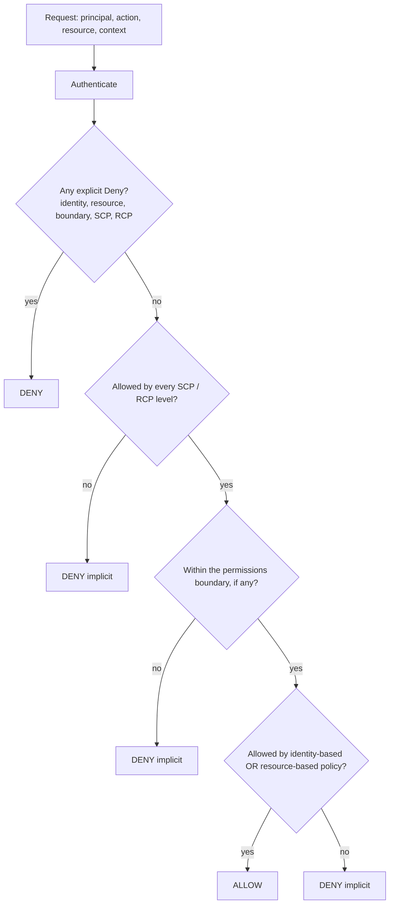

## 0. Before you start
- **Essential:** an AWS account, a user, a role and a policy (all in [00-foundations/01](aip:00-foundations/01-aws-account-iam-and-cli-setup)); what JSON is.
- **Helpful:** the `Effect`, `Action`, `Resource`, `Condition` parts of a policy; what a hash is.
- **Optional advanced:** SAML and OIDC; AWS Organizations ([08/02](aip:08-security/02-control-tower-organizations-and-governance-guardrails)).

## 1. Simple explanation
**IAM (Identity and Access Management)** decides who may do what in your AWS account. Every request is checked: *who is asking* (a principal), *what do they want* (an action such as `bedrock:InvokeModel`), *on which thing* (a resource ARN) and *under what circumstances* (conditions). The golden rule is **least privilege**: give each person, application and AI agent only the permissions needed for the job, nothing more. People should sign in through a central identity system (**IAM Identity Center**) and receive short-lived credentials; applications should use **roles**, not stored passwords or keys. For GenAI there are two extra jobs: *limit which models and guardrails a role may use*, and *mask sensitive data* (card numbers, national IDs) before it reaches a model, a log or an analyst.


```figure
flow identity-center
```

## 2. Structured explanation
1. **Principals** ✅: IAM users, roles, federated users, AWS services. **Roles** hand out temporary credentials; users have long-term ones.
2. **Policy types** ✅: identity-based (attached to users, groups, roles), resource-based (attached to a resource, with a `Principal`), permissions boundaries (a ceiling on a role or user), AWS Organizations SCPs and RCPs (guardrails on accounts), session policies.
3. **Evaluation** ✅: default deny; an explicit deny anywhere wins; in one account identity-based and resource-based permissions are a **union**; permissions boundaries and SCPs/RCPs are an **intersection** (an action must be allowed by all of them); SCPs and RCPs grant nothing.
4. **Credentials** ✅: prefer federation and roles with temporary credentials; require MFA for IAM users and root; rotate or remove long-term access keys.
5. **Workforce access** ✅: **IAM Identity Center** (organization instance, permission sets, identity sources, access portal).
6. **Bedrock and IAM** ✅: actions prefixed `bedrock`; resource-level ARNs; ABAC supported; service roles supported; **no service-linked roles, no ACLs**; resource-based policies for **guardrails and guardrail inference profiles**; the `bedrock:GuardrailIdentifier` condition key to force a guardrail.
7. **Masking and salting** 🟡: hide or transform sensitive values; use salts and keys so that hashes cannot be reversed by lookup.

## 3. Analogy
**A hotel key-card system.** The front desk (identity provider) checks your passport once and issues a card that expires (temporary credentials). The card opens only your floor and room (least privilege), and the hotel can add a rule such as "the gym only before 10 pm" (conditions). Staff cards (roles) are issued per shift, not per person forever. A master keycard (root user) lives in the safe. A "permissions boundary" is the hotel's list of rooms a manager is *allowed to give out*, not rooms the manager can enter.

*Where it breaks:* a card either opens a door or not, but IAM has an *explicit deny* that beats any number of allows, and an SCP at the organization level can cancel a permission that the account's own administrator granted.

## 4. The seven questions

**WHAT?** The access-control system for AWS, plus the data-protection techniques (masking, hashing, salting) that reduce what a GenAI system can leak.

**WHY?** A prompt-injected agent with an over-broad role can read or delete anything the role can; a leaked long-term key works from anywhere; a log full of card numbers is a data breach waiting for a reader.

**WHEN?** From the first account. Review whenever you add a model, tool, data source or team.

**WHERE?** IAM is global in scope but changes are recorded per Region in CloudTrail; Identity Center is configured in the organization's management account (organization instance) ✅.

**HOW?** §5.

**WHAT IF?**
| Situation | Effect | Remedy |
|---|---|---|
| A Lambda tool role has `bedrock:*` on `*` | A compromised function can invoke, customize or delete anything in Bedrock | Name actions and ARNs; add conditions |
| An IAM user's access key is committed to Git | The key works until revoked ✅ | Use roles; rotate; Access Analyzer unused-access review |
| A permissions boundary lacks an action the policy allows | Action is denied (intersection) ✅ | Add it to the boundary or remove from the policy |
| An SCP denies `bedrock:*` outside approved Regions | Requests fail even for administrators ✅ | Adjust the SCP |
| An agent role is reused for `RetrieveAndGenerate` while a guardrail-enforcing deny is on it | Some internal `InvokeModel` calls lack the guardrail and fail ✅ | Use a separate role for those APIs |
| Same masked value is needed to join two tables | Random masking breaks joins | Deterministic tokenization with a keyed hash (§5.7) |

**WHY NOT?** Do not use the root user for daily work. Do not share one role across unrelated workloads. Do not put secrets in prompts. Do not rely on a system prompt ("never reveal...") as access control.

## 5. Technical depth

```figure
iam-eval
```


### 5.1 IAM building blocks ✅ (`best-practices.html`, `reference_policies_evaluation-logic.html`)
| Piece | Notes |
|---|---|
| **User** | A person or app identity with long-term credentials (password, access keys). Use only when roles cannot be used (for example some third-party clients) ✅ |
| **Group** | A collection of users to attach policies to 🟡 (a group is not a principal in a policy) |
| **Role** | An identity with temporary credentials assumed by people, services or workloads; trust policy says who may assume it ✅ |
| **Policy** | JSON: `Effect` (Allow/Deny), `Action`, `Resource`, optional `Condition`; resource-based policies also have `Principal` ✅ |
| **AWS managed vs customer managed** | AWS managed policies are a starting point but may not be least privilege; write customer managed policies per use case ✅ |
| **Permissions boundary** | A managed policy that sets the maximum permissions an identity-based policy can grant; grants nothing by itself ✅ |
| **SCP / RCP** | Organization guardrails on principals (SCP) and resources (RCP); grant nothing ✅ |
| **STS** | Issues temporary credentials: `AssumeRole`, `AssumeRoleWithSAML`, `AssumeRoleWithWebIdentity` ✅ |

### 5.2 Policy evaluation ✅

*Reading the arrows:* an explicit deny anywhere ends the evaluation. Otherwise the request must pass every organization guardrail and the boundary (intersection), and finally be granted by at least one identity-based or resource-based policy (union, same account). Cross-account access needs the resource side and the caller's identity side to both allow ✅ (Bedrock IAM page).

### 5.3 Least privilege in practice (lesson 209) ✅
- Start from AWS managed policies, then narrow with customer managed policies; grant only needed **actions on specific resources under conditions**.
- **IAM Access Analyzer** ✅: *policy generation* builds a fine-grained policy from the actions a role used in CloudTrail; *policy validation* gives 100+ checks; *findings* show public and cross-account access.
- **Last-accessed information** ✅ shows unused permissions, users, roles and keys to remove.
- **Conditions** ✅ restrict by TLS use, service, tags (ABAC with `aws:ResourceTag/*`, `aws:RequestTag/*`, `aws:TagKeys`, `aws:PrincipalTag`).
- **Delegation** ✅: permissions boundaries limit what developers can grant; SCPs limit whole accounts.

### 5.4 Credentials, MFA and roles (lessons 216–219) ✅
- **Humans:** federate through an identity provider or Identity Center and use temporary credentials; where an IAM user or the root user is unavoidable, **require MFA**, preferring **phishing-resistant** methods (passkeys, security keys) ✅.
- **Workloads:** roles with temporary credentials (EC2 instance profile, Lambda execution role, ECS task role); outside AWS use **IAM Roles Anywhere** (X.509), `AssumeRoleWithSAML` or `AssumeRoleWithWebIdentity` ✅.
- **Access keys:** if unavoidable, update when needed, use last-used data to retire them ✅. **Root user:** protect it, avoid daily use ✅ (page: root user best practices).
- **Console multi-session (lesson 213)** 🟡: opt-in feature that allows up to **five** simultaneous console sessions (root, IAM or federated roles, in different or the same accounts) in one browser; each opens in a new tab; the console URL gains a subdomain; opt-out any time (summary of the Console Getting Started page, not opened in full ❌).

### 5.5 IAM Identity Center (lesson 220) ✅ (`singlesignon/.../what-is.html`)
- Connects the **workforce** to AWS accounts and AWS managed applications; connect your identity provider and sync users and groups, or create users in Identity Center.
- **One point of federation** (one SAML certificate to manage), a user-friendly **access portal**, **multi-Region** access when replicated, **trusted identity propagation** between managed applications (CloudTrail events show the user).
- **Organization instance** (best practice; deployed in the Organizations management account; the only one that manages access to AWS accounts) vs **account instance** (bound to one account; isolated application use).
- **Permission sets** (optional, organization instances) create permissions for job functions and provision them across accounts; or assign existing IAM roles with the IAM **account access manager** ✅.
- Renamed from AWS Single Sign-On on 2022-07-26; `sso`/`identitystore` namespaces unchanged ✅.

### 5.6 Bedrock and IAM ✅ (`security_iam_service-with-iam.html`, `guardrails-permissions-id.html`, `vpc-interface-endpoints.html`)
| Feature | Support |
|---|---|
| Identity-based and resource-based policies | Yes; resource-based policies exist for **guardrails and guardrail inference profiles** (recommended for account-level enforced guardrails, **required** for organization-level enforced guardrails) |
| Actions, resources, condition keys | Yes (prefix `bedrock`; see the Service Authorization Reference for the list; that page loaded only its title here ❌) |
| ABAC (tags) | Yes |
| ACLs | No |
| Temporary credentials, forward access sessions | Yes |
| Service roles | Yes (changing a Bedrock service role's permissions can break features; edit only on guidance) |
| Service-linked roles | **No** |

- **Enforce a guardrail** ✅: add an `Allow` for `InvokeModel`/`InvokeModelWithResponseStream` (and `ApplyGuardrail` on the guardrail ARN) with `StringEquals` on `bedrock:GuardrailIdentifier`, **plus an explicit `Deny` with `StringNotEquals`** so any other (or missing) guardrail is refused. Variants: DRAFT version (ARN without version), any numeric version (`ArnLike` with `:*`), any version including DRAFT (`ArnLike` with trailing `*`), or a list of identifier pairs. The condition applies to `Converse`, `ConverseStream`, `InvokeModel` and `InvokeModelWithResponseStream`.
- **Limitations** ✅: do not reuse that role for `RetrieveAndGenerate`, `InvokeAgent` or `InvokeInlineAgent` (they make internal `InvokeModel` calls without the guardrail → `AccessDenied`); a user can skip guardrail evaluation of the *prompt* with guardrail input tags, but the guardrail is **always applied on the response**; guardrail sharing across accounts works only **within an organization**.
- **Guardrail resource policies** ✅: only `bedrock:ApplyGuardrail` and `bedrock:GetGuardrail` (profiles: `ApplyGuardrail` only); conditions only on `aws:PrincipalOrgID` or `aws:PrincipalOrgPaths`; no `*` principal without an organization or OU condition; with cross-Region guardrail inference the policies must be attached through the **source** Region's endpoint for each destination-Region profile ARN. Before turning on an enforced guardrail, test `ApplyGuardrail` from every identity it will cover, because callers without permission start failing with `AccessDenied` ✅.
- **Retention control by IAM** ✅: condition keys `bedrock:DataRetentionMode` and `bedrock-mantle:DataRetentionMode` on the write actions let an SCP restrict which retention modes can be set ([08/03 §5.6](aip:08-security/03-kms-secrets-manager-macie-and-bedrock-data-protection)).
- **Tool roles for agents:** a role per agent or per tool, with the narrowest tool actions, and explicit denies for destructive actions ([03/06](aip:03-agentic-ai/06-mcp-openapi-tools-and-human-in-the-loop)).
- **API keys** appear in the Bedrock examples (`x-api-key`, `AWS_BEARER_TOKEN_BEDROCK`); their management and limits were not read ❌. Prefer roles.

### 5.7 Data masking and key salting (lesson 210) 🟡
Standard techniques (definitions are general security knowledge; the course lesson was not available as text):
| Technique | What it does | Reversible? | Use |
|---|---|---|---|
| **Masking** | Replace part or all of a value (`************1111`) | No (if the original is not kept) | Display, logs, prompts |
| **Redaction** | Remove the value or replace with a label (`[CARD]`) | No | Prompts, documents, logs |
| **Hashing** | One-way function (SHA-256) | No, but guessable for small input spaces | Integrity, deduplication |
| **Salted hashing** | Hash `salt + value` with a random per-record salt | No | Stored identifiers; defeats shared lookup tables |
| **Keyed hash / HMAC token** | Hash with a secret key (a "pepper") | No, and needs the key to verify | **Deterministic pseudonyms** that allow joins |
| **Encryption** | Reversible with a key | Yes (with key) | Data you must recover ([08/03](aip:08-security/03-kms-secrets-manager-macie-and-bedrock-data-protection)) |

**Salt:** a random value stored with each record so identical inputs hash differently and a precomputed table (rainbow table) of common values is useless. **Pepper / HMAC key:** a secret *not* stored with the data, kept in Secrets Manager or KMS. Salting protects against lookup attacks, not against brute force of a tiny input space (a 4-digit PIN is still easy) ✅ shown in the lab.

AWS tools that mask for you ✅ (other files): Guardrails sensitive-information filters (block or mask) ([01/07](aip:01-bedrock-genai-fundamentals/07-bedrock-guardrails)); Comprehend PII detection and redaction ([02/04](aip:02-data-management/04-transcribe-comprehend-and-comprehend-medical)); CloudWatch Logs data protection policies ([07/03](aip:07-governance-qa/03-cloudwatch-logs-alarms-rum-and-genai-observability)); Lake Formation column and cell filters ([07/05](aip:07-governance-qa/05-lake-formation-and-mixed-review-for-quiz-7)); Macie to *find* sensitive data in S3 ([08/03](aip:08-security/03-kms-secrets-manager-macie-and-bedrock-data-protection)).

## 6. Worked example
*Problem:* a bank's support agent (an AI agent on AgentCore) calls three tools: look up an order, issue a refund up to 50 dollars, and summarize a ticket with Bedrock. Staff sign in through the company directory. Prompts must never contain full card numbers.

| Need | Design | Why |
|---|---|---|
| Staff access | Identity Center organization instance, directory as identity source, permission set `SupportReadOnly`, MFA enforced | Temporary credentials, one federation point ✅ |
| Agent runtime identity | One execution role per agent; only the three tool functions invoke | Blast radius small |
| Order lookup tool | Lambda role: `dynamodb:GetItem` on the orders table ARN only | Least privilege |
| Refund tool | Lambda role: only the payments API; amount cap in code; **no** direct database write | Limit damage from injection |
| Summarizer | Role with `bedrock:InvokeModel` on one approved model ARN, `bedrock:GuardrailIdentifier` enforcement, separate from agent-orchestration roles | Enforced guardrail ✅ |
| Card numbers | Guardrails sensitive-information filter (mask) on input and output; HMAC token for the card ID in logs | Masking + pseudonym |
| Boundaries | Boundary on developer-created roles; SCP denying Bedrock in unapproved Regions | Delegated safety ✅ |
| Audit | CloudTrail trail; Access Analyzer review quarterly | Evidence ✅ |

## 7. Knowledge checkpoints
1. In one account, how do identity-based and resource-based policies combine?
2. What does a permissions boundary do, and does it grant permissions?
3. Which IAM feature generates a least-privilege policy from CloudTrail activity?
4. Which condition-key pattern forces every `InvokeModel` call to use a given guardrail?
5. Why does a per-record salt stop a precomputed hash table from working?

## 7b. Practice questions (exam-style, original) — answers in §14

**Q1.** A Lambda function that calls Bedrock needs credentials. What is the recommended approach?
A. Attach an execution role with only the needed Bedrock actions and resources
B. Create an IAM user and embed its access key in the code
C. Use the root user's key
D. Store the key in the prompt

**Q2.** (Select TWO) Which statements about policy evaluation are correct?
A. An explicit deny overrides any allow
B. In the same account, an allow in either an identity-based or a resource-based policy can grant access
C. SCPs grant permissions to principals
D. A permissions boundary grants permissions by itself
E. Default is allow

**Q3.** A team must guarantee that every `InvokeModel` call by a role uses guardrail version 1. Which design works?
A. Allow with `StringEquals` on `bedrock:GuardrailIdentifier` and an explicit Deny with `StringNotEquals`
B. A sentence in the system prompt
C. A WAF rule
D. An S3 bucket policy

**Q4.** After adding the guardrail-enforcing policy to a role, `RetrieveAndGenerate` calls begin failing with `AccessDenied`. Why?
A. The API makes internal `InvokeModel` calls that lack the guardrail identifier, so the explicit deny matches
B. KMS key rotation
C. NAT idle timeout
D. Missing CloudWatch alarm

**Q5.** (Select TWO) Which are IAM Identity Center facts?
A. An organization instance can manage access to AWS accounts
B. It provides one point of federation for an external SAML identity provider
C. It issues permanent access keys to users
D. Account instances are the recommended choice for all production use
E. It replaces CloudTrail

**Q6.** Which statement about Bedrock and IAM is correct?
A. Bedrock supports resource-based policies for guardrails and does not use service-linked roles
B. Bedrock supports ACLs
C. Bedrock requires a service-linked role
D. Bedrock has no condition keys

**Q7.** Developers may create roles for their apps but must never grant more than a set of approved services. Which feature?
A. Permissions boundary on the roles they create
B. A longer password policy
C. CloudFront signed URLs
D. Route 53 health checks

**Q8.** A table of customer IDs must be joinable across datasets without exposing the real IDs, and a leaked table must not be reversible by lookup. Which approach?
A. HMAC the ID with a secret key stored in Secrets Manager or KMS (deterministic keyed token)
B. Unsalted SHA-256
C. Base64 encoding
D. Random numbers regenerated every query

## 8. Hands-on lab: a mini policy evaluator, guardrail enforcement, a least-privilege diff, a credential audit and salting

### 8.1 Objective
Offline: evaluate requests the way IAM does (explicit deny, union, intersection), test the documented guardrail-enforcement policy pattern, compute unused permissions, audit credentials, and compare unsalted, salted and keyed hashing.

### 8.2 Prerequisites
Python 3 (standard library). Optional AWS part: an AWS account with IAM and Bedrock access.

### 8.3 AWS services
Offline: none. Optional: IAM, IAM Access Analyzer, Bedrock, CloudTrail.

### 8.4 IAM permissions
Offline: none. Real: an administrator to create roles and policies; for the guardrail enforcement example `bedrock:InvokeModel`, `bedrock:InvokeModelWithResponseStream` and `bedrock:ApplyGuardrail` as shown on the page ✅.

### 8.5 Region notes
IAM is global; model ARNs and guardrail ARNs include a Region. Cross-Region inference needs permissions on the destination Region resources ([04/04](aip:04-operational-efficiency/04-backoff-connection-pooling-and-cross-region-inference)).

### 8.6 Architecture
§5.2 diagram.

### 8.7 Cost
Offline: none. IAM itself has no charge that I verified ❌; Access Analyzer has features that are billed ❌ (not read).

### 8.8 Code
All names, ARNs and dates are made up. The evaluator is a simplified model: it supports `*` wildcards in actions and resources, the four condition operators below, and the evaluation order of §5.2. For negated operators it follows the standard IAM rule that a missing context key makes the condition true 🟡, which is what makes the documented "deny when no guardrail is sent" pattern work.

```python lab-run
import fnmatch, hashlib, hmac, json
from datetime import date

# ---------- 1. A mini IAM evaluator ----------
def like(patterns, value, fold=False):
    patterns = patterns if isinstance(patterns, list) else [patterns]
    return any(fnmatch.fnmatchcase(value.lower() if fold else value, p.lower() if fold else p) for p in patterns)

def cond_ok(cond, ctx):
    for op, pairs in (cond or {}).items():
        for key, want in pairs.items():
            have, wants = ctx.get(key), (want if isinstance(want, list) else [want])
            if op == "StringEquals":
                ok = have in wants
            elif op == "StringNotEquals":
                ok = have not in wants            # missing key -> true
            elif op == "ArnLike":
                ok = have is not None and like(wants, have)
            elif op == "ArnNotLike":
                ok = have is None or not like(wants, have)    # missing key -> true
            else:
                raise ValueError(op)
            if not ok:
                return False
    return True

def matches(stmt, action, resource, ctx):
    return like(stmt["Action"], action, True) and like(stmt["Resource"], resource) and cond_ok(stmt.get("Condition"), ctx)

def verdict(policies, action, resource, ctx):
    hits = [s for p in policies for s in p if matches(s, action, resource, ctx)]
    if any(s["Effect"] == "Deny" for s in hits):
        return "deny"
    return "allow" if hits else None

def evaluate(req, identity, resource_policy=None, boundary=None, scps=()):
    a, r, ctx = req["action"], req["resource"], req.get("ctx", {})
    layers = {"identity": identity, "resource": resource_policy or [], "boundary": boundary or [], **{f"scp{i}": s for i, s in enumerate(scps)}}
    for name, pol in layers.items():
        if verdict([pol], a, r, ctx) == "deny":
            return f"DENY (explicit deny in {name})"
    for i, s in enumerate(scps):
        if verdict([s], a, r, ctx) != "allow":
            return f"DENY (SCP level {i} does not allow it)"
    if boundary is not None and verdict([boundary], a, r, ctx) != "allow":
        return "DENY (outside the permissions boundary)"
    if verdict([identity], a, r, ctx) == "allow" or verdict([resource_policy or []], a, r, ctx) == "allow":
        return "ALLOW"
    return "DENY (implicit)"

MODEL = "arn:aws:bedrock:us-east-1::foundation-model/example.model-a"
invoke = lambda who="x": {"action": "bedrock:InvokeModel", "resource": MODEL}
ID_POLICY = [{"Effect": "Allow", "Action": ["bedrock:InvokeModel"], "Resource": ["arn:aws:bedrock:us-east-1::foundation-model/*"]}]
S3_ONLY = [{"Effect": "Allow", "Action": ["s3:*"], "Resource": ["*"]}]
ALL_BEDROCK = [{"Effect": "Allow", "Action": ["bedrock:*"], "Resource": ["*"]}]
print("1) evaluator scenarios")
cases = [
    ("identity allows, SCP allows", dict(identity=ID_POLICY, scps=[ALL_BEDROCK])),
    ("boundary only allows s3", dict(identity=ID_POLICY, boundary=S3_ONLY, scps=[ALL_BEDROCK])),
    ("OU-level SCP allows only s3", dict(identity=ID_POLICY, scps=[ALL_BEDROCK, S3_ONLY])),
    ("resource policy allows, identity silent", dict(identity=[], resource_policy=ID_POLICY)),
    ("identity deny beats resource allow", dict(identity=[{"Effect": "Deny", "Action": ["bedrock:*"], "Resource": ["*"]}], resource_policy=ID_POLICY)),
    ("nothing allows it", dict(identity=[])),
]
for name, kw in cases:
    print(f"   {name:<42}{evaluate(invoke(), **kw)}")

# ---------- 2. The documented guardrail-enforcement pattern (Allow + Deny with the condition key) ----------
GR = "arn:aws:bedrock:us-east-1:123456789012:guardrail/gr1abc"
def enforce(allow_op, deny_op, value):
    return [{"Effect": "Allow", "Action": ["bedrock:InvokeModel", "bedrock:InvokeModelWithResponseStream"], "Resource": ["arn:aws:bedrock:us-east-1::foundation-model/*"],
             "Condition": {allow_op: {"bedrock:GuardrailIdentifier": value}}},
            {"Effect": "Deny", "Action": ["bedrock:InvokeModel", "bedrock:InvokeModelWithResponseStream"], "Resource": ["arn:aws:bedrock:us-east-1::foundation-model/*"],
             "Condition": {deny_op: {"bedrock:GuardrailIdentifier": value}}}]
policies = {"exact version 1": enforce("StringEquals", "StringNotEquals", GR + ":1"),
            "any numeric version": enforce("ArnLike", "ArnNotLike", GR + ":*"),
            "any version incl. DRAFT": enforce("ArnLike", "ArnNotLike", GR + "*")}
requests = {"guardrail version 1": {"bedrock:GuardrailIdentifier": GR + ":1"}, "guardrail version 2": {"bedrock:GuardrailIdentifier": GR + ":2"},
            "DRAFT (no version)": {"bedrock:GuardrailIdentifier": GR}, "no guardrail sent": {}}
print("2) guardrail enforcement (rows: request, columns: policy variant)")
print(f"   {'':<22}" + "".join(f"{n:<26}" for n in policies))
for rname, ctx in requests.items():
    row = [("ALLOW" if evaluate({"action": "bedrock:InvokeModel", "resource": MODEL, "ctx": ctx}, identity=pol) == "ALLOW" else "deny") for pol in policies.values()]
    print(f"   {rname:<22}" + "".join(f"{v:<26}" for v in row))

# ---------- 3. Least-privilege diff: granted actions vs actions seen in CloudTrail ----------
GRANTED = {"bedrock:InvokeModel", "bedrock:InvokeModelWithResponseStream", "bedrock:CreateGuardrail", "bedrock:DeleteGuardrail", "s3:GetObject", "s3:PutObject", "s3:DeleteObject"}
USED = {"bedrock:InvokeModel", "s3:GetObject"}
print("3) unused permissions to remove:", sorted(GRANTED - USED))
print("   proposed policy actions:", sorted(USED))

# ---------- 4. Credential audit (the 'today' date is fixed so the output is reproducible) ----------
TODAY = date(2026, 10, 26)
USERS = [("alice", True, date(2026, 8, 1)), ("bob", False, date(2025, 1, 15)), ("ci-bot", False, date(2024, 6, 1)), ("carol", True, None)]
print("4) credential audit")
for name, mfa, key_date in USERS:
    age = (TODAY - key_date).days if key_date else None
    flags = (["no MFA"] if not mfa else []) + (["key older than 90 days"] if age and age > 90 else [])
    print(f"   {name:<8} key age {str(age) + ' days' if age is not None else 'no key':<12} {flags or 'ok'}")

# ---------- 5. Masking, salting, keyed tokens ----------
def mask_card(s):
    digits = "".join(c for c in s if c.isdigit())
    return "*" * (len(digits) - 4) + digits[-4:]
print("5) masking:", mask_card("4111 1111 1111 1111"))
PINS = ["1234", "0420", "1234", "9876"]                       # the same value appears twice
plain = [hashlib.sha256(p.encode()).hexdigest() for p in PINS]
salts = [bytes([i + 1]) * 8 for i in range(len(PINS))]       # fixed demo salts (use os.urandom in real code)
salted = [hashlib.sha256(s + p.encode()).hexdigest() for s, p in zip(salts, PINS)]
print("   unsalted: equal inputs give equal hashes:", plain[0] == plain[2])
print("   salted:   equal inputs give equal hashes:", salted[0] == salted[2])
table = {hashlib.sha256(f"{n:04d}".encode()).hexdigest(): f"{n:04d}" for n in range(10000)}      # attacker precomputes once
print("   unsalted hashes cracked by one shared 10,000-entry table:", sum(h in table for h in plain), "of", len(plain))
print("   salted hashes cracked by that table:", sum(h in table for h in salted), "of", len(salted),
      f"(attacker needs about {10000 * len(PINS):,} hashes instead of 10,000)")
KEY = b"demo-secret-key-in-secrets-manager"
tok = [hmac.new(KEY, p.encode(), hashlib.sha256).hexdigest()[:16] for p in PINS]
print("   keyed token: equal inputs equal tokens (joinable):", tok[0] == tok[2], "| table attack works:", tok[0] in {h[:16] for h in table})
```

### 8.9 Captured output
Generated on 2026-10-26 by extracting the block above from this file and running it (Python 3). It models documented behavior with made-up data; it is **not** IAM output.
```text lab-out
1) evaluator scenarios
   identity allows, SCP allows               ALLOW
   boundary only allows s3                   DENY (outside the permissions boundary)
   OU-level SCP allows only s3               DENY (SCP level 1 does not allow it)
   resource policy allows, identity silent   ALLOW
   identity deny beats resource allow        DENY (explicit deny in identity)
   nothing allows it                         DENY (implicit)
2) guardrail enforcement (rows: request, columns: policy variant)
                         exact version 1           any numeric version       any version incl. DRAFT   
   guardrail version 1   ALLOW                     ALLOW                     ALLOW                     
   guardrail version 2   deny                      ALLOW                     ALLOW                     
   DRAFT (no version)    deny                      deny                      ALLOW                     
   no guardrail sent     deny                      deny                      deny                      
3) unused permissions to remove: ['bedrock:CreateGuardrail', 'bedrock:DeleteGuardrail', 'bedrock:InvokeModelWithResponseStream', 's3:DeleteObject', 's3:PutObject']
   proposed policy actions: ['bedrock:InvokeModel', 's3:GetObject']
4) credential audit
   alice    key age 86 days      ok
   bob      key age 649 days     ['no MFA', 'key older than 90 days']
   ci-bot   key age 877 days     ['no MFA', 'key older than 90 days']
   carol    key age no key       ok
5) masking: ************1111
   unsalted: equal inputs give equal hashes: True
   salted:   equal inputs give equal hashes: False
   unsalted hashes cracked by one shared 10,000-entry table: 4 of 4
   salted hashes cracked by that table: 0 of 4 (attacker needs about 40,000 hashes instead of 10,000)
   keyed token: equal inputs equal tokens (joinable): True | table attack works: False
```

### 8.10 Explanation
- Part 1: a boundary or SCP that does not allow the action turns an identity-policy allow into a deny; a resource policy alone can grant access in the same account; an explicit deny wins.
- Part 2: the exact-version policy accepts only version 1; the numeric-version pattern accepts any numbered version but not DRAFT; the last accepts DRAFT too; a request with no guardrail is denied everywhere because the negated condition is true when the key is missing.
- Part 3: the diff is the idea behind Access Analyzer policy generation (real generation reads CloudTrail).
- Part 4: simple checks you can run on a credential report.
- Part 5: salting makes equal inputs differ and defeats the shared table, but each salted hash is still guessable one by one (cost multiplies, not infinite); a keyed token stays joinable and cannot be checked without the key.

### 8.11 Optional AWS lab (shown, not run against AWS ❌)
1. Create a role `bedrock-invoke-demo` trusted by Lambda, with the policy from §5.6 example 1 (replace the guardrail ID and Region).
2. Create a guardrail ([01/07](aip:01-bedrock-genai-fundamentals/07-bedrock-guardrails)); call `Converse` with and without the guardrail configuration and watch one succeed and one return `AccessDeniedException`.
3. Run **IAM Access Analyzer → policy generation** for a role that has been used for a week; compare with the policy you wrote.
4. In **IAM Identity Center** (organization instance) create a permission set and assign it to a test group; sign in through the access portal and note the temporary credentials.
5. Enable MFA on a test IAM user with a passkey or authenticator app.
6. Delete roles, users, permission sets and the guardrail.

### 8.12 Common errors
| Error | Cause | Fix |
|---|---|---|
| `AccessDeniedException` on `InvokeModel` | No allow, SCP/boundary blocks, wrong model ARN or Region | Check each layer in §5.2 |
| Guardrail enforcement denies everything | Condition value mismatch (version in ARN) ✅ | Use the exact pattern variant |
| `RetrieveAndGenerate` denied | Same role enforces guardrails ✅ | Use a separate role |
| Role cannot be assumed | Trust policy does not name the caller | Fix the trust policy |
| User cannot see accounts in the portal | No assignment to permission set | Assign group to account and permission set |
| Cross-account call fails | Only one side allows ✅ | Add the identity-side allow in the caller account |

### 8.13 Security recommendations
Use roles everywhere; MFA (phishing-resistant if possible) for any human credential; no root daily use; narrow Bedrock actions and ARNs; enforce guardrails with the condition pattern on user-facing roles; boundaries for delegated role creation; SCPs for Region and service limits ([08/02](aip:08-security/02-control-tower-organizations-and-governance-guardrails)); review unused access with last-accessed data and Access Analyzer; keep secrets out of prompts and tags (the Bedrock data-protection page warns against confidential data in tags and free-form fields ✅); mask before logging ([07/03](aip:07-governance-qa/03-cloudwatch-logs-alarms-rum-and-genai-observability)).

## 9. What can go wrong?
| Failure | Why | Symptoms | Investigate | Fix | Prevent |
|---|---|---|---|---|---|
| **Over-broad agent role** | `*` actions/resources | Injection reaches everything | Access Analyzer, CloudTrail | Narrow policy | Per-tool roles, boundaries |
| **Leaked access key** | Long-term credentials | Unknown API calls | CloudTrail, GuardDuty | Revoke, rotate | Roles, Roles Anywhere |
| **Silent deny** | SCP or boundary | Works in dev, fails in prod | Policy simulator, error text | Adjust layer | Test in the target OU |
| **Guardrail bypass by role** | No enforcing condition | Unfiltered calls | CloudTrail `ApplyGuardrail` data events | Add enforcement pattern | Policy templates |
| **Hash looks safe but is not** | Unsalted hash of small space | Values recovered | Pen test | Keyed token | Choose by threat |
| **MFA gaps** | Users without MFA | Account takeover | Credential report | Enforce | Identity Center MFA |
| **Console confusion** | Multi-session tabs | Wrong account actions | Account name in header | Use profiles/colors | Naming and role colors |

## 10. Common misconceptions
1. **"An allow in the SCP gives permission."** SCPs and RCPs grant nothing ✅.
2. **"A permissions boundary grants access."** It only limits ✅.
3. **"Hashing makes data anonymous."** Small value spaces are reversible by lookup; salting and keys help but pseudonymized data is still personal data 🟡.
4. **"Bedrock uses service-linked roles."** It does not ✅ (it supports service roles).
5. **"The system prompt can enforce permissions."** Only IAM and Guardrails enforce.
6. **"Identity Center is just a login page."** It manages workforce assignments across accounts ✅.

## 11. Exam notes
- **Patterns:** "least privilege" → narrow actions/resources/conditions, Access Analyzer; "temporary credentials for people" → Identity Center/federation; "force a guardrail" → `bedrock:GuardrailIdentifier` Allow + Deny pattern; "delegated admin safety" → permissions boundary; "organization-wide limit" → SCP; "mask PII before the model" → Guardrails, Comprehend; "join without exposing IDs" → keyed token.
- **Keywords:** explicit deny, boundary, SCP, RCP, permission set, trust policy, `sts:AssumeRole`, MFA, passkey, ABAC, `aws:PrincipalTag`.
- **Traps:** thinking SCPs grant; reusing the guardrail-enforcing role for `RetrieveAndGenerate`; using the root user; embedding access keys; assuming a boundary grants.
- **Compare:** user vs role; identity-based vs resource-based; SCP vs boundary; Identity Center vs IAM federation vs Cognito ([08/04](aip:08-security/04-cognito-and-aws-waf)); masking vs encryption vs hashing.

## 12. Summary and revision cards
- Evaluation: default deny; explicit deny wins; same account identity ∪ resource; boundary ∩ SCP/RCP ∩ allow.
- Use roles, MFA, Identity Center; narrow with Access Analyzer.
- Bedrock: no ACLs/SLRs; guardrail resource policies; `bedrock:GuardrailIdentifier` pattern.
- Mask, redact, salt, key your hashes.

**Cards.** Q: Do SCPs grant? A: No. · Q: Does a boundary grant? A: No. · Q: Can guardrail input tags skip response checking? A: No; the guardrail is always applied to the response.

## 13. References
| Source | URL | Verified |
|---|---|---|
| Policy evaluation logic | https://docs.aws.amazon.com/IAM/latest/UserGuide/reference_policies_evaluation-logic.html | 2026-10-26 |
| IAM security best practices | https://docs.aws.amazon.com/IAM/latest/UserGuide/best-practices.html | 2026-10-26 |
| How Bedrock works with IAM | https://docs.aws.amazon.com/bedrock/latest/userguide/security_iam_service-with-iam.html | 2026-10-26 |
| Enforce guardrails with IAM | https://docs.aws.amazon.com/bedrock/latest/userguide/guardrails-permissions-id.html | 2026-10-26 |
| Guardrail resource-based policies | https://docs.aws.amazon.com/bedrock/latest/userguide/guardrails-resource-based-policies.html | 2026-10-26 |
| What is IAM Identity Center | https://docs.aws.amazon.com/singlesignon/latest/userguide/what-is.html | 2026-10-26 |
| Multi-session console sign-in (search summary 🟡) | https://docs.aws.amazon.com/awsconsolehelpdocs/latest/gsg/multisession.html | 2026-10-26 |

**Unverified here:** Bedrock condition-key list and action list (Service Authorization Reference loaded only its title); Bedrock API keys; IAM group and user quotas; password policy; IAM Roles Anywhere details; Access Analyzer pricing; lesson-210 course text; original sources for salt and pepper definitions.

## 14. Answers to checkpoints and practice questions
**Checkpoints.** 1) The permissions are the union: an allow in either grants it, and an explicit deny in either overrides ✅. 2) It sets the maximum permissions an identity-based policy can grant; it grants nothing ✅. 3) IAM Access Analyzer policy generation ✅. 4) An `Allow` with `StringEquals` on `bedrock:GuardrailIdentifier` plus a `Deny` with `StringNotEquals` ✅. 5) Equal inputs no longer produce equal hashes, so one precomputed table cannot be reused for all records 🟡.

**Practice questions.**
- **Q1 → A.** Roles give temporary credentials; B, C, D are insecure ✅.
- **Q2 → A, B.** C and D are false; E is false (default deny) ✅.
- **Q3 → A.** Enforced by the policy pattern ✅. B, C, D are not IAM controls.
- **Q4 → A.** Internal calls without the guardrail match the explicit deny ✅.
- **Q5 → A, B.** C false (temporary credentials); D false (organization instance is recommended); E false ✅.
- **Q6 → A.** B and C are false; D is false ✅.
- **Q7 → A.** Boundaries limit delegated grants ✅.
- **Q8 → A.** Keyed deterministic token 🟡; B is guessable; C is reversible; D breaks joins.
